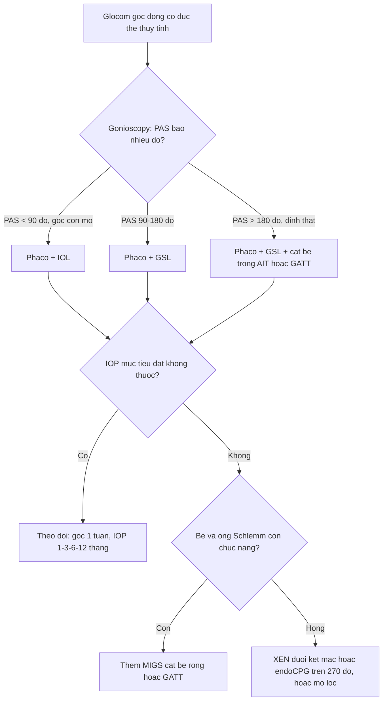
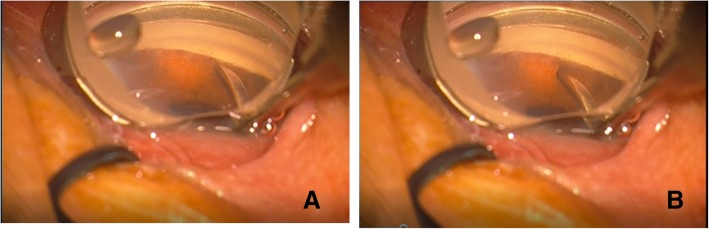
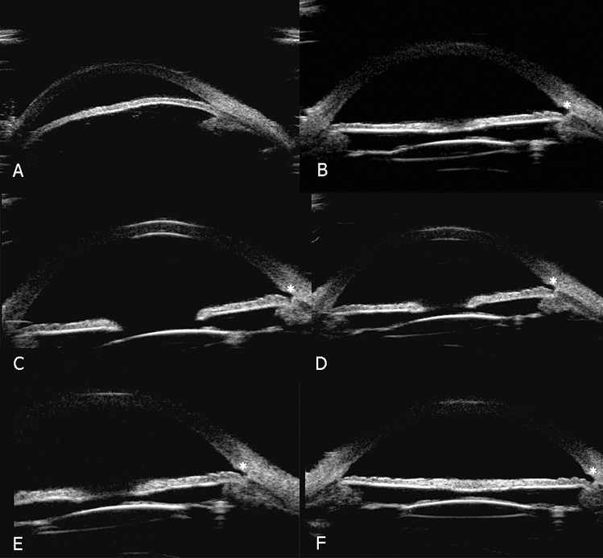
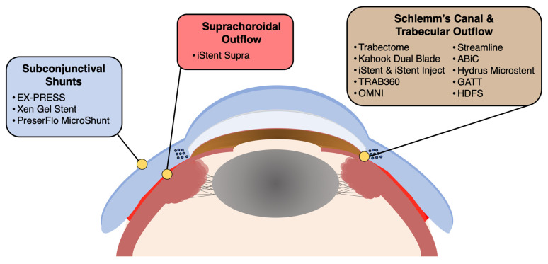

# 1985 — MIGS ở glôcôm góc đóng và góc hẹp: chọn bệnh nhân, goniosynechialysis, ghép phaco và biến chứng / Minimally invasive glaucoma surgery in primary angle-closure glaucoma

**Tags:** `pattern:goc-dong` `pattern:goc-hep` `pattern:PAS` `pattern:dinh-mong-mat-chu-bien` `pattern:tang-nhan-ap` `pattern:teo-dia-thi-glaucom` `vung:goc-tien-phong` `vung:tien-phong` `vung:the-thuy-tinh` `vung:mat` `protocol:gonioscopy` `protocol:UBM` `protocol:AS-OCT` `protocol:phaco` `protocol:gsl` `protocol:migs` `score:PAS-do`
**Mức chắc chắn (certainty):** tổng hợp y văn (literature synthesis) — ghép **1 phân tích gộp MIGS trong góc đóng 23 nghiên cứu / 875 mắt** (Paik et al., *Clin Ophthalmol* 2025, PMC11830760, CC BY-NC 3.0), **1 phân tích gộp phaco ± GSL + MIGS 12 nghiên cứu / 633 mắt** (PMC11966876, CC BY-NC-ND 4.0), **2 phân tích gộp phaco-GSL so với phaco đơn thuần** (8 RCT: PMC7899770; 9 RCT: PMC10836673), **1 đoàn hệ 27 mắt GSL ở góc đóng cấp và mạn** (PMC6399882), **1 loạt 22 mắt phaco + GSL + trabectome** (PMC8260581) và **1 loạt 47 mắt theo dõi 36 tháng** (PMC11704697). Chỗ suy luận ghi rõ "suy luận"; chỗ chưa có số liệu ghi "chưa rõ".

> **Vì sao bài này quan trọng:** glôcôm góc đóng chiếm **87% ca glôcôm ở người châu Á** và **70% ở nữ** (dẫn trong PMC11830760) — tức đây là thể bệnh phổ biến nhất ở nước ta, không phải "thể hiếm". MIGS vốn **được cấp phép cho góc mở** và **dùng ngoài nhãn (off-label)** cho góc đóng, nên câu hỏi không phải "có làm được không" mà là **"góc này có mở ra được không, mở bằng gì, và thêm MIGS có đáng so với phaco đơn thuần"**. Trả lời sai theo hai hướng đều tốn kém: **hứa hão** với bệnh nhân bằng một can thiệp chỉ cộng thêm **0,59 thuốc** (khoảng tin cậy vắt qua 0), hoặc **bỏ qua MIGS** ở mắt còn **PAS 180–360°** rồi phải mổ lọc.

## 1. Tổng quan bệnh học – cơ chế hình ảnh: vì sao góc đóng là bệnh của THỂ THỦY TINH, và vì sao MIGS chỉ là "phần phụ"

### 1.1 Vì sao góc đóng — và vì sao phaco một mình đã hạ được áp

- **Cơ chế lõi (lens-driven):** thể thủy tinh to ra theo tuổi (**lens vault** tăng) đẩy mống mắt ra trước, làm hẹp góc; ở mắt **trục nhãn cầu ngắn, tiền phòng nông, thể thủy tinh dày** thì góc đóng hẳn. Vì vậy **lấy thể thủy tinh = mở góc bằng cơ học**: tiền phòng sâu thêm, góc mở ra, và **IOP giảm khoảng 5 mmHg so với baseline sau washout** (số dẫn trong PMC11830760).
- **Pha 1 — góc đóng còn mở được:** dính **mống mắt–bè** chỉ là **tiếp xúc** (appositional), mở ra là hết.
- **Pha 2 — dính thật (synechial, PAS):** tiếp xúc kéo dài → **dính xơ**; lúc này lấy thể thủy tinh **không đủ** mở góc, phải **bóc dính (goniosynechialysis, GSL)**.
- **Pha 3 — bè/ống Schlemm đã hỏng:** tiếp xúc mống mắt–bè kéo dài gây **lắng sắc tố, thoái hóa không viêm, mất tế bào nội mô ống Schlemm và phản ứng xơ sửa chữa** — những thay đổi này **có cả ở vùng KHÔNG dính PAS** (tổng quan trong PMC11830760). Đây là lý do **IOP vẫn cao sau khi góc đã mở**, và là **cơ sở sinh lý để thêm MIGS**: bắc cầu qua bè bị hỏng.
- **Vì sao có mắt thất bại dù đã mở góc + MIGS:** nếu tắc nghẽn nằm **xa hơn** (ống Schlemm, kênh góp, áp lực tĩnh mạch củng mạc), thì **cắt bè hay đặt stent không giúp**; lúc đó phải nghĩ **XEN (dẫn dưới kết mạc)** hoặc **endoCPG (giảm sản xuất thủy dịch)**. Đây là **suy luận cơ chế có cơ sở**, không phải dữ liệu RCT.

### 1.2 Vì sao "thêm MIGS" là câu hỏi khó — con số phải nhớ

- **MIGS trong góc đóng có hiệu quả thật (23 nghiên cứu / 875 mắt; 15 nghiên cứu / 590 mắt vào phân tích gộp):** IOP giảm **7,71 mmHg** (95% CI 5,16–10,26) và **giảm 1,57 thuốc** (1,17–1,96) ở 1 năm (PMC11830760).
- **Phaco ± GSL + MIGS (12 nghiên cứu / 633 mắt):** IOP giảm **10,25 mmHg** (7,06–13,43), **giảm 1,89 thuốc** ở 12 tháng; IOP từ **25,85 → 14,10 mmHg**, thuốc từ **2,50 → 0,60** (PMC11966876).
- **Phaco-MIGS so với phaco đơn thuần (5 nghiên cứu / 492 bệnh nhân):** chênh lệch **IOP 1,22 mmHg** (95% CI **−0,96 đến 3,39** — **vắt qua 0**) và chênh lệch **thuốc 0,59** (95% CI **−0,04 đến 1,22** — **sát 0**) (PMC11830760). **Nói thẳng:** phần lớn IOP giảm đến từ **lấy thể thủy tinh**; MIGS cộng thêm **khiêm tốn và chưa chắc có ý nghĩa**.
- **Chọn loại MIGS nào (cùng phân tích gộp):** **cắt bè trong (ab interno trabeculotomy, AIT)** giảm IOP **11,48 mmHg** (7,12–15,83) — **tốt hơn iStent 4,12 mmHg** (−0,39 đến 8,62; p < 0,01) và tốt hơn endoCPG; **iStent vs endoCPG không khác** (p = 0,14). Về thuốc: **AIT 2,38** > endoCPG 1,46 > iStent 1,10 (p < 0,01) (PMC11830760).
- **Nhóm theo kỹ thuật (12 nghiên cứu):** **goniotomy 13,10 mmHg** (7,59–18,62), **GATT 11,54** (7,18–15,90), **iStent 3,94** (2,58–5,30) (PMC11966876) — cùng một xu hướng: **cắt bè rộng > stent nhỏ**.
- **GSL có đáng làm?** So với phaco đơn thuần: **8 RCT (224 vs 236 mắt)** — IOP và số thuốc **không khác** ở 6 và 12 tháng, nhưng **PAS giảm nhiều hơn** (PMC7899770). **9 RCT** — IOP thấp hơn **1,81 mmHg** (p = 0,002), **PAS giảm 59,15°** (p < 0,00001), không khác AOD500/750, TISA500, thuốc, thị lực (PMC10836673). **Kết luận thực hành:** GSL là **can thiệp vào cơ chế** (giảm PAS, ngăn tái dính) hơn là "thuốc hạ áp mạnh".

### 1.3 GSL ở góc đóng cấp vs mạn: cùng mổ, khác kết cục

- **27 mắt phaco-GSL có PAS lan rộng** (13 cấp, 14 mạn): IOP **29,77 ± 11,55 → 14,92 ± 1,66 mmHg** (cấp) và **26,00 ± 11,20 → 14,93 ± 2,70 mmHg** (mạn); PAS **314,23 ± 49,07° → 116,54 ± 73,78°** (cấp) và **285,00 ± 53,28° → 156,43 ± 56,35°** (mạn) (PMC6399882).
- **Thành công 100% (cấp) vs 64,3% (mạn)**; **tái dính PAS 30% vs 83,3%**; **5 mắt tái dính > 90°** và **tất cả hình thành trong TUẦN ĐẦU sau mổ** (PMC6399882). Đây là con số định hình cách theo dõi: **khám góc lại trong 7 ngày đầu**, không phải 1 tháng.
- **Ghép thêm trabectome (22 mắt):** IOP **22,07 ± 6,62 → 15,06 ± 3,39 mmHg**, thuốc **2,68 ± 1,17 → 0,78 ± 0,73**, thành công **88,9%** ở 12 tháng, không biến chứng đe dọa thị lực (PMC8260581).
- **Theo dõi 36 tháng (47 mắt phaco + GSL + AIT):** IOP **20,93 ± 6,53 → 15,09 ± 3,63 mmHg**, thuốc **2,45 ± 1,18 → 1,25 ± 1,55**, thành công **90,0%**; mức giảm IOP **tương quan thuận với IOP nền** (p < 0,001) (PMC11704697). **Nghĩa là:** mắt có IOP nền càng cao hưởng lợi càng nhiều — đừng chọn MIGS cho mắt IOP 16 mmHg rồi kỳ vọng nhiều.

## 2. Mẫu hình + chẩn đoán phân biệt theo giai đoạn và hình thái góc (gamut)

**Bốn câu hỏi trước khi quyết định:** **(1) góc đóng kiểu gì (tiếp xúc hay dính thật, bao nhiêu độ)? (2) bè/ống Schlemm còn chức năng hay đã hỏng? (3) thể thủy tinh còn hay đã thay? (4) mục tiêu IOP cần giảm bao nhiêu?**

- **Theo giai đoạn:**
  1. **PACS (nghi ngờ góc đóng):** góc hẹp, chưa tăng áp, chưa teo thị — **không** có chỉ định MIGS; theo dõi/ LPI theo chỉ định.
  2. **PAC (góc đóng, chưa glôcôm):** LPI ± phaco; **chưa** cần MIGS.
  3. **PACG mạn, còn thị trường, PAS < 180°, còn thể thủy tinh:** **phaco ± GSL**, thêm MIGS nếu muốn giảm thuốc; **đây là nhóm bằng chứng tốt nhất** cho MIGS.
  4. **PACG mạn, PAS 180–360°, IOP cao:** **phaco + GSL + AIT/GATT** (cắt bè rộng) — nhóm hưởng lợi nhiều nhất, nhưng **tái dính cao (83,3%)**.
  5. **PACG giai đoạn cuối, thị trường rất hẹp:** mục tiêu là **IOP thấp tuyệt đối** → **mổ lọc/tube** thường phù hợp hơn MIGS; **endoCPG** là lựa chọn khi không còn cách nào (xem thêm [1448](../1448-glaucoma-ac-tinh-sau-mo-noi-nhan/lesson.md) cho biến chứng).
- **Theo hình thái góc (mẫu hình hình ảnh):**
  - **Góc đóng do tiếp xúc:** mống mắt chạm bè nhưng **bờ dính mềm, mở được khi ấn đèn soi góc (indentation)**.
  - **Góc đóng do dính:** **dải xơ trắng–xám** bắc qua góc, **không mở khi ấn**; đo **số độ PAS** là ngôn ngữ chung giữa các nghiên cứu.
  - **Góc đóng + thể thủy tinh dày:** trên **UBM** thấy **lens vault** lớn, thể mi đẩy ra trước, tiền phòng nông đều.
  - **Góc đóng sau phaco mà IOP vẫn cao:** nghĩ **bè hỏng** (pha 3) — cần **MIGS cắt bè** hoặc chuyển sang **dẫn lưu dưới kết mạc/endoCPG**, không lặp lại GSL vô ích.
- **Đo góc bằng gì:** **gonioscopy ấn (indentation) là chuẩn vàng lâm sàng**; **AS-OCT/UBM** định lượng **AOD500/750, TISA500/750, độ mở góc, lens vault**; **không** thay thế gonioscopy vì AS-OCT không phân biệt được dính thật với tiếp xúc ở mọi vị trí.

## 3. Bảng so sánh phân biệt (ma trận đối chiếu): chọn can thiệp nào cho góc đóng

| Thực thể / kỹ thuật | Hình ảnh & chỉ định điển hình | Chốt vào (rule-in) | Chốt loại (rule-out) | Gợi ý xác nhận |
|---|---|---|---|---|
| **Phaco đơn thuần** | Góc hẹp do thể thủy tinh, PAS **< 90–180°**, chưa teo thị nặng | **Góc mở rộng sau khi lấy thể thủy tinh + IOP giảm ~5 mmHg so baseline washout** | PAS **≥ 180°** dính thật, bè đã hỏng → **không đủ** | Gonioscopy trước/sau; IOP không thuốc 3–6 tháng |
| **Phaco + GSL** | Góc đóng **dính thật**, PAS lan rộng, còn thể thủy tinh | **PAS ≥ 180°, mở được bằng bóc dính; IOP giảm 1,8 mmHg và PAS giảm ~59° so với phaco đơn thuần** | **Không có PAS** (làm thêm vô ích) hoặc góc đóng **do khối sau** (u, nang) | Gonioscopy **trong mổ** + đo PAS 1 tuần, 1 tháng |
| **AIT / goniotomy (KDB, trabectome)** | PAS vừa–nhiều, bè còn nhưng tắc; cần giảm thuốc | **IOP giảm 11,5–13,1 mmHg; hiệu quả hơn iStent có ý nghĩa (p < 0,01)** | **Mắt đã mất hết vùng bè quan sát được**; IOP mục tiêu rất thấp | Nội soi góc trong mổ; theo dõi máu tiền phòng |
| **GATT (360°)** | Dính góc lan rộng, cần mở 360°, mắt còn thể thủy tinh hoặc đã phaco | **GATT giảm 11,54 mmHg; máu tiền phòng 33,2% — cao nhất nhóm** | **Góc không quan sát được / mống mắt dày**; mắt viêm hoạt động | Gonioscopy sau mổ, kiểm tra vòng cắt 360° |
| **iStent / stent bè nhỏ** | Góc mở được, PAS ít, cần giảm **thuốc** hơn là giảm IOP | **Giảm 3,94 mmHg + 1,1–1,2 thuốc; biến chứng thấp nhất (máu 6,1%)** | PAS nhiều, **áp lực tĩnh mạch củng mạc cao**, cần giảm IOP lớn | AS-OCT kiểm tra vị trí stent; soi góc tìm bít lỗ |
| **endoCPG** | Góc đóng không mở được hết, nhiều tuổi, không muốn mổ lọc | **Giảm IOP nhờ giảm sản xuất; hiệu quả khi điều trị ≥ 270°** | **Chưa điều trị đủ 270°** (kém hiệu quả); mắt còn khả năng phục hồi thị lực cao | Đèn khe/soi đáy mắt theo dõi viêm, phù hoàng điểm |
| **XEN / PreserFlo (dưới kết mạc)** | Cần **IOP rất thấp**, bè và ống Schlemm đều hỏng | **Dẫn lưu bỏ qua toàn bộ đường bè–Schlemm** | Góc đóng **chưa xử lý** (nguy cơ bít đầu trong), kết mạc xấu | Đèn khe bọng lọc, AS-OCT bọng |

## 4. Protocol: đo góc – mổ – theo dõi tuần đầu

### 4.1 Trước mổ

- **Gonioscopy ấn 4 góc**, ghi **số độ PAS từng góc** (tổng 0–360°), phân biệt **tiếp xúc vs dính**; chụp ảnh góc để so sánh sau mổ.
- **AS-OCT/UBM:** **AOD500, TISA500, độ mở góc, lens vault, chiều sâu tiền phòng (ACD)**. Ngưỡng "đóng" **phụ thuộc định nghĩa từng nghiên cứu** (AOD500 ≈ 0 là đóng hoàn toàn; nhiều nghiên cứu dùng **AOD500 < 0,20 mm** cho "hẹp") — **luôn ghi định nghĩa** khi đối chiếu số.
- **Sinh trắc (biometry):** **AL, ACD, độ dày thể thủy tinh, lens vault** — quyết định **có nên phaco trước** và **công suất IOL**.
- **Đánh giá thần kinh thị:** **RNFL/GC-IPL, thị trường** làm mốc; mắt đã mất nhiều thần kinh thì **mục tiêu IOP phải thấp hơn**, đừng chọn MIGS "nhẹ".

### 4.2 Trong mổ (thứ tự có ý nghĩa)

1. **Phaco + IOL trước** — mở góc bằng cơ học, tiền phòng sâu, **tạo không gian làm việc** cho MIGS.
2. **GSL** — bóc dính mống mắt–bè bằng spatula/OVD dưới quan sát gonioscopy; **bóc hết dính thấy được**, tránh chảy máu nhiều.
3. **MIGS** — AIT/goniotomy/GATT hoặc stent, chọn theo **độ dính và mục tiêu IOP** (mục 3).
4. **Kiểm tra góc cuối mổ**, **không để OVD sót** (gây tăng IOP và dính lại); **không bơm quá căng**.

### 4.3 Theo dõi — tuần đầu là tuần quyết định

- **Ngày 1–7:** đo IOP, soi góc lại (**tái dính hình thành trong tuần đầu**, 5 mắt tái dính > 90° trong PMC6399882), kiểm tra máu tiền phòng.
- **1 tháng, 3 tháng, 6 tháng, 12 tháng:** IOP không thuốc, số thuốc, **số độ PAS**, RNFL/thị trường.
- **Ngưỡng hành động thực hành:** IOP **> 21 mmHg** kéo dài **> 4–6 tuần** dù đã mở góc → khởi động lại thuốc; **PAS tái dính > 90°** trong tuần đầu → cân nhắc **bóc lại/iridoplasty** (2 mắt trong PMC11830760 phải **argon laser iridoplasty** vì PAS tái phát tại vùng đã cắt bè).

## 5. Biến thể bình thường và cạm bẫy

- **Máu tiền phòng "gần 100%" không phải biến chứng.** Ở AIT, máu tiền phòng thoáng qua gặp **tới gần 100%** trong một số loạt; sau khi loại máu thoáng qua tự hết, tỉ lệ biến chứng chung còn **141/820 = 17,2%** (so với **293/875 = 33,4%** nếu tính cả máu thoáng qua) (PMC11830760). **Đừng** báo bệnh nhân "đã có biến chứng" vì một chút máu ngày 1.
- **Tăng IOP thoáng qua sau AIT/GATT (4,9–7,4%)** thường đáp ứng thuốc; **phân biệt** với tăng IOP do **OVD sót, viêm, hoặc dính lại góc**.
- **Tái dính PAS là kẻ thù chính, không phải "thất bại kỹ thuật".** **83,3%** ở góc đóng mạn có PAS lan rộng, hình thành **trong 7 ngày** (PMC6399882) — nếu không soi góc lại sớm, bạn sẽ chỉ phát hiện khi IOP đã tăng.
- **Stent bị mống mắt bít:** tỉ lệ **tới 27%** trong một nghiên cứu (dẫn trong PMC11830760) — vì vậy **iStent cho kết quả kém hơn AIT** ở góc đóng; đừng chọn stent nhỏ cho góc còn hẹp.
- **"Phaco đã đủ" — đúng một nửa.** Chênh lệch thuốc của phaco-MIGS so với phaco là **0,59** với CI **−0,04 đến 1,22** — tức **có thể bằng 0**. Nếu bệnh nhân chỉ cần giảm 1 thuốc và chấp nhận uống/nhỏ thuốc, **phaco đơn thuần là lựa chọn hợp lý**, rẻ hơn và ít biến chứng hơn.
- **MIGS là off-label ở góc đóng:** phải **giải thích rõ** với bệnh nhân và ghi hồ sơ (PMC11830760 nêu rõ điều này); không được trình bày như chỉ định đã được cấp phép.
- **Cạm bẫy chọn bệnh nhân:** IOP nền càng cao, lợi ích càng lớn (tương quan thuận, p < 0,001; PMC11704697); **mắt IOP 16 mmHg, thị trường còn tốt** là nhóm **ít lợi** nhất từ MIGS.
- **Cạm bẫy "cắt bè càng rộng càng tốt":** endoCPG **dưới 270° không đủ hiệu quả**; nhưng cắt quá rộng ở mắt teo thể mi có nguy cơ **teo nhãn** — cân bằng, không cực đoan.
- **Không dùng MIGS khi:** **áp lực tĩnh mạch củng mạc cao** (giả u, hội chứng tĩnh mạch chủ trên, glôcôm tân mạch), **glôcôm do viêm hoạt động**, hoặc **không quan sát được góc** trong mổ.

## 6. Tự lượng giá — Blind Quiz

**Ca 1 — Nữ 64 tuổi, châu Á, đau mắt đã hết sau LPI, IOP 28 mmHg với 3 thuốc, đục thể thủy tinh độ 2, góc dính 300°.**

- Hỏi: (1) mô tả (A) và (B); (2) vì sao phaco đơn thuần **không đủ** ở mắt này? (3) kế hoạch mổ và mốc theo dõi?

<b>Bấm để hiện đáp án (findings + chẩn đoán)</b>

- **(A)** góc **đóng dính (synechial)** — dải xơ bắc qua bè, **không mở khi ấn**; **(B)** sau **phaco + GSL** góc **mở lại**, thấy được bè ở cùng vị trí.
- **Không đủ vì:** PAS **300° là dính thật**, và tiếp xúc kéo dài đã làm **hỏng bè/ống Schlemm** — lấy thể thủy tinh chỉ mở góc, **không sửa được bè**; IOP vẫn cao.
- **Kế hoạch:** **phaco + IOL + GSL ± AIT/GATT**; theo dõi **góc trong 7 ngày** (tái dính tới 83,3% ở thể mạn), rồi IOP 1–3–6–12 tháng. Ca gốc (27 mắt): thành công **100% cấp / 64,3% mạn** (PMC6399882).
- Nguồn ảnh: Tian T et al., *BMC Ophthalmol* 2019 (PMC6399882), CC BY 4.0 — nguyên bản.

**Ca 2 — Nam 71 tuổi, PACG mạn, IOP 22 mmHg, 2,7 thuốc, góc hẹp 4 góc; được phaco + GSL + trabectome.**

- Hỏi: (1) đọc chuỗi A–F; (2) dấu hiệu nào chứng minh góc đã mở **thật** (không chỉ do thuốc)? (3) kết quả kỳ vọng ở 12 tháng?

<b>Bấm để hiện đáp án (findings + chẩn đoán)</b>

- **(A)** tiền phòng **nông**, góc **hẹp/đóng**, thể thủy tinh dày đẩy mống mắt ra trước; **(B–F)** sau phaco + IOL + GSL + trabectome: **tiền phòng sâu hơn**, **khoảng mở góc rộng**, mống mắt tách khỏi bè.
- **Chứng minh góc mở thật:** đo **AOD500/TISA500 tăng** + **gonioscopy thấy bè**; **không** dựa vào IOP vì IOP còn chịu ảnh hưởng thuốc và MIGS.
- **Kỳ vọng (22 mắt):** IOP **22,07 → 15,06 mmHg**, thuốc **2,68 → 0,78**, thành công **88,9%** ở 12 tháng, không biến chứng đe dọa thị lực (PMC8260581).
- Nguồn ảnh: Wang Y et al., *Sci Rep* 2021 (PMC8260581), CC BY 4.0 — nguyên bản.

**Ca 3 — Nam 68 tuổi, PACG, thể thủy tinh đã thay, IOP 17 mmHg với 3 thuốc, góc còn dính 120°; bệnh nhân hỏi "có nên làm MIGS không?".**

- Hỏi: (1) kể tên 3 nhóm MIGS theo hình và vị trí; (2) với IOP 17 mmHg và góc dính 120°, MIGS đem lại gì và **không** đem lại gì? (3) khi nào nên chọn nhóm dưới kết mạc thay vì nhóm bè?

<b>Bấm để hiện đáp án (findings + chẩn đoán)</b>

- **Ba nhóm:** **(1) ống Schlemm/bè** (Trabectome, Kahook, iStent/iStent inject, Hydrus, GATT, OMNI, ABiC); **(2) trên hắc mạc** (iStent Supra, MINIject, CyPass); **(3) dưới kết mạc** (XEN, PreserFlo, Ex-PRESS) — cộng thêm **giảm sản xuất** (endoCPG).
- **Đem lại:** giảm **thuốc** là chắc hơn giảm IOP (**0,59 thuốc**, CI sát 0); giảm IOP trung bình **khiêm tốn** (1,22 mmHg, CI vắt qua 0) (PMC11830760). **Không đem lại:** bảo đảm IOP thấp tuyệt đối; ở IOP nền 17 mmHg, lợi ích **ít** (giảm IOP tương quan thuận với IOP nền; PMC11704697).
- **Chọn nhóm dưới kết mạc khi:** bè **và** ống Schlemm đều hỏng (IOP vẫn cao sau khi góc đã mở), cần **IOP rất thấp**, hoặc đã thất bại AIT/GATT; **không** chọn khi kết mạc xấu hoặc góc chưa xử lý.
- Nguồn ảnh: Balas M, Mathew DJ, *Vision (Basel)* 2023 (PMC10443347), CC BY 4.0 — nguyên bản.

## Bài liên quan chéo
- [1452 – Glôcôm do thể thủy tinh chưa mổ](../1452-glaucom-do-the-thuy-tinh-chua-mo/lesson.md) (cơ chế lens-driven và các thể tăng áp do thể thủy tinh)
- [1935 – Đục thể thủy tinh sau MIGS](../1935-duc-the-thuy-tinh-sau-migs/lesson.md) (phaco trên mắt đã có MIGS)
- [1983 – Đục thể thủy tinh sau trabeculectomy](../1983-duc-the-thuy-tinh-sau-trabeculectomy/lesson.md) (khi MIGS không đủ, mổ lọc và cái giá của nó)
- [1448 – Glôcôm ác tính sau mổ nội nhãn](../1448-glaucoma-ac-tinh-sau-mo-noi-nhan/lesson.md) (biến chứng cần loại trừ sau mọi can thiệp góc)
- [1447 – Rách thể mi sau MIGS/Yamane](../1447-rach-the-mi-sau-migs-va-yamane/lesson.md) (biến chứng tiền phòng của thủ thuật góc)
- [442 – Glaucoma: OCT và đánh giá thần kinh thị](../442-glaucoma-OCT/lesson.md) (mốc thần kinh thị để đặt mục tiêu IOP)
- [1882 – Phù hoàng điểm do prostaglandin sau phaco](../1882-phu-hoang-diem-prostaglandin-sau-phaco/lesson.md) (mắt sau phaco xấu đi: loại trừ nguyên nhân thuốc)

> Không dùng để chẩn đoán độc lập khi chưa có người hướng dẫn.
