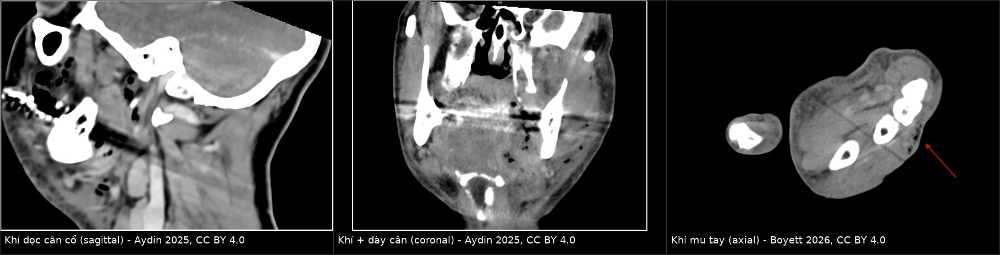
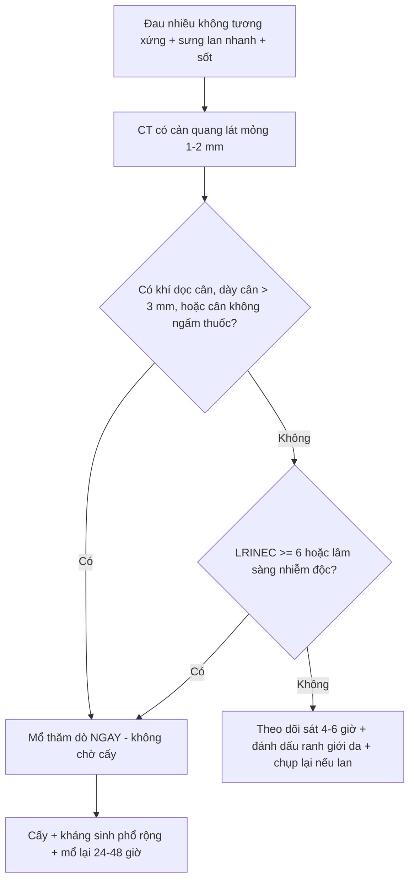
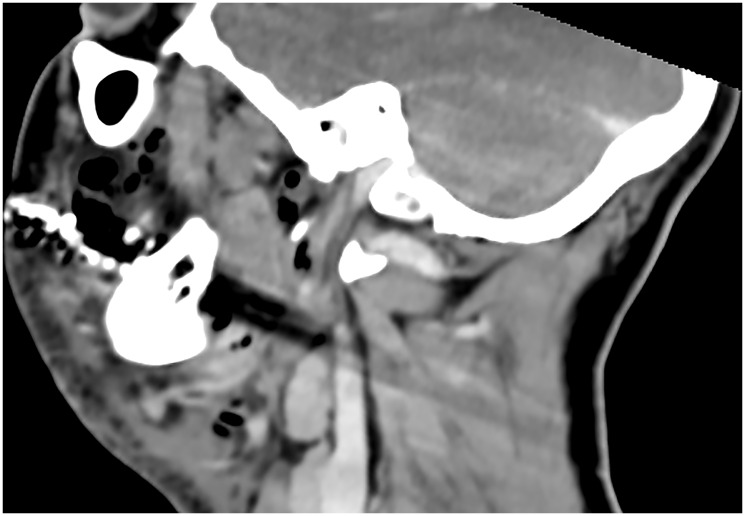
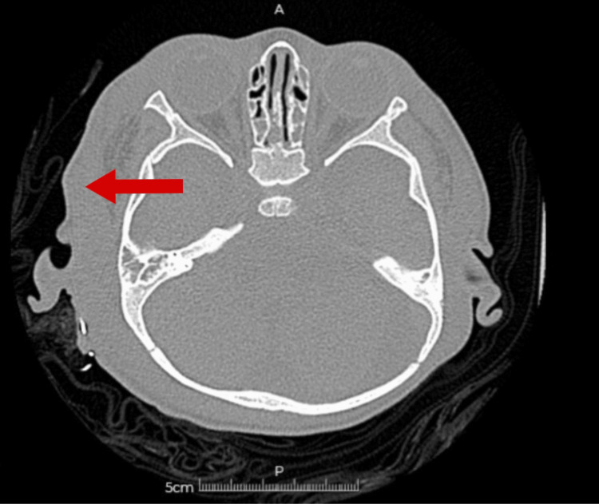
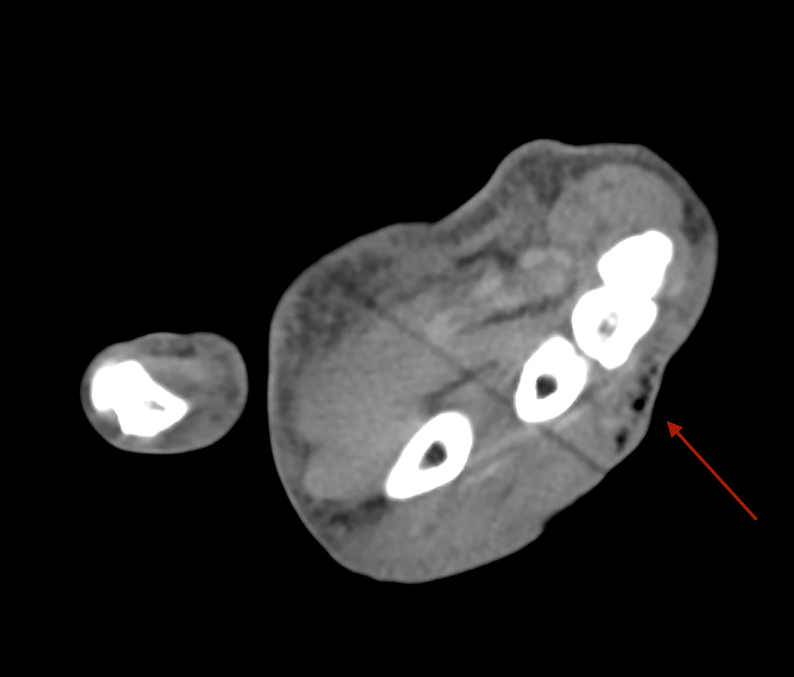

# 1986 — Viêm mô hoại tử ở trẻ: khi nào mổ KHÔNG chờ hình ảnh / Paediatric necrotizing fasciitis

**Tags:** `pattern:khi-trong-mo-mem` `pattern:day-can` `pattern:khong-ngam-thuoc` `pattern:o-dich-mo-mem` `vung:mo-mem` `vung:co` `vung:chi` `score:LRINEC` `protocol:CT-co-can-quang`

**Mức chắc chắn (certainty):** tổng hợp y văn (literature synthesis) — biên từ tổng quan **Aydin 2025** (*Oncoscience*, **PMC12723960**, CC BY 4.0), ca lâm sàng **Boyett 2026** (*Cureus*, **PMC13592732**), ca trẻ **9 tuổi** (**PMC11620763**), ca **16 tháng** đa ổ (**PMID 40526874**), ca mí mắt sau thủy đậu (**PMC12538151**) và ca trẻ ở nước đang phát triển (**PMC12919948**). Nhóm **không có bệnh nhân của mình**.

> **Câu chốt:** viêm mô hoại tử (necrotizing fasciitis, NF) là **cấp cứu ngoại khoa theo giờ**, không phải theo ngày. Hình ảnh chỉ có một nhiệm vụ: **tìm bằng chứng hoại tử cân để mổ sớm**, chứ **không dùng để loại trừ** — khí trong mô mềm chỉ có ở một phần ca, và **CT thiếu khí vẫn có thể là NF**.

## 1. Tổng quan bệnh học – cơ chế hình ảnh (TẠI SAO)

### 1.1 Sinh lý bệnh: cân là "khoang áp lực thấp" không có tuần hoàn dự phòng

- Vi khuẩn (nhóm A *Streptococcus*, tụ cầu, vi khuẩn kỵ khí, *Clostridium* sinh khí) xâm nhập qua **cửa vào da** — ở trẻ nhỏ, **thủy đậu (varicella)** là cửa vào kinh điển; ở sơ sinh là **viêm rốn (omphalitis)**; ở trẻ lớn là **áp-xe răng/nhiễm trùng hô hấp trên**.
- Độc tố (streptolysin, exotoxin) gây **huyết khối vi mạch** → cân và mô dưới da **thiếu máu nuôi** → hoại tử lan dọc **mặt phẳng cân** nhanh hơn nhiều so với lan ngang qua da. Vì vậy **da bề mặt có thể "trông chỉ hơi đỏ"** trong khi cân bên dưới đã hoại tử.
- **Đau nhiều không tương xứng** là do **thiếu máu thần kinh nông**; khi thần kinh đã chết, đau **giảm** và da **mất cảm giác** — dấu hiệu muộn, không phải dấu hiệu loại trừ.

### 1.2 Cơ chế hình ảnh: tại sao CT thấy dày cân, dịch và khí

- **Dày cân (fascial thickening):** phù viêm + thâm nhiễm tế bào làm cân dày; ngưỡng thực hành thường dùng là **> 3 mm** tại chỗ dày nhất (đo trên cửa sổ mô mềm).
- **Dịch dọc cân (fluid tracking):** mủ/phù lan theo **mặt phẳng cân** — biểu hiện là dải giảm đậm độ **chạy dọc theo cân**, khác với dịch khu trú trong một ổ áp-xe.
- **Không ngấm thuốc (non-enhancing fascia):** huyết khối vi mạch làm vùng cân **không tăng đậm độ sau cản quang** — dấu hiệu **hoại tử**, mạnh hơn "dày cân" đơn thuần.
- **Khí trong mô mềm:** chỉ sinh ra khi có **vi khuẩn sinh khí** (điển hình *Clostridium*, một số *E. coli*/kỵ khí). Vì vậy **khí chỉ gặp ở khoảng 20–50% ca** (các loạt khác nhau, chưa thống nhất) — **không có khí KHÔNG loại trừ NF**. Ngược lại, ở **vùng đầu–cổ**, vi khuẩn sinh khí **ít gặp hơn** ở chi/thân nên khí càng hiếm (Aydin 2025).
- **Đậm độ khí trên CT:** khoảng **−1.000 HU** (đen tuyệt đối), dễ nhận hơn nhiều so với khí lẫn trong mô viêm; khí **trong bao khớp/cạnh khớp** hoặc **dưới da do chấn thương** là các bẫy quen thuộc.

### 1.3 Ngưỡng định lượng cần nhớ

- **Tử vong nội viện của NF nói chung: 11–30%**, **cắt chi 7–22%** (phân tích toàn quốc Đức 2019–2024, **PMID 42384437**).
- **NF vùng đầu–cổ: < 5% tổng số NF**, nhưng **tử vong 10–30%** (Aydin 2025, **PMC12723960**).
- **NF ở trẻ:** hiếm; tử vong **thấp hơn người lớn** nhưng **chưa có con số thống nhất — chưa rõ, cần tra** (các đoàn hệ nhi đều nhỏ).
- **Mỗi giờ chậm mổ** đều làm tăng tử vong; **mổ lại trong 24–48 giờ** là quy tắc, không phải ngoại lệ (Aydin 2025).

## 2. Mẫu hình + chẩn đoán phân biệt theo vị trí (gamut)

- **Chi (hay gặp nhất ở trẻ):** NF chi thể · viêm mô tế bào (cellulitis) · áp-xe cơ/cân · viêm cơ (pyomyositis) · viêm cân hoại tử sau chấn thương/tiêm.
- **Đầu–cổ:** NF cổ–mặt (nguồn răng, hầu, tuyến mang tai) · viêm khoang cổ sâu/áp-xe · Ludwig angina · hạch viêm · viêm tuyến mang tai.
- **Thành bụng – rốn:** NF thành bụng (sơ sinh: viêm rốn) · áp-xe thành bụng · tụ máu bao cơ thẳng · thoát vị nghẹt.
- **Tầng sinh môn:** Fournier · áp-xe tuyến Bartholin/ống hậu môn · viêm mô tế bào.
- **Mẫu hình "khí trong mô mềm" (không chỉ NF):** NF · viêm mô tế bào sinh khí · áp-xe sinh khí · khí do **chấn thương/can thiệp** (vết thương hở, sau tiêm, sau mổ) · khí từ **tạng rỗng vỡ** (thực quản, ruột) · khí trong **bao khớp** sau vết thương · khí do **oxy áp lực cao/thiết bị**.

## 3. Bảng so sánh phân biệt (ma trận đối chiếu)

| Thực thể (entity) | Hình ảnh điển hình (CT có cản quang) | Chốt vào (rule-in) | Chốt loại (rule-out) | Gợi ý xác nhận |
|---|---|---|---|---|
| **Viêm mô hoại tử (NF)** | Dày cân **> 3 mm** + dịch **dọc mặt phẳng cân** + **khí** (20–50%) + **cân không ngấm thuốc** | **Khí dọc cân + dày cân + đau không tương xứng + nhiễm độc** | **Không có khí / CT sớm bình thường KHÔNG loại trừ** | Mổ thăm dò + cấy; CT chỉ để định mức lan |
| Viêm mô tế bào (cellulitis) | Dày mô dưới da, **phù dạng lưới**, **không có dịch dọc cân**, cân **ngấm thuốc bình thường** | Phù nông, không khí, không tụ dịch | **Dịch dọc cân + cân không ngấm = nghi NF** | Đánh dấu ranh giới da + theo dõi 4–6 giờ |
| Áp-xe mô mềm | Ổ dịch **khu trú có vỏ** ngấm thuốc, có thể có khí trong ổ | Ổ dịch khu trú + vỏ ngấm thuốc | **Dịch lan dọc cân không vỏ = không phải áp-xe đơn thuần** | Chọc hút/dẫn lưu |
| Viêm cơ (pyomyositis) | Cơ **sưng, giảm đậm độ, ngấm thuốc không đều**, có thể áp-xe trong cơ | Tổn thương **trong cơ**, cân còn ngấm thuốc | **Tổn thương cân + mô dưới da là chính = NF** | MRI/SA + cấy dịch cơ |
| Khí mô mềm do chấn thương/can thiệp | Khí **dọc đường vào**, không dày cân, không dịch, bệnh nhân **không nhiễm độc** | Bối cảnh chấn thương/thủ thuật + khí đơn thuần | **Sốt + đau tăng + CRP cao + dày cân = không quy cho chấn thương** | Hỏi bệnh sử + theo dõi 6–12 giờ |

*Trái: khí dọc cân cổ (mặt cắt dọc). Giữa: khí + dày cân (mặt cắt vành). Phải: khí mu tay (mặt cắt ngang, mũi tên đỏ). Ảnh ghép letterbox, giữ nguyên tỉ lệ — nguồn và giấy phép từng ảnh trong `images/CREDITS.md`.*

## 4. Protocol chụp + hệ phân độ/điểm chuẩn hóa

### 4.1 Protocol CT (không chờ MRI)

- **CT có cản quang tĩnh mạch** là lựa chọn đầu tay ở cấp cứu: nhanh, rộng, phát hiện **khí, dày cân, dịch dọc cân, mất ngấm thuốc** (Aydin 2025).
- **Lát mỏng 1–2 mm**, cửa sổ mô mềm; **phủ toàn bộ vùng sưng + một khớp ở trên và dưới** để không bỏ sót lan dọc.
- **MRI** có độ tương phản mô mềm tốt hơn nhưng **chậm và khó tiếp cận** trong cấp cứu → **không dùng để trì hoãn mổ**.
- **Siêu âm** có thể thấy dày cân/dịch nhưng **không loại trừ** và phụ thuộc người làm.
- **X-quang** chỉ thấy khí khi đã muộn — **không dùng để quyết định**.

### 4.2 LRINEC — dùng đúng, đừng tin tuyệt đối

| Biến | Ngưỡng | Điểm |
|---|---|---|
| CRP | ≥ 150 mg/L | 4 |
| Bạch cầu | 15–25 × 10⁹/L | 1 |
| Bạch cầu | > 25 × 10⁹/L | 2 |
| Hemoglobin | 11–13,5 g/dL | 1 |
| Hemoglobin | < 11 g/dL | 2 |
| Natri | < 135 mmol/L | 2 |
| Creatinin | > 141 µmol/L | 2 |
| Glucose | > 10 mmol/L | 1 |

- **Tổng ≥ 6 = nguy cơ cao; ≥ 8 = nguy cơ rất cao.** Trong nghiên cứu ban đầu, **≥ 6 có giá trị dự báo dương ~92%**.
- **Hạn chế:** độ nhạy giảm ở **giai đoạn sớm**, ở **trẻ nhỏ**, và đặc biệt ở **vùng đầu–cổ** (Aydin 2025) → **LRINEC < 6 KHÔNG loại trừ NF**; điểm số **không được thay thế quyết định mổ**.

## 5. Biến thể bình thường và cạm bẫy

- **Khí sau chấn thương/tiêm/sau mổ** là bẫy hay gặp nhất: khí **đơn thuần, không dày cân, không dịch** ở trẻ **tỉnh, không sốt** → theo dõi; nhưng **không được dùng bối cảnh chấn thương để giải thích mọi khí** khi có sốt và đau tăng.
- **CT sớm bình thường:** trong **6–12 giờ đầu**, phù và khí có thể chưa đủ để thấy → **âm tính không loại trừ**; bệnh nhân nghi ngờ cao phải **mổ thăm dò**.
- **Không có khí:** nhớ **20–50%** ca NF không có khí; đừng chờ khí mới mổ.
- **Da "trông nhẹ":** đỏ nhẹ + đau dữ dội + sốt là **tam chứng nguy hiểm**; ngược lại **da tím/bóng nước** là dấu hiệu muộn.
- **Satisfaction of search:** thấy một ổ áp-xe rõ ràng **không được dừng lại** — phải đọc **toàn bộ mặt phẳng cân** lân cận và các khoang xa (trung thất, hốc mắt, khoang dưới móng).
- **Trẻ nhỏ không mô tả được đau:** thay bằng **khóc khi chạm, không chịu cử động chi, bỏ ăn, li bì** — giá trị cao hơn "đau không tương xứng" ở người lớn.

## 6. Tự lượng giá — Blind Quiz

**Ca 1 — Trẻ 9 tuổi, sốt 2 ngày, sưng đau vùng cổ bên, đầu cổ hơi nghiêng. CT có cản quang mặt cắt dọc:**

- Gợi ý: không chấn thương, không răng sâu rõ; CRP 210 mg/L, bạch cầu 22 × 10⁹/L.
- Hỏi: có bao nhiêu loại khí/dịch bất thường? Chúng nằm ở khoang nào? Ba chẩn đoán phân biệt và dấu hiệu nào buộc mổ ngay?

<b>Bấm để hiện đáp án (findings + chẩn đoán)</b>

- Dấu hiệu: **nhiều ổ khí đen (−1.000 HU)** rải dọc **mặt phẳng cân sâu vùng cổ**, kèm **dày cân** và **dịch chạy dọc** từ trên xuống; **không có vỏ ổ áp-xe**.
- Chẩn đoán: **viêm mô hoại tử cổ–mặt (cervicofacial NF)** — khí + dày cân + dịch dọc cân là bộ ba chốt.
- Vì sao mổ ngay: dịch lan **theo mặt phẳng cân** (không khu trú) + nhiễm độc + đường thở sát bên → **mổ thăm dò + cấy + kháng sinh phổ rộng**, đồng thời **bảo vệ đường thở**.
- Nguồn: Aydin et al. 2025, *Oncoscience*, Fig. 1, **PMC12723960**, **CC BY 4.0**.

**Ca 2 — Trẻ 4 tuổi, sau thủy đậu 5 ngày, sưng đau trên ổ mắt phải, CT sọ không cản quang:**

- Hỏi: mũi tên đỏ chỉ cái gì? Vì sao vùng giảm đậm độ này quan trọng hơn "phù mô mềm" thông thường? Cần làm gì tiếp?

<b>Bấm để hiện đáp án (findings + chẩn đoán)</b>

- Dấu hiệu: **vùng giảm đậm độ trong mô dưới da vùng thái dương–trên ổ mắt**, bờ **không rõ**, kèm **phù mô mềm lan rộng** — tương ứng **dịch/hoại tử dọc cân**, không phải ổ áp-xe có vỏ.
- Bối cảnh **thủy đậu** là cửa vào kinh điển của NF do tụ cầu/liên cầu ở trẻ.
- Chẩn đoán: **NF vùng thái dương–quanh ổ mắt** (thể hiếm); cần **CT có cản quang + hội chẩn ngoại khoa ngay**, không chờ đỡ phù.
- Nguồn: *Cureus* 2026, Fig. 1, **PMC12919948**, **CC BY 4.0**.

**Ca 3 — Trẻ 12 tuổi, vết xước mu tay 3 ngày, mu tay sưng đau, không sốt cao. CT không cản quang:**

- Hỏi: mũi tên đỏ chỉ gì? Khí này có đủ chẩn đoán NF không? Nếu bệnh nhân chỉ đau vừa và không sốt thì xử trí khác thế nào?

<b>Bấm để hiện đáp án (findings + chẩn đoán)</b>

- Dấu hiệu: **các ổ khí nhỏ dưới da mặt mu tay** (mũi tên đỏ), kèm **phù mô mềm**; không thấy dày cân rõ.
- **Khí đơn thuần không đủ chẩn đoán NF** — phải đọc cùng **dày cân, dịch dọc cân, mất ngấm thuốc** và **bệnh cảnh nhiễm độc**. Ca này là **khí mô mềm sau vết thương**; nếu đau tăng nhanh + sốt + CRP cao thì **đổi hướng sang NF và mổ thăm dò**.
- Nguyên tắc: **khí là dấu hiệu định hướng, không phải tiêu chuẩn vàng**; quyết định mổ dựa trên **diễn tiến lâm sàng theo giờ**.
- Nguồn: Boyett et al. 2026, *Cureus*, Fig. 6, **PMC13592732**, **CC BY 4.0**.

## Bài liên quan chéo
- [730 – Nhiễm trùng khoang cổ sâu](../730-deep-neck-infections/lesson.md) (NF cổ–mặt vs áp-xe khoang cổ)
- [370 – Nhiễm trùng cơ xương](../370-nhiem-trung-msk/lesson.md) (viêm cơ, áp-xe cơ)
- [1794 – Sốc độc tố tụ cầu/liên cầu ở trẻ](../1794-soc-doc-to-bang-ve-sinh-o-tre/lesson.md) (bệnh cảnh nhiễm độc)
- [649 – Khí trung thất hoại tử ở trẻ](../649-khi-trung-that-hoai-tu-va-sinh-khi-o-tre/lesson.md) (khí do nhiễm khuẩn sinh khí)

> Không dùng để chẩn đoán độc lập khi chưa có người hướng dẫn.
