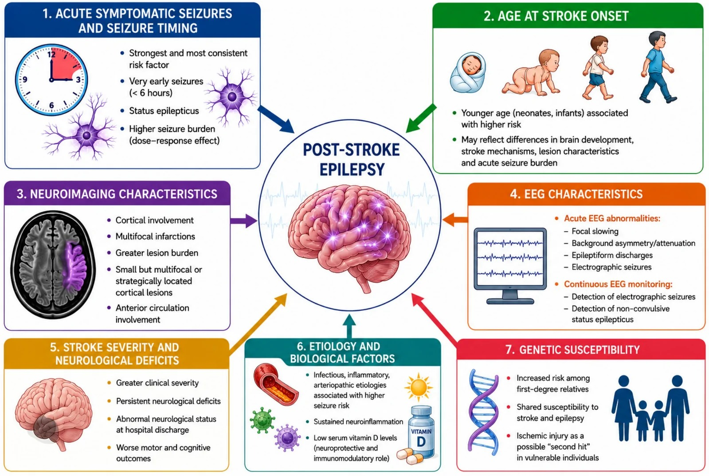
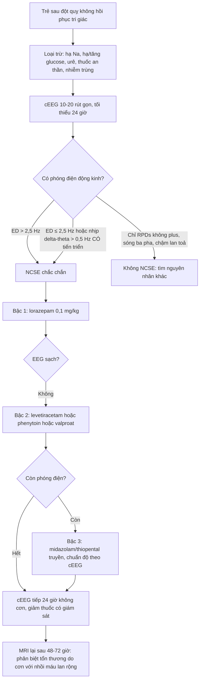
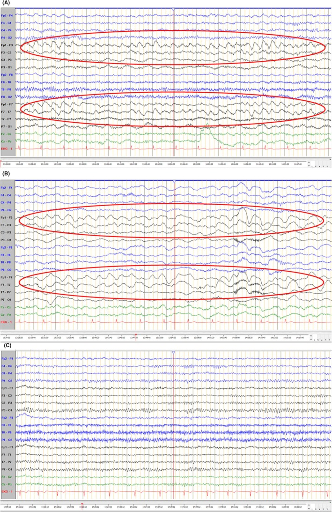
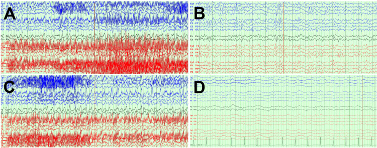
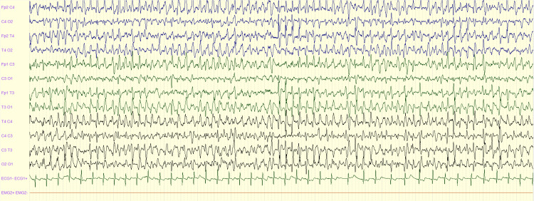

# 1987 — Trạng thái động kinh KHÔNG co giật ở trẻ sau đột quỵ: trẻ "không tỉnh" mà không co giật / Non-convulsive status epilepticus after paediatric stroke

**Tags:** `pattern:dong-kinh` `pattern:phong-dien-lien-tuc` `pattern:tri-giac-khong-hoi-phuc` `pattern:thieu-mau-nao` `vung:nao` `score:Salzburg` `protocol:cEEG` `protocol:MRI-DWI`

**Mức chắc chắn (certainty):** tổng hợp y văn (literature synthesis) — số liệu từ toàn văn của **nghiên cứu tiến cứu 469 bệnh nhân/EEG** kiểm định tiêu chuẩn Salzburg (*Epilepsia Open* 2024, **PMC11514898**, CC BY 4.0), **tổng quan đột quỵ nhi – động kinh sau đột quỵ** (*Brain Sciences* 2026, **PMC13604746**, CC BY 4.0), **đồng thuận chuyên gia Bỉ về xử trí cơn cấp ở trẻ** (*Acta Neurologica Belgica* 2026, **PMC13242445**, CC BY 4.0), **hướng dẫn thực hành lâm sàng động kinh co giật ở trẻ** (*Neurosciences* 2017, **PMC5726823**, CC BY-NC-SA) và bộ ca có ảnh EEG (PMC12574488, PMC13050277, PMC12634017). Nhóm **không có bệnh nhân của mình**; các con số về **tỉ lệ NCSE ở trẻ sau đột quỵ** hiện **chưa có giá trị thống nhất — cần tra thêm**, bài ghi rõ chỗ chưa rõ.

> **Câu chốt:** trẻ sau đột quỵ **không hồi phục tri giác trong 30–60 phút** mà **không còn cơn co giật nhìn thấy** phải được coi là **NCSE cho tới khi EEG loại trừ** — vì **cơn điện vẫn tiếp tục trong khi triệu chứng vận động đã hết**. Chẩn đoán bằng **cEEG** theo **tiêu chuẩn Salzburg** (**phóng điện động kinh > 2,5 Hz**, hoặc **≤ 2,5 Hz/nhịp delta–theta > 0,5 Hz CÓ tiến triển không–thời gian**, hoặc **dấu hiệu cơn tinh tế**, hoặc **đáp ứng với thuốc chống động kinh đường tĩnh mạch**); điều trị **theo bậc như động kinh co giật** nhưng **đích là EEG**, không phải "hết co giật". Bỏ sót = **tổn thương não thêm do hưng phấn độc (excitotoxicity)**, tri giác không hồi phục bị quy oan cho "phù não do đột quỵ".

## 1. Tổng quan bệnh học – cơ chế hình ảnh (TẠI SAO)

### 1.1 Vì sao đột quỵ sinh ra cơn điện mà không co giật

- **Mất cân bằng ức chế–hưng phấn tại bờ ổ nhồi máu:** thiếu máu làm **ATP giảm** → bơm Na⁺/K⁺ thất bại → **khử cực màng**; **glutamate** ứ ngoại bào (giảm tái hấp thu) và **GABA-A giảm chức năng** → **vùng vỏ quanh ổ (penumbra) tự phát nhịp**.
- **Vì sao không thấy co giật:** cơn phát sinh từ **vỏ não hoặc vùng sâu với đường dẫn truyền vận động bị tổn thương** chỉ biểu hiện bằng **rối loạn tri giác, hành vi, ngôn ngữ, giật cơ nhỏ ở mặt/ngón, lệch mắt, rung giật nhãn cầu** — hoặc **không gì cả**. Ở trẻ **đã đặt nội khí quản và an thần**, triệu chứng vận động bị **che hoàn toàn**.
- **Vì sao NCSE gây tổn thương thêm:** phóng điện liên tục làm **nhu cầu chuyển hóa vỏ não tăng** trong khi **cung cấp máu đã bị hạn chế** → **thiếu máu–thiếu oxy thứ phát, lan rộng vùng chết**; kèm **phù tế bào, tăng áp lực nội sọ**, và **rối loạn thần kinh thực vật** (mạch nhanh, tăng huyết áp, tăng tiết). Đây là lý do **thời gian phóng điện là biến số tiên lượng**, và **mỗi giờ chậm chẩn đoán đều có giá**.
- **Vì sao "đột quỵ không hồi phục" lại là NCSE:** sau cơn co giật, **EEG ở trẻ cần trung bình 120 phút (tối đa 300 phút) mới trở về nền**; nếu **không về nền**, đó là **phóng điện tiếp diễn** chứ không phải "di chứng". Vì vậy **EEG bình thường ngay sau cơn không loại trừ NCSE**, và **trẻ ngủ gà kéo dài phải chụp cEEG**.

### 1.2 Ngưỡng định lượng nằm lòng

| Chỉ số | Con số | Nguồn |
|---|---|---|
| Động kinh sau đột quỵ động mạch ở trẻ | **~1/4 trẻ** (khoảng **7% – > 40%** giữa các nghiên cứu) | PMC13604746 |
| Cơn triệu chứng cấp / trạng thái động kinh là yếu tố dự báo mạnh nhất | **≈ 4 lần** nguy cơ động kinh sau đột quỵ | PMC13604746 |
| Trạng thái động kinh trong cơn cấp ở đăng ký đột quỵ nhi | **16,0% (12/75)** trẻ có cơn cấp | PMID 40435763 (bài 1799) |
| EEG trở về nền sau cơn ở trẻ | trung bình **120 phút**, tối đa **300 phút** | PMC13242445 |
| Ngưỡng "phải chụp EEG" | **không tỉnh lại trong 30 phút – 1 giờ** | PMC13242445 |
| **Tiêu chuẩn Salzburg** — phóng điện động kinh (ED) | **> 2,5 Hz** (chắc chắn NCSE) | PMC11514898 |
| Salzburg — nhánh tần số thấp | **ED ≤ 2,5 Hz** hoặc **nhịp delta/theta > 0,5 Hz** **CÓ tiến triển không–thời gian** → NCSE | PMC11514898 |
| Salzburg — nhánh lâm sàng | **dấu hiệu cơn tinh tế** (giật mi, lệch mắt, rung giật nhãn cầu) **hoặc đáp ứng với ASM tĩnh mạch** | PMC11514898 |
| Hiệu lực của tiêu chuẩn (469 bệnh nhân) | **độ nhạy 94%**, **độ đặc hiệu 77%**, **PPV 34%**, **NPV 99%**; tỉ lệ NCSE thực tế **11%** | PMC11514898 |
| Phân bố mẫu EEG của NCSE | ED **có tiến triển** 60%, chuỗi nhịp/tuần hoàn **28%**, ED **> 2,5 Hz không tiến triển** 8% | PMC11514898 |
| Cơn điện (electrographic seizure) — định nghĩa ACNS | hoạt động dạng động kinh **≥ 10 giây** có tiến triển tần số/biên độ/hình thái | ACNS (định nghĩa chuẩn) |
| Thời gian ghi cEEG tối thiểu | **≥ 24 giờ** (và **≥ 24 giờ không cơn** trước khi kết thúc) | ACNS |
| cEEG phát hiện thêm cơn điện khi EEG thường âm tính | **8–48%** bệnh nhân sau khi cơn co giật đã "ngừng" | PMC12941532 |
| EEG đầu giường (POC-EEG) ở cấp cứu nhi | đặt điện cực **< 3 phút ở 100% (36 trẻ)**; **77,8%** bác sĩ thấy dễ dùng | PMC12941532 |
| Liều **lorazepam** | **0,1 mg/kg** (tối đa **4 mg**), nhắc **1 lần** sau **5–15 phút** | PMC5726823 |
| Liều **midazolam** | IV **0,1 mg/kg** (tối đa 10 mg); **buccal 0,5 mg/kg**; truyền: **0,15 mg/kg** rồi **2 µg/kg/phút**, tăng **2 µg/kg/phút mỗi 10–15 phút**, tối đa **24 µg/kg/phút** | PMC5726823 |
| Liều bậc 2 | **phenytoin 20 mg/kg** (tối đa 1.000 mg, truyền 20 phút) hoặc **levetiracetam 20–60 mg/kg** (tối đa 2.500 mg) hoặc **valproat 20–40 mg/kg** (tối đa 3.000 mg) hoặc **phenobarbital 20 mg/kg** (tối đa 1.000 mg, có thể tới 40 mg/kg) | PMC5726823 |
| Trạng thái kháng trị | **thiopental 3–5 mg/kg** rồi truyền **3–5 mg/kg/giờ**, hoặc midazolam truyền — **phải có cEEG để chuẩn độ** | PMC5726823 |

### 1.3 Vì sao MRI/ASL giúp — và vì sao dễ nhầm

- **DWI/ADC:** ổ nhồi máu **DWI sáng + ADC tối** trong **giờ đầu → ngày 7**. Điểm quan trọng: **trạng thái động kinh kéo dài tự nó gây giảm khuếch tán ở vỏ não và đồi hải mã** (phù độc tế bào do phóng điện) — hình ảnh **giống nhồi máu mới**, nên **không được gọi "nhồi máu lan rộng"** khi trẻ đang trong cơn điện: **chụp lại sau khi cắt cơn 48–72 giờ**, tổn thương do cơn **thường hồi phục hoặc không theo lãnh thổ mạch**.
- **ASL (arterial spin labeling):** vùng đang phóng điện có **tăng tưới máu vỏ não** (tăng nhu cầu chuyển hóa–lưu lượng), trong khi **ổ nhồi máu giảm tưới máu**. Vì vậy ASL **tăng ở vỏ não quanh ổ** là gợi ý **cơn đang hoạt động**, không phải "nhồi máu thêm"; ASL **lan theo vỏ, không theo lãnh thổ mạch**.
- **T2/FLAIR:** phù do cơn **tăng tín hiệu vỏ não, có thể đối xứng hoặc lan ra ngoài lãnh thổ**; sau **vài tuần** có thể teo vỏ khu trú. **Chụp muộn** mới phân biệt được sẹo do cơn với sẹo nhồi máu.
- **Hệ quả thực hành:** **hình ảnh không chẩn đoán NCSE** — chẩn đoán là **điện sinh lý**; MRI dùng để **tìm nguyên nhân, loại trừ chuyển dạng xuất huyết, và đánh giá tổn thương thứ phát**.

## 2. Mẫu hình + chẩn đoán phân biệt theo vị trí (gamut)

**Mẫu hình:** trẻ **đã được chẩn đoán đột quỵ động mạch** (thường **lãnh thổ động mạch não giữa**, có tổn thương vỏ), sau **24–72 giờ** vẫn **không tỉnh/không tương tác**, **không còn cơn co giật**, có thể **giật mi, lệch mắt, giật ngón tay thoáng qua** hoặc **hoàn toàn im lặng** (đã an thần).

**Gamut "trẻ không hồi phục tri giác sau đột quỵ" — theo trục cơ chế:**

- **(1) Điện–động kinh:** **NCSE** (bài này), **cơn điện từng đợt (electrographic seizures)**, **trạng thái động kinh co giật kín đáo (subtle SE)**.
- **(2) Cơ học–huyết động:** **phù não lan rộng, tăng áp lực nội sọ, thoát vị**, **chuyển dạng xuất huyết**, **mở rộng nhồi máu/tái thông muộn**.
- **(3) Chuyển hóa–nội tiết:** **hạ natri máu** (đặc biệt **sau truyền dịch nhược trương**), **hạ đường huyết**, **tăng đường huyết**, **urê cao**, **hạ canxi/magiê**, **nhiễm toan**.
- **(4) Nhiễm trùng–viêm:** **viêm màng não do vi khuẩn** (đặc biệt nếu đột quỵ do viêm nội tâm mạc), **viêm não**, **sốc nhiễm khuẩn**.
- **(5) Thuốc:** **an thần/giãn cơ còn tác dụng** (midazolam, fentanyl, vecuronium), **ngộ độc**, **hội chứng cai**.
- **(6) Sau cơn (post-ictal):** **tê liệt Todd** — **hồi phục trong 24–48 giờ**, không có phóng điện khi ghi lại.

**Vị trí tổn thương quyết định kiểu trình bày:** tổn thương **vỏ MCA trái** → **thất ngôn / không đáp ứng lời**; **vỏ trán–đỉnh phải** → **bỏ qua nửa người, rối loạn chú ý**; **vỏ chẩm** → **ảo giác/thay đổi thị giác**; **thalami/đồi thị** → **rối loạn tri giác không kèm dấu khu trú** — nhóm cuối **dễ bị bỏ nhất** vì không có gì để "nhìn".

## 3. Bảng so sánh phân biệt (ma trận đối chiếu)

| Thực thể (entity) | Hình ảnh / điện sinh lý điển hình | Chốt vào (rule-in) | Chốt loại (rule-out) | Gợi ý xác nhận |
|---|---|---|---|---|
| **NCSE** | cEEG: **ED > 2,5 Hz**, hoặc **ED ≤ 2,5 Hz / nhịp delta–theta > 0,5 Hz có tiến triển không–thời gian**, hoặc **RPDs có "plus"** | **Tiêu chuẩn Salzburg thoả** + **không hồi phục tri giác** | **EEG 24 giờ không có phóng điện** (và không có cơn lâm sàng) → loại NCSE | cEEG ≥ 24 giờ; **đáp ứng với benzodiazepine làm mất phóng điện** |
| **Cơn điện từng đợt** | cEEG: từng cơn **≥ 10 giây**, cách nhau, **có tiến triển** | **≥ 1 cơn điện** trên cEEG | Không có cơn điện → loại | Tiêu chuẩn ACNS; đếm **gánh nặng cơn (% thời gian)** |
| **Trạng thái co giật kín đáo** (subtle SE) | Co giật **đã ngừng** nhưng còn **giật mi/ngón**; EEG vẫn phóng điện | **Phóng điện liên tục + dấu vận động tinh tế** | **Đã ngừng hẳn vận động và EEG sạch** → loại | cEEG đồng thời video |
| **Phù não / tăng áp lực nội sọ** | CT/MRI: **xoá rãnh cuộn não, mất phân biệt xám–trắng, lệch đường giữa**, giãn não thất | **Lệch đường giữa + dấu hiệu thoát vị** | **EEG sạch + không lệch đường giữa** → loại NCSE là nguyên nhân chính | CT/MRI cấp, siêu âm qua thóp, theo dõi ICP |
| **Chuyển dạng xuất huyết** | **SWI/T2*: mất tín hiệu "blooming"** trong ổ nhồi máu; CT: tăng đậm độ mới | **Máu trong ổ trên SWI** | **SWI âm** → loại | Chụp lại CT/SWI khi tri giác xấu đi |
| **Rối loạn chuyển hóa (hạ Na, hạ glucose)** | MRI thường **bình thường hoặc phù lan toả**; **EEG: chậm lan toả, không tiến triển** | **Na/glucose bất thường + sửa là hết** | **Điện giải bình thường** → loại | Xét nghiệm khẩn; **sửa rồi ghi lại EEG** |
| **Tác dụng thuốc an thần** | EEG: **chậm, hoạt động beta lan toả, không tiến triển** | **Ngưng thuốc → tri giác cải thiện** | **Phóng điện có tiến triển** → loại | Rà soát giờ dùng thuốc, dùng flumazenil/narcan **thận trọng** |
| **Tê liệt Todd sau cơn** | MRI: **không tổn thương mới**; EEG: chậm khu trú, **không phóng điện** | **Hồi phục trong 24–48 giờ** | **Không hồi phục + phóng điện** → không phải post-ictal | Theo dõi lâm sàng + EEG lặp |

**Cạm bẫy phân biệt trên EEG:** **sóng ba pha (triphasic waves)** ở bệnh não chuyển hóa **không phải NCSE** dù trông "nhịp"; **RPDs không có "plus"** thường **không** đủ tiêu chuẩn; **SIRPIDs** (phóng điện theo kích thích) **không phải cơn** — đừng tăng thuốc vì chúng.

*Sơ đồ tổng hợp: **cơn triệu chứng cấp và trạng thái động kinh** đứng đầu nhóm yếu tố nguy cơ, cùng **tổn thương vỏ não** và **gánh nặng tổn thương** — đây chính là nhóm trẻ cần **cEEG** và theo dõi dài hạn. Nguồn: **PMC13604746**, CC BY 4.0.*

## 4. Protocol + hệ phân độ/điểm chuẩn hóa

### 4.1 Ai cần cEEG (chỉ định ở trẻ sau đột quỵ)

- **Không tỉnh/không tương tác > 30–60 phút** sau khi đã xử lý chuyển hóa và giảm an thần.
- **Co giật đã ngừng nhưng còn dấu vận động tinh tế** (giật mi, ngón, lệch mắt, rung giật nhãn cầu).
- **Co giật kéo dài > 10 phút** hoặc **≥ 3 cơn/giờ** trong 24 giờ đầu.
- **Đã dùng thuốc giãn cơ/an thần** → **không thể đánh giá lâm sàng** → cEEG **bắt buộc**.
- **Tri giác xấu đi mà CT không giải thích được.**

### 4.2 Kỹ thuật

- **Hệ điện cực 10–20 rút gọn** tối thiểu (Fp1/Fp2, C3/C4, T3/T4, O1/O2, trung tính) + **video**; nếu có điều kiện **10–20 đầy đủ**.
- **Thời lượng:** tối thiểu **24 giờ**; nếu có cơn → **tiếp tục tới 24 giờ không cơn**; sau khi **giảm/tháo an thần** phải **ghi lại ≥ 24 giờ** (cơn hay tái phát khi giảm thuốc).
- **Đọc và ghi báo cáo theo mẫu ACNS:** nền, **tần số và biên độ phóng điện**, **tiến triển**, **"plus" features**, **gánh nặng cơn (% thời gian)**, **đáp ứng kích thích**.
- **Chẩn đoán theo Salzburg** rồi phân loại **"chắc chắn / có thể / không NCSE"** — nhớ **PPV chỉ 34%** nếu chỉ dựa tiêu chuẩn mà **bỏ bối cảnh lâm sàng**.

### 4.3 Điều trị — đích là EEG, không phải "hết co giật"

| Bậc | Thuốc / liều (trẻ) | Đích |
|---|---|---|
| 1 | **Lorazepam 0,1 mg/kg** (tối đa 4 mg) TM, nhắc **1 lần** sau 5–15 phút (hoặc **midazolam 0,1 mg/kg** TM / **0,5 mg/kg** qua niêm mạc má) | **Hết phóng điện trên EEG** hoặc giảm ≥ 50% gánh nặng cơn |
| 2 | **Levetiracetam 20–60 mg/kg** (tối đa 2.500 mg) **hoặc phenytoin 20 mg/kg** (tối đa 1.000 mg, truyền 20 phút) **hoặc valproat 20–40 mg/kg** **hoặc phenobarbital 20 mg/kg** | Không còn phóng điện liên tục |
| 3 (kháng trị) | **Midazolam truyền 0,15 mg/kg rồi 2 µg/kg/phút**, tăng **2 µg/kg/phút mỗi 10–15 phút** tới **24 µg/kg/phút**; hoặc **thiopental 3–5 mg/kg rồi 3–5 mg/kg/giờ** | **Burst-suppression hoặc hết phóng điện** trên cEEG liên tục |
| 4 (super-refractory) | Phối hợp/ketamine/propofol **theo đơn vị hồi sức**, luôn có cEEG | Cắt cơn điện; **tránh hạ huyết áp** (giảm tưới máu vùng penumbra) |

> **Nguyên tắc:** ở trẻ **sau đột quỵ**, **hạ huyết áp do an thần là nguy hiểm** — chuẩn độ **chậm, có đích EEG**, giữ huyết áp đủ tưới máu; **thuốc chống động kinh dự phòng dài hạn không dùng chỉ vì có cơn cấp** (xem bài 1799).

### 4.4 Sau cắt cơn — ba việc phải làm

1. **Ghi lại cEEG sau khi giảm an thần** (cơn tái phát 20–30% khi tháo thuốc — **chưa rõ con số chính xác ở trẻ sau đột quỵ**).
2. **MRI lại 48–72 giờ** (DWI/ASL) để **không gọi nhầm tổn thương do cơn là nhồi máu mới**.
3. **Quyết định thuốc dài hạn theo bài 1799**, không theo cảm giác "đã có cơn thì phải dùng mãi".

## 5. Biến thể bình thường và cạm bẫy

- **"Trẻ ngủ nhiều sau đột quỵ là bình thường":** không. **Không hồi phục trong 30–60 phút** là **chỉ định cEEG**; đây là cạm bẫy bỏ sót phổ biến nhất.
- **EEG thường (30 phút) âm tính:** cơn điện **từng đợt** có thể **không xuất hiện trong 30 phút** — **8–48%** bệnh nhân còn cơn sau khi cơn co giật đã ngừng. **Âm tính không loại trừ**.
- **Tê liệt Todd bị gọi là "đột quỵ nặng thêm":** yếu nửa người sau cơn **hồi phục 24–48 giờ**, **không có phóng điện** khi ghi lại.
- **Sóng ba pha & SIRPIDs:** tăng thuốc chống động kinh vì "trông như cơn" → **an thần quá mức, tụt huyết áp, chậm hồi phục**.
- **DWI lan rộng trong cơn:** **giảm khuếch tán do trạng thái động kinh** ở vỏ/đồi hải mã **hồi phục** — đừng kết luận "nhồi máu lan" rồi thay đổi chiến lược tái thông.
- **Hạ natri do rửa/ truyền dịch:** ở trẻ sau đột quỵ, **hạ Na máu** vừa gây co giật vừa **bắt chước NCSE** — luôn xét nghiệm trước khi kết luận.
- **Hết co giật ≠ hết trạng thái:** **cơn co giật chuyển thành cơn điện** (subtle SE) là quy luật ở trẻ đã dùng benzodiazepine — **không được dừng theo dõi khi "hết co giật"**.

## 6. Tự lượng giá — Blind Quiz

**Ca 1 — Bé gái 9 tuổi, nhồi máu não giữa trái ngày thứ 2. Không nói, không làm theo lệnh, không co giật. Nhìn EEG, mô tả trước.**

- Gợi ý: mắt mở, không nhìn theo, thỉnh thoảng giật mi trái.
- Câu hỏi: mẫu hình EEG? Đủ tiêu chuẩn Salzburg không? Bước tiếp theo?

<b>Bấm để hiện đáp án (findings + chẩn đoán)</b>

- **Findings:** (A, B) **nhịp delta–theta nhanh (LRDA) 2,5–3,0 Hz**, chiếm **~95% của 20 phút ghi**, **có tiến triển** về tần số/biên độ giữa các đoạn; (C) sau thuốc chống động kinh: **nhịp chậm, mất phóng điện**.
- **Chẩn đoán:** **NCSE** — thoả **nhánh tần số thấp của Salzburg** (nhịp > 0,5 Hz **có tiến triển không–thời gian**) và có **đáp ứng với ASM**.
- **Bước tiếp theo:** lorazepam **0,1 mg/kg**, ghi lại EEG, bậc 2 nếu còn phóng điện; giữ huyết áp.
- Nguồn ảnh: *Epileptic Disorders* 2025, **PMC12574488**, Fig. 2, CC BY 4.0 (bệnh nhân của bài gốc).

**Ca 2 — Bé trai 6 tuổi, đột quỵ nhồi máu + xuất huyết dưới màng cứng, nghi nhiễm khuẩn thần kinh. Vẫn lơ mơ sau khi ngừng an thần 12 giờ.**

- Câu hỏi: (A) có phóng điện không? (B) thay đổi gì, và thay đổi đó chứng minh điều gì?

<b>Bấm để hiện đáp án</b>

- **Findings:** (A) hoạt động **nhịp liên tục dạng động kinh**, mất nhịp alpha chẩm; (B) sau **lorazepam**: **hết phóng điện**, nền chậm lại.
- **Ý nghĩa:** **đáp ứng với ASM tĩnh mạch** là **một trong các tiêu chuẩn Salzburg** → củng cố chẩn đoán NCSE; đây cũng là **phép thử điều trị** (test of treatment).
- **Cạm bẫy:** đừng coi "hết co giật" là hết trạng thái — trẻ này **chưa từng co giật** trong đợt này.
- Nguồn ảnh: *Cureus* 2026, **PMC13050277**, Fig. 3, CC BY 4.0.

**Ca 3 — Bé gái 12 tuổi, nhồi máu não giữa phải, hôn mê, thở máy, đã dùng giãn cơ. cEEG dưới đây.**

- Câu hỏi: vì sao **phải** chụp cEEG ở trẻ đã giãn cơ? Mẫu hình này thuộc nhóm nào?

<b>Bấm để hiện đáp án</b>

- **Findings:** **phóng điện động kinh toàn thể, nhịp nhanh, liên tục** — không có triệu chứng lâm sàng vì đã **giãn cơ**.
- **Chẩn đoán:** **NCSE** — nhóm **"chỉ thấy trên EEG"**; ở trẻ thở máy/giãn cơ, **lâm sàng không thể loại trừ**.
- **Xử trí:** bậc 1 → bậc 2 → truyền midazolam **chuẩn độ theo EEG**, giữ huyết áp; **ghi lại 24 giờ sau khi giảm thuốc**.
- Nguồn ảnh: *Cureus* 2025, **PMC12634017**, Fig. 2, CC BY 4.0.

## Bài liên quan chéo

- [1799 – Động kinh sau đột quỵ ở trẻ](../1799-dong-kinh-sau-dot-quy-o-tre/lesson.md)
- [1785 – Động kinh sau tái thông moyamoya ở trẻ](../1785-dong-kinh-sau-tai-thong-moyamoya-o-tre/lesson.md)
- [1430 – Độc thần kinh cấp sau CAR-T (ICANS)](../1430-icans-doc-tinh-than-kinh-sau-car-t/lesson.md)
- [600 – Tổng quan Nhi khoa](../600-tong-quan-nhi-khoa/lesson.md)
- [200 – Tổng quan Thần kinh](../200-tong-quan-he-than-kinh/lesson.md)

## Ảnh

- `images/1987_ncse_PMC12574488-EPD2-27-1060-g001.jpg` — LRDA 2,5–3 Hz có tiến triển, trước/sau ASM (CC BY 4.0)
- `images/1987_ncse_PMC13050277-cureus-0018-00000104724-i03.jpg` — EEG trước/sau lorazepam (CC BY 4.0)
- `images/1987_ncse_PMC12634017-cureus-0017-00000095086-i02.jpg` — phóng điện toàn thể trong NCSE (CC BY 4.0)
- `images/1987_ncse_PMC13604746-brainsci-16-00907-g002.jpg` — sơ đồ yếu tố nguy cơ động kinh sau đột quỵ ở trẻ (CC BY 4.0)
- Nguồn + giấy phép từng ảnh: `images/CREDITS.md`.

> Không dùng để chẩn đoán độc lập khi chưa có người hướng dẫn.
