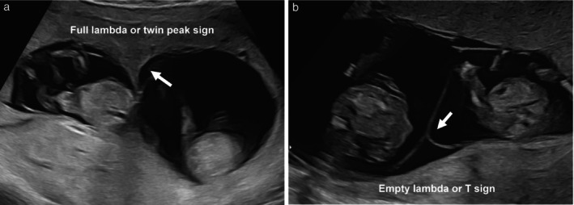
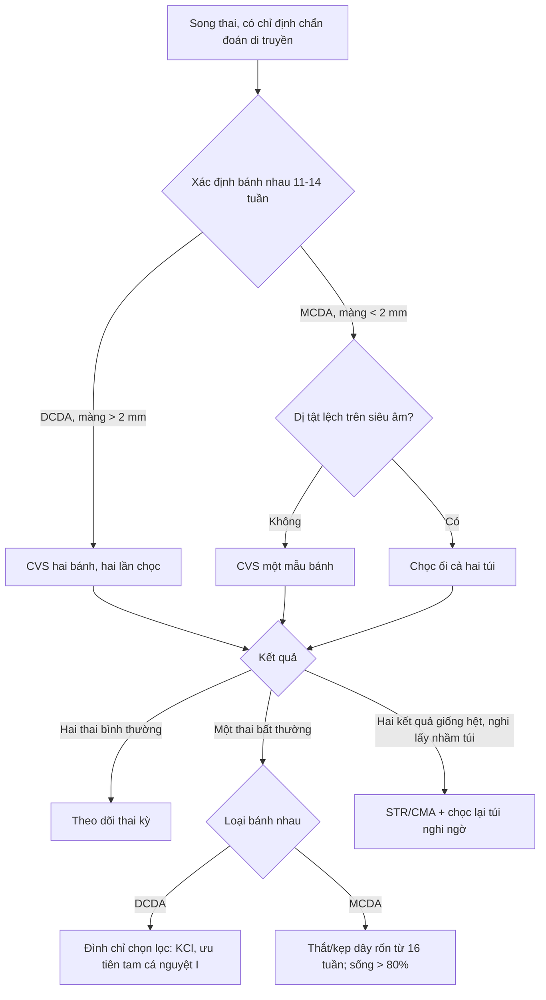
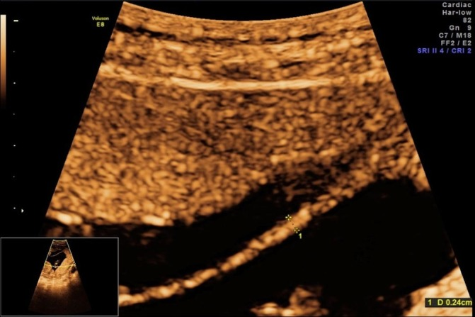
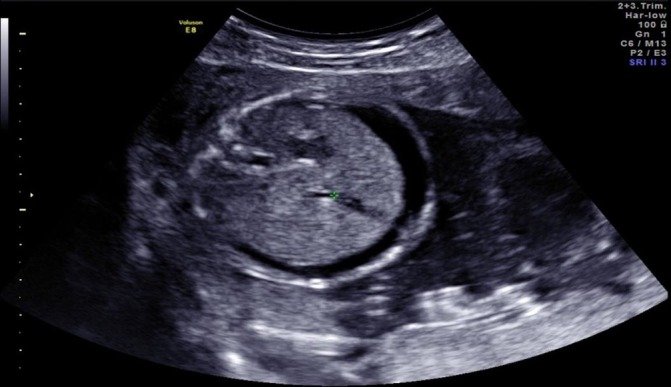

# 1988 — Chọc ối & sinh thiết gai nhau ở song thai: hai buồng ối, hai bộ gen / Amniocentesis and chorionic villus sampling in twin pregnancy

**Tags:** `pattern:ket-qua-khong-tuong-hop` `pattern:lay-nham-buong-oi` `pattern:bien-chung-thu-thuat` `vung:thai` `vung:buong-oi` `vung:manh-oi` `protocol:choc-oi` `protocol:CVS`

**Mức chắc chắn (certainty):** tổng hợp y văn (literature synthesis) — số liệu từ **đoàn hệ đa trung tâm gần 10.000 thai trong song thai** có nhóm chứng (PMC9828484), **nghiên cứu bệnh–chứng 220 ca chọc ối song thai hai bánh nhau** (PMC12137027), **hướng dẫn thực hành ISUOG 2025** (PMC11788470), **tổng quan chẩn đoán xâm lấn ở song thai** (PMC4449657) và **một ca nguyên văn song thai lệch Hb Bart's** (PMC6202988). Đây là **tổng hợp y văn**: các con số mất thai **dao động rất rộng** giữa các loạt, phải nói với gia đình theo **khoảng**, không theo một con số tuyệt đối.

> **Câu chốt:** trong song thai, câu hỏi không phải "chọc ối hay CVS" mà là **"lấy được mẫu của CẢ HAI thai, và biết chắc mẫu nào của thai nào"**. Một lần chọc vào nhầm túi hoặc hai lần chọc vào cùng một túi cho ra **hai kết quả giống nhau** — và đó là con đường dẫn tới **đình chỉ nhầm thai lành**. Ba con số để tư vấn: mất thai sau chọc ối song thai gộp **3,07%** và sau CVS **3,84%** (so với **0,11–0,13%** ở thai đơn); trong đoàn hệ có nhóm chứng, **chết thai < 24 tuần tăng có ý nghĩa** nhưng **mất thai bình thường về di truyền–hình thái thì tương đương nhóm không can thiệp**; và **4%** song thai có dị tật ở một thai (**3,4%** hai bánh nhau, **6%** một bánh nhau) — chính nhóm này cần kết quả **đúng thai**.

## 1. Tổng quan bệnh học – cơ chế hình ảnh (TẠI SAO)

### 1.1 Vì sao song thai là một bài toán khác, không phải "chọc ối hai lần"

1. **Hai bộ gen, không phải một.** Đa số song thai hai bánh nhau (dichorionic diamniotic, DCDA) là **khác hợp tử (dizygotic)** — khoảng **10%** DCDA lại là **cùng hợp tử**, nên không thể suy "cùng giới → cùng kiểu gen". Một thai có thể **47,+21**, thai kia **46,XX** bình thường: **kết quả của thai này không nói gì về thai kia**.
2. **Hai túi ối, một màng ngăn.** Màng ối giữa hai thai là **cấu trúc mỏng, di động**, có thể **gấp nếp, chồng lên nhau hoặc áp sát thành tử cung**; trên siêu âm 2D màng là **đường tăng hồi âm mảnh**, và **đầu kim 20 G (0,9 mm)** dày hơn màng rất nhiều. Vì vậy "nhìn thấy màng" **không bảo đảm** kim đã sang túi thứ hai — phải có **bằng chứng khách quan** (thuốc nhuộm, hai lần vào tử cung riêng, hoặc hình ảnh lưu).
3. **Nền sảy thai của song thai vốn đã cao hơn thai đơn.** Trong đoàn hệ có nhóm chứng, **chết thai < 24 tuần ở nhóm không can thiệp** là **1,2%** (chọc ối DCDA) và **1,8%** (chọc ối một bánh nhau); ở nhóm CVS là **1,5%** và **2,0%** (PMC9828484). Không trừ nền này thì mọi ca mất thai đều bị quy oan cho thủ thuật.
4. **Một bánh nhau (monochorionic) là bệnh cảnh riêng.** Hai thai **dùng chung một bánh nhau** → CVS **chỉ lấy được một mẫu bánh nhau**, nên **bỏ sót** thể lệch bộ nhiễm sắc thể hiếm gặp giữa hai thai; đồng thời mọi can thiệp vào một túi **ảnh hưởng huyết động học của cả hai** qua các miệng nối (bài 1637).

### 1.2 Vì sao kết quả sai lại thành thảm họa — cơ chế của "lấy nhầm túi"

- **Sinh học:** hai túi ối chứa **hai quần thể tế bào thai khác nhau**. Nếu hai lần chọc **cùng vào một túi**, phòng xét nghiệm nhận **hai mẫu của cùng một thai** → hai karyotype/CMA **giống hệt nhau**. Nếu thai đó bình thường, **thai bất thường còn lại không bao giờ được phát hiện**; nếu thai đó bất thường, **cả hai kết quả đều bất thường** và gia đình có thể **đình chỉ cả thai kỳ** hoặc đình chỉ **sai thai**.
- **Vật lý – vì sao khó phát hiện:** màng ngăn DCDA dày **> 2 mm** (dấu **lambda / twin peak**), màng một bánh nhau **< 2 mm** (dấu **T**); khi màng **gấp nếp** hoặc **hai màng chồng nhau**, mặt cắt ngang có thể cho **hai đường song song** giả tạo, và đầu kim **tạo bóng lưng (posterior acoustic shadowing)** che mất màng ngay sau đầu kim. Tỷ lệ **thủng màng do thủ thuật (iatrogenic septostomy)** được báo cáo tới **~30%** khi màng gấp/chồng (PMC4449657).
- **Hệ quả muộn:** thủng màng → **một buồng ối (iatrogenic monoamnionicity)** → **dây rốn quấn nhau**, nguy cơ **thai lưu đột ngột**. Vì vậy ISUOG khuyến cáo khi cần lấy **hai túi** thì dùng **hai lần chọc riêng (two-puncture technique)** để tránh biến chứng này (PMC11788470).

### 1.3 Ngưỡng định lượng — bảng số phải thuộc

| Nhóm | Can thiệp | Chết thai < 24 tuần | So nhóm chứng | Nguồn |
|---|---|---|---|---|
| DCDA | CVS (n = 258) | **8,1%** (21/258) | chứng 1,5%; **RR 5,54** (3,38–9,08) | PMC9828484 |
| DCDA | chọc ối (n = 406) | **2,7%** (11/406) | chứng 1,2%; **RR 1,85** (0,97–3,52) | PMC9828484 |
| MCDA | CVS (n = 98) | **10,2%** (10/98) | chứng 2,0%; **RR 5,14** (2,51–10,54) | PMC9828484 |
| MCDA | chọc ối (n = 160) | **12,5%** (20/160) | chứng 1,8%; **RR 6,39** (3,57–11,43) | PMC9828484 |
| DCDA | chọc ối, ca–chứng 2025 (n = 220) | **0,9%** mất 1 thai, **0,5%** mất cả hai | chứng 1,1% / 0,5% (p = 0,982) | PMC12137027 |
| Gộp | chọc ối song thai | **3,07%** (mất thai), **2,54%** (< 24 tuần) | ca–chứng 2,59% vs 1,53%, **RR 1,81** | PMC11788470 |
| Gộp | CVS song thai | **3,84%** | không khác TA/TC, 1 kim/2 kim, 1 lần/2 lần vào | PMC11788470 |

- **Mất thai bình thường về di truyền và hình thái** — con số quan trọng nhất khi tư vấn — **tương đương nhóm chứng**: DCDA chọc ối **1,3% vs 1,2%** (RR 1,16), MCDA chọc ối **3,4% vs 1,8%** (RR 1,93, KTC rộng) (PMC9828484).
- **Càng về tam cá nguyệt II, đình chỉ càng nặng nề** — đây là lý do ISUOG **ưu tiên CVS ở song thai hai bánh nhau**: chẩn đoán sớm cho phép **đình chỉ chọn lọc ở tam cá nguyệt I** (PMC11788470).

## 2. Mẫu hình + chẩn đoán phân biệt theo vị trí (gamut)

**Mẫu hình cần nhận diện: "hai kết quả không tương hợp"** — một bất thường, một bình thường, hoặc hai kết quả **giống hệt nhau đến mức đáng ngờ**.

- **Theo loại bánh nhau (quyết định đường vào trước tiên):**
  - **DCDA (màng > 2 mm, lambda sign):** hai bánh nhau, hai túi → **CVS hai bánh** (tốt nhất) hoặc **chọc ối hai túi**; mỗi thai một mẫu.
  - **MCDA (màng < 2 mm, T sign):** **một bánh nhau, hai túi** → CVS **chỉ một mẫu bánh** (bỏ sót lệch hiếm); nếu có **dị tật lệch** thì **chọc ối cả hai túi** là lựa chọn được khuyến cáo (PMC11788470).
  - **MCMA (một túi ối):** chỉ **một mẫu** — không có khái niệm "lấy nhầm túi", nhưng **không bao giờ chọc hai lần**.
- **Theo kiểu kết quả (gamut định hướng xử trí):**
  1. **Lệch thật (true discordance):** hai hợp tử khác nhau, hoặc cùng hợp tử nhưng đột biến sau hợp tử — **hay gặp nhất** ở DCDA.
  2. **Lấy nhầm cùng một túi:** hai kết quả **giống hệt**; gợi ý khi **giới tính trên siêu âm khác với karyotype**, hoặc khi **một thai có dị tật/hydrops rõ mà kết quả lại bình thường**.
  3. **Nhiễm bẩn tế bào mẹ (maternal cell contamination, MCC)** hoặc **lẫn mẫu giữa hai thai khi CVS** (cross-contamination **~1%**) → kết quả **khảm**, **không khớp** giữa hai phương pháp.
  4. **Thai "biến mất" (vanishing twin):** mẫu bánh nhau có thể phản ánh **thai đã chết**, không phải thai đang sống.
- **Gợi nhớ 4 bước:** **C**horionicity → **M**ap (vị trí trái/phải) → **T**wo samples (hai mẫu riêng) → **V**erify (đối chiếu siêu âm + STR/CMA).

## 3. Bảng so sánh phân biệt (ma trận đối chiếu)

| Thực thể (entity) | Hình ảnh / dữ liệu điển hình | Chốt vào (rule-in) | Chốt loại (rule-out) | Gợi ý xác nhận |
|---|---|---|---|---|
| **Lệch thật hai hợp tử** | Hai thai khác giới hoặc cùng giới; màng **> 2 mm**; một thai có dị tật/hydrops | **Hai kiểu gen khác nhau** trên STR/CMA + khớp giới tính siêu âm | Hai mẫu **giống hệt nhau** ở thai khác giới → không phải lệch thật | STR 15–20 locus, CMA; lưu ảnh vị trí từng thai |
| **Lấy nhầm một túi (wrong-sac)** | Hai lần chọc **một lần vào tử cung**, không thuốc nhuộm, màng gấp | **Karyotype/CMA hai mẫu trùng khít** + **giới tính siêu âm không khớp** một thai | Có **thuốc nhuộm** ở túi 1 và **hai lần vào tử cung** riêng → loại trừ | Chọc lại túi nghi ngờ, bơm **indigo carmine 5 mL**, siêu âm đánh dấu trái/phải |
| **Nhiễm bẩn tế bào mẹ (MCC)** | Karyotype **46,XX** "bình thường" ở thai có dị tật; **khảm thấp** | **Tỷ lệ tế bào mẹ đáng kể** trên STR; kết quả **không lặp lại** | STR **hoàn toàn của thai**; hai mẫu **độc lập** cùng kết luận | STR/SNP array; nuôi cấy **hai môi trường**; lấy lại mẫu |
| **Lẫn mẫu CVS hai thai** | CVS hai bánh một lần; kết quả **khảm** hoặc **hai mẫu giống nhau** | **~1%** ca CVS song thai; mẫu **gần màng ngăn** | Lấy **gần chỗ chèn dây rốn**, xa màng; **hai lần chọc** riêng | STR; mô bệnh bánh nhau sau sinh; lấy lại |
| **Vanishing twin** | Một túi **trống/không tim thai**; bánh nhau còn lại | Kết quả **không khớp thai đang sống**; siêu âm sớm có hai thai | Thai còn lại phát triển bình thường + **hai mẫu khớp** | Siêu âm chuỗi; STR mẫu bánh; tư vấn nguy cơ thai còn lại |

- **Ảnh minh họa màng ngăn (DCDA vs MCDA)** — dấu lambda đầy đủ so với dấu T rỗng, yếu tố **quyết định đầu tiên** của mọi kỹ thuật:

*Nguồn: ISUOG Practice Guidelines 2025 — **PMC11788470** — Figure 4 — CC BY 4.0 (ảnh nguyên bản, không crop).*

## 4. Protocol chụp/thủ thuật + hệ phân độ

### 4.1 Trước thủ thuật — ba việc không được bỏ

1. **Xác định bánh nhau/ối ở 11–14 tuần** và **lưu ảnh màng ngăn** vào hồ sơ (khuyến cáo ISUOG); đo độ dày màng: **> 2 mm** nghi DCDA, **< 2 mm** nghi MCDA. Ảnh lambda/T sign là **bằng chứng pháp lý** cho kỹ thuật đã chọn.
2. **Đánh dấu thai theo phía mẹ** (trái/phải, trên/dưới) và **ghi vào phiếu**; cùng một người siêu âm – người chọc – người đọc kết quả nên dùng **cùng hệ quy chiếu**.
3. **Tư vấn theo bánh nhau, không theo "song thai" chung:** DCDA có nền sảy thai thấp hơn MCDA; nguy cơ can thiệp cũng khác (bảng 1.3).

### 4.2 Kỹ thuật

- **Chọc ối:** kim **20 G**, **bỏ 2 mL dịch đầu** (giảm nhiễm tế bào mẹ), hút **~20 mL/túi**, **mỗi túi một lần vào tử cung riêng**. Trong loạt 220 ca DCDA: **80,3%** lấy được cả hai túi; **87,7%** dùng **hai lần chọc riêng** (PMC12137027, PMC9828484).
- **Thuốc nhuộm:** bơm **5 mL indigo carmine** vào túi thứ nhất để **chứng minh túi thứ hai là túi khác** — dùng ở **7%** ca (16/220) trong loạt trên; hữu ích khi **màng gấp/chồng** hoặc dịch ối ít một bên.
- **CVS:** **17–21 G**, lấy **gần chỗ chèn dây rốn**, **tránh vùng quanh màng ngăn** (kết quả không đáng tin **3–4%** nếu lấy sát màng); **hai bánh → hai lần chọc**; **một bánh → một mẫu** ở **amniotic equator** là lựa chọn hợp lý (PMC11788470).
- **Sau thủ thuật:** đánh giá **tim thai ngay**, nghỉ **30 phút**, hỏi **đau bụng – ra máu – rỉ ối**; **anti-D** nếu mẹ Rh âm (bài 1954).

### 4.3 Ra quyết định sau kết quả (flowchart)

- **Đình chỉ chọn lọc:** DCDA thường dùng **KCl** vào tim thai bệnh; MCDA **không dùng KCl** (thuốc qua miệng nối sang thai lành) mà **thắt/kẹp dây rốn**, làm **từ 16 tuần**, **sống > 80%** cho thai lành (PMC11788470).
- Không có hệ điểm chuẩn hóa cho "chất lượng lấy mẫu"; tiêu chuẩn thực hành là **hai mẫu độc lập + bằng chứng vị trí**.

## 5. Biến thể bình thường và cạm bẫy

- **Màng ngăn gấp nếp/chồng nhau:** dễ tạo **ảo giác hai túi** hoặc **chọc xuyên màng**; nếu dịch ối một bên ít, màng **áp sát thai** — dùng **indigo carmine** và **hai lần vào tử cung** thay vì cố "luồn kim qua màng".

*Màng ngăn đo **0,24 cm** trên siêu âm (dấu lambda) trong ca song thai hai bánh nhau. Nguồn: BMJ Case Reports 2018 — **PMC6202988** — Figure 1 — CC BY-NC 4.0 (nguyên bản, không crop).*
- **Thủng màng do thủ thuật:** có thể **không thấy ngay**; hậu quả là **một buồng ối** với **dây rốn quấn** — cảnh báo gia đình và **theo dõi sát** nếu nghi.
- **Một bánh nhau: "một mẫu là đủ" chỉ khi** đã xác định **monochorionicity trước 14 tuần** và hai thai **tương đồng về tăng trưởng – hình thái**; nếu **lệch** → phải lấy **cả hai túi** (PMC11788470).
- **Kết quả bình thường của một thai không trấn an thai kia** — đặc biệt khi thai còn lại có **hydrops, dị tật hoặc tăng khoảng sáng sau gáy**; sai lầm hay gặp là **dừng lại ở kết quả đầu tiên bình thường**.
- **CVS ở bánh nhau một bánh** không phát hiện **lệch bộ nhiễm sắc thể hiếm giữa hai thai cùng hợp tử** — đã báo cáo với trisomy 13, 18, 21, Turner và thể tam bội.
- **Nền sảy thai:** ở song thai, **mất thai < 24 tuần 1,2–2,0%** xảy ra **dù không can thiệp**; quy mọi mất thai sau chọc cho thủ thuật là **sai logic**, nhưng cũng **không được nói "không tăng nguy cơ"** — số liệu đoàn hệ có nhóm chứng cho thấy **tăng** (bảng 1.3).

## 6. Tự lượng giá — Blind Quiz

**Ca 1 — Song thai 13 tuần, siêu âm kiểm tra bánh nhau**

- Gợi ý lâm sàng: thai 13 tuần, hai thai, cần quyết định có làm CVS hay không.
- Câu hỏi: (a) Hình (a) và (b) khác nhau ở đâu? (b) Bánh nhau nào? (c) Điều đó đổi kế hoạch lấy mẫu thế nào?

<b>Bấm để hiện đáp án (findings + chẩn đoán)</b>

- **Findings:** (a) màng ngăn **dày, có "vai" mô bánh nhau chen vào** — **dấu lambda/twin peak đầy đủ** → **hai bánh nhau (DCDA)**; (b) màng **mảnh, cắm vuông góc vào thành tử cung** — **dấu T** → **một bánh nhau (MCDA)**.
- **Chẩn đoán:** (a) DCDA; (b) MCDA.
- **Vì sao quan trọng:** DCDA → **CVS hai bánh, hai lần chọc** hoặc chọc ối hai túi; MCDA → **một mẫu bánh** nếu hai thai tương đồng, **hai túi** nếu có dị tật lệch.
- **Nguồn ảnh:** ISUOG 2025 — **PMC11788470** — Figure 4 — CC BY 4.0.

**Ca 2 — Song thai 17 tuần, một thai có dịch bụng**

- Gợi ý lâm sàng: song thai hai bánh nhau, bố mẹ cùng mang **α-thalassemia-1**; thai bên trái có **dịch bụng**, thai bên phải bình thường.
- Câu hỏi: (a) Mô tả dấu hiệu. (b) Vì sao **phải lấy mẫu cả hai túi**? (c) Nếu kết quả lệch, lựa chọn nào và làm từ lúc nào?

<b>Bấm để hiện đáp án (findings + chẩn đoán)</b>

- **Findings:** khoang **dịch giảm âm bao quanh gan – ruột** của một thai (ascites), thai còn lại không có; trước đó hình ảnh màng ngăn dày **> 2 mm** (lambda sign) xác nhận DCDA.
- **Chẩn đoán:** **phù thai do Hb Bart's (--SEA/--SEA)** ở một thai, thai kia **thể mang α-thalassemia-1 (--SEA/αα)** — ca nguyên văn PMC6202988, chọc ối **mỗi túi một lần** ở **17 tuần**, kết quả xác nhận sau **2 tuần**.
- **Vì sao hai túi:** hai thai khác hợp tử; kết quả một túi **không đại diện** túi kia. Nếu chỉ lấy một túi và may mắn là thai lành → **bỏ sót thai phù**; nếu lấy nhầm cùng túi → **đình chỉ sai**.
- **Bước tiếp:** tư vấn **đình chỉ chọn lọc** thai bệnh bằng **KCl** dưới hướng dẫn siêu âm, **bản đồ thai** để đúng thai; với DCDA có thể làm **tam cá nguyệt II**, nhưng càng muộn càng nhiều biến chứng.
- **Nguồn ảnh:** BMJ Case Reports 2018 — **PMC6202988** — Figure 3 — **CC BY-NC 4.0** (nguyên bản, không crop; dùng phi thương mại).

## Bài liên quan chéo
- [1954 – Chọc ối & sinh thiết gai nhau: biến chứng và anti-D](../1954-choc-oi-sinh-thiet-gai-nhau/lesson.md)
- [1673 – Truyền máu trong tử cung qua tĩnh mạch rốn](../1673-truyen-mau-trong-tu-cung/lesson.md)
- [1637 – TAPS sau laser TTTS](../1637-taps-sau-laser-ttts/lesson.md)
- [1961 – Phù thai không do miễn dịch](../1961-phu-thai-khong-do-mien-dich/lesson.md)
- [500 – Tổng quan Vú & Sản phụ khoa](../500-tong-quan-vu-san-phu-khoa/lesson.md)

## Ảnh
- `images/1988_mang-song-thai_SieuAm_PMC11788470.jpg` — DCDA lambda vs MCDA T sign — ISUOG 2025 — **PMC11788470** — CC BY 4.0.
- `images/1988_lambda_SieuAm_PMC6202988.jpg` — màng ngăn đo **0,24 cm** (2,4 mm) — BMJ Case Rep 2018 — **PMC6202988** — CC BY-NC 4.0.
- `images/1988_thai-phu_SieuAm_PMC6202988.jpg` — dịch bụng một thai — **PMC6202988** — CC BY-NC 4.0.
- Chi tiết nguồn + giấy phép từng ảnh: `images/CREDITS.md`. Ảnh **nguyên bản, không crop, không ghép**.

> Không dùng để chẩn đoán độc lập khi chưa có người hướng dẫn.
