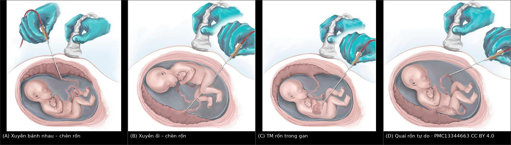
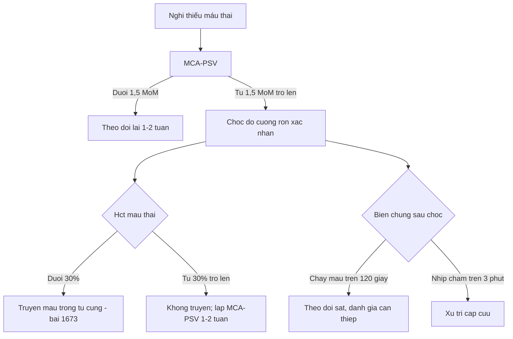
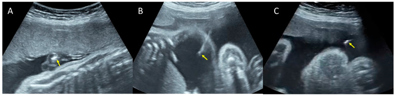

# 1989 — Chọc dò cuống rốn (cordocentesis): chọn chỗ chọc, biến chứng và theo dõi sau thủ thuật / Fetal blood sampling by cordocentesis

**Tags:** `pattern:bien-chung-thu-thuat` `pattern:chay-mau-day-ron` `pattern:nhip-cham-thai` `vung:thai-nhi` `vung:day-ron` `vung:tinh-mach-ron` `protocol:choc-day-ron` `protocol:IHUV`

**Mức chắc chắn (certainty):** tổng hợp y văn (literature synthesis) — số liệu từ **1.806 lần chọc dò cuống rốn** ở 3 trung tâm (PMC10647806), **388 lần truyền máu trong tử cung** có theo dõi thời gian chảy máu sau chọc (PMC10931764), **tổng quan quản lý bất đồng nhóm máu 2025** (PMC13344805), **kỹ thuật chọn đường vào** (PMC13344663) và **một ca nguyên văn có ảnh kim** (PMC9697820). Phần **truyền máu – thể tích – ngưỡng truyền lại** đã có bài riêng 1673; bài này chỉ giữ **phần thủ thuật chẩn đoán**.

> **Câu chốt:** chọc dò cuống rốn là thủ thuật **vào thẳng tuần hoàn thai** — biến chứng đến **trong vài giây đến vài giờ**, không phải vài ngày như chọc ối. Ba con số để nhớ: **chảy máu từ chỗ chọc 20–32%**, **xuất huyết thai–mẹ tới 40%**, **nhịp chậm 5–10%**; ở loạt 1.806 ca hiện đại, **biến chứng trong 48 giờ chỉ 1,6%** nhưng **chọc trước 17 tuần biến chứng tới 20%** (2/10). Chọn **đúng chỗ chọc** (chỗ chèn dây rốn, tĩnh mạch rốn, tránh động mạch) quan trọng hơn mọi thứ khác.

## 1. Tổng quan bệnh học – cơ chế hình ảnh (TẠI SAO)

### 1.1 Chọc dò cuống rốn để làm gì

- **Lấy máu thai trực tiếp** để: **karyotype nhanh** (24–72 giờ, khi dị tật trên siêu âm cần kết quả gấp), **chẩn đoán nhiễm trùng bào thai** (IgM, PCR CMV/toxoplasma/parvovirus), **đếm tiểu cầu** trước thủ thuật, **khí máu/thể tích hồng cầu** khi nghi thiếu máu, và **điều trị tại chỗ** (truyền máu, truyền tiểu cầu, thuốc chống loạn nhịp).
- Trong loạt **1.806** ca (1998–2019): chỉ định hay gặp nhất là **dị tật thai/nghi bất thường nhiễm sắc thể 75,1%**, sau đó **bất thường di truyền đã biết 3,9%**, **nghi nhiễm trùng 3,3%**, **chậm tăng trưởng (IUGR) 3,3%**, **phù thai 3,2%**, **nghi thiếu máu 3,0%**, **xuất huyết nội sọ thai 1,3%** (PMC10647806). Ngày nay phần lớn các chỉ định này đã được **chọc ối/CVS + CMA** thay thế; cordocentesis còn lại chủ yếu cho **thiếu máu, nhiễm trùng và điều trị**.

### 1.2 TẠI SAO biến chứng nặng hơn chọc ối — giải phẫu và vật lý

1. **Thành mạch rốn có cơ trơn dày.** Tĩnh mạch rốn **dễ chọc, dòng chảy liên tục**; **động mạch rốn có lớp cơ dày**, chọc vào dễ **co thắt mạch (vasospasm)** → **nhịp chậm** và **giảm tưới máu bánh nhau**. Chọc nhầm **động mạch** làm tăng **10,8 lần** biến chứng chu phẫu không tử vong (KTC 3,5–33,6) (PMC13344663).
2. **Lỗ chọc nằm trong mạch đang chịu áp lực thai.** Rút kim → máu chảy **từ lỗ vào nước ối**, có thể **không thấy** trên siêu âm vì máu **tan nhanh trong dịch ối**. Vì vậy phải **đo thời gian chảy máu tại chỗ** bằng Doppler màu, không chỉ "nhìn thấy khô".
3. **Xuất huyết thai–mẹ (fetomaternal hemorrhage, FMH)** xảy ra khi **đầu kim xuyên qua bánh nhau** hoặc **chọc lại nhiều lần**; nguy cơ **tới 40%**, tăng rõ khi **bánh nhau thành trước**, **thủ thuật > 3 phút**, **≥ 2 lần chọc** (PMC10647806). Hệ quả: **thiếu máu thai cấp** và, ở mẹ **Rh âm**, **tạo kháng thể anti-D** (bài 1747).
4. **Nhiễm khuẩn** đi theo **đường kim** vào tuần hoàn thai — tỷ lệ **~1%**, nhưng khi xảy ra là **nhiễm trùng huyết thai/mẹ**, không phải "viêm nhẹ".
5. **Tỷ lệ lấy được máu thai thất bại 5–10%**: kim **tuột khỏi lòng mạch** khi thai cử động, **dây rốn trượt**, hoặc **mẫu lẫn dịch ối** — lặp lại nhiều lần làm tăng FMH và chảy máu, nên **giới hạn số lần chọc**.

### 1.3 Ngưỡng định lượng — bảng số phải thuộc

| Biến chứng | Tỷ lệ | Chi tiết / yếu tố nguy cơ | Nguồn |
|---|---|---|---|
| Chảy máu từ chỗ chọc | **20–32%** | liên quan mất thai; đo bằng Doppler màu tại chỗ | PMC10647806 |
| Xuất huyết thai–mẹ | **tới 40%** | bánh nhau thành trước, > 3 phút, ≥ 2 lần chọc | PMC10647806 |
| Nhịp chậm thai | **5–10%** | thường thoáng qua; tăng khi chọc **động mạch rốn** | PMC10647806 |
| Nhiễm trùng | **~1%** | sốt, đau tử cung, dịch ối hôi | PMC10647806 |
| Không lấy được máu thai | **5–10%** | thai cử động, dây rốn trượt, lẫn dịch ối | PMC10647806 |
| Mất thai do thủ thuật | **0,6–1,9%** | loạt 1.806 ca: **1,6%** biến chứng < 48 giờ; **IUFD 0,6%** | PMC10647806 |
| Mất thai toàn bộ (mọi nguyên nhân) | **4,8%** (87/1.806) | **57,5%** có dị tật/hội chứng, **26,4%** bất thường NST, **14,9%** phù thai | PMC10647806 |
| Chọc < 17 tuần | **20%** (2/10) vs **1,4%** (26/1.796) | p = 0,02 — **tránh chọc quá sớm** | PMC10647806 |
| Chảy máu sau chọc > 120 giây | **tử vong sơ sinh 45,8%** | ở loạt 388 lần truyền máu — dấu hiệu tiên lượng xấu | PMC10931764 |

- **Ngưỡng điều trị (khi máu thai đã lấy được):** **Hct < 30%** hoặc **Hb thấp hơn trung vị > 2 SD** → **truyền máu trong tử cung**; đích sau truyền **Hb 14–16 g/dL** hoặc **Hct 40–45%**; **MCA-PSV ≥ 1,5 MoM** có **độ nhạy 86%, độ đặc hiệu 71%**, **dương tính giả ~12%** — nên cordocentesis là bước **xác nhận**, không phải bước sàng lọc (PMC13344805). Kỹ thuật truyền, thể tích và ngưỡng truyền lại: **bài 1673**.

## 2. Mẫu hình + chẩn đoán phân biệt theo vị trí (gamut)

**Mẫu hình cần nhận diện: "sau khi rút kim, thai làm sao?"** — gamut chia theo **thời điểm** và **vị trí chọc**.

- **Tại chỗ, ngay sau rút kim:**
  - **Chảy máu từ lỗ chọc** (20–32%) — tia máu/đám hồi âm trong nước ối cạnh dây rốn; **tự cầm sau 30–60 giây** ở đa số.
  - **Tụ máu dây rốn (cord hematoma)** — khối hồi âm trong Wharton's jelly, có thể **chèn ép lòng mạch** → nhịp chậm.
  - **Nhịp chậm (5–10%)** — do **co thắt động mạch**, **chèn ép dây rốn**, hoặc **phản xạ phế vị**; thường hồi phục **< 3 phút**.
- **Trong 48 giờ:**
  - **Thai lưu (0,6%** trong loạt lớn), **co tử cung (0,4%)**, **bong màng ối (chorioamniotic separation, 0,1%)**, **chọc không thành công (0,2%)** (PMC10647806).
- **Muộn (ngày–tuần):**
  - **Nhiễm trùng ối/thai (~1%)**, **rò ối/PPROM**, **thiếu máu do FMH**, **tạo kháng thể anti-D** ở mẹ Rh âm.
- **Theo vị trí chọc — gamut quyết định biến chứng:**
  - **Chỗ chèn dây rốn vào bánh nhau (placental cord insertion)** — dùng **76,9%**; dây rốn **cố định**, dễ chọc, nhưng **xuyên bánh nhau 52,1%** → **FMH cao hơn**.
  - **Quai dây rốn tự do (free loop)** — **15,2%**; **không xuyên bánh nhau** nhưng dây **di động**, khó giữ kim.
  - **Chỗ chèn vào bụng thai (fetal cord insertion)** — **1,5%**; gần thai, nguy cơ **chấn thương thai**.
  - **Tĩnh mạch rốn trong gan (IHUV)** — đường **thay thế** khi bánh nhau thành trước hoặc không tiếp cận được dây rốn; **ít FMH hơn**, nhưng kim **qua nhu mô gan**.

## 3. Bảng so sánh phân biệt (ma trận đối chiếu)

| Đường vào (approach) | Hình ảnh / kỹ thuật điển hình | Chốt vào (rule-in) | Chốt loại (rule-out) | Gợi ý xác nhận |
|---|---|---|---|---|
| **Chỗ chèn dây rốn – xuyên bánh nhau** | Kim đi **qua bánh nhau** rồi vào tĩnh mạch rốn; dùng **76,9%** ca | Bánh nhau **thành trước**, dây rốn cố định, đường kim ngắn | Bánh nhau **thành sau** hoặc dây rốn **sau thai** → khó và nguy hiểm hơn | Doppler màu xác định **tĩnh mạch** (dòng liên tục), tránh động mạch |
| **Chỗ chèn dây rốn – xuyên ối** | Kim **qua buồng ối** tới dây rốn; **không** xuyên bánh nhau | Bánh nhau **thành sau**, buồng ối trước dây rốn | Bánh nhau **thành trước** che đường đi → chọn xuyên bánh nhau | Đo **thời gian chảy máu** sau rút kim; theo dõi tim thai liên tục |
| **Quai dây rốn tự do** | Dây rốn **trôi trong ối**, không cố định; dùng **15,2%** | Dây rốn **xa bánh nhau**, tiếp cận dễ, **tránh FMH** | Thai **cử động mạnh**, dây **ngắn/trượt** → thất bại và chọc lại | Cố định nhẹ bằng tay lên bụng; **một lần chọc**, không rượt kim |
| **Tĩnh mạch rốn trong gan (IHUV)** | Kim **xuyên nhu mô gan** vào **đoạn trong gan của tĩnh mạch rốn** | Bánh nhau **thành trước**; dây rốn **không tiếp cận**; cần **ít FMH** | Nghi **bất thường gan/thai nhỏ**; **không** dùng khi cần mẫu mô gan | Doppler gan; **không** chọc vào **động mạch**; theo dõi chảy máu |
| **Chọc nhầm động mạch rốn** (biến thể tai nạn) | Máu **phun theo nhịp**, màu **đỏ tươi**, **co thắt** ngay | **Dòng phổ đập** trên Doppler; nhịp chậm ngay sau khi hút | Dòng **liên tục**, máu **sẫm** → tĩnh mạch | **Rút kim ngay**, thôi hút, theo dõi tim thai; không cố lấy thêm |

- **Ảnh ghép 4 đường vào** — dùng để chọn đường trước khi chọc (A xuyên bánh nhau, B xuyên ối, C tĩnh mạch rốn trong gan, D quai tự do):

*Ảnh minh họa giải phẫu, ghép letterbox từ 4 hình gốc — nguồn **PMC13344663**, CC BY 4.0 (không crop, không kéo giãn).*

## 4. Protocol thủ thuật + theo dõi

### 4.1 Chỉ định phải "đáng" — luôn hỏi có cách ít xâm lấn hơn không

- **Karyotype/CMA:** ưu tiên **chọc ối hoặc CVS** (bài 1954, 1988); cordocentesis chỉ khi cần **kết quả trong 24–72 giờ** hoặc không thể lấy ối/gai.
- **Thiếu máu thai:** dùng **MCA-PSV** làm sàng lọc; chỉ chọc khi **MCA-PSV ≥ 1,5 MoM** hoặc có dấu hiệu thiếu máu, vì **dương tính giả ~12%** (PMC13344805). Không chọc "để chắc" khi MCA-PSV bình thường.
- **Nhiễm trùng bào thai:** cordocentesis khi huyết thanh mẹ **không kết luận** và cần **IgM/PCR máu thai**.

### 4.2 Trước – trong – sau thủ thuật

1. **Trước:** siêu âm xác định **vị trí bánh nhau, dây rốn, thai**; đo **MCA-PSV** nếu nghi thiếu máu; **đếm tiểu cầu mẹ**; giải thích nguy cơ; **consent**; đánh dấu **trái/phải** nếu song thai.
2. **Trong:** **kim 20–22 G** dưới hướng dẫn siêu âm liên tục; vào **tĩnh mạch rốn** (dòng liên tục trên Doppler màu), **tránh động mạch**; khi cần truyền máu, **làm liệt thai bằng rocuronium** và **giữ nguyên kim** để truyền (kỹ thuật: bài 1673); **tối đa 2–3 lần chọc**, mỗi lần **< 3 phút** (yếu tố nguy cơ FMH).
3. **Sau:**
   - **Đo thời gian chảy máu tại chỗ** bằng Doppler màu; **> 120 giây** là dấu hiệu xấu (tử vong sơ sinh **45,8%** trong loạt truyền máu — PMC10931764) → theo dõi sát, cân nhắc can thiệp.
   - **Đánh giá tim thai ngay** và **theo dõi 30–60 phút**; nhịp chậm **> 3 phút** hoặc **nhịp chậm kèm mất dao động** → xử trí cấp cứu.
   - **Anti-D** nếu mẹ **Rh âm** (bài 1747).
   - **Hẹn 1–2 tuần** lặp **MCA-PSV** nếu **không truyền máu**; nếu đã truyền, theo dõi theo bài 1673.

### 4.3 Flowchart quyết định

## 5. Biến thể bình thường và cạm bẫy

- **Chảy máu ít sau chọc là bình thường:** đa số **tự cầm trong 30–60 giây**; chỉ **kéo dài > 120 giây** mới là dấu hiệu xấu. Đừng hoảng khi thấy "vệt hồi âm" trong ối — nhưng **đừng bỏ qua** khi máu tiếp tục chảy.
- **Nhịp chậm thoáng qua ≠ thai lưu:** **5–10%** ca có nhịp chậm, phần lớn hồi phục; xử trí là **ngừng kích thích, nghiêng tử cung, oxy mẹ**, không phải mổ lấy thai ngay.
- **Nhầm động mạch – tĩnh mạch:** động mạch **đập theo nhịp**, tĩnh mạch **liên tục**; hút vào động mạch gây **co thắt** và **mẫu sai** (khí máu, pH khác). Luôn bật **Doppler màu** trước khi hút.
- **Mẫu lẫn dịch ối:** làm **Hct/Hb thấp giả**; nếu kết quả **không khớp lâm sàng**, lấy lại thay vì truyền máu theo số sai.
- **Thai cử động:** đuổi theo dây rốn làm **tăng số lần chọc** và **FMH**; dùng **bàn tay ấn nhẹ** cố định hoặc chờ thai yên.
- **Chọc quá sớm:** **< 17 tuần** có biến chứng **20%** (2/10) — trì hoãn đến khi thai lớn hơn nếu không cấp cứu.
- **Song thai:** chọc **một túi** có thể **không đại diện** thai kia; ghi rõ **mẫu nào của thai nào** (bài 1988).

## 6. Tự lượng giá — Blind Quiz

**Ca 1 — Thai có dịch bụng, siêu âm can thiệp**

- Gợi ý lâm sàng: thai có **dịch bụng nặng**, cần lấy máu thai và giảm dịch.
- Câu hỏi: (a) Ba ảnh A–B–C là ba thủ thuật gì? (b) Mũi tên vàng chỉ gì? (c) Vì sao thủ thuật ở A nguy hiểm hơn B và C?

<b>Bấm để hiện đáp án (findings + chẩn đoán)</b>

- **Findings:** mũi tên vàng chỉ **đầu kim** (tăng hồi âm) trong từng thủ thuật: (A) **chọc dò cuống rốn (cordocentesis)** — đầu kim trong dây rốn; (B) **chọc hút dịch bụng (paracentesis)**; (C) **chọc ối (amniocentesis)**.
- **Chẩn đoán:** ba đường lấy mẫu/điều trị ở thai có **dịch bụng**; ca nguyên văn dùng để chẩn đoán nguyên nhân (nhiễm trùng bào thai).
- **Vì sao A nguy hiểm hơn:** A vào **tuần hoàn thai** → chảy máu, nhịp chậm, FMH, nhiễm trùng huyết thai; B/C chỉ vào **khoang dịch**, biến chứng chủ yếu là rò ối/nhiễm tại chỗ.
- **Nguồn ảnh:** Pathogens 2022 — **PMC9697820** — Figure 3 — CC BY 4.0.

**Ca 2 — Chọn đường vào ở thai có bánh nhau thành trước**

- Gợi ý lâm sàng: cần **truyền máu trong tử cung**; bánh nhau **thành trước**, dây rốn **sau thai**.
- Câu hỏi: (a) Xếp tên 4 đường vào. (b) Đường nào **ít FMH nhất**? (c) Khi nào chọn đường C?

<b>Bấm để hiện đáp án (findings + chẩn đoán)</b>

- **Findings:** (A) kim **xuyên bánh nhau** tới chỗ chèn dây rốn ở bánh nhau thành trước; (B) kim **xuyên ối** tới chỗ chèn dây rốn khi bánh nhau thành sau; (C) kim vào **tĩnh mạch rốn trong gan (IHUV)**; (D) kim vào **quai dây rốn tự do**.
- **Chẩn đoán:** lựa chọn đường vào theo **vị trí bánh nhau và dây rốn**, không theo thói quen.
- **Ít FMH nhất:** đường **C (IHUV)** và **D (quai tự do)** — không xuyên bánh nhau; **A** có **FMH tới 40%** khi bánh nhau thành trước, thủ thuật dài, chọc lại.
- **Khi chọn C:** bánh nhau **thành trước** hoặc dây rốn **không tiếp cận** được; đổi lại kim **qua nhu mô gan**.
- **Nguồn ảnh:** Pregnancy 2025 — **PMC13344663** — CC BY 4.0; ảnh ghép letterbox từ 4 hình gốc, không crop.

## Bài liên quan chéo
- [1954 – Chọc ối & sinh thiết gai nhau: biến chứng và anti-D](../1954-choc-oi-sinh-thiet-gai-nhau/lesson.md)
- [1988 – Chọc ối & sinh thiết gai nhau ở song thai](../1988-choc-oi-song-thai/lesson.md)
- [1673 – Truyền máu trong tử cung qua tĩnh mạch rốn](../1673-truyen-mau-trong-tu-cung/lesson.md)
- [1747 – Xuất huyết thai–mẹ (FMH)](../1747-xuat-huyet-thai-me/lesson.md)
- [500 – Tổng quan Vú & Sản phụ khoa](../500-tong-quan-vu-san-phu-khoa/lesson.md)

## Ảnh
- `images/1989_choc-day-ron_SieuAm_PMC9697820.jpg` — đầu kim trong cordocentesis/paracentesis/amniocentesis — Pathogens 2022 — **PMC9697820** — CC BY 4.0.
- `images/composite_duong-vao.jpg` — 4 đường vào cuống rốn — **PMC13344663** — CC BY 4.0 (composite letterbox).
- Chi tiết nguồn + giấy phép từng ảnh: `images/CREDITS.md`.

> Không dùng để chẩn đoán độc lập khi chưa có người hướng dẫn.
