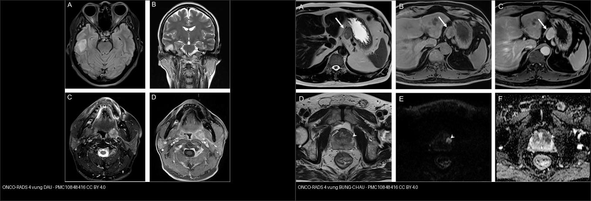
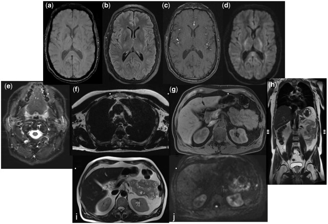
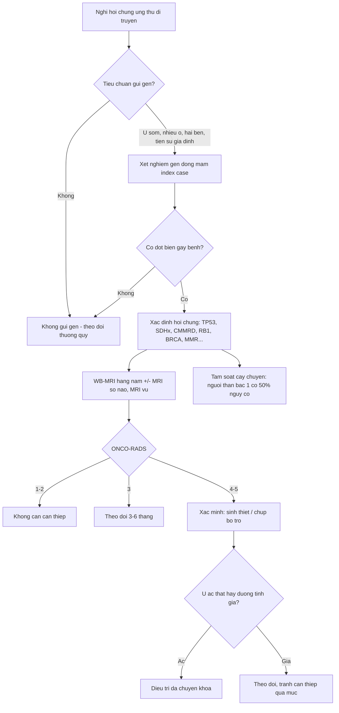
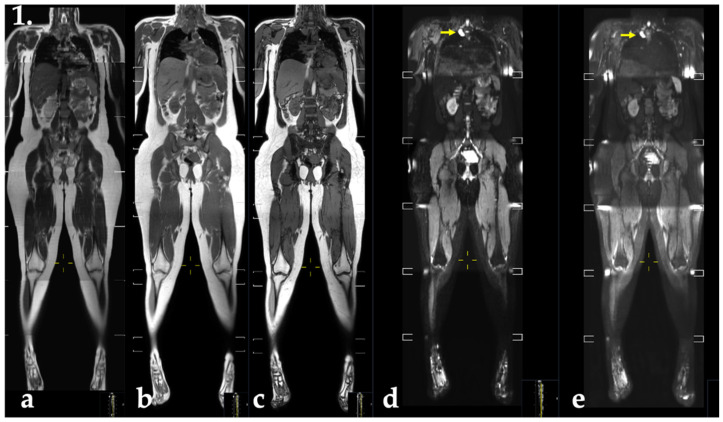
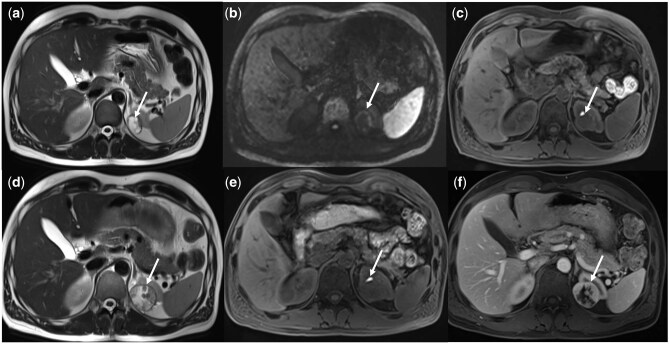
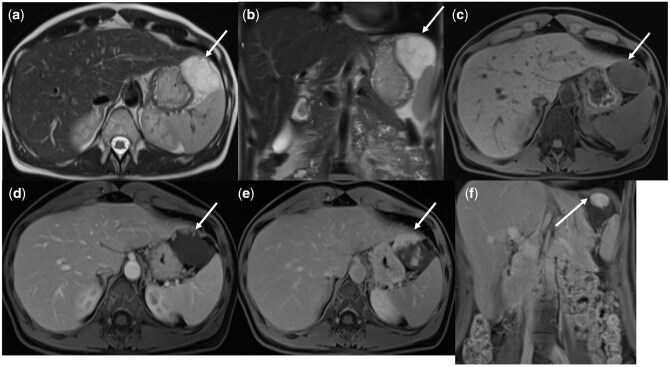
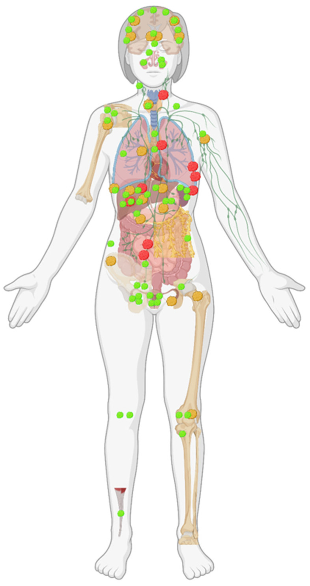
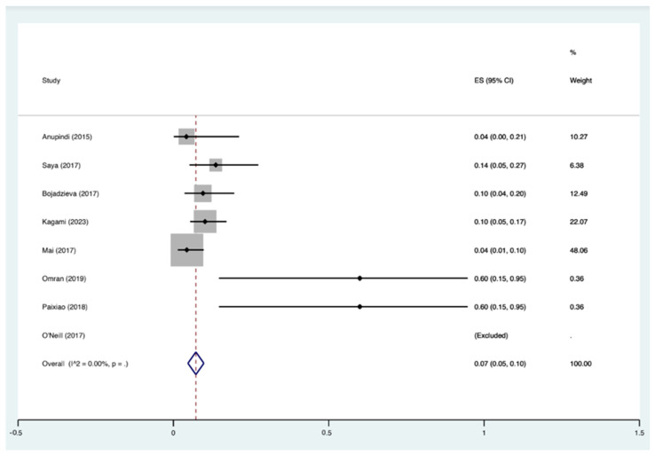

# 199 — Quy trình xét nghiệm gen & tầm soát người thân trong hội chứng ung thư di truyền / Genetic testing workflow & cascade screening in hereditary cancer syndromes

**Tags:** `pattern:tam-soat-ung-thu-di-truyen` `vung:toan-than` `score:ONCO-RADS` `protocol:WB-MRI` `incidentaloma:ton-thuong-toan-than`
**Mức chắc chắn (certainty):** tổng hợp y văn (literature synthesis) — nhóm tự biên từ y văn mở (Radiol Adv 2026 PMC13008331, J Clin Med 2024 PMC10931931, Eur Radiol 2026 PMC13035607, Cancers 2022 PMC8773910, Cancer Imaging 2024 PMC10848416, Cancers 2025 PMC11763526, Fam Cancer 2024 PMC11153258), số liệu lấy nguyên từ bài gốc.

## 1. Tổng quan — "ai gửi gen" và tại sao CĐHA là mắt xích tầm soát

- **Hội chứng ung thư di truyền (hereditary cancer syndrome):** đột biến dòng mầm (germline) gen ức chế u/ sửa chữa ADN truyền **trội** → nguy cơ ung thư **sớm, nhiều ổ, hai bên, tái phát**. Ví dụ: **TP53** (Li-Fraumeni — LFS), **SDHx** (u cận hạch/pheo di truyền), **mất bù sửa chữa lệch (CMMRD — constitutional MMR deficiency)**, **RB1** (retinoblastoma di truyền), **BRCA1/2**, **MLH1/MSH2/MSH6/PMS2** (Lynch), **PKD1/PKD2** (bài 157).
- **WHY tầm soát bằng hình ảnh, không bằng xét nghiệm máu đơn thuần:** ung thư ở nhóm này **xuất hiện ở giai đoạn chưa có triệu chứng** và có thể ở **nhiều cơ quan cùng lúc** → cần một phương thức **bao phủ toàn thân, độ tương phản mô mềm cao, không tia xạ** vì **bệnh nhân phải chụp lặp lại hằng năm nhiều thập kỷ** (nhóm LFS **nhạy cảm bức xạ** → tránh CT/PET). Đó là lý do **WB-MRI (whole-body MRI)** thay thế PET/CT cho tầm soát ở LFS/CMMRD.
- **TẠI SAO WB-MRI thấy được tổn thương (vật lý):** dựa vào **khác biệt T1/T2 của tủy xương, mô mềm, dịch** + **khuếch tán (DWI)** — tế bào ác đặc → **ADC thấp, DWI sáng** — và **các chuỗi ức mỡ (DIXON/STIR/TIRM)** làm nổi tổn thương trong mỡ. **FLAIR sọ** bắt tổn thương não; **HASTE/T2** khảo sát tạng; **DWI toàn thân** là chuỗi "chốt" bắt u.
- **Ngưỡng định lượng nằm lòng:**
  - **Nguy cơ nền LFS:** nguy cơ ung thư **~22% ở tuổi 5**, **~41% ở tuổi 18**, **gần 100% ở tuổi 70** (PMC10931931) → chính đáng chụp **hằng năm, bắt đầu từ năm đầu đời**.
  - **Hiệu quả phát hiện (yield):** WB-MRI tầm soát người **nguy cơ cao** phát hiện ung thư **5–10%**; ở người **bình thường/nguy cơ thấp** chỉ **1–2%** (PMC13008331). Gộp 8 nghiên cứu, 506 người mang **TP53**: **36/506 = 7,1% ung thư mới**, **tỉ lệ gộp 7% (95% CI 5–10)** (PMC10931931).
  - **Phản ứng phụ của tầm soát:** **phát hiện tình cờ lên tới 97%** các ca tầm soát thông thường → cần **đồng thuận trước (consent) + báo cáo chuẩn + quản lý rõ** (PMC13008331).
- **Quy trình "ai gửi gen → tầm soát người thân (cascade)":** khi một người (index case) mang đột biến, **người thân bậc một có 50% nguy cơ**; tầm soát dây chuyền (cascade) tìm người lành mang gen bằng xét nghiệm điểm đột biến đã biết của gia đình. Tại một trung tâm Anh, trung bình **1,73–1,74 xét nghiệm gia đình cho mỗi index BRCA1/2** trong 2 năm; ở Lynch **42,2% xét nghiệm tiền triệu chứng là nam** so với **25,8% ở BRCA1/2** (nghĩa là cần chủ động mời cả nam) (PMC11153258).

## 2. Mẫu hình + gamut theo HỘI CHỨNG & CƠ QUAN

- **LFS (TP53):** đa u sớm — **ung thư vú, sarcoma mô mềm/xương, u não, tuyến thượng thận (carcinoma), leukemia**. Trên WB-MRI: khối mô mềm/bone **DWI sáng/ADC thấp**, diễn tiến theo các lần chụp. **Tránh GBCA (thuốc đối quang từ) lặp lại** vì **lưu kim loại gadolinium** (PMC10931931).
- **SDHx (u cận hạch/pheo):** khối giàu mạch ở **bụng/ngực/đầu-cổ** — kết hợp với ĐTĐ (bài 168); WB-MRI + MIBG/DOTATATE.
- **CMMRD (mất bù MMR):** nhiều u ở trẻ (u não, lymphoma, u đường tiêu hóa ruột non/đại tràng) → WB-MRI nền + tầm soát ruột (nội soi).
- **Retinoblastoma di truyền (RB1):** nguy cơ **u xương/hoại tử mô mềm thứ phát** trong trường **xạ trị** → WB-MRI không tia.
- **Lynch (MMR) / FAP / BRCA / HLRCC (FH) / VHL:** tầm soát **theo cơ quan** (đại tràng/nội soi, MRI vú, MRI gan–thận — bài 156, 377), WB-MRI là bổ trợ.
- Gợi nhớ **"L-S-C-R"** khi cân nhắc **WB-MRI tầm soát nguy cơ cao**: **L**i-Fraumeni (TP53) · **S**DHx · **C**MMRD · **R**B1 di truyền.

## 3. Bảng so sánh phân biệt (ma trận đối chiếu)

| Thực thể (entity) | Hình ảnh điển hình | Chốt vào (rule-in) | Chốt loại (rule-out) | Gợi ý xác nhận |
|---|---|---|---|---|
| **U ác thật (true positive)** | Khối đặc **DWI sáng / ADC thấp**, **bờ không đều**, lớn dần giữa các lần chụp, có thể nhiều ổ | **DWI sáng + ADC thấp + tăng kích thước theo thời gian** | Ổn định nhiều năm, tín hiệu mỡ/dịch thuần → lành | Mô bệnh học; so chuỗi ảnh cũ (PMC13008331) |
| **Dương tính giả (false positive)** | Ngấm thuốc **ở thành hầu/hạch nhỏ/tuyến ức/tuyến vú lành**; nốt "bắt gặp" thoáng qua | **Tín hiệu lành ở mọi chuỗi + tự mất ở lần chụp sau** | **DWI sáng dai dẳng + lớn lên** → không được coi là lành | Chụp lại 3–6 tháng; MRI khu trú (PMC13008331, PMC13035607) |
| **Tổn thương bị bỏ sót ở lần đầu (miss)** | Tổn thương **thành ngực nhỏ, chỉ hiện trên 1 lát/thì** — nhìn thấy ở lần chụp 1 năm sau | **Chỉ 1 lát + vị trí "khuất" (thành ngực/thành bụng)** | Thấy rõ trên ≥ 2 chuỗi → ít có nguy cơ bỏ sót | Đọc có hệ thống theo vùng; DWI+HASTE (PMC13035607) |
| **Phì đại/hạch lành (mimic)** | Hạch bẹn/nách **ngấm đối xứng, hình bầu dục, có rốn mỡ** | **Đối xứng + rốn mỡ + < 1 cm** | Bờ tròn, không rốn, lớn dần → nghi ác | Theo dõi; siêu âm bổ trợ |
| **Tổn thương ONCO-RADS 4 (nghi ác)** | Khối/tổn thương **tín hiệu bất thường, ngấm hoặc DWI sáng**, chưa chắc mô học | **ONCO-RADS 4 = "nghi ác" → chỉ định xác minh (sinh thiết/chụp bổ trợ)** | ONCO-RADS 1–2 (bình thường/lành chắc) → không can thiệp | ONCO-RADS 5 = "rất nghi ác" → xử trí như ung thư (PMC10848416) |

*Trái: tổn thương **ONCO-RADS 4 vùng đầu** (T2/FLAIR). Phải: **ONCO-RADS 4 vùng bụng–chậu** (khối cạnh thận/tiểu khung). Cùng mức "nghi ác" → đều cần xác minh. Nguồn: Hu YS et al., Cancer Imaging 2024 (PMC10848416), CC BY 4.0. Ảnh ghép letterbox.*

- **Ý nghĩa ONCO-RADS (5 mức):** **1** bình thường · **2** lành chắc · **3** có thể lành · **4** nghi ác · **5** rất nghi ác. Tỉ lệ ung thư xác nhận theo mức: **0,1% (mức 2) · 5,4% (mức 3) · 42,9% (mức 4) · 75% (mức 5)** trong 2.064 người tầm soát (2,1% có mức ≥ 4; 1,2% ung thư) (PMC10848416).

## 4. Protocol WB-MRI + hệ phân độ (ONCO-RADS) + flowchart

- **Khi nào chỉ định (chỉ nguy cơ cao):** hội chứng có chỉ định rõ — **LFS (TP53), SDHx, CMMRD, RB1 di truyền**; **không** dùng WB-MRI tầm soát người nguy cơ thấp đại trà (yield 1–2%, dương tính giả/overdiagnosis, chưa có bằng chứng cải thiện sống còn) (PMC13008331).
- **Chuỗi xung tối ưu (bằng chứng mới, không cản quang):** nghiên cứu hai trung tâm (113 người LFS, 188 tổn thương: **38 ác, 120 lành, 30 chưa rõ**) cho thấy **tổ hợp FLAIR sọ + WB-HASTE (T2) + WB-DWI trục** phát hiện **toàn bộ** tổn thương ác mới → protocol **ngắn, không GBCA**, giảm gánh nặng cho bệnh nhân (PMC13035607). Với **đa chuỗi kinh điển** vẫn cần **TIRM/T2 coronal + DIXON T1** (PMC8773910, PMC13008331).
- **Lịch tầm soát LFS:** **hằng năm**: WB-MRI + **MRI sọ não** (từ năm đầu đời theo đồng thuận quốc tế); **MRI vú** riêng ở nữ mang gen (PMC10931931).
- **Trường nhìn & protocol theo ONCO-RADS 2021:** **protocol chuẩn** quét **đỉnh đầu → bàn chân** (hội chứng nguy cơ cao); **protocol ngắn** quét **đỉnh đầu → giữa đùi** (tầm soát người không triệu chứng) (PMC11763526).
- **Báo cáo:** dùng **ONCO-RADS** để chuẩn hóa mức nghi; **dương tính giả hay gặp** (ngấm thành hầu, nốt tuyến giáp/vú lành) → tránh can thiệp không cần thiết (PMC13008331, PMC13035607).

*Các chuỗi của một protocol WB-MRI tầm soát: SWI sọ (a), FLAIR (b), MRA TOF (c), DWI b = 800 (d), T2 (e–f)… Nguồn: Kierans AS et al., Radiol Adv 2026 (PMC13008331), CC BY 4.0.*

## 5. Biến thể bình thường và cạm bẫy

- **Tỉ lệ dương tính giả cao là bản chất của tầm soát:** yield thấp (nguy cơ thấp 1–2%) + phát hiện tình cờ tới **97%** → **luôn giải thích trước**; kết quả mức 3 (5,4% ung thư) không được xử trí như mức 4 (42,9%).
- **Không phải hội chứng nào cũng cần WB-MRI:** chỉ **LFS/SDHx/CMMRD/RB1** có chỉ định rõ; **BRCA/Lynch** tầm soát **theo cơ quan** (vú/đại tràng) — dùng WB-MRI đại trà không đúng.
- **Cạm bẫy bỏ sót:** tổn thương **thành ngực/thành bụng nhỏ chỉ hiện 1 lát** có thể bỏ lần đầu, chỉ thấy ở lần chụp 1 năm sau (PMC13035607) → **đọc theo vùng có checklist**, không chỉ DWI.
- **Cạm bẫy thuốc đối quang từ:** khuyến cáo **hạn chế GBCA lặp lại** ở LFS (lưu gadolinium) → ưu tiên protocol **không cản quang** (FLAIR + HASTE + DWI).
- **Tâm lý–đạo đức:** thông tin bất định (mức 3) gây lo lắng, chụp thêm, chi phí; **báo cáo thân thiện với người bệnh** kèm tư vấn di truyền (PMC13008331).
- **Cascade là "xét nghiệm điểm đột biến", không phải giải trình tự cả gen:** tránh chi phí và tránh "biến thể không rõ ý nghĩa" ở người thân (PMC11153258).

## 6. Tự lượng giá — Blind Quiz

**Ca 1 — Người lành mang TP53, chụp WB-MRI nền (coronal, nhiều chuỗi).**

- Hỏi: đây là chuỗi gì? Vì sao dùng ức mỡ? Nhìn cột ảnh, dấu hiệu bất thường nằm ở đâu?

<b>Bấm để hiện đáp án (findings + chẩn đoán)</b>

- **Findings:** ảnh **coronal toàn thân**: (a) T2/TIRM, (b) T1 DIXON in-phase, (c) out-of-phase (giảm tín hiệu tủy)… **mũi tên vàng** chỉ vùng bất thường ở **ngực trên/vai** cần xác minh.
- **Cơ chế:** chuỗi **ức mỡ/out-of-phase** triệt mỡ nền → **tổn thương mô mềm/tủy bệnh nổi rõ**; DIXON tách nước–mỡ giúp định tính mỡ/dịch.
- **Chẩn đoán:** ca nằm trong chương trình **tầm soát LFS** — 19/61 người (31%) cần xác minh, 3 người (16%) phát hiện ung thư không triệu chứng.
- Nguồn: Omran M et al., Cancers 2022 (PMC8773910), CC BY 4.0.

**Ca 2 — Người lành mang gen, WB-MRI phát hiện khối.**

- Hỏi: dấu hiệu nào gợi tổn thương ác thật? Khác gì ca 3?

<b>Bấm để hiện đáp án (findings + chẩn đoán)</b>

- **Findings:** khối **tín hiệu bất thường nhiều mặt cắt**, mũi tên **chỉ rõ trên nhiều chuỗi (T2/DWI/T1 sau tiêm)**, tăng theo dõi.
- **Chẩn đoán:** **dương tính thật** — xác nhận ung thư. Chốt: **thấy trên ≥ 2 chuỗi + DWI sáng**.
- Nguồn: Kierans AS et al., Radiol Adv 2026 (PMC13008331), CC BY 4.0.

**Ca 3 — Bệnh nhân không triệu chứng, WB-MRI có "ổ bất thường" ở vùng hầu.**

- Hỏi: vì sao đây là **dương tính giả**? Cách tránh can thiệp không cần thiết?

<b>Bấm để hiện đáp án (findings + chẩn đoán)</b>

- **Findings:** **ngấm thuốc ở thành hầu** và cấu trúc lành khác, **không có đặc điểm ác** trên các chuỗi → **dương tính giả**.
- **Chốt:** tín hiệu lành ở mọi chuỗi + không tăng kích thước → **theo dõi**, không sinh thiết mù.
- Nguồn: Kierans AS et al., Radiol Adv 2026 (PMC13008331), CC BY 4.0.

**Ca 4 — "Bản đồ" phân bố tổn thương phát hiện trên WB-MRI tầm soát (toàn cơ thể).**

- Hỏi: tổn thương tập trung ở vùng nào? Vì sao cần bản đồ phân bố?

<b>Bấm để hiện đáp án (findings + chẩn đoán)</b>

- **Findings:** sơ đồ người **xanh = lành, vàng = chưa rõ, đỏ = ác**, phân bố khắp cơ thể (đầu-cổ/ngực/bụng-chi).
- **Ý nghĩa:** nhắc người đọc **soát toàn thân theo vùng** (không bỏ sót vùng "chỉ 1 lát"), và thấy **tỉ lệ chưa rõ (vàng)** lớn → nguồn dương tính giả.
- Nguồn: Omran M et al., Cancers 2022 (PMC8773910), CC BY 4.0.

**Ca 5 — Đọc đồ thị gộp: WB-MRI phát hiện ung thư ở người mang TP53 bao nhiêu %?**

- Hỏi: tỉ lệ gộp là bao nhiêu? Vì sao vẫn cần chuẩn hóa protocol?

<b>Bấm để hiện đáp án (findings + chẩn đoán)</b>

- **Findings:** **36/506 (7,1%) ung thư mới**; **tỉ lệ gộp 7% (95% CI 5–10)**; tuổi trung bình 34,6 ± 16,3.
- **Kết luận:** WB-MRI hiệu quả phát hiện sớm ở LFS nhưng **thiếu chuẩn hóa protocol quốc tế** → cần thống nhất (DWI/HASTE/FLAIR).
- Nguồn: Temperley HC et al., J Clin Med 2024 (PMC10931931), CC BY 4.0.

## Bài liên quan chéo
- [156 – Hội chứng di truyền u thận: VHL/BHD/HLRCC/TSC/SDH](../156-hoi-chung-di-truyen-u-than/lesson.md)
- [198 – Li-Fraumeni (TP53): Chompret, phổ u lõi & tư vấn di truyền](../198-li-fraumeni-tp53-chompret-tu-van/lesson.md)
- [690 – CMMRD ở trẻ: u não, đa polyp, café-au-lait & lịch tầm soát](../690-cmmrd-tam-soat-wb-mri-o-tre/lesson.md)
- [377 – U dây thần kinh dạng đám rối & chuyển dạng MPNST ở NF1](../377-u-than-kinh-dang-dam-roi-va-mpnst-nf1/lesson.md) (WB-MRI theo dõi NF1)
- [168 – U tủy thượng thận & u cận hạch (SDHx)](../168-pheo-paraganglioma/lesson.md)
- [514 – Ung thư vú: TNM & MRI lan rộng](../514-ung-thu-vu-TNM-MRI-lan-rong/lesson.md) (MRI vú tầm soát BRCA)
- [157 – Bệnh thận đa nang ADPKD/ARPKD](../157-benh-than-da-nang-adpkd-arpkd/lesson.md)

## Ảnh
- Tên file: `199_slug_Modality_SourceID.jpg`. Nguồn + giấy phép từng ảnh trong `images/CREDITS.md`.
- Toàn bộ ảnh dùng đều **CC BY 4.0** (PMC13008331, PMC8773910, PMC10848416, PMC10931931) → ảnh ghép letterbox nền đen hợp lệ.

> Không dùng để chẩn đoán độc lập khi chưa có người hướng dẫn.
