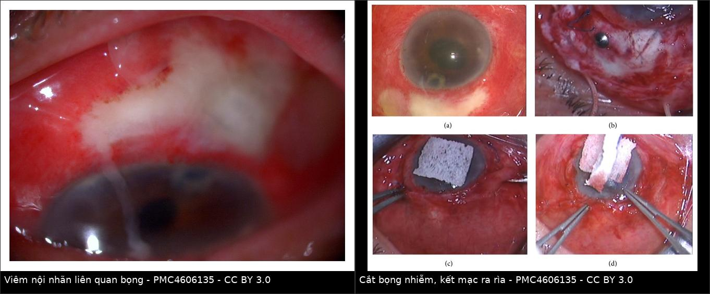
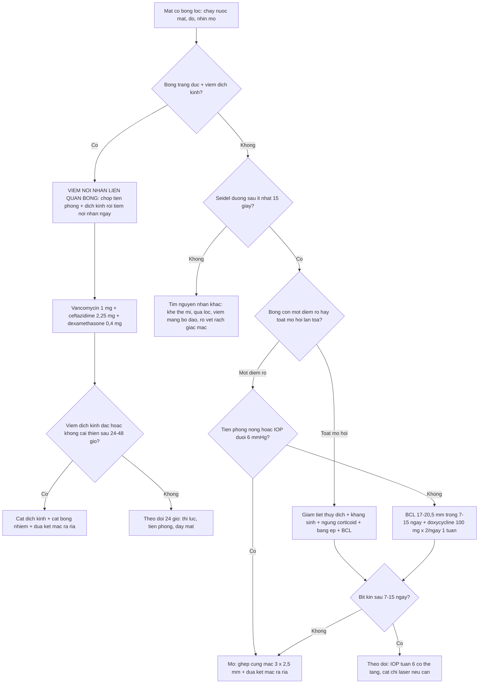
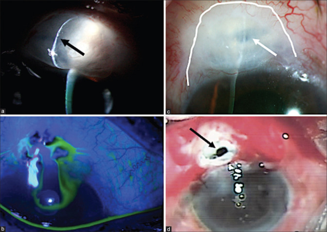
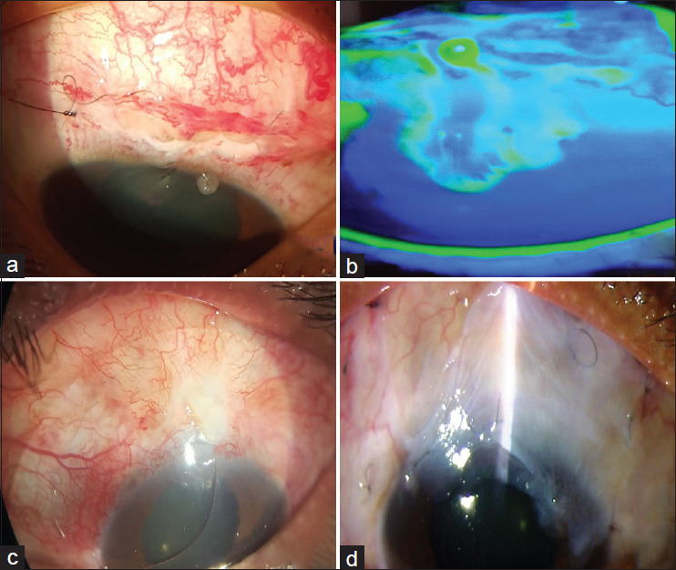
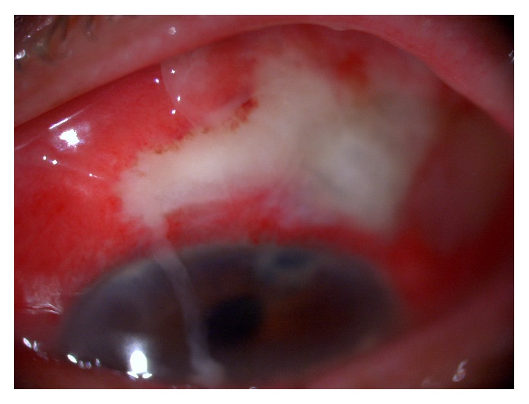
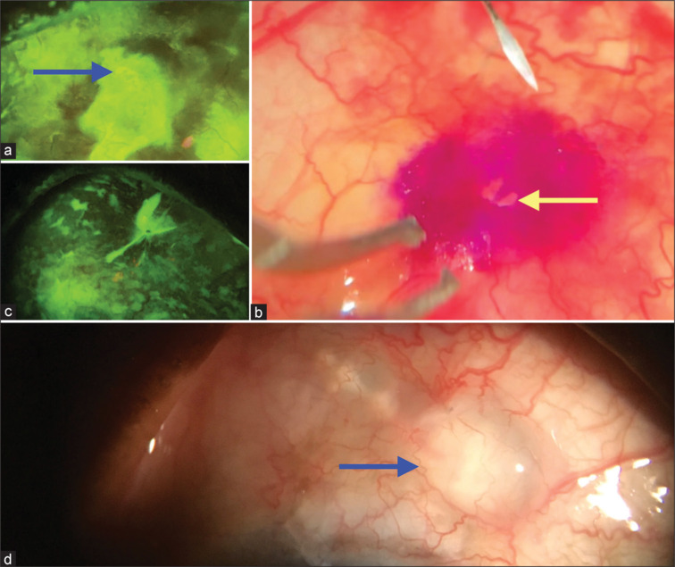

# 1991 — Rò bọng lọc muộn & viêm nội nhãn liên quan bọng: "mắt ướt" nào là cấp cứu / Late bleb leak and bleb-related endophthalmitis

**Tags:** `pattern:ro-bong-loc` `pattern:seidel-duong` `pattern:bong-mong-avascular` `pattern:blebitis` `pattern:viem-noi-nhan` `pattern:hypotony-maculopathy` `pattern:mu-tien-phong` `vung:mat` `vung:ket-mac` `vung:tien-phong` `vung:the-mi` `protocol:seidel` `protocol:den-khe` `protocol:AS-OCT` `protocol:UBM` `protocol:tiem-noi-nhan` `protocol:PPV` `score:IOP`

**Mức chắc chắn (certainty):** tổng hợp y văn (literature synthesis) — ghép **1 loạt 18 mắt sửa rò muộn bằng ghép củng mạc + đưa kết mạc** (Pathak Ray & Badakere, *Indian J Ophthalmol* 2021, PMC8544101, CC BY-NC-SA 4.0), **1 tổng quan bậc thang xử lý bọng rò/quá lọc** (Singh A et al., *Indian J Ophthalmol* 2025, PMC12013292, CC BY-NC-SA 4.0), **1 loạt 34 ca cấy dương viêm nội nhãn liên quan bọng** (Ba'arah & Smiddy, *Middle East Afr J Ophthalmol* 2009, PMC2813581, CC BY 2.0), **1 loạt 11 mắt BRE cắt dịch kính / 2.018 mắt trab + MMC** (Ohtomo K et al., *J Ophthalmol* 2015, PMC4606135, CC BY 3.0) và **1 ca rò ở đúng đường vào kim sau needling** (Lambat SP et al., *Indian J Ophthalmol* 2025, PMC12507186, CC BY-NC-SA 4.0). Chỗ suy luận được ghi rõ "suy luận"; chỗ y văn chưa có số cho người Việt ghi "chưa rõ".

> **Vì sao bài này quan trọng:** sau trabeculectomy, **mắt "ướt" là dấu chứ không phải phiền toái**: một lỗ rò nhỏ trên bọng mỏng không mạch là **cửa vào trực tiếp của vi khuẩn vào tiền phòng–dịch kính**. Cùng một triệu chứng "chảy nước mắt, hơi đỏ, hơi mờ" có thể là **rò lành tính tự bịt** hoặc **khởi đầu của viêm nội nhãn mất thị lực trong 24–48 giờ**. Bài trả lời 3 câu: **(1) rò thật hay chỉ là bọng "toát mồ hôi"? (2) đã nhiễm chưa? (3) bậc thang nào, và khi nào phải mổ thay vì theo dõi?** Nối [1983](../1983-duc-the-thuy-tinh-sau-trabeculectomy/lesson.md) (phaco phá bọng) và [1425](../1425-viem-noi-nhan-sau-tiem-noi-nhan/lesson.md) (viêm nội nhãn sau tiêm).

## 1. Tổng quan bệnh học – cơ chế hình ảnh: vì sao bọng rò thì nhãn áp tụt, và vì sao tụt áp rồi nhiễm

### 1.1 Cân bằng thủy dịch: một lỗ 0,1 mm đủ làm sập nhãn áp

- **Phương trình Goldmann** (sinh lý kinh điển): **IOP = F/C + P_v**, với **F** lưu lượng tạo thủy dịch **≈ 2,5–3 µL/phút**, **C** hệ số thoát **≈ 0,22–0,30 µL/phút/mmHg**, **P_v** áp lực tĩnh mạch thượng củng mạc **≈ 8–10 mmHg**. Nhãn áp **không phải "lượng nước" mà là "sức cản"**: trabeculectomy hạ áp vì **tạo thêm một đường thoát có sức cản gần bằng 0**.
- **Vì sao rò làm IOP sụp chứ không "hạ vừa":** một điểm rò **0,1 mm** đã có tiết diện lớn hơn nhiều lần so với đường thoát sinh lý đang bị bít; nước thoát theo **chênh áp**, nên khi có "van mở" cố định, áp trong mắt chỉ còn đủ để thắng **sức căng bề mặt + trở lực của lỗ**. Kết quả là **IOP 0–6 mmHg**, không phải 12–14 mmHg. Trong loạt 18 mắt rò muộn: **IOP trước sửa 6,3 ± 3,8 mmHg** (khoảng **1–14 mmHg**), **66,7% (12/18)** có **IOP ≤ 6 mmHg kèm bệnh hoàng điểm do hạ nhãn áp** (PMC8544101).
- **Nghịch lý "rò mà IOP 12–14 mmHg" có thật:** trong cùng loạt trên, **3 mắt** rò kín đáo vẫn **Seidel dương** dù IOP đã **12–14 mmHg** sau needling — vì lỗ rò rất nhỏ, thoát chậm, và trở lực phần còn lại của bọng còn cao. **Bài học: IOP bình thường KHÔNG loại trừ rò** (xem mục 5).

### 1.2 Vì sao MMC sinh ra đúng loại bọng dễ rò: mỏng, không mạch, "vòng thép"

- **Mitomycin C (MMC)** alkyl hóa DNA, ức chế nguyên bào sợi **cả pha nghỉ lẫn pha chia**, mạnh hơn 5-FU **~100 lần** về ức chế tăng sinh nguyên bào sợi (PMC12013292). Hệ quả mong muốn: ít xơ dưới kết mạc → bọng thoát tốt, bền. Hệ quả không mong muốn: **biểu mô kết mạc mỏng, giảm tế bào đài, mất mạng mạch nuôi**.
- **Cơ chế rò theo thời gian (barotrauma):** bọng mỏng chịu **áp lực thủy dịch đập theo nhịp** + **ma sát mi khi chớp** + **tăng áp do Valsalva** → biểu mô mỏng dần **rồi thủng điểm (pinpoint breakdown)**. Vùng MMC **khu trú** tạo **"ring of steel"** — vòng xơ cứng ở rìa bọng giữ nước lại, làm **trung tâm bọng căng và mỏng nhất** (đúng nơi thủng). Khi lớp kết mạc mất, **củng mạc bên dưới cũng tiêu (scleral melt)** và tạo **dò củng mạc thật (scleral fistula)** — trong 18/18 mắt của loạt sửa rò, **tất cả đều có dò củng mạc toàn lớp khi mổ** (PMC8544101).
- **Tần suất (số phải nhớ):** rò bọng sau trab có antimetabolite **1,8–12,9%**; **rò muộn 3–13%**; **MMC gây rò gấp ~3 lần 5-FU** (PMC12013292). Trong nghiên cứu 5 năm trab + MMC của Bindlish (được PMC8544101 dẫn): **15,6% rò muộn**, xuất hiện sau trung bình **27,9 ± 24,6 tháng**. Trong loạt sửa rò: **thời gian từ trab đến rò 96 ± 64,4 tháng** (trung vị **85 tháng**, khoảng **19–228 tháng**) — tức **rò muộn có thể đến sau 19 NĂM**, không có mốc "hết nguy cơ".
- **Vì sao vẫn có ca bọng rò dù kỹ thuật tốt:** chính tác giả loạt 18 mắt ghi nhận chỉ **5/18** ca do chính mình mổ, ước tính **~1 ca rò / ~300 ca mổ lọc** khi áp dụng Moorfields Safer Surgery System (**MMC 0,4 mg/mL × 2 phút, áp lan tỏa nhiều miếng, vạt kết mạc nền fornix, vạt củng mạc chữ nhật**) (PMC8544101). **Suy luận:** phần lớn rò đến từ **cách áp MMC khu trú** hơn là từ tay nghề mổ nói chung.

### 1.3 Vì sao rò thành viêm nội nhãn: đường vào, vi khuẩn, và tốc độ

- **Đường vào:** lỗ rò là **lỗ thông cơ học** giữa túi kết mạc (nơi có **hệ vi khuẩn chí** của mí, túi lệ, kính tiếp xúc) và **tiền phòng**. Không có hàng rào nào ở giữa. Vì vậy **rò bọng là yếu tố nguy cơ được ghi nhận của viêm nội nhãn liên quan bọng (bleb-related endophthalmitis, BRE)**: trong loạt BRE cắt dịch kính, **7/11 mắt (64%)** có rò bọng **ngay lúc khởi phát** (PMC4606135); trong loạt 34 ca cấy dương, **12%** có **rò vết mổ**, **29%** có **"vitreous wick"** (dải dịch kính lòi ra qua lỗ rò) (PMC2813581).
- **Vi khuẩn:** **Streptococcus** đứng đầu (**55%** dịch kính; *S. viridans* và *S. faecalis* mỗi loại **18,2%**), rồi **tụ cầu coagulase âm** (**20%**), **đa khuẩn 27%** — cao hơn hẳn **9,3%** của viêm nội nhãn sau phaco trong nghiên cứu EVS (PMC2813581). Ở loạt Nhật, **55%** là **vi khuẩn độc lực cao (HPB: Streptococcus, Enterococcus faecalis, Gram âm)** và **HPB là yếu tố tiên lượng thị lực xấu duy nhất có ý nghĩa** (p = 0,031; thị lực cuối logMAR **4,0** ở nhóm HPB vs **0,7** ở nhóm không HPB) (PMC4606135).
- **Tần suất BRE:** **0,2–1,3%** chung; **tới ~3%** khi dùng antimetabolite; **tới 9,4%** khi **bọng đặt ở nửa dưới** (không được mi che) (PMC2813581). Đa trung tâm Nhật: **nhiễm liên quan bọng tích lũy 2,2% trong 5 năm**, và **14,3%** các ca nhiễm đó cần **cắt dịch kính** (PMC4606135 dẫn). Y văn cũng dẫn **tần suất năm 1,1–5,4%** — **chưa rõ** con số cho Việt Nam.
- **Thời điểm:** **trung bình 51,5 ± 58 tháng** sau mổ lọc, khoảng **0,03–249,3 tháng**; **15%** khởi phát **< 2 tuần** (PMC2813581). Loạt Nhật: **7,4 năm** (1–16 năm) (PMC4606135). Kết luận thực hành: **theo dõi vô thời hạn**, không "ổn định 1 năm là xong".
- **Vì sao mất thị lực nặng:** độc tố liên cầu + tụ mủ dịch kính + hoại tử võng mạc nhanh; trong loạt 34 ca: **chỉ 47% đạt ≥ 20/400**, **24% không còn nhận thức ánh sáng**, **21% phải múc/ảnh nhãn cầu** (PMC2813581).

### 1.4 Vì sao đèn khe NHÌN THẤY dòng rò (vật lý quang học)

- **Fluorescein** hấp thụ ánh sáng **xanh 465–490 nm** và phát **xanh lá 520–530 nm**. Một **giọt dày** trên kết mạc bị **nội lọc (quenching)** và hiện **vàng–cam**; khi **thủy dịch trong** pha loãng và **rửa trôi** lớp fluorescein, nó thành **màng cực mỏng** → **phát xanh rực**. Vì vậy **dòng xanh chảy ra từ một điểm** không chỉ là "thuốc nhuộm" mà là **bằng chứng của dòng nước**: hướng và tốc độ dòng xanh = hướng và lưu lượng rò.
- **Vì sao cần đèn cobalt + kính lọc chắn vàng:** kính chắn cắt ánh kích thích xanh phản xạ, chỉ cho **huỳnh quang xanh lá** đi vào mắt người khám → tương phản tăng nhiều lần; nếu không có kính lọc, dòng rò rất mờ bị "chìm" trong ánh xanh.
- **Vì sao phải đợi ≥ 15 giây:** rò **chậm** chỉ cho **một vệt mỏng, lan chậm**; tác giả loạt 18 mắt ghi rõ **"phải quan sát ít nhất 15 giây sau khi áp thanh fluorescein ướt"** — nhiều ca **bỏ sót vì nhìn lướt** (PMC8544101).
- **Vì sao thấy "vùng xám" dưới kết mạc mỏng = củng mạc đã tiêu:** củng mạc mỏng/khuyết để **sắc tố hắc mạc–thể mi** lộ qua; trên **lát cắt quang học ở độ phóng đại cao** thấy **một chỗ lõm**. Đây là dấu **tiên lượng cần ghép củng mạc**, không chỉ khâu kết mạc.
- **Vì sao hypotony làm hoàng điểm nhăn:** khi IOP rất thấp, thành củng mạc mất sức căng → **hắc mạc–võng mạc dư thừa tương đối** → **nếp gấp hoàng điểm**, nhìn trên OCT là **nếp gấp hắc mạc–võng mạc**; thị lực giảm dù đáy mắt "không có bệnh võng mạc". Trong loạt sửa rò, **66,7%** mắt có tình trạng này và **hồi phục sau khi bịt rò**, nhưng **22,3%** còn **nếp gấp tồn dư** dù thị lực cải thiện (PMC8544101).

### 1.5 Vì sao mắt nhiễm lại "trắng đục" mà không phải lúc nào cũng có mủ tiền phòng

- **Bọng trắng đục** = **thấm nhập bạch cầu + fibrin + hoại tử biểu mô** tại chỗ nhiễm; đây là dấu **sớm và đáng tin** hơn mủ tiền phòng.
- **Mủ tiền phòng chỉ có ở 53%** ca BRE cấy dương (kích thước trung bình **0,57 ± 0,67 mm**) (PMC2813581) — vì phản ứng có thể **khu trú ở bọng/dịch kính**, hoặc đã bị **rửa bớt** khi rò mạnh. **Suy luận:** "không có mủ tiền phòng" là lý do hay làm **trễ chẩn đoán** nhất.
- **Vì sao phân biệt với blebitis quan trọng:** **blebitis** = nhiễm **giới hạn ở bọng/tiền phòng** (bọng trắng, tiền phòng có phản ứng, **KHÔNG có viêm dịch kính**); **BRE** = đã có **viêm dịch kính** (thấy mờ đỏ ánh đồng tử, giảm thị lực, đau nhiều). Ranh giới này quyết định **nhỏ thuốc + theo dõi 24 giờ** hay **chọc dịch kính + cắt dịch kính**.

## 2. Mẫu hình + chẩn đoán phân biệt theo thời điểm và theo lưu lượng (gamut)

**Ba câu hỏi với mọi mắt có bọng "ướt":** **(1) rò thật hay chỉ "toát mồ hôi"? (2) IOP bao nhiêu và tiền phòng có nông? (3) đã có dấu hiệu nhiễm (bọng trắng + viêm dịch kính)?**

- **Theo thời điểm:**
  - **Rò sớm (≤ 3 tháng, thường ≤ 1 tháng):** do **chấn thương kết mạc khi mổ, thủng kết mạc (buttonhole), hở mép vạt, chỉ khâu bung**; y văn ghi **0–30%** (PMC12013292). Hình ảnh: **hở dọc mép vạt**, rò thành **dòng**, tiền phòng **nông**.
  - **Rò muộn (> 3 tháng, đỉnh 1–19 năm):** do **bọng mỏng không mạch + barotrauma → thủng điểm → dò củng mạc**; **3–13%** sau có antimetabolite (PMC12013292). Hình ảnh: **bọng dạng nang, treo lệch (overhanging), "ring of steel", điểm thủng tí xíu**. Đây là **kiểu rò của bài này**.
- **Theo lưu lượng (quyết định xử trí):**
  - **Toát mồ hôi (sweating bleb)** — **thấm dịch lan tỏa** qua thành bọng, **không có một điểm phun**; Seidel có thể **dương lan tỏa** hoặc **âm**. Bản chất là **quá lọc (over-filtration)**, không phải lỗ thủng; loạt sửa rò **loại trừ nhóm này** vì cách xử lý khác (PMC8544101).
  - **Rò điểm (point leak)** — **một điểm Seidel dương**, có dòng xanh rõ; thường **IOP thấp–rất thấp**.
  - **Rò thành dòng (brisk leak)** — **nước chảy thành tia**, tiền phòng **nông–dẹt**, nguy cơ **hội chứng tiền phòng nông – hắc mạc tràn dịch**, cần **mổ sớm**.
- **Theo IOP:** rò **IOP bình thường (12–14 mmHg)** / rò **hạ nhãn áp (≤ 6 mmHg)** / **bệnh hoàng điểm do hạ nhãn áp** (nhăn hoàng điểm, thị lực giảm).
- **Theo nhiễm:** **bọng mỏng không nhiễm** → **blebitis (bọng trắng + phản ứng tiền phòng, không viêm dịch kính)** → **BRE (viêm dịch kính)**.
- **Gamut "mắt đỏ đau sau trabeculectomy" (bắt buộc loại trừ):** **BRE** · **blebitis** · **viêm màng bồ đào sau mổ** · **thiếu biểu mô giác mạc do BCL** · **rò vết mổ giác mạc hoặc hở vạt** · **hội chứng tiền phòng nông do quá lọc** · **viêm nội nhãn sau needling** · **viêm củng mạc**.
- **Gamut "IOP thấp sau trabeculectomy":** **quá lọc** · **rò bọng** · **khe thể mi (cyclodialysis cleft)** · **"tắt" thể mi do thuốc/viêm (ciliary shutdown)** · **bong võng mạc** · **teo nhãn cầu** · **van dẫn lưu quá thoát**.

## 3. Bảng so sánh phân biệt (ma trận đối chiếu)

| Thực thể (entity) | Hình ảnh điển hình (đèn khe / AS-OCT / UBM) | Chốt vào (rule-in) | Chốt loại (rule-out) | Gợi ý xác nhận |
|---|---|---|---|---|
| **Rò bọng muộn do dò củng mạc** | Bọng **dạng nang, treo, thành cực mỏng, không mạch**, **"ring of steel"**; **điểm thủng tí xíu**; **vùng xám** dưới kết mạc | **Seidel dương ≥ 15 giây từ MỘT điểm + IOP ≤ 6 mmHg + bọng mỏng không mạch nhiều năm sau trab** | **Seidel âm + bọng còn vi nang + thành dày** → không phải rò | Đèn khe cobalt + kính vàng; chụp ảnh/video dòng rò; AS-OCT đo độ dày thành |
| **Bọng "toát mồ hôi" quá lọc (sweating)** | Bọng **ca, căng, lan tỏa**, **không có điểm phun**; tiền phòng có thể nông; AS-OCT: khoang dịch **rộng**, thành **không khuyết** | **Thấm dịch lan tỏa toàn thành bọng + không xác định được một điểm rò** | **Một điểm xanh rõ + lỗ nhìn thấy** → rò điểm | Seidel lan tỏa; IOP; thử băng ép 24 giờ |
| **Blebitis (nhiễm khuẩn khu trú bọng)** | **Bọng trắng đục, quanh bọng xung huyết**, có thể **mủ tiền phòng nhẹ**; **KHÔNG viêm dịch kính** | **Bọng trắng + đau + phản ứng tiền phòng nhưng ánh đồng tử còn đỏ, thấy rõ đáy mắt** | **Viêm dịch kính (mất ánh đỏ, không thấy chi tiết) → BRE** | Đèn khe + soi đáy mắt; theo dõi 24 giờ sau kháng sinh |
| **Viêm nội nhãn liên quan bọng (BRE)** | **Bọng trắng**, tiền phòng **mủ (chỉ 53%)**, **viêm dịch kính**, có thể **vitreous wick**; đau nhiều | **Bọng trắng + viêm dịch kính + giảm thị lực nhanh (giờ–ngày) + rò bọng** | **Đáy mắt thấy rõ, không viêm dịch kính** → blebitis; **chỉ đau không mờ** → tìm nguyên nhân khác | Chọc tiền phòng + dịch kính **trước** khi tiêm kháng sinh; cấy |
| **Bệnh hoàng điểm do hạ nhãn áp** | **IOP ≤ 6 mmHg**, **nếp gấp hắc mạc–võng mạc ở hoàng điểm** trên OCT, có thể **phù gai**; bọng quá lớn/rò | **IOP thấp kéo dài + nếp gấp hoàng điểm + thị lực giảm không giải thích** | **OCT hoàng điểm bình thường** → tìm nguyên nhân thị lực khác | OCT hoàng điểm; đo IOP 3 lần; tìm rò/khe |
| **Rò ở đường vào kim sau needling** | **Bọng còn cao**, **một hoặc hai lỗ nhỏ ở ĐIỂM VÀO KIM** (phía sau bọng), khó thấy dưới kính hiển vi; **IOP 0 mmHg** | **Tiền sử needling gần đây + IOP rất thấp + Seidel dương ở vị trí đường vào kim** | **Rò ở đỉnh bọng** → cơ chế dò củng mạc khác | **Nhuộm kết mạc bằng bút dạ phẫu thuật** để lộ 2 lỗ; thử băng ép 24 giờ trước |
| **Khe thể mi (cyclodialysis cleft)** | Bọng **có thể bình thường/không có**; **tiền phòng sâu**, IOP thấp; **UBM/AS-OCT thấy tách thể mi–củng mạc** | **IOP thấp + tiền phòng SÂU + không tìm được rò + tiền sử chấn thương/MIGS** | **Seidel dương rõ ở bọng** → rò là nguyên nhân | Gonioscopy + UBM; xem [1962](../1962-rach-the-mi-goc-re/lesson.md), [1447](../1447-rach-the-mi-sau-migs-va-yamane/lesson.md) |
| **Rò vết mổ giác mạc sau phaco** | **Vết rạch giác mạc hở**, tiền phòng nông, Seidel ở **rìa giác mạc** chứ không ở bọng | **Seidel dương tại vết rạch + tiền sử phaco gần đây** | **Seidel chỉ ở bọng** → rò bọng | Đèn khe; khâu lại vết rạch nếu hở |
| **Viêm màng bồ đào sau mổ (vô khuẩn)** | Tiền phòng có **tế bào + flare**, **bọng không trắng**, **không viêm dịch kính**, đáp ứng corticoid | **Đáp ứng nhanh corticoid + bọng trong + không rò** | **Bọng trắng đục + không đáp ứng corticoid sau 24 giờ** → nhiễm | Thử corticoid; cấy nếu không cải thiện |

*Trái: bọng trắng đục lan rộng, xung huyết kết mạc, tiền phòng mờ — **BRE**. Phải: (a) trước mổ; (b) cắt bỏ bọng nhiễm sau cắt dịch kính; (c) đưa kết mạc ra che vạt củng mạc; (d) khâu kết mạc vào rìa bằng chỉ nylon 10-0. Nguồn: Ohtomo K et al., *J Ophthalmol* 2015 (**PMC4606135**), CC BY 3.0. Ảnh ghép letterbox, không crop.*

### Ba dấu hiệu chốt trên đèn khe (đọc theo thứ tự)

1. **Nhìn thành bọng ở lát cắt quang học:** mỏng như **giấy** + **không mạch** + **treo lệch** = bọng nguy cơ; **vùng xám lõm dưới kết mạc** = củng mạc đã tiêu.
2. **Seidel có kính lọc vàng, đợi ≥ 15 giây:** dòng xanh **từ một điểm** = rò điểm; xanh **lan tỏa** = toát mồ hôi.
3. **Soi đáy mắt qua đồng tử:** còn **ánh đỏ và thấy rõ chi tiết** = chưa viêm dịch kính; **mất ánh đỏ, chỉ thấy đỏ mờ** = **BRE cho đến khi chứng minh ngược**.

## 4. Protocol chụp – khám + hệ phân độ và bậc thang xử trí

### 4.1 Seidel test chuẩn hóa (5 bước, làm đúng thứ tự)

1. **Không ấn nhãn cầu, không kéo mi mạnh** trước khi đọc (ấn sẽ **đẩy thủy dịch ra** và tạo dòng rò giả).
2. **Thanh fluorescein 0,6 mg** làm ướt bằng nước muối, **chấm nhẹ lên kết mạc sát bọng** (không chấm lên đỉnh bọng nếu bọng quá mỏng).
3. **Đèn khe cobalt xanh + kính lọc chắn vàng**, độ phóng đại **10–16×**, bệnh nhân **nhìn xuống**, **mi trên để tự nhiên**.
4. **Quan sát liên tục ≥ 15 giây** ở **cả 4 hướng** quanh bọng; bệnh nhân **chớp vài lần** để bắt rò "theo nhịp" (rò chỉ xuất hiện khi có dòng).
5. **Ghi lại bằng ảnh/video** cùng góc, cùng đèn; **đo IOP** (ghi loại nhãn áp kế), **độ sâu tiền phòng** (đèn khe hoặc AS-OCT), tìm **Seidel ở vết rạch** và **vitreous wick**.

### 4.2 Phân độ lưu lượng rò (dùng để chọn bậc điều trị)

| Độ | Mô tả trên đèn khe | IOP điển hình | Nguy cơ | Hướng xử trí |
|---|---|---|---|---|
| **R0 — toát mồ hôi** | Thấm dịch lan tỏa, không điểm phun | 4–10 mmHg | Quá lọc, hypotony mạn | Giảm tiết thủy dịch, băng ép, BCL, cân nhắc máu tự thân/khâu ép |
| **R1 — rò điểm chậm** | Một điểm xanh, dòng mảnh, cần đợi ≥ 15 giây | 5–14 mmHg | Nhiễm, hypotony tiến triển | BCL + kháng sinh + giảm tiết; nếu không bịt sau 7–15 ngày → can thiệp |
| **R2 — rò điểm nhanh** | Dòng xanh rõ, chảy liên tục | 0–6 mmHg | **BRE**, hắc mạc tràn dịch, hoàng điểm nhăn | **Mổ sớm**: ghép củng mạc + đưa kết mạc |
| **R3 — rò thành dòng** | Nước chảy thành tia, tiền phòng nông/dẹt | 0–3 mmHg | Mù do hypotony, nhiễm | **Mổ ngay**, hồi sức tiền phòng |

### 4.3 Bậc thang điều trị (từ ít xâm lấn → mổ) và con số kết quả

- **Bậc 1 — nội khoa:** **giảm tiết thủy dịch** (chẹn beta, đồng vận alpha, ức chế carbonic anhydrase) để giảm dòng qua lỗ rò; **TRÁNH prostaglandin** (hoạt hóa metalloproteinase → làm mỏng thêm thành bọng) (PMC12013292); **ngưng corticoid tại chỗ**; **kháng sinh dự phòng**; **băng ép từng ngày**; dặn **tránh Valsalva/rặn**.
- **Bậc 2 — kính tiếp xúc băng (BCL):** **đường kính 17–20,5 mm**, dùng **7–15 ngày**, thay/tháo để kiểm tra rò định kỳ. Hiệu quả nhất ở **rò sớm** (PMC12013292).
- **Bậc 3 — thuốc/hóa chất tại chỗ:** **doxycycline 100 mg × 2/ngày × 1 tuần** (rò sớm); **keo cyanoacrylate hoặc fibrin**; **laser argon** sau nhuộm xanh methylene/rose bengal để gây xơ (PMC12013292).
- **Bậc 4 — can thiệp ít xâm lấn:** **máu tự thân vào bọng (ABI) 0,1–0,2 mL** — thành công **50–60%**; **chỉ khâu ép xuyên kết mạc 9-0 nylon** — **64–69%** (PMC12013292), phù hợp bọng mỏng thiếu máu **không có lỗ thủng thật**.
- **Bậc 5 — mổ:** **vạt kết mạc** (advancement/rotational) **50–60%**; **ghép củng mạc toàn lớp 3 × 2,5 mm + đưa kết mạc ra rìa** (5 mối chỉ: 4 mối góc + 1 mối mattress ở rìa) — **thành công 83,3%** (hoàn toàn **72,2%**, có thuốc **11,1%**), **không ca nào rò tái phát** trong **52,4 ± 26,9 tháng**; **IOP 6,3 → 12,1 mmHg**, **thị lực logMAR 0,8 → 0,4** (PMC8544101). Kỹ thuật **Maumenee** (xoay vạt củng mạc tự thân) khi không có củng mạc ghép.
- **Lưu ý sau mổ:** **IOP cao nhất ở mốc 6 TUẦN** (do bọng đã dày lên), **27,8%** cần **cắt chỉ bằng laser**; **đừng gọi là thất bại** khi IOP 20 mmHg ở tuần 6 mà bọng còn chức năng (PMC8544101).

### 4.4 Viêm nội nhãn liên quan bọng: protocol cấp cứu

- **Chẩn đoán là cấp cứu**: **không chờ cấy**. **Chọc tiền phòng + chọc dịch kính** (hoặc dịch kính lấy được trong lúc cắt) **trước** khi tiêm kháng sinh.
- **Kháng sinh nội nhãn:** **vancomycin 1 mg/0,1 mL + ceftazidime 2,25 mg/0,1 mL**; thêm **dexamethasone 0,4 mg** (dùng ở **56%** ca trong loạt 34 ca) (PMC2813581). Kháng sinh **đường toàn thân không thường quy** (chỉ **14%** ca).
- **Khi nào cắt dịch kính (PPV):** viêm dịch kính **đặc**, **thị lực ≤ đếm ngón tay**, hoặc **không cải thiện sau 24–48 giờ**; **không có bằng chứng PPV trội hơn chọc–tiêm ở mọi ca** (≥ 20/400: **33% với PPV vs 50% không PPV**, p = 0,45), nhưng **59%** ca trong loạt cuối cùng **đã phải PPV** vì diễn tiến (PMC2813581).
- **Trong lúc PPV:** **cắt bỏ bọng nhiễm + đưa kết mạc ra che vạt củng mạc** — được khuyến nghị vì **rò là yếu tố nguy cơ tái phát** và **nhiễm bọng tái phát cao** nếu để bọng cũ (PMC4606135).
- **Tiên lượng nói với gia đình bằng số:** **47%** đạt **≥ 20/400**, **24%** **NLP**, **21%** phải **mút/ảnh nhãn cầu** (PMC2813581); **thị lực cuối logMAR trung vị 0,82** khi PPV, nhưng **logMAR 4,0** nếu vi khuẩn độc lực cao (PMC4606135).
- **Sau khi qua nhiễm:** **64%** kiểm soát IOP **không cần thuốc**, **18%** vẫn **> 21 mmHg** dù có thuốc — cần kế hoạch hạ áp riêng (PMC4606135).

### 4.5 Dự phòng (phần quyết định tỉ lệ mù của cả bệnh)

- **Kỹ thuật áp MMC:** **0,4 mg/mL × 2 phút**, **áp lan tỏa bằng nhiều miếng xốp**, **vạt kết mạc nền fornix**, **vạt củng mạc chữ nhật** (Moorfields Safer Surgery System) → giảm bọng nang mỏng — ước **~1 rò/300 ca** ở loạt của tác giả (PMC8544101).
- **Vị trí bọng:** **tránh đặt bọng ở nửa dưới** (không được mi che, dễ nhiễm; nguy cơ tới **9,4%**) (PMC2813581).
- **Theo dõi:** khám bọng **mỗi lần tái khám, vô thời hạn**; dặn bệnh nhân **quay lại ngay** khi **đau mắt, đỏ, chảy nước mắt, nhìn mờ** — vì **15%** BRE khởi phát **< 2 tuần** và **24%** mất hoàn toàn thị lực.
- **Sau needling:** kiểm tra **Seidel ở ĐIỂM VÀO KIM** (xem mục 5) — đây là vị trí rò hay bị bỏ sót nhất.

## 5. Biến thể bình thường và cạm bẫy

- **"Bọng ướt" không phải lúc nào cũng là rò.** Bọng **còn vi nang, thành mỏng nhưng không khuyết, không mạch bất thường** có thể **đổ mồ hôi nhẹ** khi trời lạnh/chớp mạnh — **Seidel âm, IOP ổn định** = biến thể lành; đừng bắt đầu bậc thang điều trị chỉ vì "nhìn ướt".
- **Cạm bẫy số 1 — bỏ sót rò chậm:** rò chậm chỉ hiện **sau 10–15 giây** với **một vệt xanh mảnh**, và **IOP có thể 12–14 mmHg**; trong loạt sửa rò có **3 mắt** đúng tình huống này. **Bắt buộc đợi ≥ 15 giây và soi đủ 4 hướng.**
- **Cạm bẫy số 2 — rò ở đường vào kim sau needling:** ca 67 tuổi, trab rồi needling, **IOP 0 mmHg**, băng ép 24 giờ **thất bại**; **dưới kính hiển vi KHÔNG thấy lỗ rò** vì lỗ nằm ở **điểm vào kim phía sau bọng**; tác giả **nhuộm kết mạc bằng bút dạ phẫu thuật** → hiện **2 lỗ sát nhau** và khâu được chính xác (PMC12507186). **Suy luận:** mọi rò sau needling phải **soi cả đường vào kim**, không chỉ đỉnh bọng.
- **Cạm bẫy số 3 — nhầm "toát mồ hôi" với "rò điểm":** hai cơ chế, hai điều trị; **ghép củng mạc cho bọng toát mồ hôi là mổ oan**, còn **khâu ép/máu tự thân cho dò củng mạc toàn lớp thì thất bại** vì không có nền củng mạc để tựa.
- **Cạm bẫy số 4 — IOP cao ở tuần 6 sau sửa rò bị gọi là "thất bại":** bọng sau ghép **dày hơn bọng gốc**; IOP **cao nhất ở tuần 6**; **27,8%** ca cần **cắt chỉ laser** rồi kiểm soát tốt; chỉ **11,1%** thất bại thật (PMC8544101).
- **Cạm bẫy số 5 — "không có mủ tiền phòng nên chưa phải viêm nội nhãn":** **47%** ca BRE **không có mủ**; dấu chốt là **bọng trắng + viêm dịch kính + giảm thị lực**, không phải mủ.
- **Cạm bẫy số 6 — ấn nhãn cầu khi khám/đo IOP:** tạo **dòng rò giả** và làm **IOP thấp giả**; đo bằng nhãn áp kế **không tiếp xúc** nếu bọng rất mỏng, và ghi rõ phương pháp.
- **Cạm bẫy số 7 — hắc mạc tràn dịch/tiền phòng nông sau khi bịt rò:** khi bịt lỗ, **trở lực tăng đột ngột**; cần **theo dõi tiền phòng và hắc mạc trong 1–2 tuần**, không chỉ nhìn IOP.
- **Biến thể bình thường cần nhớ:** **nếp gấp hắc mạc tồn dư** sau khi IOP đã về bình thường (22,3% ca) — thị lực vẫn cải thiện; **đừng mổ lại chỉ vì còn nếp gấp**.

## 6. Tự lượng giá — Blind Quiz

**Ca 1 — Nam 62 tuổi, trabeculectomy + MMC 6 năm trước; 3 tuần nay chảy nước mắt, hơi đỏ, nhìn mờ. IOP 5 mmHg, tiền phòng nông nhẹ, đáy mắt thấy rõ.**

- Hỏi: (1) mô tả (a), (b), (c); (2) đây là rò hay chỉ là bọng toát mồ hôi? (3) vì sao cần mổ chứ không chỉ băng ép?

<b>Bấm để hiện đáp án (findings + chẩn đoán)</b>

- **Dấu hiệu:** (a) **bọng treo lệch, thành cực mỏng**, mũi tên đen chỉ **điểm thủng tí xíu** trên biểu mô đã mỏng; (b) **Seidel dương**: dòng fluorescein xanh chảy rõ thành vệt từ một điểm; (c) **"ring of steel"** (đường trắng ngoằn ngoèo) bao quanh vùng **xám lõm** — củng mạc đã **tiêu/khuyết**. Ca mổ tương ứng (d) cho thấy **dò củng mạc toàn lớp**.
- **Chẩn đoán:** **rò bọng muộn do dò củng mạc** (R2), kèm **hạ nhãn áp**. Không phải "toát mồ hôi" vì **có một điểm phun xác định** và **có vùng củng mạc khuyết**.
- **Vì sao phải mổ:** băng ép/BCL chỉ bịt được **khuyết biểu mô**; ở đây **không còn củng mạc tựa** nên **không có nền để biểu mô bám** — nhóm này cần **ghép củng mạc + đưa kết mạc**; kết quả **83,3% thành công**, **0 rò tái phát** trong **> 4 năm** (PMC8544101).
- **Nguồn ảnh:** Pathak Ray V & Badakere SV, *Indian J Ophthalmol* 2021 (PMC8544101), Fig. 1, **CC BY-NC-SA 4.0** — nguyên bản.

**Ca 2 — Nữ 70 tuổi, 12 ngày sau trabeculectomy; chảy nước mắt nhiều, tiền phòng nông, IOP 3 mmHg.**

- Hỏi: (1) mỗi panel (a)–(d) mô tả gì? (2) đây là rò sớm hay muộn, và bậc điều trị đầu tiên? (3) khi nào bỏ BCL để mổ?

<b>Bấm để hiện đáp án (findings + chẩn đoán)</b>

- **Dấu hiệu:** (a) **rò sớm do hở mép vạt** (chỉ khâu bung, kết mạc lành kém) — thấy **dòng dịch** ở mép vạt; (b) **Seidel dương** ở **một điểm rò khu trú** (rò muộn điển hình); (c) **kính tiếp xúc băng mini 18 mm** phủ lên bọng rò; (d) **màng ối** trải lên bọng rò để biểu mô tái phủ.
- **Chẩn đoán:** **rò sớm sau trab** (trong 12 ngày) — cơ chế **hở mép vạt/thủng kết mạc**, khác rò muộn do dò củng mạc.
- **Bậc điều trị:** **giảm tiết thủy dịch + kháng sinh + ngưng corticoid + băng ép**, rồi **BCL 17–20,5 mm trong 7–15 ngày**; nếu không bịt → **màng ối/keo** → **mổ**. **Bỏ BCL để mổ** khi **tiền phòng nông kéo dài/dẹt**, **rò thành dòng**, **IOP ≤ 3 mmHg kéo dài**, hoặc **nghi nhiễm** (bọng trắng).
- **Nguồn ảnh:** Singh A, Singh K, Singh A, *Indian J Ophthalmol* 2025 (PMC12013292), Fig. 8, **CC BY-NC-SA 4.0** — nguyên bản.

**Ca 3 — Nam 65 tuổi, trab + MMC 4 năm trước; 2 ngày nay đau nhiều, nhìn mờ nhanh. Bọng trắng đục; tiền phòng có mủ 1 mm; không thấy rõ chi tiết đáy mắt.**

- Hỏi: (1) ba dấu hiệu chốt? (2) blebitis hay BRE? (3) ba việc phải làm trong 1 giờ đầu và tiên lượng nói với gia đình?

<b>Bấm để hiện đáp án (findings + chẩn đoán)</b>

- **Dấu hiệu:** **bọng trắng đục lan rộng** (mũi tên), **xung huyết kết mạc**, **tiền phòng mờ có mủ**; **không thấy chi tiết đáy mắt** = **viêm dịch kính**.
- **Chẩn đoán:** **viêm nội nhãn liên quan bọng (BRE)** — không phải blebitis, vì đã có **viêm dịch kính**. Vi khuẩn hay gặp nhất là **Streptococcus (55%)**, đa khuẩn **27%** (PMC2813581).
- **Ba việc trong giờ đầu:** (1) **chọc tiền phòng + chọc dịch kính** gửi cấy **trước khi tiêm**; (2) **tiêm nội nhãn vancomycin 1 mg + ceftazidime 2,25 mg** (± dexamethasone 0,4 mg); (3) **đánh giá ngay chỉ định cắt dịch kính** nếu viêm dịch kính đặc/không cải thiện 24–48 giờ — và khi cắt thì **cắt bỏ bọng nhiễm + đưa kết mạc ra rìa**.
- **Tiên lượng:** **47%** đạt **≥ 20/400**, **24%** **NLP**, **21%** phải **mút/ảnh nhãn cầu**; nếu vi khuẩn **độc lực cao** thì thị lực cuối **logMAR 4,0** dù điều trị đúng (PMC4606135).
- **Nguồn ảnh:** Ohtomo K et al., *J Ophthalmol* 2015 (PMC4606135), Fig. 1, **CC BY 3.0** — nguyên bản.

**Ca 4 — Nam 67 tuổi, trab rồi needling 3 tuần trước; nay IOP 0 mmHg, chảy nước mắt; băng ép 24 giờ không bịt được. Dưới kính hiển vi không thấy lỗ rò ở đỉnh bọng.**

- Hỏi: (1) vì sao không thấy lỗ rò? (2) mẹo nào để tìm? (3) xử trí?

<b>Bấm để hiện đáp án (findings + chẩn đoán)</b>

- **Dấu hiệu:** (a) **Seidel dương** ở một điểm nhỏ, dòng xanh mảnh; (b) **nhuộm kết mạc bằng bút dạ phẫu thuật** (màu hồng) làm lộ **HAI lỗ sát nhau** (mũi tên vàng); (c) hình fluorescein xác nhận dòng rò; (d) sau khâu: **bọng căng trở lại**.
- **Vì sao khó thấy:** lỗ rò nằm ở **đường vào kim phía sau bọng**, không ở đỉnh bọng; bọng vẫn cao nên **che khuất**; rò chậm nên **không thành tia**.
- **Chẩn đoán:** **rò ở điểm vào kim sau needling** — biến chứng của chính thủ thuật needling (kỹ thuật needling đã có bài riêng: [1992 — Needling bọng lọc + 5-FU/MMC](../1992-needling-bong-loc-sau-trabeculectomy/lesson.md)).
- **Xử trí:** **khâu chính xác hai lỗ** (10-0 nylon); sau đó bọng căng lại, IOP hồi phục. Trước khi khâu: **loại trừ nhiễm** và **đánh giá tiền phòng**.
- **Nguồn ảnh:** Lambat SP et al., *Indian J Ophthalmol* 2025 (PMC12507186), Fig. 1, **CC BY-NC-SA 4.0** — nguyên bản.

## Bài liên quan chéo

- [1983 — Đục thể thủy tinh sau trabeculectomy & phaco trên mắt có bọng](../1983-duc-the-thuy-tinh-sau-trabeculectomy/lesson.md) — bọng **mất chức năng** (hướng ngược với bài này: bọng **quá thoát**).
- [1425 — Viêm nội nhãn sau tiêm nội nhãn](../1425-viem-noi-nhan-sau-tiem-noi-nhan/lesson.md) — cùng khung "chọc–tiêm", khác đường vào.
- [1447 — Rách thể mi sau MIGS/Yamane](../1447-rach-the-mi-sau-migs-va-yamane/lesson.md) và [1962 — Rách thể mi chấn thương & góc rẽ](../1962-rach-the-mi-goc-re/lesson.md) — **hạ nhãn áp không do rò**.
- [1448 — Glôcôm ác tính sau mổ nội nhãn](../1448-glaucoma-ac-tinh-sau-mo-noi-nhan/lesson.md) — mặt **ngược lại**: tiền phòng **dẹt nhưng IOP cao**.
- [1452 — Glôcôm do thể thủy tinh chưa mổ](../1452-glaucom-do-the-thuy-tinh-chua-mo/lesson.md) — tiền phòng có mủ nhưng **góc mở**, không nhiễm.

## Ảnh

- `1991_ro-bong-loc_Slitlamp_PMC8544101-Fig1.jpg` — bọng mỏng treo, Seidel dương, "ring of steel" + vùng xám, dò củng mạc trong mổ.
- `1991_ro-bong-loc_Slitlamp_PMC12013292-Fig8.jpg` — rò sớm hở mép vạt, Seidel rò muộn, BCL 18 mm, màng ối.
- `1991_ro-bong-loc_Slitlamp_PMC4606135-Fig1.jpg` — BRE: bọng trắng, xung huyết, tiền phòng mờ.
- `1991_ro-bong-loc_Mo_PMC4606135-Fig2.jpg` — các thì cắt bọng nhiễm + đưa kết mạc ra rìa.
- `1991_ro-bong-loc_Slitlamp_PMC12507186-Fig1.jpg` — rò ở điểm vào kim, nhuộm bút dạ lộ hai lỗ.
- `composite_viem-noi-nhan-bong.jpg` — ảnh ghép đối chiếu (BRE + thì mổ), tạo bằng `tools/make_composite.py`.
- Nguồn + giấy phép từng ảnh: `images/CREDITS.md`.

> Không dùng để chẩn đoán độc lập khi chưa có người hướng dẫn.
