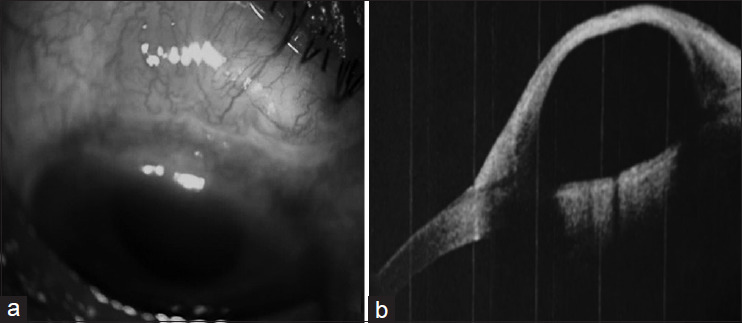
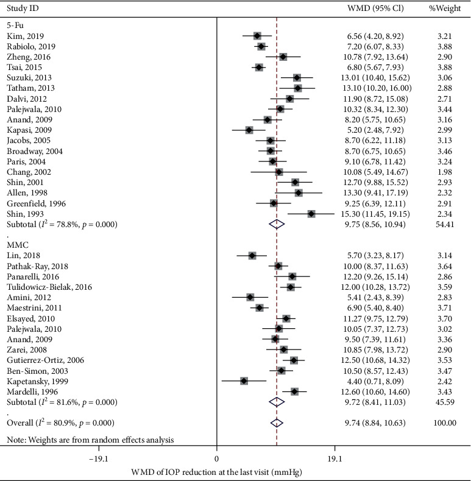
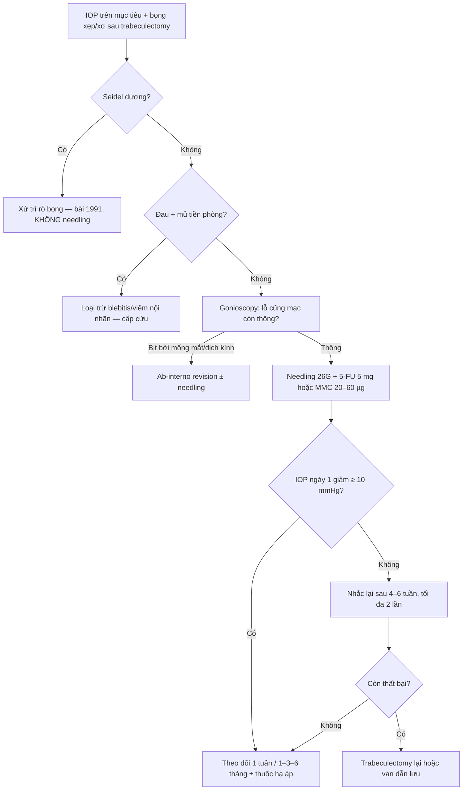
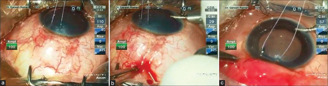
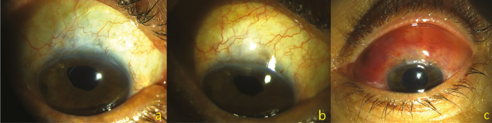
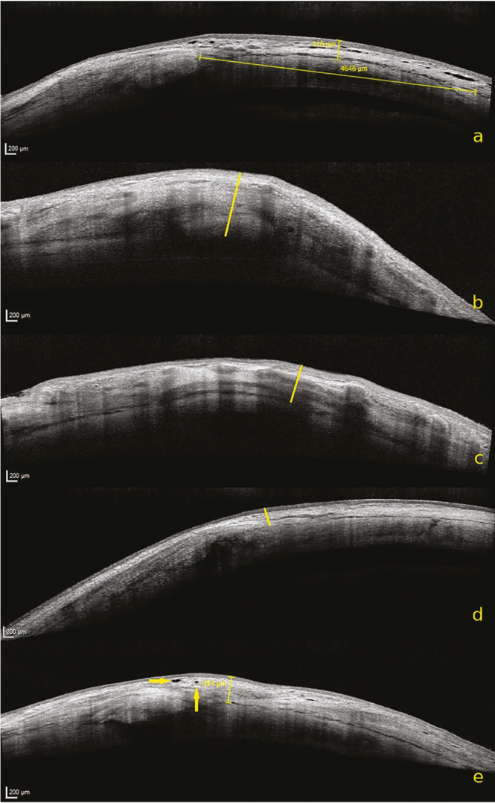

# 1992 — Needling bọng lọc + 5-FU/MMC sau trabeculectomy: "bọng xẹp, nhãn áp tăng" thì chọc lại hay mổ lại / Bleb needling with 5-fluorouracil or mitomycin C

**Tags:** `pattern:bong-loc-xo` `pattern:bao-xo-tenon` `pattern:van-hoa-duoi-ket-mac` `pattern:iop-tang-sau-trab` `vung:mat` `vung:bong-loc` `vung:tien-phong` `protocol:needling` `protocol:AS-OCT` `protocol:gonioscopy` `protocol:tiem-duoi-ket-mac` `score:IOP`

**Mức chắc chắn (certainty):** tổng hợp y văn (literature synthesis) — ghép **1 phân tích gộp 37 nghiên cứu / 2.182 bệnh nhân** (Chen X, Suo L, Hong Y, Zhang C, *J Ophthalmol* 2020, PMC7722638, CC BY 4.0), **1 tổng quan kỹ thuật bậc thang** (Singh A, Singh K, Singh A, *Indian J Ophthalmol* 2025, PMC12013292, CC BY-NC-SA 4.0), **3 đoàn hệ needling** (Das N et al., *Indian J Ophthalmol* 2022, PMC9940510; Gürpınar A & Arıtürk N, *Turk J Ophthalmol* 2025, PMC12740067; Demirok GL et al., *Indian J Ophthalmol* 2021, PMC7933892), **1 so sánh phòng khám vs phòng mổ** (Ponnusamy V, Nguyen V, An JA et al., *BMC Ophthalmol* 2021, PMC7934488, CC BY 4.0) và **1 thử nghiệm needling ± khâu vạt qua kết mạc** (Laspas P et al., *PLoS One* 2017, PMC5436863, CC BY 4.0). Chỗ suy luận được ghi rõ "suy luận"; ngưỡng chưa có dữ liệu cho người Việt ghi "chưa rõ".

> **Vì sao bài này quan trọng:** sau trabeculectomy, **bọng lọc là một "van sinh học" làm bằng sẹo có kiểm soát** — và sẹo luôn có xu hướng co lại. Khi bọng xẹp, nhãn áp (intraocular pressure, IOP) tăng lại, bác sĩ đứng trước ba lựa chọn rất khác nhau về chi phí và nguy cơ: **chọc kim (needling) ± chất chống xơ**, **mổ lại bọng**, hay **đặt van**. Chọc kim là thủ thuật **5–10 phút, gây tê nhỏ giọt, làm tại phòng khám**, nhưng **chỉ đúng khi lỗ củng mạc còn thông và bọng không rò, không nhiễm** — chọc vào một bọng đang rò hoặc đang viêm là biến sự cố nhẹ thành **viêm nội nhãn**. Bài trả lời 4 câu: **(1) bọng hỏng kiểu gì? (2) có được chọc không? (3) chọc bằng gì, bao nhiêu lần? (4) khi nào dừng và mổ lại?** Đây là bài tiếp nối trực tiếp của [1991 — Rò bọng lọc muộn & viêm nội nhãn liên quan bọng](../1991-ro-bong-loc-muon-viem-noi-nhan/lesson.md) (1991 đã nêu needling như đường vào của rò).

## 1. Tổng quan bệnh học – cơ chế hình ảnh: vì sao bọng xơ lại làm IOP tăng, và vì sao chọc kim chữa được

### 1.1 Cân bằng Goldmann: bọng là "biến trở", không phải "lỗ thoát nước"
- Phương trình Goldmann: **IOP = (F − U)/C + Pᵥ**, với F = tốc độ tạo thủy dịch (~**2,5 µL/phút**), U = tốc độ thoát qua bè củng mạc–Schlemm, **C = hệ số dễ thoát (outflow facility)**, **Pᵥ = áp lực tĩnh mạch thượng củng mạc (~8–10 mmHg** ở người bình thường). Một bọng lọc tốt làm **C tăng vọt** nên IOP có thể xuống **8–12 mmHg**; khi bọng bị xơ, **C quay về giá trị trước mổ** và IOP bò lên lại **> 21 mmHg**. Vì Pᵥ là sàn, IOP **không thể xuống dưới ~8 mmHg** nếu không quá thoát — đây chính là lý do **hạ áp "quá tốt" sau needling là dấu hiệu cảnh báo**, không phải thành tích.
- Needling **không tạo đường thoát mới**: nó **giải phóng dính dưới kết mạc và quanh vạt củng mạc**, mở lại đường thoát *đã có* từ lỗ củng mạc (sclerostomy) ra khoảng dưới kết mạc. Vì vậy **điều kiện tiên quyết là lỗ củng mạc còn thông** — phải soi góc (gonioscopy) trước; nếu lỗ bị mống mắt/dịch kính/thể mi bít thì chọc ngoài chỉ tạo bọng giả rồi xẹp lại.

### 1.2 Vì sao xơ hóa: nguyên bào sợi, collagen và "cửa sổ 2–6 tuần"
- Sau mổ, **nguyên bào sợi (fibroblast)** dưới kết mạc–Tenon tăng sinh và tổng hợp **collagen type I/III**; mật độ tế bào viêm và yếu tố tăng trưởng (TGF-β) quyết định bọng thành **mỏng, có nang vi (microcyst)** hay **dày, bao xơ**. Xơ hóa quá mức tạo **bao xơ Tenon (encapsulated bleb / Tenon cyst)** — gặp ở **10–30%** ca, xuất hiện **từ 2 tuần đến 4–6 tuần** (muộn nhất tới 6 tháng).
- Trên **AS-OCT (anterior segment OCT, bước sóng ~1310 nm)**: dịch trong bọng **trong quang học → giảm hồi âm (đen)**, còn **kết mạc–Tenon xơ → tăng hồi âm (trắng)**. Vì vậy AS-OCT phân biệt được **bọng nang có vách xơ dày** với **bọng dẹt xơ lan**, và đo được **chiều cao (tính từ củng mạc) và chiều rộng bọng theo µm** với độ lặp lại cao (**ICC ≥ 0,92** — Gürpınar 2025). Đây là thứ đèn khe không định lượng được.

### 1.3 Vì sao phải kèm chất chống chuyển hóa: 5-FU vs MMC
- **Needling đơn thuần thất bại 50–90%** (Singh 2025) vì vết chọc lành lại theo đúng cơ chế sẹo cũ. Hai thuốc được dùng tại chỗ:
  - **5-FU (5-fluorouracil)** — đồng vận pyrimidine, **chỉ diệt tế bào pha S**, tác dụng ngắn; liều chuẩn **5 mg** (0,1 mL dung dịch 50 mg/mL hoặc 0,5 mL dung dịch 10 mg/mL).
  - **MMC (mitomycin C)** — alkyl hóa, **cross-link DNA**, tác động cả tế bào nghỉ, **mạnh gấp ~100 lần** ức chế nguyên bào sợi và kéo dài hơn; liều **20 µg** (0,1 mL × 0,2 mg/mL) hoặc **60 µg** (0,15 mL × 0,4 mg/mL, kèm 0,05 mL lidocaine 2%).
- **Cái giá của MMC:** bọng mỏng–không mạch hơn, và **rò bọng do MMC gấp ~3 lần 5-FU** (Singh 2025). Đây là lý do **MMC không mặc định tốt hơn**: hiệu quả hòa nhau (xem 1.4) nhưng tai biến muộn nặng hơn.

### 1.4 Hiệu quả thật: con số từ phân tích gộp
- **37 nghiên cứu, 2.182 bệnh nhân** (Chen 2020): IOP giảm trung bình **9,74 mmHg** (95% CI 8,85–10,63); **thành công hoàn toàn 45,9%** (39,0–53,0%), **thành công có thuốc 70,4%** (63,5–77,0%).
- Tách theo thuốc: **MMC** thành công hoàn toàn **48,6%** / có thuốc **70,2%**; **5-FU** **44,3%** / **70,7%**. Chênh lệch **không đáng kể về hiệu quả**, khác nhau chủ yếu ở **biến chứng**.
- **Thành công teo dần theo thời gian**: 75% lúc 1 tháng → **40,6% lúc 6 tháng** (Gürpınar 2025); một số loạt giảm từ 64,2% (6 tháng) xuống 13% (48 tháng). Nói với bệnh nhân "chọc một lần là xong" là **hứa quá**.

## 2. Mẫu hình + chẩn đoán phân biệt theo vị trí (Gamut)

**Mẫu hình trung tâm:** *IOP tăng trở lại sau trabeculectomy + bọng lọc không còn hình thái chức năng.* Bốn câu hỏi định vị, theo đúng thứ tự (đây là gamut, không phải checklist trang trí):

1. **Bọng có nâng lên không?** Bọng **dẹt, không nang vi** = xơ lan (indistinct fibrosis) — chọc được nếu vạt còn thông. Bọng **cầu căng, thành dày, mạch giãn** = **bao xơ Tenon** — cũng chọc được nhưng **tái phát cao hơn**.
2. **Có rò không?** **Seidel dương** — **tuyệt đối không needling**, xử trí theo [1991](../1991-ro-bong-loc-muon-viem-noi-nhan/lesson.md).
3. **Lỗ củng mạc có thông không?** Soi góc: lỗ bị **mống mắt, thể mi, dịch kính** bít → cần **revision phía trong (ab-interno)** ± needling; chọc kim từ ngoài sẽ thất bại.
4. **Có nhiễm không?** **Đau + mủ tiền phòng + bọng trắng đục** = **blebitis/viêm nội nhãn** — cấp cứu, không phải thủ thuật chọn lọc.

**Gamut theo nguyên nhân "IOP cao sau trab" (thứ tự tần suất thực hành):** xơ hóa/bao xơ bọng (thường nhất) → dính vạt củng mạc → bít lỗ trong bởi mống mắt/dịch kính → tăng IOP do corticoid → viscoelastic/OVD sót lại → glôcôm ác tính (tiền phòng dẹt, IOP cao — [1448](../1448-glaucoma-ac-tinh-sau-mo-noi-nhan/lesson.md)) → rò bọng (IOP **thấp**, không phải cao) → blebitis/BRE.

*Trái (a): bọng cầu khu trú, kết mạc căng, mạch giãn — hình thái "bao xơ"; phải (b): AS-OCT cùng mắt, vách xơ dày + khoang dịch lớn bên dưới. Nguồn: Singh A, Singh K, Singh A, Indian J Ophthalmol 2025 (PMC12013292), Fig. 2, **CC BY-NC-SA 4.0** — nguyên bản.*

### Dấu hiệu đọc đúng (đừng gọi tên theo cảm giác)
- **Bao xơ Tenon:** bờ rõ, **thành dày, không thấy microcyst**, bề mặt **căng, bóng**, mạch **giãn đều** trên vòm; IOP tăng **sớm 2–6 tuần**.
- **Bọng xơ mờ (indistinct):** **không có vòm**, kết mạc **dày trắng, xơ**, mạch **ngoằn ngoèo (corkscrew)**; IOP tăng **muộn hơn**, âm thầm.
- **Bọng chức năng:** hơi nâng, **ít mạch**, **nhiều microcyst** — nếu IOP vẫn cao với bọng đẹp thì nghĩ **bít lỗ trong**, không phải xơ.

## 3. Bảng so sánh phân biệt (ma trận đối chiếu)

| Thực thể (entity) | Hình ảnh điển hình | Chốt vào (rule-in) | Chốt loại (rule-out) | Gợi ý xác nhận |
|---|---|---|---|---|
| **Bao xơ Tenon (encapsulated bleb)** | Cầu **khu trú, thành dày**, không microcyst, mạch giãn trên vòm; AS-OCT: **vách xơ dày + khoang dịch** | **Vòm căng + thành dày + IOP tăng 2–6 tuần** | Bọng dẹt không vòm → xơ lan; có **Seidel** → rò (1991) | Đèn khe + AS-OCT đo **cao/rộng (µm)**; thử needling |
| **Bọng xơ mờ (indistinct)** | Không vòm, kết mạc **dày, xơ, mạch ngoằn ngoèo**, không microcyst | **Bọng dẹt + IOP tăng dần** + soi góc thấy lỗ thông | **Có microcyst + bọng nâng** → bọng còn chức năng | AS-OCT: **không có khoang dịch** dưới kết mạc |
| **Dính vạt củng mạc** | Bọng có thể còn nang nhưng **IOP cao**; AS-OCT: mất khoảng dịch **ngay trên vạt** | **Vạt dày dính + lỗ trong thông** trên gonioscopy | Lỗ trong bịt → cần revision phía trong | Needling tách dính vạt; **IOP tụt ngay sau chọc** là dấu hiệu tốt |
| **Bít lỗ trong (iris/vitreous/ciliary plug)** | Bọng **có thể đẹp** mà IOP cao; soi góc thấy **mô bít lỗ** | **Gonioscopy thấy lỗ bịt** + bọng không xơ | Vạt/lỗ thông → xơ hóa (needling được) | Soi góc; **không** chọc mù từ ngoài |
| **Rò bọng (Seidel +)** | Lỗ rò ẩm, dòng fluorescein; **IOP thấp**, tiền phòng nông | **Seidel dương ≥ 15 giây**, bọng mỏng không mạch | Seidel âm → không phải rò | Test Seidel, AS-OCT tìm đường hầm — **không needling** |
| **Blebitis / viêm nội nhãn liên quan bọng** | Bọng trắng đục, xung huyết, **mủ tiền phòng**, đau, thị lực giảm | **Đau + mủ tiền phòng + bọng viêm** | Chỉ đỏ nhẹ, không mủ → theo dõi | Cấy dịch kính/tiền phòng — **cấp cứu**, không needling |
| **Tăng IOP do corticoid** | Bọng đẹp, **góc mở**, IOP tăng trong 2–8 tuần dùng steroid | **Tiền sử corticoid + đáp ứng khi giảm liều** | Bọng xơ/dính → do cơ học | Giảm/đổi corticoid rồi đo lại IOP |
| **Glôcôm ác tính** | **Tiền phòng dẹt**, IOP **rất cao**, bọng có thể tốt | **Tiền phòng dẹt + IOP cao + bọng còn** | Tiền phòng sâu → không phải | Siêu âm/AS-OCT, xử trí riêng (1448) |

*Rừng (forest plot) của phân tích gộp 37 nghiên cứu: **MMC** và **5-FU** đều giảm IOP có ý nghĩa, khoảng tin cậy chồng lấp — hiệu quả tương đương, khác nhau ở biên độ và biến chứng. Nguồn: Chen X, Suo L, Hong Y, Zhang C, J Ophthalmol 2020 (PMC7722638), Fig. 4, **CC BY 4.0** — nguyên bản.*

## 4. Protocol needling + ngưỡng thành công, số lần và flowchart

### 4.1 Trước thủ thuật (bắt buộc, 5 mục)
1. **Soi góc (gonioscopy)** — chứng minh **lỗ củng mạc thông**; nếu bịt → chuyển **ab-interno revision**.
2. **Test Seidel âm** — loại rò; nếu dương → điều trị rò (1991).
3. **Loại trừ nhiễm** (đau, mủ tiền phòng, bọng trắng đục).
4. **AS-OCT** đo **chiều cao (µm từ củng mạc) và chiều rộng (µm giữa hai bờ thành có nang)** — mốc so sánh sau chọc; ICC ≥ 0,92.
5. **Thuốc**: ngừng **prostaglandin** và **alpha-agonist** trước chọc nếu có thể (kích viêm, thúc xơ); gây tê **proparacaine 0,5%**, sát khuẩn **povidone-iodine 5%**; giải thích nguy cơ **rò, hạ áp, xuất huyết, viêm nội nhãn**.

### 4.2 Kỹ thuật (các con số cốt lõi)
| Bước | Thông số | Ghi chú thực hành |
|---|---|---|
| Chất chống xơ | **5-FU 5 mg** (0,1 mL × 50 mg/mL) **hoặc** **MMC 20 µg** (0,1 mL × 0,2 mg/mL) / **60 µg** (0,15 mL × 0,4 mg/mL) | Tiêm dưới kết mạc **5–10 mm** ngoài bọng, rồi **miết bằng tăm bông** lan thuốc; kiểu 2 thì **chờ 15–20 phút** mới chọc |
| Kim | **26G** (khuyến cáo; 27–30G cũng dùng) | 26G **cứng hơn, ít cong** khi tách sẹo; bẻ góc **30–45°** ở chuôi để đổi hướng lực |
| Đường vào | Cách bờ bọng **5–8 mm**, đường chéo tự bịt (**Z-tract**) | Mũi kim **hướng lên**, luôn nhìn thấy đầu kim để **không xuyên thủng kết mạc** |
| Động tác | **Jack-hammer** (lên–xuống) + **quét ngang** nhiều hướng; bơm dịch (BSS/MMC/5-FU) ngắt quãng để **căng khoang dưới kết mạc** | Cảm giác **"sần sật"** = vừa đứt dải xơ; **điểm kết thúc**: hết dải xơ + **mắt mềm** khi ấn |
| Đóng đường vào | Ép tăm bông **1 phút**, tráng **viscoelastic** hoặc **cautery** điểm vào | Chống **trào ngược** thủy dịch → giảm nguy cơ hạ áp và nhiễm |
| Nơi làm | Phòng khám **hoặc** phòng mổ | Thành công 6 tháng **28% vs 20%** (p = 0,54); IOP **14,2 vs 14,9 mmHg**; biến chứng **0% vs 7%** (p = 0,32) |

### 4.3 Sau thủ thuật, số lần và ngưỡng bỏ cuộc
- **Đánh giá**: đo IOP **ngày 1**, rồi **1 tuần, 1 tháng, 3 tháng, 6 tháng**; AS-OCT lặp lại nếu cần.
- **Dấu hiệu tiên lượng tốt**: **IOP tụt ≥ 10 mmHg ngay sau chọc** (ngưỡng được dùng trong nhiều nghiên cứu); IOP **trước chọc < 24,5 mmHg** → khả năng thành công hoàn toàn lúc 1 tháng cao hơn (Demirok 2021).
- **Nhắc lại**: chờ **10–14 ngày** xem đáp ứng; nếu thất bại, nhắc sau **4–6 tuần**; **quá 2 lần needling là yếu tố dự báo thất bại** — đừng biến needling thành "thủ thuật định kỳ".
- **Thất bại** = IOP trên mục tiêu **dù đã needling 2 lần + thuốc** → **trabeculectomy lại / đặt van dẫn lưu**; ở loạt Gürpınar 2025, **6/32 mắt** phải đặt van Ahmed.
- **Tiêu chuẩn thành công** khác nhau giữa các nghiên cứu (**IOP ≤ 21 mmHg hoặc giảm 20%** là phổ biến; Gürpınar dùng **≤ 19 mmHg**) — vì vậy **không so sánh các tỷ lệ thành công khác tiêu chuẩn** với nhau.

*Trình tự needling dưới kính hiển vi. (a) chỉ kéo giác mạc; (b) kim 26G vào khoảng dưới kết mạc, có ít máu; (c) bọng lan tỏa nâng lên = đích của thủ thuật. Nguồn: Das N et al., Indian J Ophthalmol 2022 (PMC9940510), Fig. 1, **CC BY-NC-SA 4.0** — nguyên bản.*

## 5. Biến thể bình thường và cạm bẫy

- **Bọng "đẹp" mà IOP cao**: đừng chọc. Nghĩ **bít lỗ trong** (soi góc), **tăng IOP do corticoid**, **OVD sót**, hoặc **glôcôm ác tính**. Chọc trong bít lỗ trong = tạo bọng giả, IOP không giảm.
- **Needling không phải "mở van"**: nếu lỗ củng mạc đã bít, needling từ ngoài chỉ làm **bọng căng dịch giả** rồi xẹp lại sau vài ngày — cần **revision phía trong**.
- **Sai lầm chết người**: chọc vào **bọng mỏng không mạch** hoặc bỏ qua **Seidel dương** → tạo đường vào vi khuẩn. Trong phân tích gộp, **viêm nội nhãn 1,4% (3/220)** sau needling — thấp nhưng **không bằng 0**.
- **AS-OCT đọc theo xu hướng, không theo một con số**: bọng **bao xơ giảm chiều cao** sau chọc (0,45 → 0,41 → 0,40 mm trong loạt Gürpınar) trong khi bọng **xơ mờ tăng chiều cao và tăng microcyst** — hai kiểu đáp ứng ngược nhau, cùng là thành công. Đuổi theo "bọng cao" là đọc sai.
- **Bẫy thời gian**: bọng xơ hóa **sớm 2–6 tuần** dễ bị gọi là "còn phù sau mổ"; can thiệp muộn khi sẹo đã trưởng thành làm giảm thành công. Ngược lại, **chọc quá sớm** khi tiền phòng còn nông, vạt còn lỏng → nguy cơ **hạ áp, bong hắc mạc**.
- **Bẫy tiêu chuẩn thành công**: một bài báo ghi "thành công 75%" có thể là **lúc 1 tháng** và tiêu chuẩn **≤ 19 mmHg**; bài khác "45%" là **lần khám cuối** và **≤ 21 mmHg không thuốc**. So sánh số mà bỏ tiêu chuẩn = kết luận sai.
- **Mâu thuẫn trong y văn (phản biện)**: phân tích gộp thấy **IOP trước chọc càng cao thì mức giảm càng lớn** (giải thích **64,9%** phương sai giữa các nghiên cứu), nhưng **2 nghiên cứu** lại thấy IOP trước chọc cao → **kết cục xấu hơn**, và Demirok thấy **< 24,5 mmHg** dễ thành công hoàn toàn. Cách hiểu đúng: **"giảm nhiều" ≠ "giữ được lâu"** — mức giảm là biên độ, còn thành công là duy trì. Đừng dùng con số giảm IOP để tiên lượng dài hạn.
- **Hypotony là biến chứng, không phải đích**: khâu vạt qua kết mạc (transconjunctival scleral flap sutures) khi thấy IOP ước lượng thấp trong mổ **không làm mất hiệu quả** (IOP tương đương tại 3/6/12/24 tháng) nhưng **giảm nguy cơ hạ áp** — một lựa chọn "rẻ" để phòng biến chứng (Laspas 2017).

## 6. Tự lượng giá — Blind Quiz

**Ca 1 — Nam 62 tuổi, trabeculectomy + MMC 6 tháng trước, IOP 26 mmHg, bọng dẹt, không thấy nang vi. Nhìn ảnh, mô tả trước khi đọc đáp án.**

- Hỏi: (1) đây là **bao xơ** hay **xơ mờ**? (2) bước bắt buộc trước khi chọc? (3) ảnh nào là "thành công", vì sao?

<b>Bấm để hiện đáp án (findings + chẩn đoán)</b>

- **Dấu hiệu:** (a) bọng **dẹt, mờ, không vòm, không microcyst** → **bọng xơ mờ (indistinct)**, không phải bao xơ Tenon. (b) **5 ngày sau needling**: bọng **nâng lên** do thủy dịch thoát ra. (c) **1 giờ sau needling**: bọng **lan tỏa**, kèm **xuất huyết dưới kết mạc** — dấu hiệu bình thường của thủ thuật.
- **Trước khi chọc (bắt buộc):** **soi góc** chứng minh lỗ củng mạc thông; **test Seidel âm**; loại trừ nhiễm; đo AS-OCT làm mốc.
- **Chẩn đoán:** **thất bại bọng do xơ hóa**, điều trị **needling + 5-FU 5 mg** — đúng như loạt này (thành công 75% lúc 1 tháng, **40,6% lúc 6 tháng**).
- **Nguồn ảnh:** Gürpınar A & Arıtürk N, *Turk J Ophthalmol* 2025 (PMC12740067), Fig. 1, **CC BY-NC-ND 4.0** — nguyên bản, không cắt/ghép.

**Ca 2 — Cùng bệnh nhân, AS-OCT trước và sau needling. Nhìn ảnh: đo gì, và dấu hiệu nào cho thấy bọng "sống lại"?**

- Hỏi: (1) hai đường vàng đo gì? (2) bọng bao xơ và bọng xơ mờ thay đổi **ngược nhau** thế nào sau needling? (3) vì sao không lấy chiều cao làm đích điều trị?

<b>Bấm để hiện đáp án (findings + chẩn đoán)</b>

- **Đo:** đường **ngang** = **chiều rộng bọng** giữa hai bờ thành có nang (ví dụ **4.646 µm** ở (a)); đường **dọc từ củng mạc** = **chiều cao bọng** (ví dụ **458 µm** ở (b)). Độ lặp lại **ICC ≥ 0,92**.
- **Hai kiểu đáp ứng:** (b → c) **bao xơ**: chiều cao **giảm** sau chọc; (d → e) **xơ mờ**: chiều cao **tăng** và **microcyst tăng** (mũi tên). Cả hai đều là thành công — vì đích là **thoát dịch**, không phải "bọng to".
- **Vì sao không lấy chiều cao làm đích:** bọng xơ mờ thành công bằng cách **dẹt ra và lan rộng** (chiều rộng 3,74 → 4,16 mm lúc 1 tháng), còn bọng bao xơ thành công bằng cách **xẹp vách xơ**. Đo cả **cao + rộng + microcyst**, đối chiếu **IOP**.
- **Nguồn ảnh:** Gürpınar A & Arıtürk N, *Turk J Ophthalmol* 2025 (PMC12740067), Fig. 2, **CC BY-NC-ND 4.0** — nguyên bản.

**Ca 3 — Bác sĩ trẻ chuẩn bị chọc bọng lần đầu. Nhìn 3 thì trong ảnh và trả lời bằng số.**

- Hỏi: (1) kim cỡ nào, vào cách bờ bọng bao xa? (2) điểm kết thúc? (3) ba biến chứng hay gặp nhất và tần suất?

<b>Bấm để hiện đáp án (findings + chẩn đoán)</b>

- **Kỹ thuật:** **kim 26G** (khuyến cáo), bẻ **30–45°**, vào **5–8 mm** cách bờ bọng theo đường **Z tự bịt**, mũi hướng lên; tách sẹo bằng động tác **jack-hammer + quét ngang**, bơm dịch ngắt quãng.
- **Điểm kết thúc:** cảm giác **sần sật** khi đứt dải xơ + **mắt mềm**; ảnh (c) là **bọng lan tỏa** sau khi giải phóng dải xơ.
- **Biến chứng (phân tích gộp 37 nghiên cứu):** **xuất huyết kết mạc 5,7%** (2,5–10,1), **máu tiền phòng 5,5%** (3,0–8,7), **rò bọng 5,0%** (3,2–7,3); nặng hơn: **bệnh dày sừng do bọng 1,7%**, **mất bù nội mô giác mạc 1,5%**, **xuất huyết trên hắc mạc 1,4%** (6/422), **viêm nội nhãn 1,4%** (3/220), **bệnh hoàng điểm do hạ áp 1,3%**, **blebitis 0,6%**.
- **Nguồn ảnh:** Das N et al., *Indian J Ophthalmol* 2022 (PMC9940510), Fig. 1, **CC BY-NC-SA 4.0** — nguyên bản.

## Bài liên quan chéo

- [1991 — Rò bọng lọc muộn & viêm nội nhãn liên quan bọng](../1991-ro-bong-loc-muon-viem-noi-nhan/lesson.md) — mặt **ngược lại** của cùng bọng: rò và nhiễm; **chống chỉ định needling**.
- [1983 — Đục thể thủy tinh sau trabeculectomy & phaco trên mắt có bọng](../1983-duc-the-thuy-tinh-sau-trabeculectomy/lesson.md) — phaco làm **suy bọng**; câu hỏi "bọng xẹp sau phaco" nối trực tiếp bài này.
- [1448 — Glôcôm ác tính sau mổ nội nhãn](../1448-glaucoma-ac-tinh-sau-mo-noi-nhan/lesson.md) — **tiền phòng dẹt + IOP cao**, không phải xơ bọng.
- [1447 — Rách thể mi sau MIGS/Yamane](../1447-rach-the-mi-sau-migs-va-yamane/lesson.md) — hạ áp do đường thoát **khác** (khe thể mi).
- [1962 — Rách thể mi chấn thương & góc rẽ](../1962-rach-the-mi-goc-re/lesson.md) — nguyên nhân IOP cao **muộn** sau chấn thương, dễ nhầm với "bọng hỏng".
- [400 — Tổng quan Mắt & thị giác](../400-tong-quan-mat-thi-giac/lesson.md)

## Ảnh

- `1992_bong-xo-tenon_Slitlamp_PMC12013292-Fig2.jpg` — bọng bao xơ Tenon + AS-OCT vách xơ dày.
- `1992_bong-xo-tenon_Slitlamp_PMC12740067-Fig1.jpg` — bọng xơ mờ trước / 1 giờ / 5 ngày sau needling.
- `1992_bong-xo-tenon_AS-OCT_PMC12740067-Fig2.jpg` — cách đo chiều cao/rộng bọng; bao xơ vs xơ mờ.
- `1992_needling-bong-loc_Mo_PMC9940510-Fig1.jpg` — ba thì needling bằng kim 26G.
- `1992_forest-MMC-5FU_Forest_PMC7722638-Fig4.jpg` — rừng ước lượng giảm IOP: MMC vs 5-FU.
- Nguồn + giấy phép từng ảnh: `images/CREDITS.md`.

> Không dùng để chẩn đoán độc lập khi chưa có người hướng dẫn.
