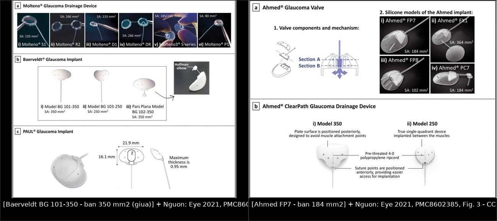
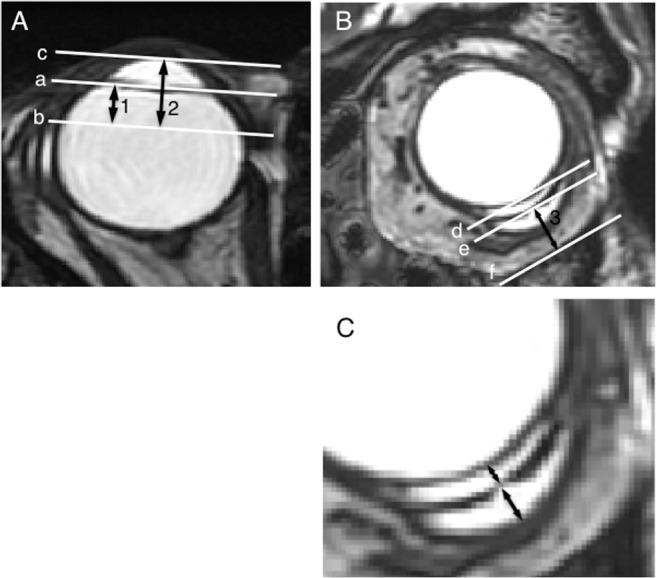
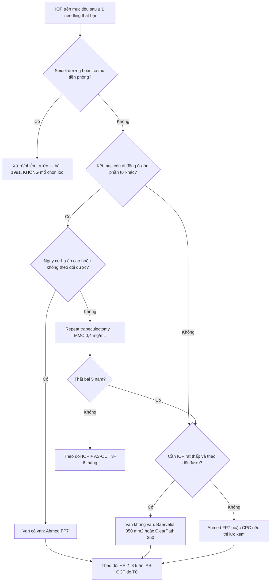
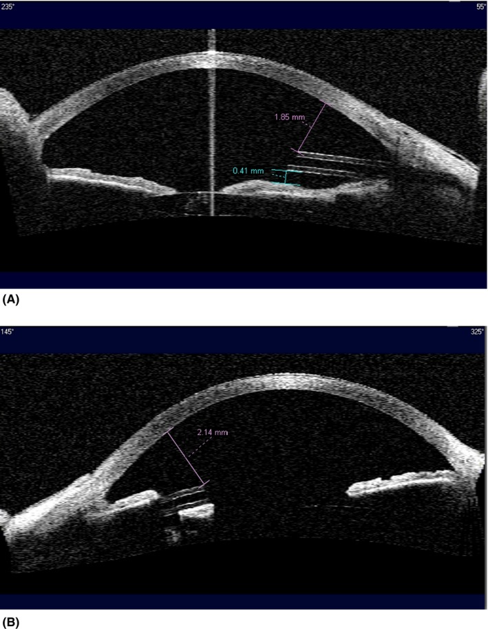
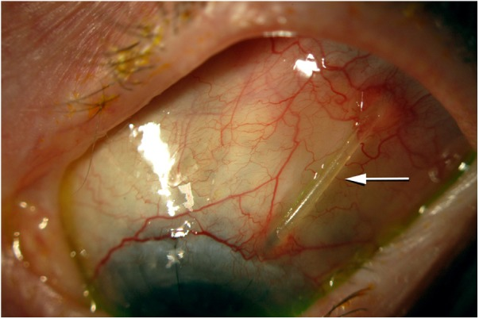

# 1993 — Thất bại needling bọng lọc: mổ lại trabeculectomy hay đặt van dẫn lưu (Ahmed vs Baerveldt) / Repeat trabeculectomy versus glaucoma drainage device after failed needling

**Tags:** `pattern:that-bai-needling` `pattern:bong-loc-xo` `pattern:bao-xo-ban-van` `pattern:iop-tang-sau-trab` `pattern:lo-ong` `vung:mat` `vung:bong-loc` `vung:tien-phong` `vung:hac-mac` `protocol:AS-OCT` `protocol:UBM` `protocol:MRI` `protocol:van-dan-luu` `score:IOP`

**Mức chắc chắn (certainty):** tổng hợp y văn (literature synthesis) — ghép **2 thử nghiệm ngẫu nhiên lớn có nhóm chứng** (TVT 5 năm, Gedde SJ et al., *Am J Ophthalmol* 2012, PMID 22245458, PMC4460598; PTVT 5 năm, Gedde SJ et al., *Ophthalmology* 2022, PMID 35835337, PMC9691551 — kèm bài biến chứng PMID 35835336), **2 thử nghiệm Ahmed vs Baerveldt** (ABC 5 năm, Budenz DL et al., *Ophthalmology* 2015, PMID 25439606, PMC4306613; gộp ABC + AVB, *Am J Ophthalmol* 2017, PMID 28104418), **1 tổng quan Cochrane** (*Cochrane Database Syst Rev* 2017, PMID 28750481), **1 phân tích gộp repeat trab vs Ahmed** (*J Glaucoma* 2023, PMID 37311016), **1 đoàn hệ so sánh 3 năm** (*Int Ophthalmol* 2020, PMID 32776301) và **3 nghiên cứu hình ảnh/đo lường** (MRI bản van, Sano I et al., *PLoS One* 2015, PMC4671622, CC BY 4.0; AS-OCT khoảng cách ống–giác mạc, Tan AN et al., *Acta Ophthalmol* 2017, PMC5298043, CC BY-NC-ND 4.0; ảnh lộ ống, Chaku M et al., *Clin Ophthalmol* 2016, PMC4820194, CC BY-NC 3.0). Chỗ suy luận ghi rõ "suy luận"; chỗ y văn chưa có số liệu ghi "chưa rõ".

> **Vì sao bài này quan trọng:** [1992](../1992-needling-bong-loc-sau-trabeculectomy/lesson.md) dừng đúng ở ngã ba: *"thất bại needling → trabeculectomy lại hoặc van dẫn lưu"*. Bài này trả lời **chọn nhánh nào, dựa trên số nào, và chọn van nào**. Đây không phải câu hỏi học thuật: mắt đã có **1 trabeculectomy + ≥ 1 needling** là mắt đã **tiêu thụ hai lần kết mạc**, nên **mổ lại lần ba** có tỷ lệ thất bại khác hẳn mổ nguyên phát; trong khi đặt van lại mang **giá riêng** — **mất nội mô giác mạc 4,5–6,6%/năm**, **lộ ống 17 tháng**, **hạ áp quá mức** (Baerveldt **4,5%** vs Ahmed **0,4%**). Chọn sai không phải "chậm vài tháng" mà là **mất thị lực không hồi**. Bài cũng là chỗ để bác sĩ CĐHA đọc đúng **van dẫn lưu trên AS-OCT/UBM/MRI/CT** — một "dị vật có chủ đích" mà báo cáo hình ảnh hay mô tả sai.

## 1. Tổng quan bệnh học – cơ chế hình ảnh: vì sao needling thất bại đổi hẳn bài toán

### 1.1 Kết mạc là tài nguyên có hạn: mỗi lần mổ là một lần trừ đi
- Trabeculectomy thành công nhờ **bọng lọc**: thủy dịch đi qua **lỗ củng mạc (sclerostomy)** rồi khuếch tán qua **kết mạc–Tenon** xuống mô dưới kết mạc, một phần vào **mạng mạch thượng củng mạc**. Vì vậy **kết mạc mỏng, di động, nhiều nang vi (microcyst)** là "van sinh học"; kết mạc **dày, xơ, dính** là van đã hỏng.
- Needling chỉ **giải phóng dải xơ** quanh vạt và dưới kết mạc, không tạo kết mạc mới. Khi needling thất bại, nguyên bào sợi đã **"được huy động" lần hai**, mật độ tế bào viêm và collagen type I/III dày hơn; **> 2 lần needling là yếu tố dự báo thất bại** (phân tích gộp 37 nghiên cứu / 2.182 bệnh nhân — Chen 2020, PMC7722638, đã dẫn trong bài 1992). Needling lần ba hiếm khi đổi kết cục, mà **thêm một lần viêm** vào đúng vùng kết mạc sẽ dùng cho phẫu thuật sau.
- Hệ quả: sau needling thất bại, hai lựa chọn thật là **(a) mổ lại đường thoát qua kết mạc** (repeat trabeculectomy, phải tìm được vùng kết mạc còn di động, thường **khác góc phần tư**) hoặc **(b) bỏ hẳn kết mạc, đưa ống vào tiền phòng và để dịch thấm qua bao xơ quanh một bản van ở xích đạo** (glaucoma drainage device, GDD).

### 1.2 Vì sao van dẫn lưu hạ áp được: trở lực chuyển từ kết mạc sang "bao xơ quanh bản"
- Phương trình Goldmann vẫn đúng: **IOP = (F − U)/C + Pᵥ**. Ở trabeculectomy, **C** phụ thuộc **tính thấm kết mạc–Tenon**; ở GDD, **C** phụ thuộc **diện tích bản (plate) và độ dày bao xơ** bao quanh bản — ống không phải nơi cản dòng.
- **Diện tích bản quyết định**: Baerveldt BG 101-350 = **350 mm²**, Ahmed FP7 = **184 mm²** (ảnh thiết bị dưới đây). Nghiên cứu MRI 27 mắt (Sano 2015, PMC4671622, CC BY 4.0) đo trực tiếp điều này: **thể tích bọng quanh bản Baerveldt 478,8 ± 84,2 mm³** so với **Ahmed 161,1 ± 52,3 mm³** (p = 0,0093), và **IOP 6 tháng thấp hơn có ý nghĩa ở nhóm Baerveldt (12,2 ± 0,7 vs 16,7 ± 1,2 mmHg, p = 0,0026)**; IOP tương quan **nghịch** với thể tích bọng (r = −0,451; p = 0,018) và chiều cao bọng (r = −0,395; p = 0,041).
- **Van hay không van**: Ahmed có **màng silicone căng trước, mở ở ngưỡng 8 mmHg** nên giảm hạ áp sớm; Baerveldt **không van**, phải **thắt ống bằng chỉ tiêu (polyglactin, tan ~6 tuần)** hoặc **đặt stent trong lòng ống** để chờ **bao xơ trưởng thành**. Đây là lý do **Baerveldt hạ áp sâu hơn nhưng hạ áp quá mức nhiều hơn**, còn **Ahmed an toàn sớm hơn nhưng IOP cao hơn và phải mổ thêm nhiều hơn** (mục 1.3).
- Đường kính lòng ống **0,30 mm (Ahmed) / 0,305 mm (Baerveldt)** — đủ lớn để **ống không phải nơi quyết định lưu lượng**; bằng chứng là **bít ống bằng mống mắt/dịch kính** làm IOP vọt lên tức thì, còn **bao xơ dày** làm IOP tăng từ từ.

### 1.3 Con số quyết định: mổ lại hay van, và van nào
**Trong đúng bối cảnh "đã mổ nội nhãn thất bại" — thử nghiệm TVT (212 mắt đã có trabeculectomy và/hoặc phaco, IOP ≥ 18 mmHg):**

| Kết cục 5 năm | Van (Baerveldt 350 mm²) | Trabeculectomy lại + MMC 0,4 mg/mL × 4 phút | Ý nghĩa |
|---|---|---|---|
| Thất bại tích lũy | **29,8%** | **46,9%** (p = 0,002; HR **2,15**; 95% CI 1,30–3,56) | Van bền hơn ở mắt đã mổ |
| Mổ lại vì glôcôm | **9%** | **29%** (p = 0,025) | Mổ lại đường kết mạc hay hỏng tiếp |
| IOP | 14,4 ± 6,9 | 12,6 ± 5,9 mmHg (p = 0,12) | Hạ áp tương đương |
| Số thuốc | 1,4 ± 1,3 | 1,2 ± 1,5 (p = 0,23) | Trabeculectomy ít thuốc hơn không đáng kể |

**Ở mắt CHƯA mổ nội nhãn — PTVT (242 mắt):** thất bại 5 năm **42% (van) vs 35% (trab)** (p = 0,21), IOP **13,4 vs 13,0 mmHg**, nhưng **số thuốc 2,2 vs 1,3** (p < 0,001) — tức **trabeculectomy nguyên phát vẫn tiết kiệm thuốc hơn**, còn van không vượt trội. Biến chứng sớm lại **thấp hơn ở van: 19% vs 34%** (p = 0,013); biến chứng muộn **22% vs 27%**; biến chứng nặng **2% vs 8%** (p = 0,11); đục thể thủy tinh tiến triển **52% vs 44%** (p = 0,30).

**Khi so trực tiếp "trabeculectomy lại" với "Ahmed" sau trabeculectomy thất bại:** phân tích gộp 14 nghiên cứu (PMID 37311016) thấy **IOP tương đương** ở 1–2–3 năm, nhưng **số thuốc ở nhóm Ahmed gấp ~2 lần lúc 1 năm** (p = 0,042) và **tổng biến chứng + biến chứng đe dọa thị lực cao hơn có ý nghĩa ở nhóm Ahmed**; kết luận nghiêng về **trabeculectomy lại** khi kết mạc còn thuận lợi. Đoàn hệ 120 mắt (PMID 32776301) lại **không thấy khác biệt** ở bất kỳ mốc nào trong 3 năm. **Phản biện:** TVT là RCT có tiêu chuẩn thất bại chặt và mổ bởi phẫu thuật viên glôcôm, còn phân tích gộp trộn nhiều định nghĩa thành công ("quá không đồng nhất để gộp" — chính tác giả ghi) và nhiều cỡ mẫu nhỏ; vì vậy **không có một câu trả lời đúng cho mọi mắt** — quyết định theo **chất lượng kết mạc** (mục 2).

**Ahmed vs Baerveldt (khi đã chọn van):**

| Kết cục 5 năm | Ahmed FP7 | Baerveldt 350 | Nguồn |
|---|---|---|---|
| IOP (ABC) | 14,7 ± 4,4 | **12,7 ± 4,5** (p = 0,015) | ABC, 276 bệnh nhân |
| Thất bại (ABC) | 44,7% | 39,4% (p = 0,65) | ABC |
| Thất bại vì IOP cao/mổ lại | 46 ca (**80%** ca thất bại) | 25 ca (**53%**) (p = 0,003) | ABC |
| Thất bại vì an toàn (hạ áp dai dẳng/tháo van/mất sáng) | 11 ca (20%) | **22 ca (47%)** | ABC |
| Gộp ABC + AVB (514 mắt): IOP | 15,8 ± 5,2 | **13,2 ± 4,7** (p < 0,001) | Gộp ABC+AVB 2017 |
| Gộp: tỷ lệ thất bại | **49%** | **37%** (p = 0,007) | Gộp ABC+AVB 2017 |
| Gộp: mổ glôcôm mới | **16%** | **8%** (p = 0,006) | Gộp ABC+AVB 2017 |
| Gộp: thất bại do hạ áp | **0,4%** | **4,5%** (p = 0,002) | Gộp ABC+AVB 2017 |

Cochrane 2017 (27 thử nghiệm, 2.099 người) xác nhận cùng hướng: IOP lúc 1 năm **cao hơn 2,60 mmHg** ở Ahmed (95% CI 1,58–3,62; bằng chứng trung bình) và **nguy cơ cần mổ glôcôm thêm gấp 2,77 lần** (95% CI 1,02–7,54).

**Bối cảnh thực hành khác:** van đặt lần hai sau van thất bại có tiên lượng khiêm tốn — **thất bại tích lũy 46,0% lúc 3 năm**, hạ áp quá mức **38,1%**, **phù giác mạc 23,8%**, **lộ ống 14,3%** (Ong 2020, PMC7125488); ở glôcôm khó trị, thành công 5 năm **53,4%** (glôcôm thứ phát chỉ **45,2%**), **bất thường/vít ống 11,11%**, **mất bù giác mạc 5,5%**, **viêm nội nhãn 0,69%** (Rojananuangnit 2022, PMC9760067).

### 1.4 Cái giá của van: nội mô giác mạc và bao xơ
- **Nội mô**: theo dõi 53 mắt Baerveldt 36 tháng bằng AS-OCT (Tan 2017, PMC5298043, CC BY-NC-ND 4.0): mật độ nội mô **giảm 4,54%/năm ở trung tâm** và **6,57%/năm ở góc phần tư gần ống**; khoảng cách ống–giác mạc (tube–cornea distance, TC) trung bình **1,69 mm**, và **TC ngắn hơn → mất nội mô nhiều hơn** (6,20% và 7,25%/năm so với 4,11% và 5,77%/năm khi TC dài). Đặt ống **xuyên mống mắt (transiridial)** mất **1,57%/năm** ở góc gần ống, so với **7,43%/năm** khi ống **"tự do" trong tiền phòng** (p = 0,006). Đây là lý do **khoảng cách ống–nội mô là biến số theo dõi**, không phải chi tiết mỹ thuật.
- **Bao xơ/pha tăng áp (hypertensive phase, HP)**: IOP tăng trong **3 tháng đầu** do **bao xơ dày trên bản + xung huyết thành bọng**; tần suất **40–80% với Ahmed** so với **20–30% với Baerveldt/Molteno**; trong một đoàn hệ 72 mắt, HP gặp **52,8%** (Pitukcheewanont 2018, PMC6103611). HP **không đồng nghĩa thất bại** — nhưng nếu không kiểm soát, nó chính là **lý do thất bại hàng đầu**.
- **Lộ ống**: trung bình **17,2 ± 18,0 tháng** sau mổ; yếu tố nguy cơ **tuổi trẻ** và **viêm trước đó** (Chaku 2016, PMC4820194, CC BY-NC 3.0) — đúng là nhóm bệnh nhân trẻ đã mổ nhiều lần mà ta đang cân nhắc.

## 2. Mẫu hình + chẩn đoán phân biệt theo vị trí (Gamut)

**Mẫu hình trung tâm:** *IOP trên mục tiêu + bọng lọc xẹp/xơ sau ≥ 1 needling, Seidel âm, không nhiễm.* Bốn câu hỏi định vị quyết định nhánh điều trị:

1. **Kết mạc còn dùng được không?** Còn **kết mạc di động, không sẹo dính, ở góc phần tư khác** (thường **thượng–mũi** nếu vùng thượng–thái dương đã mổ) → **repeat trabeculectomy khả thi**. Kết mạc **dày, dính, nhiều sẹo, đã ghép màng ối/vạt** → **GDD**.
2. **Mắt có nguy cơ hạ áp quá mức không?** Mắt **còn thị lực tốt, một mắt, thị trường rất hẹp, tiền phòng nông, đã từng hạ áp** → nghiêng **van có van (Ahmed)** hoặc **Baerveldt có thắt ống chặt ± stent nhỏ**; ngược lại, cần **IOP rất thấp và ổn định** → **Baerveldt 350 mm²**.
3. **Mục tiêu IOP và số thuốc chấp nhận được?** Mục tiêu **≤ 15 mmHg, không muốn > 2 thuốc** → ưu tiên **bản lớn (Baerveldt/ClearPath 350)**; mục tiêu **≤ 18–21 mmHg**, ưu tiên **an toàn sớm** → **Ahmed**.
4. **Bệnh nhân theo dõi được không?** GDD cần **khám nhiều lần trong 3 tháng đầu** (HP, tiền phòng, ống–nội mô); không theo dõi được → **không đặt van không van**, vì hạ áp muộn có thể bị bỏ qua.

**Gamut theo đường thoát (location-based):**

| Đường thoát | Thủ thuật | Dùng khi | Không dùng khi |
|---|---|---|---|
| **Kết mạc–Tenon** | Repeat trabeculectomy + MMC | Kết mạc di động, góc phần tư mới, bệnh nhân hợp tác | Kết mạc xơ/dính, đã ghép, mắt teo, nguy cơ thủng củng mạc |
| **Bản xích đạo (episcleral plate)** | GDD có van (Ahmed) / không van (Baerveldt, ClearPath, PAUL) | Kết mạc hỏng, glôcôm thứ phát, tân mạch, viêm, trẻ | Tiền phòng quá nông không đặt được ống; nhiễm hoạt động |
| **Thể mi (transscleral)** | Cyclophotocoagulation (CPC) | Thị lực kém/NLP, mắt đau, không còn khả năng mổ giải phẫu | Còn thị lực tốt (nguy cơ mất thị lực, viêm) |
| **Nội nhãn (MIGS)** | iStent, trabecular micro-bypass… | Glôcôm nhẹ–trung bình, phối hợp phaco | **Sau trabeculectomy thất bại** — không đủ hạ áp |

*Trái: Molteno/Baerveldt/PAUL — cột giữa là **Baerveldt BG 101-350, bản 350 mm²**, kèm "khuỷu Hoffman" nối ống–bản; phải: **Ahmed FP7, bản 184 mm²**, và các model FX1 (364 mm²), FP8 (102 mm²), PC7 (184 mm²). Diện tích bản là biến số quyết định lưu lượng và mức hạ áp. Nguồn: Pereira ICF et al., *Eye* 2021 (PMC8602385), Fig. 2 + Fig. 3, **CC BY 4.0** — ảnh ghép letterbox, không crop.*

## 3. Bảng so sánh phân biệt (ma trận đối chiếu)

| Thực thể (entity) | Hình ảnh/đặc điểm điển hình | Chốt vào (rule-in) | Chốt loại (rule-out) | Gợi ý xác nhận |
|---|---|---|---|---|
| **Trabeculectomy lại + MMC** | Bọng lọc mới ở **góc phần tư khác**, kết mạc mỏng có microcyst; AS-OCT: khoang dịch dưới kết mạc | **Kết mạc di động + không sẹo dính + góc phần tư mới** | Kết mạc dày xơ toàn bộ, đã ghép màng ối, củng mạc mỏng | Đèn khe + AS-OCT tiền phòng; TVT: thất bại 46,9%, mổ lại 29% |
| **Ahmed FP7 (van, 184 mm²)** | Bản nhỏ, **ống mở sớm (8 mmHg)**; AS-OCT/UBM: ống trong tiền phòng, đo TC; vỏ xơ mỏng quanh bản | **Cần an toàn sớm + nguy cơ hạ áp + kết mạc hỏng** | Cần IOP rất thấp, đã thất bại 1 van (thất bại 46% lúc 3 năm) | Theo dõi IOP ngày 1–7–30; AS-OCT đo TC |
| **Baerveldt BG 101-350 (không van, 350 mm²)** | Bản lớn, **ống thắt chỉ tiêu ~6 tuần**; MRI: bản **giảm tín hiệu**, bọng **tăng tín hiệu**; CT: bản cản quang | **Cần hạ áp sâu, kết mạc hỏng, theo dõi được** | Nguy cơ hạ áp cao, tiền phòng nông, không theo dõi được | IOP 6 tháng thấp hơn Ahmed; thể tích bọng 479 vs 161 mm³ trên MRI |
| **ClearPath CP350 / PAUL (không van, 350 mm²)** | Bản silicon lớn, có **ripcord** thay chỉ thắt; PAUL dày 0,95 mm | Cần bản lớn + kiểm soát dòng bằng ripcord | Chưa có dữ liệu dài hạn ngang Baerveldt | Chụp CT/MRI xác nhận vị trí bản; theo dõi như van không van |
| **Cyclophotocoagulation (CPC)** | Không có bản/ống; teo thể mi, IOP giảm nhưng **thị lực có thể mất** | **Thị lực kém/NLP + đau + không còn lựa chọn giải phẫu** | Còn thị lực tốt, mắt còn khả năng phục hồi | Siêu âm xác định thể mi; theo dõi viêm |
| **Needling lần 3** | Bọng vẫn xẹp; IOP tăng lại sau 1–2 lần chọc | Chỉ khi **lần 1–2 vừa mới, bọng còn mô, lỗ củng mạc thông** | **Đã > 2 lần needling** (yếu tố thất bại), bọng xơ lan | Soi góc + AS-OCT; đừng biến needling thành thủ thuật định kỳ |
| **Pha tăng áp sau van (HP)** | IOP tăng **trong 3 tháng đầu**, bọng căng, vỏ xơ dày; không đau, không mủ | **IOP tăng sau 2–8 tuần, bản/bọng còn tốt** | IOP tăng **sau 3 tháng** + bọng xẹp → xơ/occlusion thật | Đáp ứng thuốc hạ áp; AS-OCT bản/bọng |

*Định nghĩa các mốc đo trên MRI 3T (3D-FIESTA): (A) đường qua hai bờ rìa giác mạc; (B) **bản van (giảm tín hiệu)** với **dịch bọng (tăng tín hiệu) ở trên và dưới**; (C) bờ trước bản và khoảng cách tới trục nhãn cầu. Nguồn: Sano I et al., *PLoS One* 2015 (PMC4671622), Fig. 2, **CC BY 4.0** — nguyên bản.*

## 4. Protocol chụp/đo + tiêu chuẩn thất bại + flowchart

### 4.1 Trước mổ: 6 mục bắt buộc
1. **Đèn khe + đánh giá kết mạc từng góc phần tư**: độ dày, di động, sẹo, vạt cũ, chỉ khâu; **test Seidel** để loại rò.
2. **Soi góc (gonioscopy)**: lỗ củng mạc còn thông? ống/mống mắt bít? góc mở/đóng?
3. **AS-OCT tiền phòng**: độ sâu tiền phòng, thể thủy tinh/IOL, **khoảng cách ống–nội mô dự kiến**, tình trạng nội mô.
4. **Đếm nội mô (specular microscopy)**: mật độ và hình thái; nếu **< 1.000 tế bào/mm²** nguy cơ mất bù sau van cao — cân nhắc ống ra **pars plana** hoặc **xuyên mống mắt**.
5. **Đo IOP mục tiêu** theo tổn thương thị trường/đĩa thị: mục tiêu thường **10–15 mmHg** ở glôcôm tiến triển.
6. **Đánh giá toàn thân**: khả năng theo dõi, chống đông, dị ứng, thị lực mắt còn lại, kỳ vọng sống.

### 4.2 Thông số kỹ thuật cốt lõi
| Bước | Thông số | Ghi chú |
|---|---|---|
| Vị trí bản | **8–10 mm sau rìa** (giác mạc) | Tránh vùng sẹo rìa; 1 góc phần tư, thường thượng–thái dương |
| Đưa ống vào tiền phòng | **22–23G**, vào **1–3 mm sau rìa**, song song mặt phẳng mống mắt | Vát ống **30°**, mặt vát hướng **nội mô**; ống nằm **2–3 mm** trong tiền phòng |
| Khoảng cách ống–nội mô | Càng xa càng tốt (nghiên cứu: trung bình **1,69 mm**, ngắn hơn → mất nội mô nhiều hơn) | Đo bằng AS-OCT; tránh ống chạm mống mắt/nội mô |
| Che ống | **Mảnh ghép củng mạc/giác mạc/màng tim** hoặc vạt củng mạc 2/3 | Không che = lộ ống sớm |
| Van không van | **Thắt chỉ polyglactin ~6 tuần** hoặc **ripcord/stent** | Chờ bao xơ trưởng thành; cảnh báo hạ áp tuần 2–6 |
| Repeat trab | **MMC 0,4 mg/mL × 2–4 phút** (TVT dùng 4 phút) | Kết mạc mỏng hơn → nguy cơ rò/thủng cao hơn |

### 4.3 Tiêu chuẩn thất bại (dùng đúng như TVT/PTVT, đừng tự định nghĩa lại)
- **Thất bại** = IOP **> 21 mmHg** hoặc **giảm < 20%** so với ban đầu, **hoặc IOP ≤ 5 mmHg**, **hoặc phải mổ lại vì glôcôm**, **hoặc mất cảm nhận ánh sáng**.
- Vì tiêu chuẩn này khác nhau giữa các nghiên cứu, **không so sánh tỷ lệ thành công của hai bài báo khác tiêu chuẩn**.
- Theo dõi: **ngày 1, tuần 1, tháng 1, 3, 6, 12**, sau đó **mỗi 6 tháng**; AS-OCT khi IOP lệch kỳ vọng hoặc nghi ống chạm nội mô.

*(A) ống Baerveldt **"tự do" trong tiền phòng** — TC 1,85 mm; (B) ống **xuyên mống mắt** — TC 2,14 mm. Nhóm xuyên mống mắt mất nội mô **1,57%/năm** ở góc gần ống so với **7,43%/năm** khi ống tự do. Nguồn: Tan AN et al., *Acta Ophthalmol* 2017 (PMC5298043), Fig. 2, **CC BY-NC-ND 4.0** — nguyên bản, không cắt/ghép.*

### 4.4 Đọc hình ảnh van dẫn lưu (phần dành cho bác sĩ CĐHA)
- **AS-OCT**: đo **TC distance** (µm/mm), vị trí ống so với nội mô/mống mắt, độ sâu tiền phòng; đây là chuỗi xung theo dõi chính.
- **UBM**: dùng khi giác mạc đục, không đặt được AS-OCT; thấy ống, bản, bao xơ.
- **Siêu âm B-scan**: bản/ống cản âm, bọng dịch; hữu ích khi không thấy bản qua kết mạc dày.
- **MRI 3T (3D-FIESTA)**: **bản = giảm tín hiệu**, **dịch bọng = tăng tín hiệu** quanh bản; đo **thể tích bọng** tương quan nghịch với IOP. Không gọi bản là "khối" hay "dị vật".
- **CT**: bản Baerveldt **thấm barium → cản quang**; ống mảnh cũng thấy được. Đừng nhầm với **dị vật kim loại** hay **mảnh ghép**; mô tả đúng vị trí bản so với xích đạo và cơ trực.

## 5. Biến thể bình thường và cạm bẫy

- **Pha tăng áp không phải thất bại**: IOP tăng **2–8 tuần** sau van với bọng còn căng, bản còn tốt, không đau/mủ là **HP**; điều trị **thuốc hạ áp**, không vội mổ lại. Mổ lại trong HP làm tăng nguy cơ hạ áp và nhiễm.
- **"Bọng xẹp" sau van**: bình thường ở van không van trong **4–6 tuần** (ống còn thắt) — IOP có thể còn cao; đừng kết luận thất bại trước khi chỉ tiêu tan. AS-OCT/MRI giúp phân biệt **bản chưa có bọng** với **bản bị bao xơ**.
- **MRI: bản giảm tín hiệu là bình thường**, không phải u/nốt; **bọng tăng tín hiệu** quanh bản là dấu hiệu **còn chức năng**, nhưng **không** đồng nghĩa IOP đã đạt mục tiêu (thể tích bọng chỉ giải thích một phần phương sai).
- **CT: bản cản quang** — nếu báo cáo "dị vật cản quang ở cực sau nhãn cầu" mà không có tiền sử, hãy hỏi **van dẫn lưu** trước khi nghĩ dị vật.
- **Lộ ống ≠ nhiễm**: ống lộ nhưng **không mủ, không đau, tiền phòng sạch** là **biến chứng cơ học** cần **che lại**; ống lộ + mủ/đau = **blebitis/viêm nội nhãn** — cấp cứu.
- **Giác mạc mờ sau van**: có thể do **mất nội mô do ống chạm** chứ không phải do IOP cao; đo **TC** trước khi tăng thuốc/mổ.
- **Song thị/lệch trục sau Baerveldt**: bản lớn ở xích đạo có thể **hạn chế vận nhãn** (thay đổi vận nhãn có ý nghĩa so với trabeculectomy — Islamaj 2018, PMC6136847); hỏi triệu chứng trước khi quy cho "không hợp kính".
- **Sai lầm hệ thống**: so sánh tỷ lệ thành công giữa các nghiên cứu **khác tiêu chuẩn/timing** (mục 4.3) — đây là nguồn sai phổ biến nhất khi tư vấn bệnh nhân.

## 6. Tự lượng giá — Blind Quiz

**Ca 1 — Nam 58 tuổi, trabeculectomy + MMC 2 năm, needling 2 lần, IOP 28 mmHg, kết mạc thượng–thái dương dày dính. MRI sọ–hốc mắt được chỉ định vì lý do khác. Nhìn ảnh và mô tả trước.**

- Hỏi: (1) cấu trúc **giảm tín hiệu** ở cực sau nhãn cầu là gì? (2) dịch **tăng tín hiệu** quanh nó nói lên điều gì? (3) thể tích bọng liên quan IOP thế nào, và vì sao Baerveldt hạ áp sâu hơn Ahmed?

<b>Bấm để hiện đáp án (findings + chẩn đoán)</b>

- **Dấu hiệu:** (B) **bản van (endplate) giảm tín hiệu** nằm ở xích đạo, **dịch bọng tăng tín hiệu** ở cả trên và dưới bản; (C) bờ trước bản và khoảng cách tới trục nhãn cầu. Đây là hình ảnh **bình thường của van dẫn lưu**, không phải khối u/dị vật.
- **Ý nghĩa:** bọng quanh bản còn dịch → van còn thông; nhưng **bọng to không đồng nghĩa IOP đạt mục tiêu**.
- **Số liệu:** thể tích bọng **Baerveldt 478,8 ± 84,2 mm³** vs **Ahmed 161,1 ± 52,3 mm³** (p = 0,0093); IOP 6 tháng **12,2 vs 16,7 mmHg**; IOP tương quan nghịch với thể tích (r = −0,451) và chiều cao bọng (r = −0,395). Diện tích bản **350 vs 184 mm²** là lời giải thích cơ học.
- **Quyết định cho bệnh nhân này:** kết mạc đã xơ + needling 2 lần → **van**; nếu cần IOP rất thấp và theo dõi được → **Baerveldt 350**; nếu nguy cơ hạ áp → **Ahmed**.
- **Nguồn ảnh:** Sano I et al., *PLoS One* 2015 (PMC4671622), Fig. 2, **CC BY 4.0** — nguyên bản.

**Ca 2 — Nữ 64 tuổi, Baerveldt đặt 6 tháng, IOP 13 mmHg, giác mạc trong. AS-OCT tiền phòng: ống nằm trong tiền phòng. Nhìn ảnh, đo gì và tiên lượng gì cho nội mô?**

- Hỏi: (1) đường màu hồng đo gì, giá trị bao nhiêu? (2) hai kiểu đặt ống khác nhau thế nào về mất nội mô? (3) ngưỡng/theo dõi nào cần nhắc bác sĩ glôcôm?

<b>Bấm để hiện đáp án (findings + chẩn đoán)</b>

- **Đo:** **khoảng cách ống–giác mạc (tube–cornea distance, TC)** — (A) ống "tự do" trong tiền phòng, **1,85 mm**; (B) ống xuyên mống mắt, **2,14 mm**.
- **Mất nội mô:** trung tâm **4,54%/năm**, góc gần ống **6,57%/năm**; **TC ngắn hơn → mất nhiều hơn** (6,20% và 7,25%/năm so với 4,11% và 5,77%/năm). **Xuyên mống mắt 1,57%/năm** vs **tự do 7,43%/năm** ở góc gần ống (p = 0,006).
- **Theo dõi:** đo TC mỗi lần khám; nếu ống tiến gần nội mô hoặc xuất hiện phù giác mạc cục bộ → **báo glôcôm** để tái định vị ống, không chờ IOP tăng.
- **Nguồn ảnh:** Tan AN et al., *Acta Ophthalmol* 2017 (PMC5298043), Fig. 2, **CC BY-NC-ND 4.0** — nguyên bản.

**Ca 3 — Nam 34 tuổi, Ahmed đặt 2 năm, ra dịch ở vùng rìa trên. Nhìn ảnh: đây là gì, nguy cơ nào, và xử trí khác nhau thế nào nếu có mủ?**

- Hỏi: (1) mô tả tổn thương; (2) hai yếu tố nguy cơ chính và thời điểm trung bình; (3) phân biệt "lộ ống đơn thuần" với nhiễm.

<b>Bấm để hiện đáp án (findings + chẩn đoán)</b>

- **Dấu hiệu:** **ống silicone trắng lộ qua kết mạc mỏng** (mũi tên), mảnh ghép màng tim mỏng đi, kết mạc xung huyết quanh; **không có mủ tiền phòng** trong ảnh.
- **Dịch tễ:** lộ ống trung bình **17,2 ± 18,0 tháng** sau đặt; nguy cơ **tuổi trẻ** và **viêm trước đó** (đa biến: p = 0,027 và p = 0,004).
- **Xử trí:** lộ ống **không nhiễm** → **che lại bằng mảnh ghép + kết mạc**, theo dõi sát; **có mủ/đau/tiền phòng sạch?** → **blebitis/viêm nội nhãn**, cấy dịch kính + kháng sinh, cân nhắc **tháo van** — khác hoàn toàn đường xử trí.
- **Nguồn ảnh:** Chaku M et al., *Clin Ophthalmol* 2016 (PMC4820194), Fig. 1, **CC BY-NC 3.0** — nguyên bản.

## Bài liên quan chéo

- [1992 — Needling bọng lọc + 5-FU/MMC sau trabeculectomy](../1992-needling-bong-loc-sau-trabeculectomy/lesson.md) — **bước trước** của bài này: khi nào chọc, chọc bao nhiêu lần, khi nào dừng.
- [1991 — Rò bọng lọc muộn & viêm nội nhãn liên quan bọng](../1991-ro-bong-loc-muon-viem-noi-nhan/lesson.md) — **chống chỉ định tuyệt đối** mọi can thiệp chọn lọc khi Seidel dương hoặc có mủ.
- [1983 — Đục thể thủy tinh sau trabeculectomy & phaco trên mắt có bọng](../1983-duc-the-thuy-tinh-sau-trabeculectomy/lesson.md) — phaco làm suy bọng; cùng câu hỏi "IOP tăng sau mổ: bọng hỏng hay nguyên nhân khác".
- [1985 — MIGS trong glôcôm góc đóng](../1985-migs-glocom-goc-dong/lesson.md) — MIGS **không** thay thế van ở mắt đã thất bại trabeculectomy.
- [1448 — Glôcôm ác tính sau mổ nội nhãn](../1448-glaucoma-ac-tinh-sau-mo-noi-nhan/lesson.md) — **tiền phòng dẹt + IOP cao**, không phải thất bại van.
- [1962 — Rách thể mi chấn thương & góc rẽ](../1962-rach-the-mi-goc-re/lesson.md) — nguyên nhân IOP cao muộn khác, dễ nhầm với "van hỏng".
- [400 — Tổng quan Mắt & thị giác](../400-tong-quan-mat-thi-giac/lesson.md)

## Ảnh

- `composite_van-dan-luu.jpg` — Baerveldt 350 mm² vs Ahmed 184 mm² (ảnh ghép letterbox, CC BY 4.0).
- `1993_van-dan-luu_MRI_PMC4671622-Fig2.jpg` — MRI 3T: bản giảm tín hiệu, bọng tăng tín hiệu.
- `1993_khoang-cach-ong-giac-mac_AS-OCT_PMC5298043-Fig2.jpg` — AS-OCT đo khoảng cách ống–giác mạc, 2 kiểu đặt ống.
- `1993_lo-ong_Anh-mau_PMC4820194-Fig1.jpg` — lộ ống qua kết mạc mỏng.
- Nguồn + giấy phép từng ảnh: `images/CREDITS.md`.

> Không dùng để chẩn đoán độc lập khi chưa có người hướng dẫn.
