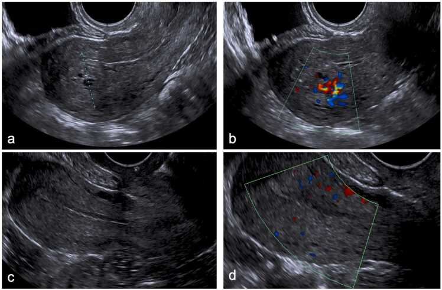
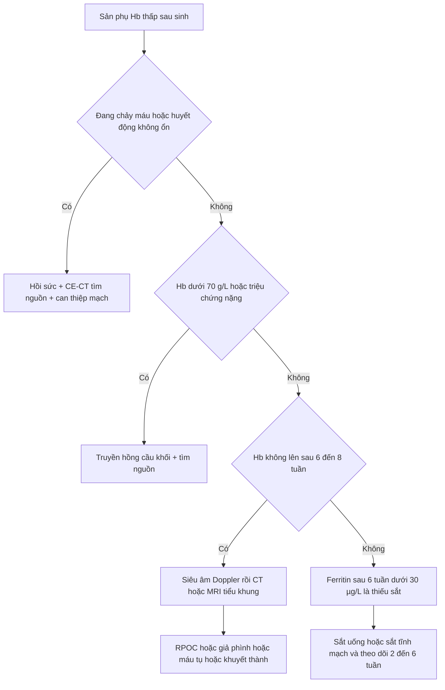
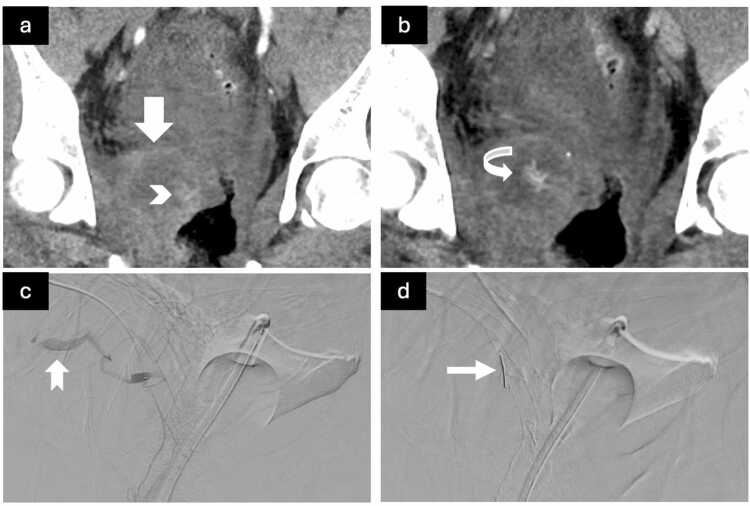

# 1995 — Thiếu máu và thiếu sắt sau băng huyết hậu sản / Postpartum anaemia and iron deficiency after postpartum haemorrhage

**Tags:** `pattern:thieu-mau` `pattern:mat-mau-keo-dai` `pattern:sot-rau` `pattern:gia-phinh` `pattern:khong-hoi-phuc` `vung:tu-cung-phan-phu` `vung:tu-cung` `vung:tieu-khung` `protocol:SA-Doppler` `protocol:CT-bung-can-quang` `protocol:MRI-chau` `score:WHO-anemia`
**Mức chắc chắn (certainty):** tổng hợp y văn (literature synthesis) — ghép 1 tổng quan hình ảnh hậu sản có **14 hình minh hoạ** (Eur J Radiol Open 2026, PMC13351678), 1 bài khuyến cáo quản lý thiếu máu hậu sản (Blood Transfus 2025, PMID 39804748), 1 phân tích gộp **20 thử nghiệm / 4.196 sản phụ** về sắt tĩnh mạch (Syst Rev 2024, PMC10759729), 1 đoàn hệ **573 thai phụ** (J Nutr Sci 2022, PMC9201879), 1 đoàn hệ **489 ca mổ lấy thai** (Perioper Med 2022, PMC9351116), 1 thử nghiệm ngẫu nhiên **590 thai phụ** về ferric carboxymaltose (Nat Med 2025, PMC11750709), 1 đoàn hệ **176 ca nghi sót rau** (Abdom Radiol 2016, DOI 10.1007/s00261-016-0954-x) và 1 tổng quan Sheehan (Pituitary 2025, PMC11762620). Câu nào là **tính toán/suy luận** được ghi rõ.

> **Vì sao bài này quan trọng:** sau khi xuất viện, "thiếu máu sau sinh" bị coi là **chuyện bình thường phải chờ** — trong khi **25% sản phụ còn thiếu máu ở tuần 14** và **39% còn thiếu sắt** (PMC9201879). Cái giá phải trả không chỉ là mệt: thiếu sắt làm **chậm hồi phục thể lực, giảm tiết sữa, tăng trầm cảm sau sinh** (PMID 39804748). Ngược lại, có một nhóm **không hồi phục dù đã bổ sung sắt** — vì còn **nguồn chảy chưa kiểm soát** (sót rau, giả phình động mạch tử cung, máu tụ trên hoành). Bài này dạy cách **phân biệt hai nhóm đó bằng xét nghiệm + hình ảnh**, và **khi nào phải chụp**.

## 1. Tổng quan bệnh học – cơ chế hình ảnh

- **Định nghĩa gốc (phải nhớ để không đọc sai mọi số liệu):** băng huyết sau sinh (postpartum haemorrhage, PPH) nguyên phát là **mất > 500 mL máu từ đường sinh dục trong 24 giờ**; PPH thứ phát là chảy máu bất thường **từ 24 giờ đến 12 tuần** sau sinh (PMC13351678). **Nguyên nhân theo "4T":** Tone (đờ tử cung, **70–90%** PPH nguyên phát), Trauma (rách đường sinh dục, **2–4%**), Thrombin (rối loạn đông máu), Tissue (sót rau/nhau bám bất thường) (PMC13351678).
- **Thiếu máu hậu sản (postpartum anaemia, PPA) — ngưỡng thay đổi theo thời điểm:** WHO định nghĩa **Hb < 110 g/L ở tuần đầu** và **< 120 g/L trong năm đầu sau sinh**; hướng dẫn Anh dùng **< 100 g/L trong 48 giờ đầu** rồi **< 120 g/L** sau đó (PMID 39804748). Hai ngưỡng khác nhau **không phải mâu thuẫn** mà phản ánh sinh lý: trong 24–48 giờ đầu, thể tích huyết tương còn dao động sau khi rau sổ và dịch từ khoảng kẽ trở lại lòng mạch, nên **Hb bị pha loãng**; đo quá sớm vừa có thể **thấp giả** vừa có thể **bỏ sót máu đang tiếp tục mất**.
- **TẠI SAO một lượng máu mất "trông nhỏ" lại tạo thiếu sắt lớn:** 1 g hemoglobin chứa **3,47 mg sắt**. Với Hb 120 g/L, **500 mL máu chứa 60 g Hb ≈ 208 mg sắt**; PPH 1.000 mL làm mất **≈ 400 mg sắt** — bằng **gần một nửa** lượng sắt dự trữ của phụ nữ không mang thai (khoảng 0–500 mg) **[tính toán từ thành phần Hb]**. Đây là lý do **không thể bù bằng "ăn uống tốt hơn"**: sắt uống chỉ hấp thu **1–10%** tuỳ muối sắt và tình trạng hepcidin.
- **TẠI SAO ferritin là chỉ số đúng nhưng dễ đọc sai:** ferritin phản ánh **kho sắt dự trữ**, nhưng là **protein pha cấp**. Sau sinh có **phản ứng viêm cấp**, IL-6 tăng → **hepcidin tăng** → ferroportin bị phân huỷ → sắt bị **giữ trong đại thực bào**, ferritin **tăng giả** trong khi sắt tuần hoàn vẫn thiếu. Vì vậy NATA khuyến cáo **đo công thức máu + ferritin ở 4–8 tuần sau sinh** và **tránh đo ferritin trong 6 tuần đầu** (PMID 39804748). Ngưỡng dùng trong nghiên cứu: **ferritin < 15 µg/L** (PMC9201879) hoặc **< 30 µg/L** (PMC9351116); kèm **TSAT < 20%** khi ferritin nằm vùng 30–100 µg/L.
- **Quy mô (số liệu để không xem nhẹ):** đoàn hệ Na Uy **573 thai phụ**, ở **tuần 14 sau sinh**: **25% thiếu máu** (Hb < 120 g/L), **39% thiếu sắt** theo ferritin < 15 µg/L, **19%** theo sTfR và **22%** theo tổng lượng sắt cơ thể; Hb trung bình **12,8 g/dL** khi không thiếu sắt so với **11,6 g/dL** khi thiếu cả ba chỉ số; **PPH là yếu tố liên quan độc lập với Hb thấp hơn** (PMC9201879). Ở **489 ca mổ lấy thai**: **33,9%** thiếu sắt (ferritin < 30 µg/L) ngay lần khám đầu, **62,1%** ca thiếu máu trung bình (Hb 80–109 g/L) có thiếu sắt, và **≥ 40%** còn Hb < 130 g/L khi xuất viện — nhưng **chỉ 45,9%** ca thiếu sắt được điều trị (PMC9351116).
- **TẠI SAO bổ sung sắt tĩnh mạch hiệu quả hơn ở nhóm nặng:** phân tích gộp **20 thử nghiệm, 4.196 sản phụ** cho thấy so với sắt uống, sắt tĩnh mạch tăng **Hb thêm 0,54 g/dL** (KTC 95% 0,47–0,61), **ferritin thêm 58,07 µg/L** (55,74–60,41), giảm **mệt SMD −0,40** (−0,62 đến −0,18) và giảm **biến cố bất lợi RR 0,63** (0,52–0,77); chất lượng bằng chứng **thấp–trung bình** (PMC10759729). Thử nghiệm ngẫu nhiên ở thai kỳ muộn (**590 thai phụ**, Hb < 100 g/L, 27–35 tuần) dùng **ferric carboxymaltose 20 mg/kg tối đa 1.000 mg** một lần: còn thiếu máu **46,7% vs 67,3%** (PR 0,74; KTC 95% 0,64–0,87) (PMC11750709) — đây là **bằng chứng về liều và tốc độ**, không phải chỉ định cho hậu sản.
- **TẠI SAO vẫn phải truyền máu ở một số ca:** truyền hồng cầu khối chỉ nên cân nhắc khi **Hb < 70 g/L** hoặc có **nguy cơ chảy máu lại / huyết động không ổn** (PMID 39804748). Bằng chứng so sánh trực tiếp **sắt tĩnh mạch vs truyền máu** gần như trống: trong 20 thử nghiệm, chỉ **6 nghiên cứu** báo cáo mệt, và **không có so sánh đầu đối đầu đủ lớn** (PMC10759729).
- **TẠI SAO hình ảnh lại là phần không thể bỏ:** thiếu sắt **không gây thiếu máu nếu không có nguồn mất**. Một sản phụ "đã bù sắt 6 tuần vẫn Hb 85 g/L" thường không phải vì sắt kém hấp thu, mà vì **còn mất máu**: **sót rau** (up to **~5%** các thai kỳ), **giả phình động mạch tử cung**, **máu tụ trên hoành (supralevator)** không thấy được bằng mắt (PMC13351678). Siêu âm Doppler là **bước đầu**, CE-CT là **bước xác định nguồn** khi siêu âm không kết luận.

## 2. Mẫu hình + chẩn đoán phân biệt theo vị trí (Gamut)

**Mẫu hình chung:** "Hb thấp sau sinh, không hồi phục theo thời gian" — gamut theo **cơ chế**, vì cùng một con số Hb có 6 hướng xử trí khác nhau.

- **Mất máu còn tiếp diễn — TRONG tử cung:** **sót rau (retained products of conception, RPOC)** — khối echo trong lòng tử cung, **bề dày nội mạc > 10 mm**, tăng sinh mạch; **giả phình động mạch tử cung (uterine artery pseudoaneurysm)** — túi có cổ, **yin–yang**, phổ **to-and-fro**; **dị dạng động–tĩnh mạch tử cung** — mạng mạch lan toả **trong cơ tử cung**; **khuyết thành tử cung** sau mổ lấy thai; **nhau bám bất thường** còn sót.
- **Mất máu còn tiếp diễn — NGOÀI tử cung:** **máu tụ dưới hoành (supralevator)** — dây chằng rộng, sau phúc mạc; **máu tụ tầng sinh môn/âm đạo (infralevator)** — thấy bằng mắt; **máu tụ thành bụng** (rectus sheath) sau mổ lấy thai. Điểm chung: **không có máu âm đạo** hoặc máu âm đạo ít, nhưng **Hb tụt, đau, huyết động xấu**.
- **Thiếu sắt thật, không mất máu đang tiếp diễn:** ferritin thấp, TSAT thấp, hồng cầu nhỏ nhược sắc, **reticulocyte thấp** (đáp ứng chưa đủ), CRP có thể bình thường.
- **Pha loãng/hồi phục thể tích:** Hb thấp trong 24–72 giờ đầu rồi **tự tăng**, ferritin bình thường, không có nguồn mất; gặp ở người nhận nhiều dịch tinh thể trong chuyển dạ.
- **Tan máu:** **HELLP/aHUS/TTP** sau sinh (xem 1959), **phản ứng truyền máu** (xem 1958), thiếu G6PD; schistocyte, LDH tăng, haptoglobin giảm, bilirubin gián tiếp tăng.
- **Viêm/nhiễm và bệnh nền:** **viêm nội mạc tử cung (endometritis)** — **27%** sau mổ lấy thai và **3%** sau sinh thường (PMC13351678); **Sheehan** — **6–8%** các nguyên nhân suy tuyến yên, MRI **empty sella** (PMC11762620); **thalassemia trait**; thiếu **B12/folate**.

**Mnemonic "MẤT – THIẾU – LOÃNG – TAN – VIÊM – NỀN":** **M**ất máu tiếp diễn, **T**hiếu sắt, **L**oãng/hồi phục thể tích, **T**an máu, **V**iêm, **N**ền (thalassemia, B12, Sheehan, bệnh thận). Câu hỏi đầu tiên luôn là: **"Còn nguồn chảy không?"** — nếu có, mọi liều sắt chỉ là che dấu.

**Theo vị trí trên hình ảnh:**
- **Trong lòng tử cung** → RPOC, cục máu, endometritis.
- **Trong cơ tử cung/cạnh tử cung** → giả phình, AVM, khuyết thành, nhau bám sâu.
- **Dây chằng rộng/sau phúc mạc** → máu tụ supralevator, giả phình nhánh tử cung vỡ ra ngoài.
- **Tầng sinh môn/âm đạo** → máu tụ infralevator.
- **Tuyến yên** → Sheehan khi thiếu máu + **mất sữa + mệt kéo dài**.

## 3. Bảng so sánh phân biệt (ma trận đối chiếu)

| Thực thể (entity) | Dấu hiệu điển hình (xét nghiệm/hình ảnh) | Chốt vào (rule-in) | Chốt loại (rule-out) | Gợi ý xác nhận |
|---|---|---|---|---|
| **Thiếu sắt sau sinh** | Hb ↓, MCV ↓, ferritin **< 30 µg/L** (đo **sau 6 tuần**), TSAT < 20%, retic thấp | **Ferritin < 30 µg/L + Hb tăng sau bổ sung sắt** | Ferritin **> 100 µg/L** kèm CRP cao **không loại trừ** (ferritin pha cấp) | Sắt uống/IV; kiểm tra nguồn nếu Hb không lên sau 4–6 tuần |
| **Pha loãng/hồi phục thể tích** | Hb thấp **24–72 giờ** đầu, ferritin bình thường, retic bình thường, không đau/sốt | **Hb tự tăng ≥ 10 g/L trong 1–2 tuần** không cần sắt | Ferritin thấp hoặc Hb tiếp tục tụt → **không phải** thuần pha loãng | Theo dõi CBC tuần 2 và tuần 6 |
| **Sót rau (RPOC)** | US: **bề dày nội mạc > 10 mm** hoặc khối echo trong lòng; **vascularity 0–3** so với cơ tử cung; hCG còn dương | **Khối trong lòng + mạch nuôi + hCG (+)** | Nội mạc **< 5 mm**, không khối, hCG âm → ít khả năng | Nạo hút khi type 2–3; type 0 có thể theo dõi (PMC13351678) |
| **Giả phình động mạch tử cung** | Túi tròn **có cổ**, **yin–yang**, phổ **to-and-fro**; CTA đọng thuốc thì động mạch | **Yin–yang + to-and-fro** (độ nhạy tới **~95%**) | Mạng mạch lan toả, hồi lưu tĩnh mạch sớm → AVM | DSA + nút chọn lọc (xem 1723) |
| **Máu tụ supralevator** | CT: khối dịch/máu **40–60 HU**, ± **thoát mạch ≥ 100 HU**; đẩy tử cung/bàng quang | **Khối máu tụ + Hb tụt không giải thích** | CT không thấy máu tụ + không thoát mạch | CE-CT; nút mạch hoặc mổ |
| **Tan máu vi mạch** | **Schistocyte**, LDH ↑, haptoglobin ↓, bilirubin ↑, tiểu cầu ↓ | **Schistocyte + LDH/haptoglobin** | Phết bình thường + retic thấp → không tan máu | ADAMTS13, bổ thể (xem 1959) |
| **Thalassemia trait** | **MCV < 80 fL**, **Mentzer < 13**, ferritin bình thường, HbA₂ ↑ | **MCV thấp + ferritin bình thường** | Ferritin thấp → thiếu sắt là nguyên nhân chính | Điện di Hb |

*Bốn ô của cùng một bệnh nhân: **(a)** khối echo trong lòng tử cung (đường chấm), **(b)** tăng sinh mạch trên Doppler; sau nạo hút: **(c)** nội mạc trở về bình thường, **(d)** mạch bình thường. Nguồn: Agarwal G et al., Eur J Radiol Open 2026 (PMC13351678), **CC BY 4.0** — nguyên bản, không crop.*

**Ba con số phân tầng nguy cơ của RPOC (dùng để quyết định nạo hay theo dõi):** trong **176 ca** có chẩn đoán siêu âm RPOC, **47,2%** khỏi bằng theo dõi, **23,8%** cần điều trị nội khoa và **29,0%** phải can thiệp ngoại khoa; **bề dày nội mạc trung bình 21,3 mm**; mỗi **1 mm** nội mạc dày thêm làm **OR cần mổ 1,08** (1,04–1,12), mỗi **1 điểm vascularity** làm **OR 1,77** (1,16–2,70), và **Hb thấp hơn** cũng dự báo cần mổ (**OR 0,69** mỗi 1 g/dL) (DOI 10.1007/s00261-016-0954-x). Nói cách khác: **khối càng mạch và bệnh nhân càng thiếu máu thì càng không được "chờ"**.

## 4. Protocol chụp + hệ phân độ/điểm chuẩn hóa

- **Ai cần chụp (4 chỉ định):** (1) **đang chảy máu/huyết động không ổn**; (2) **Hb không hồi phục sau 6–8 tuần** hoặc tụt lại sau khi đã lên; (3) **đau bụng, sốt, dịch âm đạo hôi** (nghi endometritis/áp-xe/máu tụ nhiễm); (4) **mức thiếu máu không giải thích được** bằng lượng máu mất ước tính.
- **Siêu âm — đầu tay, luôn kèm Doppler màu:** đầu dò **transabdominal 3,5–5 MHz** + **transvaginal 5–9 MHz**; đo **bề dày nội mạc** ở mặt cắt sagittal tại chỗ dày nhất; phân độ **vascularity 0–3** so với cơ tử cung; tìm **túi có cổ** trong cơ/cạnh tử cung và bật **phổ xung ở cổ túi** để tìm **to-and-fro** (PMC13351678).
- **CE-CT khi siêu âm không kết luận hoặc nghi máu tụ trên hoành:** thì **động mạch 25–35 giây** để bắt **thoát mạch hoạt tính**, thì **cổng 70 giây** để thấy **máu tụ và tương quan với tử cung/bàng quang**; máu tụ điển hình **40–60 HU**, cản quang thoát mạch **≥ 100 HU**.
- **MRI tiểu khung** khi cần phân biệt **RPOC vs AVM vs nhau bám sâu**, hoặc khi có thai lại/không dùng iod: **T2 ± DWI**, gadolinium an toàn khi đang cho con bú.
- **MRI sọ/tuyến yên** khi thiếu máu kèm **mất sữa, mệt kéo dài, hạ Na⁺**: tìm **empty sella** (Sheehan) — **6–8%** các nguyên nhân suy tuyến yên, tỷ lệ **5,1/100.000 phụ nữ** trong một khảo sát 2009 (PMC11762620).
- **Xét nghiệm tối thiểu:** CBC, **ferritin (sau 6 tuần)**, TSAT, CRP, reticulocyte, phết máu, LDH, bilirubin, haptoglobin; **hCG** khi nghi RPOC; **Hb điện di/Mentzer** khi MCV thấp mà ferritin bình thường.
- **Điều trị theo tầng (WHO):** thiếu máu **nhẹ 110–119 g/L**, **trung bình 80–109 g/L**, **nặng < 80 g/L** (nữ không mang thai); ở thai phụ ngưỡng thấp hơn **10 g/L**. **Sắt uống 100–200 mg sắt nguyên tố/ngày, cách ngày** (tăng hấp thu nhờ "cửa sổ hepcidin"); **sắt tĩnh mạch** (ferric carboxymaltose **20 mg/kg, tối đa 1.000 mg**) khi thiếu máu trung bình–nặng, kém hấp thu, không dung nạp hoặc không tuân thủ; **tiếp tục sắt uống 12 tuần sau khi Hb bình thường** để lấp kho dự trữ (PMID 39804748).
- **Truyền máu:** cân nhắc khi **Hb < 70 g/L** hoặc có **nguy cơ chảy máu lại/huyết động không ổn** — không dùng truyền máu để "bù kho sắt" (PMID 39804748).
- **Theo dõi:** **CBC + ferritin ở 4–8 tuần** (NATA); sau bắt đầu sắt, đo lại Hb ở **2–6 tuần**; nếu **Hb tăng < 10 g/L** dù đã uống đúng → kiểm tra tuân thủ, rồi **chụp tìm nguồn**.

## 5. Biến thể bình thường và cạm bẫy

- **Ferritin đo sớm = ferritin giả cao.** Trong **6 tuần đầu**, phản ứng viêm sau sinh làm ferritin tăng; **ferritin "bình thường" không loại trừ thiếu sắt** (PMID 39804748). Đo lại sau 6 tuần hoặc dùng **TSAT/reticulocyte** để quyết định.
- **Ferritin sau liều sắt tĩnh mạch cũng giả cao** trong nhiều tuần — đừng dùng ferritin để đánh giá đáp ứng ngay sau truyền; theo dõi bằng **Hb và reticulocyte**.
- **"Hb bình thường lúc xuất viện" không loại trừ còn chảy máu.** Trong ca minh hoạ của PMC13351678, bệnh nhân **tụt Hb lúc 8 giờ sau sinh** vì máu tụ âm đạo–cổ tử cung; Hb đầu tiên có thể còn bình thường do cô đặc và pha loãng chưa hoàn tất.
- **Vật liệu echo trong lòng tử cung gặp ở tới 50% sản phụ KHÔNG triệu chứng trong 7 ngày đầu**, và **khí trong buồng tử cung có thể bình thường tới 3 tuần** — đừng gọi RPOC/endometritis chỉ vì siêu âm "bẩn" (PMC13351678).
- **Cơ tử cung hậu sản tăng sinh mạch là sinh lý** — tăng mạch lan toả không đồng nghĩa AVM; AVM nằm **trong cơ tử cung**, RPOC nằm **trong lòng tử cung** (PMC13351678).
- **Nạo trên giả phình chưa chẩn đoán = vỡ túi, chảy máu ồ ạt.** Nếu siêu âm thấy **túi có cổ/yin–yang**, phải **loại giả phình trước khi đặt dụng cụ vào buồng tử cung** (xem 1723).
- **MCV thấp không đồng nghĩa thiếu sắt:** **thalassemia trait** có MCV thấp, ferritin bình thường, **Mentzer < 13**; điều trị sắt kéo dài ở nhóm này chỉ làm **quá tải sắt**.
- **Thiếu máu + mất sữa + hạ Na⁺ sau PPH nặng:** nghĩ **Sheehan**, không phải "trầm cảm sau sinh" — MRI tuyến yên là chốt (PMC11762620).

## 6. Tự lượng giá — Blind Quiz

**Ca 1 — Sản phụ 28 tuổi, sinh thường 3 tuần trước, ra máu âm đạo từng đợt, Hb 92 g/L, ferritin 12 µg/L. Siêu âm đầu dò âm đạo + Doppler dưới đây.**

- Câu hỏi: (1) Mô tả hai dấu hiệu chính trong lòng tử cung. (2) Ba chẩn đoán phân biệt? (3) Dấu hiệu nào quyết định **nạo hút** thay vì theo dõi?

<b>Bấm để hiện đáp án (findings + chẩn đoán)</b>

- **Dấu hiệu:** **khối echo trong lòng tử cung** (đường chấm) + **tăng sinh mạch rõ trên Doppler**, bề dày nội mạc **> 10 mm**.
- **Chẩn đoán:** **sót rau (RPOC)** — mô rau còn lại kích thích tăng sinh mạch và chảy máu; ferritin 12 µg/L cho thấy đã mất một lượng sắt lớn.
- **Phân biệt:** **giả phình động mạch tử cung** (túi có cổ, trong cơ, **không có khối trong lòng**), **AVM tử cung** (mạng mạch trong cơ), **endometritis** (sốt, đau, khí trong buồng tử cung — khí có thể bình thường tới 3 tuần).
- **Quyết định:** **vascularity type 2–3** và Hb thấp → **nạo hút**; type 0 có thể theo dõi bằng siêu âm lặp lại (PMC13351678). Sau nạo: kiểm tra lại nội mạc và mạch (ô c–d).
- Nguồn ảnh: Agarwal G et al., Eur J Radiol Open 2026 (PMC13351678), **CC BY 4.0**.

**Ca 2 — Sản phụ 30 tuổi, rách âm đạo độ 2 đã khâu; 8 giờ sau sinh tụt Hb, đau vùng chậu, huyết áp 95/60 mmHg, không ra máu âm đạo nhiều. CT tiểu khung dưới đây.**

- Câu hỏi: (1) Ổ bất thường nằm ở đâu và đậm độ bao nhiêu? (2) Vì sao **không có máu âm đạo nhiều** mà Hb vẫn tụt? (3) Bước tiếp theo?

<b>Bấm để hiện đáp án (findings + chẩn đoán)</b>

- **Dấu hiệu:** **máu tụ lớn dọc thành âm đạo–cổ tử cung bên phải**, đậm độ **40–60 HU**, có **ổ thoát cản quang lờ mờ thì động mạch** và **đọng thuốc thì muộn** — tức **còn chảy máu hoạt tính** (thoát mạch **≥ 100 HU**).
- **Vì sao máu âm đạo ít:** máu tụ nằm **trong mô (supralevator/paravaginal)**, không thoát ra ngoài; đây là lý do **máu tụ trên hoành là "kẻ giấu mặt"** của PPH (PMC13351678).
- **Chẩn đoán:** **máu tụ âm đạo–cổ tử cung có thoát mạch hoạt tính** sau rách đường sinh dục.
- **Bước tiếp theo:** **DSA + nút mạch chọn lọc** (ô c–d trong hình: chụp mạch xác nhận nhánh âm đạo của động mạch tử cung phải, sau nút không còn thoát mạch); truyền máu theo Hb/huyết động; **không nạo mù**.
- Nguồn ảnh: Agarwal G et al., Eur J Radiol Open 2026 (PMC13351678), **CC BY 4.0**.

**Ca 3 — Sản phụ 32 tuổi, 8 tuần sau sinh, Hb 95 g/L, ferritin 8 µg/L, siêu âm tử cung bình thường, không ra máu âm đạo. Chọn đường bổ sung sắt nào và theo dõi ra sao?**

<b>Bấm để hiện đáp án</b>

- **Chẩn đoán:** **thiếu sắt thật sau sinh**, không có nguồn chảy (siêu âm bình thường, không triệu chứng).
- **Điều trị:** có thể **sắt uống 100–200 mg sắt nguyên tố cách ngày**; nếu không dung nạp/không tuân thủ hoặc muốn hồi phục nhanh → **ferric carboxymaltose 20 mg/kg tối đa 1.000 mg** một lần; tiếp tục sắt uống **12 tuần sau khi Hb bình thường** (PMID 39804748).
- **Theo dõi:** Hb ở **2–6 tuần**; nếu **tăng < 10 g/L** dù uống đúng → xem lại tuân thủ, rồi **chụp tìm nguồn** (siêu âm Doppler → CE-CT).
- **Sai lầm hay gặp:** coi ferritin 8 µg/L là "không cần điều trị" vì Hb 95 g/L chưa nguy hiểm — kho sắt rỗng sẽ làm **mệt kéo dài và tái phát thiếu máu ở thai kỳ sau**.

## 7. Câu hỏi nghiên cứu & điểm chưa đồng thuận (tính đến 11/2026)

1. **[Tranh cãi] Ở sản phụ thiếu máu nặng sau sinh (Hb 70–90 g/L), sắt tĩnh mạch có thay thế được truyền hồng cầu khối về mệt và Hb không?**
   - **Đã biết:** phân tích gộp 20 thử nghiệm / 4.196 sản phụ chỉ có **6 nghiên cứu** báo cáo mệt và **không có so sánh đầu đối đầu đủ lớn** giữa sắt tĩnh mạch và truyền máu; bằng chứng cho truyền máu được xếp **rất hạn chế** (PMC10759729).
   - **Chưa rõ:** ngưỡng Hb nào thì truyền máu vẫn cần để giảm mệt/mất bù dịch, và liều sắt tĩnh mạch tối ưu cho nhóm Hb < 80 g/L.
   - **Hướng nghiên cứu:** thử nghiệm ngẫu nhiên so **sắt tĩnh mạch liều cao vs 1–2 đơn vị hồng cầu** với outcome **mệt (MFI/BFS) + Hb tuần 6 + biến cố**.
   - **Nguồn:** PMC10759729 (2024).

2. **[Khác biệt thực hành] Thời điểm đo ferritin sau sinh: 4–8 tuần (NATA) hay ngay khi xuất viện?**
   - **Đã biết:** ferritin là **protein pha cấp**, tăng giả trong viêm sau sinh; NATA khuyến cáo **tránh đo trong 6 tuần đầu** và đo **CBC + ferritin ở 4–8 tuần** (DOI 10.2450/BloodTransfus.924); các đoàn hệ vẫn đo ở **tuần 14** và thấy **39% thiếu sắt** (PMC9201879).
   - **Chưa rõ:** đo sớm kèm **CRP/TSAT** có đủ tin cậy để bắt đầu sắt tĩnh mạch trước xuất viện không, và ngưỡng ferritin nào phù hợp khi CRP cao.
   - **Hướng nghiên cứu:** nghiên cứu chẩn đoán so **ferritin ± CRP ± TSAT sớm** với **ferritin tuần 6** làm chuẩn, outcome là **tỉ lệ được điều trị đúng và Hb tuần 6**.
   - **Nguồn:** 10.2450/BloodTransfus.924 (2025); PMC9201879 (2022).

3. **[Khoảng trống] Có ngưỡng siêu âm nào đủ mạnh để quyết định chụp/ can thiệp ở sản phụ thiếu máu KHÔNG triệu chứng không?**
   - **Đã biết:** ngưỡng **bề dày nội mạc > 10 mm** và **vascularity 0–3** được dùng cho ca **nghi RPOC có triệu chứng**; trong 176 ca, mỗi 1 mm nội mạc làm **OR cần mổ 1,08** và mỗi 1 điểm mạch làm **OR 1,77** (DOI 10.1007/s00261-016-0954-x), nhưng **chưa có ngưỡng cho người không triệu chứng**.
   - **Chưa rõ:** tỷ lệ RPOC tự khỏi ở nhóm **chỉ thiếu máu, không ra máu**, và nguy cơ nạo oan nếu chụp rộng.
   - **Hướng nghiên cứu:** đoàn hệ tiến cứu sản phụ thiếu máu không triệu chứng, siêu âm Doppler định kỳ, outcome **Hb tuần 6 + can thiệp + biến chứng**.
   - **Nguồn:** PMC13351678 (2026); 10.1007/s00261-016-0954-x (2016).

## Bài liên quan chéo
- [1932 – Truyền máu khối lượng lớn và rối loạn đông máu trong băng huyết sau sinh](../1932-truyen-mau-khoi-luong-lon-bang-huyet-sau-sinh/lesson.md) — xử lý cấp khi đang chảy máu
- [1723 – Giả phình động mạch tử cung](../1723-gia-phinh-dong-mach-tu-cung/lesson.md) — yin–yang/to-and-fro và nút chọn lọc
- [1957 – Hoại tử vỏ thận sau băng huyết](../1957-hoai-tu-vo-than-sau-bang-huyet/lesson.md) — mặt thận của di chứng PPH
- [1959 – Tán huyết vi mạch sau sinh: HELLP vs aHUS vs TTP](../1959-tan-huyet-vi-mach-sau-sinh-hellp-ahus-ttp/lesson.md) — khi Hb thấp kèm schistocyte
- [1958 – TACO, TRALI, AFE: phù phổi sau truyền máu](../1958-taco-trali-afe/lesson.md) — biến cố của chính biện pháp truyền máu

## Ảnh
- Hai ảnh tải từ PMC (PMC13351678), giấy phép **CC BY 4.0**, ghi từng file trong `images/CREDITS.md`; **nguyên bản, không crop, không ghép**.
- Không dùng ảnh paywall/AuntMinnie.

> Không dùng để chẩn đoán độc lập khi chưa có người hướng dẫn.
