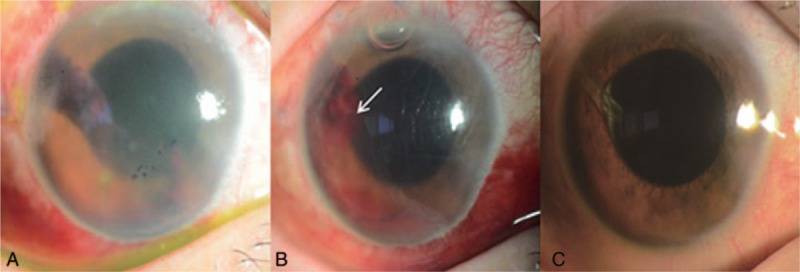
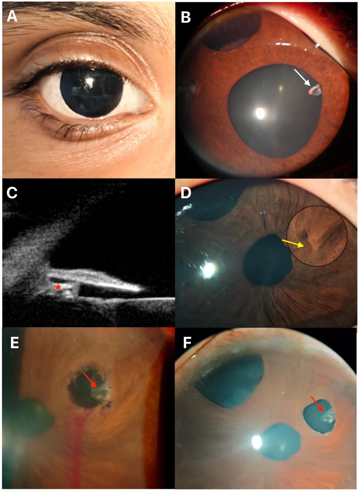
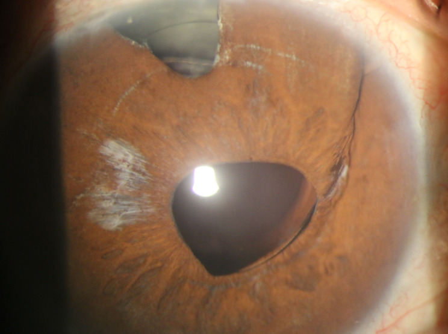
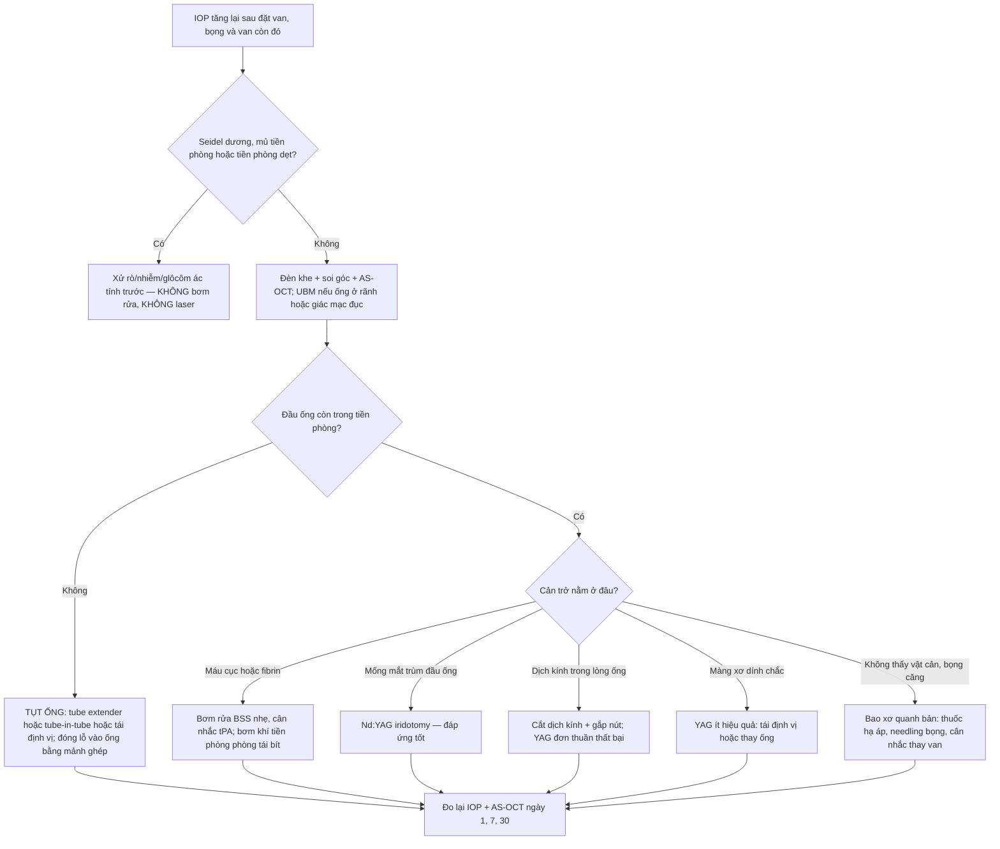
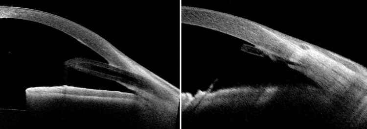
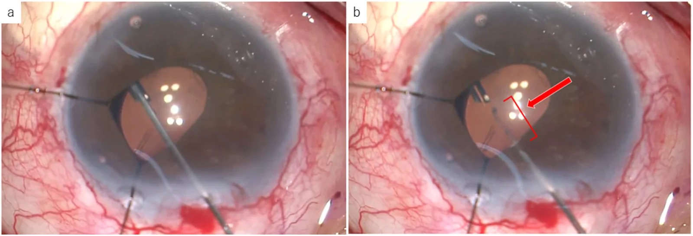

# 1996 — Tắc và tụt ống van dẫn lưu glôcôm: ống bít hay ống tụt, đọc bằng AS-OCT/UBM, và khi nào bơm rửa – laser – tái định vị – thay ống / Tube occlusion and retraction of glaucoma drainage devices

**Tags:** `pattern:bit-ong` `pattern:tut-ong` `pattern:iop-tang-sau-van` `pattern:mong-mat-bit-ong` `pattern:bao-xo-ban-van` `vung:mat` `vung:tien-phong` `vung:goc-tien-phong` `vung:hac-mac` `protocol:AS-OCT` `protocol:UBM` `protocol:gonioscopy` `protocol:van-dan-luu` `score:IOP` `score:ECD`

**Mức chắc chắn (certainty):** tổng hợp y văn (literature synthesis) — ghép **2 đoàn hệ có số biến cố ống** (144 mắt glôcôm khó trị, Rojananuangnit K et al., *Clin Ophthalmol* 2022, PMID 36540897, PMC9760067; 81 mắt, *Arch Soc Esp Oftalmol* 2004, PMID 15286904), **1 đoàn hệ so sánh kỹ thuật đặt ống** (135 mắt, Chey JH & Lee CK, *PLoS One* 2023, PMID 36787298, PMC9928107, CC BY 4.0), **1 so sánh trẻ – người lớn** (Mandalos A & Sung V, *Graefes Arch Clin Exp Ophthalmol* 2017, PMID 28144751, PMC5394135), và **4 ca/hai ca có ảnh** (máu cục + khí tiền phòng, Hwang SH et al., *Medicine* 2017, PMID 29390305, PMC5815717, CC BY 4.0; mống mắt + UBM + Nd:YAG, Iqbal MI & Osman F, *BMC Ophthalmol* 2026, PMID 42698097, PMC13543376; IOL lạc bít ống, Ha A et al., *BMC Ophthalmol* 2025, PMID 40640773, PMC12247232; AS-OCT vị trí ống, Hwang YH et al., *J Curr Glaucoma Pract* 2025, PMID 41113684, PMC12532363; hút lòng ống, Hayami T et al., *Am J Ophthalmol Case Rep* 2026, PMID 42733525, PMC13571464). Chỗ suy luận ghi rõ "suy luận"; chỗ y văn chưa có số ghi "chưa rõ".

> **Vì sao bài này quan trọng:** [1993](../1993-that-bai-needling-van-dan-luu/lesson.md) chọn **đặt van nào**; bài này là **mặt sau của cùng thiết bị** — van đã nằm trong mắt rồi mà IOP lại bò lên. Đây là **biến cố thường gặp nhất** của phẫu thuật van: **16/144 mắt (11,1%)** có biến cố liên quan ống, trong đó **bít ống 3 mắt**, **sai vị trí 11 mắt** (Rojananuangnit 2022); loạt 81 mắt ghi **11 ca bít ống (13,6%)**, **10/11 ở đầu ống** (Rojananuangnit 2022; Gómez Ledesma 2004). Điều nguy hiểm không phải con số mà là **phản xạ sai**: thấy IOP tăng thì **bơm rửa mạnh cho "thông ống"** — thao tác này có thể **bắn máu cục/mảnh vào tiền phòng, làm bung chỗ vào ống, hoặc đẩy dịch kính vào sâu**; trong khi một **IOP vọt sau tháo chỉ thắt** lại là chuyện **bình thường**, không phải bít. Bài này đưa **thuật toán định vị bằng hình ảnh** (AS-OCT/UBM) trước khi động vào mắt.

## 1. Tổng quan bệnh học – cơ chế hình ảnh: vì sao 0,30 mm là điểm yếu chết người

### 1.1 Vật lý lòng ống: trở lực tỉ lệ nghịch với bán kính mũ 4
- Ống silicone của van dẫn lưu có **đường kính lòng 0,30 mm (Ahmed) / 0,305 mm (Baerveldt)** — diện tích lòng chỉ **≈ 0,071 mm²** (tính: π × 0,15² mm). Thủy dịch toàn mắt sản xuất **≈ 2,5 µL/phút**, nên vận tốc trong ống rất thấp, **ứng suất trượt (shear stress) thấp** — đúng điều kiện để protein bám thành ống và **fibrin lắng thành màng**.
- Theo **định luật Poiseuille**, trở lực **R ∝ 1/r⁴**: bán kính giảm **50%** làm trở lực tăng **16 lần**. Vì vậy **một màng fibrin mỏng 0,1 mm** ở đầu ống cũng đủ **nâng IOP 10–20 mmHg**, dù trên đèn khe "ống vẫn còn đó". Đây là lý do **"thấy ống" ≠ "ống thông"** — câu hỏi luôn là **thông ở đâu, cản ở đâu**.
- Hệ quả lâm sàng: bít ống chia **hai tầng** — **tầng đầu ống (proximal)** do máu cục, fibrin, mống mắt, dịch kính, IOL; và **tầng quanh bản (distal)** do **bao xơ** quanh bản van. Hai tầng này **điều trị khác hẳn nhau** (mục 4), và **chỉ hình ảnh mới tách được**.

### 1.2 Bốn cơ chế bít đầu ống — mỗi cơ chế một "cửa sổ thời gian"
| Cơ chế | Thời điểm điển hình | Vì sao | Bằng chứng định lượng |
|---|---|---|---|
| **Máu cục / fibrin** | **ngày 1–7** sau mổ, nhất là glôcôm tân mạch | lòng 0,30 mm + lưu lượng thấp + thủy dịch giàu protein sau vỡ hàng rào máu–thủy dịch → clot bám đầu ống | 4 ca tân mạch bít ống **ngay ngày 1**, thông lại sau khi lấy cục máu + **bơm khí tiền phòng** (Hwang 2017); **6/11** ca bít do máu cục trong loạt 81 mắt |
| **Mống mắt** | **tháng 3–12** (muộn) | đầu ống quá gần mặt trước mống mắt; đồng tử **giãn** kéo mống mắt trùm đầu ống; hay gặp khi ống đặt **rãnh thể mi** | bít do mống mắt **10 tháng** sau đặt, **IOP 36 mmHg** → **12 mmHg** sau Nd:YAG, không tái bít **7 tháng** (Iqbal 2026) |
| **Dịch kính** | **tuần 2–6**, ngay sau **tháo chỉ thắt/ripcord** | mắt **aphakic/đã cắt dịch kính**: dịch kính bị hút vào lòng ống rồi **cô đặc** thành nút | **3/11** ca trong loạt 81 mắt; Nd:YAG đơn thuần chỉ hạ **32 → 28 mmHg trong 2 giờ** rồi thất bại (Iqbal 2026) |
| **Màng xơ / tổ chức hóa** | **tháng 6 trở đi** | nguyên bào sợi từ mống mắt/góc bám đầu ống; màng **dính chắc**, không trôi | **1/11** ca trong loạt 81 mắt; đáp ứng **kém** với laser, cần tái định vị/thay ống |

- **Cơ chế thứ năm — vật liệu nội nhãn:** IOL–bao xơ **lạc ra trước** (sau Valsalva, chấn thương, hội chứng giả tróc bao) đẩy mống mắt trùm đầu ống; vòng **Soemmering** di lệch cũng bít được lòng ống. Ca minh hoạ: **6 tháng** sau van, ho sau **3 ngày** → IOL lạc lên trên, **IOP 32 mmHg**, tái định vị IOL → **9 mmHg**, **12 mmHg** lúc 2 tháng (Ha 2025).

### 1.3 Tụt ống (retraction): ống "rời khỏi" tiền phòng chứ không bị bít
- **Định nghĩa thực dụng:** đầu ống **không còn trong tiền phòng** — nằm trong củng mạc, trong rãnh thể mi, hoặc quá ngắn không tới được tiền phòng. Lòng ống **có thể thông hoàn toàn**, nên **bơm rửa không giải quyết gì**: thủy dịch chảy vào **mô củng mạc/kết mạc** chứ không vào tiền phòng.
- **Cơ chế:** (a) **chà mắt/dụi mắt** và chấn thương làm cả **phức hợp ống–bản** di chuyển ra sau; (b) **mắt trẻ lớn** — nhãn cầu to ra trong khi ống cố định → đầu ống **tụt khỏi tiền phòng**; (c) **bản van di chuyển** hoặc ống bị cắt **quá ngắn** lúc mổ; (d) xơ co kéo vùng củng mạc quanh chỗ vào ống.
- **Vì sao trẻ em là nhóm riêng:** so sánh 69 mắt trẻ vs 145 mắt người lớn cho thấy trẻ **cần tái định vị ống nhiều hơn** và có tỷ lệ **viêm nội nhãn** cao hơn (Mandalos 2017). Suy luận: ở trẻ, **mọi lần IOP tăng đều phải kiểm tra độ dài ống bằng AS-OCT trước khi nghĩ "bít"**.
- **Điều trị tụt ống không phải bơm rửa** mà là **kéo dài ống** (tube extender, "tube-in-tube", 22G angiocatheter) hoặc **tái định vị phức hợp ống–bản**, hoặc **thay van** — với điều kiện **phải đóng kín lỗ vào ống** bằng mảnh ghép củng mạc/màng tim, nếu không sẽ **rò tiền phòng**.

### 1.4 Vì sao hình ảnh — chứ không phải đèn khe — quyết định
- **Đèn khe** chỉ trả lời được khi **giác mạc trong + đồng tử đủ rộng + ống nằm trong tiền phòng**. Ba điều kiện này **thường vắng** ở đúng nhóm bệnh nhân có van: giác mạc đã mờ do mất nội mô, đồng tử dính, ống đặt ở **rãnh thể mi**.
- **AS-OCT tiền phòng** cho **số**: độ dài ống trong tiền phòng (TL), **khoảng cách ống–giác mạc (TCD)**, **góc ống–giác mạc (TCA)**. Đây cũng là **biến số theo dõi nội mô**: nhóm đặt ống có hướng dẫn có TCD/TCA lớn hơn và **0% phải tái định vị trong 2 năm**, so với **12,66%** ở nhóm thường (p = 0,005); những mắt phải tái định vị đã mất **54,42%** nội mô, tốc độ **4,80%/tháng**, và tái định vị lúc **13,40 ± 6,15 tháng** (Chey & Lee 2023).
- **UBM (35–50 MHz)** là chuỗi xung **bắt buộc khi ống ở rãnh thể mi hoặc giác mạc đục**: nó thấy **đầu ống trong rãnh** (xác nhận ống còn thông), thấy **mô mống mắt trùm đầu ống**, và thấy **bao xơ quanh bản** — những thứ AS-OCT không tới được (Iqbal 2026, Hình 1C–D).
- **B-scan** trả lời câu hỏi **quanh bản**: bản cản âm, khoang dịch quanh bản, hay **bản bị bao xơ dày**; **CT/MRI** chỉ dùng khi nghi **bản di chuyển** hoặc cần đối chiếu giải phẫu (bản Baerveldt thấm barium nên **cản quang**).

## 2. Mẫu hình + chẩn đoán phân biệt theo vị trí (Gamut)

**Mẫu hình trung tâm:** *IOP tăng trở lại sau một giai đoạn ổn định, van và bọng vẫn "còn đó", không đau, không mủ.* Bốn câu hỏi định vị, theo đúng thứ tự:

1. **Có rò hoặc nhiễm không?** Seidel dương, tiền phòng có mủ, đau nhiều → **dừng mọi can thiệp chọn lọc**, xử lý rò/nhiễm trước ([1991](../1991-ro-bong-loc-muon-viem-noi-nhan/lesson.md)).
2. **Đầu ống còn trong tiền phòng không?** AS-OCT (hoặc UBM nếu ống ở rãnh) → nếu **không**: **tụt ống**, không phải bít.
3. **Nếu còn trong tiền phòng: cái gì bít?** Soi góc + đèn khe + AS-OCT: **máu/fibrin** (đỏ, trôi), **mống mắt** (mô nâu trùm đầu ống), **dịch kính** (trong, dính), **IOL/vòng Soemmering** (phản quang, di động theo tư thế), **màng xơ** (trắng đục, dính chắc).
4. **Nếu đầu ống và lòng ống đều tốt: cản ở đâu?** → **bao xơ quanh bản** (pha tăng áp/encapsulation) hoặc **nguyên nhân ngoài van** (corticoid, glôcôm ác tính, phù thể mi).

*Ba thì của cùng một mắt: máu cục bít **đầu ống** ngay ngày đầu, rồi thông lại sau khi lấy cục máu và **bơm khí vào tiền phòng** để máu không quay lại đầu ống. Nguồn: Hwang SH et al., *Medicine (Baltimore)* 2017 (PMC5815717), Fig. 1, **CC BY 4.0** — nguyên bản.*

*Chuỗi bằng chứng đầy đủ của một ca bít ống muộn: **đèn khe nghi** → **UBM định vị ống trong rãnh** → **Nd:YAG mở mống mắt** → **ống thông lại**. Lưu ý (E): máu tiền phòng và viêm tiền phòng thoáng qua sau laser là **dự kiến**, tự hết trong 3 ngày. Nguồn: Iqbal MI & Osman F, *BMC Ophthalmol* 2026 (PMC13543376), Fig. 1, **CC BY-NC-ND 4.0** — nguyên bản, không cắt/ghép.*

## 3. Bảng so sánh phân biệt (ma trận đối chiếu)

| Thực thể (entity) | Hình ảnh/đặc điểm điển hình | Chốt vào (rule-in) | Chốt loại (rule-out) | Gợi ý xác nhận |
|---|---|---|---|---|
| **Bít do máu cục/fibrin** | Đầu ống đỏ sẫm, cục máu **di động**, hay gặp **ngày 1–7**, mắt tân mạch | **Cục máu bám đúng miệng ống + IOP vọt trong tuần đầu** | Cục máu ở **xung quanh** ống mà miệng ống trống → không phải nguyên nhân | Bơm rửa nhẹ BSS; cân nhắc **tPA nội tiền phòng**; **bơm khí** phòng tái bít |
| **Bít do mống mắt** | Mô nâu trùm đầu ống; đồng tử **giãn** làm lộ rõ; ống thường ở **rãnh thể mi** | **AS-OCT/UBM: mống mắt chạm/trùm miệng ống**; IOP tăng **muộn (tháng)** | Đầu ống **cách mống mắt > 1 mm** trên AS-OCT | **Nd:YAG iridotomy** — đáp ứng tốt, IOP **36 → 12 mmHg** |
| **Bít do dịch kính** | Nút trong, dính, xuất hiện **sau tháo chỉ thắt**; mắt aphakic/đã PPV | **Sợi dịch kính chạy vào miệng ống**; AS-OCT thấy chất trong lòng ống | Không có tiền sử PPV/aphakia và ống không dính dịch kính | **Cắt dịch kính + gắp nút**; **YAG vitreolysis đơn thuần thất bại** (32 → 28 mmHg) |
| **Bít do IOL/vòng Soemmering** | IOL–bao xơ **lạc ra trước**, đẩy mống mắt; bờ IOL phản quang trước miệng ống | **IOL di động + IOP vọt sau Valsalva/chấn thương** | IOL cân, không chạm mống mắt/ống | Tái định vị IOL → **32 → 9 mmHg**, 12 mmHg lúc 2 tháng |
| **Màng xơ đầu ống** | Màng trắng đục, **dính chắc**, không trôi; xuất hiện **> 6 tháng** | **Màng phủ miệng ống + không đáp ứng bơm rửa** | Màng mỏng, trôi khi bơm → fibrin | **YAG ít hiệu quả**; tái định vị/thay ống |
| **Tụt ống (retraction)** | Đầu ống **không thấy trong tiền phòng**; ống ngắn; tiền sử chà mắt/chấn thương/trẻ đang lớn | **AS-OCT/UBM: đầu ống ngoài tiền phòng (trong củng mạc/rãnh)** | Đầu ống còn **2–3 mm** trong tiền phòng | **Tube extender / tube-in-tube / tái định vị**; đóng lỗ vào ống bằng mảnh ghép |
| **Bao xơ quanh bản (encapsulation)** | Bọng **căng, dày**, IOP tăng **2–8 tuần** rồi tiếp tục; bản bị vỏ xơ | **Bản còn, ống thông, nhưng bọng căng + IOP tăng sau 2–8 tuần** | Ống bít tại miệng hoặc ống tụt | B-scan/AS-OCT bản–bọng; thuốc hạ áp ± needling bọng |
| **Gập/kinking ống** | Ống gấp khúc sau củng mạc, thường do ống **quá dài trong củng mạc** | **AS-OCT: ống gấp + mất liên tục lòng ống** | Ống thẳng, lòng liên tục | Sửa ống lúc mổ; đừng bơm rửa |
| **IOP tăng KHÔNG do van** | Van/bọng bình thường, tiền phòng sâu, hay gặp sau **corticoid**, glôcôm ác tính | **Đầu ống thông + bọng tốt + tiền phòng sâu** | Có bằng chứng bít/tụt trên AS-OCT | Ngừng corticoid; xử lý nguyên nhân (1448) |

*Cơ chế "vật liệu nội nhãn": ống không bị bít bởi mô mà bị **che bởi mống mắt bị IOL đẩy ra trước**. Xử trí là **tái định vị IOL**, không phải bơm rửa ống. Nguồn: Ha A et al., *BMC Ophthalmol* 2025 (PMC12247232), Fig. 2, **CC BY-NC-ND 4.0** — nguyên bản.*

## 4. Protocol chụp/đo + phân loại biến cố ống + flowchart

### 4.1 Trình tự 6 bước khi IOP tăng sau van
1. **Loại trừ cấp cứu trước hình ảnh:** Seidel (rò), mủ tiền phòng/đau (nhiễm), tiền phòng dẹt (glôcôm ác tính) — ba tình huống này **không** xử lý bằng bơm rửa/laser.
2. **Đèn khe + soi góc (gonioscopy):** thấy miệng ống? mống mắt chạm? máu/fibrin? mảnh IOL?
3. **AS-OCT tiền phòng:** đo **TL, TCD, TCA**, xác định đầu ống còn trong tiền phòng hay không.
4. **UBM** khi giác mạc đục hoặc ống ở **rãnh thể mi/pars plana** — đây là chuỗi xung **quyết định** cho tụt ống và bít do mống mắt.
5. **B-scan** khi cần đánh giá **quanh bản** (bản, khoang dịch, vỏ xơ) hoặc khi không thấy bản qua kết mạc dày.
6. **Đếm nội mô (specular)** + **IOP mục tiêu**: quyết định **tái định vị** chứ không chỉ "hạ áp bằng thuốc".

### 4.2 Ngưỡng và thông số cần ghi vào báo cáo
| Thông số | Ngưỡng/ý nghĩa | Ghi chú |
|---|---|---|
| Đường kính lòng ống | **0,30 mm (Ahmed) / 0,305 mm (Baerveldt)** | Cơ sở giải thích vì sao bít dễ |
| Độ dài ống trong tiền phòng (TL) | Đầu ống **2–3 mm** trong tiền phòng | Quá ngắn → tụt; quá dài → chạm nội mô |
| Khoảng cách ống–giác mạc (TCD) | Càng lớn càng tốt; nhóm có hướng dẫn **lớn hơn có ý nghĩa** | AS-OCT, đo µm/mm |
| Mật độ nội mô (ECD) | **Tái định vị khi ECD < 1.000 tế bào/mm² và giảm > 50%** so với trước mổ | Mất **54,42%** trước tái định vị; **4,80%/tháng** |
| Thời điểm tái định vị | Trung bình **13,40 ± 6,15 tháng** | Nghĩa là **năm đầu** là cửa sổ theo dõi |
| Tần suất biến cố ống | **16/144 mắt (11,1%)**: sai vị trí 11, lộ ống 2, bít 3 | Bít ống **riêng lẻ 13,6%** (11/81) |

### 4.3 Phân loại biến cố ống (dùng khi viết báo cáo, không tự đặt tên mới)
- **Occlusion (bít):** miệng ống bị máu/fibrin/mống mắt/dịch kính/màng xơ; hoặc lòng ống bị gập.
- **Malposition (sai vị trí/tụt):** đầu ống ngoài tiền phòng, ngắn, hoặc chạm nội mô/mống mắt.
- **Exposure (lộ ống):** ống xuyên qua kết mạc — **khác hoàn toàn** bít ống, và là **cửa vào của viêm nội nhãn**.

### 4.4 Xử trí theo cơ chế (không theo "thói quen")
| Cơ chế | Bước 1 | Bước 2 nếu thất bại | Bằng chứng |
|---|---|---|---|
| Máu cục | Bơm rửa tiền phòng + lấy cục máu; **bơm khí** giữ máu xa miệng ống | **tPA nội tiền phòng** | 4 ca tân mạch, ống thông lại, IOP ổn định (Hwang 2017) |
| Mống mắt | **Nd:YAG iridotomy** tại vị trí trùm | Tái định vị ống ra xa mống mắt | **36 → 12 mmHg**, không tái bít 7 tháng (Iqbal 2026) |
| Dịch kính | **Cắt dịch kính + gắp nút** bằng kẹp | Tái định vị ống / thay van | YAG vitreolysis chỉ **32 → 28 mmHg trong 2 giờ** (Iqbal 2026) |
| Màng xơ | Tái định vị hoặc thay ống | Thay van | Đáp ứng laser **kém** với màng xơ (Iqbal 2026) |
| Tụt ống | **Tube extender / tube-in-tube / tái định vị phức hợp ống–bản** | Thay van | Kỹ thuật tube-in-tube: 3 ca, giữ vị trí 1 tháng–3 năm (Pandav 2021) |
| Bít trong lòng ống (fibrin) | **Hút lòng ống** qua đường vào trong tiền phòng | Tái định vị/thay ống | Ca bít lòng ống **22 tuần** sau van, xử lý bằng hút lòng ống (Hayami 2026) |

*AS-OCT là chuỗi xung trả lời **"ống ở đâu"** bằng số — không phải bằng cảm giác. Ở đây ống van cũ gây mất nội mô nên được thay bằng đường thoát khác; hình phải cho thấy vị trí stent mới. Nguồn: Hwang YH et al., *J Curr Glaucoma Pract* 2025 (PMC12532363), Fig. 1, **CC BY-NC 4.0** — nguyên bản.*

*Khi vật cản nằm **trong lòng ống** (fibrin, tổ chức hóa) chứ không phải mống mắt/dịch kính, **hút lòng ống** là cách lấy vật cản mà không phải mở củng mạc — ca minh hoạ bít lòng ống **22 tuần** sau đặt van. Nguồn: Hayami T et al., *Am J Ophthalmol Case Rep* 2026 (PMC13571464), Fig. 2, **CC BY-NC-ND 4.0** — nguyên bản.*

## 5. Biến thể bình thường và cạm bẫy

- **IOP vọt ngay sau tháo chỉ thắt/ripcord KHÔNG phải bít ống:** van không van (Baerveldt) được thắt ống **~6 tuần**; khi chỉ tan, IOP **giảm** rồi có thể **dao động**. IOP **tăng** trong cửa sổ này phải lo **dịch kính bít ống** (nhất là mắt aphakic/PPV), không phải "van hỏng".
- **Pha tăng áp (hypertensive phase) không phải thất bại:** IOP tăng **2–8 tuần** với bọng **căng**, bản còn tốt, không đau/mủ; gặp **40–80% với Ahmed** (bài 1993). Điều trị **thuốc**, không vội mổ lại.
- **"Thấy ống" ≠ "ống thông":** đèn khe thấy ống trắng nằm trong tiền phòng mà IOP vẫn cao → **phải đo/định vị** (AS-OCT/UBM), vì màng fibrin **0,1 mm** đã đủ tăng trở lực **16 lần** (mục 1.1).
- **Bơm rửa mạnh để "thông ống" là thao tác nguy hiểm:** có thể **bung chỗ vào ống** (rò tiền phòng), **đẩy cục máu vào tiền phòng**, hoặc **đẩy dịch kính vào sâu**. Bơm rửa chỉ đúng khi **đã loại nhiễm** và **đã xác định vật cản nằm trong lòng ống**.
- **Không laser/bơm rửa khi chưa loại nhiễm:** ống lộ + mủ/đau = **blebitis/viêm nội nhãn** — cấy dịch kính, kháng sinh, cân nhắc **tháo van** ([1991](../1991-ro-bong-loc-muon-viem-noi-nhan/lesson.md)).
- **YAG không miễn phí:** sau Nd:YAG có thể **máu tiền phòng tới 15%** và **viêm tiền phòng 7,7%**, tự hết trong **3 ngày** (loạt Singh được dẫn trong Iqbal 2026). Đừng bắn lặp nhiều lần vào màng xơ — vừa không hiệu quả vừa tăng viêm.
- **"Ống dài" gây mờ giác mạc, không phải bít ống:** mất nội mô do ống chạm/ở gần nội mô; AS-OCT cho **TCD** — xử lý bằng **cắt ngắn/tái định vị**, không phải bơm rửa.
- **B-scan/MRI: bản van là "dị vật có chủ đích":** bản **cản âm** trên siêu âm, **cản quang** trên CT (Baerveldt thấm barium), **giảm tín hiệu** trên MRI — đừng gọi là khối u/dị vật lạ khi chưa hỏi tiền sử.
- **Trẻ em:** mắt lớn dần → **tụt ống** thường hơn người lớn (tái định vị nhiều hơn — Mandalos 2017). IOP tăng ở trẻ có van: **đo độ dài ống trước, nghĩ bít sau**.

## 6. Tự lượng giá — Blind Quiz

**Ca 1 — Nam 66 tuổi, glôcôm giả tróc bao, van Ahmed 6 tháng, IOP 8–10 mmHg không thuốc. Sau một đợt ho dữ, đau mắt và nhìn mờ 3 ngày, IOP 32 mmHg. Nhìn ảnh trước khi đọc đáp án.**

- Hỏi: (1) cấu trúc nào đang che miệng ống? (2) Vì sao đợt ho lại gây ra chuyện này? (3) Xử trí đúng là gì — bơm rửa ống, laser, hay can thiệp vào đâu?

<b>Bấm để hiện đáp án (findings + chẩn đoán)</b>

- **Dấu hiệu:** **IOL–bao xơ lạc lên trên**, đẩy **mống mắt ra trước** và **trùm đầu ống**; đồng tử méo, bờ IOL phản quang trước miệng ống.
- **Cơ chế:** Valsalva (ho) làm **đứt yếu thêm dây chằng zonule** ở mắt giả tróc bao → phức hợp IOL–bao xơ di lệch → mống mắt bị đẩy → che ống. **Lòng ống không bị bít**, nên bơm rửa vô ích.
- **Xử trí:** **tái định vị IOL** (không cần cắt dịch kính sau) → IOP **32 → 9 mmHg**, **12 mmHg** lúc 2 tháng, không tái bít.
- **Nguồn ảnh:** Ha A et al., *BMC Ophthalmol* 2025 (PMC12247232), Fig. 2, **CC BY-NC-ND 4.0** — nguyên bản.

**Ca 2 — Nữ 11 tuổi, glôcôm bẩm sinh, một mắt còn thị lực, van AADI đặt trong rãnh thể mi 10 tháng, IOP 36 mmHg. Đồng tử giãn thấy ống; UBM xác nhận ống trong rãnh. Nhìn ảnh, mô tả và chọn can thiệp.**

- Hỏi: (1) Vì sao UBM cần thiết ở đây? (2) Cái gì bít ống, và vì sao nó xảy ra muộn (10 tháng) chứ không sớm? (3) Can thiệp nào hiệu quả, và biến chứng nào phải báo trước cho gia đình?

<b>Bấm để hiện đáp án (findings + chẩn đoán)</b>

- **UBM:** ống đặt ở **rãnh thể mi** không nằm trong mặt phẳng AS-OCT thường quy và dễ bị giác mạc đục che → **UBM (35–50 MHz)** là chuỗi xung xác nhận **vị trí + độ thông** của ống (Hình 1C: sao đỏ).
- **Cơ chế:** **mống mắt trùm đầu ống** (Hình 1D) — bít **muộn**, cơ học, không phải fibrin. IOP **36 mmHg**.
- **Can thiệp:** **Nd:YAG iridotomy** → ống thông lại (Hình 1E, mũi tên đỏ), IOP **12 mmHg** không thuốc lúc **7 tháng**, không tái bít.
- **Báo trước:** **máu tiền phòng + viêm tiền phòng thoáng qua** sau laser, tự hết trong **3 ngày** (loạt Singh: máu **tới 15%**, viêm **7,7%**).
- **Nguồn ảnh:** Iqbal MI & Osman F, *BMC Ophthalmol* 2026 (PMC13543376), Fig. 1, **CC BY-NC-ND 4.0** — nguyên bản.

**Ca 3 — Nam 57 tuổi, glôcôm tân mạch do đái tháo đường, van Ahmed đặt ngày hôm qua, IOP 44 mmHg, tiền phòng có máu. Nhìn ảnh: cái gì bít ống, và làm gì để máu không quay lại miệng ống?**

- Hỏi: (1) Mô tả (A); (2) vì sao đúng bệnh cảnh tân mạch lại dễ bít ngày đầu? (3) Thủ thuật nào ở (B) giữ cho miệng ống mở, và theo dõi gì sau đó?

<b>Bấm để hiện đáp án (findings + chẩn đoán)</b>

- **Dấu hiệu:** (A) **cục máu bít đầu ống** trong tiền phòng đầy máu; (B) sau **lấy cục máu + bơm khí tiền phòng**, miệng ống **mở** (mũi tên trắng) dù còn máu quanh ống; (C) tiền phòng sạch, IOP ổn định.
- **Vì sao:** lòng ống **0,30 mm** + lưu lượng thấp + thủy dịch giàu protein sau vỡ hàng rào máu–thủy dịch ở mắt tân mạch → **clot hình thành trong vài giờ**. Máu cục ở **quanh** ống mà miệng ống trống thì **không phải nguyên nhân**.
- **Theo dõi:** IOP + tiền phòng **ngày 1, 7, 30**; AS-OCT nếu IOP không giảm; cảnh báo **chảy máu lại** (bơm khí chỉ là biện pháp cơ học, không sửa được tân mạch).
- **Nguồn ảnh:** Hwang SH et al., *Medicine (Baltimore)* 2017 (PMC5815717), Fig. 1, **CC BY 4.0** — nguyên bản.

## Bài liên quan chéo

- [1993 — Thất bại needling: repeat trabeculectomy hay van dẫn lưu (Ahmed vs Baerveldt)](../1993-that-bai-needling-van-dan-luu/lesson.md) — **bước trước**: chọn van nào, diện tích bản, đường kính lòng ống **0,30/0,305 mm**, mất nội mô theo **TCD**.
- [1992 — Needling bọng lọc + 5-FU/MMC](../1992-needling-bong-loc-sau-trabeculectomy/lesson.md) — IOP tăng sau mổ lọc: **bọng** hay **van** là hai bài toán khác nhau.
- [1991 — Rò bọng lọc muộn & viêm nội nhãn liên quan bọng](../1991-ro-bong-loc-muon-viem-noi-nhan/lesson.md) — **chống chỉ định** bơm rửa/laser khi Seidel dương hoặc có mủ.
- [1448 — Glôcôm ác tính sau mổ nội nhãn](../1448-glaucoma-ac-tinh-sau-mo-noi-nhan/lesson.md) — **tiền phòng dẹt + IOP cao**, không phải bít ống.
- [1985 — MIGS trong glôcôm góc đóng](../1985-migs-glocom-goc-dong/lesson.md) — MIGS không thay van; nhưng stent trong củng mạc cũng có "bít ống" riêng.
- [411 — Siêu âm nhãn cầu](../411-sieu-am-nhan-cau/lesson.md) — kỹ thuật B-scan, cản âm của bản van và dị vật nội nhãn.
- [400 — Tổng quan Mắt & thị giác](../400-tong-quan-mat-thi-giac/lesson.md)

## Ảnh

- `1996_bit-ong-mau-cuc_Anh-mau_PMC5815717-Fig1.jpg` — máu cục bít ống ngày 1, thông lại sau bơm khí tiền phòng (CC BY 4.0).
- `1996_bit-ong-mong-mat_Anh-mau-UBM_PMC13543376-Fig1.jpg` — ống trong rãnh thể mi, UBM, mống mắt bít ống, Nd:YAG (CC BY-NC-ND 4.0).
- `1996_bit-ong-do-IOL-lac_Anh-mau_PMC12247232-Fig2.jpg` — IOL lạc bít ống (CC BY-NC-ND 4.0).
- `1996_vi-tri-ong-tien-phong_AS-OCT_PMC12532363-Fig1.jpg` — AS-OCT vị trí ống trong tiền phòng (CC BY-NC 4.0).
- `1996_hut-long-ong_Anh-mau_PMC13571464-Fig2.jpg` — hút lòng ống lấy vật cản trong lòng ống (CC BY-NC-ND 4.0).
- Nguồn + giấy phép từng ảnh: `images/CREDITS.md`.

> Không dùng để chẩn đoán độc lập khi chưa có người hướng dẫn.
