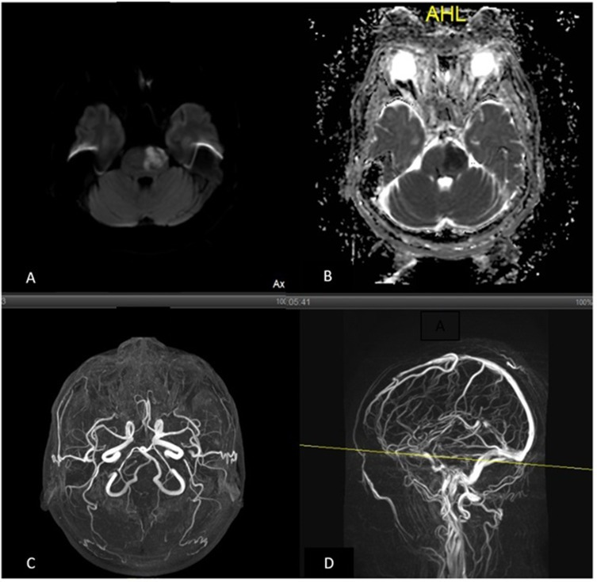
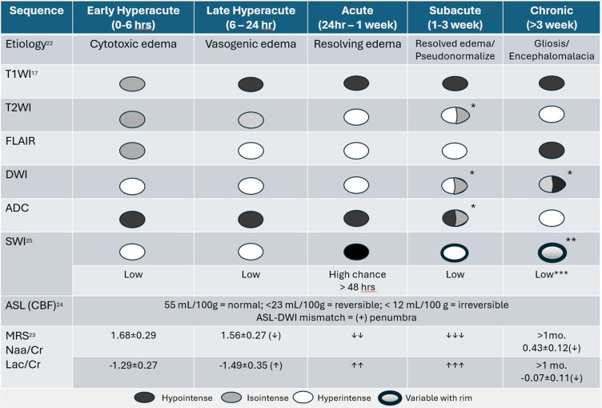

# 200 — Tổng quan Hệ Thần kinh / Neuro overview

**Tags:** `tong-quan`
**Mức chắc chắn (certainty):** tổng hợp y văn (literature synthesis).

## Bảng so sánh phân biệt bắt buộc (Hệ Thần kinh & Cột sống)
| Mẫu hình (pattern) | Vị trí (location) | Gamut chính (DDx) | Phân biệt nhanh (Chốt định lượng / Tín hiệu) | Bài chi tiết |
|---|---|---|---|---|
| Khuếch tán hạn chế (DWI+/ADC−) | Nhu mô não (brain parenchyma) | Nhồi máu não cấp, Áp-xe mủ, U lympho (lymphoma), Nang thượng bì (epidermoid), Bệnh Creutzfeldt-Jakob | Theo vùng cấp máu động mạch (artery) + ASPECTS = Nhồi máu cấp; Trong lòng nang ngấm viền = Áp-xe; Ngoài trục góc cầu tiểu não = Epidermoid | `211`, `213`, `217` |
| Máu tụ ngoài trục: Hình liềm vs. Thấu kính vs. Rãnh não | Nội sọ (intracranial) | Dưới màng cứng (SDH), Ngoài màng cứng (EDH), Xuất huyết dưới nhện (SAH) | Hình liềm vượt khớp sọ = SDH; Hình thấu kính không vượt khớp + khoảng tỉnh = EDH; Trong bể nền/rãnh Sylvius dày ≥ 1 mm (Modified Fisher) = SAH | `212` |
| Khối ngấm thuốc dạng vòng (Ring-enhancing) | Trong trục (intra-axial) | U nguyên bào thần kinh đệm (GBM), Di căn (metastasis), Áp-xe não, Mất myelin giả u (tumefactive demyelination) | Thành dày qua thể chai + trung tâm ADC sáng = GBM; Trung tâm DWI+ sáng rực + viền kép T2 = Áp-xe; Vòng ngấm thuốc hở (open-ring) = Mất myelin (cấm mổ!) | `213`, `214`, `215` |
| Khối ngoài trục (Extra-axial) & Góc cầu tiểu não (CPA) | Màng não & Nền sọ | U màng não (meningioma), U dây VIII (schwannoma), Nang thượng bì (epidermoid), Nang màng nhện (arachnoid cyst) | Đuôi màng cứng + khe dịch não tủy (DNT) = Meningioma; Rộng ống tai trong = Schwannoma; Giống DNT trên T1/T2 nhưng DWI+ sáng = Epidermoid (DWI tối = Nang màng nhện) | `217` |
| Chất trắng đa ổ (Multifocal white matter) | Quanh não thất & Tủy | Xơ cứng rải rác (MS), Viêm tủy thị thần kinh (NMOSD), Bệnh mạch máu nhỏ (Fazekas) | Ngón tay Dawson vuông góc não thất + tủy < 2 đốt = MS; Tổn thương tủy dài ≥ 3 đốt (LETM) + giao thoa thị = NMOSD | `215` |
| Giãn não thất & Đẩy lệch cấu trúc | Hệ thống não thất | Não úng thủy tắc nghẽn, Não úng thủy áp lực bình thường (NPH), Teo não tuổi già, Thoát vị não | Chỉ số Evans > 0,3 + góc thể chai < 90° + DESH = NPH; Giãn cả não thất lẫn rãnh vỏ não tương xứng = Teo não | `218` |
| Tổn thương ống sống theo 3 khoang | Cột sống – Tủy sống (spine) | Ngoài màng cứng (thoát vị đĩa, di căn), Trong màng cứng-ngoài tủy (schwannoma, meningioma), Nội tủy (ependymoma, viêm tủy) | Đẩy lệch túi màng cứng = Ngoài màng cứng; Mở rộng khoang dưới nhện hình chén (meniscus) = Trong màng cứng-ngoài tủy; Phình rộng tủy = Nội tủy | `220` |
| Tổn thương thân đốt sống & Đĩa đệm | Cột sống | Viêm đĩa đệm-đốt sống vi khuẩn, Lao cột sống (Pott), Di căn cột sống, Xẹp đốt sống loãng xương | Phá hủy đĩa đệm sớm = Vi khuẩn; Bảo tồn đĩa sớm + áp-xe lạnh vôi hóa = Lao; Chừa đĩa đệm + hủy cuống cung (mất mắt cú) = Di căn | `221`, `222` |
| Thoát vị đĩa đệm thắt lưng & thoái hóa đĩa–sụn tận cùng | Cột sống thắt lưng (lumbar) | Hình thái: phình (bulge) · lồi (protrusion) · thoát ra (extrusion) · mảnh rời (sequestration); Phân độ **Pfirrmann I–V**; **Modic 1/2/3**; Hẹp ống sống (**Schizas A–D**) | **Đáy < chiều cao = extrusion; mảnh mất liên tục = sequestration**; **nhân T2 xám–đen + mất ranh giới = Pfirrmann IV–V**; **Modic 1 = T1 tối/T2 sáng (hoạt tính, tái phát OR 2,97)** vs **Modic 2 = T1 sáng**; **mất rễ + mất mỡ ngoài màng cứng = Schizas D**; vị trí → rễ bị chèn (trung tâm→đuôi ngựa; dưới khớp→rễ đi ngang; lỗ/ngoài lỗ→rễ đi ra) | `228`, `220`, `222` |
| Tín hiệu tủy sau chấn thương (cord signal) | Tủy sống | Phù tủy, Xuất huyết tủy, Đứt tủy, SCIWORA (CT bình thường) | T2/STIR sáng đơn thuần = phù (tiên lượng khá); T2 tối + "blooming" GRE/SWI = xuất huyết (xấu); CT bình thường + dấu tủy = SCIWORA — chấm AIS A–E (chốt sacral sparing S4–5) | `223` |
| Hội chứng tủy **KHÔNG hoàn toàn** (theo mặt cắt ngang) | Tủy sống (myelopathy) | Tủy trung tâm (CCS) · tủy trước (ASA) · Brown-Séquard (hemisection) · tủy sau · nón tủy/đuôi ngựa | **Yếu TAY > chân + chênh UEMS–LEMS ≥ 10 điểm = tủy trung tâm** (hồi phục ~90%/3 năm); **liệt + mất đau–nhiệt hai bên mà CÒN cảm giác sâu = tủy trước**; **mất sâu CÙNG bên + mất đau–nhiệt ĐỐI bên = Brown-Séquard**; **mất sâu hai bên, còn vận động = tủy sau (< 1%, dễ bỏ sót)** | `225`, `223`, `220` |
| Nhân tuyến giáp & Hạch cổ (ACR TI-RADS) | Tuyến giáp & Cổ (thyroid-neck) | Ung thư nhú (PTC), nang thể, keo lành, giả nhân Hashimoto, hạch di căn | Đặc + rất giảm + cao-rộng + đa cung + vi vôi ≤ 1 mm (≥ 7đ) = TR5; bọt biển = TR1 (DỪNG); hạch mất rốn + Tg rửa = di căn (bỏ ngưỡng mm!) | `230` |
| Phù não sau **có hồi phục** vs **co mạch não có hồi phục** | Nhu mô não (vỏ–dưới vỏ) & mạch não | PRES (THA cấp/thuốc độc), RCVS (đau đầu sét đánh tái diễn), nhồi máu, viêm não HSV | Phù **đối xứng dưới vỏ chẩm-đỉnh + ADC TĂNG** = PRES (CT chỉ nhạy 46%/MRI 98%); **ADC TỐI theo lãnh thổ** = nhồi máu; **"chuỗi hạt" co mạch đa ổ, hồi phục < 3 tháng** = RCVS (RCVS2 ≥ 5; MRA có thể âm tuần đầu) | `219` |
| **Đau đầu sét đánh** (thunderclap) | Khoang dưới nhện & mạch máu não | **SAH vỡ phình · RCVS · CVST · bóc tách cổ · pituitary apoplexy** · viêm màng não · hạ áp lực DNT · TCH nguyên phát | **CT máu bể nền 60–80 HU + CTA/DSA = SAH**; **TCH tái diễn + co mạch "chuỗi hạt" hồi phục < 3 tháng + RCVS2 ≥ 5 = RCVS**; **khuyết thuốc xoang trên CTV/MRV = CVST**; **TCH + sụp thị trường/liệt vận nhãn = pituitary apoplexy** | `227`, `219`, `216`, `212` |
| **Hẹp/huyết khối mạch cổ sau đau cổ – chấn thương** | Động mạch cảnh trong & động mạch đốt sống đoạn ngoài sọ | Bóc tách tự phát · BCVI (Denver I–V) · xơ vữa · loạn sản cơ–sợi (FMD) · viêm mạch · thiểu sản động mạch đốt sống | **Hẹp hình nón/đuôi chuột + vách nội mạc/hai lòng + dải T1 sáng trong thành = bóc tách**; **Denver I–V: kháng huyết khối 24–48 giờ, CTA lặp 7 ngày + 3 tháng**; **CTA gộp Se 66% → CTA âm không loại trừ (DSA/MRA)** | `247`, `248`, `231`, `227` |
| **Suy tuyến yên sau sinh & hố yên trống** | Tuyến yên – vùng yên (sellar region) | Sheehan cấp/mạn · viêm tuyến yên lympho bào · đột quỵ tuyến yên · macroadenoma · hố yên trống nguyên phát | **PPH/choáng + vô sữa + hạ Na + tuyến yên to không có khối = Sheehan cấp**; **teo tuyến + DNT lấp > 50% hố yên = hố yên trống**; **cuống dày + đái tháo nhạt + ngấm mạnh = viêm tuyến yên**; **T1 sáng + mức dịch–dịch = đột quỵ tuyến yên** | `246`, `245`, `432` |
| **Co mạch/hẹp mạch não đa ổ** (PACNS vs RCVS) | Mạch máu não (intracranial vessels) | PACNS (viêm mạch TKTW nguyên phát), RCVS (co mạch có hồi phục), xơ vữa nội sọ, bóc tách, moyamoya, viêm mạch hệ thống | **HR-vwMRI: ngấm ĐỒNG TÂM mạnh + KHÔNG hồi phục = PACNS** (sinh thiết não–màng não; **corticoid + cyclophosphamide**); **hẹp từng đoạn "chuỗi hạt" hồi phục < 3 tháng + ngấm NHẸ = RCVS** (RCVS2 ≥ 5; **nimodipine, TRÁNH corticoid** — điều trị ngược nhau!) | `229`, `219`, `227` |
| Chấn thương đầu ở trẻ: máu tụ ngoài trục & DAI | Nội sọ (intracranial, trẻ) | EDH (thấu kính) vs SDH (liềm) vs tSAH vs đụng dập vs DAI vs phù lan tỏa; AHT/NAT | **Thấu kính + dừng ở đường khớp sọ = EDH**; **liềm + vượt khớp = SDH**; **vi xuất huyết thể chai/cuống não trên SWI = DAI** (CT thường âm tính); **SDH nhiều tầng + xuất huyết võng mạc ở < 2 tuổi = AHT/NAT** | `224` |
| Mờ xương chũm + mòn vách & biến chứng nội sọ | Xương thái dương – hố sau (temporal bone) | Viêm xương chũm cấp biến chứng (CAM): tụ mủ ngoài/dưới màng cứng, áp-xe não, **huyết khối xoang sigma–ngang (OLST)**, viêm màng não; viêm chũm ẩn (masked) | **Mờ chũm + mòn vách xoang sigma/tegmen + khuyết thuốc trên MRV = OLST**; **DWI sáng/ADC tối + viền ngấm = áp-xe não**; **soi tai bình thường KHÔNG loại trừ** (viêm chũm ẩn ở người già/suy giảm miễn dịch); CRP ≥ 12 mg/dL gợi ý CAM | `236`, `235`, `217` |
| **Tăng áp lực nội sọ** (ICP) ở trẻ | Nội sọ – khoang dịch não tủy | Khối choán chỗ · phù lan tỏa · não úng thủy · huyết khối xoang · tăng ICP "giả" (IIH) | **ICP > 20 mmHg kéo dài > 5 phút = ngưỡng điều trị**; **CPP = MAP − ICP, tối thiểu 40–50 mmHg**; **sóng ICP P2 > P1 = cạn dự trữ dù ICP thấp**; **ICP > 20 mmHg xấu bất kể CPP** (vùng CPP an toàn 56–89 mmHg); **ONSD ≥ 5,5 mm → ICP ≥ 20 (Se 100%/Sp 75%)** nhưng KHÔNG thay thế monitor | `234`, `224`, `218` |
| Quy tắc quyết định CHỤP cột sống cổ & khi nào BỎ NẸP | Cột sống cổ (chấn thương kín) | NEXUS · Canadian C-Spine Rule · PECARN CSI (trẻ) · DGOU nhi | **Tỉnh GCS 15 + không tiêu chí = bỏ nẹp, không chụp**; **CCR đặc hiệu 45,1% (NEXUS 36,8%), bỏ sót 1/169 ca so với NEXUS ~10%**; **trẻ: NEXUS chỉ nhạy 85,7% < CCR 90,8% < PECARN 93,3% → dùng PECARN**; không áp dụng được ở bệnh nhân hôn mê → CT ± MRI | `202`, `221`, `223` |
| Tủy mềm KHÔNG do chấn thương | Tủy sống (nội tủy) | Nhồi máu tủy (ASA) · SDAVF · viêm tủy cấp/NMOSD · tủy mềm do xạ · (loại trừ chèn ép) | **Đột ngột + đau + DWI hạn chế + 2/3 trước = nhồi máu tủy**; **flow void + phù lan dài từ nón tủy = SDAVF → DSA**; **LETM ≥ 3 đốt + H-sign + area postrema = NMOSD**; **nhiều tháng sau xạ, tổn thương trong trường chiếu = RM** | `226`, `225`, `215`, `220` |

## Trục cốt lõi minh họa — hạn chế khuếch tán & tiến triển tín hiệu theo thời gian

> Hai trục lý thuyết của cả hệ Thần kinh: **(1) hàng rào máu não + khuếch tán (DWI/ADC)** và **(2) tiến triển tín hiệu theo thời gian** (đặc biệt chuỗi hemoglobin của máu tụ).

*Tổn thương cầu não: **DWI tăng tín hiệu (A)** + **ADC giảm tín hiệu (B)** = **hạn chế khuếch tán** (phù tế bào/cytotoxic edema — nước chuyển nội bào); MRA (C/D) đánh giá mạch. Nguồn: Bachtiar NA et al., Vasc Health Risk Manag 2024, PMC11608002, CC BY-NC 4.0.*

*Bảng tín hiệu T1W/T2W/FLAIR/DWI/ADC/SWI/ASL theo 5 mốc (siêu cấp 0–6 giờ → mạn > 3 tuần). **Chốt đọc nhanh:** DWI sớm nhất (siêu cấp), **ADC tối đạt đáy ~1 tuần rồi "giả bình thường hóa"** ở giai đoạn mạn; FLAIR dương muộn hơn DWI (bất tương hợp DWI–FLAIR dùng cho đột quỵ giờ thức giấc); ASL–DWI bất tương hợp (+) gợi vùng tranh tối–tranh sáng (penumbra). Nguồn: Bachtiar NA et al., Vasc Health Risk Manag 2024, PMC11608002, CC BY-NC 4.0.*

## Bài liên quan chéo
- [211 – Đột quỵ não](../211-dot-quy-nao/lesson.md) *(đã có)*
- [212 – Xuất huyết sọ](../212-xuat-huyet-so-nao/lesson.md) *(đã có)*
- [213 – U não](../213-u-nao/lesson.md) *(đã có)*
- [432 – Vùng yên](../432-vung-yen/lesson.md) (nối chéo khối ngoài trục `217` – tuyến yên)
- [245 – U tuyến yên chảy máu/nhồi máu (pituitary apoplexy) & suy tuyến yên cấp](../245-u-tuyen-yen-chay-mau-nhoi-mau-pituitary-apoplexy/lesson.md) *(đã có)*
- [246 – Hội chứng Sheehan (hoại tử tuyến yên sau sinh) & suy tuyến yên mạn](../246-hoi-chung-sheehan-hoai-tu-tuyen-yen-sau-sinh/lesson.md) *(đã có)*
- [247 – Bóc tách động mạch cổ/đốt sống tự phát & sau chấn thương cổ](../247-boc-tach-dong-mach-co-dot-song-cervical-artery-dissection/lesson.md) *(đã có)*
- [248 – Can thiệp nội mạch giả phình & bóc tách động mạch cổ/đốt sống](../248-can-thiep-noi-mach-gia-phinh-boc-tach-dong-mach-co-dot-song/lesson.md) *(đã có)*
- [236 – Viêm tai xương chũm & biến chứng nội sọ](../236-viem-tai-xuong-chum-bien-chung-noi-so/lesson.md) *(đã có)*
- [228 – Thoát vị đĩa đệm thắt lưng & phân độ Pfirrmann/Modic](../228-thoat-vi-dia-dem-that-lung-pfirrmann-modic/lesson.md) *(đã có)*
- [229 – Viêm mạch TKTW nguyên phát (PACNS) vs co mạch não có hồi phục (RCVS)](../229-pacns-vs-rcvs/lesson.md) *(đã có)*
- [234 – Tăng áp lực nội sọ & theo dõi đa phương thức ở trẻ TBI (EVD, osmotherapy, giải ép, CPPopt)](../234-tang-ap-luc-noi-so-theo-doi-da-phuong-thuc-nhi/lesson.md) *(đã có)*
- [231 – Tổn thương mạch máu não do chấn thương (BCVI) & vỡ sọ tiến triển ở trẻ](../231-ton-thuong-mach-mau-nao-chan-thuong-va-vo-so-tien-trien/lesson.md) *(đã có)*
- [232 – Chấn thương đầu nhẹ & chấn động não (concussion) ở trẻ: PECARN, quan sát 4–6 giờ & quay lại học/thể thao](../232-chan-thuong-dau-nhe-concussion-o-tre/lesson.md) *(đã có)*

## Quy hoạch Master Curriculum Hệ Thần kinh (200–249)
> Đã viết có link; chưa viết là text dự kiến. ID ổn định, không đánh lại số. Giữ nguyên 100% ID `211, 212, 213` đã tạo.

**200–210 — Tổng quan, Giải phẫu cắt lớp & Kỹ thuật sọ não**
- **200** – Tổng quan Hệ Thần kinh / Neuro overview *(bài này)*
- 201 – Protocol CT/MRI sọ não: Cửa sổ đột quỵ, DWI/ADC, Tưới máu (Perfusion), SWI & Chuỗi xung mạch CTA/MRA/MRV  *(đã có — [bài học](../201-protocol-so-nao/lesson.md))*
- 202 – Quy tắc quyết định chụp cột sống cổ cấp cứu (NEXUS & Canadian C-Spine Rule, PECARN CSI trẻ) + khi nào bỏ nẹp cổ  *(đã có — [bài học](../202-quy-tac-chup-cot-song-co-cap-cuu-nexus-canadian/lesson.md))*
- 210 – Giải phẫu cắt lớp sọ não: Các thùy não, Hạch nền, Bao trong, Hố sau & Đa giác Willis (vùng cấp máu ACA/MCA/PCA)  *(đã có — [bài học](../210-giai-phau-so-nao/lesson.md))*

**211–212 & 216 — Cấp cứu Mạch máu não & Xuất huyết nội sọ**
- 211 – Đột quỵ thiếu máu não cấp: Dấu sớm NECT, ASPECTS, DWI/ADC & Tưới máu chọn lọc lấy huyết khối *(đã có — [bài học](../211-dot-quy-nao/lesson.md))*
- 212 – Xuất huyết nội sọ (EDH, SDH, SAH, ICH) & Bảng diễn tiến 5 giai đoạn Hemoglobin trên MRI *(đã có — [bài học](../212-xuat-huyet-so-nao/lesson.md))*
- 216 – Dị dạng mạch máu não (Phình mạch, AVM, Cavernoma) & Huyết khối xoang tĩnh mạch não (CVST: dấu empty delta)  *(đã có — [bài học](../216-di-dang-mach-CVST/lesson.md))*

**213–215 & 217–219 — U não, Nhiễm trùng, Mất myelin & Thoát vị não**
- 213 – U não trong trục & Khối ngấm thuốc vòng: GBM vs. Di căn vs. Lymphoma vs. Áp-xe *(đã có — [bài học](../213-u-nao/lesson.md))*
- 214 – Nhiễm trùng hệ thần kinh trung ương: Viêm não Herpes (thùy thái dương, chừa hạch nền), Lao màng não, Ký sinh trùng (Ấu trùng sán lợn 4 giai đoạn, Toxoplasma)  *(đã có — [bài học](../214-nhiem-trung-tktw/lesson.md))*
- 215 – Bệnh lý mất myelin: Xơ cứng rải rác (MS — tiêu chuẩn McDonald, ngón tay Dawson), NMOSD & ADEM  *(đã có — [bài học](../215-mat-myelin/lesson.md))*
- 217 – Khối ngoài trục (Extra-axial) & Góc cầu tiểu não (CPA): Meningioma, Schwannoma dây VIII, Epidermoid vs. Arachnoid cyst  *(đã có — [bài học](../217-ngoai-truc-CPA/lesson.md))*
- 218 – Các hội chứng Thoát vị não cấp cứu (dưới liềm, móc thái dương, hạnh nhân) & Não úng thủy (NPH vs. Tắc nghẽn vs. Teo não)  *(đã có — [bài học](../218-thoat-vi-nao-ung-thuy/lesson.md))*
- 219 – PRES & RCVS: phù não sau có hồi phục (4 kiểu Bartynski, biến thể trung tâm 13%) & co mạch não có hồi phục trên MRA ("chuỗi hạt", RCVS2/RCVS-TCH)  *(đã có — [bài học](../219-pres-rcvs/lesson.md))*
- 227 – Đau đầu sét đánh: tiếp cận cấp cứu & phân biệt SAH / RCVS / CVST / bóc tách / pituitary apoplexy / TCH nguyên phát; CT > 95% trong 24 giờ, chọc DNT ≥ 12 giờ, RCVS2 ≥ 5  *(đã có — [bài học](../227-dau-dau-set-danh-thunderclap/lesson.md))*
- 229 – Viêm mạch TKTW nguyên phát (PACNS) vs co mạch não có hồi phục (RCVS): **HR-vwMRI T1 sau tiêm (ngấm đồng tâm vs ngấm nhẹ)**, sinh thiết não–màng não, RCVS2/RCVS-TCH, điều trị **ngược nhau** (PACNS: corticoid + cyclophosphamide; RCVS: nimodipine, tránh corticoid)  *(đã có — [bài học](../229-pacns-vs-rcvs/lesson.md))*

**220–229 — Cột sống & Tủy sống (Spine)**
- 220 – Tiếp cận tổn thương ống sống theo 3 khoang: Thoát vị đĩa đệm (phân loại MSU/Pfirrmann), U tủy & Viêm tủy cắt ngang  *(đã có — [bài học](../220-ong-song-tuy/lesson.md))*
- 221 – Chấn thương cột sống: Mô hình 3 cột Denis, phân loại AO/TLICS & Phân biệt xẹp đốt sống lành tính (loãng xương) vs. Ác tính trên MRI  *(đã có — [bài học](../221-chan-thuong-cot-song/lesson.md))*
- 222 – Viêm thân đốt sống - đĩa đệm (Lao cột sống Pott vs. Vi khuẩn sinh mủ) vs. Di căn cột sống (dấu mất mắt cú)  *(đã có — [bài học](../222-viem-dot-song/lesson.md))*
- 223 – Chấn thương tủy sống: thang ASIA (AIS A–E, sacral sparing) & SCIWORA (CT bình thường — phù vs xuất huyết tủy trên MRI)  *(đã có — [bài học](../223-chan-thuong-tuy-so/lesson.md))*
- 224 – Chấn thương sọ não ở trẻ (TBI nhi): phân độ **Marshall (I–VI)** & **Rotterdam (1–6)**, khoang dưới nhện (bể nền/tSAH), đụng dập vs DAI (SWI), EDH vs SDH, quy tắc **PECARN** & AHT/NAT  *(đã có — [bài học](../224-chan-thuong-so-nao-nhi/lesson.md))*
- 234 – Tăng áp lực nội sọ & theo dõi đa phương thức ở trẻ TBI: **chỉ định đặt monitor** (GCS ≤ 8 + CT bất thường), **chọn EVD vs đầu dò nhu mô vs PbtO₂**, **ngưỡng ICP > 20 mmHg / CPP 40–50 (vùng an toàn 56–89)**, **sóng P2 > P1 = cạn compliance**, **3% NaCl vs mannitol tương đương**, **giải ép ≥ 12–15 cm**, **ONSD 5,5 mm**, **rút EVD nhanh**  *(đã có — [bài học](../234-tang-ap-luc-noi-so-theo-doi-da-phuong-thuc-nhi/lesson.md))*
- 225 – Hội chứng tủy KHÔNG hoàn toàn: tủy trung tâm (CCS), tủy trước (ASA), Brown-Séquard, tủy sau  *(đã có — [bài học](../225-hoi-chung-tuy-khong-hoan-toan/lesson.md))*
- 226 – Tủy mềm KHÔNG chấn thương: nhồi máu tủy, dò động–tĩnh mạch màng cứng (SDAVF), viêm tủy cấp/NMOSD, tủy mềm do xạ  *(đã có — [bài học](../226-tuy-mem-khong-chan-thuong-nhoi-mau-sdavf-nmo-xa/lesson.md))*
- 228 – Thoát vị đĩa đệm thắt lưng & thoái hóa đĩa–sụn tận cùng: hình thái **bulge/protrusion/extrusion/sequestration** (Fardon/ASNR), phân độ **Pfirrmann I–V**, **Modic 1/2/3**, hẹp ống sống **Schizas A–D**; **Modic type 1 = yếu tố nguy cơ tái phát (OR 2,97)**; mảnh rời có thể **tiêu vi tự nhiên** *(đã có — [bài học](../228-thoat-vi-dia-dem-that-lung-pfirrmann-modic/lesson.md))*

**230–249 — Đầu Mặt Cổ & Nền sọ (Head & Neck — Mở rộng)**
- 230 – Tuyến giáp ACR TI-RADS & Hạch cổ *(đã có — [bài học](../230-tuyen-giap-hach-co/lesson.md))*
- 231 – Tổn thương mạch máu não do chấn thương (BCVI) & vỡ sọ tiến triển: **Denver/Biffl I–V**, **McGovern ≥ 3**, **CTA 1 mm**, **aspirin 3–5 mg/kg (tối đa 81 mg)**, **MRI T2 cho GSF**  *(đã có — [bài học](../231-ton-thuong-mach-mau-nao-chan-thuong-va-vo-so-tien-trien/lesson.md))*
- 232 – Chấn thương đầu nhẹ & chấn động não (concussion) ở trẻ: **PECARN < 2 / ≥ 2 tuổi**, **quan sát 4–6 giờ**, **không CT để chẩn đoán concussion**, **nghỉ tương đối 24–48 giờ**, **6 bước quay lại thể thao**  *(đã có — [bài học](../232-chan-thuong-dau-nhe-concussion-o-tre/lesson.md))*
- 235 – Xương thái dương (Cholesteatoma trên DWI non-EPI) & Xoang cạnh mũi (Viêm xoang nấm tăng tỷ trọng vs. U)  *(đã có — [bài học](../235-xuong-thai-duong-xoang/lesson.md))*
- 236 – Viêm tai xương chũm & biến chứng nội sọ (huyết khối xoang sigma, áp-xe não, viêm màng não; CT xương thái dương + MRI/MRV)  *(đã có — [bài học](../236-viem-tai-xuong-chum-bien-chung-noi-so/lesson.md))*
- 245 – U tuyến yên chảy máu/nhồi máu (pituitary apoplexy): **PAS 0–10**, **hydrocortisone 100–200 mg IV ngay**, **MRI nhạy 88–90% vs CT 21–46%**, **mổ trước 7 ngày OR 5,88**, **tái phát 3,3%**  *(đã có — [bài học](../245-u-tuyen-yen-chay-mau-nhoi-mau-pituitary-apoplexy/lesson.md))*
- 246 – Hội chứng Sheehan: **PPH/choáng + vô sữa + hạ Na 33–69%**, **GH/prolactin giảm 90–100%**, **trễ chẩn đoán 9–20 năm**, **MRI cấp: tuyến to/T1 thấp; mạn: hố yên trống**, **hydrocortisone trước levothyroxine**  *(đã có — [bài học](../246-hoi-chung-sheehan-hoai-tu-tuyen-yen-sau-sinh/lesson.md))*
- 247 – Bóc tách động mạch cổ/đốt sống: **CeAD 2,6–3,0/100.000/năm**, **Denver I–V**, **CTA gộp Se 66%/Sp 97%**, **CADISS/TREAT-CAD**, **kháng huyết khối ≥ 3 tháng + CTA 7 ngày/3 tháng**  *(đã có — [bài học](../247-boc-tach-dong-mach-co-dot-song-cervical-artery-dissection/lesson.md))*
- 248 – Can thiệp nội mạch giả phình/bóc tách mạch cổ: **stent 11,6% ca đột quỵ CeAD, tái phát 1,2% vs 3,5%**, **~15% thất bại nội khoa 3–6 tháng**, **DAPT ≥ 3 tháng**, **DSA/CTA 6 tháng**  *(đã có — [bài học](../248-can-thiep-noi-mach-gia-phinh-boc-tach-dong-mach-co-dot-song/lesson.md))*

> Không dùng để chẩn đoán độc lập khi chưa có người hướng dẫn.
