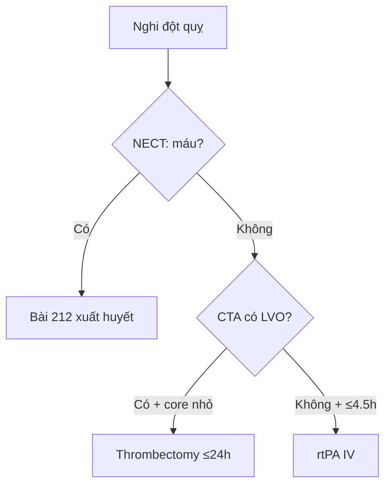

# 201 — Protocol CT/MRI sọ não: cửa sổ đột quỵ, DWI & tưới máu / Stroke protocol

**Tags:** `pattern:protocol-so-nao` `vung:so-nao` `score:ASPECTS` `protocol:CT-MRI-so-nao`
**Mức chắc chắn (certainty):** tổng hợp y văn (literature synthesis) — nhóm tự biên từ y văn mở, chưa gắn ca nguyên văn đơn lẻ.

## 1. Tổng quan — mỗi phút 1,9 triệu neuron chết + cửa sổ quyết định mọi chỉ định

- Đột quỵ thiếu máu: mỗi phút tắc mạch lớn mất **~1,9 triệu neuron** — TẠI SAO protocol ép thời gian (cửa-chụp **< 25 phút**, cửa-kim **< 60 phút**, cửa-chọc mạch **< 90 phút**): chụp càng nhanh, cứu càng nhiều vùng tranh tối tranh sáng (penumbra).
- CT không tiêm (NECT) thấy máu **50–90 HU** nhưng nhồi máu sớm chỉ giảm **~2–3 HU/giờ** — TẠI SAO bắt buộc chỉnh **cửa sổ đột quỵ (Stroke window: W: 40, L: 40 hoặc W: 8, L: 32)**: cửa sổ bụng/thông thường nuốt chửng chênh lệch nhỏ của nhân bèo/thùy đảo.

*Sơ đồ gốc Thư viện CĐHA, CC0.*

## 2. Gamut chỉ định theo chuỗi xung (Gamut)

- **NECT + CTA đầu-cổ:** mọi đột quỵ cấp + chấn thương — loại trừ máu + tìm tắc nhánh lớn (LVO) + ASPECTS.
- **Tưới máu CT/MR (Perfusion):** cửa sổ 6–24 giờ không rõ giờ khởi phát — core/penumbra chọn lọc lấy huyết khối.
- **DWI/ADC + FLAIR + SWI:** DWI+/FLAIR− = < 4,5 giờ; SWI tìm huyết khối tĩnh mạch + vi xuất huyết amyloid.
- **MRA/MRV:** phình/AVM + huyết khối xoang tĩnh mạch (CVST) khi đau đầu + phù gai.

## 3. Bảng chuỗi xung-chỉ định

| Chuỗi xung (sequence) | Tìm gì | Chốt vào (rule-in) | Chốt loại (rule-out) | Ngưỡng |
|---|---|---|---|---|
| NECT cửa sổ đột quỵ | Máu + dấu sớm MCA | **Hyperdense MCA > 45–50 HU + mất ranh giới nhân bèo/đảo** | Không máu + ASPECTS 10 → chuyển CTA | W: 40, L: 40; < 25 phút |
| CTA đầu-cổ | Tắc nhánh lớn (LVO) | **Cắt cụt ICA/M1/basilar** | Không LVO → xét rtPA | ≤ 4,5 giờ rtPA |
| Perfusion (CBF/Tmax) | Core vs penumbra | **Core CBF < 30% < 70 mL + Tmax > 6s + mismatch ≥ 1,8 (≥ 15 mL)** | Core ≥ 70 mL → lõi rộng | Tới 24 giờ (DAWN/DEFUSE-3) |
| DWI/ADC + FLAIR | Tuổi nhồi máu | **DWI+/ADC− < 10 ngày; DWI+/FLAIR− = < 4,5 giờ** | ADC sáng = shine-through | ADC < 620; giả bình thường 10–14 ngày |

## 4. Protocol chuẩn + flowchart

- Chuẩn đột quỵ: NECT (stroke window) → CTA → perfusion (khi 6–24 giờ/không rõ giờ) → MRI DWI khi cần tuổi tổn thương.
- Chấn thương: NECT lát mỏng + cửa sổ xương; SAH: CTA tìm phình + Modified Fisher.

## 5. Cạm bẫy

- **Quên chỉnh stroke window** = bỏ sót nhồi máu sớm (chỉ giảm 2–3 HU/giờ).
- **Tương phản thận/suy thận** trì hoãn CTA — cân nguy cơ/lợi ích, đừng bỏ CTA khi LVO.
- **Chuyển động bệnh nhân kích động** giả dày thành/nhòe — an thần nhẹ + lát mỏng.

## 6. Tự lượng giá — Blind Quiz

**Ca 1 — Liệt nửa người 2 giờ, NECT cửa sổ thường bình thường:** chỉnh gì? Tìm dấu nào? *(Bảng mục 3.)*

<b>Bấm để hiện đáp án</b>

- **Chỉnh W: 40, L: 40** tìm hyperdense MCA > 45–50 HU + mất ranh giới nhân bèo/đảo + ASPECTS.

**Ca 2 — Không rõ giờ khởi phát, DWI+/FLAIR−:** còn rtPA được không? Vì sao? *(Bảng mục 3.)*

<b>Bấm để hiện đáp án</b>

- **Được (wake-up stroke):** DWI+/FLAIR− ≈ < 4,5 giờ — chỉ điểm tiêu sợi huyết khi giờ khởi phát không rõ.

**Ca 3 — Tắc M1 giờ 16, core 40 mL + mismatch 2,2:** thrombectomy hay nội khoa? *(Bảng mục 3.)*

<b>Bấm để hiện đáp án</b>

- **Thrombectomy:** core < 70 mL + mismatch ≥ 1,8 (≥ 15 mL) trong cửa sổ 24 giờ DAWN/DEFUSE-3.

## Bài liên quan chéo
- [200 – Tổng quan Thần kinh](../200-tong-quan-he-than-kinh/lesson.md)
- [211 – Đột quỵ não](../211-dot-quy-nao/lesson.md) (DWI/ASPECTS)
- [210 – Giải phẫu sọ não](../210-giai-phau-so-nao/lesson.md) (vùng mạch)

> Không dùng để chẩn đoán độc lập khi chưa có người hướng dẫn.
