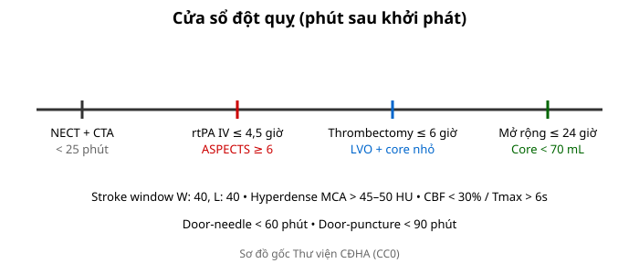
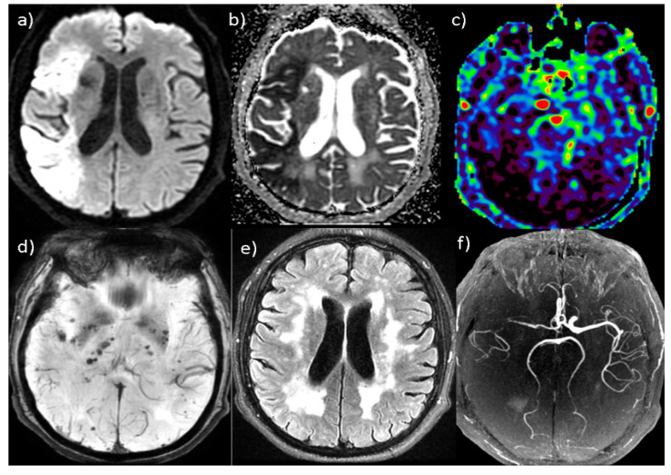
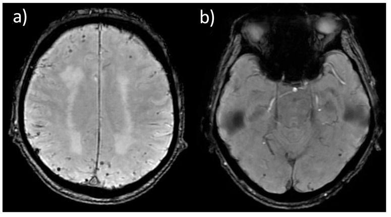
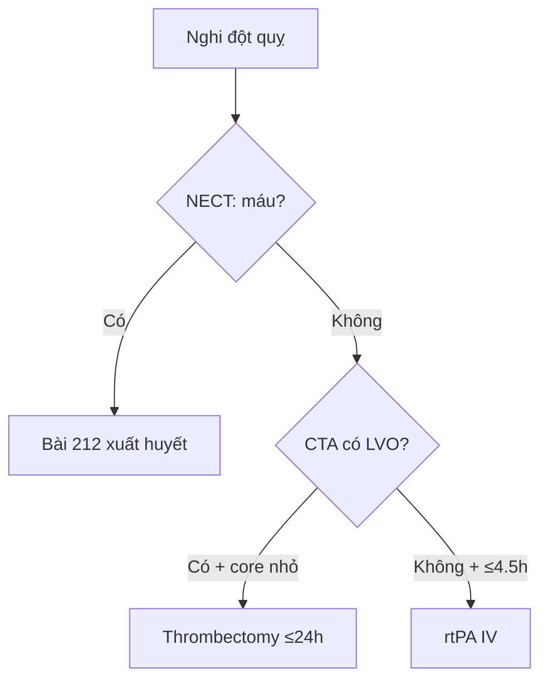

# 201 — Protocol CT/MRI sọ não: cửa sổ đột quỵ, DWI & tưới máu / Stroke protocol

**Tags:** `pattern:protocol-so-nao` `vung:so-nao` `score:ASPECTS` `protocol:CT-MRI-so-nao`
**Mức chắc chắn (certainty):** tổng hợp y văn (literature synthesis) — nhóm tự biên từ y văn mở, chưa gắn ca nguyên văn đơn lẻ.

## 1. Tổng quan — mỗi phút 1,9 triệu neuron chết + cửa sổ quyết định mọi chỉ định

- Đột quỵ thiếu máu: mỗi phút tắc mạch lớn mất **~1,9 triệu neuron** — TẠI SAO protocol ép thời gian (cửa-chụp **< 25 phút**, cửa-kim **< 60 phút**, cửa-chọc mạch **< 90 phút**): chụp càng nhanh, cứu càng nhiều vùng tranh tối tranh sáng (penumbra).
- CT không tiêm (NECT) thấy máu **50–90 HU** nhưng nhồi máu sớm chỉ giảm **~2–3 HU/giờ** — TẠI SAO bắt buộc chỉnh **cửa sổ đột quỵ (Stroke window: W: 40, L: 40 hoặc W: 8, L: 32)**: cửa sổ bụng/thông thường nuốt chửng chênh lệch nhỏ của nhân bèo/thùy đảo.

*Sơ đồ gốc Thư viện CĐHA, CC0.*

*Một ca "đa phương thức" minh họa cả gói protocol: (a) **DWI tăng tín hiệu** + (b) **ADC giảm** (hạn chế khuếch tán) vùng ĐM não giữa phải — nhồi máu cấp; (c) bản đồ tưới máu; (d) SWI; (e) FLAIR; (f) MRA. Nguồn: Aracki-Trenkic A et al., J Clin Med 2026 (PMC12986106), **CC BY 4.0**.*

## 2. Gamut chỉ định theo chuỗi xung (Gamut)

- **NECT + CTA đầu-cổ:** mọi đột quỵ cấp + chấn thương — loại trừ máu + tìm tắc nhánh lớn (LVO) + ASPECTS.
- **Tưới máu CT/MR (Perfusion):** cửa sổ 6–24 giờ không rõ giờ khởi phát — core/penumbra chọn lọc lấy huyết khối.
- **DWI/ADC + FLAIR + SWI:** DWI+/FLAIR− = < 4,5 giờ; SWI tìm huyết khối tĩnh mạch + vi xuất huyết amyloid.
- **MRA/MRV:** phình/AVM + huyết khối xoang tĩnh mạch (CVST) khi đau đầu + phù gai.

*Chuỗi **SWI/SWAN** — "mất tín hiệu tròn nhỏ" (a) hơn mười vi xuất huyết hai bên dưới vỏ và (b) vi xuất huyết dạng thùy; TẠI SAO SWI nhạy nhất: sản phẩm máu (hemosiderin) gây **mất tín hiệu + "blooming"**; cạm bẫy là **vôi hóa** cũng mất tín hiệu (phân biệt bằng pha/CT). Nguồn: Aracki-Trenkic A et al., J Clin Med 2026 (PMC12986106), **CC BY 4.0**.*

## 3. Bảng chuỗi xung-chỉ định

| Chuỗi xung (sequence) | Tìm gì | Chốt vào (rule-in) | Chốt loại (rule-out) | Ngưỡng |
|---|---|---|---|---|
| NECT cửa sổ đột quỵ | Máu + dấu sớm MCA | **Hyperdense MCA > 45–50 HU + mất ranh giới nhân bèo/đảo** | Không máu + ASPECTS 10 → chuyển CTA | W: 40, L: 40; < 25 phút |
| CTA đầu-cổ | Tắc nhánh lớn (LVO) | **Cắt cụt ICA/M1/basilar** | Không LVO → xét rtPA | ≤ 4,5 giờ rtPA |
| Perfusion (CBF/Tmax) | Core vs penumbra | **Core CBF < 30% < 70 mL + Tmax > 6s + mismatch ≥ 1,8 (≥ 15 mL)** | Core ≥ 70 mL → lõi rộng | Tới 24 giờ (DAWN/DEFUSE-3) |
| DWI/ADC + FLAIR | Tuổi nhồi máu | **DWI+/ADC− < 10 ngày; DWI+/FLAIR− = < 4,5 giờ** | ADC sáng = shine-through | ADC < 620; giả bình thường 10–14 ngày |

## 4. Protocol chuẩn + flowchart

- Chuẩn đột quỵ: NECT (stroke window) → CTA → perfusion (khi 6–24 giờ/không rõ giờ) → MRI DWI khi cần tuổi tổn thương.
- Chấn thương: NECT lát mỏng + cửa sổ xương; SAH: CTA tìm phình + Modified Fisher.

## 5. Cạm bẫy

- **Quên chỉnh stroke window** = bỏ sót nhồi máu sớm (chỉ giảm 2–3 HU/giờ).
- **Tương phản thận/suy thận** trì hoãn CTA — cân nguy cơ/lợi ích, đừng bỏ CTA khi LVO.
- **Chuyển động bệnh nhân kích động** giả dày thành/nhòe — an thần nhẹ + lát mỏng.

## 6. Tự lượng giá — Blind Quiz

**Ca 1 — Liệt nửa người 2 giờ, nhìn gói ảnh: (a) DWI, (b) ADC — đọc gì?**

- Câu hỏi: chuỗi DWI/ADC nói gì? So với FLAIR? Có hạn chế khuếch tán thật không, hay "shine-through"?

<b>Bấm để hiện đáp án</b>

- **DWI (a) TĂNG tín hiệu + ADC (b) GIẢM** ở vùng ĐM não giữa phải = **hạn chế khuếch tán thật** (nhồi máu cấp). Nếu **ADC không giảm** mà DWI sáng → **"shine-through" T2** (giả), không phải nhồi máu mới.
- Nguồn ảnh: Aracki-Trenkic A et al., J Clin Med 2026 (PMC12986106), CC BY 4.0.

**Ca 2 — Không rõ giờ khởi phát, DWI+/FLAIR−:** còn rtPA được không? Vì sao? *(Bảng mục 3.)*

<b>Bấm để hiện đáp án</b>

- **Được (wake-up stroke):** DWI+/FLAIR− ≈ < 4,5 giờ — chỉ điểm tiêu sợi huyết khi giờ khởi phát không rõ.

**Ca 3 — Tắc M1 giờ 16, core 40 mL + mismatch 2,2:** thrombectomy hay nội khoa? *(Bảng mục 3.)*

<b>Bấm để hiện đáp án</b>

- **Thrombectomy:** core < 70 mL + mismatch ≥ 1,8 (≥ 15 mL) trong cửa sổ 24 giờ DAWN/DEFUSE-3.

**Ca 4 — Ảnh SWI (a): vô số điểm mất tín hiệu tròn nhỏ dưới vỏ. Là gì, và phân biệt với cái gì?**

- Câu hỏi: dấu hiệu trên SWI? Chẩn đoán? Cạm bẫy hình ảnh giống?

<b>Bấm để hiện đáp án</b>

- **Vi xuất huyết não (cerebral microbleeds — CMB)**: điểm **mất tín hiệu tròn nhỏ < 10 mm** trên SWI/SWAN, thường dưới vỏ/thùy (bệnh mạch máu nhỏ, amyloid). **Cạm bẫy:** **vôi hóa** và **huyết khối tĩnh mạch** cũng mất tín hiệu — phân biệt bằng **ảnh pha/CT** và phân bố.
- Nguồn ảnh: Aracki-Trenkic A et al., J Clin Med 2026 (PMC12986106), CC BY 4.0.

## Bài liên quan chéo
- [200 – Tổng quan Thần kinh](../200-tong-quan-he-than-kinh/lesson.md)
- [211 – Đột quỵ não](../211-dot-quy-nao/lesson.md) (DWI/ASPECTS)
- [210 – Giải phẫu sọ não](../210-giai-phau-so-nao/lesson.md) (vùng mạch)
- [224 – Chấn thương sọ não ở trẻ](../224-chan-thuong-so-nao-nhi/lesson.md) (protocol chấn thương, SWI cho DAI)

> Không dùng để chẩn đoán độc lập khi chưa có người hướng dẫn.
