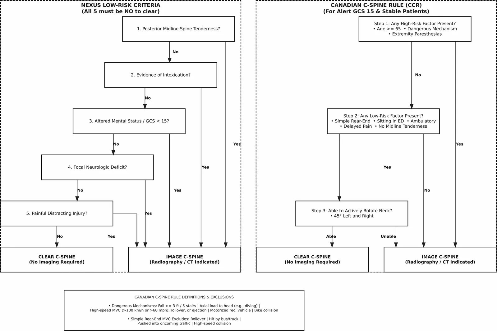
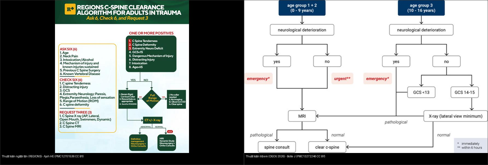
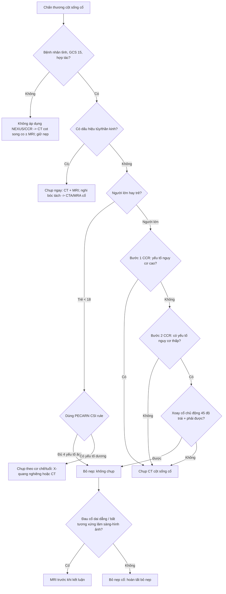
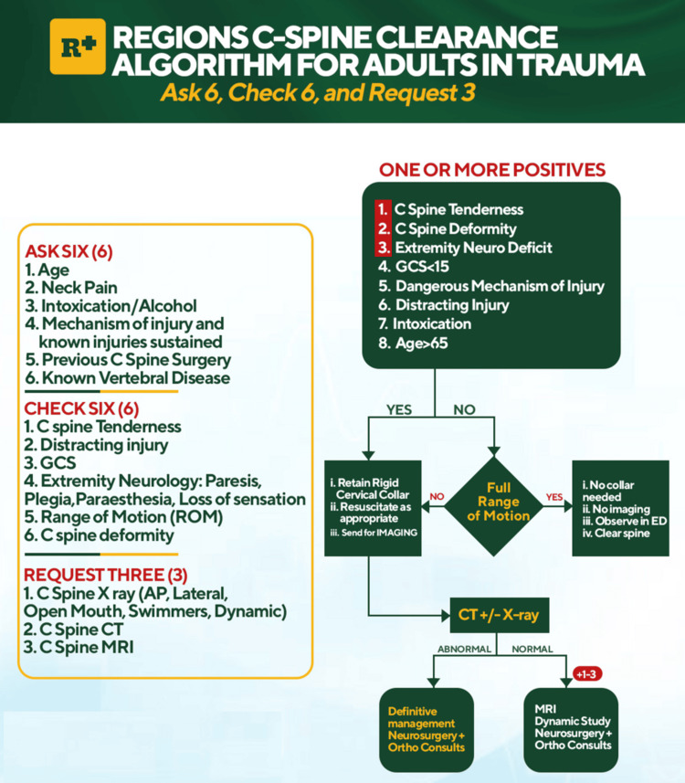
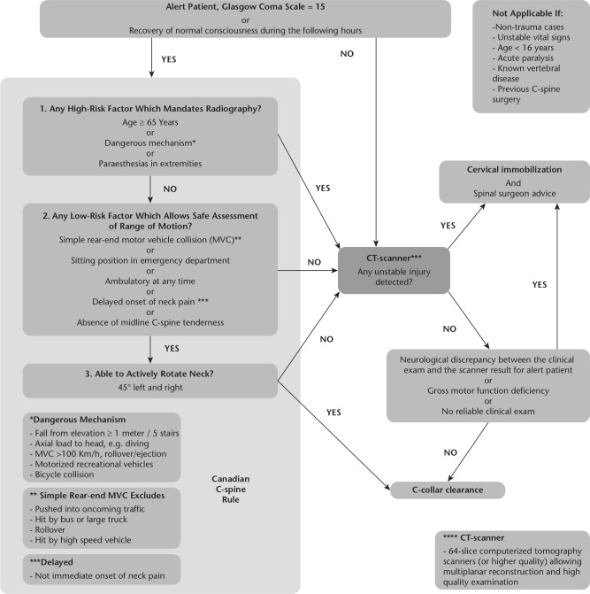
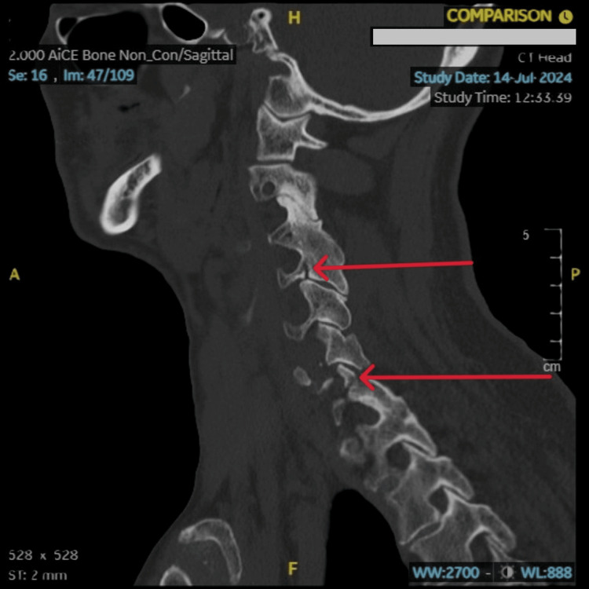
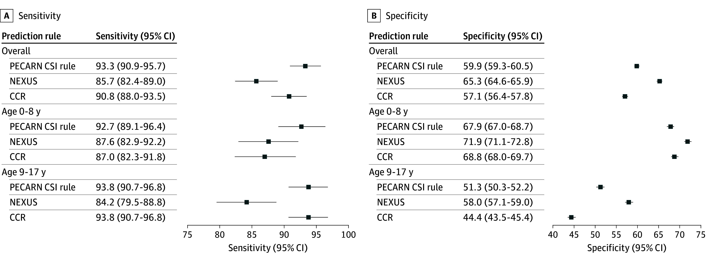

# 202 — Quy tắc quyết định chụp cột sống cổ cấp cứu: NEXUS & Canadian C-Spine Rule, khi nào bỏ nẹp cổ / Cervical spine clearance rules

**Tags:** `pattern:chan-thuong-cot-song` `pattern:quy-tac-quyet-dinh` `vung:cot-song-co` `score:NEXUS` `score:Canadian-C-Spine-Rule` `score:PECARN-CSI` `protocol:CT-cot-song-co` `protocol:MRI-cot-song-co`
**Mức chắc chắn (certainty):** tổng hợp y văn (literature synthesis) — tổng hợp từ nghiên cứu đoàn hệ dịch tễ (Vartiainen E et al., Emerg Radiol 2026, PMC13633157), so sánh hiệu năng quy tắc ở trẻ (Lee LK et al., JAMA Netw Open 2025, PMC12717614), tổng quan bỏ nẹp cổ (Moeri M et al., EFORT Open Rev 2020, PMC7197104), thuật toán phối hợp tại chỗ (Ajah HE & Nzekwu OO, Cureus 2025, PMC12701536), thuật toán nhi DGOU (Bolte J et al., Eur J Trauma Emerg Surg 2026, PMC13272246) và **ca nguyên văn (verbatim case)** gãy cột sống cổ đến muộn (Mahmood A & Abouelkheir M, Cureus 2025, PMC12001663).

## 1. Tổng quan — vì sao cần "quy tắc quyết định" thay vì chụp tất cả

- **Bài toán lưỡng nan (double bind):** bỏ sót thương tổn cột sống cổ (cervical spine injury — CSI) có thể gây liệt tứ chi/tử vong do di lệch thứ phát; nhưng chụp tràn lan làm tăng **bức xạ** (X-quang/CT), chi phí, thời gian cố định cổ và **biến chứng của bất động kéo dài** (loét do tì đè, viêm phổi, huyết khối). Quy tắc quyết định (clinical decision rule — CDR) sinh ra để **chọn đúng người cần chụp**, không phải để "chẩn đoán".
- **TẠI SAO phải bỏ nẹp cổ (collar) đúng lúc:** nẹp cứng giải quyết vấn đề cấp, nhưng để lâu gây hại. Bỏ nẹp chỉ hợp lệ khi **đã loại trừ tổn thương mất vững (unstable injury)** bằng lâm sàng (quy tắc âm) hoặc bằng hình ảnh (CT ± MRI). **Nẹp cổ không phải điều trị — nó là cầu nối chờ xác nhận.**
- **Hai "định luật" hình ảnh nằm lòng:**
  - **CT là chuẩn thực hành để loại trừ xương (bony clearance).** X-quang thẳng/nghiêng/ngửa hầu như đã bị bỏ; **CT có dựng đa bình diện (multiplanar reconstruction)** mới đủ nhạy cho xương.
  - **MRI không dùng thường quy** — chỉ khi có dấu hiệu tủy/thần kinh, **bất tương xứng lâm sàng–hình ảnh (radio-clinical discrepancy)**, bệnh nhân không đánh giá được (hôn mê/đặt nội khí quản), hoặc đau cổ dai dẳng dù CT âm (Moeri M et al., EFORT Open Rev 2020, PMC7197104).
- **Số liệu định lượng nằm lòng (định vị quy mô vấn đề):**
  - Đoàn hệ 9.359 bệnh nhân chấn thương chụp đồng thời CT sọ + CT cột sống cổ: **gãy cột sống cổ 4,9% (457/9.359)**; bất thường nội sọ 23,9%; **tổn thương đồng thời cả hai chỉ 1,3%**; **không có liên hệ ý nghĩa giữa CT sọ dương và gãy cổ (OR 1,16; p = 0,174)**; lưu lượng chụp **tăng gấp 5 lần trong 10 năm** nhưng hiệu suất chẩn đoán **giảm từ 7,1% → 3,9%** — bằng chứng lạm dụng chụp (Vartiainen E et al., Emerg Radiol 2026, PMC13633157).
  - Ở trẻ: 22.430 trẻ chấn thương kín, **CSI 1,9% (433)** — thương tổn hiếm nhưng hậu quả nặng (Lee LK et al., JAMA Netw Open 2025, PMC12717614).
- **Cơ chế (mechanism) là mảnh ghép không thể thiếu — đặc sản của Canadian C-Spine Rule:** cơ chế năng lượng thấp (va chạm đuôi xe đơn thuần) khác hẳn cơ chế nguy hiểm (ngã ≥ 1 m/5 bậc, tải trục lên đầu, tai nạn tốc độ cao) → quyết định chụp khác hẳn dù cùng "đau cổ".

*Hai quy tắc "ông tổ" đặt cạnh nhau: **NEXUS** — 5 tiêu chí nguy cơ thấp, cả 5 đều "KHÔNG" mới bỏ chụp; **Canadian C-Spine Rule (CCR)** — 3 bước (yếu tố nguy cơ cao → yếu tố nguy cơ thấp → xoay cổ chủ động 45°). NEXUS chỉ dùng lâm sàng; CCR còn dùng **cơ chế chấn thương** nên đặc hiệu cao hơn. Vartiainen E et al., Emerg Radiol 2026 (PMC13633157, Fig. 1), CC BY 4.0.*

## 2. Mẫu hình + chẩn đoán phân biệt theo bối cảnh (Gamut)

Đọc bài không theo "bệnh" mà theo **bốn câu hỏi cửa vào** — mỗi câu dẫn tới một nhánh quyết định:

- **Bệnh nhân tỉnh (GCS 15), hợp tác, ổn định:** dùng được **cả NEXUS lẫn CCR**. Đây là vùng quy tắc phát huy tối đa — **CCR mạnh hơn** vì thêm cơ chế và bước xoay cổ, giảm chụp oan.
- **Bệnh nhân không đánh giá được (hôn mê, đặt NKQ, say):** **không thể áp dụng NEXUS/CCR** (đều đòi bệnh nhân tỉnh). Con đường: **CT cột sống cổ** (xương) ± **MRI** (tủy/dây chằng) — nẹp giữ cho tới khi xác nhận.
- **Bệnh nhân có dấu hiệu tủy/thần kinh (focal neurologic deficit, dị cảm):** **bỏ qua bước quy tắc → chụp ngay**. Nghi ngờ tổn thương mạch máu cổ (bóc tách) → CTA/MRA cổ.
- **Trẻ em:** **NEXUS và CCR được thiết kế cho người lớn — không dùng nguyên trạng**. Dùng **PECARN CSI rule** (đặc hiệu cho trẻ), thận trọng với ART/ALARA.

**Cơ chế "nguy hiểm" (dangerous mechanism) theo CCR** — điều kiện định lượng bắt buộc nhớ: **ngã ≥ 1 m hoặc ≥ 5 bậc thang**; **tải trục lên đầu** (lặn, đâm đầu); **tai nạn xe cơ giới tốc độ cao > 100 km/h (> 60 mph)**, có lật xe/phóng người khỏi xe; xe cơ giới giải trí; va chạm xe đạp. **Cơ chế năng lượng thấp (simple rear-end)** phải LOẠI các tình huống: bị đẩy ra làn xe ngược chiều, bị xe buýt/xe tải đâm, lật xe, xe tốc độ cao.

**Gợi nhớ "5 ngón NEXUS" — không được THIẾU thì mới bỏ chụp:** **N**o posterior **midline tenderness** · **N**o intoxication · **N**ormal alertness (GCS 15) · **N**o focal neurologic deficit · **N**o painful distracting injury.

## 3. Bảng so sánh phân biệt (ma trận đối chiếu)

| Thực thể (entity) | Đặc điểm nhận diện | Chốt vào (rule-in → phải chụp) | Chốt loại (rule-out → bỏ chụp) | Gợi ý xác nhận |
|---|---|---|---|---|
| **NEXUS (Hoffman 2000)** | 5 tiêu chí lâm sàng thuần, không dùng cơ chế | **Bất kỳ 1/5 tiêu chí dương** (đau đường giữa, ngộ độc, GCS < 15, thiếu hụt TK khu trú, thương tổn gây đau phân tán) | **Cả 5 tiêu chí đều ÂM** | Nhẹ/trực quan nhưng **độ đặc hiệu thấp** (chụp nhiều hơn) |
| **Canadian C-Spine Rule (Stiell 2001)** | 3 bước: nguy cơ cao → nguy cơ thấp → xoay cổ 45° | **Bước 1 DƯƠNG** (tuổi ≥ 65 · cơ chế nguy hiểm · dị cảm chi) → chụp ngay | **Bước 1 âm + bước 2 dương (nguy cơ thấp) + xoay cổ 45° được** | **Độ đặc hiệu cao hơn NEXUS** (giảm chụp oan) |
| **PECARN CSI rule (trẻ < 18)** | 4 yếu tố lâm sàng đặc hiệu cho trẻ | Có **rối loạn tri giác / thiếu hụt TK khu trú / đau–đau khi ấn vùng cổ / đầu nghiêng (torticollis)** | Đủ 4 yếu tố âm + bệnh cảnh cho phép | **Nhạy và NPV cao nhất ở trẻ**; CT dự phóng thấp nhất |
| **Bệnh nhân KHÔNG áp dụng được quy tắc** | Hôn mê/đặt NKQ/say/không hợp tác/liệt sẵn | Luôn **CT (± MRI)** — không có ngoại lệ lâm sàng | Không có "chốt loại" lâm sàng | CT xương + MRI tủy; giữ nẹp tới khi xác nhận |
| **Gãy cổ đến muộn (cạm bẫy)** | Ban đầu "chỉ có vết rách nhỏ", được cho về | **Dị cảm tay mới xuất hiện / đau cổ tăng khi vận động** → hình ảnh lại | Không được "chốt loại" bằng một lần khám sạch | CT lại ± MRI (phù tủy xương) |

*Trái — **thuật toán người lớn (REGIONS, phối hợp NEXUS + CCR)**: "Ask 6 · Check 6 · Request 3", phân nhánh theo **biên độ vận động cổ** → bỏ nẹp hay chụp. Phải — **thuật toán trẻ em DGOU 2026**: phân nhóm theo **pGCS** rồi theo tuổi (0–9 vs 10–16) và cơ chế, ưu tiên X-quang nghiêng cho trẻ nhỏ, MRI khi có dấu thần kinh. Ảnh ghép letterbox giữ tỷ lệ. Ajah HE (PMC12701536, CC BY 4.0) + Bolte J (PMC13272246, CC BY 4.0).*

### Hiệu năng định lượng — đọc con số, đừng nghe cảm tính
- **Người lớn (Stiell 2003, dẫn trong Moeri 2020):** 8.283 bệnh nhân, 169 thương tổn cột sống cổ **quan trọng lâm sàng**; **NEXUS bỏ sót ~10%**, **CCR chỉ bỏ sót 1 ca**; **CCR đặc hiệu cao hơn (45,1% vs 36,8% của NEXUS)** → giảm số lần chụp cần thiết.
- **Trẻ em (Lee 2025, n = 22.430):** độ nhạy **PECARN 93,3% (90,9–95,7%)** · **CCR 90,8% (88,0–93,5%)** · **NEXUS 85,7% (82,4–89,0%)**; NPV tương ứng **99,8% / 99,7% / 99,6%**. Áp dụng nghiêm ngặt → **CT dự phóng: PECARN 6,9% · NEXUS 10,8% · CCR 13,2%** (Lee LK et al., JAMA Netw Open 2025, PMC12717614).
- **Kết luận thực hành:** ở trẻ, **NEXUS KHÔNG đủ nhạy** (bỏ sót ~14% CSI) — **không dùng NEXUS đơn độc cho trẻ**.

## 4. Protocol chụp + quy tắc & lưu đồ

- **Hình ảnh xương:** **CT cột sống cổ lát mỏng (≤ 1 mm) + dựng đa bình diện (MPR sagittal + coronal)** là chuẩn; X-quang thẳng/nghiêng/ngửa **đã bị bỏ** cho bỏ nẹp. Đọc **ba cột Denis (trước/giữa/sau)** trên dựng hình (nối bài `221`).
- **Hình ảnh tủy/dây chằng:** MRI cột sống cổ (T2W/STIR sagittal + axial) khi: dấu tủy/thần kinh, **bất tương xứng lâm sàng–hình ảnh**, bệnh nhân không đánh giá được, hoặc **đau cổ dai dẳng dù CT âm**. MRI phát hiện **phù tủy xương (bone marrow edema)**, tổn thương dây chằng, máu tụ ngoài/trong màng.
- **Bỏ nẹp (collar removal):**
  - Bệnh nhân **tỉnh, hợp tác, quy tắc ÂM** → bỏ nẹp **không cần hình ảnh**.
  - **CT âm + không dấu thần kinh + xoay cổ được** → bỏ nẹp.
  - **Không đánh giá được/hôn mê:** CT âm có thể đủ ở nhiều trung tâm, nhưng nếu còn nghi ngờ tủy/dây chằng → **MRI** trước khi bỏ nẹp.
- **Cờ đỏ bắt buộc chụp mạch:** di lệch đốt sống cổ cao, gãy qua **lỗ ngang (foramen transversarium)** (đi qua động mạch đốt sống), hoặc **bất tương xứng thần kinh** → **CTA/MRA cổ** tìm bóc tách.

*Thuật toán phối hợp NEXUS + CCR tại một đơn vị thần kinh quy mô nhỏ: hỏi 6 · khám 6 · yêu cầu 3; nếu có **1 hoặc nhiều điểm dương** → kiểm tra **biên độ vận động cổ (full range of motion)**: có → bỏ nẹp; không → **CT ± X-quang**. Đây là minh họa cách "may đo" quy tắc quốc tế cho bối cảnh địa phương. Ajah HE & Nzekwu OO, Cureus 2025 (PMC12701536, Fig. 2), CC BY 4.0.*

*Bản đồ đầy đủ CCR: bệnh nhân tỉnh GCS 15 → **bước 1 yếu tố nguy cơ cao** → **bước 2 yếu tố nguy cơ thấp** → **bước 3 xoay cổ 45°**; kèm hộp **tiêu chí loại trừ** (không tỉnh/không ổn định, < 16 tuổi, liệt cấp, bệnh cột sống đã biết, đã mổ cổ trước đó). Moeri M et al., EFORT Open Rev 2020 (PMC7197104, Fig. 1), **CC BY-NC 4.0 — nguyên bản**.*

## 5. Biến thể bình thường và cạm bẫy

- **Cạm bẫy "một lần khám sạch = loại trừ":** ca gãy cổ đến muộn (Mahmood & Abouelkheir, Cureus 2025, PMC12001663) — nam thất tuần sau tai nạn giao thông, ban đầu chỉ có vết rách trán, **được cho về**, hôm sau quay lại vì **dị cảm tay trái**; hình ảnh lại phát hiện **nhiều đốt sống cổ gãy**. **Triệu chứng có thể xuất hiện muộn** — giáo dục bệnh nhân dấu hiệu cảnh báo.
- **Cạm bẫy "NEXUS dùng cho trẻ":** NEXUS/CCR thiết kế cho người lớn; ở trẻ **NEXUS chỉ nhạy 85,7%** → **không thay thế PECARN CSI rule**.
- **Cạm bẫy "tổn thương mạch đi kèm":** gãy qua **lỗ ngang (foramen transversarium)** hoặc di lệch cao có thể kèm **bóc tách động mạch đốt sống/cảnh** — CT xương âm không loại trừ mạch; cần CTA/MRA khi có bất tương xứng.
- **Cạm bẫy "bỏ nẹp bằng X-quang":** phim thẳng/nghiêng bỏ sót tổn thương; **phải CT MPR**. Tránh "phim X-quang bình thường → bỏ nẹp" ở bệnh nhân nguy cơ.
- **Cạm bẫy "vùng chồng lấp của dị cảm":** **dị cảm chi đơn thuần** ở người trẻ chấn thương nhẹ thường lành, nhưng trong CCR nó là **yếu tố nguy cơ cao** → chụp; đừng chủ quan.
- **Cạm bẫy "thương tổn gây đau phân tán (distracting injury)":** vết thương lớn/đau nơi khác che lấp đau cổ → **NEXUS mất giá trị** (không thể khám đường giữa) → chuyển sang CT.

## 6. Tự lượng giá — Blind Quiz (ảnh trơn ngoài, đáp án trong)

**Ca 1 — Nam thất tuần, tai nạn giao thông, ban đầu chỉ rách da trán; hôm sau dị cảm tay trái. Đọc CT:**

- Gợi ý lâm sàng (clinical context): khám ban đầu "không dấu hiệu"; về nhà; tái khám vì dị cảm.
- Câu hỏi: Tìm bất thường xương ở đâu? Vì sao ca này là "cạm bẫy quy tắc"? Bước tiếp theo?

<b>Bấm để hiện đáp án (findings + chẩn đoán)</b>

- Dấu hiệu (findings): CT cửa sổ xương cho thấy **gãy di lệch tối thiểu qua lỗ ngang (foramen transversarium) đốt C4 bên trái** và tổn thương mỏm ngang — kèm bất thường mô mềm quanh.
- Chẩn đoán (diagnosis): **gãy cột sống cổ nhiều đốt (cervical spine fracture)** — biểu hiện **muộn** (dị cảm tay sau 1 ngày). Bài học: **một lần khám sạch KHÔNG loại trừ**; gãy qua **lỗ ngang** đòi hỏi **CTA/MRA cổ** loại trừ tổn thương mạch đốt sống.
- Nguồn ảnh: Mahmood A & Abouelkheir M, Cureus 2025 (PMC12001663, Fig. 2), CC BY 4.0.

**Ca 2 — Bệnh nhân tỉnh, GCS 15, không dị cảm, đau cổ sau ngã. Nhìn lưu đồ CCR: có chụp không?**

- Gợi ý lâm sàng: ngã thấp, tỉnh hoàn toàn, không dấu thần kinh.
- Câu hỏi: Bước 1 CCR có yếu tố nguy cơ cao nào? Nếu qua được bước 2 và xoay cổ 45° được thì kết luận gì?

<b>Bấm để hiện đáp án (findings + chẩn đoán)</b>

- Dấu hiệu (findings): **bước 1 âm** (không tuổi ≥ 65/cơ chế nguy hiểm/dị cảm) → sang **bước 2** (yếu tố nguy cơ thấp) → **bước 3 xoay cổ 45° hai bên được**.
- Chẩn đoán (diagnosis): **bỏ nẹp cổ, không chụp** (quy tắc âm). Ngược lại, **bất kỳ yếu tố nguy cơ cao** hoặc **không xoay được** → **CT cột sống cổ**. Lưu ý **tiêu chí loại trừ**: không áp dụng cho bệnh nhân không tỉnh/không ổn định, < 16 tuổi, liệt cấp, bệnh cột sống đã biết.
- Nguồn ảnh: Moeri M et al., EFORT Open Rev 2020 (PMC7197104, Fig. 1), **CC BY-NC 4.0 — nguyên bản**.

**Ca 3 — Trẻ chấn thương kín, nghi thương tổn cổ: quy tắc nào nhạy nhất? Đọc forest plot so sánh.**

- Gợi ý lâm sàng: trẻ em, chấn thương kín, cần quyết định chụp.
- Câu hỏi: Quy tắc nào có độ nhạy/NPV cao nhất? NEXUS có đủ nhạy ở trẻ không?

<b>Bấm để hiện đáp án (findings + chẩn đoán)</b>

- Dấu hiệu (findings): forest plot cho thấy **độ nhạy tăng dần: NEXUS 85,7% < CCR 90,8% < PECARN 93,3%**; **NPV PECARN 99,8%** cao nhất; **CT dự phóng PECARN 6,9%** thấp nhất.
- Chẩn đoán (diagnosis): ở trẻ dùng **PECARN CSI rule**; **NEXUS KHÔNG đủ nhạy** (bỏ sót ~14%). Quy tắc quyết định giúp **giảm chụp** nhưng phải chọn đúng quy tắc theo tuổi.
- Nguồn ảnh: Lee LK et al., JAMA Netw Open 2025 (PMC12717614, Fig. 1), CC BY 4.0.

**Ca 4 — Ảnh ghép: cùng "chấn thương cổ", hai thuật toán khác nhau. Nhìn và phân biệt bối cảnh áp dụng.**

- Câu hỏi: Mỗi bên dành cho đối tượng nào? Khác nhau ở điểm vào (entry point) nào?

<b>Bấm để hiện đáp án (findings + chẩn đoán)</b>

- Dấu hiệu (findings): trái — **người lớn**: vào bằng **"Ask 6 · Check 6"** (NEXUS + CCR phối hợp), nhánh theo **biên độ vận động cổ**; phải — **trẻ em**: vào bằng **pGCS** rồi **nhóm tuổi 0–9 vs 10–16** + cơ chế, thiên về **X-quang nghiêng** cho trẻ nhỏ.
- Chẩn đoán (diagnosis): **không dùng chung một quy tắc cho mọi tuổi** — NEXUS/CCR cho người lớn, **PECARN/DGOU** cho trẻ. Ảnh ghép letterbox giữ tỷ lệ (chỉ ghép 2 ảnh CC BY).
- Nguồn ảnh: Ajah HE (Cureus 2025, PMC12701536, CC BY 4.0) + Bolte J (Eur J Trauma Emerg Surg 2026, PMC13272246, CC BY 4.0).

## Bài liên quan chéo
- [200 – Tổng quan Hệ Thần kinh](../200-tong-quan-he-than-kinh/lesson.md) (bảng DDx)
- [221 – Chấn thương cột sống: 3 cột Denis, TLICS](../221-chan-thuong-cot-song/lesson.md) (đọc tổn thương xương/mất vững)
- [223 – Chấn thương tủy sống: ASIA & SCIWORA](../223-chan-thuong-tuy-so/lesson.md) (khi đã có tổn thương tủy)
- [224 – Chấn thương sọ não ở trẻ: PECARN & Marshall](../224-chan-thuong-so-nao-nhi/lesson.md) (quy tắc PECARN CT sọ)
- [220 – Ống sống 3 khoang](../220-ong-song-tuy/lesson.md) (phân bố tổn thương theo khoang)

## Ảnh
- `images/202_nexus-ccr_EmergRadiol_PMC13633157-Fig1-CCBY.webp` — sơ đồ NEXUS + CCR (CC BY 4.0).
- `images/202_thuat-toan-hybrid_PMC12701536-Fig2-CCBY.jpg` — thuật toán phối hợp người lớn (CC BY 4.0).
- `images/202_thuat-toan-hybrid_PMC12701536-Fig1-CCBY.jpg` — bản "khái niệm ban đầu" của thuật toán (CC BY 4.0).
- `images/202_thuat-toan-nhi_PMC13272246-Fig2-CCBY.jpg` — thuật toán chỉ định chụp trẻ em DGOU 2026 (CC BY 4.0).
- `images/202_phac-do-CCR_PMC7197104-Fig1-CCBYNC.jpg` — lưu đồ CCR đầy đủ (CC BY-NC 4.0, nguyên bản).
- `images/202_forest-pecarn-nexus-ccr_PMC12717614-Fig1-CCBY.jpg` — forest plot so sánh 3 quy tắc ở trẻ (CC BY 4.0).
- `images/202_gay-cot-song-co_CT_PMC12001663-Fig2-CCBY.jpg` — ca gãy cổ đến muộn (CC BY 4.0).
- `images/composite_202_thuat-toan-nguoi-lon-vs-nhi.jpg` — ảnh ghép so sánh thuật toán (chỉ ghép ảnh CC BY).
- Nguồn + giấy phép đầy đủ: `images/CREDITS.md`; link gốc: `sources.md`.

> Không dùng để chẩn đoán độc lập khi chưa có người hướng dẫn.
