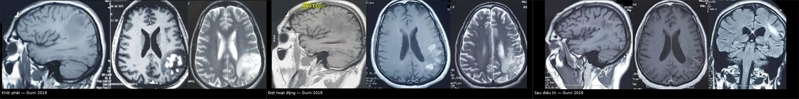
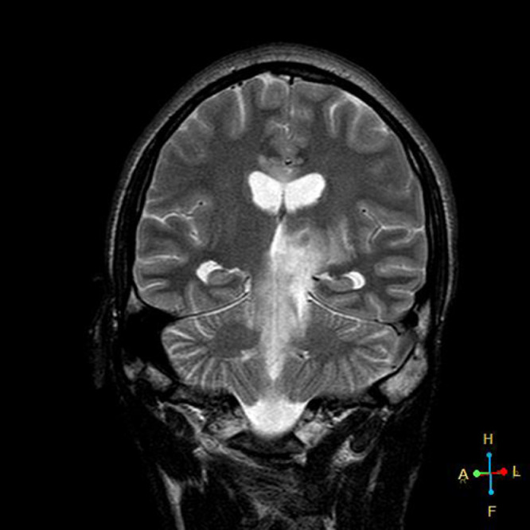
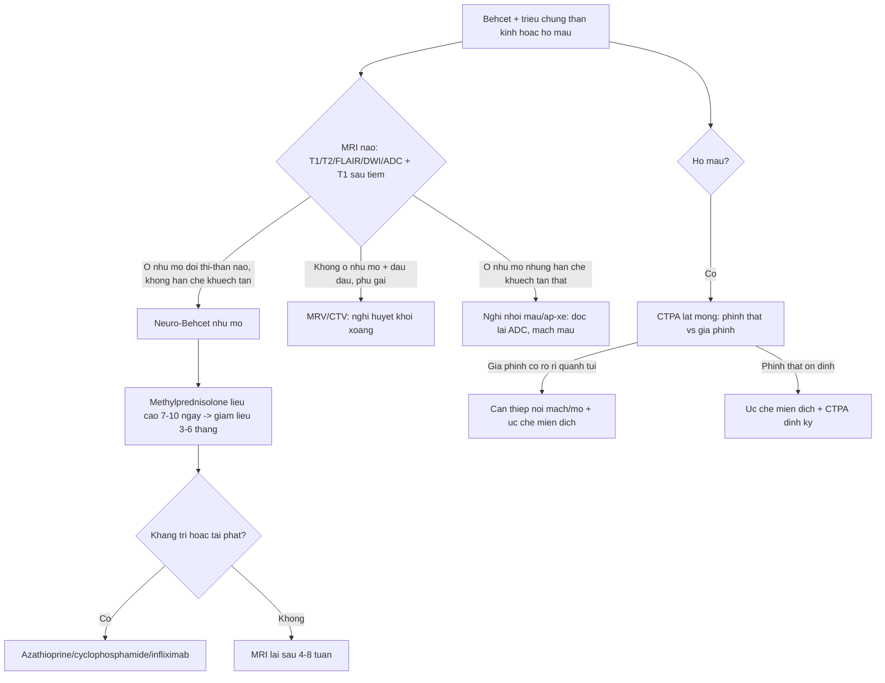
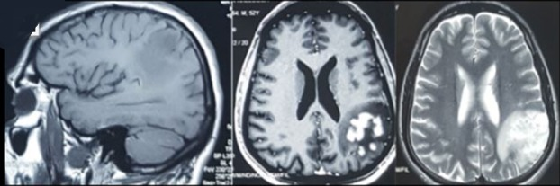
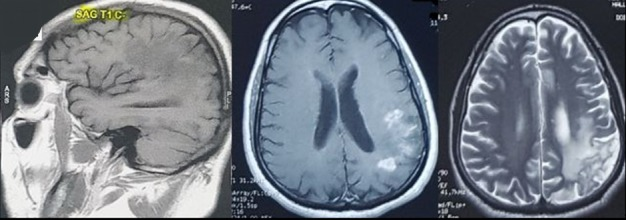
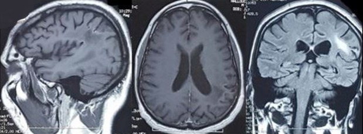
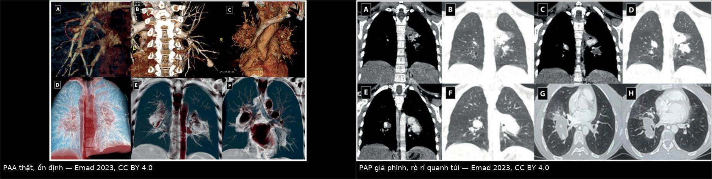

# 203 — Neuro-Behçet & Behçet mạch máu lớn: đồi thị–thân não "thác nước" và phình/giả phình động mạch phổi

**Tags:** `pattern:ton-thuong-doi-thi-than-nao` `vung:nao-than-nao` `pattern:phinh-mach` `vung:dong-mach-phoi` `protocol:MRI-DWI` `protocol:CTPA`
**Mức chắc chắn (certainty):** tổng hợp y văn (literature synthesis) — ghép 2 ca nguyên văn mở (Pan Afr Med J 2019, CC BY 4.0; Radiol Case Rep 2022, CC BY-NC-ND 4.0) với atlas CTPA 42 bệnh nhân Behçet (Sarcoidosis Vasc Diffuse Lung Dis 2023, CC BY 4.0); phần điều trị là khung tổng hợp, không phải ca đơn lẻ.

## 1. Tổng quan — vì sao Behçet đánh vào cả não lẫn mạch lớn

- **Bệnh Behçet (Behçet disease, BD)** là **viêm mạch biến thể (variable vessel vasculitis)** — khác các viêm mạch "một cỡ mạch" như TAK/GCA, BD có thể viêm **động mạch lớn, động mạch nhỏ và tĩnh mạch** cùng lúc, và **ưu tiên tĩnh mạch**. Vì vậy một bệnh nhân có thể vừa có **tổn thương nhu mô não** vừa có **huyết khối xoang màng cứng** vừa có **phình động mạch phổi** — bài này gom cả ba vào một khung đọc.
- **Tần suất thần kinh:** biểu hiện thần kinh gặp **1–59%** tùy series; thể **nhu mô (parenchymal)** và **ngoài nhu mô (extra-parenchymal)** cộng lại được báo cáo **5,3% đến hơn 50%** (Pan Afr Med J 2019, PMC6814321). Thể **giả u (pseudotumoral)** thì **hiếm** — chính vì hiếm nên dễ bị mổ nhầm thành u thần kinh đệm.
- **TẠI SAO MRI là chốt, và TẠI SAO tín hiệu lại như vậy:**
  - Viêm quanh tĩnh mạch + phù **mô kẽ (vasogenic edema)** → **T2/FLAIR tăng tín hiệu**, **T1 giảm/đồng tín hiệu**, bờ không rõ, có thể **phù lan rộng + hiệu ứng choán chỗ** (giả u).
  - **Hàng rào máu–não vỡ cục bộ** → **ngấm thuốc dạng nốt/mảng** thì muộn; mức ngấm **giảm dần khi viêm được kiểm soát** nên đây là dấu theo dõi đáp ứng.
  - **KHÔNG hạn chế khuếch tán (no restricted diffusion)** trên DWI/ADC ở ca nguyên văn (Pretorius 2022, PMC8688177) — vì phù **mạch (vasogenic)**, không phải **độc tế bào (cytotoxic)**. Đây là điểm phân biệt cơ học với **nhồi máu** và **áp-xe**.
  - **Dấu "thác nước"/"thác đổ" (waterfall sign / cascade sign)** trên **T2 coronal**: tăng tín hiệu liên tục từ **đồi thị → cuống đại não → cầu**, chạy dọc theo bó sợi — dấu gợi ý mạnh neuro-Behçet và **rất khó giải thích bằng một ổ nhồi máu đơn lẻ**.
- **TẠI SAO mạch lớn cũng là chuyện của Behçet:** viêm lớp giữa (vasa vasorum) → **phá hủy thành → phình thật**, hoặc **vỡ khu trú được bọc lại → giả phình (pseudoaneurysm)**; kèm **huyết khối tại chỗ (in-situ thrombosis)** do viêm nội mạc. Trong atlas 42 bệnh nhân Behçet có tổn thương mạch phổi: **huyết khối tĩnh mạch sâu 73,8%**, **huyết khối động mạch 31%**, **phình động mạch ngoại vi 28,5%**, **ho máu 90,5%** và **ho máu tử vong 19%** (Emad 2023, PMC10540716).
- **Vì sao phải phân biệt phình thật vs giả phình phổi:** trên cùng 42 bệnh nhân, CTPA cho **phình thật ổn định 31%**, **phình thật không ổn định 26,2%**, **giả phình ổn định 16,7%**, **giả phình không ổn định 40,5%** — nhóm **giả phình có rò rỉ quanh túi (perianeurysmal leakage)** là nhóm **dọa vỡ**, cần can thiệp sớm chứ không "theo dõi định kỳ".

## 2. Mẫu hình + chẩn đoán phân biệt theo vị trí (gamut)

**Ba tầng tổn thương — hỏi lần lượt, đừng gộp:**

1. **Tầng nhu mô (parenchymal):** **đồi thị, nhân nền, bao trong sau, cuống đại não (mesencephalon), cầu, diencephalon** — vị trí kinh điển; tổn thương **một bên hoặc hai bên không đối xứng**, **T2 sáng, T1 tối, ngấm thuốc**, có thể **giả u**.
2. **Tầng màng não–tĩnh mạch (extra-parenchymal):** **huyết khối xoang màng cứng** (thường **xoang dọc trên**), viêm màng não vô khuẩn, tăng áp lực nội sọ lành tính — hình ảnh **không có ổ nhu mô**, chẩn đoán bằng **MRV/CTV**.
3. **Tầng động mạch lớn (large-vessel):** **phình/giả phình động mạch phổi** (thể Hughes–Stovin), phình ĐMC, phình động mạch ngoại vi, huyết khối động mạch — chẩn đoán bằng **CTPA/CTA**, không bằng MRI não.

**Gamut "tổn thương đồi thị–thân não" (theo cơ chế):**
- **Viêm:** neuro-Behçet (đứng đầu khi bệnh cảnh gợi ý) · **sarcoid thần kinh** · **lupus (NPSLE)** · **ADEM**.
- **Khử myelin:** **MS** (ổ nhỏ, quanh não thất, "Dawson fingers", lan dọc trục ngắn) · **NMOSD** (diện não thất, đồi thị có thể) · **MOGAD**.
- **Mạch máu:** **nhồi máu đồi thị** (theo lãnh thổ, **hạn chế khuếch tán thật**, hình chêm) · **huyết khối tĩnh mạch sâu nội sọ** (đồi thị hai bên, có xuất huyết) · **bệnh mạch máu nhỏ**.
- **U/hàng giả u:** **u thần kinh đệm** (thể giả u của neuro-Behçet bắt chước) · **lymphoma** (ngấm đồng nhất, hạn chế khuếch tán) · **di căn**.
- **Nhiễm:** **áp-xe** (viền ngấm, hạn chế khuếch tán trung tâm) · **viêm não** · **lao**.

## 3. Bảng so sánh phân biệt (ma trận đối chiếu)

| Thực thể (entity) | Hình ảnh điển hình | Chốt vào (rule-in) | Chốt loại (rule-out) | Gợi ý xác nhận |
|---|---|---|---|---|
| **Neuro-Behçet nhu mô** | Đồi thị/bao trong sau/cuống đại não/cầu, **T2–FLAIR sáng, T1 tối**, ngấm **nốt/mảng**, có thể **giả u + phù**; **coronal T2 "thác nước"** | **Loét miệng tái diễn + loét sinh dục/viêm mắt + tổn thương đồi thị–thân não không theo lãnh thổ** | **Hạn chế khuếch tán rõ + hình chêm theo mạch** → nhồi máu; ổ quanh não thất nhỏ kiểu MS | MRI não có **DWI/ADC + T1 sau tiêm**, coronal T2; **MRV** loại huyết khối xoang |
| **Neuro-Behçet mạch (CVST)** | **Khuyết thuốc xoang dọc trên** trên CTV/MRV, nhồi máu **không theo lãnh thổ**, có thể xuất huyết; **không có ổ nhu mô đặc hiệu** | **Đau đầu tăng dần + phù gai + yếu tố tăng đông âm tính + Behçet đã biết** | **Ổ nhu mô T2 sáng điển hình đồi thị** → thể nhu mô | **MRV/CTV bắt buộc**; D-dimer không loại trừ |
| **U thần kinh đệm (glioma)** | Khối **một ổ**, phù quanh, ngấm **vòng/không đều**, hiệu ứng choán chỗ tiến triển | **Tiến triển trên 2 lần chụp cách 4–8 tuần**, ngấm kiểu u, **không đáp ứng corticoid liều cao** | **Đáp ứng nhanh sau 3–5 ngày methylprednisolone** nghiêng về viêm; **"thác nước" dọc bó sợi** nghiêng về NBD | MRI tưới máu (u tăng tưới máu), **không sinh thiết ngay khi bệnh cảnh Behçet rõ** |
| **MS / ADEM** | Ổ **quanh não thất, thân chẩn đoán McDonald**, **lan dọc trục ngắn**, ít phù | **Tiền sử các đợt thần kinh phân ly theo thời gian**, **dải Oligoclonal IgG** trong LCR | **Tổn thương đồi thị–cuống đại não một bên, phù mạnh, "thác nước"** → NBD | MRI não + tủy sống, LCR (OCB), evoked potentials |
| **Behçet phổi — PAA thật** | **Túi phình thành mạch rõ**, **huyết khối trong lòng chiếm phần lớn túi**, bờ nhẵn, **không rò rỉ** | **Định kỳ CTPA ổn định ≥ 6 tháng**, kích thước không đổi | **Máu tụ quanh túi, bờ mờ, đổi hình giữa 2 thì** → giả phình | **CTPA có thì động mạch + thì muộn**; so sánh chính xác cùng mặt cắt |
| **Behçet phổi — PAP (giả phình)** | **Rò rỉ quanh túi (perianeurysmal leakage)**, **máu tụ/alveolar haemorrhage quanh**, **lõm vào phế quản (bronchial indentation)** | **Ho máu + túi mạch có quầng máu quanh, bờ không rõ** | **Túi bờ nhẵn, không quầng, ổn định** → phình thật | CTPA khẩn; **không chọc/xử lý như nốt phổi thường** |

*Ba thời điểm của cùng một bệnh nhân: **khởi phát** (T1/T1+Gd/T2: ổ giảm tín hiệu T1, tăng tín hiệu T2 ở đồi thị và bao trong sau), **đợt hoạt động** (nốt mới + phù quanh ổ — dù đã 3 bolus corticoid), **sau điều trị** (thoái lui). Nguồn: Guini M et al., Pan Afr Med J 2019 (PMC6814321) Fig. 1–3, CC BY 4.0. Ảnh ghép letterbox, không crop/kéo giãn.*

### Đọc dấu "thác nước" cho đúng

- **Coronal T2/FLAIR** là mặt cắt **bắt buộc** khi nghi neuro-Behçet: tăng tín hiệu chạy **liên tục đồi thị → cuống đại não → cầu hai bên** tạo hình **thác nước/thác đổ (waterfall/cascade)** (Pretorius 2022, PMC8688177).
- Dấu này phản ánh **phù lan theo bó sợi + đường đi quanh tĩnh mạch**, không phải một ổ mạch máu — nên **không tôn trọng lãnh thổ động mạch** là chốt âm tính quan trọng nhất để loại nhồi máu.

*T2 coronal: tăng tín hiệu **đồi thị trái, cuống đại não trái, cầu hai bên** tạo hình **"thác nước"**. Nguồn: Pretorius JJ et al., Radiol Case Rep 2022 (PMC8688177) Fig. 3, CC BY-NC-ND 4.0 — ảnh giữ nguyên bản, không ghép.*

## 4. Protocol chụp–chẩn đoán + phân tầng xử trí

**MRI não (chốt chẩn đoán, làm đủ chuỗi):**
- **Axial T1, T2, FLAIR, DWI + ADC, T1 sau tiêm gadolinium**, cộng **coronal T2/FLAIR** (dấu thác nước) và **MRV** nếu đau đầu/tăng áp lực nội sọ.
- Đo **kích thước ổ (mm)**, ghi **có/không ngấm thuốc**, **có/không phù quanh**, ghi **ADC** (loại nhồi máu/áp-xe). Không cần **MRS** thường quy; MRS chỉ để loại u khi hình ảnh không điển hình.
- **Chụp lại sau 4–8 tuần** (hoặc sớm hơn nếu xấu đi): ca nguyên văn còn **tăng tín hiệu nhẹ đồi thị/thân não sau 4 tháng** — đừng kỳ vọng "sạch hoàn toàn" trên MRI.

**CTPA/CTA (khi có tổn thương mạch lớn):**
- **Chỉ định:** ho máu ở bệnh nhân Behçet (dù chỉ một lần), phình trên CTA trước đó, đau ngực, khó thở.
- **Kỹ thuật:** CTPA **lát ≤ 1 mm**, **thì động mạch phổi + thì muộn**, dựng **MIP/3D** để thấy túi phình; đo **đường kính túi (mm)**, ghi **huyết khối trong lòng (%)**, **quầng máu quanh túi**, **lõm phế quản**.
- **Cạm bẫy liều:** bệnh nhân Behçet trẻ, thường đã chụp nhiều lần → dùng **liều thấp nhất đủ chẩn đoán**, tránh lặp CTPA vô ích.

**Điều trị (khung, không thay thế chuyên khoa):**
- **Đợt cấp nhu mô:** **methylprednisolone liều cao 7–10 ngày**, sau đó **giảm liều đường uống trong 3–6 tháng** tùy mức nặng (Pan Afr Med J 2019); bước tiếp **azathioprine/cyclophosphamide** (ca nguyên văn: cyclophosphamide **200 mg/ngày × 10 ngày** tấn công, rồi **1 g/tháng × 6 tháng** duy trì), **infliximab** khi kháng trị.
- **Huyết khối xoang:** **chống đông** là nền tảng, phối hợp ức chế miễn dịch; quyết định thời gian chống đông theo mức tắc và nguy cơ chảy máu.
- **Phình/giả phình động mạch phổi:** **giả phình có rò rỉ** hoặc **ho máu nặng** → **can thiệp nội mạch (coil/nút mạch) hoặc mổ** kèm **ức chế miễn dịch tích cực**; **phình thật ổn định** → ức chế miễn dịch + **CTPA theo dõi định kỳ**, không can thiệp mù.

## 5. Biến thể bình thường và cạm bẫy

- **Thể giả u = cạm bẫy mổ nhầm:** ca Pan Afr Med J có tổn thương **"en doigt de gant" vỏ–dưới vỏ** giống u thần kinh đệm; **LCR bình thường** và **không có uveitis** càng làm chẩn đoán khó. Chốt an toàn: **bệnh cảnh Behçet + đáp ứng với corticoid + theo dõi 4–8 tuần**, không sinh thiết/mổ ngay.
- **"Không hạn chế khuếch tán" không phải dấu loại trừ tuyệt đối:** ổ viêm rất nhỏ hoặc có mủ vẫn có thể hạn chế nhẹ; ngược lại **nhồi máu cũ** có thể "giả" giống NBD. Đọc **ADC định lượng**, không chỉ nhìn DWI sáng.
- **Đừng gộp "thác nước" với lan dọc trục của MS:** NBD lan **dài, một bên, qua đồi thị–cuống–cầu**, thường **có phù mạnh** và **đáp ứng corticoid nhanh**; MS ổ **nhỏ, quanh não thất, lan dọc trục ngắn**.
- **Bỏ sót tầng mạch vì chỉ chụp não:** **ho máu** ở bệnh nhân Behçet là **cờ đỏ** cho phình/giả phình động mạch phổi — phải **CTPA**, không "theo dõi X-quang ngực".
- **Phình thật vs giả phình — khác nhau về tiên lượng, không chỉ về chữ:** **giả phình có quầng máu quanh túi/lõm phế quản** thuộc nhóm **dọa vỡ**, đã có **ho máu tử vong 19%** trong atlas 42 ca; đừng đọc "túi phình nhỏ nên lành".
- **Cạm bẫy mặt cắt:** túi phình động mạch phổi nằm **sát phế quản** — trên lát axial mỏng dễ bị đọc thành **hạch rốn phổi hoặc nang khí**; luôn xem **MIP coronal** và **thì muộn** trước khi kết luận.

## 6. Tự lượng giá — Blind Quiz

**Ca 1 — Nam trẻ, liệt nửa người phải + hôn mê nhẹ, tiền sử loét miệng tái diễn. MRI não:**

- Hỏi: mô tả tăng tín hiệu? Dấu này tên gì? Hai chẩn đoán cần loại trừ và cách loại?

<b>Bấm để hiện đáp án (findings + chẩn đoán)</b>

- Findings: **tăng tín hiệu T2 ở đồi thị trái, cuống đại não trái và cầu hai bên**, chạy liên tục thành dải — **dấu "thác nước"/"cascade"**. Trên axial kèm **đồi thị, bao trong sau, nhân đậu sau, cuống đại não**; **không hạn chế khuếch tán**; **ngấm thuốc lốm đốm** thì muộn.
- Chẩn đoán: **neuro-Behçet thể nhu mô (pseudotumoral)**, có **giãn nhẹ não thất + giãn sừng thái dương** do phù (gợi ý tăng áp lực nội sọ sớm).
- Loại trừ: **nhồi máu** (không theo lãnh thổ, ADC không hạn chế) và **u thần kinh đệm** (đáp ứng corticoid, "thác nước" dọc bó sợi, không ngấm kiểu u).
- Nguồn: Pretorius JJ et al., Radiol Case Rep 2022 (PMC8688177) Fig. 3, CC BY-NC-ND 4.0.

**Ca 2 — Nữ 30 tuổi Behçet, đau đầu + aphasia + liệt nửa người phải, LCR bình thường. MRI lần 1:**

- Hỏi: mô tả ổ tổn thương? LCR bình thường có loại trừ neuro-Behçet không? Nếu chỉ nhìn ảnh này, bạn có mổ không?

<b>Bấm để hiện đáp án (findings + chẩn đoán)</b>

- Findings: ổ **giảm tín hiệu T1, tăng tín hiệu T2/FLAIR/DWI**, **hình "ngón tay găng" vỏ–dưới vỏ** thùy đỉnh sau trái, **ngấm thuốc dạng nốt** — bề ngoài giống u thần kinh đệm.
- **LCR bình thường KHÔNG loại trừ** neuro-Behçet (đúng ca nguyên văn) — chẩn đoán dựa **bệnh cảnh + hình ảnh + đáp ứng điều trị**.
- **Không mổ/không sinh thiết ngay**: sau **3 bolus corticoid liều cao** bệnh nhân hồi phục hoàn toàn; MRI kiểm tra lại cho thấy **nốt mới + phù quanh ổ** (đợt hoạt động) → chuyển **cyclophosphamide**, rồi **thoái lui** trên MRI lần 3.
- Bài học: thể **giả u** của neuro-Behçet là chỉ định **theo dõi + điều trị thử**, không phải chỉ định mổ.

- Nguồn: Guini M et al., Pan Afr Med J 2019 (PMC6814321) Fig. 1–3, CC BY 4.0.

**Ca 3 — Bệnh nhân Behçet, ho máu 200 mL. CTPA:**

- Hỏi: hai tổn thương khác nhau ở điểm nào? Tổn thương nào phải can thiệp ngay? Vì sao "kích thước nhỏ" không đồng nghĩa "lành"?

<b>Bấm để hiện đáp án (findings + chẩn đoán)</b>

- Trái: **phình thật (true PAA)** — túi bờ nhẵn, **huyết khối trong lòng chiếm phần lớn túi**, **không có quầng máu quanh**. Phải: **giả phình (PAP)** — **rò rỉ quanh túi (perianeurysmal leakage)**, bờ mờ, máu tụ quanh, có thể **lõm vào phế quản**.
- **Can thiệp ngay: giả phình có rò rỉ** (coil/nút mạch hoặc mổ) + ức chế miễn dịch tích cực; **phình thật ổn định**: ức chế miễn dịch + CTPA định kỳ.
- "Nhỏ" không lành vì **giả phình là vỡ được bọc lại** — nguy cơ **ho máu ồ ạt**; trong 42 ca Behçet có tổn thương mạch phổi, **ho máu tử vong 19%**.
- Nguồn: Emad Y et al., Sarcoidosis Vasc Diffuse Lung Dis 2023 (PMC10540716) Fig. 1 & Fig. 6, CC BY 4.0. Ảnh ghép letterbox.

## Bài liên quan chéo
- [455 – Behçet & lupus: biểu hiện mắt](../455-behcet-lupus-mat/lesson.md) (viêm mắt trong cùng bệnh — cửa vào hay gặp)
- [216 – Huyết khối tĩnh mạch não (CVST)](../216-di-dang-mach-CVST/lesson.md) (thể ngoài nhu mô của neuro-Behçet)
- [213 – U não](../213-u-nao/lesson.md) (thể giả u của neuro-Behçet bắt chước u thần kinh đệm)
- [229 – PACNS vs RCVS](../229-pacns-vs-rcvs/lesson.md) (viêm mạch não nguyên phát — phân biệt bằng bệnh cảnh ngoài thần kinh)
- [436 – Takayasu & GCA](../436-takayasu-vs-gca/lesson.md) (viêm mạch lớn: dày thành mạch, không phình kiểu Behçet)

## Ảnh
- `203_neuro-behcet-thalamus-ban-dau_MRI_PMC6814321-Fig1.jpg` — Guini M et al., Pan Afr Med J 2019 (PMCID: PMC6814321) Fig. 1, CC BY 4.0.
- `203_neuro-behcet-nodule-hoat-dong_MRI_PMC6814321-Fig2.jpg` — Guini M et al. (PMC6814321) Fig. 2, CC BY 4.0.
- `203_neuro-behcet-thoai-lui_MRI_PMC6814321-Fig3.jpg` — Guini M et al. (PMC6814321) Fig. 3, CC BY 4.0.
- `203_neuro-behcet-dau-thac-nuoc_MRI_PMC8688177-Fig3.jpg` — Pretorius JJ et al., Radiol Case Rep 2022 (PMCID: PMC8688177) Fig. 3, CC BY-NC-ND 4.0 (nguyên bản, không ghép).
- `203_behcet-phinh-dong-mach-phoi_CTPA_PMC10540716-Fig1.jpg` — Emad Y et al., Sarcoidosis Vasc Diffuse Lung Dis 2023 (PMCID: PMC10540716) Fig. 1, CC BY 4.0.
- `203_behcet-gia-phinh-phoi-khong-on-dinh_CTPA_PMC10540716-Fig6.jpg` — Emad Y et al. (PMC10540716) Fig. 6, CC BY 4.0.
- `composite_neuro-behcet-tien-trien-doi-thi.jpg` và `composite_behcet-phinh-that-vs-gia-phinh-phoi.jpg` — ghép bằng `tools/make_composite.py` (letterbox, không crop).
- Chi tiết giấy phép từng ảnh trong `images/CREDITS.md`. AuntMinnie/Radiopaedia: chỉ dẫn link, không tải.

> Không dùng để chẩn đoán độc lập khi chưa có người hướng dẫn.
