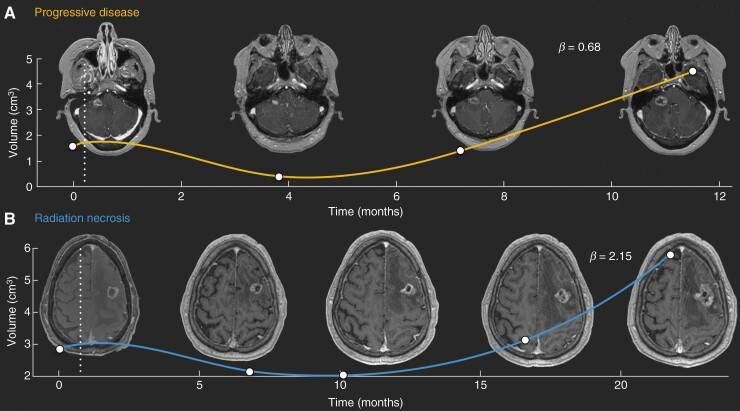
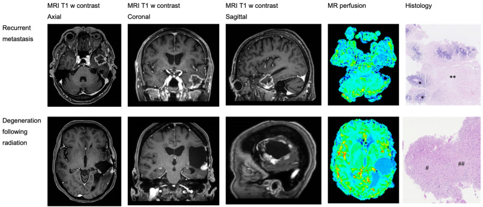
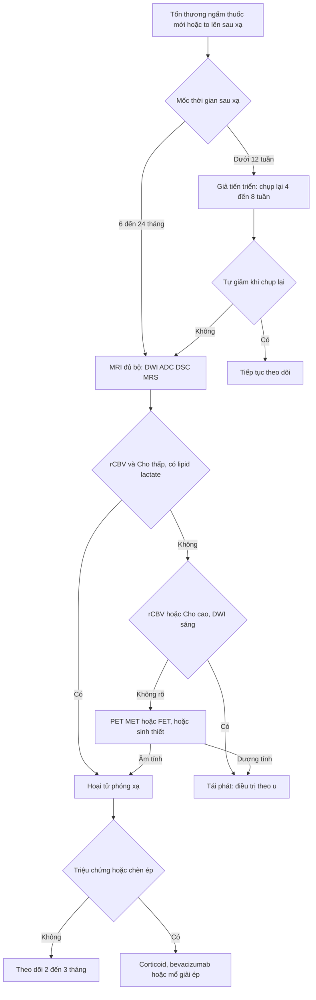
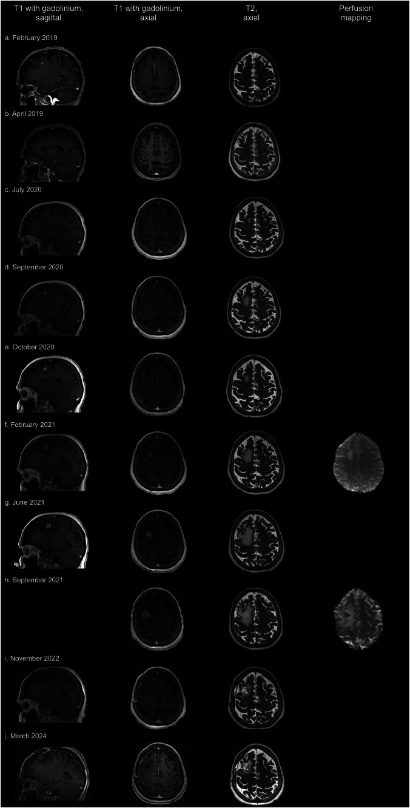

# 204 — Hoại tử phóng xạ sau xạ trị u não và "vòng xoáy" tái phát giả / Radiation necrosis vs tumour recurrence after brain radiotherapy

**Tags:** `pattern:hoai-tu-phong-xa` `pattern:ngam-vong` `pattern:phu-chat-trang` `vung:nao` `score:RANO-BM` `score:lesion-quotient` `protocol:MRI-DSC-MRS` `protocol:PET-MET-FET`
**Mức chắc chắn (certainty):** tổng hợp y văn (literature synthesis) — số liệu từ tổng quan so sánh đa phương thức (Arif S et al., *Cureus* 2025, PMC11890348), đoàn hệ 101 di căn não (Ocaña-Tienda B et al., *Neuro-Oncol Adv* 2023, PMC9887079), 32 ca có mô bệnh (Schack A et al., *Brain Sci* 2024, PMC11048647), 94 ca điều trị phù não do hoại tử phóng xạ (Dijkstra ME et al., *Neuro-Oncol Adv* 2026, PMC13197578) và một **ca nguyên văn** theo dõi 60 tháng (Ahmed M et al., *Adv Radiat Oncol* 2024, PMC11491898).

## 1. Tổng quan bệnh học – cơ chế hình ảnh: vì sao "vòng ngấm" không đồng nghĩa "u sống"

- **Định nghĩa:** hoại tử phóng xạ (radiation necrosis — RN) là tổn thương mô não do xạ trị, xuất hiện **6–24 tháng** sau xạ phẫu (SRS/fSRS) hoặc xạ trị phân liều, đôi khi tới **nhiều năm**. Tần suất **5–10%** sau SRS/fSRS điều trị di căn não (PMC11491898) và **5–25%** nếu tính cả xạ trị phân liều cho u nguyên phát (PMC11890348).
- **Chuỗi bệnh học (TẠI SAO có hình ảnh đó):**
  1. **Tổn thương nội mô mạch** → huyết khối fibrin, **hoại tử dạng tơ huyết (fibrinoid necrosis)** thành mạch.
  2. **Thiếu máu cục bộ + thiếu oxy** → hoại tử lan tỏa, mất myelin, tăng sinh tế bào hình sao.
  3. **Tăng VEGF** → **tăng tính thấm hàng rào máu–não** → **phù chất trắng** và **ngấm gadolinium**. Đây là lý do **corticoid và bevacizumab** (kháng VEGF) làm giảm phù nhanh, dù không "chữa" mô hoại tử.
- **TẠI SAO từng chuỗi xung cho tín hiệu khác nhau — vật lý cần nhớ:**
  - **T2/FLAIR:** mô hoại tử nhiều nước tự do → **sáng**; phù chất trắng lan **"ngón tay"** theo bó sợi, **không tôn trọng ranh giới chất xám** (khác u xâm lấn).
  - **T1W sau gadolinium:** hàng rào máu–não vỡ → ngấm; RN hay có **ngấm dạng vòng mỏng, đều, viền trong nhẵn**, trong khi tái phát thường **nốt đặc, dày không đều, lệch tâm** — nhưng **chồng lấp rất lớn**.
  - **DWI/ADC:** trung tâm hoại tử **khuếch tán tự do (ADC cao)**; u đặc tế bào dày **ADC thấp**. Cạm bẫy: **viền mô hạt của RN cũng có thể hạn chế khuếch tán**.
  - **DSC-MRI (rCBV):** RN **không có mạng mao mạch sống** → **rCBV thấp**; tái phát có **tân mạch** → **rCBV cao**. Đây là nguyên lý mạnh nhất trong thực hành.
  - **MRS:** RN **Cho thấp, NAA giảm, có đỉnh lipid–lactate** (hoại tử yếm khí); tái phát **Cho cao** (tăng tổng hợp màng tế bào), **Cho/NAA và Cho/Cr tăng**.
  - **PET acid amin (MET/FET):** u hấp thu acid amin mạnh, **mô hoại tử thì không** → phân biệt tốt hơn FDG (vỏ não hấp thu FDG rất mạnh, dễ nhiễu).
- **TẠI SAO "đọc phim thường" hay sai:** cả hai đều **ngấm thuốc + phù + tăng thể tích**. Ba dấu "kinh điển" của RN là **"soap bubble"**, **"Swiss cheese"**, **"cut green pepper"** chỉ có **giá trị dự báo dương 25%** (PMC11890348) — tức 3/4 trường hợp "trông như RN" vẫn có thể là u.
- **TẠI SAO thời điểm quan trọng:** **giả tiến triển (pseudoprogression)** xuất hiện **trong 12 tuần đầu** sau xạ (do viêm cấp, hàng rào máu–não vỡ tạm thời) và **tự thoái triển**; RN thật thường **sau 6 tháng**. Cùng một hình ảnh, khác mốc thời gian → khác xử trí.

### Ngưỡng định lượng trụ cột

| Chỉ số | Số liệu | Nguồn |
|---|---|---|
| Tần suất RN sau SRS/fSRS di căn não | **5–10%** | PMC11491898 |
| Tần suất RN chung (xạ trị phân liều) | **5–25%** (7% nếu chẩn đoán bằng mô bệnh; 24% nếu bằng hình ảnh) | PMC11890348 |
| RN ở u thần kinh đệm sống > 1 năm | **10–15%** | PMC11890348 |
| Hoại tử thùy thái dương sau xạ vòm họng | **1,6–22%** trong 9 tháng–16 năm; **5%** trong 10 năm | PMC11890348 |
| Hóa trị đồng thời | tăng nguy cơ RN **5 lần** | PMC11890348 |
| Liều–thể tích (HyTEC) | **V12Gy < 5 mL** nguy cơ thấp; tăng theo thể tích xạ | PMC11491898 |
| Lesion quotient (LQ) | **< 0,3** → RN; **> 0,6** → tái phát; NPV 73% / 39% | PMC11890348 |
| Dấu "soap bubble/cut green pepper" | PPV **25%** | PMC11890348 |
| MRI thường cho tái phát | Se **87,1%**, Sp **30%** | PMC11890348 |
| DSC-MRI | Se **90%**, Sp **88%** | PMC11890348 |
| MRS | Se **91%**, Sp **95%** | PMC11890348 |
| 11C-MET PET/CT | Se **94,7%**, Sp **88,9%** | PMC11890348 |
| 18F-FET PET | Se **91%**, Sp **95%** | PMC11890348 |
| Phối hợp nhiều phương thức | Se **96%**, Sp **93%** | PMC11890348 |
| Động học thể tích (β) | AUC **0,76** cho phân biệt RN/tái phát (101 tổn thương: 60 tái phát, 41 RN) | PMC9887079 |

## 2. Mẫu hình + chẩn đoán phân biệt theo mốc thời gian (Gamut)

- **Mốc < 12 tuần sau xạ:** **giả tiến triển** (pseudoprogression) — ngấm tăng, phù tăng rồi **giảm dần không cần đổi điều trị**; đặc biệt sau hóa–xạ đồng thời và sau **ức chế điểm kiểm soát miễn dịch** (iRANO).
- **Mốc 6–24 tháng:** **RN** (thể vòng, thể nốt, thể lan tỏa), **tái phát tại chỗ**, **di căn mới** ngoài trường xạ, **áp-xe** (hiếm), **nhồi máu bán cấp** trong trường xạ, **viêm mạch phóng xạ**.
- **Mốc > 24 tháng:** RN muộn (có thể tiến triển nhiều năm), **u thứ phát do xạ** (meningioma, sarcoma), **giãn não thất do xạ**, **bệnh chất trắng phóng xạ lan tỏa**.
- **Theo hình thái:**
  - **Vòng mỏng, viền trong nhẵn, trung tâm T2 rất sáng, không nốt đặc** → RN.
  - **Nốt đặc lệch tâm, dày không đều, DWI sáng/ADC tối** → tái phát.
  - **"Soap bubble" (bọt xà phòng), "Swiss cheese", "cut green pepper"** → gợi RN nhưng **PPV chỉ 25%**.
  - **Giảm thể tích + teo + encephalomalacia** → RN đã ổn định.
- **Gợi nhớ 4T:** **T**ime (mốc 6–24 tháng), **T**opography (trong **trường xạ**, quanh ổ đã chiếu), **T**rait (vòng mỏng, bọt, không nốt đặc), **T**races (rCBV thấp, Cho thấp, lipid–lactate cao, MET/FET thấp).

## 3. Bảng so sánh phân biệt (ma trận đối chiếu)

*Trên (A, vàng): tái phát — thể tích giảm sau xạ rồi **tăng đơn điệu**, hệ số phát triển **β = 0,68**. Dưới (B, xanh): hoại tử phóng xạ — thể tích **tăng nhanh rồi tự thoái triển**, **β = 2,15**. Đường đứt nét = thời điểm SRS. Nguồn: Ocaña-Tienda B et al., Neuro-Oncol Adv 2023, PMC9887079 Fig. 1, CC BY 4.0.*

| Thực thể | Hình ảnh điển hình | Chốt vào (rule-in) | Chốt loại (rule-out) | Gợi ý xác nhận |
|---|---|---|---|---|
| **Hoại tử phóng xạ (RN)** | Vòng ngấm **mỏng, đều**, trung tâm T2 rất sáng, **rCBV thấp**, Cho thấp + **lipid–lactate**, MET/FET **thấp**, teo dần | **Nằm trong trường xạ + mốc 6–24 tháng + rCBV thấp + giảm dần theo thời gian** | **Nốt đặc lệch tâm + DWI sáng/ADC tối + rCBV cao + Cho cao** → không phải RN | DSC-MRI + MRS (± MET/FET), theo dõi 6–8 tuần |
| **Tái phát tại chỗ** | Nốt **đặc**, dày không đều, **tăng thể tích liên tục**, phù tăng, có thể xâm lấn màng não | **Tăng ≥ 20% đường kính dài nhất (và ≥ 5 mm) + rCBV cao + Cho/NAA cao** | **Teo + giảm ngấm không điều trị** → RN | Mô bệnh (sinh thiết/mổ) là chuẩn vàng |
| **Giả tiến triển** | Ngấm tăng **trong 12 tuần** quanh ổ xạ, phù tăng, lâm sàng ổn | **Mốc < 12 tuần + tự giảm khi chụp lại 4–8 tuần** | **Tiếp tục tăng sau 12 tuần** → không còn là giả tiến triển | Chụp lại 4–8 tuần; không đổi điều trị |
| **Áp-xe trong trường xạ** | Ổ dịch **ngấm viền + hạn chế khuếch tán mạnh (ADC rất thấp)**, có thể có khí, sốt | **Sốt + ADC rất thấp + cấy dương** | **ADC cao trung tâm + không sốt** → RN/u | DWI/ADC + cấy + dẫn lưu |
| **Nhồi máu bán cấp** | Ngấm theo **lãnh thổ mạch**, hình chêm, vỏ não, ADC giảm sớm rồi tăng | **Theo lãnh thổ + khởi phát đột ngột** | **Không theo lãnh thổ, hình cầu quanh ổ xạ** → RN/u | DWI + MRA |
| **U thứ phát do xạ** | Meningioma/sarcoma **ngoài trường xạ**, xuất hiện **> 5 năm**, phát triển chậm | **Thời gian tiềm tàng dài + tổn thương mới ngoài ổ xạ** | Tổn thương **trong ổ xạ, 6–24 tháng** → RN/tái phát | MRI + mô bệnh |
| **Bệnh chất trắng phóng xạ lan tỏa** | T2/FLAIR **đối xứng quanh não thất**, không ngấm, không choán chỗ | **Đối xứng + không ngấm + không hiệu ứng khối** | **Một ổ + ngấm + choán chỗ** → RN/tái phát | MRI, loại trừ nguyên nhân khác |

### Bảng độ chính xác của từng phương thức (dùng để chọn, không để chốt tuyệt đối)

| Phương thức | Se | Sp | Ghi chú thực hành |
|---|---|---|---|
| MRI thường (T1+Gd, T2) | 87,1% | **30%** | Không đủ loại trừ; "vòng đẹp" vẫn có thể là u |
| DSC-MRI (rCBV) | 90% | 88% | **Ưu tiên số 1** khi có máy và kỹ thuật ổn định |
| MRS (Cho/Cr, Cho/NAA) | 91% | 95% | Cần voxel đặt đúng, tránh vùng hoại tử/xương |
| 11C-MET PET/CT | **94,7%** | 88,9% | Se cao nhất cho tái phát; ít trung tâm có |
| 18F-FET PET | 91% | 95% | Thay thế tốt cho MET |
| 18F-FDG PET | 81% | 72% | **Kém** ở não: vỏ não hấp thu mạnh |
| Phối hợp nhiều phương thức | **96%** | 93% | Cách thực tế nhất khi một phương thức không rõ |

*Hàng trên: di căn não tái phát (T1+Gd axial/coronal/sagittal) — bản đồ tưới máu **rực màu** (rCBV cao), mô bệnh có mô u (*) và hoại tử (**). Hàng dưới: thoái hóa sau xạ — tổn thương **rỗng, ngấm viền**, bản đồ tưới máu **kém màu hơn**, mô bệnh là mô thần kinh thoái hóa (#, ##). Nguồn: Schack A et al., Brain Sci 2024, PMC11048647 Fig. 2, CC BY 4.0.*

## 4. Protocol chụp + xử trí & theo dõi

### 4.1 Protocol MRI (bắt buộc đủ bộ, không chỉ "MRI sọ có cản quang")

- **Máy:** 1,5 T tối thiểu, **3 T ưu tiên** cho DSC/MRS; cùng máy, cùng protocol giữa các lần để so sánh.
- **Chuỗi tối thiểu:** T1W axial (không tiêm), T2W/FLAIR, **DWI + ADC**, **T1W sau gadolinium 3 bình diện**, **DSC-MRI (rCBV)**, **MRS đa voxel** (voxel đặt trong **nốt ngấm đặc**, tránh hoại tử và xương); thêm **SWI** (vi chảy máu sau xạ) và **MRA/MRV** khi nghi mạch.
- **Đo và ghi số:** đường kính dài nhất + tích hai chiều theo **RANO-BM**; tiến triển khi **tăng ≥ 20% và ≥ 5 mm** so với phim tốt nhất, hoặc tổn thương mới; ghi **rCBVmax**, **Cho/Cr**, **Cho/NAA**, có/không **lipid–lactate**.
- **Thời điểm chụp:** baseline sau xạ **2–3 tháng**, sau đó **2–3 tháng/lần** trong 2 năm đầu; khi nghi tiến triển → **chụp lại 4–8 tuần** trước khi đổi điều trị (trừ khi có chèn ép đe dọa).
- **PET acid amin** khi MRI đa phương thức không kết luận và bệnh nhân không mổ được; **không dùng FDG đơn thuần** để chốt.

### 4.2 Xử trí (theo mức nặng, không theo "nhãn" chẩn đoán)

- **Không triệu chứng, không chèn ép:** **theo dõi** — nhiều RN tự thoái triển; tránh xạ lại vô ích.
- **Phù não có triệu chứng:** **dexamethasone** liều thấp–trung bình, giảm liều nhanh nhất có thể (tác dụng phụ: tăng đường huyết, teo cơ, nhiễm trùng, giảm hiệu quả miễn dịch trị liệu).
- **Phụ thuộc corticoid / phù nặng:** **bevacizumab 7,5 mg/kg mỗi 3 tuần, tối đa 4 liều** (phác đồ đoàn hệ 94 ca, PMC13197578); ca khác dùng **15 mg/kg mỗi 3 tuần × 6** và duy trì cải thiện **44 tháng** (PMC12481117). Bevacizumab **giảm phù nhanh nhưng không diệt u** → phải chắc chắn không phải tái phát trước khi dùng.
- **Chèn ép, thoát vị, chẩn đoán không chắc:** **mổ lấy mô** vừa giải ép vừa cho chẩn đoán vàng. So sánh 94 ca: mổ **ngừng được dexamethasone 81,0%** so với **46,7%** ở nhóm bevacizumab (p < 0,0001) và **biến cố độ ≥ 2 chỉ 3,2%** so với **43,8%**; sống còn toàn bộ **không khác** (PMC13197578).
- **RN kháng trị, ổ nhỏ, không mổ được:** cân nhắc **LITT (laser interstitial thermal therapy)** hoặc xạ lại liều thấp ở trung tâm có kinh nghiệm — chỉ định theo hội chẩn đa chuyên khoa.

## 5. Biến thể bình thường và cạm bẫy

- **Cạm bẫy lớn nhất: mô hoại tử "trông" như u.** Ca nguyên văn PMC11491898: tổn thương tăng từ **5,5 mm (15 tháng) → 21 mm (28 tháng)**, **DSC lúc 23 tháng không tăng**, nhưng **DSC lúc 28 tháng tăng** và **MRS có Cho giảm, NAA giảm, lipid–lactate** — hội chẩn vẫn nghi u, mổ ra **hoại tử fibrinoid, không có u**. Bài học: **ngay cả MRI đa phương thức cũng có thể dương tính giả**, chuẩn vàng vẫn là mô bệnh khi quyết định mổ.
- **Giả tiến triển trong 12 tuần** — đừng đổi phác đồ hệ thống chỉ vì "phim xấu"; hãy chụp lại. Sau **ức chế điểm kiểm soát miễn dịch**, dùng **iRANO** (cần xác nhận sau 3 tháng).
- **Corticoid làm giảm ngấm thuốc** → chụp trong lúc đang dùng corticoid liều cao có thể che u; ghi rõ liều và thời điểm.
- **Bevacizumab tạo "giả đáp ứng"**: phù và ngấm giảm nhanh nhưng u vẫn còn; không dùng hình ảnh sau bevacizumab để kết luận khỏi.
- **Rim enhancement sau mổ** trong **48 giờ–6 tháng** là bình thường; so với phim mổ ngay sau mổ (baseline trong 48 giờ).
- **Vỏ não hấp thu FDG** làm FDG-PET kém chính xác (Se 81%, Sp 72%) — ưu tiên MET/FET hoặc DSC/MRS.
- **Voxel MRS đặt sai** (vào hoại tử, xương, dịch não tủy) cho kết quả vô nghĩa; luôn ghi vị trí voxel và chất lượng phổ.
- **Bỏ sót di căn mới ngoài trường xạ** khi chỉ tập trung vào ổ đang to lên — luôn so toàn bộ não và đếm tổn thương.
- **Xạ lại vô ích** ở bệnh nhân RN: tăng nguy cơ RN nặng hơn và di chứng thần kinh; ngược lại, **trì hoãn điều trị u thật** làm mất cửa sổ can thiệp — vì vậy **không chốt bằng một lần chụp**.

## 6. Tự lượng giá — Blind Quiz

**Ca 1 — Nữ 64 tuổi, di căn não do ung thư vú, fSRS 35 Gy/5 phân liều cho 6 tổn thương (3/2019). 15 tháng sau: tổn thương ngấm viền mới 5,5 mm; 17 tháng: 8,7 mm kèm phù và choán chỗ; bệnh nhân mệt, đau đầu, đi loạng choạng. Nhìn chuỗi ảnh, mô tả trước.**

- Hỏi: (1) Tổn thương tăng dần gợi ý gì? (2) Vì sao **không** kết luận tái phát ngay? (3) Bước tiếp theo trong 6 tuần?

<b>Bấm để hiện đáp án (findings + chẩn đoán)</b>

- **Dấu hiệu:** (c) 15 tháng — nốt ngấm viền **5,5 mm** ở hồi trán giữa phải trong vùng đã xạ; (d) 17 tháng — **8,7 mm**, phù chất trắng và choán chỗ; (e) 18 tháng — **9 mm**, phù **giảm** so với trước dù tổn thương còn; (f) 23 tháng — **13 mm**, **tưới máu không tăng**; (g) 26 tháng — **19 mm**; (h) 28 tháng — **21 mm**, **tưới máu tăng**; (i–j) sau mổ 43 và 60 tháng — ổ mổ ổn định, không tái phát.
- **Chẩn đoán thực tế:** **hoại tử phóng xạ** — mô bệnh sau mổ (11/2021) là **hoại tử kèm thay đổi fibrinoid mạch**, **không có u**.
- **Vì sao không kết luận sớm:** cả tái phát và RN đều tăng thể tích + ngấm + phù; **phù giảm dần** và **tưới máu không tăng lúc 23 tháng** là manh mối RN, nhưng lần chụp 28 tháng lại **tăng tưới máu** → **dương tính giả**, buộc phải mổ.
- **Bước tiếp:** chụp lại **4–8 tuần** + DSC/MRS, hội chẩn; nếu vẫn không chắc và có choán chỗ → **mổ lấy mô** (vừa chẩn đoán vừa giải ép), không xạ lại mù.
- **Nguồn ảnh:** Ahmed M et al., *Adv Radiat Oncol* 2024, PMC11491898 Fig. 1, CC BY-NC-ND 4.0 (hiển thị nguyên bản, không cắt/ghép).

**Ca 2 — Hai bệnh nhân cùng di căn não sau SRS, cùng "to lên". Đường cong thể tích nào là tái phát, đường nào là hoại tử?**

- Hỏi: (1) Đường màu vàng và màu xanh khác nhau ở điểm nào? (2) β nói lên điều gì? (3) AUC 0,76 đủ để bỏ sinh thiết không?

<b>Bấm để hiện đáp án (findings + chẩn đoán)</b>

- **Dấu hiệu:** đường **vàng (A)** giảm sau xạ rồi **tăng đơn điệu** → **tái phát** (β = **0,68**). Đường **xanh (B)** **tăng nhanh rồi tự thoái triển** → **hoại tử phóng xạ** (β = **2,15**).
- **Ý nghĩa β:** β là số mũ trong quy luật tăng trưởng Von Bertalanffy; RN có **động học viêm nhanh nhưng thoáng qua** nên β **lớn hơn**, tái phát tăng chậm nhưng bền.
- **AUC 0,76:** đủ để **hỗ trợ**, **không đủ để bỏ mô bệnh** — 24% trường hợp vẫn xếp nhầm. Dùng như **dấu hiệu bổ sung** khi đã có ≥ 3 lần đo thể tích.
- **Nguồn ảnh:** Ocaña-Tienda B et al., *Neuro-Oncol Adv* 2023, PMC9887079 Fig. 1, CC BY 4.0.

**Ca 3 — Bệnh nhân thứ ba, tổn thương ngấm viền; có MRI tưới máu và mô bệnh. Hai hàng ảnh khác nhau ở đâu?**

- Hỏi: (1) Hàng nào là u, hàng nào là thoái hóa? (2) Bản đồ tưới máu giúp gì? (3) Vì sao "MRI thường" đủ sai để phải dùng thêm perfusion?

<b>Bấm để hiện đáp án (findings + chẩn đoán)</b>

- **Hàng trên = tái phát di căn:** khối ngấm thuốc đặc, bản đồ tưới máu **rực màu (rCBV cao)**, mô bệnh có **mô u (*)** và hoại tử (**). **Hàng dưới = thoái hóa sau xạ:** tổn thương **rỗng, ngấm viền**, tưới máu **kém hơn**, mô bệnh là **mô thoái hóa/gliosis (#, ##)**.
- **Giá trị của tưới máu:** phân biệt **tân mạch của u** với **mô hoại tử không mạch**; trong nghiên cứu 32 ca, **rCBVmax cao hơn có ý nghĩa ở nhóm tái phát** (p = 0,048).
- **Vì sao cần perfusion:** MRI thường chỉ đúng **75%** (18/24) khi gọi tái phát — **25% là RN bị gọi nhầm**; không phương thức đơn lẻ nào đủ, nên phải **phối hợp** (Se 96%, Sp 93%).
- **Nguồn ảnh:** Schack A et al., *Brain Sci* 2024, PMC11048647 Fig. 2, CC BY 4.0.

## Bài liên quan chéo
- [253 – Viêm xương nền sọ giữa không do tai](../253-viem-xuong-nen-so-giua-khong-do-tai/lesson.md) (MRI nền sọ bất thường: nhiễm hay hoại tử phóng xạ?)
- [241 – HR-vwMRI thành mạch nội sọ](../241-hr-vwmri-doc-ngam-thanh-mach/lesson.md) (ngấm thành mạch: viêm, xơ vữa, RCVS)
- [240 – Hannover & chọn SRS hay mổ schwannoma tiền đình](../240-hannover-schwannoma-tien-dinh-srs-vs-mo-cpa/lesson.md) (biến chứng sau SRS)
- [242 – PACNS: duy trì theo dõi](../242-pacns-duy-tri-theo-doi/lesson.md) (tổn thương chất trắng ngấm thuốc)
- [200 – Tổng quan hệ Thần kinh](../200-tong-quan-he-than-kinh/lesson.md)

> Không dùng để chẩn đoán độc lập khi chưa có người hướng dẫn.
