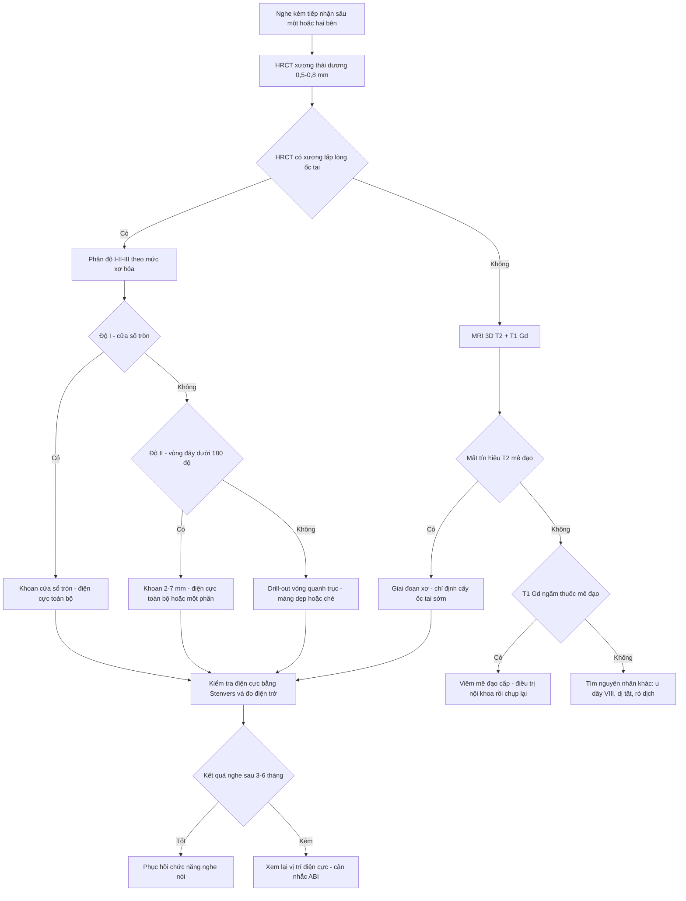
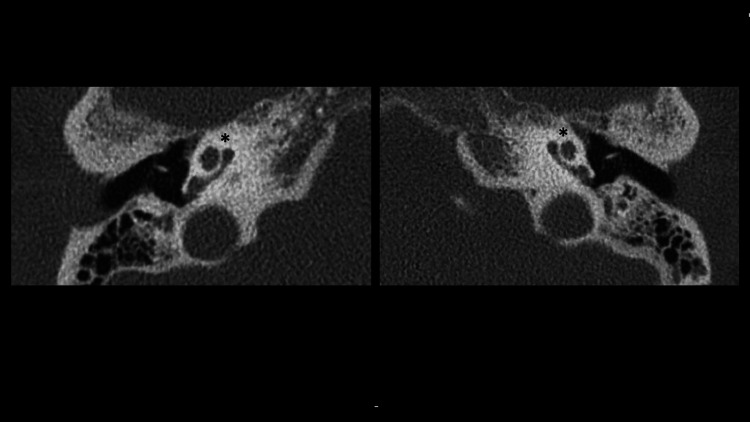
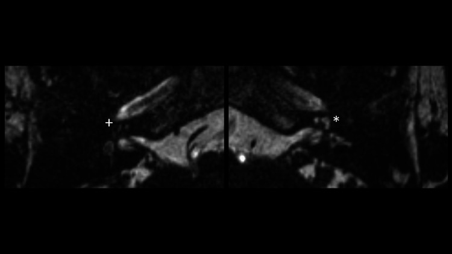
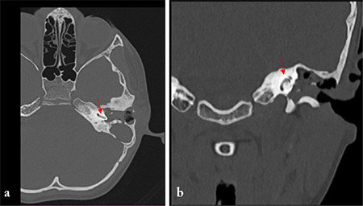
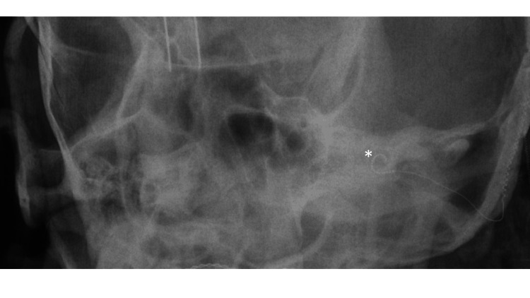
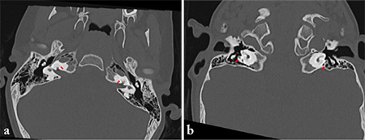

# 205 — Xơ hóa mê đạo sau viêm mê nhĩ & cấy ốc tai / Labyrinthitis ossificans & cochlear implantation

**Tags:** `pattern:xo-hoa-me-dao` `pattern:mat-tin-hieu-T2` `pattern:nghe-kem-tiep-nhan` `vung:tai-trong` `vung:xuong-thai-duong` `score:ossification-stage` `protocol:HRCT-xuong-thai-duong` `protocol:MRI-T2-3D`
**Mức chắc chắn (certainty):** tổng hợp y văn (literature synthesis) — gom loạt 54 ốc tai xơ hóa đã cấy điện cực (Tokat T et al., *J Int Adv Otol* 2022, PMC9449912), 3 ca theo căn nguyên kèm hình ảnh (Tạp chí *Turk Arch Otorhinolaryngol* 2023, PMC11110085), ca hậu cắt lách–viêm màng não (Kamkari N et al., *Cureus* 2023, PMC9985465), ca so sánh MRI–HRCT (Vyas S et al., *J Neurosci Rural Pract* 2016, PMC4821957) và ca xơ hóa tiến triển giả dị tật bẩm sinh (Laridi A et al., *Radiol Case Rep* 2026, PMC12554901).

## 1. Tổng quan bệnh học – cơ chế hình ảnh: từ viêm mê đạo đến xương mới trong ốc tai

- **Viêm mê đạo (labyrinthitis)** là viêm màng mê đạo, thường do nhiễm trùng; hậu quả cuối là **xơ hóa mê đạo (labyrinthitis ossificans — LO)**: mô xơ rồi xương mới lấp lòng mê đạo màng, gây **nghe kém tiếp nhận sâu không hồi phục**.
- **Ba giai đoạn mô bệnh – ba kiểu hình ảnh (chốt để không bỏ sót):**
  1. **Cấp (acute):** viêm, tăng tưới máu màng não — **CT bình thường**, **MRI T1 sau gadolinium thấy ngấm thuốc mê đạo**.
  2. **Xơ (fibrous):** mô xơ thay dịch nội dịch — **CT vẫn bình thường**, **MRI mất tín hiệu T2 của dịch mê đạo**. Đây là "cửa sổ vàng" để chẩn đoán trước khi cốt hóa.
  3. **Cốt hóa (ossification):** xương mới thay màng mê đạo — **HRCT thấy xương lấp lòng ốc tai/bán khuyên**, MRI mất tín hiệu T2 tương ứng.
- **TẠI SAO mất tín hiệu T2 lại đi trước CT:** tín hiệu T2 của tai trong đến từ **dịch (nội dịch/perilymph)**; chỉ cần mô xơ thay dịch là mất tín hiệu, **trong khi Canxi chưa đủ để tăng đậm độ trên CT**. Vì vậy **CT bình thường KHÔNG loại trừ LO giai đoạn sớm** (Vyas 2016, PMC4821957: MRI phát hiện tổn thương xơ ở ốc tai, tiền đình và bán khuyên mà HRCT còn bình thường).
- **Đường lan quyết định vị trí xơ hóa:**
  - Từ **khoang dưới nhện qua ống ốc tai (cochlear aqueduct)** → viêm/xơ hóa **bắt đầu và nặng nhất ở vòng đáy ốc tai**, thường **hai bên**.
  - Từ **ống tai trong (internal auditory canal — IAC)** → tổn thương **vòng 1–2** rõ hơn.
  - Từ **tai giữa (tympanogenic)** — cholesteatoma/viêm tai xương chũm ăn vào mê đạo → **vòng đáy và bán khuyên bên** hay bị nhất, thường **một bên**.
  - Sau **chấn thương xương đá** (đặc biệt vỡ làm tổn thương vỏ mê đạo) cũng có thể dẫn tới LO.
- **Ngưỡng định lượng trụ cột:**
  - **Thời gian:** xơ hóa có thể bắt đầu **3 tuần** sau viêm mê đạo mủ và tiến triển tới **9 tháng**.
  - **Viêm màng não vi khuẩn:** **5%** trẻ bị nghe kém sâu; tới **80%** phát triển một mức xơ hóa mê đạo.
  - **Viêm tai xương chũm/cholesteatoma (tympanogenic):** **2%** trong loạt 195 bệnh nhân được mổ xương chũm (trích trong PMC11110085).
  - **Tỷ lệ trong dân số cấy ốc tai:** **54/2.154 ca (2,5%)** có ốc tai xơ hóa trong loạt 1998–2019 (PMC9449912); căn nguyên: **viêm màng não 24/54 (44%)**, **viêm tai mạn 19/54 (35%)**, **xơ cứng tai 10/54 (19%)**, Cogan 1.
  - **Mức độ xơ hóa quyết định kết quả:** CAP-II trung bình **8,3** (chỉ xơ hóa cửa sổ tròn) → **6,7** (xơ hóa vòng đáy ≤ 180°) → **6,5** (xơ hóa toàn bộ); SIR **4,6 / 4,1 / 4,0** (PMC9449912).
- **TẠI SAO cấy ốc tai vẫn hiệu quả:** điện cực kích thích **tế bào hạch xoắn (spiral ganglion cells)** còn sống; xơ hóa chỉ chặn đường vào, không xóa toàn bộ tế bào. Số tế bào hạch lý tưởng cho nghe hữu ích là **~3.500**, nhưng phân tích gộp **không chứng minh tương quan giữa số tế bào hạch và kết quả nghe–nói** sau cấy (Cheng & Svirsky, trích trong PMC11110085) — nên **không dùng mức xơ hóa để tiên đoán tuyệt đối**.

## 2. Mẫu hình + chẩn đoán phân biệt theo vị trí (Gamut)

- **Theo số bên:**
  - **Hai bên:** hậu **viêm màng não**, bệnh hệ thống/ tự miễn (Cogan), di truyền.
  - **Một bên:** **tympanogenic** (cholesteatoma, viêm tai mạn), **sau chấn thương**, sau phẫu thuật xương thái dương.
- **Theo vị trí trong mê đạo:**
  - **Ốc tai (cochlea):** vòng đáy (đường ống ốc tai) → vòng giữa → đỉnh; xơ hóa toàn bộ = "ốc tai đặc".
  - **Tiền đình (vestibule):** vôi hóa vách, mất tín hiệu T2; thường kèm ốc tai.
  - **Bán khuyên (semicircular canals):** hay bị trong mọi căn nguyên, **có thể không có triệu chứng tiền đình** dù đã xơ hóa (Laridi 2026, PMC12554901).
- **Theo hình thái trên HRCT:**
  - **Xơ hóa cửa sổ tròn (round window ossification — RWO)** — mức nhẹ nhất, còn lòng ốc tai.
  - **Xơ hóa vòng đáy (basal turn ossification — BTO)** ≤ 180° hoặc lan > 180°/nhiều vòng.
  - **Xơ hóa hoàn toàn (complete obliteration)** — không còn lòng ốc tai thông.
- **Gamut "mất tín hiệu T2 tai trong":** LO (xơ/cốt hóa) · **viêm mê đạo cấp** (ngấm thuốc, dịch) · **dị tật bẩm sinh Michel/ốc tai không phát triển** · **xơ cứng tai thể ốc tai (cochlear otosclerosis)** · **u bao dây thần kinh tiền đình ốc tai (vestibular schwannoma)** lớn · **rò dịch mê đạo/chấn thương** · **cholesteatoma có đường rò vào mê đạo** (thường một bên, có khối mô mềm).
- **Mnemonic "LOOP":** **L**abyrinthitis (viêm mê đạo) — **O**ssification (xơ hóa) — **O**ne/bilateral theo căn nguyên — **P**rofound SNHL (nghe kém sâu) + **P**re-cochlear implant planning.

## 3. Bảng so sánh phân biệt (ma trận đối chiếu)

| Thực thể (entity) | Hình ảnh điển hình | Chốt vào (rule-in) | Chốt loại (rule-out) | Gợi ý xác nhận |
|---|---|---|---|---|
| **LO hậu viêm màng não** | HRCT: xương lấp vòng đáy ± toàn bộ ốc tai, **hai bên**; MRI 3D T2: mất tín hiệu dịch ở vòng đáy/tiền đình, **có thể còn tín hiệu ở đỉnh** | **Tiền sử viêm màng não + nghe kém sâu hai bên + mất tín hiệu T2 vùng ốc tai** | Tín hiệu T2 **bình thường đối xứng** + không có tiền sử → ít nghĩ LO | MRI 3D T2 lát mỏng + HRCT 0,5–0,8 mm |
| **LO thể tympanogenic** | HRCT: xơ hóa **một bên**, kèm **mòn xương con/scutum**, khối mô mềm tai giữa; MRI: mất T2 + ngấm thuốc mê đạo | **Bệnh tai giữa mạn/cholesteatoma cùng bên + xơ hóa một bên** | Tai giữa **sạch, đối xứng**, không mòn xương → tìm căn nguyên khác | Soi tai + HRCT + MRI; sinh thiết nếu có khối |
| **Xơ cứng tai thể ốc tai (cochlear otosclerosis)** | HRCT: **ổ giảm đậm độ quanh vỏ ốc tai (halo)** trước khi cốt hóa; MRI: mất T2 khu trú, thường **không lan toàn mê đạo** | **Nghe kém dẫn truyền/hỗn hợp + ổ thấu quang quanh ốc tai + tiền sử gia đình** | Xơ hóa **toàn bộ** mê đạo + mất T2 lan rộng → LO; **CT có vôi hóa lấp lòng** → LO | HRCT cửa sổ xương + audiometry |
| **Dị tật Michel/ốc tai không phát triển** | HRCT: **không có ốc tai (cochlear aplasia)**, xương đá dày đặc; MRI: không thấy mô mê đạo | **Bẩm sinh, nghe kém từ nhỏ, không có cấu trúc ốc tai trên mọi lát** | Còn **một phần ốc tai/vòng đáy** + tiền sử nhiễm trùng → LO, **không phải Michel** | MRI 3D T2 + HRCT; đối chiếu tuổi/tiền sử |
| **Viêm mê đạo cấp** | MRI T1 sau Gd: **ngấm thuốc mê đạo**; T2 còn dịch (có thể hơi giảm); CT bình thường | **Đau tai/sốt/ù tai + ngấm thuốc T1 + CT bình thường** | Mất T2 **lan rộng, không ngấm thuốc** → giai đoạn xơ/cốt hóa | MRI T1 Gd thì sớm |
| **U dây VIII (vestibular schwannoma)** | Khối **ống tai trong/góc cầu–tiểu não**, ngấm thuốc mạnh, **rộng lỗ ống tai trong**; T2 khối thay dịch | **Khối đặc trong IAC + ngấm thuốc + điếc một bên tiến triển** | Mê đạo **mất tín hiệu lan tỏa, không có khối** → LO | MRI T1 Gd + T2 3D |
| **Cholesteatoma rò mê đạo** | HRCT: khối mô mềm thượng nhĩ + **mòn vỏ mê đạo (labyrinthine fistula)**; DWI non-EPI sáng | **Khối DWI sáng + mòn vỏ ốc tai/bán khuyên** | DWI âm + xơ hóa lan tỏa → LO | MRI non-EPI DWI + HRCT |

## 4. Protocol chụp + phân độ xơ hóa & quyết định cấy ốc tai

- **HRCT xương thái dương:** lát **0,5–0,8 mm**, tái tạo **axial + coronal** (thêm **Pöschl/Stenvers** khi cần), cửa sổ **xương**; đọc **cửa sổ tròn → vòng đáy → vòng giữa/đỉnh → tiền đình → bán khuyên**, so **hai bên**. Lưu ý **hiệu ứng thể tích một phần** ở ốc tai nhỏ.
- **MRI tai trong (bắt buộc khi CT bình thường mà nghe kém sâu):** **3D T2 lát mỏng 0,5–1 mm** (CISS/FIESTA/DRIVE), **T1 trước và sau gadolinium** (tìm viêm hoạt động/khối), **DWI** khi nghi cholesteatoma. Đọc **mất tín hiệu T2** theo từng vòng ốc tai, tiền đình, bán khuyên — đây là dấu hiệu **giai đoạn xơ**, trước khi CT dương tính.
- **Phân độ theo mức xơ hóa (dùng để chọn kỹ thuật mổ, Tokat 2022 — PMC9449912):**
  - **Độ I — xơ hóa cửa sổ tròn (RWO):** mở cửa sổ tròn, khoan bỏ xơ tại chỗ, **đặt điện cực toàn bộ** vào thang nhĩ.
  - **Độ II — xơ hóa vòng đáy ≤ 180° (BTO):** **khoan giới hạn 2–7 mm** dọc vòng đáy đã bị lấp; đặt điện cực **toàn bộ hoặc một phần**.
  - **Độ III — xơ hóa > 180°/toàn bộ ốc tai:** **khoan vòng quanh trục ốc tai (circumodiolar drill-out)**; điện cực chỉ đặt **một phần**; có thể dùng **mảng điện cực dẹp (compressed array) hoặc mảng đôi/chẻ (split/double array)**.
- **Kỹ thuật drill-out kinh điển (Balkany):** khoan **6–8 mm** để đủ chỗ cho **4–8 điện cực**; nếu thang nhĩ tắc hoàn toàn có thể **đặt vào thang tiền đình (scala vestibuli)** qua cochleostomy trước–trên cửa sổ tròn.
- **Kết quả định lượng (PMC9449912):** đặt toàn bộ điện cực **35/54 (65%)**, một phần **19/54 (35%)**; **không có biến chứng phẫu thuật** trong loạt; CAP-II giảm dần theo độ xơ hóa (**8,3 → 6,7 → 6,5**) và **viêm màng não cho kết quả kém hơn** xơ cứng tai/viêm tai mạn (SIR 4,0 so với 4,7; p = 0,016).
- **Thời điểm – nguyên tắc:** **không chờ** khi đã nghe kém sâu hai bên và hình ảnh có xơ hóa, vì quá trình tiến triển **3 tuần–9 tháng**; **hội chẩn sớm với tai–thần kinh** để lên kế hoạch điện cực/đường vào. (Khuyến cáo "mổ sớm trong vài tháng" là **suy luận thực hành** từ động học bệnh, chưa có thử nghiệm lâm sàng so sánh thời điểm.)
- **Tư vấn thính lực – giới hạn:** xơ hóa toàn bộ/viêm màng não có **tiên lượng kém hơn**; nếu cấy ốc tai thất bại hoặc kết quả kém, **cấy điện cực thân não (auditory brainstem implant — ABI)** là lựa chọn thay thế nhưng hiệu quả **thường thấp hơn** cấy ốc tai.

## 5. Biến thể bình thường và cạm bẫy

- **CT bình thường ở giai đoạn xơ** — cạm bẫy số 1. Ở bệnh nhân nghe kém sâu sau viêm màng não, **MRI 3D T2 là bắt buộc**; bỏ MRI là bỏ mất "cửa sổ vàng" trước khi ốc tai đặc.
- **Xơ hóa tiến triển giả dị tật bẩm sinh:** ca 65 tuổi bị xơ hóa gần toàn bộ ốc tai/tiền đình/bán khuyên, hình ảnh **giống dị tật tai trong bẩm sinh**; chốt nhờ **tiền sử nhiễm trùng tai thời thơ ấu + nghe kém tiến triển một bên + không có triệu chứng tiền đình** (Laridi 2026, PMC12554901). Đừng gán "dị tật" chỉ vì xương đặc.
- **Hiệu ứng thể tích một phần** ở ốc tai (đặc biệt lát 1 mm) có thể **giả xơ hóa** hoặc **che mất xơ hóa nhỏ**; luôn dùng lát mỏng và đối chiếu hai bên.
- **Không có triệu chứng tiền đình không loại trừ xơ hóa bán khuyên:** nhiều ca xơ hóa bán khuyên hoàn toàn vẫn **không chóng mặt** — hỏi tiền sử và đọc hình, không dựa triệu chứng.
- **Sau phẫu thuật xương thái dương:** mảnh xương/mô xơ hậu phẫu có thể **giả xơ hóa**; đọc trên HRCT lát mỏng và so phim cũ.
- **Satisfaction of search:** thấy xơ hóa ốc tai rồi bỏ sót **cholesteatoma** (DWI), **rò dịch não tủy**, **hẹp ống tai trong**, hoặc **xơ cứng tai** kèm theo.
- **Đừng hứa hẹn kết quả theo mức xơ hóa:** mức xơ hóa **tương quan với CAP-II** nhưng không dự đoán được từng ca; tư vấn theo **hai bên, căn nguyên, thời gian điếc** và phục hồi chức năng.

## 6. Tự lượng giá — Blind Quiz

**Ca 1 — Nữ 71 tuổi, cắt lách cách đây hơn 20 năm, viêm màng não do phế cầu 3 tháng trước; nghe kém sâu hai bên. HRCT xương thái dương "bình thường" theo báo cáo ban đầu.**

- Câu hỏi: (1) Vì sao HRCT bình thường vẫn chưa loại trừ xơ hóa mê đạo? (2) Cần chụp gì tiếp? (3) Nếu MRI mất tín hiệu T2 thì giai đoạn nào?

<b>Bấm để hiện đáp án (findings + chẩn đoán)</b>

- **Dấu hiệu:** ốc tai hai bên còn cấu trúc xương, **không thấy xương lấp lòng rõ** — nhưng đây là giai đoạn **xơ**, chưa đủ Canxi để CT dương tính.
- **Chẩn đoán:** **xơ hóa mê đạo giai đoạn xơ (fibrous stage)** sau viêm màng não; MRI là chốt.
- **Bước tiếp:** MRI **3D T2 lát 0,5–1 mm** + **T1 sau gadolinium**; nếu mất tín hiệu T2 → chỉ định **cấy ốc tai sớm**, không chờ CT.
- **Nguồn ảnh:** Kamkari N et al., *Cureus* 2023, PMC9985465 Fig. 2, CC BY 4.0.

**Ca 2 — Cùng bệnh nhân. MRI T2 lát mỏng tai trong.**

- Câu hỏi: (1) Mô tả tín hiệu T2 hai bên? (2) Vì sao bên phải nặng hơn? (3) Điện cực có vào được không?

<b>Bấm để hiện đáp án (findings + chẩn đoán)</b>

- **Dấu hiệu:** **mất hoàn toàn tín hiệu T2 dịch ốc tai bên phải (+)**; **mất một phần tín hiệu vòng đáy bên trái (*)** — xơ hóa **bất đối xứng**.
- **Vì sao:** đường lan qua **ống ốc tai** làm vòng đáy tổn thương trước/nặng nhất; mức xơ hóa hai bên có thể khác nhau dù cùng một đợt viêm màng não.
- **Điện cực:** vẫn cấy được — ca này **cấy tai trái** (xơ hóa một phần vòng đáy, đặt qua cửa sổ tròn); tai phải xơ hóa hoàn toàn sẽ cần **drill-out** nếu cấy; kiểm tra bằng **phim Stenvers** sau mổ.
- **Nguồn ảnh:** Kamkari N et al., *Cureus* 2023, PMC9985465 Fig. 3, CC BY 4.0.

**Ca 3 — Bé trai 9 tuổi, chảy mủ tai trái 4 năm, nghe kém tiến triển. HRCT xương thái dương.**

- Câu hỏi: (1) Vị trí xơ hóa? (2) Phân độ nào? (3) Kỹ thuật mổ phù hợp?

<b>Bấm để hiện đáp án (findings + chẩn đoán)</b>

- **Dấu hiệu:** **xương lấp vòng đáy ốc tai trái** (mũi tên đỏ); lát coronal cho thấy **vòng giữa/đỉnh xơ hóa nhiều hơn vòng đáy** — xơ hóa không đồng đều, kèm **mòn xương con** do cholesteatoma.
- **Chẩn đoán:** **LO thể tympanogenic (một bên)** trên nền cholesteatoma/viêm tai xương chũm mạn; mức **độ II–III**.
- **Kỹ thuật:** **khoan giới hạn 2–7 mm** dọc vòng đáy để lấy lòng; đặt điện cực toàn bộ/một phần; nếu tắc hoàn toàn → **drill-out** hoặc **thang tiền đình**; phải **xử lý ổ cholesteatoma** cùng lúc (không đặt điện cực vào tai còn nhiễm trùng hoạt động).
- **Nguồn ảnh:** *Turk Arch Otorhinolaryngol* 2023, PMC11110085 Fig. 1, CC BY-NC 4.0.

**Ca 4 — Bệnh nhân ca 1–2 sau cấy ốc tai: kiểm tra vị trí điện cực.**

- Câu hỏi: (1) Điện cực có nằm trong ốc tai không? (2) Vì sao phải chụp phim này? (3) Dấu hiệu nào cho biết đặt toàn bộ?

<b>Bấm để hiện đáp án (findings + chẩn đoán)</b>

- **Dấu hiệu:** dải điện cực **uốn theo vòng ốc tai trái (*)**, không ra ngoài vỏ ốc tai.
- **Vì sao:** **Stenvers cải biên** là tư thế chuẩn để xác nhận điện cực vào đúng ốc tai (đặc biệt khi đã drill-out), phát hiện gập/ra ngoài.
- **Đặt toàn bộ:** đầu điện cực **tới đỉnh ốc tai** trên phim; đối chiếu với số điện cực hoạt động trên đo điện trở.
- **Nguồn ảnh:** Kamkari N et al., *Cureus* 2023, PMC9985465 Fig. 4, CC BY 4.0.

**Ca 5 — Bé gái 4 tuổi, chấn thương đầu, nghe kém sâu hai bên; HRCT và MRI tai trong.**

- Câu hỏi: (1) Mức xơ hóa? (2) Tiên lượng cấy ốc tai? (3) Phương án nếu kết quả kém?

<b>Bấm để hiện đáp án (findings + chẩn đoán)</b>

- **Dấu hiệu:** **xương lấp toàn bộ ốc tai hai bên** + xơ hóa nhẹ bán khuyên — **độ III**.
- **Tiên lượng:** điện cực chỉ đặt **một phần**; CAP-II thấp hơn nhóm độ I (6,5 so với 8,3 trong loạt 54 ca) — cần tư vấn kỹ.
- **Nếu kém:** xem lại vị trí điện cực/đo điện trở; cân nhắc **ABI** (hiệu quả thường thấp hơn cấy ốc tai).
- **Nguồn ảnh:** *Turk Arch Otorhinolaryngol* 2023, PMC11110085 Fig. 6, CC BY-NC 4.0.

## Bài liên quan chéo
- [237 – Biến chứng thần kinh sọ của viêm tai: Gradenigo, liệt dây VII, viêm mê nhĩ](../237-bien-chung-than-kinh-so-viem-tai-gradenigo/lesson.md) (viêm mê nhĩ cấp — giai đoạn trước xơ hóa)
- [233 – Viêm tai ngoài ác tính & viêm xương nền sọ](../233-viem-tai-ngoai-ac-tinh-nen-so/lesson.md) (phân biệt viêm xương/viêm mê đạo)
- [720 – Xương đá & cholesteatoma](../720-temporal-bone-cholesteatoma/lesson.md) (cholesteatoma gây LO một bên, non-EPI DWI)
- [235 – Xương thái dương & xoang: cholesteatoma DWI + nấm vs u](../235-xuong-thai-duong-xoang/lesson.md)
- [700 – Tổng quan Đầu Mặt Cổ](../700-head-neck-overview/lesson.md)

## Ảnh
- `images/205_xo-hoa-me-dao_CT_Cureus-PMC9985465-Fig2.jpg`, `..._MRI-T2_...Fig3.jpg`, `..._XR-Stenver_...Fig4.jpg` — Kamkari N et al., *Cureus* 2023, PMC9985465, **CC BY 4.0**.
- `images/205_xo-hoa-me-dao_HRCT_TurkArch-PMC11110085-Fig1.jpg`, `...Fig6.jpg`, `..._MRI-T2_...Fig7.jpg`, `..._PT_...Fig8.jpg` — *Turk Arch Otorhinolaryngol* 2023, PMC11110085, **CC BY-NC 4.0** (giữ nguyên, không crop/ghép).
- Chi tiết giấy phép từng file: `images/CREDITS.md`.

> Không dùng để chẩn đoán độc lập khi chưa có người hướng dẫn.
