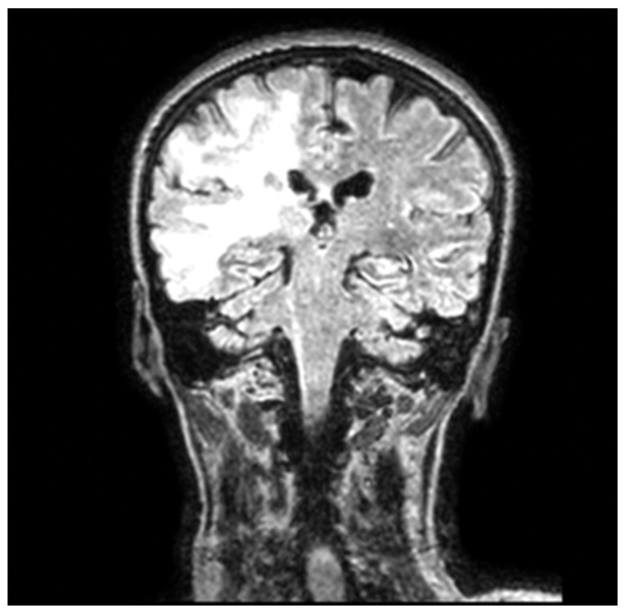
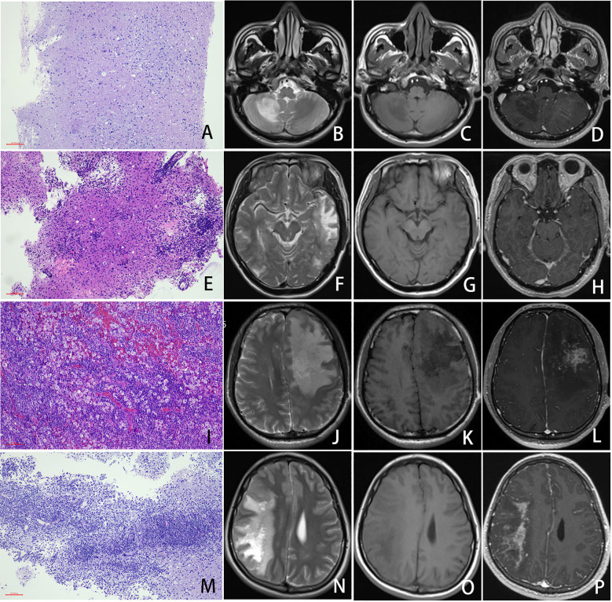
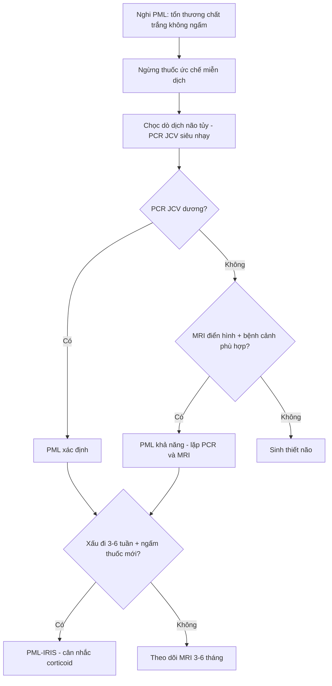

# 206 — PML & hội chứng viêm phục hồi miễn dịch (IRIS) / Progressive multifocal leukoencephalopathy and PML-IRIS

**Tags:** `pattern:ton-thuong-chat-trang` `pattern:khong-ngam` `vung:nao` `vung:chat-trang` `protocol:MRI-DWI` `protocol:MRI-T1-Gd` `score:PML-2013`
**Mức chắc chắn (certainty):** tổng hợp y văn (literature synthesis) — gộp 3 bài mở (PMC12425872, PMC12245874, PMC12441267) + 1 loạt ca AIDS–PML (PMC12897592); chưa có ca nguyên văn của nhóm.

## 1. Tổng quan — vì sao PML "im lặng" trên ảnh và chỉ "bùng" khi miễn dịch trở lại

- **Bệnh học:** virus JC (JCPyV — *John Cunningham polyomavirus*) tái hoạt ở người suy giảm miễn dịch, **nhiễm tan tế bào oligodendrocyte** → mất myelin từng ổ, không đối xứng; tế bào astrocyte phì đại kỳ quái (bizarre astrocytes) là dấu mô bệnh. Mô bệnh 19 ca AIDS–PML: **63,2% (12/19) có CD4+ < 200 tế bào/µL**, phần còn lại vẫn có CD4+ ≥ 200.
- **TẠI SAO không ngấm thuốc và không có hiệu ứng khối:** tổn thương **mất myelin + phù nội bào nhẹ nhưng hàng rào máu–não còn nguyên**, viêm quanh mạch ít → gadolinium không thoát ra ngoài lòng mạch. Vì vậy **"không ngấm" là dấu hiệu của PML sớm, không phải bằng chứng loại trừ**. Khi có **ngấm thuốc** thì thường là **thành phần viêm (IRIS)** hoặc PML đang hoạt động mạnh; loạt 19 ca cho thấy mức viêm quanh mạch, có tương bào và mảng lympho quanh mạch **tương quan có ý nghĩa với ngấm thuốc** (P = 0,044; 0,011; 0,018).
- **TẠI SAO T2/FLAIR sáng và T1 tối:** mất myelin + tăng nước mô kẽ kéo dài T2 → **FLAIR tăng tín hiệu lan tỏa, bờ không rõ, không theo mạch máu**; T1 giảm tín hiệu vì mô mất cấu trúc myelin. Không có xuất huyết, không có vôi hóa — khác nhồi máu và u.
- **TẠI SAO DWI chỉ sáng ở BỜ tổn thương:** ở **rìa đang lan**, oligodendrocyte bị nhiễm và phù nội bào → **hạn chế khuếch tán (DWI sáng, ADC thấp)**; ở **trung tâm đã mất myelin hoàn toàn**, khoảng nước ngoại bào tăng → **ADC cao (T2 shine-through)**. Vì vậy bờ DWI sáng là **"mặt trận" virus đang tiến**, còn trung tâm sáng trên DWI có thể chỉ là hiệu ứng T2.
- **Ngưỡng định lượng cốt lõi:**
  - **Nguy cơ natalizumab (nhóm TOP, n = 6148):** 53 ca PML (**0,9%** trong 10 năm) = **2,034/1000 bệnh nhân–năm**; tại Thụy Điển giảm từ **1,49/1000 PY (2012) → 0,72/1000 PY (2018)** nhờ phân tầng nguy cơ.
  - **3 yếu tố nguy cơ:** kháng thể JCV dương, **đã dùng ức chế miễn dịch trước đó**, **thời gian dùng > 24 tháng**.
  - **PCR JCV trong dịch não tủy** bằng kỹ thuật siêu nhạy: **độ nhạy > 95%**; **âm tính giả** gặp khi miễn dịch đang phục hồi (virus đã bị thanh thải).
  - **Dấu "shrimp sign"** (tổn thương chất trắng tiểu não): **độ nhạy 85%, độ đặc hiệu 100%** cho PML tiểu não.
  - **Động kinh** chỉ gặp **< 20%** ca PML có tổn thương vỏ não.
- **Điểm mấu chốt lâm sàng:** PML **không có thuốc kháng virus đặc hiệu**; điều trị là **phục hồi miễn dịch** (ngừng thuốc ức chế miễn dịch, ART ở HIV). Ở HIV, **CD4+ > 50 tế bào/µL lúc chẩn đoán gắn với giảm tử vong**. Ở PML do natalizumab, bằng chứng gần đây cho thấy **trao đổi huyết tương (PLEX) không cải thiện sống còn** → không còn được khuyến cáo thường quy (điểm phản biện với thực hành cũ).

## 2. Mẫu hình + chẩn đoán phân biệt theo vị trí (gamut)

- **Mẫu hình chung:** nhiều ổ **bất đối xứng, hai bên nhưng không cân xứng**, lan **liền nhau (confluent)**, **tôn trọng chất trắng dưới vỏ (subcortical U-fibers)**, bờ không rõ, **không hiệu ứng khối hoặc rất nhẹ**, **không ngấm thuốc** giai đoạn sớm, tiến triển trong vài tuần–vài tháng.
- **Theo vị trí:**
  - **Chất trắng dưới vỏ/U-fibers (subcortical):** PML, ADEM, hạ đường huyết, ngộ độc thuốc, bệnh mạch máu nhỏ.
  - **Quanh não thất (periventricular):** MS (Dawson fingers, vuông góc với não thất), bệnh mạch máu nhỏ, HIV encephalopathy, CADASIL.
  - **Thể chai (corpus callosum):** PML, MS, u lympho nguyên phát TKTW ("butterfly"), Marchiafava–Bignami.
  - **Tiểu não/thân não:** PML (shrimp sign), MS, u sao bào, bệnh tạo xơ.
  - **Vỏ não (cortex) đơn thuần:** JC virus encephalopathy (JCVE) — rất hiếm, khác PML chất trắng.
- **Gamut "tổn thương chất trắng KHÔNG ngấm + KHÔNG khối":** PML · HIV encephalopathy · CADASIL · bệnh chất trắng do độc chất/thuốc · hạ đường huyết · xơ hóa chất trắng sau xạ (muộn) · thiếu máu não mạn.
- **Gamut "ngấm thuốc + khối" khi đang theo dõi PML:** **PML-IRIS** (viêm phục hồi) · tái phát MS · u lympho · nhồi máu bán cấp · hoại tử phóng xạ.
- **Mnemonic "PML" — *Progressive, Myelin, Lytic*:** tiến triển nhanh vài tuần, mất myelin, nhiễm tan oligodendrocyte; không sốt, không tăng bạch cầu máu, không tăng men gan.

## 3. Bảng so sánh phân biệt (ma trận đối chiếu)

| Thực thể (entity) | Hình ảnh điển hình | Chốt vào (rule-in) | Chốt loại (rule-out) | Gợi ý xác nhận |
|---|---|---|---|---|
| **PML** | FLAIR: ổ bất đối xứng chất trắng dưới vỏ, bờ không rõ, **không ngấm**, không khối; DWI sáng ở rìa | **Bất đối xứng + U-fibers + không ngấm + tiến triển vài tuần** | Ngấm thuốc mạnh + khối rõ + bờ tròn đều → nghĩ u/áp-xe | MRI + LP PCR JCV siêu nhạy; sinh thiết nếu PCR âm mà ảnh điển hình |
| **PML-IRIS** | Tổn thương PML cũ **to ra, phù, hiệu ứng khối, ngấm thuốc dạng vá** sau khi giảm ức chế miễn dịch | **Xấu đi 3–6 tuần sau ngừng thuốc/PLEX hoặc bắt đầu ART + ngấm thuốc mới** | Xấu đi mà **không ngấm, không phù** → PML tiến triển đơn thuần | MRI lặp lại + CD4/viral load; corticoid khi có khối/chèn ép |
| **MS tái phát (tumefactive)** | Ổ quanh não thất, **Dawson fingers**, bờ tương đối rõ, ngấm **vòng hở** | **Ngấm thuốc + vị trí quanh não thất + tuổi trẻ + tiền sử MS** | Không ngấm + chất trắng dưới vỏ + tiến triển đều → PML | MRI 3 tháng/lần; JCV kháng thể; LP (bạch cầu, band) |
| **ADEM** | Đa ổ chất trắng + **đồi thị/nền**, sau nhiễm/sau tiêm; **ngấm thuốc thường gặp** | **Khởi phát sau nhiễm 1–3 tuần + ngấm thuốc + đáp ứng corticoid** | Không ngấm, tiến triển chậm không liên quan nhiễm trùng → PML | MRI sọ + tủy; LP; đáp ứng corticoid |
| **HIV encephalopathy** | **Đối xứng quanh não thất**, teo não, không ngấm, không khối | **Đối xứng + teo não + HIV giai đoạn muộn** | Bất đối xứng + U-fibers → PML | MRI + CD4 + viral load; loại trừ PML bằng PCR |
| **CADASIL** | Ổ dưới vỏ **đối xứng**, **thùy thái dương trước + nang chêm**, không ngấm | **Tiền sử gia đình + đột quỵ lặp + thùy thái dương trước** | Bất đối xứng, tiến triển nhanh vài tuần → PML | MRI + gen NOTCH3; không cần sinh thiết |
| **Hoại tử phóng xạ** | Ổ trong **trường chiếu xạ**, phù, ngấm **"swiss cheese"**, có thể khối | **Nằm đúng liều xạ, xuất hiện 6–24 tháng sau xạ** | Ngoài trường xạ, không tiền sử xạ → không phải | MRI phổ/choline; PET; so phim xạ |
| **U lympho nguyên phát TKTW** | Khối quanh não thất, **ngấm đồng nhất mạnh**, DWI rất sáng (ADC thấp) | **Ngấm mạnh + DWI sáng toàn khối + đáp ứng corticoid nhanh** | Không ngấm, không khối → không phải | Sinh thiết; PET; LP tế bào học |

*Coronal FLAIR: **ổ tăng tín hiệu lớn, bất đối xứng ở chất trắng dưới vỏ và quanh não thất bán cầu trái** (bên phải ảnh), **không hiệu ứng khối, không ngấm thuốc** — mẫu hình kinh điển của PML. Nguồn: *J Clin Med* 2026, PMC12897592 Fig. 1, CC BY 4.0.*

*Bốn hàng = bốn mức viêm (A–D nhẹ, E–H trung bình, I–L nặng, M–P **PML-IRIS**); cột trái là mô bệnh, ba cột phải là **T2 / T1 / T1 sau gadolinium**. Hàng M–P: tổn thương lan rộng, **phù và hiệu ứng khối rõ, ngấm thuốc dạng vá mạnh** — khác hẳn hàng A–D (không ngấm). Nguồn: *Front Cell Infect Microbiol* 2025, PMC12245874 Fig. 3, CC BY 4.0.*

## 4. Protocol chụp + tiêu chuẩn chẩn đoán 2013

- **MRI sọ (1,5–3 T), tối thiểu 4 chuỗi:** **T2/FLAIR** (lan tỏa, bờ), **DWI + ADC** (rìa đang hoạt động), **T1 trước tiêm**, **T1 sau gadolinium** (tìm ngấm = viêm/IRIS). Không cần CT; CT chỉ để loại trừ xuất huyết/chèn ép cấp.
- **Thời điểm chụp:** lúc nghi ngờ, lặp lại **3–6 tháng/lần** khi theo dõi; **ngay khi xấu đi sau khi giảm ức chế miễn dịch** (tìm IRIS).
- **Xét nghiệm:** **PCR JCV định lượng trong dịch não tủy** (kỹ thuật siêu nhạy, độ nhạy > 95%); tế bào/bạch cầu, protein, glucose, cytology, PCR HSV/VZV/CMV, HIV; **JCV kháng thể huyết thanh + chỉ số (index)** ở bệnh nhân MS dùng natalizumab.
- **Sinh thiết não:** khi **PCR âm nhưng ảnh điển hình** hoặc chẩn đoán không chắc; loạt 19 ca AIDS–PML có **16 ca qua sinh thiết** — mô bệnh vẫn là chuẩn vàng.
- **Tiêu chuẩn đồng thuận 2013 (Berger và cộng sự):**

| Mức chẩn đoán | Điều kiện |
|---|---|
| **Chắc chắn (definitive)** | Lâm sàng phù hợp **+** hình ảnh phù hợp **+** PCR JCV dịch não tủy dương |
| **Nhiều khả năng (probable)** | PCR dương **+** chỉ có lâm sàng **hoặc** chỉ có hình ảnh |
| **Có thể (possible)** | PCR dương đơn thuần **hoặc** PCR âm nhưng có **cả** lâm sàng và hình ảnh phù hợp |
| **Không PML** | Chỉ có một tiêu chuẩn lâm sàng hoặc hình ảnh |

- **Theo dõi bệnh nhân MS dùng natalizumab:** xét nghiệm **JCV index mỗi 6 tháng**, MRI sọ **6–12 tháng/lần**, đánh giá lại nguy cơ sau **24 tháng** điều trị (nguy cơ tăng theo thời gian).
- **Xử trí PML-IRIS:** **không ngừng corticoid ngay** khi đang có khối; corticoid liều trung bình–cao khi có **phù/chèn ép/ngấm thuốc nhiều**; theo dõi sát vì IRIS có thể gây tử vong dù bản thân PML đã ngừng tiến triển.

## 5. Biến thể bình thường và cạm bẫy

- **Biến thể bình thường dễ nhầm:** **khoảng quanh mạch (perivascular spaces) giãn** quanh hạch nền — dịch, không ngấm, không tiến triển; **thay đổi chất trắng tuổi già** đối xứng, không lan nhanh.
- **Cạm bẫy 1 — "không ngấm là không viêm":** PML sớm **không ngấm**; ngấm thuốc chỉ xuất hiện khi có viêm (IRIS). Đừng loại PML vì thiếu ngấm.
- **Cạm bẫy 2 — đọc DWI sai:** chỉ **rìa** tổn thương hạn chế khuếch tán; trung tâm có thể **ADC cao**. Nếu chỉ nhìn DWI sáng trung tâm sẽ tưởng nhồi máu/u.
- **Cạm bẫy 3 — PCR âm:** gặp ở **natalizumab** (tải lượng virus thấp) và khi **miễn dịch đang phục hồi**; PCR âm **không loại trừ** nếu ảnh điển hình → lặp PCR/sinh thiết.
- **Cạm bẫy 4 — IRIS vs tiến triển:** sau ngừng thuốc/PLEX **3–6 tuần**, tổn thương to ra + phù + ngấm = **IRIS**, không phải "PML nặng hơn"; điều trị ngược nhau (corticoid vs không).
- **Cạm bẫy 5 — U-fibers:** PML **ăn tới vỏ não** qua U-fibers (khác nhồi máu theo lãnh thổ mạch và khác MS quanh não thất). Đây là dấu định vị mạnh.
- **Cạm bẫy 6 — "shrimp sign" không phổ biến:** chỉ có ở PML tiểu não; **không thấy dấu này không loại trừ** PML.
- **Cạm bẫy 7 — thỏa mãn tìm kiếm:** bệnh nhân HIV có teo não + tổn thương chất trắng → dễ gán "HIV encephalopathy" và bỏ sót PML bất đối xứng.

## 6. Tự lượng giá — Blind Quiz

**Ca 1 — Nam 52 tuổi, HIV dương, yếu nửa người trái tiến triển 3 tuần, không sốt.**

- Gợi ý: tổn thương lớn, không đối xứng; không có tiền sử chấn thương.
- Câu hỏi: Mô tả vị trí và mức lan của tổn thương? Có hiệu ứng khối không? Ba chẩn đoán phân biệt và dấu hiệu nào chốt hướng PML?

<b>Bấm để hiện đáp án (findings + chẩn đoán)</b>

- **Dấu hiệu:** ổ tăng tín hiệu FLAIR lớn ở **chất trắng dưới vỏ + quanh não thất bán cầu trái**, lan tới **U-fibers**, bờ không rõ, **không hiệu ứng khối**, không ngấm thuốc.
- **Chẩn đoán:** **PML** — mất myelin do JCPyV ở người suy giảm miễn dịch; hàng rào máu–não còn nguyên nên **không ngấm**.
- **Ba phân biệt:** HIV encephalopathy (đối xứng, quanh não thất), MS tumefactive (ngấm vòng hở, quanh não thất), u lympho (khối, ngấm mạnh, DWI sáng toàn khối).
- **Chốt:** bất đối xứng + U-fibers + không ngấm + tiến triển vài tuần → **LP PCR JCV**.
- Nguồn: *J Clin Med* 2026, PMC12897592 Fig. 1, CC BY 4.0.

**Ca 2 — Bệnh nhân PML do natalizumab, ngừng thuốc 4 tuần, đau đầu tăng và liệt nặng hơn. Ảnh 4 hàng là 4 mức viêm.**

- Câu hỏi: Hàng nào là **PML-IRIS**? Dấu hiệu nào trên ảnh phân biệt IRIS với PML tiến triển đơn thuần? Vì sao thời điểm 4 tuần lại quan trọng?

<b>Bấm để hiện đáp án (findings + chẩn đoán)</b>

- **Hàng M–P = PML-IRIS:** tổn thương **lan rộng, phù, hiệu ứng khối**, và **ngấm thuốc dạng vá mạnh** trên T1 sau gadolinium (cột P).
- **Phân biệt:** PML tiến triển **không ngấm, không phù, không khối**; IRIS **ngấm + phù + khối** do miễn dịch tấn công ổ virus.
- **Vì sao 4 tuần:** IRIS điển hình xuất hiện **3–6 tuần sau ngừng thuốc ức chế miễn dịch hoặc PLEX** — đúng cửa sổ thời gian này.
- **Xử trí:** corticoid khi có phù/chèn ép; **không** tăng lại ức chế miễn dịch một cách mù quáng.
- Nguồn: *Front Cell Infect Microbiol* 2025, PMC12245874 Fig. 3, CC BY 4.0.

## Bài liên quan chéo
- [200 – Tổng quan hệ Thần kinh](../200-tong-quan-he-than-kinh/lesson.md)
- [214 – Nhiễm trùng hệ thần kinh trung ương](../214-nhiem-trung-tktw/lesson.md)
- [215 – Bệnh mất myelin](../215-mat-myelin/lesson.md)
- [204 – Hoại tử phóng xạ sau xạ trị u não](../204-hoai-tu-phong-xa-sau-xa-tri-u-nao/lesson.md)
- [242 – PACNS: điều trị duy trì và theo dõi tái phát](../242-pacns-duy-tri-theo-doi/lesson.md)

## Ảnh
- `images/206_pml_MRI_PMC12897592.jpg` — FLAIR coronal, PMC12897592 Fig. 1, CC BY 4.0.
- `images/206_pml-iris_MRI_PMC12245874.jpg` — bảng 4 mức viêm (T2/T1/Gd), PMC12245874 Fig. 3, CC BY 4.0.
- Nguồn + giấy phép chi tiết: `images/CREDITS.md`.

> Không dùng để chẩn đoán độc lập khi chưa có người hướng dẫn.
