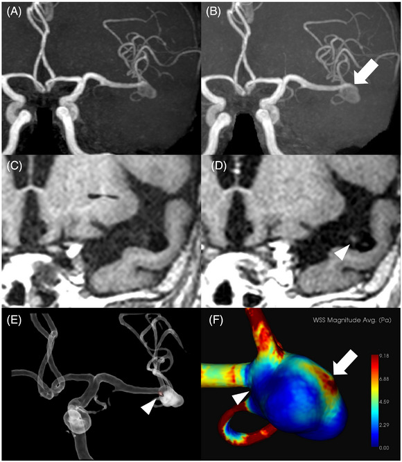
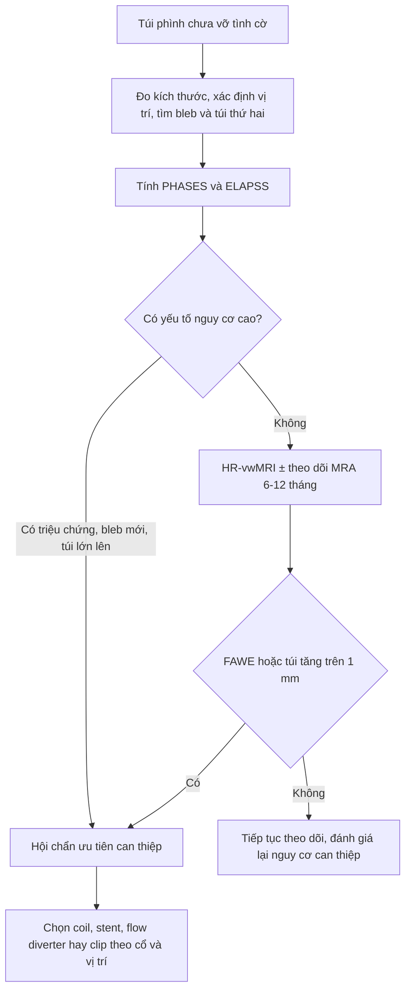
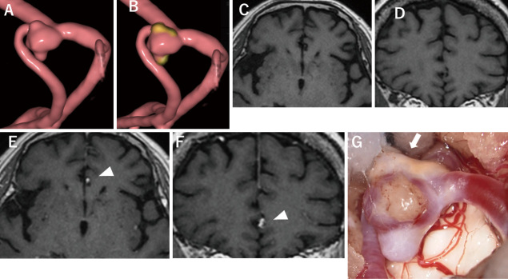

# 207 — Phình mạch nội sọ chưa vỡ: PHASES/ELAPSS/UIATS + ngấm thành trên HR-vwMRI và quyết định điều trị / Unruptured intracranial aneurysm: risk scores, wall enhancement and the treatment decision

**Tags:** `pattern:phinh-mach` `pattern:ngam-thanh-mach` `vung:mach-nao` `score:PHASES` `score:ELAPSS` `score:UIATS` `protocol:CTA-co` `protocol:HR-vwMRI` `protocol:DSA` `incidentaloma:phinh-nao`
**Mức chắc chắn (certainty):** tổng hợp y văn (literature synthesis) — bảng điểm lấy nguyên văn từ bài tổng quan toàn văn mở (PMC12778449: PHASES/ELAPSS/UIATS), số liệu ngấm thành từ nghiên cứu tiến cứu 114 túi phình (PMC12778726), phản biện hiệu lực điểm số từ 2 cohort (PMC12655681, PMC13545608). **Ca trong quiz là ca nguyên văn**, giữ đúng tuổi – giới – mô tả hình ảnh gốc.

> **Câu chốt:** túi phình chưa vỡ **không phải "chẩn đoán" mà là một quyết định**: nguy cơ vỡ (kích thước × vị trí × tuổi/THA/tiền sử SAH/dân số) **so với** nguy cơ của can thiệp (**biến chứng thần kinh thường > 5%** ngay cả ở cohort hiện đại, PMC13545608). Điểm số chỉ là **ngôn ngữ chung để hội chẩn**, không phải bảng tra cứu mệnh lệnh — và **ngấm thành mạch (AWE) chỉ là một mảnh ghép thêm vào quyết định**, không đủ một mình để mổ.

## 1. Tổng quan bệnh học – cơ chế hình ảnh (TẠI SAO)

- **Dịch tễ:** phình mạch nội sọ (intracranial aneurysm) có ở **3–5%** dân số trưởng thành; đa số **không bao giờ vỡ**, nhưng vỡ gây **SAH** với tỷ lệ tử vong/tàn phế cao — vì vậy mọi túi phình tình cờ đều phải **phân tầng**, không phải "cứ thấy là mổ" (PMC12655681).
- **Bệnh học thành túi phình:** mất **lớp đàn hồi trong (internal elastic lamina)**, giảm và thoái hoá **tế bào cơ trơn**, thâm nhiễm đại thực bào/lympho, thành mỏng dần ở đáy túi. Đó là lý do **đáy túi** là nơi hay có **bleb/núm con (daughter sac)** và là nơi vỡ.
- **TẠI SAO kích thước lại quan trọng đến vậy — định luật Laplace:** sức căng thành **T ∝ P × r** (với thành mỏng, chính xác hơn là **T = P·r / 2t**). Bán kính tăng gấp đôi → sức căng gấp đôi; thành mỏng thêm → tăng lần nữa. Vì thế nguy cơ **tăng phi tuyến**: túi **< 7 mm** = 0 điểm, **7,0–9,9 mm** = 3 điểm, **10,0–19,9 mm** = 6 điểm, **≥ 20 mm** = 10 điểm trong PHASES (PMC12778449).
- **TẠI SAO vị trí quan trọng:** thành mạch ở **chạc ba và đoạn có nhánh xiên** mỏng hơn, chịu **lực cắt thành (wall shear stress — WSS)** và **áp lực va đập** lớn hơn. PHASES cho **ICA 0 điểm**, **MCA 2 điểm**, **ACA/PCom/tuần hoàn sau 4 điểm** — phản ánh đúng nguy cơ vỡ cao hơn của **ACom, PCom và tuần hoàn sau**.
- **TẠI SAO ngấm thành mạch (AWE) = dấu hiệu bất ổn:** viêm thành → **tăng tính thấm nội mô** + **tân mạch vasa vasorum** → gadolinium rò vào thành và **giữ lại**; chuỗi **3D T1 "máu đen" (black-blood)** triệt tín hiệu dòng chảy nên chỉ còn thành sáng. Ngấm **khu trú (FAWE)** = ổ viêm khu trú; ngấm **chu vi (CAWE)** thường đi cùng túi lớn/xơ vữa, ý nghĩa tiên lượng kém đồng nhất hơn (PMC12778726).
- **Số liệu then chốt của AWE (114 túi phình chưa vỡ, theo dõi trung vị 34 tháng):**
  - **13/114 (11,4%)** túi lớn lên; **4 túi vỡ** — **cả 4 đều có FAWE**.
  - **FAWE** là yếu tố độc lập dự báo lớn túi: **HR 4,59 (95% CI 1,29–16,3)**; phân tích đơn biến **HR 6,83 (2,15–21,7)** (PMC12778726).
  - **70/76 (92%)** túi **không ngấm** thì **ổn định** trong thời gian theo dõi.
  - Ở nhóm lớn túi: FAWE hình thành **bleb 6/7 (86%)** so với **1/6 (17%)** ở nhóm không ngấm; thời gian từ VWI đến lúc lớn **16 ± 9,2 tháng** (FAWE) so với **38 ± 17 tháng** (không ngấm) (PMC12778726).
  - **Điểm vỡ lại nằm ở vùng KHÔNG ngấm, nơi WSS cao** → AWE báo "túi đang bất ổn", **không phải bản đồ vị trí sẽ vỡ** (PMC12778726).
- **TẠI SAO không được tin tuyệt đối vào điểm số — bằng chứng phản biện:**
  - Cohort **180 túi phình** (103 đã vỡ): PHASES **1,6% ở cả nhóm vỡ và không vỡ**; ELAPSS 5 năm **22,6% vs 20,0%** (không khác biệt); UIATS lại **thiên về bảo tồn ở 56,3%** số túi **đã vỡ**; tuổi là yếu tố độc lập duy nhất (**OR 1,05/năm**) (PMC12655681).
  - **> 50%** túi đã vỡ có kích thước **< 6 mm**, và **79%** ca vỡ có **PHASES < 5** — tức "nguy cơ thấp" theo bảng điểm (PMC13545608).
  - Kết luận thực hành: **điểm số + hình thái + AWE + nguyện vọng/tuổi thọ + nguy cơ can thiệp** → hội chẩn đa chuyên khoa; **không có ngưỡng mm nào tự động quyết định mổ**.

## 2. Mẫu hình + chẩn đoán phân biệt theo vị trí & hình thái (Gamut)

- **Theo hình thái:**
  - **Túi phình dạng túi (saccular)** — phổ biến nhất, có cổ, ở chạc ba.
  - **Bleb/núm con, thuỳ (lobulation)** — dấu hiệu thành mỏng khu trú, **làm tăng nguy cơ** dù kích thước nhỏ.
  - **Phình dạng thoi (fusiform)** và **phình bóc tách (dissecting)** — không có cổ, xử trí khác (stent/flow diverter, không coil đơn thuần).
  - **Blood blister aneurysm** — thành rất mỏng, dễ vỡ khi can thiệp; ưu tiên flow diverter/bọc.
  - **Phình nhiễm trùng (mycotic)** — thành viêm, hình túi không điển hình, thường ở đoạn xa, cần kháng sinh dài.
- **Theo vị trí (dùng đúng trọng số PHASES):**
  - **ACom** — hay gặp nhất, nguy cơ vỡ cao, dễ nhầm với **dị tật cửa sổ (fenestration)**.
  - **PCom** — túi chạm **dây III** gây **liệt dây III đau** = túi **có triệu chứng**, nguy cơ cao, **không chờ**.
  - **Chạc ba MCA**, **ICA đoạn mắt/đoạn PCom**, **đỉnh nền (basilar tip)**, **PICA**.
  - **Tuần hoàn sau** có nguy cơ vỡ cao hơn cùng kích thước → 4 điểm.
- **Theo kích thước (ngưỡng để nói chuyện, không phải ngưỡng mổ):** < 5 mm · 5–6,9 mm · 7–9,9 mm · 10–19,9 mm · ≥ 20 mm.
- **Theo hình thái nguy cơ cao trong UIATS:** túi **không đều/lobulated**, **tỷ số kích thước (size ratio) > 3**, **tỷ số dài/rộng (aspect ratio) > 1,6** (PMC8976821).
- **Theo bối cảnh phát hiện:** tình cờ · **đau đầu/liệt dây III (có triệu chứng)** · **đa túi phình** (SUAVe: đa túi làm tăng nguy cơ vỡ, PMC12778449) · **tiền sử SAH do túi khác** (+1 điểm PHASES) · **tiền sử gia đình** (yếu tố quyết định mạnh nhưng **không** nằm trong PHASES).

## 3. Bảng so sánh phân biệt (ma trận đối chiếu)

| Thực thể (entity) | Hình ảnh điển hình (CTA/MRA/DSA) | Chốt vào (rule-in) | Chốt loại (rule-out) | Gợi ý xác nhận |
|---|---|---|---|---|
| Túi phình thật (saccular) | Túi có **cổ rõ**, thành liên tục với lòng mạch, thường ở chạc ba | **Cổ + túi + dòng chảy vào túi thì động mạch** | Mạch đi xuyên qua "túi" → không phải túi | CTA ≤ 1 mm, DSA 3D |
| Infundibulum (phễu) | **Hình nón ≤ 3 mm** ở **gốc nhánh** (thường PCom), **không có cổ**, mạch nhánh đi ra từ đỉnh nón | **Nón, đối xứng, nhánh xuất phát từ đỉnh** | Có **cổ + đáy túi lệch trục** → túi thật | DSA 3D + so phim cũ |
| Dị tật cửa sổ ACom (fenestration) | **Hai ống ACom** tách–nhập, vùng "trống" ở giữa, không có thành túi | **Thấy 2 kênh chảy song song** trên 3D | Một kênh + túi bên cạnh → túi thật | DSA 3D xoay, CTA mỏng |
| Vòng mạch/giả tổn thương do dòng chảy | "Túi" chỉ thấy trên một thì/bình diện, **mất khi xoay hoặc chụp lại** | **Mất ở bình diện khác** | Cố định mọi bình diện → tổn thương thật | CTA + MRA đối chiếu |
| Phình đã huyết khối toàn bộ | Khối quanh mạch, **không có dòng vào** trên CTA/DSA | **Không ngấm/dòng vào**, có viền canxi | Có dòng vào → phình chưa huyết khối | MRI T1 (máu cũ), DSA |
| Phình nhiễm trùng (mycotic) | Túi **không điển hình, đoạn xa**, thành dày viêm, có thể đa ổ | **Sốt + cấy máu (+) + túi mới** | Túi điển hình ở chạc ba, không nhiễm → phình thường | CTA + cấy máu + PET nếu cần |
| Túi "dòng chảy" cạnh AVM | Phình ở **nhánh nuôi AVM**, kèm nidus/shunt | **Thấy AVM + shunt sớm** | Không có nidus → phình đơn thuần | DSA có thì sớm |

- **Bảng quyết định (không phải bảng chẩn đoán):** ngấm thành **khu trú** + **túi lớn lên** hoặc **bleb mới** = tín hiệu bất ổn; **ngấm chu vi lan toả + xơ vữa thành** có thể chỉ là phản ứng lành (xem mục 5 và ca 2).

*(A, B)* MRA túi phình MCA trái ở nam 73 tuổi — sau 1 năm xuất hiện **bleb** (mũi tên). *(C, D)* HR-vwMRI **trước** và **sau** gadolinium: **ngấm khu trú (FAWE)** ở vùng cổ túi (đầu mũi tên). *(E)* Fusion MRA + VWI. *(F)* Bản đồ WSS: túi lớn thêm ở **vùng KHÔNG ngấm, WSS cao** (mũi tên), còn vùng ngấm thì không đổi hình thái. Nguồn: Hashimoto Y et al., *Stroke Vasc Interv Neurol* 2023 (PMC12778726), Fig. 3, CC BY-NC 4.0.

## 4. Protocol chụp + hệ phân độ/điểm chuẩn hoá

### 4.1 Chụp gì, khi nào
- **CTA động mạch nội sọ, lát ≤ 1 mm**, dựng MPR/3D: khảo sát đầu tay khi nghi/tình cờ; đánh giá **cổ, bleb, canxi hoá, nhánh xuất phát**.
- **MRA TOF 3D** (1,5T hoặc 3T) khi cần theo dõi không xạ; đối chiếu cùng bình diện với phim cũ để đo **đúng trục**.
- **DSA 3D xoay** là chuẩn vàng khi CTA/MRA không chốt (infundibulum vs túi, cửa sổ ACom) **và** trước can thiệp.
- **HR-vwMRI 3D T1 black-blood ± gadolinium** (xem bài 241): chỉ đọc khi **so sánh trước/sau tiêm cùng vị trí**, phân loại **NAWE / FAWE / CAWE**.
- **Theo dõi:** trong nghiên cứu tiến cứu nêu trên, **MRA mỗi 6 hoặc 12 tháng**; "lớn túi" định nghĩa là **tăng > 1 mm ở bất kỳ hướng nào** hoặc **thay đổi hình thái rõ** (bleb mới) (PMC12778726).

### 4.2 PHASES — nguy cơ vỡ 5 năm (Greving 2014; bảng nguyên văn PMC12778449)

| Biến số | Nhóm | Điểm |
|---|---|---|
| Dân số (population) | Bắc Mỹ/châu Âu (không Phần Lan) | 0 |
| | Nhật | 3 |
| | Phần Lan | 5 |
| Tăng huyết áp | Không / Có | 0 / 1 |
| Tuổi | < 70 / ≥ 70 | 0 / 1 |
| Kích thước túi | < 7,0 mm | 0 |
| | 7,0–9,9 mm | 3 |
| | 10,0–19,9 mm | 6 |
| | ≥ 20,0 mm | 10 |
| SAH trước đó do túi khác | Không / Có | 0 / 1 |
| Vị trí | ICA | 0 |
| | MCA | 2 |
| | ACA/PCom/tuần hoàn sau | 4 |

| Tổng điểm PHASES | Nguy cơ vỡ 5 năm |
|---|---|
| ≤ 2 | 0,4% |
| 3 | 0,7% |
| 4 | 0,9% |
| 5 | 1,3% |
| 6 | 1,7% |
| 7 | 2,4% |
| 8 | 3,2% |
| 9 | 4,3% |
| 10 | 5,3% |
| 11 | 7,2% |
| ≥ 12 | **17,8%** |

### 4.3 ELAPSS — nguy cơ **lớn túi** 3 và 5 năm (Backes 2017; bảng nguyên văn PMC12778449)

| Biến số | Nhóm | Điểm |
|---|---|---|
| SAH trước đó | Có / Không | 0 / 1 |
| Vị trí | ICA 0 · ACA/ACom 0 · MCA 3 · PCom/tuần hoàn sau 5 | |
| Tuổi | > 60 tuổi: **+1 cho mỗi 5 năm** | |
| Dân số | Tham chiếu 0 · Nhật 1 · Phần Lan 7 | |
| Kích thước | 1,0–2,9 mm 0 · 3,0–4,9 mm 4 · 5,0–6,9 mm 10 · 7,0–9,9 mm 13 · ≥ 10 mm 22 | |
| Hình dạng | Đều 0 · Không đều 4 | |

| Tổng điểm ELAPSS | Lớn túi 3 năm (5 năm) |
|---|---|
| < 5 | 5% (8,4%) |
| 5–9 | 7,8% (13%) |
| 10–14 | 11,7% (19,3%) |
| 15–19 | 17,5% (28,1%) |
| 20–24 | 25,8% (39,9%) |
| ≥ 25 | 42,7% (60,8%) |

### 4.4 UIATS — điểm "điều trị vs bảo tồn" (29 biến số, đồng thuận Delphi)
- Cộng điểm nhóm **ủng hộ điều trị** và nhóm **ủng hộ bảo tồn**; **hiệu số ≥ 3 điểm** mới tạo ra khuyến cáo (điều trị hoặc bảo tồn); **hiệu số ≤ 2 điểm = không kết luận**, quyết định theo từng ca (PMC12778449).
- Vì UIATS là **ý kiến chuyên gia**, không phải mô hình tiên lượng: cohort thực tế cho thấy UIATS **khuyên bảo tồn ở 56,3% túi đã vỡ** (PMC12655681) → dùng để **cấu trúc cuộc hội chẩn**, không dùng để "chấm điểm rồi thôi".

### 4.5 Thuật toán (tóm tắt để hội chẩn, không thay hướng dẫn)

## 5. Biến thể bình thường và cạm bẫy

- **Infundibulum ở gốc PCom** — "túi" nhỏ ≤ 3 mm, hình nón, **không có cổ**, nhánh mắt/PCom xuất phát từ đỉnh. Đây là **biến thể bình thường**, không phải túi phình; đừng đưa bệnh nhân vào lịch theo dõi suốt đời chỉ vì một phễu mạch.
- **Dị tật cửa sổ ACom** — dòng chảy chia đôi tạo "khoảng trống" giả túi; trên CTA một bình diện có thể trông như túi. Luôn xoay 3D/DSA trước khi kết luận.
- **AWE không đặc hiệu cho "viêm cấp"** — ca 2 dưới đây: ngấm **toàn bộ túi** trên VWI, mổ ra là **biến đổi xơ vữa** (thành dày, ngấm thuốc). Ngấm **đều, lan toả** thường phản ánh **xơ vữa/tái cấu trúc**; ngấm **khu trú ở đáy/bleb** đáng lo hơn. Đừng biến "AWE +" thành chỉ định mổ.
- **Ngấm sau can thiệp** — sau coil/stent/clip, thành ngấm do phản ứng viêm–lành trong nhiều tháng; **không đọc AWE như dấu hiệu tái phát** nếu chưa so với phim nền.
- **Bẫy "nhỏ là lành"** — **hơn nửa** số túi vỡ có kích thước **< 6 mm** (PMC13545608); túi nhỏ ở ACom/PCom hoặc có bleb vẫn có thể vỡ. Đừng dừng ở câu "dưới 7 mm nên theo dõi".
- **Satisfaction of search** — thấy một túi rồi dừng: **đa túi phình** làm tăng nguy cơ vỡ (SUAVe, PMC12778449); phải đọc **toàn bộ các nhánh** trên CTA/DSA 3D và ghi rõ túi nào đang được theo dõi.
- **Bẫy thời gian của điểm số** — PHASES/ELAPSS được xây trên **quần thể chọn lọc**, có **crossover điều trị** (ISUIA: 32% bệnh nhân chuyển sang can thiệp, làm giảm nguy cơ vỡ quan sát được) (PMC13196851). Vì vậy dùng điểm số để **so sánh tương đối**, không để hứa "nguy cơ 0,4%".

## 6. Tự lượng giá — Blind Quiz ngay trên trang tĩnh

**Ca 1 — Nam 73 tuổi, túi phình MCA trái tình cờ. Nhìn 2 hàng ảnh, mô tả trước khi mở đáp án.**

- Gợi ý lâm sàng: không triệu chứng; theo dõi MRA 6–12 tháng.
- Câu hỏi: (1) Có gì thay đổi giữa A và B? (2) D và C khác nhau ở đâu, ngấm **khu trú hay chu vi**? (3) Vùng nào lớn lên và vì sao điều đó lại nghịch lý với "vùng ngấm"?

<b>Bấm để hiện đáp án (findings + chẩn đoán)</b>

- **Findings:** sau 1 năm, túi xuất hiện **bleb** ở đáy (mũi tên ở B). Trên HR-vwMRI sau gadolinium (D so với C), có **ngấm khu trú (FAWE)** ở **vùng cổ túi** (đầu mũi tên). Fusion MRA–VWI (E) xác nhận đúng vị trí ngấm. Bản đồ WSS (F) cho thấy **túi lớn thêm ở vùng KHÔNG ngấm, nơi WSS cao**.
- **Chẩn đoán:** túi phình **đang bất ổn** (FAWE + bleb mới + lớn túi) → cần hội chẩn can thiệp. FAWE = ổ viêm thành khu trú; nhưng **điểm vỡ/lớn lại ở vùng không ngấm** → ngấm thành phản ánh **tình trạng viêm toàn túi**, không phải "chỗ sắp vỡ".
- **Phản biện (bắt buộc):** đây là **một ca minh hoạ** trong loạt 114 túi; FAWE có **HR 4,59** nhưng khoảng tin cậy rộng (1,29–16,3) và **không đủ một mình** để mổ. CAWE trong loạt này **không lớn** trong thời gian theo dõi ngắn (trung vị 14 tháng) — chưa đủ dữ liệu để kết luận CAWE lành.
- Nguồn: Hashimoto Y et al., *Stroke Vasc Interv Neurol* 2023 (PMC12778726), Fig. 3, CC BY-NC 4.0.

**Ca 2 — Túi phình MCA phải đang lớn dần (Apo A1 113 mg/dL, dưới trung bình). Ảnh gồm DSA 3D, VWI trước/sau tiêm và ảnh trong mổ. Ngấm thành có đồng nghĩa "phải mổ ngay"?**

- Gợi ý: túi phình MCA phải được đánh giá trước can thiệp.
- Câu hỏi: (1) Ngấm thành ở đâu, kiểu gì? (2) Ảnh mổ (G) cho thấy gì? (3) "AWE dương tính" một mình có đủ chỉ định mổ?

<b>Bấm để hiện đáp án (findings + chẩn đoán)</b>

- **Findings:** DSA 3D (A) và fusion với VWI (B) định vị túi MCA phải. VWI axial/coronal **trước tiêm** (C, D) và **sau tiêm** (E, F): **ngấm toàn bộ thành túi (whole-sac AWE)** (arrowhead). Trong mổ (G): **biến đổi xơ vữa (atherosclerotic change)** trên thành túi (mũi tên).
- **Chẩn đoán:** túi phình **lớn dần** có **AWE toàn bộ** — trên mô học là **tái cấu trúc xơ vữa, thành dày**, không phải ổ viêm cấp. Nghiên cứu nguồn (156 túi phình, AWE 36,5%) cho thấy AWE độc lập với **tuổi (OR 1,05/năm)**, **nam (OR 3,83)**, **đường kính (OR 1,19/mm)**, **hình không đều (OR 5,01)** và **Apo A1 thấp (OR 0,97 mỗi mg/dL)** — tức AWE là dấu hiệu **thoái hoá/xơ vữa thành**, không đồng nghĩa "đang viêm cấp".
- **Bài học cốt lõi:** AWE **không phải** "chỉ điểm mổ". Thành **dày xơ vữa** ngấm thuốc nhưng **bền hơn**, trong khi **thành mỏng NGAY CẠNH vùng ngấm** mới là chỗ dễ vỡ — khớp với ca 1 (điểm lớn/vỡ ở vùng không ngấm, WSS cao). Vì vậy phải đọc **kiểu ngấm + vùng lân cận + kích thước/theo dõi**, không đọc "có/không ngấm".
- **Phản biện:** nghiên cứu nguồn là **hồi cứu, một trung tâm**, 44% ca theo dõi có lớn túi vì chọn nhiều ca chỉ định can thiệp; AWE **không** là yếu tố độc lập dự báo lớn túi khi đã hiệu chỉnh (OR 1,72; 0,58–5,09) — đừng thổi phồng giá trị tiên lượng của AWE.
- Nguồn: Hosogai M et al., *Neurol Med Chir (Tokyo)* 2025;65:340–347 (PMC12412027), Fig. 1, CC BY-NC-ND 4.0 — ảnh dùng **nguyên bản, không cắt/ghép**.

## Bài liên quan chéo
- [200 – Tổng quan hệ Thần kinh](../200-tong-quan-he-than-kinh/lesson.md)
- [210 – Giải phẫu sọ não](../210-giai-phau-so-nao/lesson.md)
- [212 – Xuất huyết dưới nhện](../212-xuat-huyet-so-nao/lesson.md) (hậu quả của vỡ túi phình)
- [241 – Đọc HR-vwMRI thành mạch nội sọ](../241-hr-vwmri-doc-ngam-thanh-mach/lesson.md) (kỹ thuật + VWE 0–3)
- [248 – Can thiệp nội mạch giả phình/bóc tách mạch cổ](../248-can-thiep-noi-mach-gia-phinh-boc-tach-dong-mach-co-dot-song/lesson.md)
- [216 – Di dạng mạch & CVST](../216-di-dang-mach-CVST/lesson.md)

## Ảnh
- `207_phinh-mach-nao_MRI-MRA_PMC12778726-Fig3-CCBYNC.jpg` — Hashimoto Y et al., *Stroke Vasc Interv Neurol* 2023, Fig. 3, **CC BY-NC 4.0**.
- `207_phinh-mach-nao_DSA-VWI_PMC12412027-Fig1-CCBYNCND.jpg` — Hosogai M et al., *Neurol Med Chir (Tokyo)* 2025;65:340–347, Fig. 1, **CC BY-NC-ND 4.0** (dùng nguyên bản).
- Chi tiết giấy phép từng ảnh: `images/CREDITS.md`.

> Không dùng để chẩn đoán độc lập khi chưa có người hướng dẫn.
