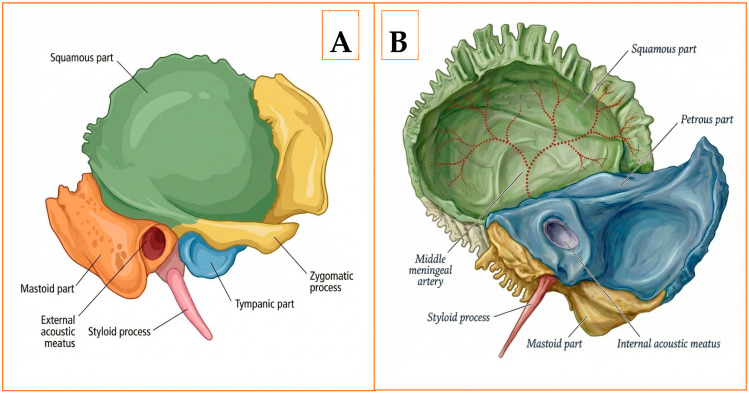
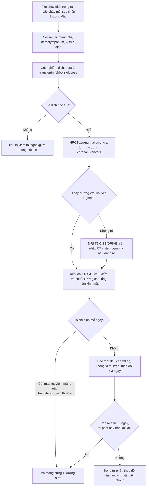
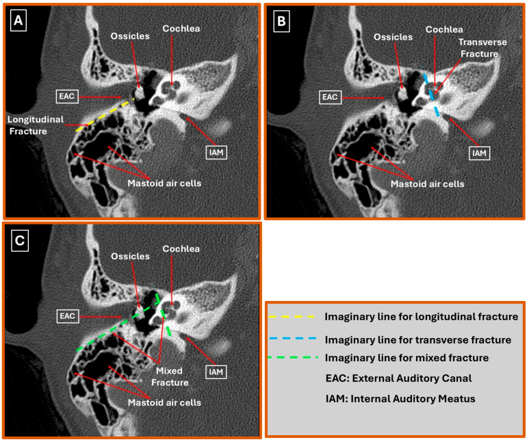
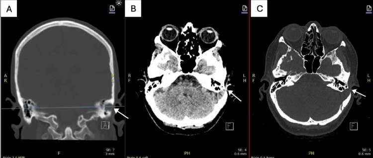

# 208 — Rò dịch não tủy qua xương đá ở trẻ: chảy dịch tai, viêm màng não tái diễn & khi nào vá / Cerebrospinal fluid otorrhea through the petrous bone in children

**Tags:** `pattern:ro-dich-nao-tuy` `pattern:vo-xuong-da` `pattern:chay-dich-tai` `vung:xuong-thai-duong` `vung:tai-giua` `score:House-Brackmann` `protocol:HRCT-lat-mong` `protocol:MRI-T2-CISS`
**Mức chắc chắn (certainty):** tổng hợp y văn (literature synthesis) — số liệu từ 1 nghiên cứu cắt ngang 45 BN có HRCT (PMC12984264), 1 đoàn hệ 88 trẻ vỡ xương thái dương (PMC12303713), 1 bài tổng quan kinh điển về rò DNT chấn thương (PMC5702760), 1 loạt mổ vá tegmen 27 ca (PMC13541042), 1 nghiên cứu tiên đoán rò sau vỡ nền sọ (PMC13157939) và 1 ca nguyên văn CC BY (PMC12510266). Số nào chưa đối chiếu được ghi **"chưa rõ"**.

> Bài này trả lời 3 câu hỏi thực hành: **(1) trẻ chảy dịch trong tai sau ngã — dịch tai hay dịch não tủy? (2) HRCT phải đọc những gì để định vị lỗ rò và tiên lượng? (3) theo dõi bao lâu thì vá, và vì sao "đặt ống thông khí màng nhĩ" là sai lầm chết người?** Rò dịch não tủy qua **nền sọ trước** (chảy mũi) ở [244](../244-ro-dich-nao-tuy-nen-so/lesson.md); viêm tai xương chũm biến chứng nội sọ ở [236](../236-viem-tai-xuong-chum-bien-chung-noi-so/lesson.md); giải phẫu xương thái dương ở [235](../235-xuong-thai-duong-xoang/lesson.md).

*Xương thái dương nhìn từ ngoài (A) và từ trong (B): phần đá (petrous part, xanh) là khối chứa **ốc tai, tiền đình, ống tai trong** và ống thần kinh mặt — đây là nơi vỡ sẽ làm rách màng não vì màng cứng dính chặt vào xương. Phần vảy (squamous, xanh lá) và phần chũm (mastoid, vàng) là nơi khí hóa, dễ tạo đường rò ra tai giữa. Nguồn: Diagnostics 2026, PMC12984264, Fig. 1, CC BY 4.0.*

## 1. Tổng quan bệnh học – cơ chế hình ảnh

- **Đường rò giải phẫu (3 tầng):** khoang dưới nhện → **màng cứng rách** + **xương đá/thượng nhĩ (tegmen) vỡ** → **tai giữa – xương chũm** → ra ngoài theo **màng nhĩ thủng (chảy dịch tai)** hoặc theo **vòi nhĩ (Eustachian tube) xuống mũi họng (chảy mũi "nghịch thường")**. Chính vì vậy một vỡ xương đá **có thể biểu hiện bằng chảy mũi trong khi mũi hoàn toàn bình thường** — đây là cạm bẫy định vị hay gặp nhất.
- **TẠI SAO trẻ dễ rò hơn người lớn cùng mức chấn thương:** xương sọ trẻ mỏng, đàn hồi hơn, màng cứng bám chặt vào xương đá; xương chũm chưa khí hóa hoàn toàn nên đường rò ngắn và ít mô đệm. Cơ chế chấn thương hay gặp là **ngã** và **tai nạn giao thông** (PMC12303713).
- **TẠI SAO hình ảnh trông như vậy (vật lý):**
  - **HRCT xương (≤ 0,6–1 mm):** đường vỡ là **đường giảm đậm độ** cắt qua bè xương đặc; phần đá rất đặc nên chỉ cần **1 lát cắt lệch mặt phẳng** là mất dấu đường vỡ → bắt buộc **dựng lại đa mặt phẳng, đặc biệt coronal oblique/Stenvers**.
  - **Khí trong mê đạo (pneumolabyrinth)** và **khí trong tai giữa/xương chũm** là dấu hiệu **đặc hiệu** của thông thương với khoang chứa khí/dịch não tủy; ngược lại **mờ tai giữa đơn thuần không đặc hiệu** vì máu tụ (hemotympanum) sau chấn thương cũng mờ y như vậy.
  - **MRI T2 CISS/DRIVE** (lát mỏng 0,5–0,8 mm, tín hiệu dịch rất cao) cho thấy **cuống màng não–nhu mô thoát vị (encephalocele)** và **đường dịch liên tục** từ bể dưới nhện vào tai giữa; **DWI** để loại cholesteatoma (hạn chế khuếch tán).
- **Ngưỡng và tần suất phải nhớ:**
  - Xương thái dương bị tổn thương trong **3–22%** các vỡ xương sọ (PMC12984264); ở trẻ, **88/369 (24%)** ca vỡ xương sọ có vỡ xương thái dương (PMC12303713).
  - Rò DNT sau chấn thương sọ kín ở người lớn: **1–3%**; **80–90%** các rò DNT là do chấn thương đầu (PMC5702760).
  - **Chảy dịch tai** gặp ở **44%** bệnh nhân vỡ xương thái dương (PMC12984264); ở trẻ, **28,6% (OCV) vs 6,2% (OCS)** (PMC12303713).
  - **Vỡ làm tổn thương vỏ mê đạo (OCV)** → rò DNT **14,3% vs 2,5%** ở trẻ (PMC12303713); ở người lớn **OR 5,1 (95% CI 0,8–33,6)** — chênh rất mạnh nhưng khoảng tin cậy rộng vì mẫu nhỏ (PMC12984264).
  - **Viêm màng não** xảy ra ở **19%** các rò DNT kéo dài, tử vong **10%** (PMC5702760).

## 2. Mẫu hình + chẩn đoán phân biệt theo vị trí (Gamut)

- **Chảy dịch tai sau chấn thương + màng nhĩ thủng:** vỡ xương đá/thượng nhĩ có rách màng cứng (thường kèm máu); rách ống tai ngoài; vỡ xương chũm.
- **Chảy mũi trong khi mũi không chấn thương:** rò DNT **qua vòi nhĩ** từ vỡ xương đá — phải soi tai tìm màng nhĩ/hemotympanum trước khi kết luận "rò nền sọ trước".
- **Chảy dịch tai + liệt mặt:** vỡ OCV (liệt mặt **OR 3,6**; 57,8% bệnh nhân vỡ xương thái dương có liệt mặt House–Brackmann ≥ II trong loạt 45 ca) (PMC12984264).
- **Không chấn thương, người lớn/trẻ lớn, chảy dịch tai tái diễn:** **khuyết tegmen tự phát** (spontaneous tegmen dehiscence) + thoát vị màng não; cholesteatoma ăn mòn xương; dị dạng tai trong (ống tiền đình mở rộng); u xương thái dương.
- **Viêm màng não tái diễn không rõ nguyên nhân:** dị tật bẩm sinh tai trong, khuyết tegmen, nang màng não — **luôn chụp HRCT xương thái dương**.
- **Sau mổ tai (đặt ống thông khí, tympanoplasty, cấy ốc tai):** rò DNT do thủ thuật — hình ảnh giống hệt rò chấn thương nhưng **bối cảnh** là chốt.
- **Gợi nhớ "3 tầng – 2 đường ra":** Ôn tập bằng chuỗi **D**ưới nhện → **Đ**á/thượng nhĩ → **T**ai giữa, rồi **2 đường ra**: màng nhĩ (tai) và vòi nhĩ (mũi).

## 3. Bảng so sánh phân biệt (ma trận đối chiếu)

| Thực thể (entity) | Hình ảnh điển hình | Chốt vào (rule-in) | Chốt loại (rule-out) | Gợi ý xác nhận |
|---|---|---|---|---|
| **Vỡ xương đá OCV + rò DNT** | Đường vỡ **cắt qua vỏ mê đạo**, có thể **pneumolabyrinth**, mờ tai giữa/chũm, liệt mặt | **Đường vỡ qua ốc tai/tiền đình + pneumolabyrinth + chảy dịch trong tai** | Đường vỡ chỉ ở phần vảy/chũm, mê đạo nguyên → rò ít khả năng hơn | HRCT ≤ 1 mm + beta-2 transferrin |
| **Vỡ xương đá OCS + rò DNT** | Đường vỡ song song trục đá, **không vào mê đạo**, hay qua tegmen | **Rò dịch rõ + đường vỡ chạm thượng nhĩ/mastoid** | Không có dịch, không khí trong mê đạo | HRCT + MRI T2 CISS |
| **Khuyết tegmen tự phát (spontaneous)** | **Khuyết xương thượng nhĩ** + mô mềm/màng não thoát vị, không có đường vỡ | **Khuyết xương khu trú + encephalocele trên MRI + tiền sử chảy dịch tái diễn** | Có đường vỡ xuyên xương → do chấn thương | MRI T2 CISS; phẫu thuật xác nhận |
| **Viêm tai giữa / hemotympanum** | Mờ tai giữa–chũm, **không có đường vỡ**, màng nhĩ nguyên | **Mờ tai giữa sau chấn thương nhưng dịch không phải DNT** | Beta-2 transferrin **dương** → rò DNT thật | Xét nghiệm dịch; nội soi tai |
| **Cholesteatoma ăn mòn** | Khối mô mềm **hạn chế khuếch tán (DWI)**, tiêu xương tai giữa/mê đạo | **DWI sáng + tiêu xương + chảy dịch mạn, hôi** | Dịch trong, không hạn chế khuếch tán → không phải cholesteatoma | MRI DWI + HRCT |
| **Rò DNT nền sọ trước (mũi)** | Khuyết sàng/xoang bướm, dịch mũi một bên | **Beta-2 transferrin dương + khuyết xương xoang** | Màng nhĩ/hemotympanum cùng bên → nghĩ đường qua vòi nhĩ | HRCT nền sọ + MRI |
| **Rò do thủ thuật (sau đặt ống, cấy ốc tai)** | Dịch quanh ống thông/điện cực, khuyết xương đúng vị trí mổ | **Tiền sử mổ + dịch trong 24–72 giờ + khuyết xương tại chỗ** | Không tiền sử can thiệp | So phim trước–sau; beta-2 transferrin |

### Đọc HRCT theo 6 câu hỏi cố định
1. **Hướng đường vỡ:** dọc (longitudinal), ngang (transverse) hay hỗn hợp — trong 45 ca: **dọc 60%, ngang 20%, hỗn hợp 20%** (PMC12984264).
2. **Vỏ mê đạo (otic capsule):** còn nguyên (OCS) hay bị phá (OCV) — **73,3% OCS, 26,7% OCV** trong cùng loạt; đây là yếu tố tiên lượng **mất thính lực, liệt mặt và rò DNT**.
3. **Chuỗi xương con:** trật/gián đoạn (gây điếc dẫn truyền).
4. **Tegmen thượng nhĩ & mảnh sau hố sọ sau:** có khuyết? có mô mềm thoát vị?
5. **Khí trong mê đạo / tai giữa:** pneumolabyrinth = dấu hiệu đặc hiệu.
6. **Ống thần kinh mặt:** có đường vỡ cắt qua? (liệt mặt **57,8%** trong loạt, **73% liệt ngay lập tức**) (PMC12984264).

## 4. Protocol chụp + xử trí + flowchart

### 4.1 Bước 1 — Chứng minh dịch là dịch não tủy
- **Beta-2 transferrin** (hoặc beta-trace protein): chỉ có trong **dịch não tủy, dịch mê đạo và dịch kính** → độ đặc hiệu rất cao; **âm tính giả** khi đã có viêm màng não tiến triển (PMC5702760). Đây là **xét nghiệm chốt**.
- **Đường glucose (glucose oxidase):** dương khi **> 20 mg/dL**; dịch mũi bình thường ~**10 mg/dL**; nhưng **nhiều dương/âm tính giả** (máu, nước mắt) → chỉ dùng sàng lọc (PMC5702760).
- **Dấu "halo"/"double ring" trên giấy thấm:** vòng ngoài trong (dịch não tủy) + vòng trong đỏ (máu) — **gợi ý, không chốt**.
- **Nội soi tai:** tìm màng nhĩ thủng, **hemotympanum**, vị trí rỉ dịch; **không bơm rửa, không nút kín ống tai** khi nghi rò.

### 4.2 Bước 2 — Hình ảnh
| Kỹ thuật | Lát cắt / cách làm | Trả lời câu hỏi gì |
|---|---|---|
| **HRCT xương thái dương** | **≤ 0,6–1 mm**, trục + **coronal oblique/Stenvers**, đa mặt phẳng | Đường vỡ, OCS/OCV, chuỗi xương con, tegmen, ống thần kinh mặt, pneumolabyrinth |
| **MRI T2 CISS/DRIVE** | 0,5–0,8 mm, không cản quang | Lỗ rò màng cứng, **encephalocele**, đường dịch vào tai giữa |
| **MRI DWI** | — | Loại **cholesteatoma** (hạn chế khuếch tán) |
| **CT cisternography** | Bơm cản quang trong bể | Chỉ khi **đang rò hoạt động**, HRCT âm tính và đã quyết định mổ — xâm lấn |
| **Thính lực (PTA) + House–Brackmann** | Trước và sau mổ | Phân loại điếc dẫn truyền/hỗn hợp; theo dõi liệt mặt |

### 4.3 Bước 3 — Theo dõi & chỉ định vá (có mốc thời gian)
- **Điều trị bảo tồn (ưu tiên ở trẻ, không biến chứng):** **đầu cao 30°**, tránh **xì mũi, ho mạnh, rặn, ngáp to**, làm mềm phân, tránh nâng vật nặng; theo dõi sát **≥ 3 ngày** nội trú để quyết định bước tiếp (PMC5702760). Phần lớn rò chấn thương **tự đóng**; rò kéo dài/tái diễn cần vá (PMC13157939).
- **Dẫn lưu thắt lưng** khi rò kéo dài: **10–15 mL/giờ**, tổng **150–250 mL/ngày** — dẫn quá nhanh gây **tràn khí nội sọ và tụt não** (PMC5702760).
- **Chỉ định mổ SỚM:** vết thương xuyên thấu, máu tụ nội sọ, **viêm màng não**, tràn khí nội sọ lớn, **nhu mô não thoát vị ra mũi/tai**, khả năng tự vá thấp (PMC5702760).
- **Chỉ định mổ MUỘN (sau 10 ngày bảo tồn):** rò **kéo dài > 10 ngày**, rò tái phát, tràn khí tái diễn, có viêm màng não/áp-xe (PMC5702760).
- **Kết quả vá tegmen (27 ca):** **76%** biểu hiện bằng chảy dịch não tủy, **16%** biểu hiện đầu tiên bằng **viêm màng não**; nằm viện trung vị **3 ngày**, đọc lại trong 30 ngày **< 10%**, theo dõi **18 tháng** (PMC13541042) — bằng chứng rằng **vá là can thiệp hiệu quả, ít biến chứng** ở trung tâm có kinh nghiệm.
- **Kháng sinh dự phòng: còn tranh cãi.** Số cũ ghi viêm màng não **2,5% (có kháng sinh) vs 10% (không)**, nhưng không có bằng chứng giảm rò hay tử vong; ưu tiên **vệ sinh, tránh nút kín, tư vấn và tiêm phòng phế cầu** (PMC5702760).

## 5. Biến thể bình thường và cạm bẫy

- **"Viêm tai giữa" sau ngã:** mờ tai giữa sau chấn thương gần như luôn là **hemotympanum**, không phải viêm. **Đặt ống thông khí màng nhĩ trong bối cảnh này tạo một lỗ rò vĩnh viễn** — sai lầm nặng nhất của bài này.
- **Chảy mũi "nghịch thường" qua vòi nhĩ:** trẻ chảy mũi một bên, mũi không đau, **không có khuyết xương nền sọ trước** → soi tai trước, đừng mổ xoang.
- **Halo sign không đặc hiệu:** máu pha nước muối/nước mắt cũng tạo 2 vòng; chỉ dùng để **sàng lọc**.
- **Glucose âm tính giả** khi đã có viêm màng não; **dương tính giả** khi dịch lẫn máu/nước mắt (PMC5702760).
- **Đường vỡ "biến mất" khi cắt lệch mặt phẳng:** luôn dựng lại đa mặt phẳng và chụp lại nếu triệu chứng vẫn tiếp diễn.
- **Pneumolabyrinth có thể là dấu hiệu DUY NHẤT** khi trẻ không chảy dịch ra ngoài (màng nhĩ nguyên, dịch xuống vòi nhĩ).
- **Liệt mặt xuất hiện muộn (27%)** vẫn có thể do phù/chèn ép — không mặc định "không do vỡ xương" (PMC12984264).
- **Satisfaction of search:** đã thấy vỡ xương thái dương vẫn phải rà **máu tụ ngoài/dưới màng cứng, dập não, vỡ xương mặt (Le Fort II–III)** — vỡ không dọc có **OR 8,4** đi kèm Le Fort II–III (PMC12984264).
- **Trẻ nhỏ:** vỡ xương đang phát triển có thể tạo **nang màng não (leptomeningeal cyst)** muộn — hẹn chụp lại nếu thấy bờ xương rộng ra.

## 6. Tự lượng giá — Blind Quiz

**Ca 1 — Trẻ 8 tuổi ngã xe đạp, chảy máu tai phải, liệt mặt cùng bên. HRCT xương thái dương phải (A–C):**

- Câu hỏi: Ba panel minh họa ba kiểu đường vỡ nào? Kiểu nào nguy cơ rò DNT và liệt mặt cao nhất? Vì sao?

<b>Bấm để hiện đáp án (findings + chẩn đoán)</b>

- **A: đường vỡ dọc** — chạy song song trục đá, từ ống tai ngoài, **né vỏ mê đạo** (OCS). **B: đường vỡ ngang** — cắt thẳng qua ốc tai/tiền đình (**OCV**). **C: đường vỡ hỗn hợp**.
- Nguy cơ cao nhất: **ngang/hỗn hợp (OCV)** — vì đường vỡ đi qua **vỏ mê đạo, ống tai trong và ống thần kinh mặt**; trong loạt 45 ca OCV chiếm **26,7%** và làm tăng rò DNT (**OR 5,1**) và liệt mặt (**OR 3,6**).
- Nguồn: Diagnostics 2026, PMC12984264, Fig. 2, CC BY 4.0. Các đường kẻ màu ở hình là **đường tham chiếu của tác giả**, không phải đường vỡ thật.

**Ca 2 — Nữ 66 tuổi (người lớn, để đối chiếu), tiền sử máu tụ dưới màng cứng điều trị bảo tồn, nay chảy dịch trong tai trái tái diễn, không chấn thương:**

- Câu hỏi: Tổn thương ở đâu? Vì sao không có đường vỡ? Chẩn đoán và hướng xử trí?

<b>Bấm để hiện đáp án</b>

- Dấu hiệu: **khuyết xương thượng nhĩ trái (tegmen tympani)**, mờ các tế bào chũm; coronal (A) thấy rõ lỗ khuyết, trục (B, C) thấy mô mềm trong tai giữa.
- Chẩn đoán: **rò dịch não tủy do khuyết tegmen tự phát** — không có đường vỡ xuyên xương nên cơ chế là **mỏng xương + tăng áp lực dịch não tủy** (bệnh nhân có tiền sử máu tụ dưới màng cứng).
- Xử trí: xác nhận beta-2 transferrin → **MRI T2 CISS** tìm encephalocele → **vá tegmen** (đường xuyên chũm hoặc mở sọ nhỏ trên xương thái dương); loạt 27 ca của PMC13541042 có **76%** biểu hiện bằng chảy dịch, **16%** bằng viêm màng não, nằm viện **3 ngày**.
- Nguồn: Cureus 2025, PMC12510266, Fig. 1, CC BY 4.0.

**Ca 3 — Trẻ 5 tuổi, chảy mũi trong một bên sau ngã, nội soi mũi bình thường, không chảy máu mũi. Nhìn lại giải phẫu:**

- Câu hỏi: Dịch có thể đi từ khoang dưới nhện ra mũi bằng đường nào khi mũi không chấn thương? Cần khám gì trước khi chụp nền sọ trước?

<b>Bấm để hiện đáp án</b>

- Con đường: **khoang dưới nhện → khuyết phần đá/tegmen → tai giữa → vòi nhĩ → mũi họng** ("rò nghịch thường"). Phần đá (petrous) là nơi màng cứng dính chặt nhất, dễ rách khi vỡ.
- Cần khám trước: **nội soi tai** tìm màng nhĩ thủng/hemotympanum và **xét nghiệm beta-2 transferrin** — nếu dương thì chụp **HRCT xương thái dương**, không mặc định "rò nền sọ trước".
- Bài học: **vị trí dịch chảy ra không phải vị trí lỗ rò.**
- Nguồn: Diagnostics 2026, PMC12984264, Fig. 1, CC BY 4.0.

## Bài liên quan chéo

- [200 – Tổng quan hệ Thần kinh](../200-tong-quan-he-than-kinh/lesson.md)
- [235 – Xương thái dương & xoang](../235-xuong-thai-duong-xoang/lesson.md)
- [236 – Viêm tai xương chũm: biến chứng nội sọ](../236-viem-tai-xuong-chum-bien-chung-noi-so/lesson.md)
- [237 – Biến chứng thần kinh của viêm tai (Gradenigo)](../237-bien-chung-than-kinh-so-viem-tai-gradenigo/lesson.md)
- [244 – Rò dịch não tủy sau chấn thương nền sọ ở trẻ (đường mũi)](../244-ro-dich-nao-tuy-nen-so/lesson.md)
- [231 – Tổn thương mạch máu não chấn thương & vỡ sọ tiến triển](../231-ton-thuong-mach-mau-nao-chan-thuong-va-vo-so-tien-trien/lesson.md)
- [205 – Xơ hóa mê đạo sau viêm mê nhĩ & cấy ốc tai](../205-xo-hoa-me-dao-sau-viem-me-nhi/lesson.md)

## Ảnh

- `images/208_ro-dnt-xuong-da_CT_PMC12984264-Fig1.jpg` — giải phẫu xương thái dương (mặt ngoài/mặt trong), CC BY 4.0.
- `images/208_ro-dnt-xuong-da_CT_PMC12984264-Fig2.jpg` — ba kiểu đường vỡ trên HRCT (dọc/ngang/hỗn hợp) + đường tham chiếu của tác giả, CC BY 4.0.
- `images/208_ro-dnt-xuong-da_CT_PMC12510266-Fig1.jpg` — khuyết tegmen tympani trên HRCT coronal + trục, CC BY 4.0.
- Nguồn + giấy phép từng ảnh: `images/CREDITS.md`.

> Không dùng để chẩn đoán độc lập khi chưa có người hướng dẫn.
