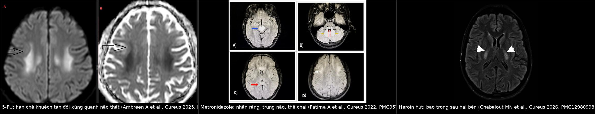
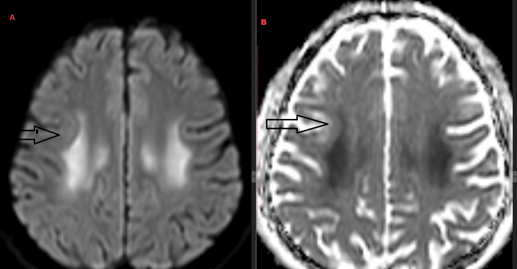
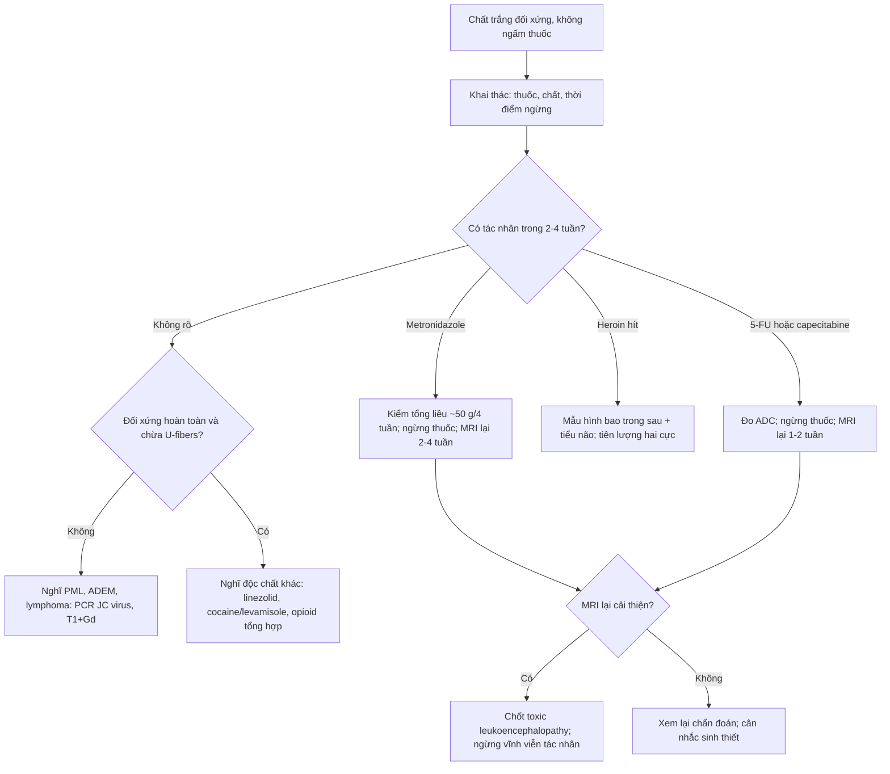
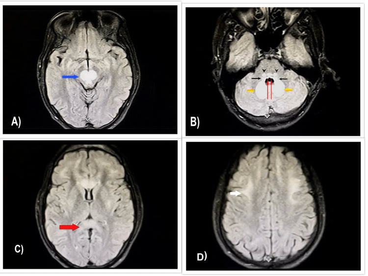
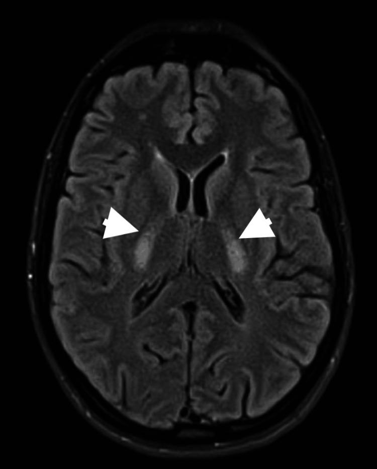

# 209 — Bệnh chất trắng do độc chất (toxic leukoencephalopathy): heroin "chasing the dragon", metronidazole, 5-FU/capecitabine / Toxic leukoencephalopathy

**Tags:** `pattern:ton-thuong-chat-trang` `pattern:doi-xung` `pattern:han-che-khuech-tan` `pattern:khong-ngam` `vung:nao` `vung:chat-trang` `protocol:MRI-DWI` `protocol:MRI-FLAIR` `score:ADC`
**Mức chắc chắn (certainty):** tổng hợp y văn (literature synthesis) — nhóm tự biên từ các ca nguyên văn có ảnh và số liệu: heroin hít (**PMC12980998**, **PMC12717832**, **PMC10860508**), 5-FU (**PMC12746003**), capecitabine (**PMC10497845**), metronidazole (**PMC9573127**, 5 ca + gộp 15 ca), cocaine/levamisole (**PMC10957391**, **PMC11130053**), linezolid (**PMC11631214**). Không có đoàn hệ lớn nào về nhóm bệnh này → mọi con số dưới đây gắn với đúng nguồn của nó.

> **Vì sao bài này quan trọng:** "chất trắng đối xứng, không ngấm thuốc" là mẫu hình mà **bệnh sử là chốt chẩn đoán**, nhưng bệnh sử lại hay bị giấu (bệnh nhân không khai dùng chất, người nhà không biết, thuốc đã ngừng từ tuần trước). Bỏ sót theo hai hướng đều nguy hiểm: **tiếp tục thuốc gây tổn thương không hồi phục** (5-FU/capecitabine, metronidazole) hoặc **gán nhầm PML** rồi ngừng thuốc/điều trị ức chế miễn dịch sai hướng. Điểm phân biệt mạnh nhất trên hình ảnh không phải "chất trắng" mà là **phân bố** (nhân răng · thể chai · bao trong · quanh não thất) cộng với **thời gian so với thuốc** và **hướng diễn tiến trên DWI**.

## 1. Tổng quan bệnh học – cơ chế hình ảnh – vì sao DWI là "cửa sổ" của bệnh

- **Bản chất tổn thương: phù nội myelin (intramyelinic edema), không phải nhồi máu.** Độc chất/thiếu năng lượng làm **nước thấm vào giữa các lớp myelin** (tách lớp myelin), tạo các **khoang vi thể** — trên mô học của thể hít heroin là **não dạng bọt biển (spongiform) với các hốc 2–50 µm**. Vì nước bị "nhốt" trong khoang kín giữa các lớp myelin nên **chuyển động Brown của phân tử nước giảm** → **ADC thấp** dù **không có phù tế bào (cytotoxic edema) kiểu nhồi máu**. Đây là lý do **DWI sáng + ADC tối** trong khi vỏ não và nhân xám sâu **bình thường** — mô hình không thể giải thích bằng "thiếu máu".
- **Vì sao T2/FLAIR sáng:** nước tăng trong mô → T2 dài; FLAIR **triệt tín hiệu dịch não tủy** nên chỉ còn tổn thương mô → dễ thấy tổn thương **quanh não thất** (nơi dễ bị "rửa trôi" bởi dịch não tủy trên FLAIR).
- **Vì sao không ngấm thuốc:** hàng rào máu–não **còn nguyên** (không phải viêm mạch/u); ngấm thuốc chỉ xuất hiện khi có **phá hàng rào** (PML-IRIS, ADEM, áp-xe). Do đó "không ngấm" **không loại trừ** bệnh nặng — nó chỉ loại trừ nhóm viêm/u.
- **Vì sao đối xứng:** độc chất đi theo **dòng máu**, nên tổn thương rơi vào **vùng có nhu cầu chuyển hóa/tưới máu cao và "cuối dòng"**: **nhân răng (dentate nuclei)**, **thể chai (splenium)**, **bao trong sau (posterior limb of internal capsule)**, **cuống tiểu não giữa (MCP)**, **chất trắng quanh não thất**. Đối xứng **hai bên, gần như ảnh gương** là dấu hiệu của nguyên nhân **hệ thống**, không phải mạch máu.
- **Cơ chế theo từng tác nhân (khác nhau, cùng một hình ảnh):**
  - **Heroin hít ("chasing the dragon")** — nhiệt phân heroin tạo **hỗn hợp pyrolysate** (monoacetyl morphine, 6-MAM, **độc tố gây độc ty thể**); tổn thương **chất trắng tiểu não, bao trong sau, thể chai, cuống đại não**; **vỏ não và nhân xám sâu được chừa**.
  - **Metronidazole** — độc tính **thần kinh trung ương** liên quan **liều tích lũy** (tổn thương ty thể + phù myelin); mô hình **nhân răng – trung não – thể chai – cầu não**, **hồi phục sau khi ngừng thuốc**.
  - **5-FU / capecitabine** — thiếu hụt **thymidylate synthase** ở chất trắng có tốc độ chuyển hóa cao (đặc biệt **thể chai/splenium** và **quanh não thất**); **phù nội myelin**, hồi phục sau ngừng thuốc nhưng **có thể tiến triển nếu tiếp tục**.
  - **Cocaine/levamisole, linezolid, opioid tổng hợp** — cùng phổ "chất trắng đối xứng ± nhân răng".
- **Định lượng phải nhớ (dùng để chốt, không để "mô tả cho đẹp"):**
  - Metronidazole: **liều tích lũy trung bình 51,3 g** (39–72,5 g) trong **29 ngày** (18–40 ngày); **khởi phát triệu chứng sau 18,8 ngày** (14–25 ngày); **hồi phục 4–7 ngày** (trung bình **5,6 ngày**) sau ngừng thuốc; phân bố tổn thương gộp 15 ca: **nhân răng 93%**, **trung não 73%**, **thể chai 73%**, **cầu não 53%**; **≥ 65%** hồi phục hoàn toàn/rõ rệt (PMC9573127).
  - 5-FU: tỉ lệ **< 5%** bệnh nhân điều trị; tổn thương **hạn chế khuếch tán đối xứng quanh não thất**, **tiến triển** nếu tiếp tục thuốc (so sánh tháng 12/2023 → 3/2024, PMC12746003).
  - Capecitabine: **6 bệnh nhân** (nữ 40–74 tuổi), triệu chứng trong **3–7 ngày** đầu chu kỳ 1, tổn thương **thể chai**; **ADC 0,3 × 10⁻³ mm²/s** (giảm mạnh), **FA 0,7**; **hồi phục lâm sàng–hình ảnh trung vị 8,5 ngày** sau ngừng thuốc (PMC10497845).
  - Heroin: tiên lượng **hai cực** — thể nhẹ **tử vong ~10%**, thể nặng **gần 100%** (PMC12717832 dẫn nguồn); tam chứng tiến triển **3 giai đoạn** (xem mục 2).

## 2. Mẫu hình + chẩn đoán phân biệt theo vị trí (gamut)

- **Gamut theo vị trí — "chất trắng ở đâu, nghĩ tới ai":**
  1. **Nhân răng + trung não + thể chai** (đối xứng, hồi phục) → **metronidazole**; cân nhắc **Wernicke** (đồi thị trong, quanh cống, thể vú), **methyl bromide**, **enterovirus 71** (trẻ).
  2. **Bao trong sau + cuống tiểu não giữa + thể chai** (đối xứng, hạn chế khuếch tán sớm) → **heroin hít**; cân nhắc **HIE sau ngừng tim** (nhưng có vỏ não/nhân xám), **maple syrup urine disease** (trẻ sơ sinh).
  3. **Quanh não thất, đối xứng, hạn chế khuếch tán** → **5-FU/capecitabine**, **methotrexate** (bài 1421/494), **linezolid**, **cocaine/levamisole**.
  4. **Thể chai đơn độc (splenium)** → **capecitabine/5-FU**, **Marchiafava–Bignami** (rượu), **lymphoma**, **suy tĩnh mạch**; ở trẻ em cân nhắc **MERS (mild encephalitis/encephalopathy with reversible splenial lesion)**.
  5. **Chất trắng dưới vỏ (U-fibers) + không đối xứng** → **PML** (bài 206) — *đây là điểm khác biệt quan trọng nhất*: PML **ăn tới U-fibers**, độc chất **chừa U-fibers**.
- **Ba giai đoạn lâm sàng của "chasing the dragon" (dùng để hỏi bệnh, không phải để chẩn đoán hình ảnh):** (1) **thất điều tiểu não, nói khó, rung giật**; (2) **co thắt cơ, myoclonus, loạn trương lực, bất động (akinesia)**; (3) **liệt nhẽo, câm–bất động (akinetic mutism), tăng thân nhiệt** → tử vong. Triệu chứng có thể xuất hiện **vài ngày tới vài tuần SAU khi ngừng** (ca đã cai 10 ngày vẫn khởi phát — PMC12980998).
- **Ảnh ghép — ba tác nhân, ba mẫu hình, cùng một logic "đối xứng – không ngấm – chừa U-fibers".**

  

  Nguồn từng ô: Ambreen A et al., *Cureus* 2025 (PMC12746003) Fig. 2 — CC BY 4.0; Fatima A et al., *Cureus* 2022 (PMC9573127) Fig. 3 — CC BY 4.0; Chabalout MN et al., *Cureus* 2026 (PMC12980998) Fig. 2 — CC BY 4.0.

## 3. Bảng so sánh phân biệt (ma trận đối chiếu)

| Thực thể (entity) | Hình ảnh điển hình | Chốt vào (rule-in) | Chốt loại (rule-out) | Gợi ý xác nhận |
|---|---|---|---|---|
| **Heroin hít ("chasing the dragon")** | FLAIR/T2 **đối xứng**: **bao trong sau, thể chai, chất trắng tiểu não, MCP**; DWI hạn chế **sớm**; **chừa vỏ não + nhân xám sâu + U-fibers**; không ngấm | **Bệnh sử hít heroin** + đối xứng ở **bao trong sau/tiểu não**; khởi phát **vài ngày–vài tuần**, có thể **sau cai**; **3 giai đoạn** lâm sàng | Tổn thương **một bên**, **có ngấm**, hoặc **vỏ não/nhân xám** là trung tâm | MRI não + DWI/ADC; hỏi kỹ **đường dùng (hít ≠ tiêm)**; loại trừ nhiễm trùng (dịch não tủy) |
| **Metronidazole** | FLAIR sáng **nhân răng hai bên (93%)**, **trung não 73%**, **thể chai 73%**, **cầu não 53%**; **DWI thường KHÔNG hạn chế thật** (trừ thể chai) | **Liều tích lũy lớn (~50 g / ~4 tuần)**, khởi phát **~19 ngày** sau bắt đầu, **hồi phục 4–7 ngày** sau ngừng | Tổn thương **không đối xứng**, **không liên quan liều**, hoặc **tiến triển dù đã ngừng thuốc** | Ngừng metronidazole ± MRI lại sau **2–4 tuần** (hồi phục = chốt); đối chiếu tổng liều |
| **5-FU / capecitabine** | **Hạn chế khuếch tán đối xứng quanh não thất** và/hoặc **thể chai**; T2/FLAIR sáng; **tiến triển** nếu tiếp tục thuốc | Triệu chứng trong **3–7 ngày** sau chu kỳ; **ADC rất thấp (0,3 × 10⁻³ mm²/s)**; hồi phục sau ngừng | Tổn thương **lan tỏa không đối xứng**, có **ngấm**, hoặc **không đổi sau ngừng thuốc** | Ngừng thuốc + MRI lại **1–2 tuần**; DPYD nếu nghĩ ngộ độc |
| **PML (bài 206)** | **Không đối xứng**, **ăn tới U-fibers dưới vỏ**, T1 giảm, **không choán chỗ**, thường **không hạn chế khuếch tán** | **Suy giảm miễn dịch** (HIV, thuốc ức chế), tổn thương **dưới vỏ** lan vào chất trắng sâu, **không ngấm** | **Đối xứng hoàn toàn**, **chừa U-fibers**, hạn chế khuếch tán mạnh ở vùng đối xứng | PCR **JC virus** trong dịch não tủy; theo dõi tiến triển |
| **ADEM** | Nhiều ổ **bất đối xứng**, chất trắng ± nhân xám, **ngấm thuốc dạng vòng/mảng**, phù nhẹ | **Sau nhiễm/tiêm vaccine 1–3 tuần**, trẻ em, nhiều ổ, **ngấm thuốc** | **Đối xứng ảnh gương**, không ngấm, khởi phát gắn với thuốc/chất | MRI + bệnh sử; có thể cần sinh thiết nếu không điển hình |
| **HIE / ngộ độc CO** | **Nhân xám sâu (nhân bèo, đuôi), vỏ não**, có thể **ranh giới vùng tưới máu (watershed)**; DWI hạn chế sớm | **Ngừng tim/hạ huyết áp/CO**, tổn thương **nhân xám + vỏ** | **Nhân xám sâu bình thường**, tổn thương chỉ ở chất trắng | Bệnh sử + khí máu + troponin; MRI sớm < 6 giờ |
| **PRES** | Phù **vỏ–dưới vỏ** vùng **chẩm–đỉnh**, thường **bất đối xứng nhẹ**, **không hạn chế khuếch tán** | **Tăng huyết áp/ức chế miễn dịch/sản giật**, đau đầu, nhìn mờ, co giật; **hồi phục** | Tổn thương **chỉ chất trắng sâu quanh não thất**, đối xứng hoàn toàn | MRI + đáp ứng hạ áp; **ADC không giảm** là điểm khác |

- **Ảnh 1 — mẫu hình "quanh não thất đối xứng" (5-FU).**

  

  Nguồn: Ambreen A et al., *Cureus* 2025 (PMC12746003) Fig. 2 — CC BY 4.0, nguyên bản.

## 4. Protocol chụp + hệ phân độ & cách theo dõi

- **Protocol MRI tối thiểu (cấp cứu, không cần cản quang trước):** **DWI + ADC (b=1000)** → **FLAIR/T2** trục toàn não → **T1** (đánh giá giảm tín hiệu/hoại tử) → **SWI** (loại trừ xuất huyết, CO, huyết khối tĩnh mạch) → **T1 + Gd** chỉ khi nghi viêm/u (ADEM, PML-IRIS, lymphoma). **Lát 4–5 mm** đủ cho chất trắng; **lát mỏng 1–2 mm** cho thể chai/trung não nếu cần.
- **Đo định lượng:** **ADC** tại vùng tổn thương đối chiếu chất trắng lành đối bên — ngưỡng thực hành: **ADC < 0,6 × 10⁻³ mm²/s** = hạn chế khuếch tán thật (capecitabine: **0,3**); **ADC > 1,0 × 10⁻³ mm²/s** = phù mạch/glue, loại trừ phù nội myelin cấp.
- **Bảng phân độ thực hành (không có RADS; dùng 3 mức diễn tiến):**

| Mức | Tiêu chí hình ảnh | Ý nghĩa xử trí |
|---|---|---|
| **Độ 1 – khả hồi** | Chỉ **FLAIR sáng**, DWI hạn chế **nhẹ/khu trú**, không teo, không xuất huyết | **Ngừng tác nhân** + MRI lại **1–2 tuần** |
| **Độ 2 – lan tỏa** | **DWI hạn chế đối xứng nhiều vùng** (quanh não thất ± thể chai ± nhân răng), không ngấm | Ngừng tác nhân + hồi sức; MRI lại **2–4 tuần**; cân nhắc IVIG (bằng chứng yếu) |
| **Độ 3 – không hồi phục** | **T1 giảm mạnh**, **teo não**, **xuất huyết (SWI)**, tổn thương **lan tới thân não/tủy** | Tiên lượng xấu (heroin thể nặng **gần 100% tử vong**); chăm sóc giảm nhẹ/thảo luận gia đình |

- **Nguyên tắc theo dõi "chẩn đoán bằng thời gian":** với **metronidazole**, **hồi phục 4–7 ngày** (mean 5,6) sau ngừng thuốc là **bằng chứng chẩn đoán**; với **5-FU/capecitabine**, hồi phục **trung vị 8,5 ngày**; với **heroin**, không có "test điều trị" — chẩn đoán dựa **bệnh sử + mẫu hình**, và **tiên lượng hai cực** (nhẹ ~10% tử vong, nặng ~100%).

## 5. Biến thể bình thường và cạm bẫy

- **Biến thể bình thường:** **khoang quanh mạch (perivascular spaces) giãn** quanh hạch nền — **dịch não tủy**, **tối trên FLAIR**, **không hạn chế khuếch tán** (ADC cao); **nhân răng hơi sáng trên T2** ở người già do thoái hóa sắt nhẹ; **splenium "sáng nhẹ"** ở trẻ do myelin chưa trưởng thành.
- **Cạm bẫy 1 — "không hạn chế khuếch tán thì không phải độc chất":** metronidazole **thường không hạn chế thật** (trừ thể chai); nếu đòi DWI dương mới chẩn đoán sẽ **bỏ sót**.
- **Cạm bẫy 2 — "không ngấm thuốc thì lành":** heroin thể nặng **không ngấm** mà tử vong gần 100%; ngấm thuốc là dấu hiệu **viêm/phá hàng rào**, không phải "nặng".
- **Cạm bẫy 3 — "T2 shine-through":** DWI sáng nhưng **ADC không giảm** = hiệu ứng T2, không phải hạn chế thật (gặp ở phù mạch, PRES, tổn thương cũ). Luôn **đọc cặp DWI + ADC**, đừng chỉ nhìn DWI.
- **Cạm bẫy 4 — bệnh sử bị giấu:** người bệnh **không khai** dùng heroin/cocaine; triệu chứng **khởi phát sau khi đã cai** (ca **10 ngày** sau detox). Hỏi **người nhà**, tìm **dấu kim tiêm/vết loét mũi**, và **không bỏ qua xét nghiệm chất**.
- **Cạm bẫy 5 — quy cho "tuổi già/thiếu máu":** chất trắng quanh não thất ở người > 60 tuổi hay bị gọi là **bệnh mạch nhỏ**; nếu **đối xứng ảnh gương + hạn chế khuếch tán mạnh + khởi phát cấp** thì **không phải mạch nhỏ**.
- **Cạm bẫy 6 — chỉ chụp CT:** CT **thường bình thường** trong 24–48 giờ đầu (ca 5-FU: CT tháng 12/2023 bình thường, chỉ MRI mới thấy). **CT bình thường không loại trừ** toxic leukoencephalopathy.

## 6. Tự lượng giá — Blind Quiz (mở trên Pages để tự đoán trước)

**Ca 1 — nữ 58 tuổi, ung thư đại tràng, truyền 5-FU chu kỳ 1; vài ngày sau xuất hiện lú lẫn, nói khó, đi loạng choạng.**

- Câu hỏi: Mẫu hình chính? Ba chẩn đoán phân biệt? Việc làm ngay và mốc chụp lại?
- Gợi ý: so sánh **hai bán cầu** và **vùng nào được chừa**.

<b>Bấm để hiện đáp án (findings + chẩn đoán)</b>

- Dấu hiệu: **hạn chế khuếch tán đối xứng ở chất trắng quanh não thất hai bên** (DWI sáng, ADC tối); vỏ não, nhân xám sâu và **U-fibers dưới vỏ được chừa**.
- Chẩn đoán: **bệnh chất trắng do 5-FU** — phù nội myelin ở vùng chất trắng chuyển hóa cao; tỉ lệ **< 5%** bệnh nhân điều trị.
- Việc làm: **ngừng 5-FU**, hồi sức; **MRI lại 1–2 tuần** (nếu tiếp tục thuốc, tổn thương **tiến triển** — xem ca cùng bài, Fig. 3).
- Nguồn ảnh: Ambreen A et al., *Cureus* 2025 (PMC12746003) Fig. 2 — CC BY 4.0.

**Ca 2 — nam 55 tuổi, áp-xe trong ổ bụng, metronidazole ~3 tuần; sau khoảng 2–3 tuần điều trị xuất hiện thất điều, nói khó, lú lẫn.**

- Câu hỏi: Vị trí tổn thương gợi ý gì? Có cần DWI dương mới chẩn đoán? Tiên lượng hồi phục ra sao?
- Gợi ý: nghĩ tới **liều tích lũy** và **thời gian từ lúc bắt đầu thuốc**.

<b>Bấm để hiện đáp án (findings + chẩn đoán)</b>

- Dấu hiệu: FLAIR sáng **đối xứng** ở **trung não (nhân đỏ/tegmentum)**, **nhân răng hai bên**, **thể chai (splenium)** và chất trắng dưới vỏ.
- Chẩn đoán: **bệnh não do metronidazole (MIE)** — liều tích lũy trung bình **51,3 g** trong **29 ngày**, khởi phát **18,8 ngày**; gộp 15 ca: **nhân răng 93% · trung não 73% · thể chai 73% · cầu não 53%**.
- Điểm chốt: **DWI thường không hạn chế thật** (trừ thể chai) — không đòi DWI dương; **hồi phục 4–7 ngày** (mean **5,6**) sau ngừng thuốc, **≥ 65%** hồi phục hoàn toàn/rõ rệt.
- Nguồn ảnh: Fatima A et al., *Cureus* 2022 (PMC9573127) Fig. 3 — CC BY 4.0.

**Ca 3 — bệnh nhân hít heroin ("chasing the dragon"), đã cai 10 ngày, nay yếu tứ chi, nói khó, rung giật.**

- Câu hỏi: Dấu hiệu trên FLAIR? Vì sao vỏ não và nhân xám sâu không tổn thương? Tiên lượng?
- Gợi ý: so sánh với **nhồi máu** và **PML**.

<b>Bấm để hiện đáp án (findings + chẩn đoán)</b>

- Dấu hiệu: **tăng tín hiệu FLAIR đối xứng ở bao trong sau hai bên** (mũi tên), kèm tổn thương **cuống tiểu não giữa/chất trắng tiểu não** ở lát thấp hơn.
- Chẩn đoán: **bệnh chất trắng do heroin hít (chasing the dragon)** — phù nội myelin dạng bọt biển; độc chất đi theo dòng máu nên chọn **chất trắng chuyển hóa cao**, chừa vỏ/nhân xám.
- Tiên lượng: **hai cực** — thể nhẹ **~10% tử vong**, thể nặng **gần 100%**; khởi phát có thể **sau cai** (ca này 10 ngày).
- Nguồn ảnh: Chabalout MN et al., *Cureus* 2026 (PMC12980998) Fig. 2 — CC BY 4.0.

## Bài liên quan chéo
- [206 – PML & IRIS (hàng phân biệt bắt buộc: ăn tới U-fibers)](../206-pml-va-iris-uc-che-mien-dich/lesson.md)
- [215 – Mất myelin (demyelinating disease) — ADEM/MS](../215-mat-myelin/lesson.md)
- [494 – Độc thần kinh methotrexate](../494-doc-than-kinh-methotrexate/lesson.md)
- [1421 – Nhận thức sau độc thần kinh methotrexate](../1421-nhan-thuc-sau-doc-than-kinh-mtx/lesson.md)
- [3033 – Bệnh não Wernicke & thiếu thiamin (đồi thị/quanh cống)](../3033-benh-nao-wernicke-thieu-thiamin/lesson.md)
- [3035 – HIE sau ngừng tim (nhân xám + vỏ)](../3035-hie-sau-ngung-tim-nguoi-lon/lesson.md)
- [219 – PRES & RCVS](../219-pres-rcvs/lesson.md)

## Ảnh
- `images/209_doc-chat-trang_DWI-ADC_PMC12746003-Fig2-CCBY.jpg` và `...-Fig3-CCBY.jpg` — 5-FU, DWI/ADC lúc đầu và lúc tiến triển (CC BY 4.0).
- `images/209_metronidazole_FLAIR_PMC9573127-Fig3-CCBY.jpg` — metronidazole, FLAIR 4 lát (CC BY 4.0).
- `images/209_heroin_FLAIR_PMC12980998-Fig2-CCBY.jpg` và `...-Fig3-CCBY.jpg` — heroin, FLAIR bao trong sau và MCP (CC BY 4.0).
- `images/composite_doc-chat-trang_ba-mau-hinh.jpg` — composite 3 tác nhân (chỉ ảnh CC BY).
- Nguồn + giấy phép từng file: `images/CREDITS.md`.

> **Disclaimer:** bài học dùng cho đào tạo/tra cứu, **không dùng để chẩn đoán độc lập** khi chưa có bác sĩ chẩn đoán hình ảnh/thần kinh hướng dẫn.
