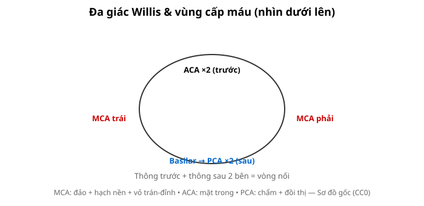
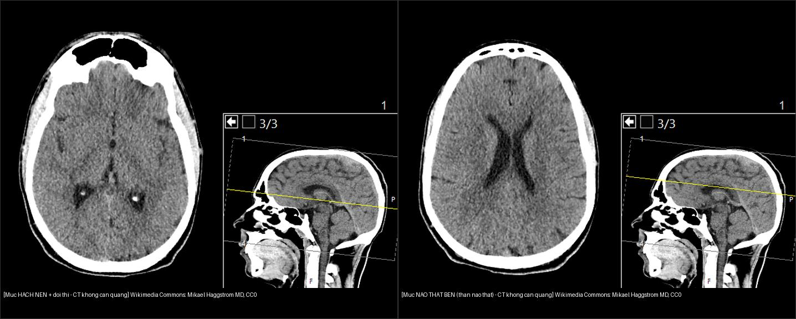
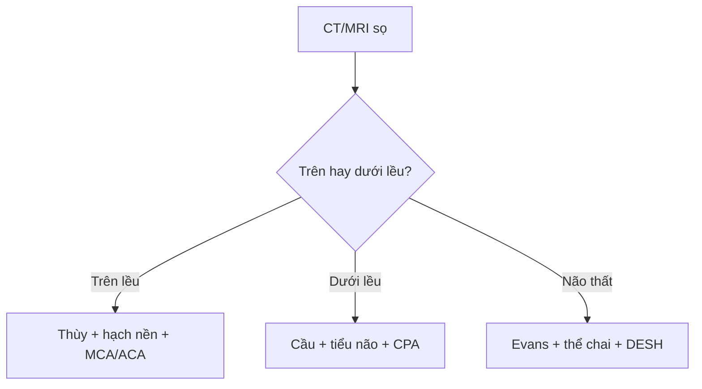

# 210 — Giải phẫu sọ não cắt lớp: thùy, hạch nền & Willis / Brain anatomy

**Tags:** `pattern:giai-phau-nao` `vung:so-nao` `anatomy:nao`
**Mức chắc chắn (certainty):** tổng hợp y văn (literature synthesis) — nhóm tự biên từ y văn mở, chưa gắn ca nguyên văn đơn lẻ.

## 1. Tổng quan — bản đồ mạch-mô quyết định mọi định khu

- Vỏ não 4 thùy (trán, đỉnh, thái dương, chẩm) + đảo (insula) + hạch nền (nhân đuôi, nhân bèo, đồi thị) + bao trong (chân trước/gối/chân sau) — TẠI SAO bao trong chân sau (posterior limb) quan trọng nhất: bó vỏ-tủy (corticospinal) đi qua diện tích chỉ **vài mm**, tổn thương nhỏ cũng liệt nửa người.
- Đa giác Willis (thông trước + thông sau 2 bên) nối tuần hoàn trước-sau — TẠI SAO tắc M1 vẫn có người nhẹ: bàng hệ (collaterals) qua Willis + vỏ.

*Sơ đồ gốc Thư viện CĐHA, CC0.*

*CT không cản quang 2 mức (mỗi panel kèm ảnh sagittal định vị mức cắt — đường vàng): **trái = mức hạch nền + đồi thị** (nhân đuôi, nhân bèo, đồi thị, bao trong ở giữa; chú ý các chấm tăng đậm độ **đối xứng hai bên** vùng hạch nền — thường là **vôi hóa sinh lý**, phân biệt với máu bằng tính đối xứng); **phải = mức thân não thất bên** (thể chai, vách trong suốt, liềm não, rãnh vỏ). Wikimedia Commons: Mikael Häggström, M.D., CC0. Ảnh ghép letterbox, giữ tỉ lệ.*

## 2. Gamut định khu theo vùng (Gamut)

- **MCA (động mạch não giữa):** đảo + hạch nền + vỏ trán-đỉnh bên — thất ngôn (trái) / lơ là (phải) + liệt mặt-tay > chân.
- **ACA (động mạch não trước):** mặt trong trán-đỉnh — yếu chân > tay + thờ ơ (abulia).
- **PCA (động mạch não sau):** chẩm + đồi thị + thái dương trong — bán manh + quên (amnesia).
- **Hố sau (vertebrobasilar):** cầu não (basis + tegmentum), tiểu não, ống tai trong — liệt chéo (crossed), thất điều, điếc-ù một bên (CPA).

## 3. Bảng vùng-dấu hiệu

| Vùng (location) | Cấu trúc chính | Chốt vào (rule-in) | Chốt loại (rule-out) | Bài nối |
|---|---|---|---|---|
| MCA + hạch nền | Đảo, nhân bèo, bao trong | **Thất ngôn/lơ là + liệt mặt-tay; ASPECTS 10 vùng** | Yếu chân trội → ACA | `211` |
| Hố sau + CPA | Cầu não, góc cầu-tiểu não | **Liệt chéo + thất điều + ù tai/điếc** | Liệt cùng bên đơn thuần → trên lều | `217` |
| Não thất + vòm | Thể chai, vách trong suốt | **Bướm qua thể chai = GBM; Evans > 0,3 = giãn não thất** | Không qua đường giữa → trong trục thường | `213`, `218` |
| Màng não + xương | Liềm, lều, khớp sọ | **Liềm qua khớp = SDH; thấu kính không qua khớp = EDH** | Máu rãnh Sylvius → SAH | `212` |

## 4. Protocol đọc cắt lớp

- Đọc hệ thống: đối xứng → xám-trắng → hạch nền/bao trong → não thất/rãnh → hố sau (cửa sổ xương khi chấn thương) → mạch (CTA/MRA).
- Đo: ASPECTS 10 vùng, Evans (sừng trán/rộng sọ > 0,3), lệch đường giữa > 5 mm, máu cấp 50–90 HU, DNT 0–15 HU.

## 5. Cạm bẫy

- **Thể tích riêng phần (partial volume)** rãnh Sylvius giả SAH — HU máu 50–90 vs dịch não tủy 0–15.
- **Vôi hóa sinh lý** nhân bèo/tuyến tùng giả máu — đối xứng + HU > 100 + phim cũ.
- **Hố sau nhiễu xương đá** bỏ sót nhồi máu nhỏ — DWI lát mỏng khi chóng mặt + thất điều.

## 6. Tự lượng giá — Blind Quiz

**Ca 1 — Liệt mặt-tay phải + thất ngôn:** vùng mạch nào? Vì sao không phải ACA? *(Bảng mục 3.)*

<b>Bấm để hiện đáp án</b>

- **MCA trái:** thất ngôn + liệt mặt-tay trội (ACA là yếu chân + thờ ơ).

**Ca 2 — Ù tai điếc trái + thất điều + liệt mặt ngoại biên:** định khu đâu? *(Bảng mục 3.)*

<b>Bấm để hiện đáp án</b>

- **Góc cầu-tiểu não (CPA) trái:** VII/VIII + tiểu não — nghĩ schwannoma dây VIII (bài 217).

**Ca 3 — Sừng trán rộng + Evans 0,35 + đi khó tiểu không tự chủ:** NPH hay teo não? *(Bảng mục 3.)*

<b>Bấm để hiện đáp án</b>

- **Nghi NPH:** Evans > 0,3 + tam chứng (đi-tiểu-trí) — đo góc thể chai + DESH + tap test (bài 218).

**Ca 4 — CT không cản quang 2 mức. Ở mức hạch nền có các chấm tăng đậm độ hai bên. Máu hay không?**

- Câu hỏi: Gọi tên mức cắt hai panel? Các chấm tăng đậm độ đối xứng vùng hạch nền là gì, và vì sao không nghĩ xuất huyết?

<b>Bấm để hiện đáp án</b>

- **Trái = mức hạch nền + đồi thị**; **phải = mức thân não thất bên** (thể chai, vách trong suốt, liềm não).
- Các **chấm tăng đậm độ ĐỐI XỨNG hai bên, nằm đúng vị trí nhân bèo** = **vôi hóa sinh lý** (đối chiếu phim cũ nếu nghi). **Xuất huyết** thường **một bên, không đối xứng, kèm phù giảm đậm độ quanh** và bệnh cảnh cấp — khác hẳn.
- Ảnh sagittal định vị (đường vàng) giúp tự kiểm tra mức cắt đang đọc.
- Nguồn ảnh: Wikimedia Commons, Mikael Häggström M.D., CC0. Ảnh ghép letterbox.

## Bài liên quan chéo
- [200 – Tổng quan Thần kinh](../200-tong-quan-he-than-kinh/lesson.md)
- [201 – Protocol sọ não](../201-protocol-so-nao/lesson.md) (cửa sổ đột quỵ)
- [211 – Đột quỵ não](../211-dot-quy-nao/lesson.md) (vùng MCA)

> Không dùng để chẩn đoán độc lập khi chưa có người hướng dẫn.
