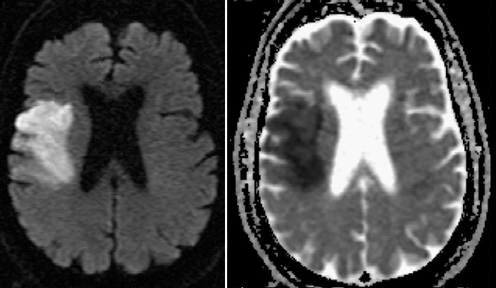
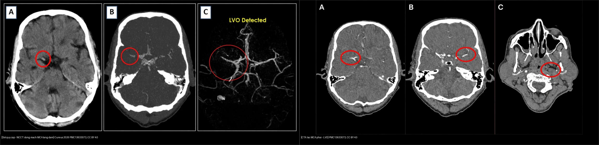
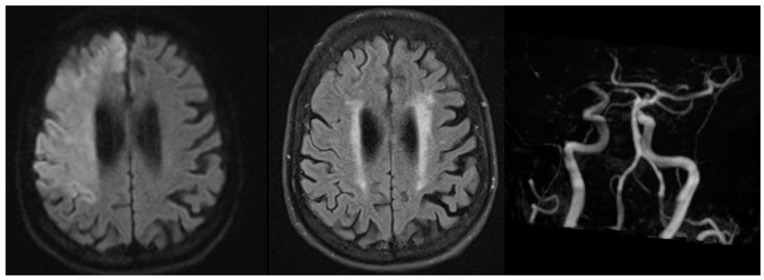
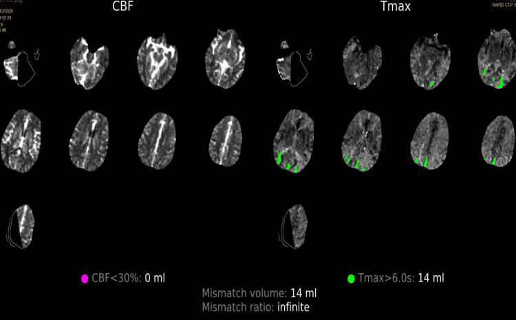
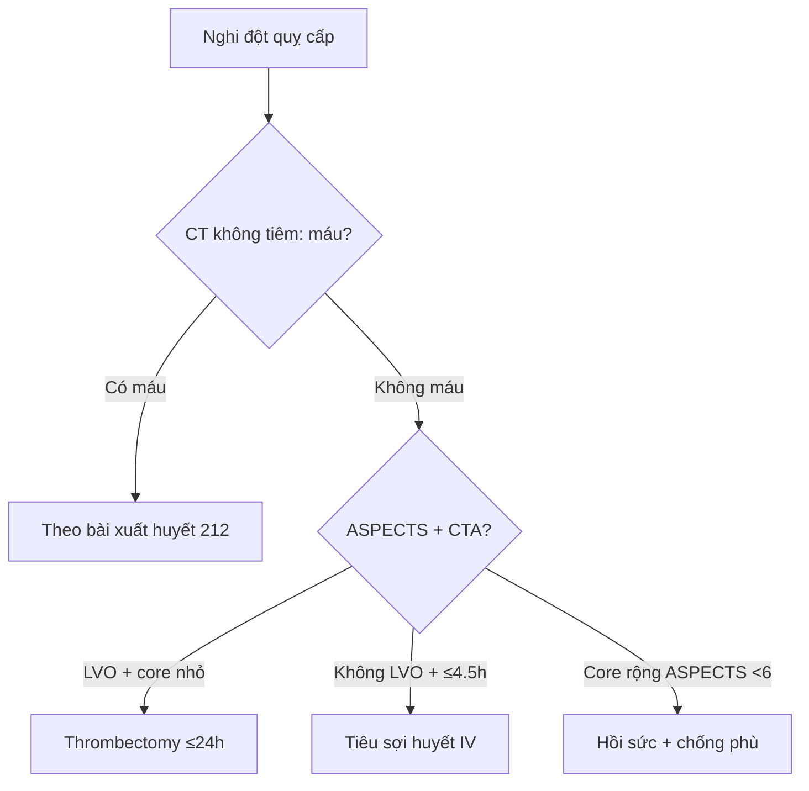

# 211 — Đột quỵ thiếu máu não: DWI/ADC & ASPECTS / Acute ischemic stroke

**Tags:** `pattern:nhoi-mau` `vung:nao` `score:ASPECTS` `protocol:MRI-dot-quy`
**Mức chắc chắn (certainty):** tổng hợp y văn (literature synthesis) — nhóm tự biên từ y văn mở, chưa gắn ca nguyên văn đơn lẻ.

## 1. Tổng quan — tắc mạch → phù độc tế bào → DWI sáng/ADC tối

- Tắc động mạch não (thường động mạch não giữa — MCA) → thiếu ATP → bơm Na/K thất bại → nước dồn vào trong tế bào (phù độc tế bào — cytotoxic edema) → khuếch tán (diffusion) nước bị hạn chế.
- TẠI SAO DWI sáng + bản đồ ADC (apparent diffusion coefficient) tối = nhồi máu cấp: proton nước không dịch chuyển tự do được → tín hiệu DWI (b=1000) tăng, giá trị ADC giảm. Cửa sổ sáng rõ nhất **24 giờ – 7–10 ngày**; giai đoạn bán cấp (**10–14 ngày**) có hiện tượng **giả bình thường hóa ADC (ADC pseudonormalization)** trong khi DWI vẫn sáng do hiệu ứng **T2 shine-through** — luôn đối chiếu cặp DWI/ADC + FLAIR.
- Ngưỡng định lượng nằm lòng: lõi nhồi máu (core) ADC thường **< 620 × 10⁻⁶ mm²/s**; cửa sổ tiêu sợi huyết tĩnh mạch (IV alteplase, rtPA) **≤ 4,5 giờ** nếu chưa tổn thương **> 1/3 diện tích MCA**; lấy huyết khối cơ học (thrombectomy) **≤ 6 giờ**, mở rộng tới **24 giờ** nếu còn mô cứu được (DAWN/DEFUSE-3: core < 70 mL, mismatch ≥ 1,8, mismatch ≥ 15 mL).

## 2. Mẫu hình + chẩn đoán phân biệt theo vùng mạch (Gamut)

- **Vùng MCA (động mạch não giữa):** vỏ đảo (insula) + hạch nền + vỏ trán-đỉnh — liệt nửa người đối bên + thất ngôn (trái) / lơ là không gian (phải).
- **Vùng ACA (động mạch não trước):** mặt trong trán-đỉnh — yếu chân > tay.
- **Vùng PCA (động mạch não sau):** chẩm + đồi thị — bán manh (hemianopia) cùng bên.
- **Hố sau (động mạch thân nền — vertebrobasilar):** tiểu não/thân não — chóng mặt + thất điều + liệt dây thần kinh sọ chéo bên.
- Giả nhồi máu DWI+: áp-xe (mủ hạn chế trung tâm), lymphoma (tế bào dày đặc), Creutzfeldt-Jakob (vỏ + hạch nền đối xứng), viêm não herpes (thái dương trong 2 bên).

## 3. Bảng so sánh phân biệt (ma trận đối chiếu)

| Thực thể (entity) | Hình ảnh điển hình | Chốt vào (rule-in) | Chốt loại (rule-out) | Gợi ý xác nhận |
|---|---|---|---|---|
| Nhồi máu cấp MCA | **DWI sáng + ADC tối** theo vùng mạch, mất ranh giới xám-trắng, **dấu insula mờ** | **DWI+/ADC− < 10 ngày + đúng vùng mạch** | DWI sáng + ADC sáng (T2 shine-through) → không phải cấp | CTA/MRA tìm tắc, tưới máu (core/penumbra) |
| Áp-xe não | Vòng bắt thuốc mỏng đều + **DWI trung tâm sáng mạnh** | **Hạn chế trung tâm + sốt + viêm** | Vòng dày gồ ghề hoại tử → u | Phổ (lactate/amino acid), cấy máu |
| Lymphoma nguyên phát | Khối quanh não thất bắt thuốc **đồng nhất**, DWI sáng toàn khối | **Đồng nhất + quanh não thất + ADC rất thấp** | Hoại tử vòng dày → GBM | Steroid làm nhỏ giả, sinh thiết trước steroid |
| Giả T2 shine-through | DWI sáng + **ADC sáng/bình thường** (nhồi máu cũ, phù mạch) | **ADC không tối** | ADC tối → cấp thật | So ADC, FLAIR cũ/mới |
| Nhồi máu hố sau/thân nền | Tổn thương tiểu não/thân não, có thể **nhỏ, khuất xương đá trên CT** | **DWI+/ADC− lát mỏng vùng hố sau + hội chứng chéo bên** | CT bình thường + không DWI+ → không loại trừ, cần MRI | MRI DWI lát mỏng 3 mm; MRA thân nền |
| Bắt chước đột quỵ (stroke mimic) | **NECT không tổn thương (ASPECTS 10) + CTA không tắc + CTP chất lượng kém/nhiễu** | **Thiếu khuyết thần kinh khu trú nhưng hình ảnh âm tính, có cử động/nhiễu** | DWI+ đúng vùng mạch → nhồi máu thật | MRI muộn (DWI âm = không nhồi máu); theo dõi lâm sàng |

*Trái: DWI b=1000 sáng vùng vỏ phải. Phải: ADC tối tương ứng = hạn chế khuếch tán cấp. Nguồn: Mirza & Gokhale 2016, CC BY 4.0.*

### Dấu sớm NECT & ASPECTS — thang 10 điểm MCA (đọc chuẩn xác)
- **Dấu tăng tỷ trọng động mạch não giữa (Hyperdense MCA sign): > 45–50 HU** so với bên đối diện — cục huyết khối tươi trong lòng mạch.
- **Mất phân biệt chất xám-trắng nhân bèo/thùy đảo:** mỗi giờ thiếu máu đậm độ chỉ giảm **~2–3 HU** nên BẮT BUỘC chỉnh **cửa sổ đột quỵ (Stroke window: W: 40, L: 40 hoặc W: 8, L: 32)** mới thấy dấu sớm.
- **ASPECTS (Alberta Stroke Program Early CT Score):** 10 trừ dần mỗi vùng MCA tổn thương sớm — **7 vùng ngang hạch nền: nhân đuôi (C), nhân bèo (L), bao trong (IC), thùy đảo (I), vỏ M1–M3; 3 vùng trên hạch nền: vỏ M4–M6**. **Ngưỡng hành động:** ASPECTS **≥ 6** là chỉ định chuẩn lấy huyết khối cơ học; < 6 = lõi rộng, nguy cơ chảy máu sau tái thông cao.

*Trái: NECT — **động mạch MCA phải tăng đậm độ** (vòng tròn), dấu sớm của huyết khối tươi. Phải: **CTA — mất tín hiệu/không có dòng chảy ở MCA phải** = tắc nhánh lớn (LVO). Nguồn: Cureus 2026, PMC13633073 Fig. 1–2, CC BY 4.0. Ảnh ghép letterbox, giữ nguyên tỷ lệ.*

## 4. Protocol chụp + hệ phân độ/điểm chuẩn hóa

- **CT không tiêm đầu tay (< 25 phút cửa-chụp) + cửa sổ đột quỵ W: 40, L: 40:** loại trừ xuất huyết + ASPECTS + dấu tăng tỷ trọng MCA > 45–50 HU.
- **CTA mạch não + tưới máu CT/MR (cửa sổ 6–24 giờ theo DAWN/DEFUSE-3):** tắc nhánh lớn (ICA/M1/basilar) + **lõi nhồi máu (Core): CBF < 30% (hoặc DWI+) < 70 mL** + **vùng tranh tối tranh sáng (Penumbra): Tmax > 6 giây** + **mismatch ratio ≥ 1,8 và thể tích mismatch ≥ 15 mL** → thrombectomy tới 24 giờ.
- **MRI DWI/ADC + FLAIR:** DWI+/FLAIR− = < 4,5 giờ (chỉ điểm tiêu sợi huyết khi giờ khởi phát không rõ).

*Bất tương hợp **DWI–FLAIR (DWI-FLAIR mismatch)**: tổn thương đã hạn chế khuếch tán (DWI sáng) nhưng **chưa tăng tín hiệu trên FLAIR** → ước tính khởi phát **< 4,5 giờ**, dùng chọn bệnh nhân đột quỵ lúc ngủ dậy/không rõ giờ (WAKE-UP). Nguồn: J Clin Med 2024, PMC11477225 Fig. 1, CC BY 4.0.*

*Cạm bẫy: **bản đồ tưới máu CT (CTP)** cho khuyết thiếu **không đặc hiệu**, bị đọc là **nhiễu do bệnh nhân cử động**; NECT ASPECTS 10 + CTA không tắc → ca này cuối cùng là **bắt chước đột quỵ (stroke mimic)**. CTP chỉ có giá trị khi **chất lượng ảnh đủ** và **đối chiếu lâm sàng**. Nguồn: Cureus 2026, PMC13283053 Fig. 1, CC BY 4.0.*

## 5. Biến thể bình thường và cạm bẫy

- **T2 shine-through** (DWI sáng + ADC sáng) đọc nhầm nhồi máu cấp — luôn đối chiếu ADC.
- **Giả bình thường hóa ADC (10–14 ngày)** bỏ sót nếu chỉ đọc ADC — cộng DWI + FLAIR (DWI vẫn sáng do T2 shine-through).
- **Nhồi máu hố sau nhỏ** khuất bóng xương đá trên CT — nghi ngờ thì MRI DWI lát mỏng.
- **Hài lòng sớm (satisfaction of search):** đã thấy tắc M1 đừng quên tắc tandem cổ + chảy máu chuyển dạng (hemorrhagic transformation).

## 6. Tự lượng giá — Blind Quiz

**Ca 1 — Liệt nửa người trái cấp giờ thứ 3. Nhìn DWI/ADC trước.**

- Gợi ý lâm sàng (clinical context): nam trung niên, liệt nửa người trái + lơ là không gian phải, khởi phát 3 giờ.
- Câu hỏi: Mô tả dấu hiệu (finding) chính? Đưa 3 chẩn đoán phân biệt (differential)? Dấu hiệu nào chốt (clincher)?

<b>Bấm để hiện đáp án (findings + chẩn đoán)</b>

- Dấu hiệu (findings): vùng vỏ-dưới vỏ bán cầu phải sáng DWI + tối ADC, theo phân bố MCA, phù nhẹ, chưa hóa FLAIR mạnh.
- Chẩn đoán (diagnosis): **nhồi máu cấp MCA phải** — vì DWI+/ADC− đúng vùng mạch < 10 ngày + lâm sàng đối bên.
- Nguồn ảnh: Mirza & Gokhale 2016 (SMGebooks), CC BY 4.0.

**Ca 2 — Bệnh nhân yếu nửa người trái cấp, chụp NECT rồi CTA. Đọc phim trước:**

- Gợi ý lâm sàng: khởi phát < 4,5 giờ, NIHSS 6, không rõ tiền sử.
- Hỏi: hai dấu hiệu sớm trên NECT/CTA là gì? Bước tiếp theo là gì?

<b>Bấm để hiện đáp án (findings + chẩn đoán)</b>

- Dấu hiệu (findings): trái — **dấu tăng tỷ trọng động mạch MCA (> 45–50 HU)**; phải — **tắc MCA trên CTA** = tắc nhánh lớn (LVO). **Luôn đọc NECT ở cửa sổ đột quỵ (W: 40 / L: 40)** để không bỏ lỡ dấu sớm.
- Chẩn đoán (diagnosis): **nhồi máu cấp MCA có LVO** — chỉ định **tiêu sợi huyết IV (< 4,5 giờ)** + chuyển **lấy huyết khối cơ học**.
- Chốt: **tăng tỷ trọng MCA + tắc trên CTA**; đánh thêm **ASPECTS** trước khi quyết định.
- Nguồn ảnh: Cureus 2026 (PMC13633073) Fig. 1–2, CC BY 4.0.

**Ca 3 — Bệnh nhân thức dậy thấy yếu nửa người, không rõ giờ khởi phát. MRI:**

- Hỏi: dấu hiệu này nghĩa là gì? Có tiêu sợi huyết được không? Vì sao?

<b>Bấm để hiện đáp án (findings + chẩn đoán)</b>

- Dấu hiệu (findings): **DWI sáng** (đã hạn chế khuếch tán) nhưng **FLAIR chưa tăng tín hiệu** = **bất tương hợp DWI–FLAIR**.
- Chẩn đoán (diagnosis): **nhồi máu cấp, khởi phát ước tính < 4,5 giờ** → **đủ điều kiện tiêu sợi huyết** dù không rõ giờ khởi phát (dựa trên thử nghiệm **WAKE-UP**: mRS 0–1 90 ngày **53,3% vs 41,8%**, aOR 1,61).
- Chốt: **DWI+/FLAIR−**; nhớ cạm bẫy **giả bình thường hóa ADC 10–14 ngày** (DWI vẫn sáng do T2 shine-through).
- Nguồn ảnh: J Clin Med 2024 (PMC11477225) Fig. 1, CC BY 4.0.

**Ca 4 — Bệnh nhân rối loạn ngôn ngữ nặng, chụp CTP nhưng cử động nhiều. ASPECTS 10, CTA không tắc. CTP:**

- Hỏi: khuyết thiếu tưới máu này có đáng tin? Hướng chẩn đoán? Xử trí ra sao khi hình ảnh "âm tính"?

<b>Bấm để hiện đáp án (findings + chẩn đoán)</b>

- Dấu hiệu (findings): **khuyết thiếu tưới máu không đặc hiệu**, bị dựng hình do **cử động/nhiễu**; **ASPECTS 10 + CTA không tắc**.
- Chẩn đoán (diagnosis): khuyết thiếu **không đặc hiệu** — ca gốc cuối cùng là **bắt chước đột quỵ (stroke mimic)**, nghĩ **migraine có aura ngôn ngữ (HaNDL loại trừ)**; MRI muộn **bình thường**.
- Xử trí: khiếm khuyết nặng + trong cửa sổ + hình ảnh hạn chế, có thể **vẫn tiêu sợi huyết** rồi **định hướng lại chẩn đoán sau cấp**; không dựa vào CTP chất lượng kém để chốt.
- Chốt: **DWI âm muộn = không nhồi máu**; luôn đối chiếu chất lượng ảnh + lâm sàng.
- Nguồn ảnh: Cureus 2026 (PMC13283053) Fig. 1, CC BY 4.0.

**Ca 5 — ASPECTS 4 + tắc M1 giờ thứ 5 (không ảnh):** thrombectomy hay nội khoa? Vì sao? *(Bảng mục 3 + mục 4.)*

<b>Bấm để hiện đáp án (findings + chẩn đoán)</b>

- Dấu hiệu (findings): lõi rộng (ASPECTS < 6) = > 1/3 lãnh thổ MCA đã chết.
- Chẩn đoán (diagnosis): **lõi rộng, nguy cơ chảy máu sau tái thông cao** — đa số chuyển hồi sức/chống phù, hội chẩn cá thể thay vì thrombectomy thường quy (lưu ý các thử nghiệm lõi rộng gần đây chọn bệnh nhân theo **thể tích lõi** chứ không chỉ ASPECTS).

## Bài liên quan chéo
- [200 – Tổng quan Thần kinh](../200-tong-quan-he-than-kinh/lesson.md)
- [212 – Xuất huyết sọ](../212-xuat-huyet-so-nao/lesson.md) (loại trừ máu trước tiêu sợi huyết)
- [213 – U não](../213-u-nao/lesson.md) (DWI+ giả nhồi máu: lymphoma/áp-xe)
- [216 – Huyết khối xoang tĩnh mạch não (CVST)](../216-di-dang-mach-CVST/lesson.md) (nhồi máu tĩnh mạch — bối cảnh khác)
- [221 – Chấn thương cột sống](../221-chan-thuong-cot-song/lesson.md) (mạch máu cổ — tắc tandem)

## Ảnh
- `211_nhoi-mau_DWI_Wikimedia-Mirza-CCBY40.png` — Mirza & Gokhale, SMGebooks 2016, CC BY 4.0.
- `211_hyperdense-MCA-CTA_CT_PMC13633073-Fig1-CCBY.jpg`, `211_tac-MCA_LVO_CTA_PMC13633073-Fig2-CCBY.jpg`, `composite_hyperdense-MCA-vs-CTA.jpg` — Cureus 2026 (PMCID: PMC13633073), CC BY 4.0.
- `211_DWI-FLAIR-mismatch_MRI_PMC11477225-Fig1-CCBY.jpg` — J Clin Med 2024 (PMCID: PMC11477225), CC BY 4.0.
- `211_tuoi-mau-CTP_PMC13283053-Fig1-CCBY.jpg` — Cureus 2026 (PMCID: PMC13283053), CC BY 4.0.
- Chi tiết giấy phép từng ảnh trong `images/CREDITS.md`. AuntMinnie: chỉ dẫn link, không tải.

> Không dùng để chẩn đoán độc lập khi chưa có người hướng dẫn.
