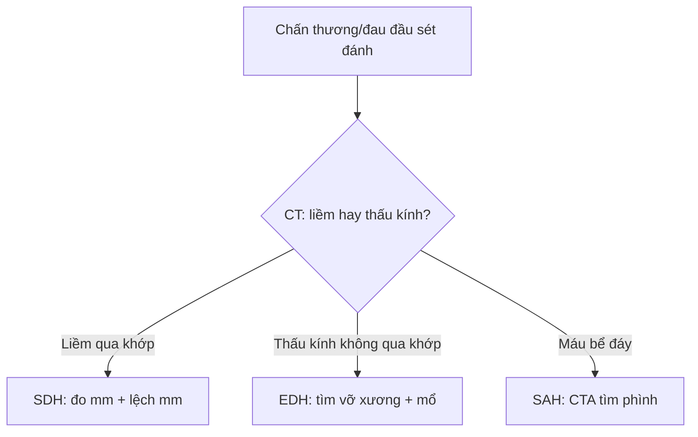

# 212 — Xuất huyết sọ: ICH/SAH/SDH/EDH & diễn tiến máu / Intracranial hemorrhage

**Tags:** `pattern:xuat-huyet-so` `vung:so-nao` `score:GCS-ICH` `protocol:CT-so-nao`
**Mức chắc chắn (certainty):** tổng hợp y văn (literature synthesis) — nhóm tự biên từ y văn mở, chưa gắn ca nguyên văn đơn lẻ.

## 1. Tổng quan — máu đông đặc tăng HU + hemoglobin đổi tín hiệu theo ngày

- Máu cục cấp trên CT không tiêm tăng tỷ trọng (hyperdense) **50–90 HU** do globin đặc; TẠI SAO MRI đổi theo thời gian: oxyhemoglobin (vài giờ) → deoxyhemoglobin (cấp 1–3 ngày: T1 đẳng, T2 tối) → methemoglobin nội bào (bán cấp sớm 3–7 ngày: T1 sáng) → methemoglobin ngoại bào (7–14 ngày: T1+T2 sáng) → hemosiderin mạn (> 14 ngày: viền T2* tối).
- Ngưỡng mổ nằm lòng: lệch đường giữa (midline shift) **> 5 mm**, thể tích máu tụ (ABC/2) **> 30 mL** nhu mô hoặc dày SDH **> 10 mm** + GCS tụt ≥ 2 điểm → hội chẩn mổ cấp cứu.
- TẠI SAO vị trí quyết định cơ chế: SDH (tĩnh mạch cầu — bridging veins, chấn thương nhẹ/người già/te nghiện rượu) ôm bờ não; EDH (động mạch màng não giữa — MMA sau vỡ xương thái dương) bóc màng cứng khỏi sọ.

## 2. Mẫu hình + chẩn đoán phân biệt theo khoang (Gamut)

- **Nhu mô (ICH — intraparenchymal):** tăng huyết áp (hạch nền/đồi thị/cầu não/tiểu não), amyloid (vỏ thùy, người > 55 tuổi tái phát), u/AVM (trẻ, phù + bắt thuốc quanh).
- **Dưới nhện (SAH — subarachnoid):** máu đầy bể đáy + rãnh Sylvius — vỡ phình (aneurysm) sau gắng sức/đau đầu sét đánh.
- **Dưới màng cứng (SDH — subdural):** liềm (crescent) ôm bờ, **qua khớp sọ**, lệch đường giữa sớm.
- **Ngoài màng cứng (EDH — epidural):** thấu kính (lens/biconvex), **không qua khớp** (dính màng cứng), **qua được liềm**, khoảng tỉnh (lucid interval) + vỡ xương thái dương.

## 3. Bảng so sánh phân biệt (ma trận đối chiếu)

| Thực thể (entity) | Hình ảnh điển hình | Chốt vào (rule-in) | Chốt loại (rule-out) | Gợi ý xác nhận |
|---|---|---|---|---|
| SDH cấp | **Liềm tăng HU 60–80 ôm bờ, qua khớp sọ**, chèn não | **Liềm + chấn thương nhẹ/người già + qua khớp** | Thấu kính không qua khớp → EDH | CT lại sau 6 giờ (máu lan), mổ khi > 10 mm/lệch > 5 mm |
| EDH cấp | **Thấu kính, không qua khớp**, vỡ xương thái dương | **Thấu kính + lucid + vỡ xương + MMA** | Qua khớp + liềm → SDH | CTA tìm giả phình MMA, mổ khi > 30 mL |
| SAH vỡ phình | Máu bể đáy + rãnh Sylvius, não úng thủy sớm | **Đau sét đánh + máu bể đáy** | Chỉ máu rãnh liềm đơn độc → chấn thương | CTA/MRA tìm phình, nimodipine + kẹp/coil |
| ICH tăng huyết áp | Hạch nền/đồi thị/cầu, HU 60–80, phù quanh | **Hạch nền + tăng HA + tuổi** | Vỏ thùy tái phát người già → amyloid | CTA spot sign (chảy đang diễn), kiểm soát HA |

*Liềm tăng HU ôm bờ não, qua khớp sọ, đè đẩy nhu mô. Nguồn: Wikimedia Commons, public domain.*

*Hai liềm đẳng tỷ trọng 2 bên, não bị bó chặt. Nguồn: Doc James (James Heilman), CC BY-SA 4.0.*

### Liềm vs thấu kính — cặp song sinh dễ nhầm
- **SDH = liềm (crescent), qua khớp, ôm bờ** — tĩnh mạch cầu rách, chấn thương nhẹ cũng rách ở người già/te não.
- **EDH = thấu kính (lens), không qua khớp, bóc màng** — động mạch MMA sau vỡ xương, khoảng tỉnh rồi hôn mê nhanh.

## 4. Protocol chụp + hệ phân độ/điểm chuẩn hóa

- **CT không tiêm lát mỏng (< 10 phút):** HU + ABC/2 + lệch đường giữa mm + chèn bể đáy.
- **CTA khi:** SAH (tìm phình), ICH trẻ/không tăng HA (tìm AVM/u), spot sign (chảy đang diễn → mổ sớm).
- Thang điểm: **GCS + ICH Score (0–6: GCS, tuổi ≥ 80, thể tích ≥ 30 mL, não thất, hố sau)**; Fisher/WFNS cho SAH.

## 5. Biến thể bình thường và cạm bẫy

- **SDH mạn đẳng tỷ trọng** lẫn não — bỏ sót nếu chỉ tìm máu trắng; tìm liềm đè rãnh + lệch vách trong suốt.
- **Giả SAH (pseudo-SAH)** khi phù não nặng: rãnh sáng giả do sung huyết — HU thấp hơn máu thật, bối cảnh ngạt/tim ngừng.
- **Vôi hóa sinh lý (pineal/choroid)** giả máu — đối xứng + HU > 100 + phim cũ không đổi.
- **Thiếu máu cục bộ sau chấn thương** khuất sau máu — đừng dừng ở máu, tìm thêm phù/DWI.

## 6. Tự lượng giá — Blind Quiz

**Ca 1 — Chấn thương đầu, GCS 13. Nhìn CT có mũi tên trước.**

- Gợi ý lâm sàng (clinical context): tai nạn xe máy, đau đầu + lơ mơ nhẹ, không khoảng tỉnh.
- Câu hỏi: Mô tả dấu hiệu (finding) chính? Đưa 3 chẩn đoán phân biệt (differential)? Dấu hiệu nào chốt (clincher)?

<b>Bấm để hiện đáp án (findings + chẩn đoán)</b>

- Dấu hiệu (findings): dải tăng tỷ trọng hình liềm ôm bờ não một bên, qua khớp sọ, đè xẹp rãnh vỏ, lệch đường giữa nhẹ.
- Chẩn đoán (diagnosis): **máu tụ dưới màng cứng cấp (acute SDH)** — vì liềm + qua khớp (khác thấu kính EDH không qua khớp) + cơ chế tĩnh mạch cầu sau chấn thương.
- Nguồn ảnh: Wikimedia Commons (Trauma subdural arrows), public domain.

**Ca 2 — Người già ngã nhẹ 3 tuần trước, nay lú lẫn 2 bên. Đọc CT trơn dưới đây.**

<b>Bấm để hiện đáp án (findings + chẩn đoán)</b>

- Dấu hiệu (findings): hai dải đẳng/giảm tỷ trọng hình liềm 2 bên, xóa rãnh, não bó chặt, ít lệch đường giữa (cân bằng 2 bên).
- Chẩn đoán (diagnosis): **SDH mạn 2 bên (bilateral chronic SDH)** — vì đẳng HU + teo não người già + chấn thương nhẹ 3 tuần (hemoglobin đã thành hemosiderin/màng).
- Nguồn ảnh: Doc James, CC BY-SA 4.0 (bản trơn + annotated).

**Ca 3 — Ngã + khoảng tỉnh 2 giờ rồi hôn mê + đồng tử giãn cùng bên, CT thấu kính thái dương không qua khớp:** SDH hay EDH? Xử trí? *(Bảng mục 3.)*

<b>Bấm để hiện đáp án (findings + chẩn đoán)</b>

- Dấu hiệu (findings): thấu kính + không qua khớp + vỡ xương thái dương + lucid interval = rách động mạch màng não giữa.
- Chẩn đoán (diagnosis): **EDH cấp chèn ép** — mổ mở sọ cấp cứu (khác SDH liềm qua khớp có thể theo dõi khi mỏng).

## Bài liên quan chéo
- [200 – Tổng quan Thần kinh](../200-tong-quan-he-than-kinh/lesson.md)
- [211 – Đột quỵ não](../211-dot-quy-nao/lesson.md) (loại trừ máu trước tiêu sợi huyết)
- [213 – U não](../213-u-nao/lesson.md) (máu trong u vs máu chấn thương)

> Không dùng để chẩn đoán độc lập khi chưa có người hướng dẫn.
