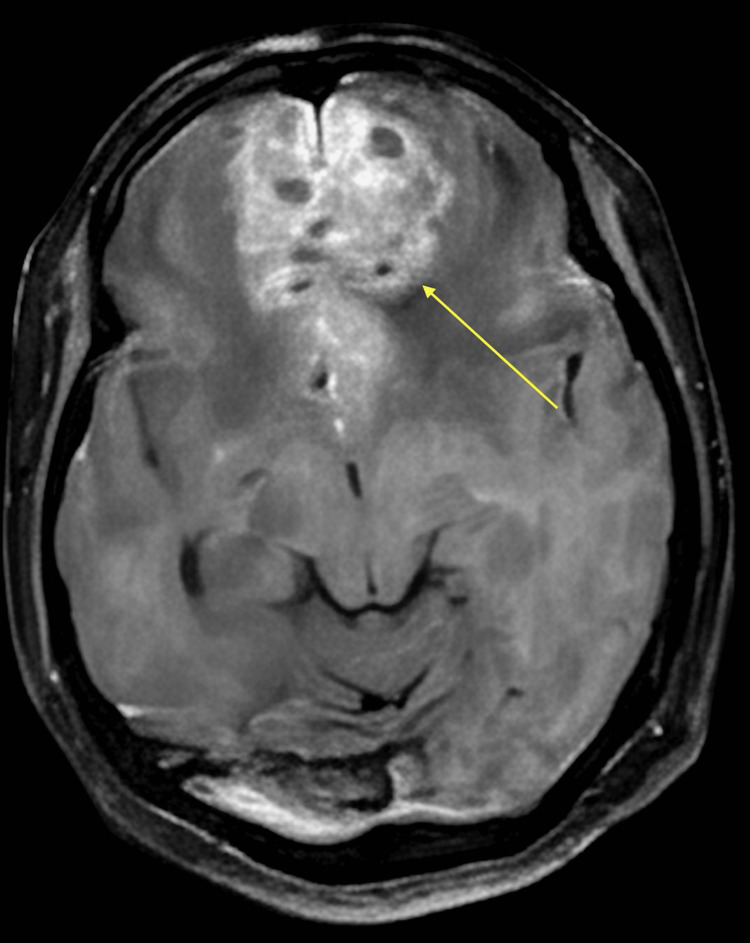
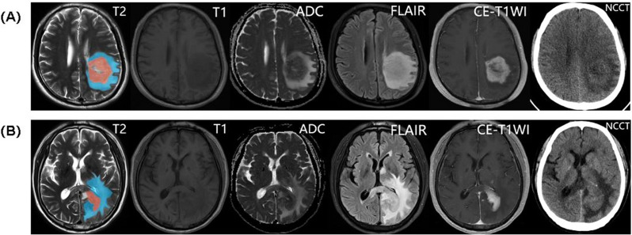
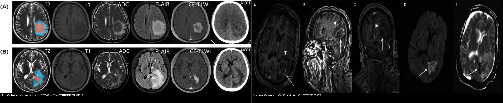
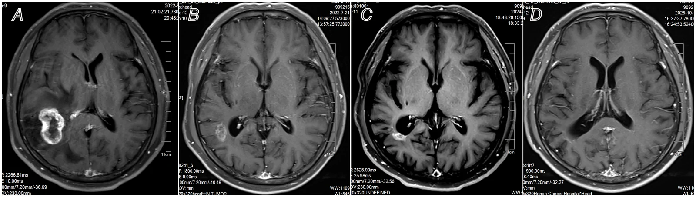
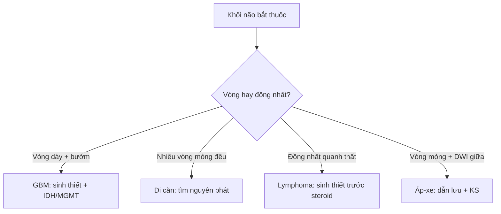
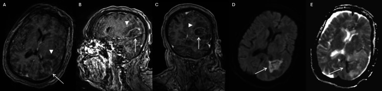

# 213 — U não: GBM bướm vs di căn vs lymphoma vs áp-xe / Brain tumors

**Tags:** `pattern:u-nao` `vung:nao` `protocol:MRI-u-nao`
**Mức chắc chắn (certainty):** tổng hợp y văn (literature synthesis) — nhóm tự biên từ y văn mở, chưa gắn ca nguyên văn đơn lẻ.

## 1. Tổng quan — hàng rào máu-não vỡ → bắt thuốc + tân mạch rCBV cao

- U thần kinh đệm độ cao (glioblastoma — GBM, WHO grade 4) hoại tử trung tâm + tân mạch (neovascularization) → bắt thuốc vòng dày gồ ghề + thể tích máu não tương đối (rCBV) **> 1,75** + xâm lấn qua thể chai (corpus callosum) thành hình bướm (butterfly).
- TẠI SAO di căn nhiều ổ ở ranh giới chất xám-trắng: tắc vi thuyên tắc tại nơi mạch thu nhỏ đột ngột + phù vận mạch (vasogenic edema) hình ngón tay lan trắng rất rộng. U lympho hệ thần kinh trung ương nguyên phát (PCNSL) mật độ tế bào cực đặc → **tăng tỷ trọng tự nhiên trên CT không tiêm (40–50 HU)** và **giảm tín hiệu trên T2W** + hạn chế khuếch tán toàn bộ khối đặc. Áp-xe mủ đặc → hạn chế khuếch tán trung tâm + vòng mỏng đều + viền kép T2.
- Ngưỡng nằm lòng: GBM đường kính hay gặp **> 40–50 mm** khi phát hiện + phù lan > khối + rCBV > 1,75; di căn điển hình **nhiều ổ 5–20 mm**; lymphoma ADC cực thấp **< 0,6–0,7 × 10⁻³ mm²/s** (tương đương < 600–700 × 10⁻⁶ mm²/s).

## 2. Mẫu hình + chẩn đoán phân biệt theo vị trí (Gamut)

- **Qua thể chai 2 trán (butterfly):** GBM độ cao — xâm lấn chất trắng, hoại tử + bắt vòng.
- **Nhiều ổ ranh giới xám-trắng + phù lớn:** di căn (phổi/vú/melanoma/thận) — tìm u nguyên phát + PET.
- **Quanh não thất bắt đồng nhất:** lymphoma nguyên phát (người suy giảm miễn dịch) — đáp ứng steroid giả.
- **Vòng mỏng + DWI trung tâm + sốt:** áp-xe vi khuẩn — cấy máu + phổ (lactate).
- **Trẻ + hố sau giữa:** medulloblastoma/ependymoma/pilocytic — khác người lớn trên lều.

## 3. Bảng so sánh phân biệt (ma trận đối chiếu)

| Thực thể (entity) | Hình ảnh điển hình | Chốt vào (rule-in) | Chốt loại (rule-out) | Gợi ý xác nhận |
|---|---|---|---|---|
| GBM bướm | **Qua thể chai 2 bên + vòng dày gồ ghề + hoại tử + rCBV > 1,75; trung tâm hoại tử KHÔNG hạn chế khuếch tán (DWI tối, ADC sáng)**; phổ MRS đỉnh Choline/NAA rất cao + Lactate/Lipid | **Butterfly + hoại tử + xâm lấn trắng + DWI trung tâm tối** | Trung tâm DWI sáng rực + viền kép → áp-xe | Sinh thiết + IDH/MGMT, MRI phổ (choline cao) |
| Di căn | **Đa ổ ranh giới chất xám-trắng + phù vận mạch ngón tay rất rộng + vòng đều 5–20 mm** | **Nhiều ổ + K nguyên phát đã biết** | Đơn ổ qua thể chai → GBM | Tìm nguyên phát (CT ngực/PET), SRS toàn não |
| Lymphoma (PCNSL) | **Quanh não thất/thể chai + tăng tỷ trọng 40–50 HU trên NECT + giảm tín hiệu T2W** + ngấm đồng nhất | **Đồng nhất + quanh thất + ADC < 0,6–0,7 × 10⁻³ + T2 tối** | Vòng hoại tử dày → GBM; chỉ ngấm vòng khi HIV/AIDS | Sinh thiết TRƯỚC steroid (steroid che mờ) |
| Áp-xe vi khuẩn | **Vòng mỏng nhẵn (mặt hướng não thất mỏng hơn → dễ vỡ vào não thất) + trung tâm mủ DWI sáng rực/ADC tối đen + dấu viền kép (Dual-rim sign) trên T2W** | **Hạn chế trung tâm + viêm toàn thân + viền kép** | Vòng dày gồ ghề + rCBV cao + DWI trung tâm tối → GBM | Dẫn lưu + kháng sinh, phổ lactate |

*Khối trán 2 bên ~65 mm + hoại tử nang + phù lan, xâm lấn thể chai gối. Nguồn: Maity et al., Cureus 2026 Fig. 3, CC BY 4.0 — ca sa sút tiến triển nhanh, cần sinh thiết loại trừ lymphoma.*

*Mỗi hàng là T2, T1, ADC, FLAIR, T1 sau cản quang, NECT. **(A) GBM:** hoại tử trung tâm + ngấm vòng dày gồ ghề, **ADC trung tâm hoại tử SÁNG** (hoại tử không hạn chế khuếch tán). **(B) Lymphoma (PCNSL):** khối **đặc, đồng nhất**, **ADC TỐI** (mật độ tế bào cực cao — nước nội bào giảm) + phù FLAIR. Chốt phân biệt là **đồng nhất + ADC tối** vs **hoại tử + ADC sáng**. Nguồn: Yu F et al., Cancer Imaging 2026 (PMC13104201), CC BY 4.0.*

*Trái: u não — GBM (hoại tử, ADC sáng) vs lymphoma (đặc, ADC tối). Phải: **áp‑xe** giả u — ngấm vòng (A–C) + **DWI trung tâm sáng rực** (D) và T2 (E): ổ mủ đặc hạn chế khuếch tán. **Cùng "vòng ngấm thuốc" nhưng DWI trung tâm là chốt loại trừ u.** Nguồn: PMC13104201 + PMC13354021 (Rath TM et al., Cureus 2026), CC BY 4.0.*

*Di căn não đơn độc: nốt ngấm thuốc mạnh ở **ranh giới chất xám–chất trắng**, đáp ứng xạ phẫu lập thể (SRS). Nhiều ổ + phù vận mạch rộng + K nguyên phát đã biết = di căn. Nguồn: Liu X et al., Front Immunol 2026 (PMC13582613), CC BY 4.0.*

## 4. Protocol chụp + hệ phân độ/điểm chuẩn hóa

- **MRI sọ não + gadolinium 3 mặt phẳng + DWI/ADC + tưới máu (rCBV) + phổ (MRS):** vòng/đồng nhất, hoại tử, choline/NAA, lactate/lipid.
- Phân loại WHO 2021: IDH-wildtype + TERT/EGFR/+7/−10 = GBM ngay cả khi mô học thấp; MGMT methyl hóa → đáp ứng temozolomide tốt hơn.
- Đánh giá đáp ứng RANO 2.0: diện bắt thuốc 2 chiều + FLAIR + steroid + lâm sàng (giả tiến triển sau xạ cần theo dõi 12 tuần).

## 5. Biến thể bình thường và cạm bẫy

- **Giả tiến triển (pseudoprogression) sau xạ-hóa** bắt thuốc tăng giả 12 tuần đầu — đừng mổ lại vội, theo dõi RANO + tưới máu.
- **Steroid làm lymphoma nhỏ giả** mất dấu sinh thiết — sinh thiết trước steroid.
- **Nhồi máu bán cấp bắt thuốc vòng** giả u — DWI vùng mạch + bối cảnh mạch máu phân biệt (bài 211).
- **Mất myelin giả u (Tumefactive demyelination) — CẤM MỔ:** dấu **vòng ngấm thuốc hở (Open-ring sign)** với phần hở hướng về phía chất xám vỏ não/hạch nền — đáp ứng corticoid, sinh thiết/mổ nhầm thành GBM là sai lầm chết người (hội chẩn MS/NMOSD bài 215).
- **Viêm não herpes thái dương 2 bên** giả u lan — sốt + PCR HSV + không tân mạch rCBV.

## 6. Tự lượng giá — Blind Quiz

**Ca 1 — Sa sút tiến triển nhanh + khối trán lan 2 bên. Nhìn MRI trước.**

- Gợi ý lâm sàng (clinical context): người lớn tuổi, sa sút nhanh + thay đổi nhân cách, không sốt, không K đã biết.
- Câu hỏi: Mô tả dấu hiệu (finding) chính? Đưa 3 chẩn đoán phân biệt (differential)? Dấu hiệu nào chốt (clincher)?

<b>Bấm để hiện đáp án (findings + chẩn đoán)</b>

- Dấu hiệu (findings): khối trán 2 bên ~65 mm qua thể chai gối (butterfly) + hoại tử nang đa ổ + phù lan + bắt thuốc không đều (mũi tên).
- Chẩn đoán (diagnosis): **nghi glioblastoma bướm (butterfly GBM)** — vì qua thể chai + hoại tử + tân mạch (khác lymphoma đồng nhất quanh thất, di căn nhiều ổ nhỏ).
- Nguồn ảnh: Maity et al., Cureus 2026 Fig. 3, CC BY 4.0 (ca giả sa sút, cần sinh thiết + IDH/MGMT).

**Ca 2 — Nhiều nốt 8–15 mm ranh giới xám-trắng + phù lớn + K phổi đã biết. Nhìn ảnh:**

- Câu hỏi: GBM hay di căn? Xử trí?

<b>Bấm để hiện đáp án (findings + chẩn đoán)</b>

- Dấu hiệu (findings): nốt **ngấm thuốc mạnh ở ranh giới chất xám–trắng**, phù vận mạch quanh; bối cảnh K nguyên phát đã biết.
- Chẩn đoán (diagnosis): **di căn não** — xạ phẫu lập thể (SRS)/toàn não + điều trị nguyên phát (khác GBM đơn ổ bướm). Nguồn: Liu X et al., Front Immunol 2026 (PMC13582613), CC BY 4.0.

**Ca 3 — Khối quanh não thất bắt đồng nhất + ADC 520, chưa dùng steroid. Nhìn 2 hàng ảnh (A: trên, B: dưới):**

- Câu hỏi: Hàng nào là lymphoma? Dấu hiệu nào chốt? Bước tiếp cấm kỵ gì?

<b>Bấm để hiện đáp án (findings + chẩn đoán)</b>

- Dấu hiệu (findings): hàng dưới (B) **đặc, đồng nhất, ADC TỐI**; hàng trên (A) có **hoại tử trung tâm + ADC sáng**.
- Chẩn đoán (diagnosis): **lymphoma nguyên phát (B) — sinh thiết TRƯỚC steroid** (steroid làm khối teo giả, mất chẩn đoán). Nguồn: Yu F et al., Cancer Imaging 2026 (PMC13104201), CC BY 4.0.

**Ca 4 — Sốt + ổ ngấm vòng, đang điều trị nhiễm khuẩn. Nhìn vòng ngấm (A–C) và DWI (D):**

- Câu hỏi: Đây là u hay áp‑xe? Dấu hiệu nào phân biệt với GBM? Xử trí?

<b>Bấm để hiện đáp án (findings + chẩn đoán)</b>

- Dấu hiệu (findings): ổ **ngấm vòng** (A–C) nhưng **DWI trung tâm SÁNG rực/ADC tối** (D) = mủ đặc hạn chế khuếch tán, khác hoại tử trung tâm ADC sáng của GBM.
- Chẩn đoán (diagnosis): **áp‑xe não** (giả u độ cao) — dẫn lưu + kháng sinh, không xạ trị/sinh thiết mù. Nguồn: Rath TM et al., Cureus 2026 (PMC13354021), CC BY 4.0.

## Bài liên quan chéo
- [200 – Tổng quan Thần kinh](../200-tong-quan-he-than-kinh/lesson.md)
- [211 – Đột quỵ não](../211-dot-quy-nao/lesson.md) (DWI giả u)
- [212 – Xuất huyết sọ](../212-xuat-huyet-so-nao/lesson.md) (máu trong u)

> Không dùng để chẩn đoán độc lập khi chưa có người hướng dẫn.
