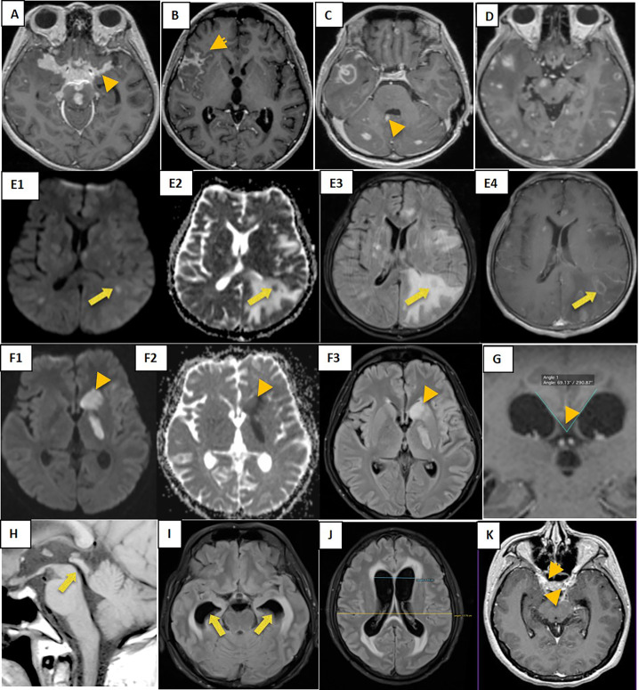
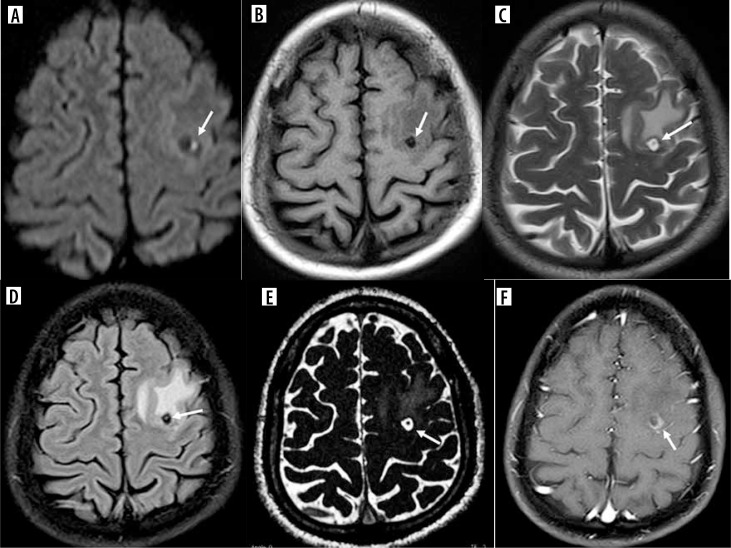
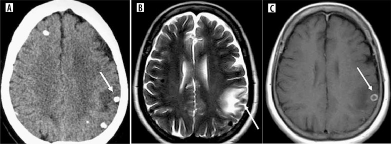
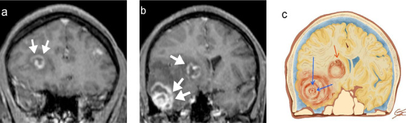
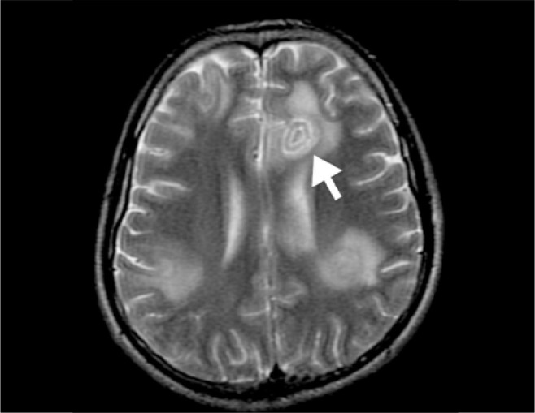
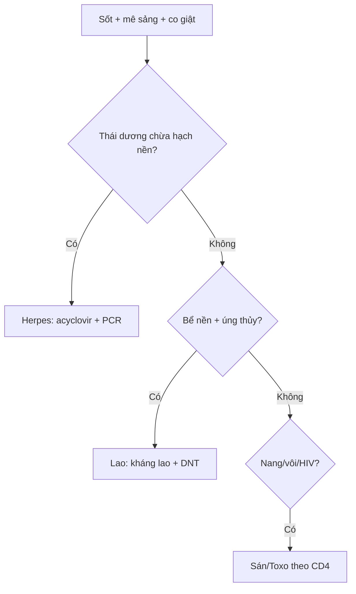

# 214 — Nhiễm trùng thần kinh trung ương: Herpes, lao, sán, Toxo / CNS infections

**Tags:** `pattern:nhiem-trung-tktw` `vung:nao` `protocol:MRI-nhiem-trung`
**Mức chắc chắn (certainty):** tổng hợp y văn (literature synthesis) — nhóm tự biên từ y văn mở, chưa gắn ca nguyên văn đơn lẻ.

## 1. Tổng quan — virus ưa thái dương + vi khuẩn ưa đáy + ký sinh trùng nang

- Virus Herpes simplex type 1 (HSV-1) đi ngược dây khứu giác/tam thoa vào hệ viền (limbic) — TẠI SAO tổn thương thái dương trong + đảo + hồi đai mà **chừa hạch nền**: virus lan theo vỏ-limbic, không theo mạch lenticulostriate (khác nhồi máu hạch nền).
- Lao màng não (TB meningitis) đọng đáy (bể nền) → viêm dính + não úng thủy tắc nghẽn + nhồi máu hố sau — TẠI SAO: dịch não tủy (DNT) chảy chậm ở bể nền, trực khuẩn lắng đọng.
- Ngưỡng: DNT lao (protein > 100 mg/dL + đường < 40 mg/dL + lympho) + PCR HSV dương = chốt; acyclovir **10 mg/kg mỗi 8 giờ 14–21 ngày** càng sớm càng cứu não.

## 2. Gamut nhiễm trùng theo vị trí (Gamut)

- **Thái dương-đảo 2 bên không đối xứng + chừa hạch nền + sốt:** Herpes — acyclovir ngay khi nghi ngờ, đừng chờ PCR.
- **Bể nền + não úng thủy + nhồi máu:** Lao màng não — kháng lao + corticoid + dẫn lưu não thất.
- **Nang đa giai đoạn + vôi hóa:** Ấu trùng sán lợn (cysticercosis 4 giai đoạn) — albendazole + steroid.
- **Hạch nền đa ổ + HIV + vành lệch tâm:** Toxoplasma — cotrimoxazole (khác lymphoma đồng nhất).

## 3. Bảng so sánh phân biệt (ma trận đối chiếu)

| Thực thể (entity) | Hình ảnh điển hình | Chốt vào (rule-in) | Chốt loại (rule-out) | Gợi ý xác nhận |
|---|---|---|---|---|
| Herpes HSV-1 | **Thái dương trong + đảo + hồi đai, CHỪA hạch nền, phù + chảy máu nhẹ** | **Thái dương-đảo + chừa hạch nền + sốt/mê sảng** | Hạch nền hoại tử → nhồi máu/Toxo | PCR HSV DNT + acyclovir 10 mg/kg q8h |
| Lao màng não | **Ngấm bể nền + não úng thủy + nhồi máu hố sau** | **Bể nền + DNT đường thấp + lao phổi** | Thái dương chừa hạch nền → Herpes | Cấy/GenXpert DNT + kháng lao |
| Sán lợn 4 giai đoạn | **Nang mụn (vesicular) → keo (colloidal) → hạt (nodular) → vôi (calcified) + đầu sán (scolex)** | **Scolex trong nang + vôi đa ổ + dịch tễ** | Vành lệch tâm hạch nền + HIV → Toxo | ELISA sán + albendazole + steroid |
| Toxoplasma | **Đa ổ hạch nền + vành lệch tâm (eccentric target)** | **HIV + CD4 < 100 + vành lệch tâm** | Đồng nhất quanh thất → lymphoma | Kháng thể Toxo + cotrimoxazole thử |

*Tăng tín hiệu T2 thái dương + phù + hiệu ứng khối, chừa hạch nền. Nguồn: Chadha et al., Radiol Case Rep 2025 Fig. 1, CC BY-NC-ND 4.0 (giữ nguyên bản).*

*Chùm hình lao màng não (người lớn): (A) ngấm màng não **bể nền**; (B) ngấm **khe Sylvius**; (C) ngấm **màng não thất**; (D) **tuberculoma** đơn/đa; (E) **lao giả áp-xe** (pseudo-abscess) với ngấm vòng; (F) **nhồi máu** hạch nền do viêm mạch; (H–K) biến chứng **não úng thủy tắc nghẽn**. Nguồn: Dian S et al., PLoS One 2020 (PMC7665695), CC BY 4.0.*

*Giai đoạn **keo (colloidal)**: nang giảm tín hiệu trên DWI/T1 (A,B) + **đầu sán (scolex) tăng tín hiệu** bên trong; nang T2 tăng + viền giảm tín hiệu (C). Nguồn: Goddu Govindappa SK et al., Pol J Radiol 2024 (PMC11705042), CC BY-NC-ND 4.0 (giữ nguyên bản).*

*Giai đoạn **vôi hóa (calcified)**: (A) CT nốt vôi hóa kèm **phù quanh** ở vỏ đỉnh trái; (B) T2 cùng ca cho nốt giảm tín hiệu (mũi tên); (C) T1 sau tiêm — viền ngấm mảnh. Nguồn: Goddu Govindappa SK et al., Pol J Radiol 2024 (PMC11705042), CC BY-NC-ND 4.0 (giữ nguyên bản).*

*Toxoplasma (AIDS): T1 sau tiêm (a,b) nhiều tổn thương **ngấm vòng** với **"đích lệch tâm" (eccentric target sign)** — cấu trúc ngấm lệch về một phía thành nang; (c) sơ đồ minh họa. Nguồn: Tiradentes PHA et al., Radiol Bras 2026 (PMC13317705), CC BY 4.0.*

*Dấu **"đích đồng tâm" (concentric target sign)** trên T2 — tổn thương ở hồi đai trái (mũi tên) với vòng đồng tâm; gặp ở Toxoplasma nhưng **kém đặc hiệu** hơn "đích lệch tâm". Nguồn: Tiradentes PHA et al., Radiol Bras 2026 (PMC13317705), CC BY 4.0.*

## 4. Protocol

- **MRI + gadolinium + DWI + PCR DNT** khi sốt + rối loạn ý thức + co giật (đừng chụp CT rồi về).
- Nghi Herpes: acyclovir ngay + levetiracetam dự phòng co giật; lao: chọc DNT đo áp lực + đường/protein + GenXpert.

## 5. Cạm bẫy

- **Chờ PCR mới cho acyclovir** = não chết thêm mỗi giờ — cho ngay khi nghi ngờ lâm sàng + MRI.
- **Lao gọi nhầm u/meningioma bể nền** → mổ vô ích — DNT + lao cũ trước mổ.
- **Sán vôi hóa** giả u vôi/CMV bẩm sinh — scolex + dịch tễ + không phù là chốt.

## 6. Tự lượng giá — Blind Quiz

**Ca 1 — Sốt + loạn thần cấp 7 ngày, không đáp ứng haloperidol. Đọc T2.**

- Hỏi: tổn thương đâu? Chừa cấu trúc nào? Thuốc nào cho ngay?

<b>Bấm để hiện đáp án</b>

- Dấu hiệu (findings): tăng T2 thái dương-phải lan đảo-trán + phù, **chừa hạch nền**.
- Chẩn đoán (diagnosis): **viêm não Herpes** — acyclovir 10 mg/kg q8h ngay + PCR DNT (đừng chờ).
- Nguồn: Chadha et al., Fig. 1, CC BY-NC-ND 4.0 (nguyên bản).

**Ca 2 — Sốt kéo dài, đau đầu, gáy cứng, tổn thương phổi cũ; nhìn chùm ảnh MRI:**

- Gợi ý lâm sàng (clinical context): sốt kéo dài, đau đầu, cứng gáy, có thể liệt dây thần kinh sọ.
- Câu hỏi: (A–C) ngấm ở đâu? (D,E,F) tổn thương nhu mô là gì? (H–K) biến chứng? Xét nghiệm chốt?

<b>Bấm để hiện đáp án</b>

- Dấu hiệu (findings): **ngấm màng não bể nền** (A), **khe Sylvius** (B), **màng não thất** (C); **tuberculoma** (D) và **lao giả áp-xe** (pseudo-abscess, E) ngấm vòng; **nhồi máu hạch nền** (F) do viêm mạch; **não úng thủy tắc nghẽn** (H–K) do viêm dính bể nền.
- Chẩn đoán (diagnosis): **lao màng não (tuberculous meningitis)** — chốt bằng **DNT (protein > 100 mg/dL + glucose < 40 mg/dL + lympho) + GenXpert/cấy lao**; điều trị kháng lao + corticoid, dẫn lưu khi úng thủy.
- Nguồn ảnh: Dian S et al., PLoS One 2020 (PMC7665695), CC BY 4.0.

**Ca 3 — Co giật + tiền sử ăn thịt lợn gạo/từng mắc sán; nhìn MRI (DWI/T1) và CT:**

- Câu hỏi: Hai ảnh thuộc hai giai đoạn nào của sán lợn? Dấu hiệu chốt trên mỗi ảnh? Điều trị kèm gì để tránh phù não?

<b>Bấm để hiện đáp án</b>

- Dấu hiệu (findings): (a) giai đoạn **keo**: nang **giảm tín hiệu DWI/T1** + **đầu sán (scolex) tăng tín hiệu** bên trong, T2 tăng + viền tối; (b) giai đoạn **vôi hóa**: **CT nốt vôi + phù quanh**, T2 nốt giảm tín hiệu; viền ngấm mảnh trên T1 sau tiêm.
- Chẩn đoán (diagnosis): **sán lợn (neurocysticercosis) đa giai đoạn** (vesicular → colloidal → granular-nodular → calcified). Điều trị **albendazole + CORTICOID (steroid)** để hạn chế phù khi nang thoái hóa; **scolex trong nang** là dấu hiệu đặc hiệu.
- Nguồn ảnh: Goddu Govindappa SK et al., Pol J Radiol 2024 (PMC11705042), CC BY-NC-ND 4.0 (giữ nguyên bản).

**Ca 4 — HIV, CD4 60, đa ổ ngấm vòng; nhìn 2 ảnh:**

- Câu hỏi: hai dấu "đích" này thuộc bệnh nào? Dấu nào đặc hiệu hơn? Phân biệt với lymphoma? Điều trị thử?

<b>Bấm để hiện đáp án</b>

- Dấu hiệu (findings): **nhiều tổn thương hạch nền ngấm vòng**; (a) **"đích lệch tâm" (eccentric target)** trên T1 sau tiêm — đặc hiệu hơn cho Toxo; (b) **"đích đồng tâm" (concentric target)** trên T2 — kém đặc hiệu.
- Chẩn đoán (diagnosis): **Toxoplasma não (toxoplasmic encephalitis)** — đa ổ hạch nền + vành ngấm/đích lệch tâm ở bệnh nhân **CD4 < 100**; **điều trị thử cotrimoxazole 2 tuần**; lymphoma quanh thất **đồng nhất**, ADC cực thấp, đáp ứng steroid. Để dè chừng: dấu đích không tuyệt đối đặc hiệu, cần bối cảnh HIV/CD4.
- Nguồn ảnh: Tiradentes PHA et al., Radiol Bras 2026 (PMC13317705), CC BY 4.0.

## Bài liên quan chéo
- [200 – Tổng quan Thần kinh](../200-tong-quan-he-than-kinh/lesson.md)
- [213 – U não](../213-u-nao/lesson.md) (áp-xe vs GBM vs lymphoma)
- [211 – Đột quỵ não](../211-dot-quy-nao/lesson.md) (nhồi máu vs Herpes)
- [219 – PRES & RCVS](../219-pres-rcvs/lesson.md) (viêm não HSV & lao là DDx của phù não sau; phân biệt phù mạch máu vs nhiễm trùng)

## Ảnh
- `images/214_herpes-thai-duong_T2_PMC-Chadha-CCBYNCND40.jpg` — Herpes thái dương-đảo (CC BY-NC-ND 4.0, giữ nguyên bản).
- `images/214_lao-mang-nao_MRI_PMC7665695-Fig1-CCBY.jpg` — lao màng não: ngấm bể nền, tuberculoma, giả áp-xe, úng thủy (CC BY 4.0).
- `images/214_san_MRI_PMC11705042-Fig11-colloidal-CCBYNCND.jpg` — sán giai đoạn keo + đầu sán (CC BY-NC-ND 4.0, giữ nguyên bản).
- `images/214_san_CT-MRI_PMC11705042-Fig14-calcified-CCBYNCND.jpg` — sán giai đoạn vôi hóa trên CT + MRI (CC BY-NC-ND 4.0, giữ nguyên bản).
- `images/214_toxo_MRI_PMC13317705-Fig4-lech-tam-CCBY.jpg` — Toxo: dấu đích lệch tâm (CC BY 4.0).
- `images/214_toxo_MRI_PMC13317705-Fig5-dong-tam-CCBY.jpg` — Toxo: dấu đích đồng tâm (CC BY 4.0).
- Nguồn + giấy phép đầy đủ: `images/CREDITS.md`; link gốc: `sources.md`.

> Không dùng để chẩn đoán độc lập khi chưa có người hướng dẫn.
