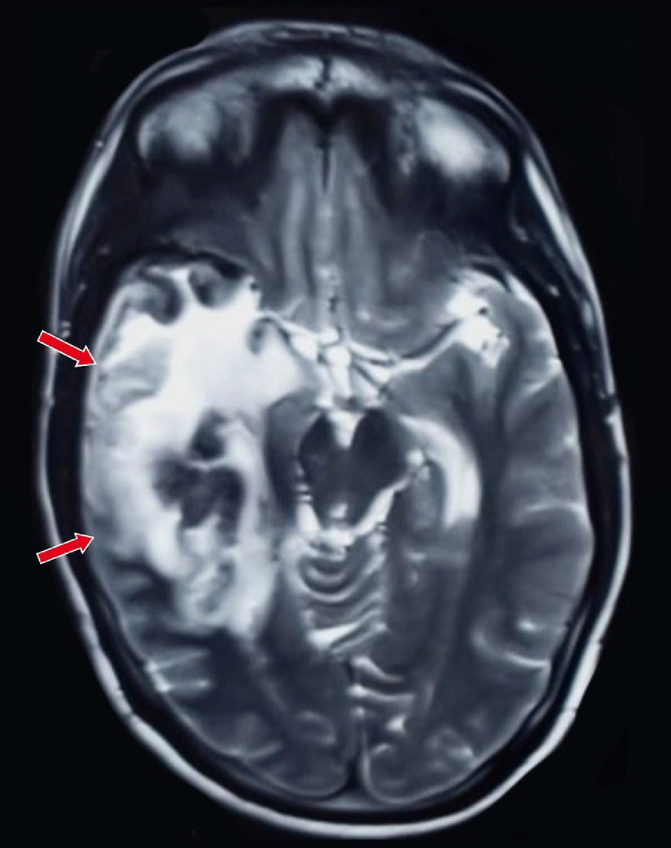
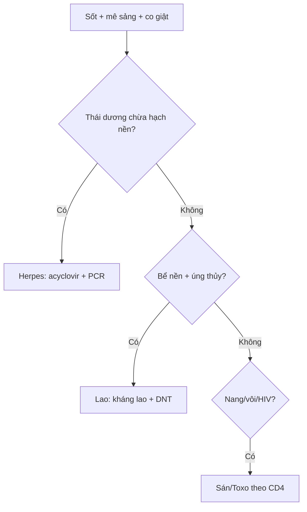

# 214 — Nhiễm trùng thần kinh trung ương: Herpes, lao, sán, Toxo / CNS infections

**Tags:** `pattern:nhiem-trung-tktw` `vung:nao` `protocol:MRI-nhiem-trung`
**Mức chắc chắn (certainty):** tổng hợp y văn (literature synthesis) — nhóm tự biên từ y văn mở, chưa gắn ca nguyên văn đơn lẻ.

## 1. Tổng quan — virus ưa thái dương + vi khuẩn ưa đáy + ký sinh trùng nang

- Virus Herpes simplex type 1 (HSV-1) đi ngược dây khứu giác/tam thoa vào hệ viền (limbic) — TẠI SAO tổn thương thái dương trong + đảo + hồi đai mà **chừa hạch nền**: virus lan theo vỏ-limbic, không theo mạch lenticulostriate (khác nhồi máu hạch nền).
- Lao màng não (TB meningitis) đọng đáy (bể nền) → viêm dính + não úng thủy tắc nghẽn + nhồi máu hố sau — TẠI SAO: dịch não tủy (DNT) chảy chậm ở bể nền, trực khuẩn lắng đọng.
- Ngưỡng: DNT lao (protein > 100 mg/dL + đường < 40 mg/dL + lympho) + PCR HSV dương = chốt; acyclovir **10 mg/kg mỗi 8 giờ 14–21 ngày** càng sớm càng cứu não.

## 2. Gamut nhiễm trùng theo vị trí (Gamut)

- **Thái dương-đảo 2 bên không đối xứng + chừa hạch nền + sốt:** Herpes — acyclovir ngay khi nghi ngờ, đừng chờ PCR.
- **Bể nền + não úng thủy + nhồi máu:** Lao màng não — kháng lao + corticoid + dẫn lưu não thất.
- **Nang đa giai đoạn + vôi hóa:** Ấu trùng sán lợn (cysticercosis 4 giai đoạn) — albendazole + steroid.
- **Hạch nền đa ổ + HIV + vành lệch tâm:** Toxoplasma — cotrimoxazole (khác lymphoma đồng nhất).

## 3. Bảng so sánh phân biệt (ma trận đối chiếu)

| Thực thể (entity) | Hình ảnh điển hình | Chốt vào (rule-in) | Chốt loại (rule-out) | Gợi ý xác nhận |
|---|---|---|---|---|
| Herpes HSV-1 | **Thái dương trong + đảo + hồi đai, CHỪA hạch nền, phù + chảy máu nhẹ** | **Thái dương-đảo + chừa hạch nền + sốt/mê sảng** | Hạch nền hoại tử → nhồi máu/Toxo | PCR HSV DNT + acyclovir 10 mg/kg q8h |
| Lao màng não | **Ngấm bể nền + não úng thủy + nhồi máu hố sau** | **Bể nền + DNT đường thấp + lao phổi** | Thái dương chừa hạch nền → Herpes | Cấy/GenXpert DNT + kháng lao |
| Sán lợn 4 giai đoạn | **Nang mụn (vesicular) → keo (colloidal) → hạt (nodular) → vôi (calcified) + đầu sán (scolex)** | **Scolex trong nang + vôi đa ổ + dịch tễ** | Vành lệch tâm hạch nền + HIV → Toxo | ELISA sán + albendazole + steroid |
| Toxoplasma | **Đa ổ hạch nền + vành lệch tâm (eccentric target)** | **HIV + CD4 < 100 + vành lệch tâm** | Đồng nhất quanh thất → lymphoma | Kháng thể Toxo + cotrimoxazole thử |

*Tăng tín hiệu T2 thái dương + phù + hiệu ứng khối, chừa hạch nền. Nguồn: Chadha et al., Radiol Case Rep 2025 Fig. 1, CC BY-NC-ND 4.0 (giữ nguyên bản).*

## 4. Protocol

- **MRI + gadolinium + DWI + PCR DNT** khi sốt + rối loạn ý thức + co giật (đừng chụp CT rồi về).
- Nghi Herpes: acyclovir ngay + levetiracetam dự phòng co giật; lao: chọc DNT đo áp lực + đường/protein + GenXpert.

## 5. Cạm bẫy

- **Chờ PCR mới cho acyclovir** = não chết thêm mỗi giờ — cho ngay khi nghi ngờ lâm sàng + MRI.
- **Lao gọi nhầm u/meningioma bể nền** → mổ vô ích — DNT + lao cũ trước mổ.
- **Sán vôi hóa** giả u vôi/CMV bẩm sinh — scolex + dịch tễ + không phù là chốt.

## 6. Tự lượng giá — Blind Quiz

**Ca 1 — Sốt + loạn thần cấp 7 ngày, không đáp ứng haloperidol. Đọc T2.**

- Hỏi: tổn thương đâu? Chừa cấu trúc nào? Thuốc nào cho ngay?

<b>Bấm để hiện đáp án</b>

- Dấu hiệu (findings): tăng T2 thái dương-phải lan đảo-trán + phù, **chừa hạch nền**.
- Chẩn đoán (diagnosis): **viêm não Herpes** — acyclovir 10 mg/kg q8h ngay + PCR DNT (đừng chờ).
- Nguồn: Chadha et al., Fig. 1, CC BY-NC-ND 4.0 (nguyên bản).

**Ca 2 — HIV + CD4 60 + đa ổ hạch nền vành lệch tâm:** Toxo hay lymphoma? Thuốc thử? *(Bảng mục 3.)*

<b>Bấm để hiện đáp án</b>

- **Toxoplasma:** cotrimoxazole thử 2 tuần (lymphoma là đồng nhất quanh thất + ADC cực thấp).

**Ca 3 — Nang não có đầu sán + vôi đa ổ + ăn thịt lợn gạo:** giai đoạn nào? Thuốc gì kèm steroid? *(Bảng mục 3.)*

<b>Bấm để hiện đáp án</b>

- **Sán lợn đa giai đoạn:** albendazole + steroid (chống phù khi nang chết).

## Bài liên quan chéo
- [200 – Tổng quan Thần kinh](../200-tong-quan-he-than-kinh/lesson.md)
- [213 – U não](../213-u-nao/lesson.md) (áp-xe vs GBM vs lymphoma)
- [211 – Đột quỵ não](../211-dot-quy-nao/lesson.md) (nhồi máu vs Herpes)

> Không dùng để chẩn đoán độc lập khi chưa có người hướng dẫn.
