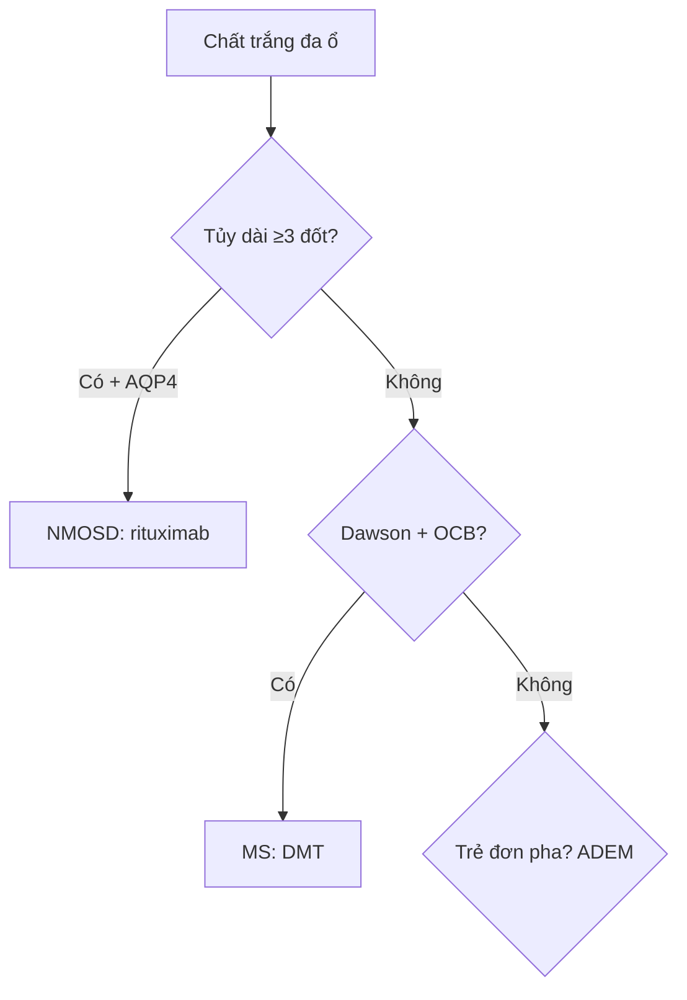

# 215 — Mất myelin: MS, NMOSD & ADEM / Demyelination

**Tags:** `pattern:mat-myelin` `vung:nao-tuy` `score:McDonald`
**Mức chắc chắn (certainty):** tổng hợp y văn (literature synthesis) — nhóm tự biên từ y văn mở, chưa gắn ca nguyên văn đơn lẻ.

## 1. Tổng quan — miễn dịch ăn myelin quanh tĩnh mạch + 2 kháng thể chốt NMOSD/MOGAD

- Xơ cứng rải rác (MS): viêm quanh tĩnh mạch (perivenular) lan theo sợi trắng — TẠI SAO ngón tay Dawson (Dawson fingers) vuông góc não thất: tĩnh mạch tủy (medullary veins) chạy vuông góc thành não thất, viêm lan dọc theo chúng.
- Viêm tủy thị thần kinh (NMOSD): kháng thể aquaporin-4 (AQP4-IgG) đánh kênh nước chân astrocyte — tổn thương dài + thị thần kinh 2 bên + vùng nôn (area postrema).
- Tiêu chuẩn McDonald 2017: lan tỏa không gian (DIS: ≥ 2/4 vùng — quanh não thất, vỏ-dưới vỏ, hố sau, tủy) + lan tỏa thời gian (DIT: tổn thương mới hoặc dải oligoclonal — OCB).

## 2. Gamut chất trắng đa ổ (Gamut)

- **Ngón tay Dawson + tủy ngắn < 2 đốt + OCB:** MS — interferon/ocrelizumab.
- **Tủy dài ≥ 3 đốt (LETM) + thị 2 bên + AQP4 (+):** NMOSD — corticoid + thay huyết tương + rituximab (cấm interferon!).
- **Trẻ + sốt + đối xứng 2 bên + đơn pha:** ADEM — corticoid + IVIG.
- **Mạch máu nhỏ tuổi già:** Fazekas đối xứng + tăng huyết áp — kiểm soát mạch, đừng gọi MS.

## 3. Bảng so sánh phân biệt (ma trận đối chiếu)

| Thực thể (entity) | Hình ảnh điển hình | Chốt vào (rule-in) | Chốt loại (rule-out) | Gợi ý xác nhận |
|---|---|---|---|---|
| MS (McDonald) | **Dawson vuông góc não thất + juxtacortical + hố sau + tủy < 2 đốt; vòng hở hướng vỏ** | **DIS ≥ 2/4 + DIT (mới/OCB)** | LETM ≥ 3 đốt + AQP4 → NMOSD | OCB DNT + VEP + DMT |
| NMOSD | **LETM ≥ 3 đốt + thị 2 bên + area postrema** | **AQP4-IgG (+) + LETM** | Tủy ngắn + OCB → MS | AQP4/MOG + rituximab |
| ADEM | **Trẻ + đối xứng 2 bên + hạch nền + đơn pha sau nhiễm/chủng** | **Trẻ + đơn pha + đối xứng** | Tái phát nhiều đợt → MS | Corticoid + theo dõi tái phát |
| Fazekas mạch nhỏ | **Đối xứng quanh não thất + tuổi già + tăng HA** | **Tuổi + mạch + đối xứng** | Dawson + juxtacortical → MS | Kiểm soát HA/lipid |

*Tổn thương vuông góc thành não thất bên + vòng ngấm hoạt tính. Nguồn: Jameel et al., Radiol Case Rep 2025 Fig. 1/3, CC BY-NC-ND 4.0 (giữ nguyên bản, ca Marburg ác tính).*

## 4. Protocol + McDonald flowchart

- **MRI não + tủy toàn trục + gadolinium + AQP4/MOG + OCB:** DIS/DIT + kháng thể quyết định thuốc (interferon cấm trong NMOSD!).

## 5. Cạm bẫy

- **Giả u mất myelin (tumefactive) mổ nhầm GBM** — vòng hở hướng vỏ + MRS choline thấp + đáp ứng steroid (bài 213).
- **Interferon cho NMOSD** làm nặng thêm — kháng thể AQP4/MOG trước DMT.
- **Marburg ác tính** phù + khối + lệch đường giữa giả u — Dawson + OCB + hội chẩn (ảnh trên là Marburg!).

## 6. Tự lượng giá — Blind Quiz

**Ca 1 — Yếu liệt + tổn thương quanh não thất. Đọc MRI.**

- Hỏi: tên dấu? Bệnh gì? Thuốc nào khi ác tính không đáp ứng steroid?

<b>Bấm để hiện đáp án</b>

- Dấu hiệu (findings): tổn thương vuông góc não thất = **ngón tay Dawson** + vòng ngấm hoạt tính.
- Chẩn đoán (diagnosis): **mất myelin MS (biến thể Marburg ác tính)** — steroid không đỡ → thay huyết tương/IVIG + DMT mạnh (alemtuzumab/ocrelizumab).
- Nguồn: Jameel et al., Fig. 1/3, CC BY-NC-ND 4.0 (nguyên bản).

**Ca 2 — Mù 2 bên + tủy dài 5 đốt + nôn nấc:** MS hay NMOSD? Kháng thể + thuốc cấm? *(Bảng mục 3.)*

<b>Bấm để hiện đáp án</b>

- **NMOSD:** AQP4-IgG (+) + LETM ≥ 3 đốt — **cấm interferon**, dùng rituximab + thay huyết tương.

**Ca 3 — Trẻ 6 tuổi sốt phát ban 1 tuần, tổn thương đối xứng 2 bên đơn pha:** MS hay ADEM? *(Bảng mục 3.)*

<b>Bấm để hiện đáp án</b>

- **ADEM:** trẻ + sau nhiễm + đối xứng + đơn pha — corticoid + theo dõi (tái phát → xét MS).

## Bài liên quan chéo
- [200 – Tổng quan Thần kinh](../200-tong-quan-he-than-kinh/lesson.md)
- [213 – U não](../213-u-nao/lesson.md) (giả u mất myelin vs GBM)
- [430 – Đường thị giác](../430-duong-thi-giac/lesson.md) (viêm thị + LETM)

> Không dùng để chẩn đoán độc lập khi chưa có người hướng dẫn.
