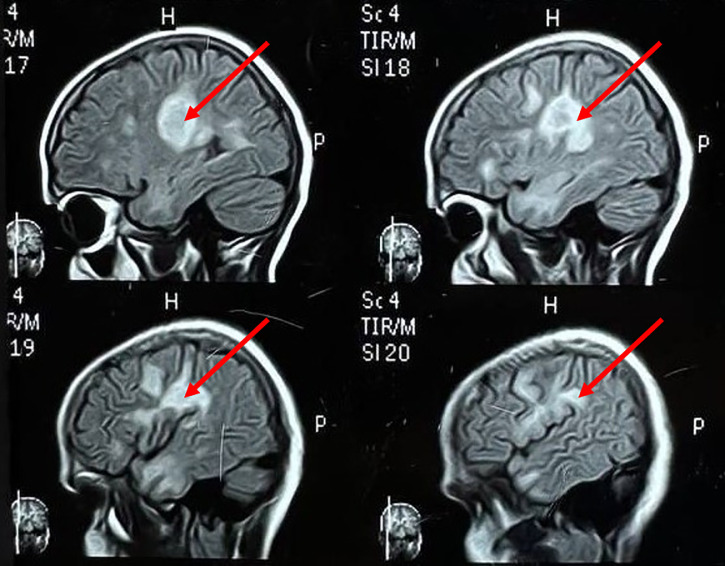
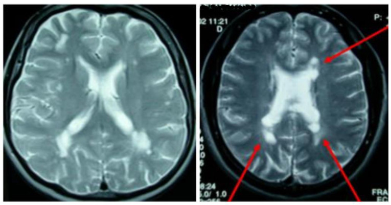
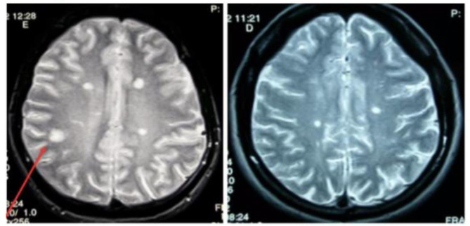
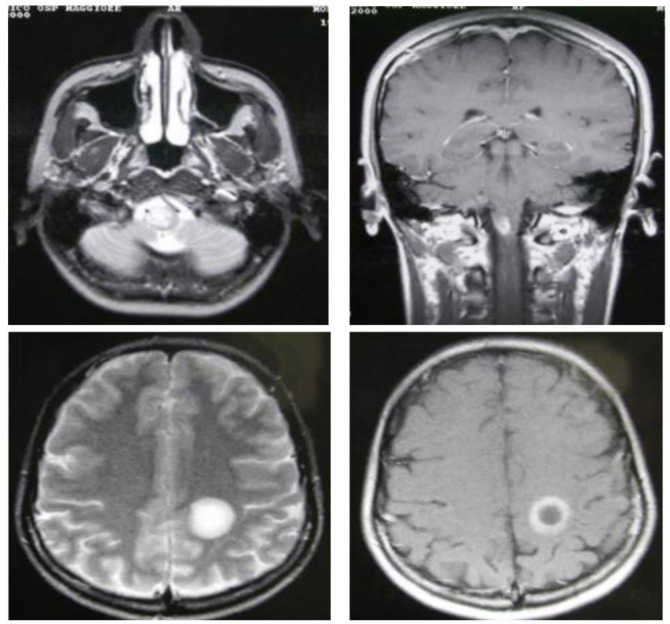
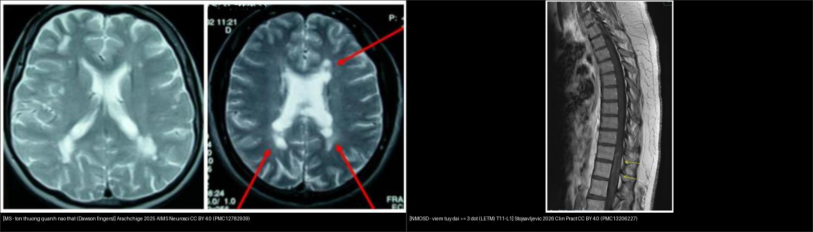
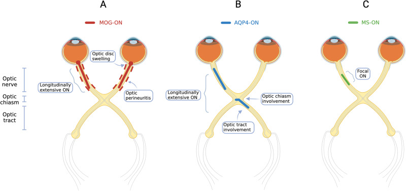
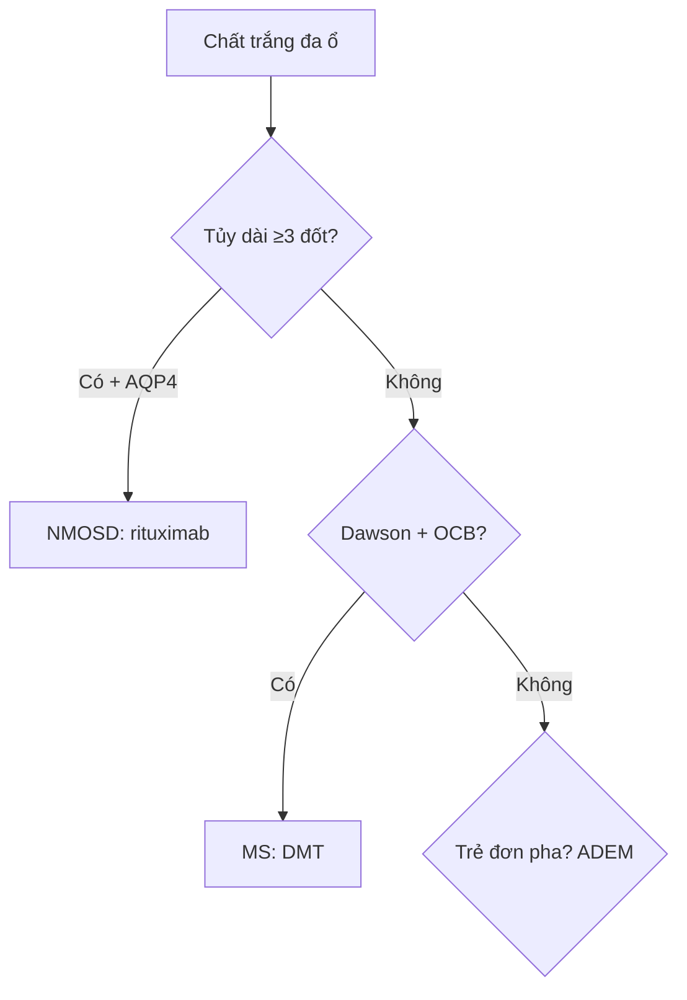
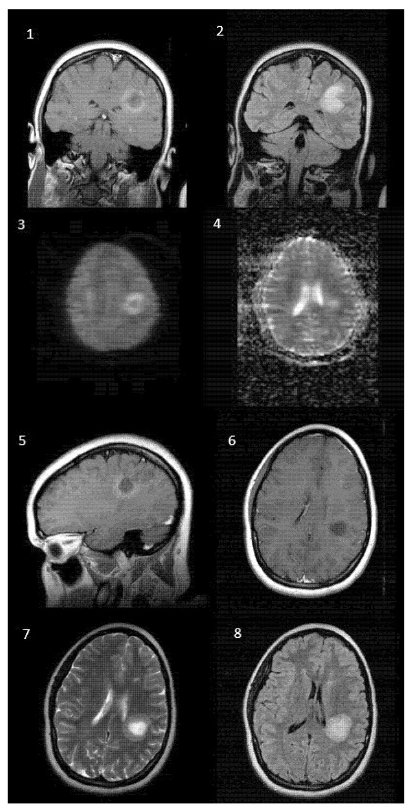
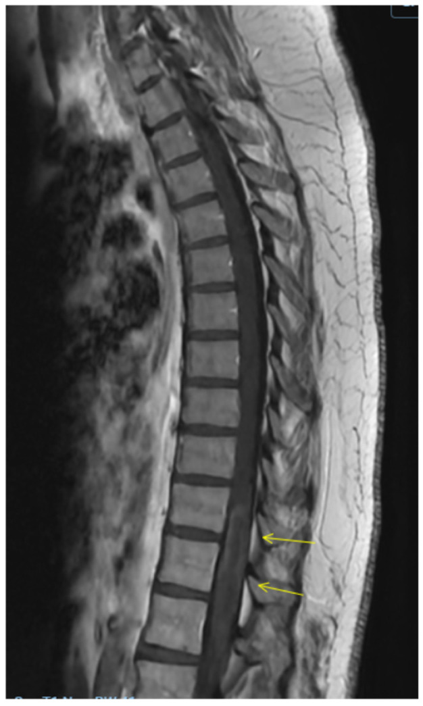
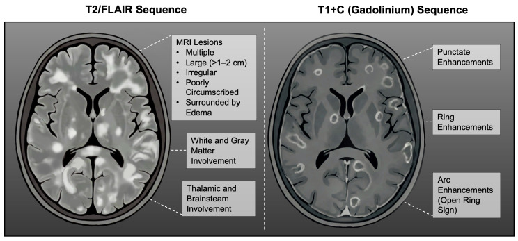

# 215 — Mất myelin: MS, NMOSD & ADEM / Demyelination

**Tags:** `pattern:mat-myelin` `vung:nao-tuy` `score:McDonald`
**Mức chắc chắn (certainty):** tổng hợp y văn (literature synthesis) — nhóm tự biên từ y văn mở, chưa gắn ca nguyên văn đơn lẻ.

## 1. Tổng quan — miễn dịch ăn myelin quanh tĩnh mạch + 2 kháng thể chốt NMOSD/MOGAD

- Xơ cứng rải rác (MS): viêm quanh tĩnh mạch (perivenular) lan theo sợi trắng — TẠI SAO ngón tay Dawson (Dawson fingers) vuông góc não thất: tĩnh mạch tủy (medullary veins) chạy vuông góc thành não thất, viêm lan dọc theo chúng.
- Viêm tủy thị thần kinh (NMOSD): kháng thể aquaporin-4 (AQP4-IgG) đánh kênh nước chân astrocyte — tổn thương dài + thị thần kinh 2 bên + vùng nôn (area postrema).
- Bệnh kháng myelin-oligodendrocyte (MOGAD): kháng MOG ở bao myelin ngoài — viêm thị 2 bên + phù đĩa + quanh bao + LETM/tủy ngắn + ADEM-like trẻ em, đáp ứng steroid tốt, tái phát ít di chứng hơn NMOSD.
- Tiêu chuẩn McDonald 2017: lan tỏa không gian (DIS: ≥ 2/4 vùng — quanh não thất, vỏ-dưới vỏ, hố sau, tủy) + lan tỏa thời gian (DIT: tổn thương mới hoặc dải oligoclonal — OCB).

## 2. Gamut chất trắng đa ổ (Gamut)

- **Ngón tay Dawson + tủy ngắn < 2 đốt + OCB:** MS — interferon/ocrelizumab.
- **Tủy dài ≥ 3 đốt (LETM) + thị 2 bên + AQP4 (+):** NMOSD — corticoid + thay huyết tương + rituximab (cấm interferon!).
- **Trẻ + sốt + đối xứng 2 bên + đơn pha:** ADEM — corticoid + IVIG.
- **Mạch máu nhỏ tuổi già:** Fazekas đối xứng + tăng huyết áp — kiểm soát mạch, đừng gọi MS.

## 3. Bảng so sánh phân biệt (ma trận đối chiếu)

| Thực thể (entity) | Hình ảnh điển hình | Chốt vào (rule-in) | Chốt loại (rule-out) | Gợi ý xác nhận |
|---|---|---|---|---|
| MS (McDonald) | **Dawson vuông góc não thất + juxtacortical + hố sau + tủy < 2 đốt; vòng hở hướng vỏ** | **DIS ≥ 2/4 + DIT (mới/OCB)** | LETM ≥ 3 đốt + AQP4 → NMOSD | OCB DNT + VEP + DMT |
| NMOSD | **LETM ≥ 3 đốt + thị 2 bên + area postrema** | **AQP4-IgG (+) + LETM** | Tủy ngắn + OCB → MS | AQP4/MOG + rituximab |
| MOGAD | **Thị 2 bên + phù đĩa + quanh bao + LETM/ngắn + ADEM-like** | **MOG-IgG (+) + phù đĩa + đáp ứng tốt** | Không phù đĩa + AQP4 → NMOSD | Steroid + theo dõi (tiên lượng khá) |
| ADEM | **Trẻ + đối xứng 2 bên + hạch nền + đơn pha sau nhiễm/chủng** | **Trẻ + đơn pha + đối xứng** | Tái phát nhiều đợt → MS | Corticoid + theo dõi tái phát |
| Fazekas mạch nhỏ | **Đối xứng quanh não thất + tuổi già + tăng HA** | **Tuổi + mạch + đối xứng** | Dawson + juxtacortical → MS | Kiểm soát HA/lipid |

*Tổn thương vuông góc thành não thất bên + vòng ngấm hoạt tính. Nguồn: Jameel et al., Radiol Case Rep 2025 Fig. 1/3, CC BY-NC-ND 4.0 (giữ nguyên bản, ca Marburg ác tính).*

### Bốn vùng tổn thương "chốt" của MS trên MRI (DIS)

*Tổn thương **quanh não thất** (periventricular) — vùng DIS thứ nhất. Nguồn: Arachchige ASPM et al., AIMS Neurosci 2025 (PMC12782939), CC BY 4.0.*

*Tổn thương **cạnh vỏ (juxtacortical)** — vùng DIS thứ hai. Nguồn: Arachchige ASPM et al., AIMS Neurosci 2025 (PMC12782939), CC BY 4.0.*

*Tổn thương **ngấm gadolinium** trên T1W sau tiêm (vòng/đặc) = tổn thương **hoạt tính** (DIT). Nguồn: Arachchige ASPM et al., AIMS Neurosci 2025 (PMC12782939), CC BY 4.0.*

*Trái: **MS** — tổn thương quanh não thất. Phải: **NMOSD** — viêm tủy dọc dài ≥ 3 đốt (LETM) T11–L1 trên T2 sagittal. Nguồn: Arachchige ASPM 2025 (PMC12782939) + Stojsavljevic J 2026 (PMC13206227), CC BY 4.0. Ảnh ghép letterbox.*

### Phân bố tổn thương thị theo kháng thể (MOG-ON / AQP4-ON / MS-ON)

*(A) **MOG-ON** — viêm thị hai bên dọc dài + phù đĩa; (B) **AQP4-ON (NMOSD)** — viêm thị dọc dài, thường nặng, lan tới giao thoa/hai bên; (C) **MS-ON** — viêm thị ngắn, khu trú một đoạn. Nguồn: Jeyakumar N et al., Eye 2024 (PMC11306565), CC BY 4.0.*

## 4. Protocol + McDonald flowchart

- **MRI não + tủy toàn trục + gadolinium + AQP4/MOG + OCB:** DIS/DIT + kháng thể quyết định thuốc (interferon cấm trong NMOSD!).

## 5. Cạm bẫy

- **Giả u mất myelin (tumefactive) mổ nhầm GBM** — vòng hở hướng vỏ + MRS choline thấp + đáp ứng steroid (bài 213).
- **Interferon cho NMOSD** làm nặng thêm — kháng thể AQP4/MOG trước DMT.
- **Marburg ác tính** phù + khối + lệch đường giữa giả u — Dawson + OCB + hội chẩn (ảnh trên là Marburg!).
- **Khoảng Virchow-Robin giãn / đốm Fazekas** giả mảng MS — MS thật phải **chạm sát não thất + mặt dưới thể chai trên sagittal FLAIR** (Fazekas chừa viền, tròn nhỏ, không Dawson).

*Tổn thương mất myelin giả u (tumefactive): **vòng ngấm HỞ hướng về vỏ não (open-ring/horseshoe sign)** + trung tâm không ngấm — dấu hiệu phân biệt với u thần kinh đệm độ cao (vòng ngấm kín, dày không đều). Nguồn: Fernandez-Gomez MP et al., Reports (MDPI) 2026 (PMC13306738), CC BY 4.0.*

## 6. Tự lượng giá — Blind Quiz

**Ca 1 — Yếu liệt + tổn thương quanh não thất. Đọc MRI.**

- Hỏi: tên dấu? Bệnh gì? Thuốc nào khi ác tính không đáp ứng steroid?

<b>Bấm để hiện đáp án</b>

- Dấu hiệu (findings): tổn thương vuông góc não thất = **ngón tay Dawson** + vòng ngấm hoạt tính.
- Chẩn đoán (diagnosis): **mất myelin MS (biến thể Marburg ác tính)** — steroid không đỡ → thay huyết tương/IVIG + DMT mạnh (alemtuzumab/ocrelizumab).
- Nguồn: Jameel et al., Fig. 1/3, CC BY-NC-ND 4.0 (nguyên bản).

**Ca 2 — Nam 30 tuổi, tổn thương chất trắng quanh não thất. Nhìn ảnh trước.**

- Hỏi: tổn thương nằm ở vùng nào (DIS)? Đọc thêm vùng nào để đủ tiêu chuẩn McDonald?

<b>Bấm để hiện đáp án</b>

- Dấu hiệu (findings): nhiều ổ tăng tín hiệu **quanh não thất** (periventricular), vuông góc thành não thất.
- Chẩn đoán (diagnosis): **MS** — vùng DIS thứ nhất; cần thêm ≥ 1 vùng nữa (cạnh vỏ, hố sau, tủy) để đủ **DIS ≥ 2/4** + DIT.
- Nguồn: Arachchige ASPM et al., AIMS Neurosci 2025 (PMC12782939), CC BY 4.0 — Fig 5.

**Ca 3 — Bệnh nhân tổn thương chạm vỏ não. Nhìn ảnh trước.**

<b>Bấm để hiện đáp án</b>

- Dấu hiệu (findings): tổn thương **cạnh vỏ (juxtacortical)** — chạm vỏ não (mũi tên đỏ).
- Chẩn đoán (diagnosis): **MS** — vùng DIS thứ hai; cạnh vỏ là vùng phân biệt với bệnh mạch máu nhỏ (thường không chạm vỏ).
- Nguồn: Arachchige ASPM et al., AIMS Neurosci 2025 (PMC12782939), CC BY 4.0 — Fig 6.

**Ca 4 — Bệnh nhân tổn thương ngấm thuốc. Nhìn ảnh trước.**

<b>Bấm để hiện đáp án</b>

- Dấu hiệu (findings): tổn thương **ngấm gadolinium** trên T1W sau tiêm (vòng/đặc) ở trên lều.
- Chẩn đoán (diagnosis): **MS hoạt tính** — tổn thương ngấm thuốc = bằng chứng **lan tỏa thời gian (DIT)**.
- Nguồn: Arachchige ASPM et al., AIMS Neurosci 2025 (PMC12782939), CC BY 4.0 — Fig 7.

**Ca 5 — Phù tủy dọc dài. Nhìn ảnh trước.**

- Hỏi: tổn thương chiếm bao nhiêu đốt? Gợi ý MS hay NMOSD? Kháng thể cần tìm + thuốc CẤM?

<b>Bấm để hiện đáp án</b>

- Dấu hiệu (findings): tăng tín hiệu T2 **dọc dài từ T11–L1 (≥ 3 đốt) = LETM** (viêm tủy dọc dài).
- Chẩn đoán (diagnosis): **gợi ý NMOSD** — tìm **AQP4-IgG** (và MOG-IgG); **CẤM interferon** (làm nặng), dùng corticoid + thay huyết tương ± rituximab.
- Nguồn: Stojsavljevic J et al., Clin Pract 2026 (PMC13206227), CC BY 4.0 — Fig 3.

**Ca 6 — Mù hai bên ở người trẻ, cần phân bố tổn thương thị. Nhìn sơ đồ.**

<b>Bấm để hiện đáp án</b>

- Dấu hiệu (findings): (A) **MOG-ON** — hai bên, dọc dài, phù đĩa; (B) **AQP4-ON** — dọc dài, nặng, lan giao thoa/hai bên; (C) **MS-ON** — ngắn, khu trú một đoạn.
- Chẩn đoán (diagnosis): phân biệt theo **kháng thể (MOG vs AQP4 vs MS)** quyết định tiên lượng và điều trị (MOGAD đáp ứng steroid tốt, tái phát ít di chứng hơn NMOSD).
- Nguồn: Jeyakumar N et al., Eye 2024 (PMC11306565), CC BY 4.0 — Fig 1.

**Ca 7 — Trẻ 6 tuổi sốt phát ban 1 tuần, tổn thương đối xứng 2 bên đơn pha. Nhìn ảnh trước.**

- Hỏi: tổn thương có đặc điểm gì (kích thước, bờ, đồi thị)? MS hay ADEM?

<b>Bấm để hiện đáp án</b>

- Dấu hiệu (findings): T2/FLAIR + T1+C — tổn thương **nhiều ổ, lớn (> 1–2 cm), bờ không rõ (poorly marginated)**, có thể gồm **đồi thị/hạch nền**.
- Chẩn đoán (diagnosis): **ADEM** — trẻ + sau nhiễm + đối xứng + đơn pha; corticoid + theo dõi (tái phát nhiều đợt → xét MS).
- Nguồn: Ferenc K et al., Brain Sci 2026 (PMC12938939), CC BY 4.0 — Fig 4.

**Ca 8 — Giả u mất myelin. Nhìn ảnh trước.**

<b>Bấm để hiện đáp án</b>

- Dấu hiệu (findings): tổn thương **vòng ngấm HỞ hướng về vỏ (open-ring/horseshoe sign)** + trung tâm không ngấm.
- Chẩn đoán (diagnosis): **mất myelin giả u (tumefactive demyelination)** — vòng hở hướng vỏ giúp phân biệt với u thần kinh đệm độ cao (vòng kín, dày không đều); tránh sinh thiết/mổ nhầm (đáp ứng steroid).
- Nguồn: Fernandez-Gomez MP et al., Reports (MDPI) 2026 (PMC13306738), CC BY 4.0 — Fig 1.

**Ca 9 — Mù 2 bên + tủy dài 5 đốt + nôn nấc:** MS hay NMOSD? Kháng thể + thuốc cấm? *(Bảng mục 3.)*

<b>Bấm để hiện đáp án</b>

- **NMOSD:** AQP4-IgG (+) + LETM ≥ 3 đốt — **cấm interferon**, dùng rituximab + thay huyết tương.

## Bài liên quan chéo
- [200 – Tổng quan Thần kinh](../200-tong-quan-he-than-kinh/lesson.md)
- [213 – U não](../213-u-nao/lesson.md) (giả u mất myelin vs GBM)
- [430 – Đường thị giác](../430-duong-thi-giac/lesson.md) (viêm thị + LETM)

> Không dùng để chẩn đoán độc lập khi chưa có người hướng dẫn.
