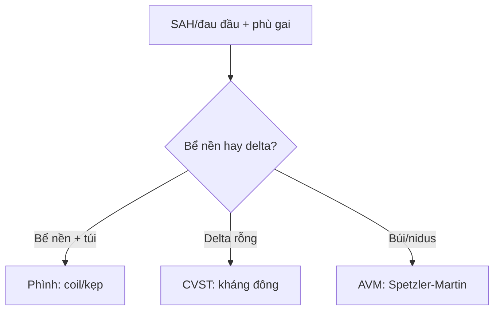

# 216 — Dị dạng mạch não & huyết khối xoang tĩnh mạch / Aneurysm, AVM & CVST

**Tags:** `pattern:di-dang-mach` `vung:mach-nao` `protocol:CTA-MRA`
**Mức chắc chắn (certainty):** tổng hợp y văn (literature synthesis) — nhóm tự biên từ y văn mở, chưa gắn ca nguyên văn đơn lẻ.

## 1. Tổng quan — túi phình + búi động-tĩnh mạch + hang mạch + xoang tắc

- Phình động mạch (aneurysm) túi ở chỗ chia mạch (thông trước, PCom, MCA) — TẠI SAO vỡ khi gắng sức: thành túi chỉ có nội mạc + xơ, không lớp cơ; nguy cơ vỡ tăng theo kích thước (≥ 7 mm trước / ≥ 5 mm sau thường can thiệp).
- Dị dạng động-tĩnh mạch (AVM): búi nidus nối trực tiếp ĐM-TM không mao mạch — Spetzler-Martin (kích thước + vùng chức năng + dẫn lưu sâu, 1–5 điểm) quyết định mổ.
- Huyết khối xoang tĩnh mạch (CVST): ứ trệ xoang dọc trên/xoang ngang — phù gai + nhồi máu không theo vùng động mạch + chảy máu.

## 2. Gamut mạch máu (Gamut)

- **Đau sét đánh + SAH bể nền:** vỡ phình — CTA/MRA + coil/kẹp + nimodipine.
- **Trẻ co giật + chảy máu + búi flow-void:** AVM — Spetzler-Martin + dao gamma/mổ.
- **Bỏng ngô + viền hemosiderin + DVA:** Cavernoma — SWI + theo dõi (chảy máu tái phát mới mổ).
- **Đau đầu + phù gai + nhồi máu lạ vùng mạch:** CVST — empty delta + kháng đông NGAY CẢ khi có máu.

## 3. Bảng so sánh phân biệt (ma trận đối chiếu)

| Thực thể (entity) | Hình ảnh điển hình | Chốt vào (rule-in) | Chốt loại (rule-out) | Gợi ý xác nhận |
|---|---|---|---|---|
| Phình vỡ | **Túi cổ ở chỗ chia + SAH + co thắt mạch** | **SAH bể nền + túi ≥ 5–7 mm** | Búi nidus → AVM | CTA + coil/kẹp ≤ 72 giờ |
| AVM | **Búi nidus flow-void + DVA + vôi** | **Nidus + Spetzler-Martin 1–5** | Bỏng ngô viền sắt → cavernoma | DSA + gamma/mổ theo điểm |
| Cavernoma | **Bỏng ngô đa thì máu + viền hemosiderin SWI tối** | **Popcorn + viền tối + DVA kèm** | Nidus + shunt cao → AVM | SWI + theo dõi, mổ khi tái chảy |
| CVST | **Empty delta + dây thừng đặc (cord sign) + nhồi máu lạ vùng** | **Delta rỗng + phù gai + không theo ĐM** | Theo vùng MCA/PCA → nhồi máu ĐM | MRV + kháng đông (kể cả có máu) |

*(a) axial + (b) coronal: trung tâm không ngấm (huyết khối) viền ngấm (màng) = delta rỗng. Nguồn: Rojas-Oviedo et al., Clin Case Rep 2026 Fig. 1, CC BY-NC-ND 4.0 (giữ nguyên bản).*

## 4. Protocol

- **CTA/MRA + DSA** khi SAH (tìm phình/AVM); **CTV/MRV + D-dimer** khi nghi CVST (phù gai, hậu sản, thuốc).
- CVST: heparin → warfarin/DOAC 3–12 tháng + điều trị áp lực nội sọ (acetazolamide/chọc tháo).

## 5. Cạm bẫy

- **Không kháng đông CVST vì sợ máu** = sai lầm chết người — huyết khối lan mới là kẻ giết (kháng đông kể cả có chảy máu).
- **Phình < 5 mm vỡ vẫn chết** — kích thước là xác suất, vỡ rồi là mổ/coil bất kể mm.
- **Cavernoma gia đình đa ổ** bỏ sót — SWI toàn não + tầm soát người thân.

## 6. Tự lượng giá — Blind Quiz

**Ca 1 — Đau đầu + phù gai + nhìn đôi. Đọc CTA.**

- Hỏi: tên dấu? Tắc ở đâu? Kháng đông có chống chỉ định khi có máu không?

<b>Bấm để hiện đáp án</b>

- Dấu hiệu (findings): trung tâm xoang không ngấm + viền ngấm = **dấu delta rỗng (empty delta)** xoang ngang.
- Chẩn đoán (diagnosis): **huyết khối xoang tĩnh mạch (CVST)** — kháng đông ngay cả khi có chảy máu kèm (heparin → apixaban + theo dõi hematocrit).
- Nguồn: Rojas-Oviedo et al., Fig. 1, CC BY-NC-ND 4.0 (nguyên bản).

**Ca 2 — Túi thông trước 8 mm vỡ + SAH Fisher 3:** coil hay theo dõi? Thuốc chống co thắt? *(Bảng mục 3.)*

<b>Bấm để hiện đáp án</b>

- **Coil/kẹp ≤ 72 giờ + nimodipine:** ≥ 7 mm trước + đã vỡ = can thiệp (không theo dõi).

**Ca 3 — Bỏng ngô thái dương + viền SWI tối + co giật 1 cơn:** AVM hay cavernoma? Mổ ngay? *(Bảng mục 3.)*

<b>Bấm để hiện đáp án</b>

- **Cavernoma:** theo dõi + thuốc chống co giật (mổ khi tái chảy/thần kinh tiến triển).

## Bài liên quan chéo
- [200 – Tổng quan Thần kinh](../200-tong-quan-he-than-kinh/lesson.md)
- [212 – Xuất huyết sọ](../212-xuat-huyet-so-nao/lesson.md) (SAH Fisher)
- [211 – Đột quỵ não](../211-dot-quy-nao/lesson.md) (nhồi máu lạ vùng mạch)

> Không dùng để chẩn đoán độc lập khi chưa có người hướng dẫn.
