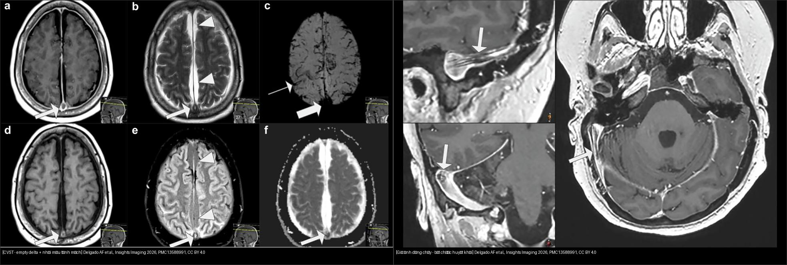
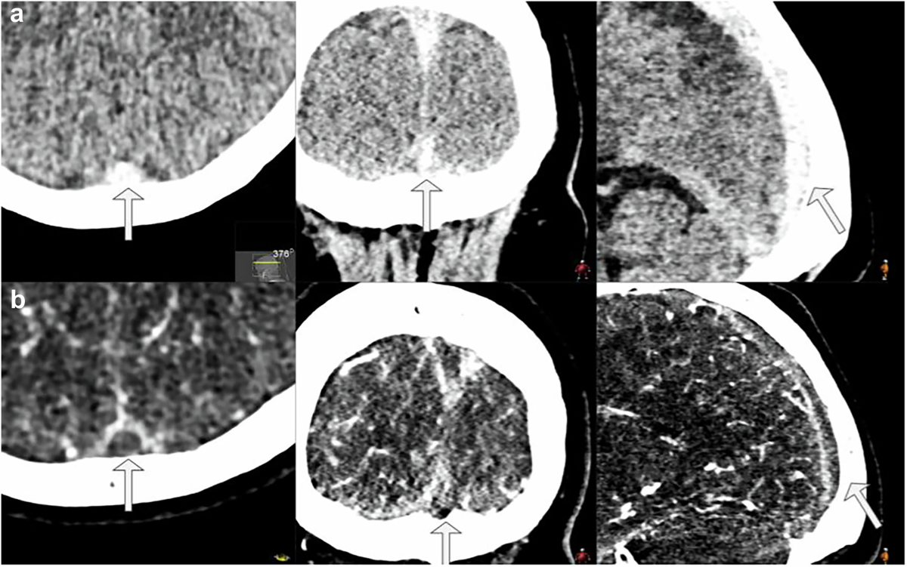
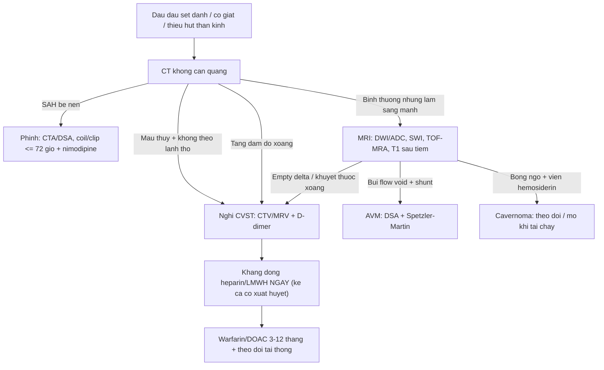
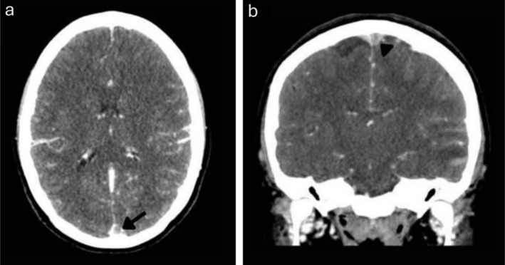
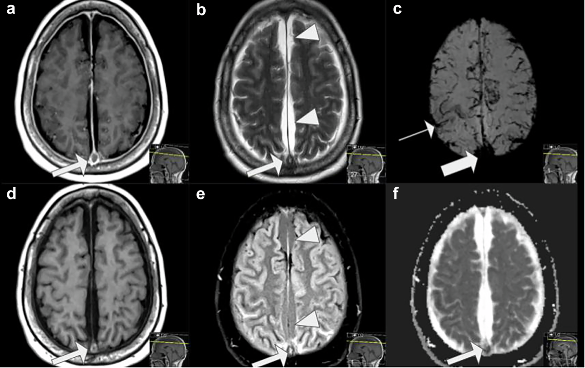
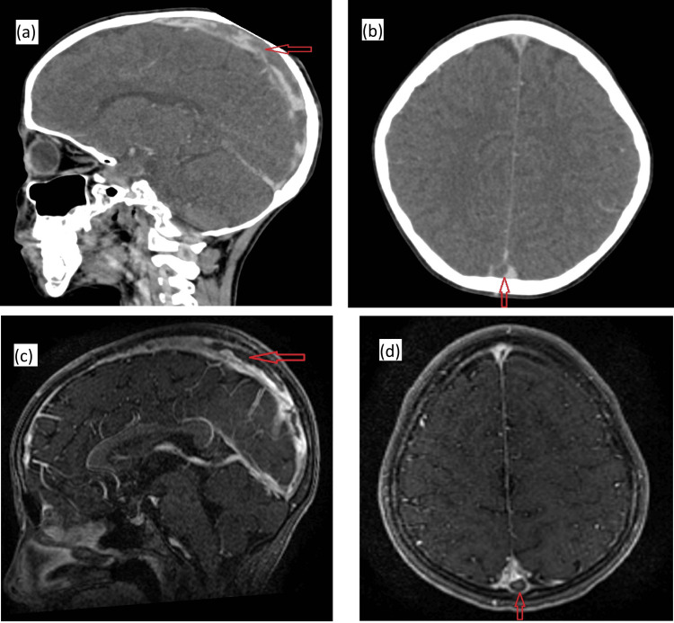
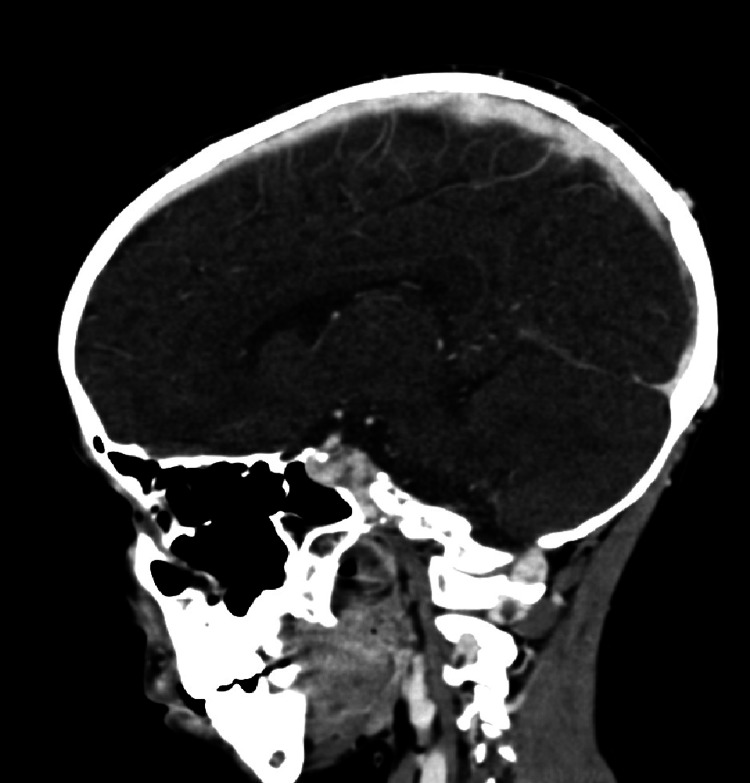
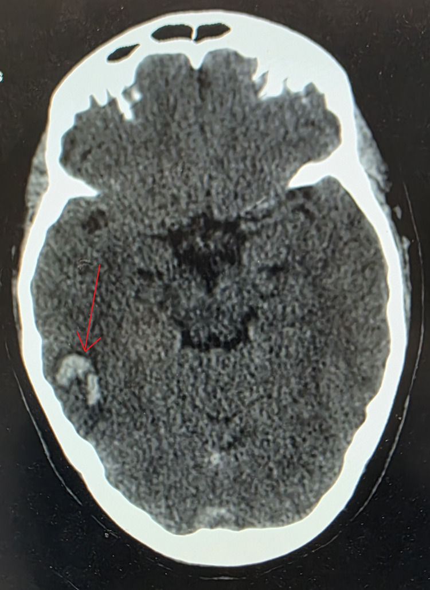
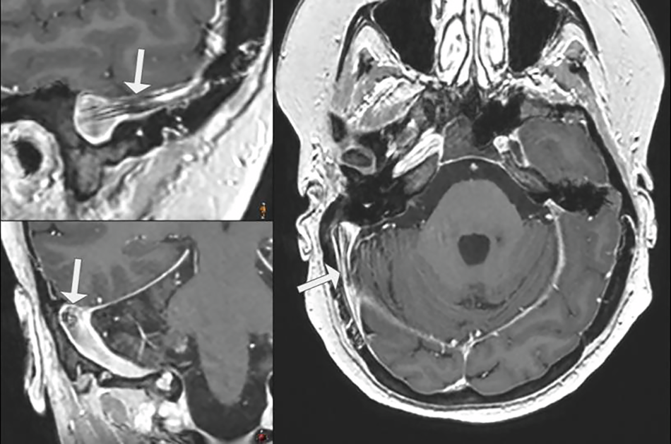

# 216 — Dị dạng mạch não & huyết khối xoang tĩnh mạch / Aneurysm, AVM, Cavernoma & CVST

**Tags:** `pattern:di-dang-mach` `pattern:khuyet-thuoc-xoang` `vung:mach-nao` `protocol:CTA-MRV` `score:Spetzler-Martin`
**Mức chắc chắn (certainty):** tổng hợp y văn (literature synthesis) — bài tổng quan hình ảnh + ca nguyên văn (verbatim case) từ nguồn CC BY; số liệu lấy từ bài gốc có PMCID.

> **Điểm chốt:** bốn thực thể trong một bài vì cùng nằm trên phổ "mạch máu não": **phình vỡ → SAH**, **AVM → xuất huyết/nidus**, **cavernoma → "bỏng ngô" + viền hemosiderin**, **CVST → nhồi máu không theo lãnh thổ động mạch + empty delta**. CVST là chẩn đoán **hay bị bỏ sót nhất** ở trẻ đau đầu/co giật, và **kháng đông không chống chỉ định chỉ vì có xuất huyết**.

## 1. Tổng quan bệnh học – cơ chế hình ảnh

### 1.1 Phình động mạch (intracranial aneurysm)

- Túi phình thường ở **chỗ chia mạch** (thông trước, thông sau, MCA bifurcation). Thành túi **chỉ còn nội mạc + xơ**, thiếu lớp cơ → **vỡ khi gắng sức/tăng huyết áp**.
- **TẠI SAO SAH có máu bể nền:** vỡ túi đổ máu vào khoang dưới nhện → CT không cản quang thấy **máu tăng đậm độ ở bể nền/rãnh**; biến chứng **co thắt mạch (vasospasm)** đỉnh ngày **3–14**, gây nhồi máu muộn.
- Nguy cơ vỡ tăng theo kích thước: **≥ 7 mm (tuần hoàn trước) / ≥ 5 mm (tuần hoàn sau)** là ngưỡng thường được cân nhắc can thiệp; nhưng **phình < 5 mm vẫn có thể vỡ**, nhất là phình đã có tiền sử vỡ.
- Điều trị: **coil nội mạch hoặc kẹp (clip) ≤ 72 giờ** sau SAH; **nimodipine** dự phòng co thắt.

### 1.2 Dị dạng động–tĩnh mạch (AVM)

- **Nidus** nối trực tiếp ĐM–TM **không qua mao mạch** → shunt lưu lượng cao, mạch nuôi giãn, dẫn lưu TM sớm.
- Trên MRI: **búi flow void** ("bag of worms"), có thể kèm **xuất huyết cũ (SWI tối)** và **vôi hóa**; DSA xác định nidus + shunt.
- Phân độ **Spetzler–Martin** (1–5): **kích thước** (< 3 cm = 1; 3–6 cm = 2; > 6 cm = 3) + **vùng chức năng** (+1) + **dẫn lưu TM sâu** (+1). Điểm càng cao, nguy cơ phẫu thuật càng lớn → cân nhắc **dao gamma/xạ định vị** hoặc theo dõi.

### 1.3 Cavernoma (cavernous malformation)

- Các **xoang mạch (caverns)** thành mỏng, **không có nhu mô não giữa các xoang**, không shunt động–tĩnh mạch đáng kể.
- Hình ảnh đặc trưng: **"bỏng ngô" (popcorn)** đa tín hiệu do **máu ở nhiều giai đoạn** (hemoglobin thoái giáng: methemoglobin sáng T1, hemosiderin tối T2/SWI), **viền hemosiderin tối trên SWI/T2\***, thường kèm **DVA**.
- **TẠI SAO đa tín hiệu:** các đợt xuất huyết lặp lại tạo các "ống" máu ở thời điểm khác nhau → T1/T2 hỗn hợp; **không ngấm thuốc đáng kể** (khác u).

### 1.4 Huyết khối xoang tĩnh mạch não (cerebral venous sinus thrombosis, CVST)

- **Sinh lý bệnh:** tắc xoang → **tăng áp lực tĩnh mạch** → giảm chênh áp tưới máu, phù não, **nhồi máu tĩnh mạch** và/hoặc **xuất huyết**. Vì vậy nhồi máu **không theo lãnh thổ động mạch**, hay **hai bên/đối xứng**, ưu thế **đồi thị, thùy chẩm/đỉnh, thùy thái dương**.
- **Dịch tễ trẻ:** **0,6–1,1/100.000 trẻ/năm**, đang tăng khoảng **3,8%/năm** (chuẩn hóa tuổi–giới); nhập viện vì CVST tăng **4,9%/năm** ở Mỹ (Maratta C et al., *Crit Care Explor* 2026, PMC13200926). Tử vong **3–12%**, di chứng thần kinh tới **62%** người sống.
- **Bối cảnh ở trẻ:** nhiễm trùng đầu–cổ (viêm xoang, viêm tai xương chũm), **mất nước**, thiếu máu, sepsis, bệnh ác tính/điều trị, **tăng đông di truyền**, hội chứng thận hư, lupus. Ở trẻ sơ sinh: **co giật, kích thích, thóp căng**; trẻ lớn: **đau đầu + phù gai + nhìn đôi**.
- **Cơ chế hình ảnh:**
  - **CT không cản quang:** máu tụ trong xoang **tăng đậm độ** ("dense sinus"/**cord sign**); độ nhạy thấp, dễ bỏ sót nếu không nhìn xoang.
  - **CTV/MRV:** **khuyết thuốc (filling defect)** trong xoang — tiêu chuẩn chẩn đoán; **empty delta sign** = trung tâm huyết khối **không ngấm**, viền màng cứng **ngấm** (chỉ thấy khi có cản quang, thường sau vài ngày).
  - **MRI:** huyết khối thay đổi theo thời gian — **T1 sáng** khi methemoglobin (bán cấp sớm), **T2 tối** khi hemosiderin (muộn); **T2\*/SWI** thấy vi xuất huyết/tĩnh mạch giãn "corkscrew"; **DWI/ADC** phân biệt **phù mạch (ADC tăng)** với **nhồi máu (ADC giảm)**.
  - **Nhồi máu tĩnh mạch** trên CT: **giảm đậm độ không theo lãnh thổ + xuất huyết trong ổ** (thường thùy thái dương/đỉnh), có thể **hiệu ứng khối**.
- **Điều trị:** **kháng đông (heparin/LMWH) NGAY cả khi có xuất huyết kèm**, sau đó warfarin/DOAC **3–12 tháng** tùy nguyên nhân; **không** dùng kháng đông là sai lầm chết người. Nặng: **dẫn lưu/xuất huyết giải ép**, khi thất bại có thể **huyết khối cơ học nội mạch** ở trung tâm có kinh nghiệm.

## 2. Mẫu hình + chẩn đoán phân biệt theo vị trí (gamut)

- **SAH bể nền + đau đầu sét đánh + túi ở chỗ chia mạch:** **phình vỡ** → CTA + coil/clip ≤ 72 giờ + nimodipine.
- **Búi flow void + shunt sớm trên DSA + xuất huyết thùy:** **AVM** → Spetzler–Martin.
- **"Bỏng ngô" + viền SWI tối + không ngấm + DVA:** **cavernoma** → theo dõi; mổ khi tái chảy/thần kinh tiến triển.
- **Nhồi máu không theo lãnh thổ + đau đầu/phù gai + khuyết thuốc xoang:** **CVST** → CTV/MRV + kháng đông.
- **Xuất huyết thùy thái dương/đỉnh + giãn tĩnh mạch bề mặt + không có túi phình:** nghĩ **CVST có nhồi máu xuất huyết** — tìm khuyết thuốc xoang, đừng dừng ở "ICH".
- **Tăng đậm độ một xoang đơn độc trên CT không cản quang:** phân biệt **huyết khối** với **máu đặc do hematocrit cao**, **giả ảnh dòng chảy**, **hạt nhện (arachnoid granulation)**, **xoang giảm sản**.

## 3. Bảng so sánh phân biệt (ma trận đối chiếu)

| Thực thể (entity) | Hình ảnh điển hình | Chốt vào (rule-in) | Chốt loại (rule-out) | Gợi ý xác nhận |
|---|---|---|---|---|
| **Phình vỡ** | Túi ở chỗ chia mạch + **SAH bể nền/rãnh** + có thể máu não thất | **SAH + túi ≥ 5–7 mm** (hoặc bất kỳ túi đã vỡ) | Búi nidus/shunt → AVM; không túi + máu thùy → CVST/AVM | CTA (hoặc MRA) + DSA; coil/clip ≤ 72 giờ; nimodipine |
| **AVM** | **Búi flow void** + mạch nuôi giãn + TM dẫn lưu sớm; xuất huyết/vôi hóa | **Nidus + shunt ĐM–TM sớm trên DSA**; Spetzler–Martin 1–5 | "Bỏng ngô" + viền hemosiderin, không shunt → cavernoma | DSA 4 mạch; MRI/SWI; gamma/mổ theo điểm |
| **Cavernoma** | **"Bỏng ngô" đa tín hiệu** + **viền hemosiderin tối SWI** + DVA; không ngấm đáng kể | **Viền hemosiderin + đa giai đoạn máu + không shunt** | Nidus + shunt → AVM; ngấm đặc → u | SWI/T2*; theo dõi; mổ khi tái chảy |
| **CVST** | **Tăng đậm độ xoang** (CT) + **empty delta** + **khuyết thuốc CTV/MRV** + nhồi máu không theo lãnh thổ/xuất huyết | **Khuyết thuốc trong xoang + nhồi máu tĩnh mạch**; đau đầu/phù gai/co giật | Nhồi máu theo lãnh thổ ĐM + mạch bình thường → AIS; khuyết thuốc giả do dòng chảy/hạt nhện | CTV/MRV (hoặc MRI + MRV); D-dimer; kháng đông **kể cả có máu** |
| **Nhồi máu tĩnh mạch do CVST** | Giảm đậm độ **không theo lãnh thổ** + **xuất huyết trong ổ** + giãn tĩnh mạch bề mặt | **Nhồi máu + xuất huyết thùy + khuyết thuốc xoang** | Nhồi máu theo lãnh thổ MCA/PCA + mạch động mạch bình thường → AIS | MRI DWI/ADC + SWI + MRV; kháng đông + theo dõi |

*Trái: (a,b) T1 sau tiêm **empty delta** (trung tâm huyết khối không ngấm, viền màng cứng ngấm); (c) DWI ổ nhồi máu tĩnh mạch; (d–f) T2 hỗn hợp + DWI/ADC. Phải: **giả ảnh dòng chảy** trên T1 3D GRE — khuyết tín hiệu trong xoang ngang phải, bắt chước huyết khối; phải đối chiếu T2/CTV. Nguồn: Delgado AF et al., Insights Imaging 2026, PMC13588991, CC BY 4.0. Ảnh ghép letterbox, giữ tỉ lệ.*

**Dấu hiệu trên CT không cản quang và CTV:**

*(a) CT không cản quang nhiều lát: **xoang dọc trên tăng đậm độ** (máu tụ); (b) CTV: **khuyết thuốc** trong xoang dọc trên, không ngấm thuốc. Nguồn: Delgado AF et al., Insights Imaging 2026, PMC13588991, Fig. 1, CC BY 4.0.*

## 4. Protocol chụp + hệ phân độ/điểm chuẩn hóa

### 4.1 Protocol

1. **CT không cản quang** (cấp cứu): tìm **máu dưới nhện, xuất huyết, tăng đậm độ xoang**; **không đủ để loại trừ CVST**.
2. **CTA/CTV** (hoặc **MRA/MRV** nếu trẻ/không thuốc cản quang): xác định **túi phình, nidus, khuyết thuốc xoang**.
3. **MRI sọ:** T1, T2, FLAIR, **DWI/ADC**, **SWI/T2\***, **TOF-MRA**; **MRV** khi nghi tĩnh mạch. **T1 sau tiêm** để tìm empty delta/viêm màng cứng.
4. **DSA** (tiêu chuẩn vàng): AVM (nidus/shunt), phình nhỏ, CVST khi cần can thiệp; ở trẻ cần **gây mê có kiểm soát**.
5. **Xét nghiệm:** công thức máu/hematocrit (giả tăng đậm độ), **D-dimer**, đông máu, yếu tố nguy cơ (nhiễm trùng, mất nước, thuốc, thai/hậu sản ở trẻ lớn), **tầm soát tăng đông** khi tái phát/gia đình.

### 4.2 Phân độ & ngưỡng xử trí

- **Phình:** nguy cơ vỡ tăng theo kích thước; **≥ 7 mm trước / ≥ 5 mm sau** thường được cân nhắc can thiệp; **đã vỡ = can thiệp sớm ≤ 72 giờ**.
- **AVM:** **Spetzler–Martin 1–5** (kích thước + vùng chức năng + dẫn lưu sâu); điểm cao → ưu tiên xạ/gamma hoặc theo dõi.
- **CVST:** không có thang điểm hình ảnh quyết định; **khuyết thuốc + biến chứng** (nhồi máu/xuất huyết) định hướng điều trị. **Kháng đông 3–12 tháng**; **không chống chỉ định vì xuất huyết**; giải ép khi hiệu ứng khối.
- **Theo dõi:** CTV/MRV lặp sau **3–6 tháng** để đánh giá tái thông; MRI khi thần kinh xấu đi.

## 5. Biến thể bình thường và cạm bẫy

- **Giả ảnh dòng chảy (flow artifact)** trên T1 3D GRE/TOF có thể tạo "khuyết tín hiệu" trong xoang ngang — **đối chiếu T2, CTV/MRV**, đừng chẩn đoán CVST chỉ dựa một chuỗi.
- **Hạt nhện (arachnoid granulation)** là khuyết thuốc **bờ nhẵn, hình bầu dục**, thường ở xoang ngang gần chỗ đổ vào xoang dọc; **không ngấm** như huyết khối và **không đổi theo thời gian**. So sánh phim cũ.
- **Xoang giảm sản/bất đối xứng** (thường xoang ngang trái nhỏ) và **hẹp xoang trong tăng áp lực nội sọ vô căn** có thể giả "huyết khối" — cần **CTV/MRV + bối cảnh**.
- **Máu đặc (polycythemia/hematocrit cao)** làm xoang **tăng đậm độ giả** trên CT; kiểm tra hematocrit.
- **Không kháng đông CVST vì sợ xuất huyết** = sai lầm chết người: huyết khối lan là nguyên nhân tử vong, **kháng đông được chỉ định kể cả khi có xuất huyết kèm** (theo dõi sát).
- **Bỏ sót CVST ở trẻ sơ sinh:** co giật/kích thích/thóp căng không đặc hiệu → **siêu âm qua thóp** có thể bình thường; cần **MRI + MRV**.
- **"Satisfaction of search"** sau khi thấy máu thùy: luôn nhìn **xoang tĩnh mạch** và **mạch động mạch** trước khi kết luận "ICH tự phát".
- **Phình nhỏ < 5 mm vẫn vỡ** — kích thước là xác suất, **đã vỡ là can thiệp** bất kể mm.
- **Cavernoma gia đình đa ổ** dễ bỏ sót — **SWI toàn não** + tầm soát người thân.

## 6. Tự lượng giá — Blind Quiz

**Ca 1 — Đau đầu + phù gai + nhìn đôi. CTA axial + coronal.**

- Hỏi: tên dấu? Tắc ở đâu? Kháng đông có chống chỉ định khi có máu không?

<b>Bấm để hiện đáp án</b>

- **Dấu hiệu:** trung tâm xoang **không ngấm** + viền màng cứng **ngấm** = **empty delta** xoang ngang.
- **Chẩn đoán:** **CVST** — kháng đông ngay cả khi có chảy máu kèm (heparin → LMWH/DOAC + theo dõi).
- Nguồn: Rojas-Oviedo et al., Clin Case Rep 2026 (PMC13161870), Fig. 1, CC BY-NC-ND 4.0 (nguyên bản, không ghép).

**Ca 2 — Trẻ đau đầu, co giật; CT không cản quang rồi CTV. Dấu hiệu nào chốt?**

- Hỏi: (a) bất thường trên CT không cản quang? (b) CTV xác nhận gì? Có cần chọc dò không?

<b>Bấm để hiện đáp án</b>

- **Dấu hiệu:** (a) **xoang dọc trên tăng đậm độ** (huyết khối cấp); (b) CTV **khuyết thuốc** trong xoang, không ngấm.
- **Chẩn đoán:** **CVST cấp** — CT không cản quang **không đủ loại trừ**, CTV/MRV là bước xác nhận. **Không chọc dò** khi đã có chẩn đoán hình ảnh; kháng đông sớm.
- Nguồn: Delgado AF et al., Insights Imaging 2026 (PMC13588991), Fig. 1, CC BY 4.0.

**Ca 3 — Đau đầu + nhìn mờ, MRI trước và sau tiêm. Empty delta và ổ nhồi máu?**

- Hỏi: (a,d) dấu gì? (b,e) vì sao tín hiệu hỗn hợp? (c,f) DWI/ADC nói gì?

<b>Bấm để hiện đáp án</b>

- **Dấu hiệu:** (a,d) T1 sau tiêm: **empty delta**; (b,e) T2: huyết khối **tín hiệu hỗn hợp** (các giai đoạn hemoglobin khác nhau); (c) DWI có ổ **tăng tín hiệu**, (f) ADC **giảm** = **nhồi máu tĩnh mạch**.
- **Chẩn đoán:** **CVST có biến chứng nhồi máu** — kháng đông + theo dõi sát; nếu hiệu ứng khối nặng → cân nhắc giải ép.
- **Cơ chế:** empty delta do trung tâm huyết khối không có mạch máu, viền màng cứng ngấm; nhồi máu do tăng áp lực tĩnh mạch → phù độc tế bào (ADC giảm).
- Nguồn: Delgado AF et al., Insights Imaging 2026 (PMC13588991), Fig. 4, CC BY 4.0.

**Ca 4 — Bé trai có u lympho Burkitt, đau đầu; CT có cản quang (a–d) và sau 2 tháng điều trị (e).**

- Hỏi: khuyết thuốc ở đâu? Vì sao trẻ ung thư dễ CVST? Điều trị gì?

<b>Bấm để hiện đáp án</b>

- **Dấu hiệu:** (a) sagittal, (b) axial: **khuyết thuốc trong xoang dọc trên** (mũi tên đỏ); (c,d) sau tiêm: xoang không ngấm hoàn toàn. (e) sau 2 tháng kháng đông: **xoang ngấm đều, hết khuyết thuốc**.
- **Chẩn đoán:** **CVST trên nền ung thư/điều trị** (tăng đông do bệnh ác tính + hóa trị + mất nước). Điều trị: **kháng đông** (cân nhắc nguy cơ chảy máu do giảm tiểu cầu), theo dõi hình ảnh.
- **Tái thông sau 2 tháng kháng đông:** xoang ngấm đều trở lại, không còn khuyết thuốc.

- Nguồn: Fouad KE et al., Cureus 2025 (PMC12450065), Fig. 6 + Fig. 7, CC BY 4.0.

**Ca 5 — Xuất huyết thùy thái dương "tự phát". Có phải chỉ là ICH?**

- Hỏi: vị trí? Có đặc điểm nào không điển hình cho xuất huyết do tăng huyết áp? Bước tiếp theo?

<b>Bấm để hiện đáp án</b>

- **Dấu hiệu:** ổ **giảm đậm độ + xuất huyết trong ổ** ở **thùy thái dương phải** (mũi tên), bờ không đều, **không theo lãnh thổ động mạch**; có thể thấy **giãn tĩnh mạch bề mặt**.
- **Chẩn đoán:** **nhồi máu xuất huyết do CVST** — không phải ICH tăng huyết áp điển hình (thường nhân xám sâu). Bước tiếp: **CTV/MRV + D-dimer**, kháng đông nếu xác nhận.
- Nguồn: Hammadi H et al., Cureus 2026 (PMC12968466), Fig. 1, CC BY 4.0.

**Ca 6 — Bệnh nhân nghi CVST, T1 3D GRE thấy khuyết tín hiệu xoang ngang phải. Có phải huyết khối?**

- Hỏi: vì sao có thể **không** phải huyết khối? Cần chuỗi/đối chiếu nào?

<b>Bấm để hiện đáp án</b>

- **Dấu hiệu:** khuyết tín hiệu trong xoang ngang phải trên **T1 3D GRE** (mũi tên) — **giả ảnh dòng chảy** do dòng máu nhanh, không có huyết khối thật.
- **Chẩn đoán:** **flow artifact** — loại trừ bằng **T2/CTV/MRV** và bối cảnh (không đau đầu/không yếu tố nguy cơ). Đây là cạm bẫy hay gặp nhất khi đọc T1 3D.
- Nguồn: Delgado AF et al., Insights Imaging 2026 (PMC13588991), Fig. 7, CC BY 4.0.

**Ca 7 — Túi thông trước 8 mm vỡ + SAH Fisher 3:** coil hay theo dõi? Thuốc chống co thắt? *(Bảng mục 3.)*

<b>Bấm để hiện đáp án</b>

- **Coil/kẹp ≤ 72 giờ + nimodipine:** ≥ 7 mm trước + đã vỡ = can thiệp (không theo dõi).

**Ca 8 — Bỏng ngô thái dương + viền SWI tối + co giật 1 cơn:** AVM hay cavernoma? Mổ ngay? *(Bảng mục 3.)*

<b>Bấm để hiện đáp án</b>

- **Cavernoma:** theo dõi + thuốc chống co giật (mổ khi tái chảy/thần kinh tiến triển).

## Bài liên quan chéo
- [200 – Tổng quan Thần kinh](../200-tong-quan-he-than-kinh/lesson.md)
- [211 – Đột quỵ não](../211-dot-quy-nao/lesson.md) — nhồi máu theo lãnh thổ động mạch (đối chiếu).
- [212 – Xuất huyết sọ](../212-xuat-huyet-so-nao/lesson.md) — SAH Fisher, ICH.
- [219 – PRES & RCVS](../219-pres-rcvs/lesson.md) — co mạch não có hồi phục, phân biệt với viêm mạch.
- [652 – Đột quỵ & bệnh mạch máu não ở trẻ](../652-dot-quy-mach-mau-nao-nhi-moyamoya-viem-mach/lesson.md) — CVST là DDx của đột quỵ trẻ.

> Không dùng để chẩn đoán độc lập khi chưa có người hướng dẫn.
