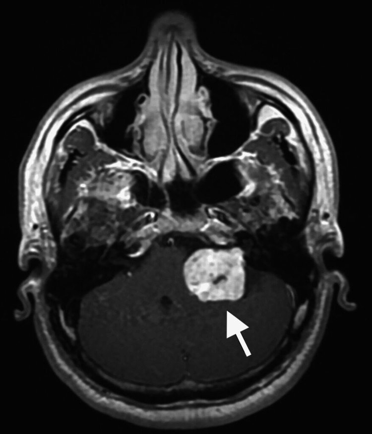
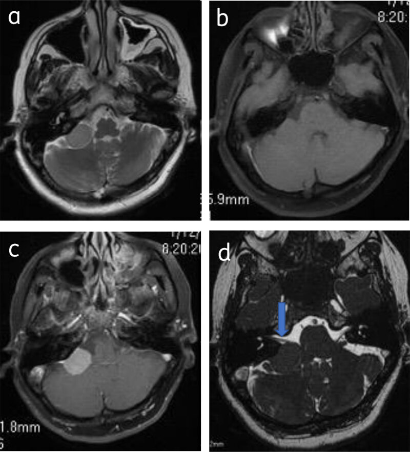
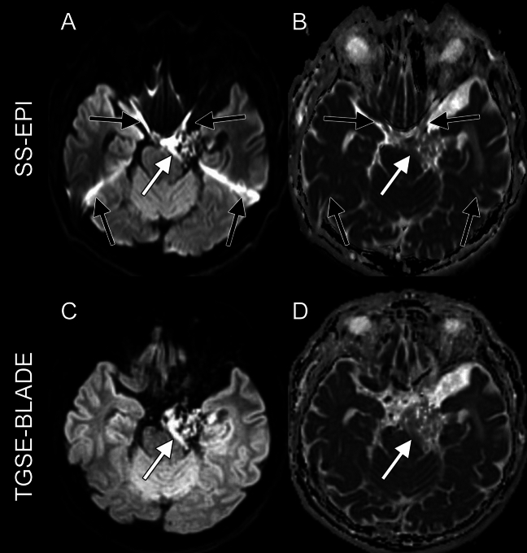
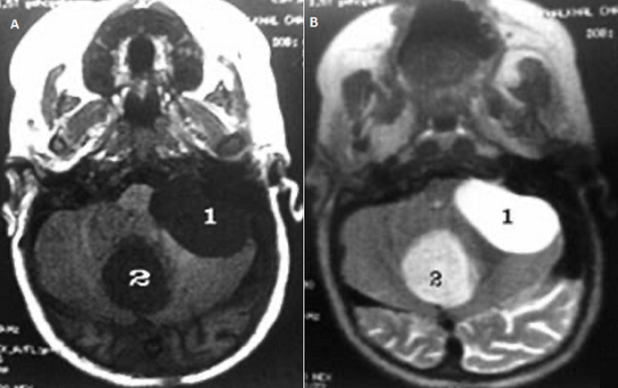
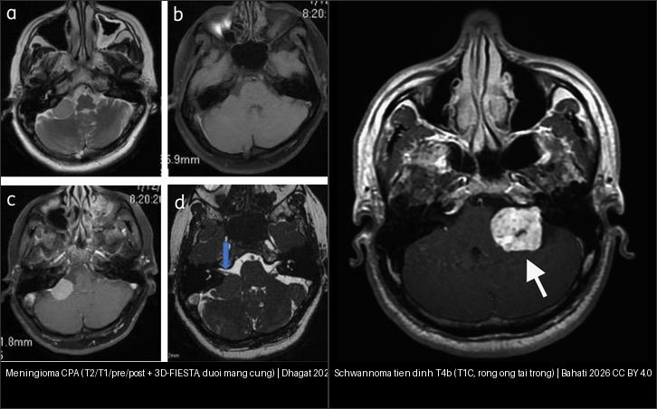
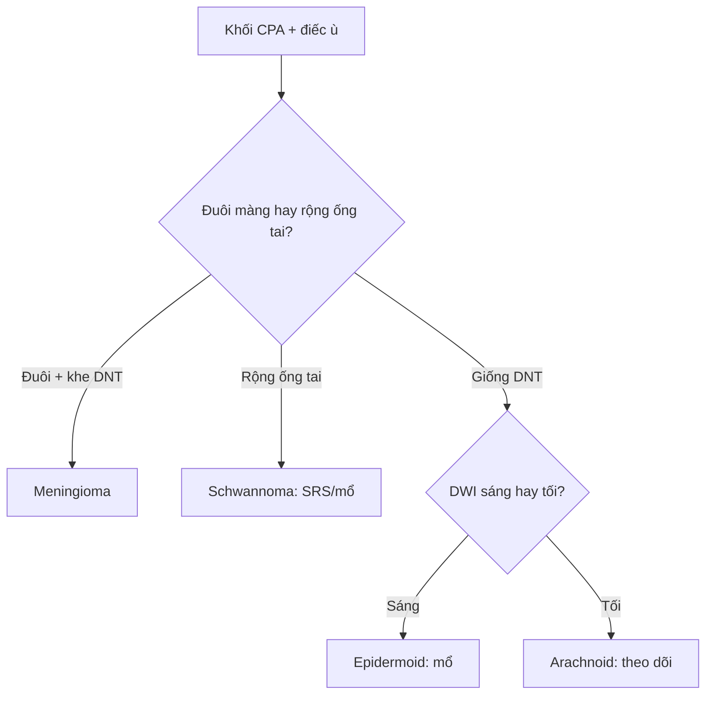

# 217 — Ngoài trục & góc cầu-tiểu não: meningioma, schwannoma, epidermoid / CPA tumors

**Tags:** `pattern:ngoai-truc-CPA` `vung:nen-so`
**Mức chắc chắn (certainty):** tổng hợp y văn (literature synthesis) — nhóm tự biên từ y văn mở, chưa gắn ca nguyên văn đơn lẻ.

## 1. Tổng quan — ngoài màng cứng đẩy não + khe dịch bao quanh

- Khối ngoài trục (extra-axial) nằm ngoài nhu mô, đẩy não vào trong — TẠI SAO có **khe dịch não tủy (CSF cleft)** + cuống màng (dural tail) + dày xương (hyperostosis): khối từ màng cứng, không từ não.
- U dây VIII (vestibular schwannoma) từ bao Schwann đoạn trong ống tai (IAC) — TẠI SAO rộng ống tai trong + điếc-ù một bên sớm: u nong ống xương từ trong ra.
- Nang thượng bì (epidermoid) từ tế bào sừng kẹt phôi — giống DNT mọi chuỗi xung nhưng **DWI sáng** (keratin đặc), khác nang màng nhện (arachnoid) DWI tối.

## 2. Gamut góc cầu-tiểu não (Gamut)

- **Đuôi màng cứng + khe DNT + dày xương:** Meningioma — mổ/SRS theo Simpson.
- **Rộng ống tai trong + điếc-ù + T4 Hannover:** Schwannoma VIII — theo dõi (< 20 mm) / SRS / mổ (giữ mặt VII).
- **Giống DNT + DWI sáng rực:** Epidermoid — mổ bóc (tái phát nếu sót vỏ).
- **Giống DNT + DWI tối + không ngấm:** Arachnoid cyst — bỏ qua (trừ chèn ép).

## 3. Bảng so sánh phân biệt (ma trận đối chiếu)

| Thực thể (entity) | Hình ảnh điển hình | Chốt vào (rule-in) | Chốt loại (rule-out) | Gợi ý xác nhận |
|---|---|---|---|---|
| Meningioma | **Đuôi màng cứng + khe DNT + dày xương + ngấm đồng nhất** | **Đuôi + khe + xương** | Rộng ống tai → schwannoma | SRS/mổ (Simpson) |
| Schwannoma VIII | **Rộng ống tai trong + ICE + Hannover T1–T4b; 38 mm = T4b** | **Ống tai + điếc-ù một bên** | Đuôi màng cứng → meningioma | SRS khi < 30 mm, mổ giữ VII |
| Epidermoid | **Giống DNT + DWI sáng rực + viền festooned** | **DWI+ trong nang giống DNT** | DWI tối → arachnoid | Mổ bóc vỏ (tránh viêm màng) |
| Arachnoid cyst | **Giống DNT mọi xung + DWI tối + đè xương mỏng** | **DWI tối + không ngấm** | DWI sáng → epidermoid | Bỏ qua, theo dõi |

*Khối ngấm mạnh CPA trái 38,2 × 31,3 mm + não úng thủy tắc nghẽn + yên rỗng. Nguồn: Bahati et al., Cureus 2026 Fig. 1, CC BY 4.0.*

*Meningioma **CPA phải**: khối ngoài trục bám rộng nền màng cứng, **ngấm đồng nhất + đuôi màng cứng**, **KHÔNG rộng ống tai trong**; 3D-FIESTA thấy đè dây VII–VIII. Nguồn: Dhagat, *J Belg Soc Radiol* 2022 (PMC9053553) Fig. 5, CC BY 4.0.*

*Epidermoid (nang thượng bì) **CPA trái**: trên **b1000** khối **sáng rực** (SS-EPI hàng trên: A; TGSE-BLADE hàng dưới: C) và **ADC TỐI** (B, D) — **DWI là chốt** phân biệt với nang màng nhện (DWI tối), dù cả hai giống dịch não tủy trên T1/T2. Nguồn: Otani S et al., *Jpn J Radiol* 2025 (PMC12053340) Fig. 1, CC BY 4.0.*

*Nang màng nhện **CPA trái** (nhãn **1**): **giảm tín hiệu T1 (A) + tăng tín hiệu T2 (B) = y hệt dịch não tủy**, **không ngấm** (nhãn 2 là nang bì vùng giun tiểu não, DDx khác). Nguồn: Abbou Z et al., *Pan Afr Med J* 2021 (PMC8641637) Fig. 2, CC BY 4.0.*

*Trái: **meningioma** — đuôi màng cứng + bờ rộng nền, ống tai trong **không rộng**. Phải: **schwannoma tiền đình** — khối ngấm lớn từ **ống tai trong** ra, T4b. Ảnh ghép letterbox; nguồn Dhagat 2022 Fig. 5 (CC BY 4.0) + Bahati 2026 Fig. 1 (CC BY 4.0).*

## 4. Protocol

- **MRI hố sau lát mỏng + T1C + DWI non-EPI + CISS/FIESTA** (dây VII/VIII trong ống tai) + thính lực đồ.
- Hannover T1 (trong ống) → T4b (chèn thân não + não úng thủy) quyết định mổ/SRS.

## 5. Cạm bẫy

- **Epidermoid sót vỏ tái phát + viêm màng vô khuẩn** — bóc hết + corticoid.
- **Mổ schwannoma lớn mất mặt VII** (House-Brackmann III–VI) — SRS khi còn nhỏ + giám sát thần kinh trong mổ.
- **Meningioma rãnh khứu giác lan nền sọ** tưởng xoang — đuôi màng + xương là chốt (nối bài 432 vùng yên).

## 6. Tự lượng giá — Blind Quiz

**Ca 1 — Điếc trái + loạng choạng + mù 2 bên muộn. Đọc T1C.**

- Hỏi: khối ở đâu? Kích thước bao nhiêu? Hannover mấy? Vì sao mù?

<b>Bấm để hiện đáp án</b>

- Dấu hiệu (findings): khối ngấm CPA trái 38,2 × 31,3 mm chèn thân não + lệch não thất IV.
- Chẩn đoán (diagnosis): **schwannoma tiền đình T4b** — mù 2 bên do não úng thủy tắc nghẽn mạn + yên rỗng (không phải u chèn trực tiếp thị).
- Nguồn: Bahati et al., Fig. 1, CC BY 4.0.

**Ca 2 — Nang CPA giống dịch não tủy, có DWI (hàng trên SS-EPI, hàng dưới TGSE-BLADE): dịch thật hay khối?**

- Hỏi: trên b1000 khối **sáng hay tối**? ADC **sáng hay tối**? Kết luận là epidermoid hay nang màng nhện? Xử trí?

<b>Bấm để hiện đáp án (findings + chẩn đoán)</b>

- Dấu hiệu (findings): **b1000 (A, C) sáng rực + ADC (B, D) tối** trong nang ở CPA (mũi tên) — **hạn chế khuếch tán**, không phải dịch tự do.
- Chẩn đoán (diagnosis): **epidermoid (nang thượng bì)** — keratin đặc làm DWI sáng; **nang màng nhện sẽ DWI TỐI** (giống DNT mọi chuỗi xung).
- Xử trí: **mổ bóc vỏ hết** (sót vỏ → tái phát + viêm màng vô khuẩn).
- Nguồn ảnh: Otani S et al., *Jpn J Radiol* 2025 (PMC12053340) Fig. 1, CC BY 4.0.

**Ca 3 — Khối CPA + điếc-ù một bên. So 2 ảnh bên dưới: đâu là meningioma, đâu là schwannoma? Chốt bằng gì?**

- Hỏi: khối nào có **đuôi màng cứng**? Khối nào **rộng ống tai trong**? Vì sao phải phân biệt (khác xử trí)?

<b>Bấm để hiện đáp án (findings + chẩn đoán)</b>

- Dấu hiệu (findings): **khối trái = meningioma** (bám rộng nền màng cứng + **đuôi màng cứng**, ống tai trong không rộng); **khối phải = schwannoma tiền đình** (khối ngấm **từ ống tai trong** lan ra, T4b 38,2 mm).
- Vì sao phân biệt: **meningioma** → mổ/SRS theo **Simpson** (chú ý xoang tĩnh mạch, động mạch); **schwannoma** → **SRS khi < 30 mm** hoặc mổ **giữ dây VII** (nguy cơ liệt mặt House-Brackmann III–VI).
- Nguồn ảnh: Dhagat, *J Belg Soc Radiol* 2022 (PMC9053553) Fig. 5, CC BY 4.0.
- Nguồn ảnh (schwannoma T4b): Bahati et al., Cureus 2026 Fig. 1, CC BY 4.0.

**Ca 4 — Khối CPA tín hiệu y hệt dịch não tủy trên T1/T2, không ngấm. Có cần mổ không?**

- Hỏi: tín hiệu của khối giống gì? Phân biệt với epidermoid bằng chuỗi xung nào? Xử trí?

<b>Bấm để hiện đáp án (findings + chẩn đoán)</b>

- Dấu hiệu (findings): khối CPA trái (nhãn **1**) **giảm tín hiệu T1 (A) + tăng tín hiệu T2 (B)** = **y hệt DNT**, bờ nhẵn, **không ngấm** — nang màng nhện bẩm sinh.
- Phân biệt: **DWI tối** (nang màng nhện) vs **DWI sáng** (epidermoid) — đây là câu chốt.
- Xử trí: **theo dõi, không mổ** trừ khi chèn ép gây triệu chứng (khác epidermoid phải mổ).
- Nguồn ảnh: Abbou Z et al., *Pan Afr Med J* 2021 (PMC8641637) Fig. 2, CC BY 4.0.

## Bài liên quan chéo
- [200 – Tổng quan Thần kinh](../200-tong-quan-he-than-kinh/lesson.md)
- [432 – Vùng yên](../432-vung-yen/lesson.md) (meningioma nền sọ)
- [213 – U não](../213-u-nao/lesson.md) (trong trục vs ngoài trục)

> Không dùng để chẩn đoán độc lập khi chưa có người hướng dẫn.
