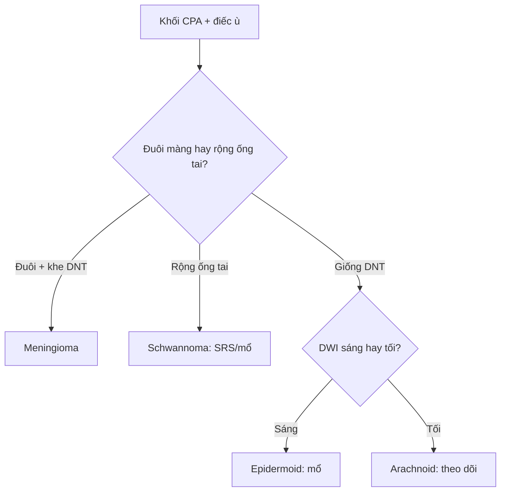

# 217 — Ngoài trục & góc cầu-tiểu não: meningioma, schwannoma, epidermoid / CPA tumors

**Tags:** `pattern:ngoai-truc-CPA` `vung:nen-so`
**Mức chắc chắn (certainty):** tổng hợp y văn (literature synthesis) — nhóm tự biên từ y văn mở, chưa gắn ca nguyên văn đơn lẻ.

## 1. Tổng quan — ngoài màng cứng đẩy não + khe dịch bao quanh

- Khối ngoài trục (extra-axial) nằm ngoài nhu mô, đẩy não vào trong — TẠI SAO có **khe dịch não tủy (CSF cleft)** + cuống màng (dural tail) + dày xương (hyperostosis): khối từ màng cứng, không từ não.
- U dây VIII (vestibular schwannoma) từ bao Schwann đoạn trong ống tai (IAC) — TẠI SAO rộng ống tai trong + điếc-ù một bên sớm: u nong ống xương từ trong ra.
- Nang thượng bì (epidermoid) từ tế bào sừng kẹt phôi — giống DNT mọi chuỗi xung nhưng **DWI sáng** (keratin đặc), khác nang màng nhện (arachnoid) DWI tối.

## 2. Gamut góc cầu-tiểu não (Gamut)

- **Đuôi màng cứng + khe DNT + dày xương:** Meningioma — mổ/SRS theo Simpson.
- **Rộng ống tai trong + điếc-ù + T4 Hannover:** Schwannoma VIII — theo dõi (< 20 mm) / SRS / mổ (giữ mặt VII).
- **Giống DNT + DWI sáng rực:** Epidermoid — mổ bóc (tái phát nếu sót vỏ).
- **Giống DNT + DWI tối + không ngấm:** Arachnoid cyst — bỏ qua (trừ chèn ép).

## 3. Bảng so sánh phân biệt (ma trận đối chiếu)

| Thực thể (entity) | Hình ảnh điển hình | Chốt vào (rule-in) | Chốt loại (rule-out) | Gợi ý xác nhận |
|---|---|---|---|---|
| Meningioma | **Đuôi màng cứng + khe DNT + dày xương + ngấm đồng nhất** | **Đuôi + khe + xương** | Rộng ống tai → schwannoma | SRS/mổ (Simpson) |
| Schwannoma VIII | **Rộng ống tai trong + ICE + Hannover T1–T4b; 38 mm = T4b** | **Ống tai + điếc-ù một bên** | Đuôi màng cứng → meningioma | SRS khi < 30 mm, mổ giữ VII |
| Epidermoid | **Giống DNT + DWI sáng rực + viền festooned** | **DWI+ trong nang giống DNT** | DWI tối → arachnoid | Mổ bóc vỏ (tránh viêm màng) |
| Arachnoid cyst | **Giống DNT mọi xung + DWI tối + đè xương mỏng** | **DWI tối + không ngấm** | DWI sáng → epidermoid | Bỏ qua, theo dõi |

*Khối ngấm mạnh CPA trái 38,2 × 31,3 mm + não úng thủy tắc nghẽn + yên rỗng. Nguồn: Bahati et al., Cureus 2026 Fig. 1, CC BY 4.0.*

## 4. Protocol

- **MRI hố sau lát mỏng + T1C + DWI non-EPI + CISS/FIESTA** (dây VII/VIII trong ống tai) + thính lực đồ.
- Hannover T1 (trong ống) → T4b (chèn thân não + não úng thủy) quyết định mổ/SRS.

## 5. Cạm bẫy

- **Epidermoid sót vỏ tái phát + viêm màng vô khuẩn** — bóc hết + corticoid.
- **Mổ schwannoma lớn mất mặt VII** (House-Brackmann III–VI) — SRS khi còn nhỏ + giám sát thần kinh trong mổ.
- **Meningioma rãnh khứu giác lan nền sọ** tưởng xoang — đuôi màng + xương là chốt (nối bài 432 vùng yên).

## 6. Tự lượng giá — Blind Quiz

**Ca 1 — Điếc trái + loạng choạng + mù 2 bên muộn. Đọc T1C.**

- Hỏi: khối ở đâu? Kích thước bao nhiêu? Hannover mấy? Vì sao mù?

<b>Bấm để hiện đáp án</b>

- Dấu hiệu (findings): khối ngấm CPA trái 38,2 × 31,3 mm chèn thân não + lệch não thất IV.
- Chẩn đoán (diagnosis): **schwannoma tiền đình T4b** — mù 2 bên do não úng thủy tắc nghẽn mạn + yên rỗng (không phải u chèn trực tiếp thị).
- Nguồn: Bahati et al., Fig. 1, CC BY 4.0.

**Ca 2 — Nang CPA giống DNT + DWI sáng rực:** epidermoid hay arachnoid? Xử trí? *(Bảng mục 3.)*

<b>Bấm để hiện đáp án</b>

- **Epidermoid:** mổ bóc vỏ (arachnoid DWI tối thì bỏ qua).

**Ca 3 — Khối lều + đuôi màng cứng + dày xương:** meningioma hay schwannoma? *(Bảng mục 3.)*

<b>Bấm để hiện đáp án</b>

- **Meningioma:** đuôi + khe DNT + xương (schwannoma là rộng ống tai + điếc-ù).

## Bài liên quan chéo
- [200 – Tổng quan Thần kinh](../200-tong-quan-he-than-kinh/lesson.md)
- [432 – Vùng yên](../432-vung-yen/lesson.md) (meningioma nền sọ)
- [213 – U não](../213-u-nao/lesson.md) (trong trục vs ngoài trục)

> Không dùng để chẩn đoán độc lập khi chưa có người hướng dẫn.
