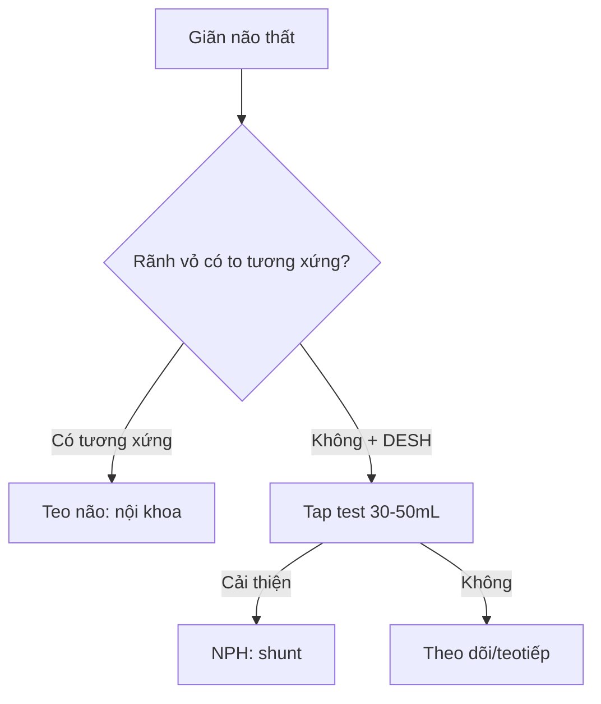

# 218 — Thoát vị não & não úng thủy: NPH vs tắc nghẽn vs teo / Herniation & Hydrocephalus

**Tags:** `pattern:thoat-vi-ung-thuy` `vung:nao-that` `score:Evans`
**Mức chắc chắn (certainty):** tổng hợp y văn (literature synthesis) — nhóm tự biên từ y văn mở, chưa gắn ca nguyên văn đơn lẻ.

## 1. Tổng quan — sọ cứng + khối choán chỗ = não chỉ còn đường thoát xuống

- Hộp sọ cứng dung tích cố định (~1400 mL) — TẠI SAO khối/máu/phù gây thoát vị theo đường ít kháng nhất: dưới liềm (cingulate), móc thái dương (uncal), hạnh nhân tiểu não (tonsillar) xuống lỗ chẩm.
- Não úng thủy áp lực bình thường (NPH): tái hấp thu DNT kém ở người già — tam chứng **đi khó (gait) + tiểu không tự chủ (urine) + sa sút (dementia)** + não thất to mà rãnh vỏ không to tương xứng (DESH).
- Ngưỡng: **Evans (sừng trán/rộng sọ) > 0,3** + **góc thể chai < 90°** + DESH = NPH; tap test tháo **30–50 mL** DNT cải thiện đi bộ = shunt đáp ứng.

## 2. Gamut giãn não thất + lệch đường giữa (Gamut)

- **Lệch > 5 mm + khối một bên:** thoát vị dưới liềm — mổ khối + mannitol + tăng thông khí.
- **Móc thái dương + đồng tử giãn cùng bên:** thoát vị uncal — tối khẩn (chèn não giữa).
- **Hạnh nhân < −5 mm dưới lỗ chẩm:** thoát vị hạnh nhân — cấm chọc thắt lưng!
- **Evans > 0,3 + DESH + tap (+):** NPH — shunt; giãn tương xứng vỏ + thất = teo não tuổi già.

## 3. Bảng so sánh phân biệt (ma trận đối chiếu)

| Thực thể (entity) | Hình ảnh điển hình | Chốt vào (rule-in) | Chốt loại (rule-out) | Gợi ý xác nhận |
|---|---|---|---|---|
| Thoát vị dưới liềm | **Vành đai (cingulate) chui qua liềm + lệch > 5 mm** | **Lệch + khối một bên** | Không khối → não úng thủy | Mổ khối + chống phù |
| Thoát vị uncal | **Móc thái dương + mất bể quanh cuống + giãn đồng tử** | **Đồng tử + hôn mê nhanh** | Hạnh nhân → lỗ chẩm | Tối khẩn, cấm chờ |
| NPH | **Evans > 0,3 + góc < 90° + DESH + tap (+)** | **Đi-tiểu-trí + DESH + tap cải thiện** | Rãnh vỏ to tương xứng → teo não | Shunt VP + tap test 30–50 mL |
| Tắc nghẽn/teo não | **Tắc nghẽn: thất trên to + thất IV xẹp; Teo: thất + rãnh cùng to** | **Mất cân xứng = tắc; tương xứng = teo** | DESH + tap (+) → NPH | ETV/shunt khi tắc; nội khoa khi teo |

## 4. Protocol

- **CT cấp + MRI DESH + tap test:** đi bộ định giờ trước/sau tháo 30–50 mL; cấm chọc thắt lưng khi thoát vị hạnh nhân/chèn hố sau.

## 5. Cạm bẫy

- **Chọc thắt lưng khi thoát vị hạnh nhân** = tụt kẹt chết người — đọc hạnh nhân trước mọi chọc DNT.
- **NPH gọi nhầm Parkinson/Alzheimer** → bỏ shunt cứu đi lại — tap test + DESH phân biệt.
- **Não úng thủy áp lực cao sau SAH/viêm màng** tưởng NPH — bối cảnh cấp + Bavenport khác mạn.

## 6. Tự lượng giá — Blind Quiz

**Ca 1 — Già 72 tuổi đi khó + tiểu dầm + quên, Evans 0,35 + DESH:** NPH hay teo não? Test nào quyết định shunt? *(Bảng mục 3.)*

<b>Bấm để hiện đáp án</b>

- **NPH:** tam chứng + Evans > 0,3 + DESH — **tap test 30–50 mL** cải thiện đi bộ → shunt VP.

**Ca 2 — U trán + lệch 8 mm + đồng tử trái giãn:** thoát vị gì? Cấm thủ thuật nào? *(Bảng mục 3.)*

<b>Bấm để hiện đáp án</b>

- **Thoát vị uncal trái:** mổ khối tối khẩn + **cấm chọc thắt lưng** + chống phù (mannitol + tăng thông khí).

**Ca 3 — Thất + rãnh cùng to tương xứng, 80 tuổi, quên chậm:** shunt được không? *(Bảng mục 3.)*

<b>Bấm để hiện đáp án</b>

- **Teo não tuổi già:** tương xứng + tap (−) → không shunt, nội khoa + phục hồi chức năng.

## Bài liên quan chéo
- [200 – Tổng quan Thần kinh](../200-tong-quan-he-than-kinh/lesson.md)
- [210 – Giải phẫu sọ não](../210-giai-phau-so-nao/lesson.md) (Evans, não thất)
- [212 – Xuất huyết sọ](../212-xuat-huyet-so-nao/lesson.md) (máu gây chèn ép)

> Không dùng để chẩn đoán độc lập khi chưa có người hướng dẫn.
