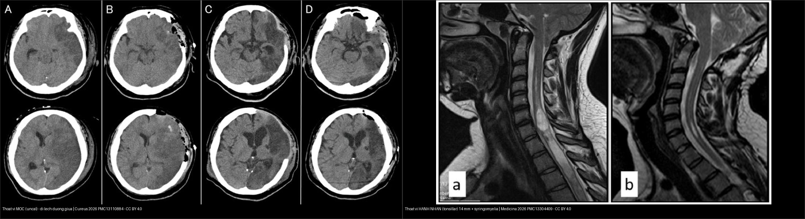
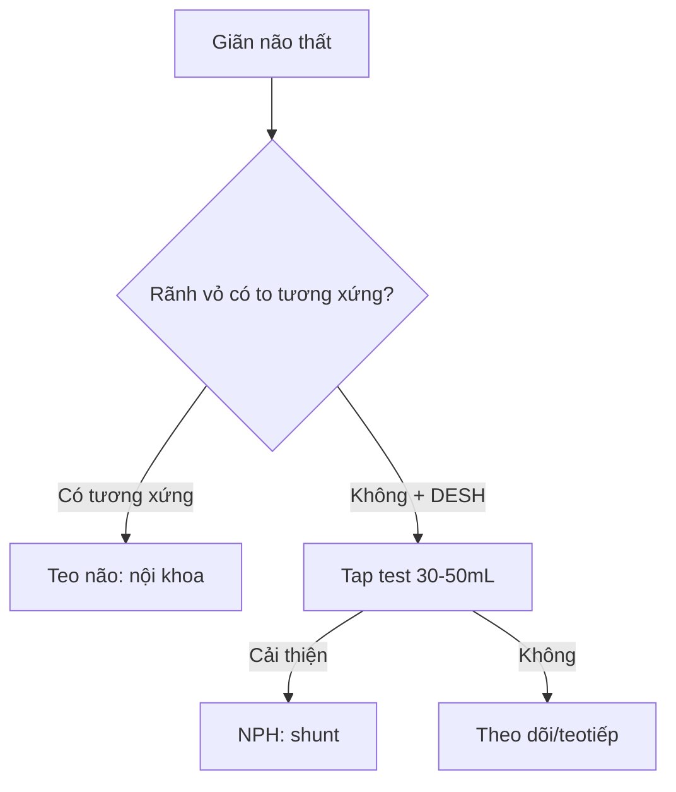
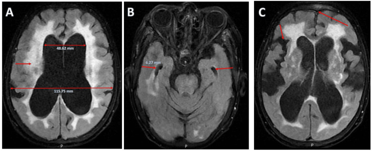
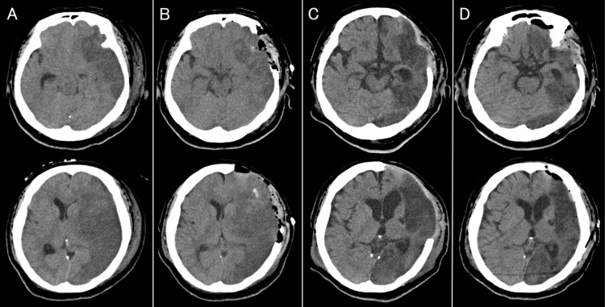
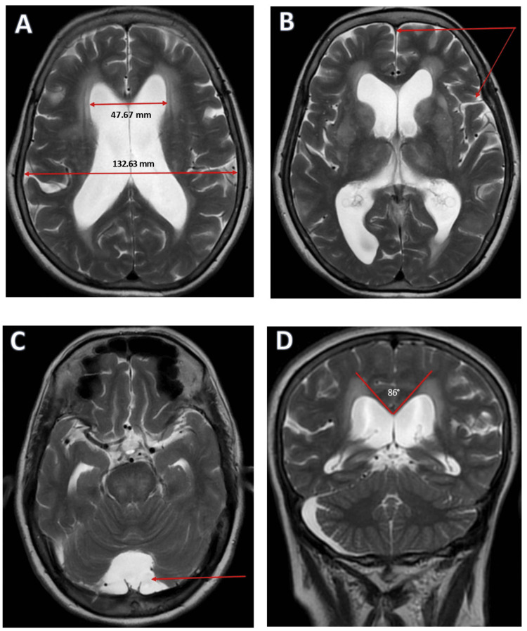
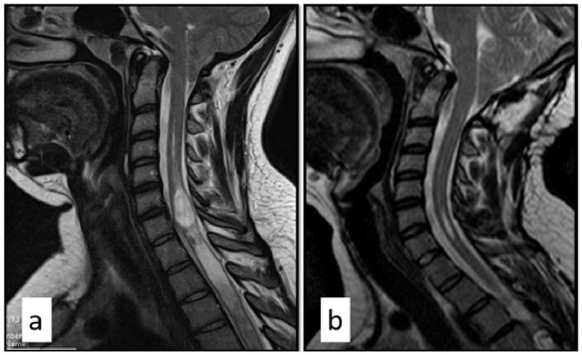

# 218 — Thoát vị não & não úng thủy: NPH vs tắc nghẽn vs teo / Herniation & Hydrocephalus

**Tags:** `pattern:thoat-vi-ung-thuy` `vung:nao-that` `score:Evans`
**Mức chắc chắn (certainty):** tổng hợp y văn (literature synthesis) — nhóm tự biên từ y văn mở, chưa gắn ca nguyên văn đơn lẻ.

## 1. Tổng quan — sọ cứng + khối choán chỗ = não chỉ còn đường thoát xuống

- Hộp sọ cứng dung tích cố định (~1400 mL) — TẠI SAO khối/máu/phù gây thoát vị theo đường ít kháng nhất: dưới liềm (cingulate), móc thái dương (uncal), hạnh nhân tiểu não (tonsillar) xuống lỗ chẩm.
- Não úng thủy áp lực bình thường (NPH): tái hấp thu DNT kém ở người già — tam chứng **đi khó (gait) + tiểu không tự chủ (urine) + sa sút (dementia)** + não thất to mà rãnh vỏ không to tương xứng (DESH).
- Ngưỡng: **Evans (sừng trán/rộng sọ) > 0,3** + **góc thể chai < 90°** + DESH = NPH; tap test tháo **30–50 mL** DNT cải thiện đi bộ = shunt đáp ứng.

## 2. Gamut giãn não thất + lệch đường giữa (Gamut)

- **Lệch > 5 mm + khối một bên:** thoát vị dưới liềm — mổ khối + mannitol + tăng thông khí.
- **Móc thái dương + đồng tử giãn cùng bên:** thoát vị uncal — tối khẩn (chèn não giữa).
- **Hạnh nhân < −5 mm dưới lỗ chẩm:** thoát vị hạnh nhân — cấm chọc thắt lưng!
- **Evans > 0,3 + DESH + tap (+):** NPH — shunt; giãn tương xứng vỏ + thất = teo não tuổi già.

## 3. Bảng so sánh phân biệt (ma trận đối chiếu)

| Thực thể (entity) | Hình ảnh điển hình | Chốt vào (rule-in) | Chốt loại (rule-out) | Gợi ý xác nhận |
|---|---|---|---|---|
| Thoát vị dưới liềm | **Vành đai (cingulate) chui qua liềm + lệch > 5 mm** | **Lệch + khối một bên** | Không khối → não úng thủy | Mổ khối + chống phù |
| Thoát vị uncal | **Móc thái dương + mất bể quanh cuống + giãn đồng tử** | **Đồng tử + hôn mê nhanh** | Hạnh nhân → lỗ chẩm | Tối khẩn, cấm chờ |
| NPH | **Evans > 0,3 + góc < 90° + DESH + tap (+)** | **Đi-tiểu-trí + DESH + tap cải thiện** | Rãnh vỏ to tương xứng → teo não | Shunt VP + tap test 30–50 mL |
| Tắc nghẽn/teo não | **Tắc nghẽn: thất trên to + thất IV xẹp; Teo: thất + rãnh cùng to** | **Mất cân xứng = tắc; tương xứng = teo** | DESH + tap (+) → NPH | ETV/shunt khi tắc; nội khoa khi teo |

*Trái: thoát vị MÓC (uncal) — di lệch đường giữa, mờ bể quanh cuống (do phù/nhồi máu bán cầu). Phải: thoát vị HẠNH NHÂN (tonsillar) 14 mm dưới lỗ chẩm + syringomyelia. Nguồn: Hatakenaka S et al., Cureus 2026 (PMC13110884) + Engin R et al., Medicina (Kaunas) 2026 (PMC13304409), CC BY 4.0. Ảnh ghép letterbox, giữ tỉ lệ.*

## 4. Protocol

- **CT cấp + MRI DESH + tap test:** đi bộ định giờ trước/sau tháo 30–50 mL; cấm chọc thắt lưng khi thoát vị hạnh nhân/chèn hố sau.

*iNPH trên FLAIR (A–C): não thất bên to (48,62 mm trên 115,75 mm — Evans > 0,3); sừng thời (temporal horn) giãn 6,27 mm; DESH — rãnh đỉnh cao hẹp, khe Sylvius rộng. Nguồn: Aung KZ et al., Cureus 2025 (PMC12548762), Figure 1, CC BY 4.0.*

## 5. Cạm bẫy

- **Chọc thắt lưng khi thoát vị hạnh nhân** = tụt kẹt chết người — đọc hạnh nhân trước mọi chọc DNT.
- **NPH gọi nhầm Parkinson/Alzheimer** → bỏ shunt cứu đi lại — tap test + DESH phân biệt.
- **Não úng thủy áp lực cao sau SAH/viêm màng** tưởng NPH — bối cảnh cấp + Bavenport khác mạn.

## 6. Tự lượng giá — Blind Quiz (ảnh trơn ngoài, đáp án ẩn trong khối chi tiết)

**Ca 1 — Nam 30 tuổi, nhồi máu bán cầu trái lan rộng, hôn mê. CT sọ không cản quang các ngày. Mô tả trước khi mở đáp án.**

- Câu hỏi: Ở phim đầu (A) có dấu hiệu thoát vị gì và di lệch đường giữa? Vì sao phải mở sọ giải ép, và dấu hiệu nào cho thấy đã giải quyết?

<b>Bấm để hiện đáp án (findings + chẩn đoán)</b>

- **Dấu hiệu:** (A) ngày 1 — **nhồi máu lan rộng vùng động mạch não giữa trái + di lệch đường giữa + thoát vị MÓC (uncal)**: móc thái dương chèn xuống, **mờ bể quanh cuống (perimesencephalic cistern)**. (B) ngày 2 sau **mở sọ giải ép** — di lệch giảm, **thoát vị móc hồi phục**. (C) ngày 40 — phù não tiêu. (D) ngày 44 — tạo hình sọ.
- **Chẩn đoán – xử trí:** **thoát vị móc (uncal) do phù não ác tính sau nhồi máu** — tối khẩn: mở sọ giải ép + chống phù (mannitol/tăng thông khí). **Cấm chọc thắt lưng** khi có thoát vị.
- Nguồn ảnh: Hatakenaka S et al., Cureus 2026 (PMC13110884), Figure 6, CC BY 4.0.

**Ca 2 — Già 78 tuổi đi khó + tiểu không tự chủ + sa sút, quên chậm. MRI T2 sọ. Chấm Evans, góc thể chai, DESH.**

- Câu hỏi: Evans của bệnh nhân? Góc thể chai? Có DESH không? NPH hay teo não — test nào quyết định shunt?

<b>Bấm để hiện đáp án (findings + chẩn đoán)</b>

- **Dấu hiệu:** (A) sừng trán **47,67 mm trên đường kính sọ trong 132,63 mm → Evans > 0,3**; (B) **DESH** — rãnh đỉnh cao hẹp, khe Sylvius rộng; (C) **tứ não thất to → úng thủy thông thương**; (D) **góc thể chai ~86° (< 90°)**.
- **Chẩn đoán – xử trí:** **não úng thủy áp lực bình thường (NPH)** — tam chứng + Evans > 0,3 + DESH + góc < 90°; **tap test tháo 30–50 mL** DNT, cải thiện đi bộ → **shunt VP**. (Teo não tuổi già sẽ có **thất + rãnh cùng to tương xứng**, tap âm.)
- Nguồn ảnh: Aung KZ et al., Cureus 2025 (PMC12548762), Figure 2, CC BY 4.0.

**Ca 3 — Nam 19 tuổi, đau đầu + tê tay khi ho/hắt hơi. MRI T2 sagittal. Cấm thủ thuật nào?**

- Câu hỏi: Hạnh nhân tiểu não xuống bao nhiêu mm dưới lỗ chẩm? Có tổn thương kèm theo? Vì sao cấm chọc thắt lưng?

<b>Bấm để hiện đáp án (findings + chẩn đoán)</b>

- **Dấu hiệu:** (a) trước mổ — **thoát vị hạnh nhân tiểu não 14 mm dưới lỗ chẩm (Grade 2) + syringomyelia từ C3 xuống ngực** (ống tủy chứa dịch); (b) sau giải ép hố sau 1 năm — syringomyelia giảm rõ.
- **Chẩn đoán – xử trí:** **thoát vị hạnh nhân (tonsillar herniation)** — hạnh nhân xuống dưới lỗ chẩm; **cấm chọc thắt lưng** vì nguy cơ **tụt kẹt hạnh nhân gây tử vong**. Hướng xử trí: giải ép hố sau (như ca này).
- Nguồn ảnh: Engin R et al., Medicina (Kaunas) 2026 (PMC13304409), Figure 2, CC BY 4.0.

## Bài liên quan chéo
- [200 – Tổng quan Thần kinh](../200-tong-quan-he-than-kinh/lesson.md)
- [210 – Giải phẫu sọ não](../210-giai-phau-so-nao/lesson.md) (Evans, não thất)
- [212 – Xuất huyết sọ](../212-xuat-huyet-so-nao/lesson.md) (máu gây chèn ép)

> Không dùng để chẩn đoán độc lập khi chưa có người hướng dẫn.
