# 219 — PRES & RCVS: phù não sau có hồi phục & co mạch não có hồi phục / Posterior reversible encephalopathy syndrome & Reversible cerebral vasoconstriction syndrome

**Tags:** `pattern:phu-nao-sau` `pattern:co-mach-nao` `vung:nao` `score:RCVS2` `protocol:MRA-CE-FLAIR`
**Mức chắc chắn (certainty):** tổng hợp y văn (literature synthesis) — nhóm tự biên từ y văn mở (J Headache Pain 2025, Cureus 2023, Radiol Case Rep 2026, Neurol Int 2025, Eur J Neurol 2024 CC BY/BY-NC-ND); **các ca trong quiz là ca nguyên văn (verbatim case)** chép đúng tuổi – lâm sàng – chú thích gốc.

## 1. Tổng quan – bệnh học & cơ chế hình ảnh (TẠI SAO)

- **PRES (posterior reversible encephalopathy syndrome)** mô tả lần đầu năm 1996 (Hinchey) trên 15 bệnh nhân: khởi phát cấp các triệu chứng **co giật, đau đầu, rối loạn thị giác, giảm tri giác**, kèm **phù não mạch máu (vasogenic edema)** ưu thế vùng sau, có thể hồi phục. Tên gọi là "hội chứng" chứ không phải bệnh đơn lẻ vì có rất nhiều yếu tố khởi phát (Alzahrani Y., Cureus 2023, PMC10821201).
- **3 học thuyết cơ chế (không loại trừ nhau):**
  1. **Tăng tưới máu/THA (hyperperfusion)**: tăng huyết áp cấp vượt ngưỡng tự điều hòa (autoregulation) → tiểu động mạch giãn → tăng áp lực mao mạch → vỡ hàng rào máu-não (BBB) → nước thoát vào mô kẽ. **Ngưỡng tự điều hòa ở trẻ THẤP hơn (40 mmHg) so với người lớn (50–60 mmHg)** → trẻ PRES với MAP thấp hơn người lớn.
  2. **Mất tự điều hòa**: co mạch não bù trừ → giảm tưới máu → thiếu oxy → tăng VEGF (vascular endothelial growth factor) → tăng tính thấm.
  3. **Rối loạn nội mô (endothelial theory)**: độc chất (thuốc ức chế miễn dịch, hóa trị), nhiễm trùng/nhiễm khuẩn huyết, tự miễn → cytokin → hở BBB; thể này có thể xảy ra **khi huyết áp bình thường**.
- **RCVS (reversible cerebral vasoconstriction syndrome)** là thực thể riêng, giới thiệu 2007: **đau đầu sét đánh (thunderclap headache) tái diễn** + **co mạch từng đoạn đa ổ** của động mạch não, **hồi phục trong 3 tháng (12 tuần)**. Cơ chế được hiểu là **rối loạn kiểm soát trương lực mạch máu + hở hàng rào máu-não (BBB)** do yếu tố co mạch (thuốc/vận mạch, hậu sản, thai kỳ, stress, Valsalva). Hai thực thể **chồng lấp** ở người hậu sản/THA: RCVS nặng có thể gây PRES.
- **TẠI SAO đọc được bản chất mô bằng vật lý (theo Argon):**
  - Phù **mạch máu** = nước **ngoại bào** → **T2W/FLAIR tăng tín hiệu, T1W giảm nhẹ**; nước ngoại bào không hạn chế khuếch tán → **DWI thường ÂM, ADC TĂNG**. Đây là **chìa khóa** phân biệt với **nhồi máu** (DWI sáng + ADC tối do phù độc tế bào). Cơ chế khác (mở BBB) nên phân bố theo **chất trắng dưới vỏ**, ít chọn lọc vỏ não.
  - **Vị trí ưu thế là vùng chuyển tiếp (watershed) MCA–PCA (chẩm-đỉnh)** — nơi mật độ mạch máu tự điều hòa thưa nhất, dễ tổn thương khi áp lực đổi đột ngột.
  - **Xuất huyết nhỏ** = deoxyhemoglobin/hemosiderin (sắt từ) → **mất tín hiệu, "blooming" trên SWI/GRE**; **hạn chế khuếch tán thật** (DWI sáng/ADC tối) chỉ xảy ra ở thiểu số (~18% cvPRES) và là **dấu hiệu tiên lượng xấu**.
- **Ngưỡng định lượng nằm lòng (mọi nhận định kèm số/phiên bản):**
  - **CT nhạy 46% vs MRI nhạy 98%** cho phù mạch máu PRES → **CT âm không loại trừ được PRES** (PMC10821201).
  - **4 kiểu Bartynski** (gặp ở ~70% ca): (1) **parieto-occipital** điển hình (vùng chuyển tiếp MCA–PCA), (2) **superior frontal sulcus**, (3) **holohemispheric watershed**, (4) **central** (chất trắng sâu, hạch nền, đồi thị, thân não). Biến thể không điển hình gặp **61–82% ở trẻ vs 10–58% ở người lớn** (PMC10821201).
  - **Biến thể trung tâm (cvPRES)**: tỷ lệ gộp **13% (KTC 95%: 9–18%)**; thân não **88%** (cầu não **70,45%**); tủy sống **18%** (PRES-SCI); tuổi trung bình **40,9**; nam **54%**; THA **72%**, **50% có SBP > 200 mmHg**; **tử vong chỉ 2%** — tiên lượng tốt hơn thể điển hình vì phù vẫn hồi phục (Srichawla BS et al., Neurol Int 2025, PMC12298113).
  - **Hậu quả mạch máu (gộp, Kaufmann J et al., Eur J Neurol 2024, PMC11235994 — 48 nghiên cứu):** **PRES** (1385 BN): nhồi máu **11,2%** (7,9–15), xuất huyết nội sọ **16,1%** (12,3–20,3), SAH **7%** (4,7–9,9), IPH **9,7%** (5,4–15). **RCVS** (2746 BN): nhồi máu **15,9%** (9,6–23,4), xuất huyết nội sọ **22,1%** (10–39,6), SAH **20,3%** (11,2–31,2), IPH **6,7%** (3,6–10,7). → **Xuất huyết/đột quỵ trong PRES & RCVS rất thường gặp, không được coi là "lành tính tuyệt đối"**.
  - **PRES khác:** tử vong **10–19%**; **40–44% di chứng/thương tổn còn lại**; co giật **60–90%**; **15–20% huyết áp bình thường/không tăng nhiều**; **tái phát 1–3,9%**; tới **70% cần ICU**, **35–40% cần hỗ trợ thông khí** (Mourid MR et al., Int J Emerg Med 2026, PMC12922249).
  - **Xử trí THA trong PRES:** **giảm từ từ, đích MAP 105–125 mmHg**; trong **tăng huyết áp ác tính hạ DBP về 100–105 mmHg trong vài giờ**; tránh tụt nhanh gây thiếu máu. Ưu tiên **labetalol, nicardipine, nimodipine** (PMC12922249).
  - **RCVS:** co mạch hồi phục **< 3 tháng**; **MRA/CTA có thể BÌNH THƯỜNG trong tuần đầu** → "probable RCVS" (ICHD-3) khi lâm sàng điển hình nhưng mạch âm. **Hở BBB trên CE-FLAIR: 69% RCVS chắc chắn, 25% RCVS nghi ngờ**; nhờ đó tỷ lệ chẩn đoán tăng **33% → 41%** ở ca angiogram âm (Kim SA et al., J Headache Pain 2025, PMC12036309).

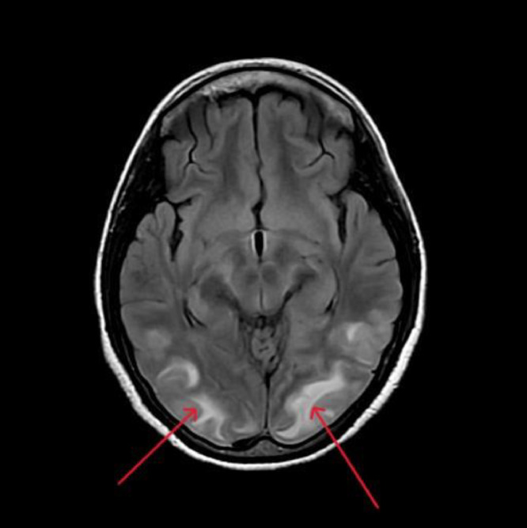
*PRES điển hình: FLAIR tăng tín hiệu **đối xứng vỏ + dưới vỏ vùng chẩm-đỉnh hai bên** (mũi tên) = phù mạch máu, cơ sở là tổn thương vùng chuyển tiếp MCA–PCA. Nguồn: Nalla S et al., Radiol Case Rep 2026 (PMC13396603), CC BY-NC-ND 4.0 — ảnh giữ nguyên bản.*

## 2. Mẫu hình + chẩn đoán phân biệt theo bối cảnh (Gamut)

- **THEO BỐI CẢNH LÂM SÀNG:**
  - **PRES:** **THA cấp** (bệnh thận, tiền sản giật/eclampsia, tăng huyết áp ác tính), **thuốc ức chế miễn dịch** (tacrolimus, cyclosporine), **hóa trị/VEGF inhibitor** (cisplatin, lenvatinib), **nhiễm trùng–nhiễm khuẩn huyết**, **tự miễn (SLE)**, **ghép tạng/tủy**, truyền máu, rối loạn điện giải, suy thận. → **Hỏi bệnh kỹ vì cách điều trị là LOẠI BỎ yếu tố khởi phát.**
  - **RCVS:** **thuốc/vận mạch co mạch** (thuốc cảm cúm, serotonin, triptan, ergot), **hậu sản/thai kỳ**, **stress/vận động/Valsalva** (tắm, gắng sức, ho, đi tiêu), thuốc ức chế miễn dịch. → **Bệnh cảnh đau đầu sét đánh tái diễn có yếu tố khởi phát = chìa khóa.**
- **THEO HÌNH THÁI TỔN THƯƠNG (gamut hình ảnh):**
  - **Điển hình (chẩm-đỉnh)** → **superior frontal sulcus** → **holohemispheric watershed** → **central (thân não/hạch nền/đồi thị/tủy = cvPRES)**.
  - **PRES xuất huyết**: SAH lồi (convexity) hoặc IPH; **PRES có hạn chế khuếch tán**: ~18% cvPRES, tiên lượng xấu hơn.
  - **RCVS theo kiểu mạch**: **chuỗi hạt (string of beads)** kinh điển (hẹp-giãn xen kẽ) → hẹp **từng đoạn đơn độc** → **giãn khu trú mới xuất hiện** → **hẹp lan tỏa** → **angiogram âm (probable RCVS)**.
- **Mnemonic yếu tố khởi phát PRES (tự soạn):** **"TAXI"** — **T**ăng huyết áp cấp · **A**utoimmune (SLE) · **X**enobiotic/độc chất–thuốc (ức chế miễn dịch/hóa trị) · **I**nfection (nhiễm khuẩn huyết).
- **RCVS khác PRES ở điểm mấu chốt:** RCVS **bắt đầu bằng đau đầu sét đánh tái diễn và tổn thương mạch ĐA Ổ ở các vùng mạch khác nhau**, thường **nhẹ/không ngấm thành mạch**; tổn thương nhu mô (nếu có) **xuất hiện muộn hơn co mạch**.

## 3. Bảng so sánh phân biệt (ma trận đối chiếu)

| Thực thể (entity) | Hình ảnh điển hình | Chốt vào (rule-in) | Chốt loại (rule-out) | Gợi ý xác nhận |
|---|---|---|---|---|
| **PRES điển hình (chẩm-đỉnh)** | FLAIR/T2 tăng tín hiệu **đối xứng vỏ+dưới vỏ chẩm-đỉnh**, vùng chuyển tiếp MCA–PCA; **DWI âm/ADC tăng** | **Đối xứng + dưới vỏ ưu thế + ADC TĂNG** + bối cảnh THA/thuốc | DWI sáng + ADC tối theo lãnh thổ mạch → **nhồi máu** | MRI não (T2/FLAIR/DWI/ADC); theo dõi hồi phục |
| **PRES biến thể trung tâm (cvPRES)** | Phù **thân não (cầu não) / hạch nền / đồi thị / tủy**, **tương đối chừa chẩm-đỉnh** | **Thân não 88%, cầu não 70%** + THA nặng (50% SBP > 200) | Tổn thương **một bên, chèn ép, mở rộng khoang** → u/nhồi máu thân não | MRI + theo dõi hồi phục; loại trừ u/nhồi máu |
| **Nhồi máu não cấp** | **DWI SÁNG + ADC TỐI**, theo lãnh thổ động mạch (không đối xứng) | **Bất tương hợp DWI–ADC trong lãnh thổ mạch** | Đối xứng + ADC tăng + chừa vỏ theo lãnh thổ → không phải nhồi máu | DWI/ADC, CTA/MRA, đối chiếu lãnh thổ |
| **Viêm não Herpes (HSV) thùy thái dương** | FLAIR tăng tín hiệu **vỏ thùy thái dương + trán dưới + đảo**, **chừa hạch nền**, DWI sáng, ± xuất huyết | **Vỏ thái dương–đảo chọn lọc + sốt/rối loạn ý thức** | Ưu thế chẩm-đỉnh dưới vỏ + ADC tăng → PRES | PCR HSV trong DNT + MRI; kháng virus sớm |
| **RCVS** | Co mạch **từng đoạn đa ổ "chuỗi hạt"**, vùng mạch khác nhau; nhẹ/không ngấm thành mạch | **Thunderclap tái diễn + yếu tố khởi phát + co mạch đa ổ**, hồi phục < 3 tháng (RCVS2 ≥ 5) | Hẹp **một mạch, không hồi phục > 3 tháng, ngấm mạnh thành mạch** → xơ vữa/viêm mạch | MRA/CTA + lặp 2–3 tuần; HR-vwMRI; CE-FLAIR |
| **Xơ vữa nội sọ (ICAS)** | Hẹp **lệch tâm**, tái tạo dương (positive remodeling), mảng xơ vữa ngấm lệch tâm; **không hồi phục** | **HR-vwMRI: mảng xơ vữa lệch tâm + tái tạo dương** | HR-vwMRI chỉ **ngấm nhẹ, không mảng lệch tâm** → RCVS | HR-vwMRI (T2 + T1 sau tiêm), theo dõi ≥ 1 năm |
| **Bóc tách động mạch nội sọ** | **Vạt nội mạc (intimal flap) + máu tụ thành mạch**; thường **một mạch** | **Vạt nội mạc (42–91%) hoặc máu tụ thành mạch (23–61%)** | Co mạch **đa ổ đối xứng, động học** → RCVS | HR-vwMRI; theo dõi động học tổn thương |
| **Viêm mạch TKTW nguyên phát (PACNS)** | Hẹp **đối xứng, ít nghiêm trọng**, tổn thương nhu mô nặng ở **hạch nền/thân não**, ngấm **mạnh–đồng tâm** thành mạch | **Đau đầu âm ỉ tiến triển + thiếu hụt thần kinh kéo dài + HR-vwMRI ngấm đồng tâm mạnh** | **Thunderclap tái diễn, thiếu hụt thoáng qua, ngấm nhẹ** → RCVS | Sinh thiết não–màng não; HR-vwMRI; loại trừ nhiễm trùng |
| **Co mạch sau SAH phình mạch** | Co mạch **quanh vị trí chảy máu, thường một bên**, đỉnh 4–14 ngày | **Máu SAH ở bể nền/khe Sylvius + co mạch cùng bên theo mức chảy máu** | **SAH lồi (convexity) + co mạch đa ổ không tương xứng lượng máu** → RCVS | CT/DSA + tìm phình mạch; xanthochromia DNT |
| **Moyamoya** | Hẹp **đoạn tận ĐM cảnh trong hai bên** + **búi mạch "khói thuốc" (puff of smoke)**, **không hồi phục**, tái tạo âm | **Hẹp tận ICA tiến triển + tuần hoàn bàng hệ nền sọ** | Hồi phục trong 3 tháng, không tuần hoàn bàng hệ nền sọ → RCVS | MRA/DSA, HR-vwMRI (tái tạo âm, ngấm đồng tâm), theo dõi 1 năm |

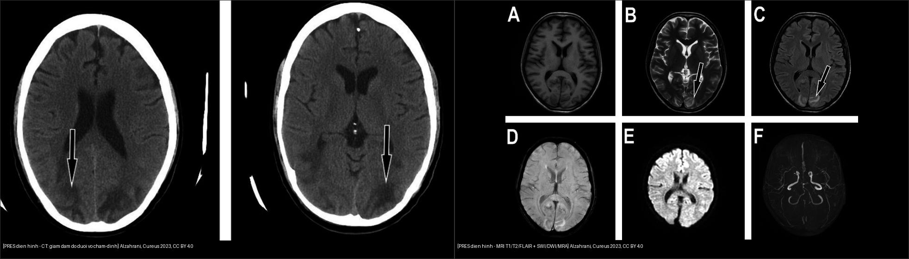
*Trái: **CT** — giảm đậm độ mờ dưới vỏ chẩm-đỉnh (mũi tên). Phải: **MRI 6 chuỗi** (T1/T2/FLAIR + SWI/DWI/MRA) — T2 (B) và FLAIR (C) tăng tín hiệu vỏ+dưới vỏ; SWI (D) không xuất huyết; DWI (E) không hạn chế khuếch tán = **phù mạch máu**. Lưu ý **CT nhạy chỉ 46% vs MRI 98%**. Ảnh ghép letterbox từ 2 hình của cùng nguồn: Alzahrani Y., Cureus 2023 (PMC10821201), CC BY 4.0.*

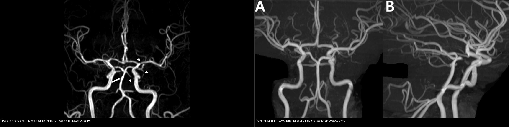
*Trái: **MRA chuỗi hạt** — hẹp (mũi tên nhọn) và giãn sau hẹp (mũi tên) xen kẽ nhiều mạch = hình "string of beads/sausage-on-a-string". Phải: **MRA BÌNH THƯỜNG** ở tuần đầu của ca đau đầu sét đánh tái diễn khác (**probable RCVS**) — **không được loại RCVS vì mạch âm tuần đầu**. Ảnh ghép letterbox từ 2 hình của cùng nguồn: Kim SA et al., J Headache Pain 2025 (PMC12036309), CC BY 4.0.*

## 4. Protocol chụp + hệ thống điểm & flowchart

- **PRES — protocol:** **MRI não là tiêu chuẩn vàng** (nhạy 98% vs CT 46%): **T1W, T2W, FLAIR, DWI + ADC, SWI/GRE, TOF-MRA ± CE-FLAIR (BBB)**. **DWI/ADC là chuỗi quyết định** (phân biệt phù mạch máu với nhồi máu). Chụp lại để xác nhận hồi phục.
- **RCVS — protocol & thời điểm:**
  - **TOF-MRA là lựa chọn đầu tay** (không nhiễm độc/tia xạ; CTA cũng dùng được). Nếu MRA làm **sớm (< 1 tuần) âm** mà lâm sàng vẫn nghi → **lặp lại sau 2–3 tuần** (co mạch đạt đỉnh tuần 2–3).
  - **HR-vwMRI (high-resolution vessel wall MRI)** khi tổn thương **mạch gần** để phân biệt xơ vữa, bóc tách, moyamoya, PACNS (hạn chế với mạch xa).
  - **CE-FLAIR (BBB)** là xét nghiệm hỗ trợ: hở BBB **69% RCVS rõ / 25% RCVS nghi ngờ**, xuất hiện **trước co mạch**, đỉnh 1–2 tuần.
  - **DSA (catheter angiography)** dự trữ: thấy co mạch mạch nhỏ + đánh giá hồi phục với thuốc giãn mạch nội động mạch.
- **Điểm chuẩn hóa:**
  - **RCVS2 score** (dựa CTA): **thunderclap tái diễn/đơn + 5 · động mạch cảnh trong nội sọ − 2 · yếu tố khởi phát + 3 · nữ + 1 · SAH + 1**. **≥ 5: Se 90%/Sp 99%** xác định RCVS giữa các bệnh mạch nội sọ; **≤ 2: Se 85%/Sp 100%** loại RCVS (PMC12036309).
  - **RCVS-TCH score** (dựa đau đầu sét đánh): **thunderclap tái diễn + 2 · nữ + 3 · tăng huyết áp đột ngột + 4 · yếu tố khởi phát (nhiều + 3 / một + 2)**. **Ngưỡng ≥ 7: Se 80%/Sp 97%** (PMC12036309; de Sousa ÍA et al., Headache 2026, PMC13142216).
- **Xử trí:** PRES — loại bỏ yếu tố khởi phát + **hạ huyết áp từ từ (MAP 105–125 mmHg; tăng huyết áp ác tính DBP 100–105 mmHg trong vài giờ)**, co giật dùng thuốc kháng động kinh. RCVS — **ngừng thuốc/yếu tố co mạch**, **nimodipine** (khởi đầu < 7 ngày có thể giảm co mạch; chủ yếu giảm đau đầu), tránh glucocorticoid.

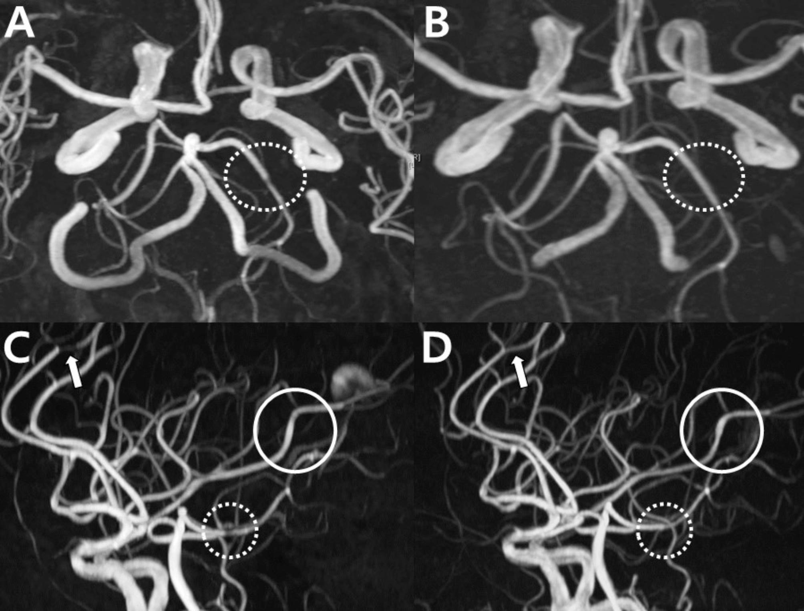
*MRA lặp sau **2 ngày** (ca đau đầu sét đánh): (A) hẹp ổ khu trú ĐM não sau trái (vòng chấm) → (B) **hồi phục**; (C→D) giãn khu trú **mới xuất hiện** ở ĐM não giữa trái (vòng tròn). **Đường kính mạch thay đổi theo thời gian** nên không chốt từ một lần chụp — chìa khóa phân biệt với xơ vữa (không hồi phục). Nguồn: Kim SA et al., J Headache Pain 2025 (PMC12036309), CC BY 4.0.*

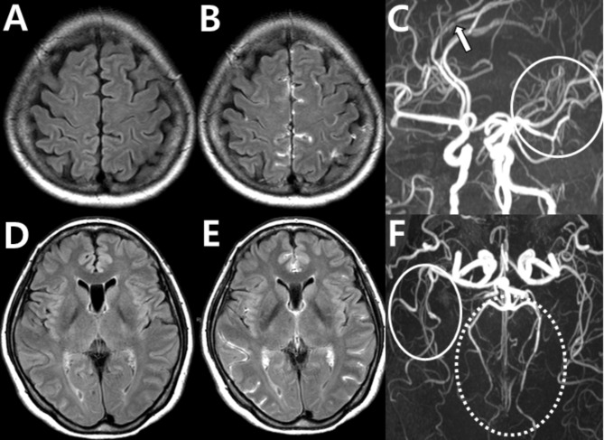
*CE-FLAIR: hở **hàng rào máu-não (BBB)** = tăng tín hiệu **dịch não tủy/dưới nhện** (B, E) so với FLAIR không cản quang (A, D); MRA (C, F) co mạch đa ổ. **Hở BBB xuất hiện trước co mạch, đỉnh 1–2 tuần** (69% RCVS rõ/25% RCVS nghi ngờ) → tăng chẩn đoán ở ca angiogram âm. Cạm bẫy: tăng tín hiệu dịch cũng gặp ở SAH/viêm màng não/nhồi máu. Nguồn: Kim SA et al., J Headache Pain 2025 (PMC12036309), CC BY 4.0.*

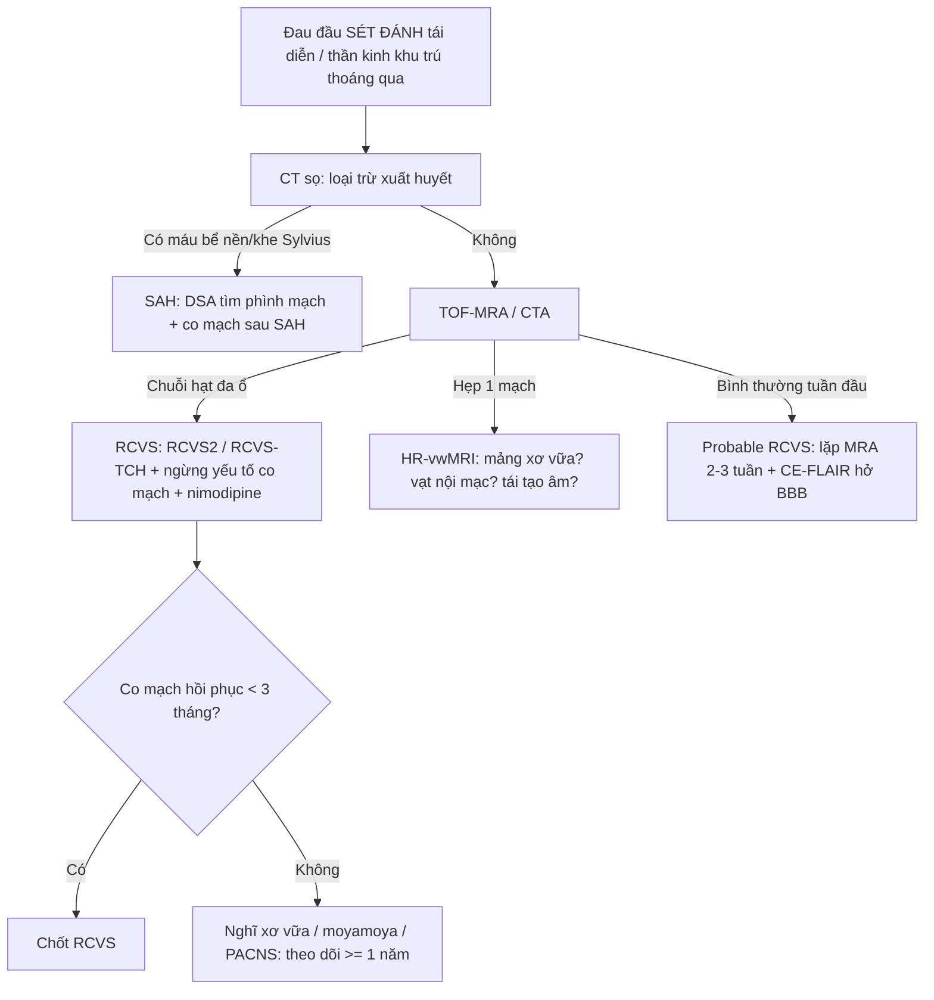

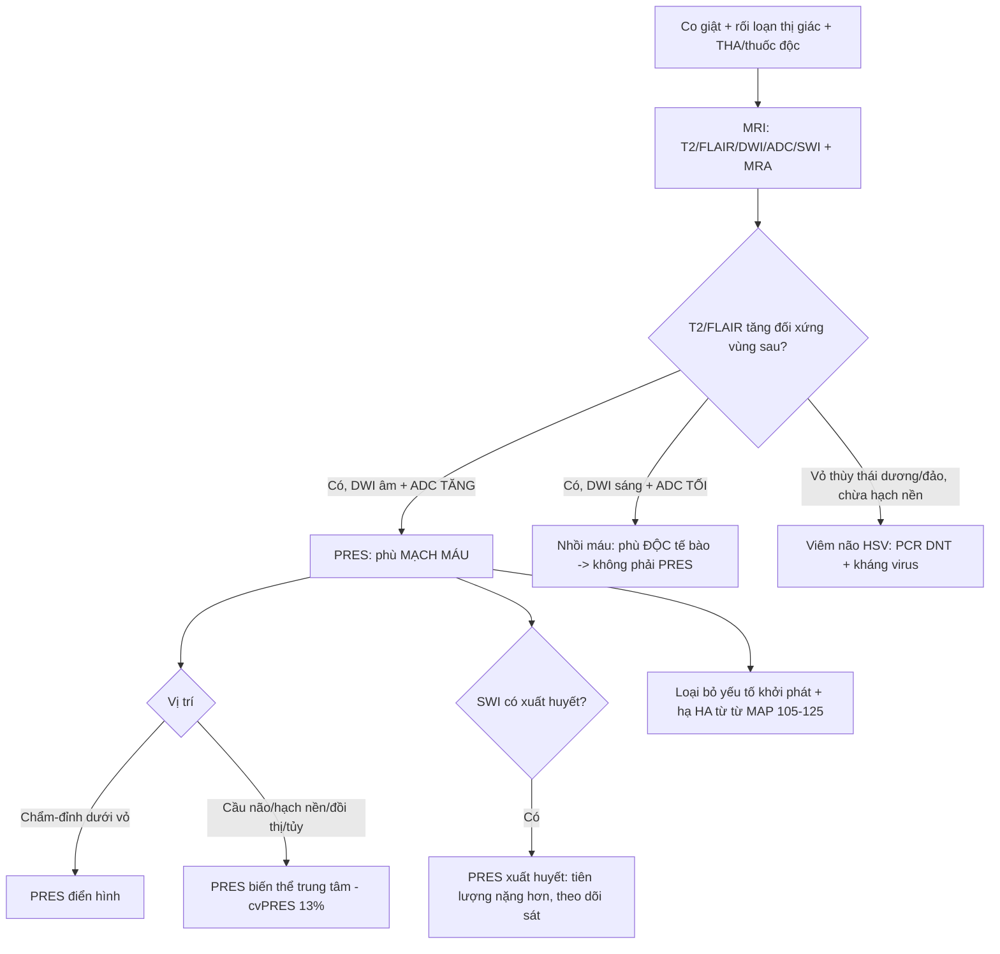

## 5. Biến thể bình thường và cạm bẫy

- **"Reversible" là tên gọi lịch sử, KHÔNG phải bảo đảm hồi phục:** **40–44%** bệnh nhân PRES còn di chứng/thương tổn xơ hóa, và **tử vong 10–19%** (PMC12922249). Đừng trấn an quá mức.
- **CT âm không loại trừ PRES (nhạy ~46%)** — bệnh nhân co giật + THA có **CT bình thường vẫn phải MRI**.
- **Giả ảnh MRA ở RCVS là cạm bẫy đọc phim (theo PMC12036309):**
  - **Stair-step artifact (2D TOF)**: mạch xiên bị pixel hóa → **giả hẹp**; xác nhận bằng **MRA có cản từ**.
  - **In-plane saturation artifact**: mạch nằm trong mặt phẳng bị mất tín hiệu → giả hẹp/tắc; **nhìn lại trên MRA cản từ**.
  - **Venetian blind artifact (3D TOF)**: giảm tín hiệu ở mép phiến (slab) → giả hẹp.
  - **Mạch xa kém hiển thị** → có thể bỏ sót hẹp (tuần đầu còn khó hơn).
- **Đọc "mặt cắt ngang" một thời điểm dễ bỏ sót RCVS**: đường kính mạch **thay đổi theo thời gian** (một mạch có thể bình thường lúc đầu rồi hẹp/giãn sau; hoặc ngược lại) → **luôn đối chiếu chuỗi theo thời gian**, không chốt từ một lần chụp.
- **Không được chẩn đoán "loạn sản cơ xơ (FMD)" hay "viêm mạch" vội** khi thấy co mạch: kiểm tra **yếu tố khởi phát co mạch**, hồi phục theo thời gian, ngấm thành mạch (RCVS ngấm **nhẹ**).
- **Overlap PRES–RCVS:** cùng bệnh nhân (đặc biệt **hậu sản**) có thể có **cả hai**; RCVS nặng gây PRES. Nếu có **đau đầu sét đánh tái diễn + phù não sau**, phải nghĩ **cả hai** chứ không loại trừ nhau.
- **Không dùng corticosteroid cho RCVS** (có thể làm nặng/làm chậm hồi phục); điều trị khác hẳn PACNS (vốn cần ức chế miễn dịch).

## 6. Tự lượng giá — Blind Quiz (ảnh trơn ngoài, đáp án trong)

**Ca 1 — Thai phụ vị thành niên, tiền sản giật/eclampsia, co giật + rối loạn thị giác. Nhìn T2:**

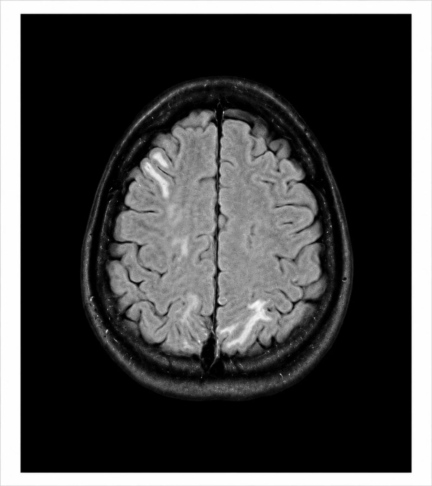

- Gợi ý lâm sàng (clinical context): thai kỳ/ngay sau sinh, tăng huyết áp, co giật và giảm thị lực.
- Câu hỏi: Tổn thương ở đâu, đối xứng không? Đây là phù gì? 3 chẩn đoán phân biệt + dấu hiệu chốt?

<b>Bấm để hiện đáp án (findings + chẩn đoán)</b>

- Dấu hiệu (findings): T2 **tăng tín hiệu vỏ + dưới vỏ vùng chẩm-đỉnh hai bên (không đối xứng hoàn toàn)** = phù mạch máu vùng chuyển tiếp MCA–PCA.
- Chẩn đoán (diagnosis): **PRES do tiền sản giật/eclampsia**. Cơ chế: tăng huyết áp cấp vượt tự điều hòa → hở BBB → phù mạch máu; xử trí = kiểm soát huyết áp + magnesium sulfate (dự phòng/điều trị co giật) + sinh con theo sản khoa.
- Nguồn ảnh: Gómez KA et al., Cureus 2026 (PMC13555745), CC BY 4.0.

**Ca 2 — Bệnh nhân co giật, tăng huyết áp; CT rồi MRI. Nhìn 2 ảnh:**

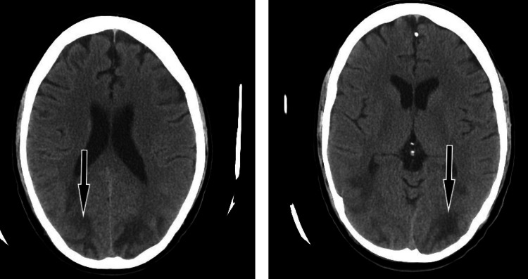

- Câu hỏi: (a) CT thấy gì? (b) Vì sao CT có thể **âm** dù đã PRES? Bước tiếp theo?

<b>Bấm để hiện đáp án (findings + chẩn đoán)</b>

- Dấu hiệu (findings): CT **giảm đậm độ mờ dưới vỏ vùng chẩm-đỉnh hai bên** (mũi tên), không xuất huyết; đối chiếu **MRI 6 chuỗi** cùng ca: **T1 giảm, T2/FLAIR tăng, SWI âm, DWI không hạn chế (ADC tăng)** = phù mạch máu.
- Chẩn đoán (diagnosis): **PRES điển hình**. CT chỉ nhạy ~46% → **âm không loại trừ**; cần **MRI (T2/FLAIR/DWI/ADC)**, nhạy 98%.
- Nguồn ảnh: Alzahrani Y., Cureus 2023 (PMC10821201), CC BY 4.0.

**Ca 3 — Sau sinh, mất máu nhiều; tổn thương "lan tỏa". Nhìn MRI:**

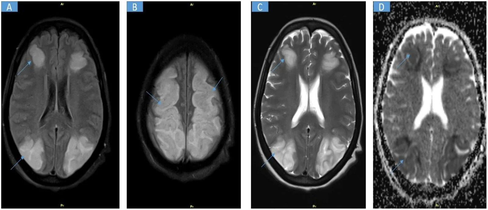

- Câu hỏi: Đây có phải PRES "điển hình chẩm-đỉnh" không? Vì sao vẫn gọi là PRES? Chuỗi ADC nói gì?

<b>Bấm để hiện đáp án (findings + chẩn đoán)</b>

- Dấu hiệu (findings): FLAIR/T2 **tăng tín hiệu lan tỏa đối xứng vỏ–dưới vỏ vùng trán-đỉnh và chẩm cả hai bán cầu** (mũi tên); **ADC tương ứng tăng** (map ADC sáng) = phù mạch máu.
- Chẩn đoán (diagnosis): **PRES biến thể lan tỏa (atypical)** sau mất máu nặng/sản khoa — vẫn là PRES dù **không khu trú "chẩm-đỉnh"**; **ADC tăng** (không hạn chế khuếch tán) giúp loại nhồi máu. Đây là cạm bẫy: biến thể không điển hình gặp 10–58% người lớn.
- Nguồn ảnh: Mohamed SA et al., Radiol Case Rep 2026 (PMC13488048), CC BY-NC-ND 4.0 — ảnh giữ nguyên bản.

**Ca 4 — Eclampsia khởi phát sớm, hôn mê; nhìn DWI/ADC và SWI:**

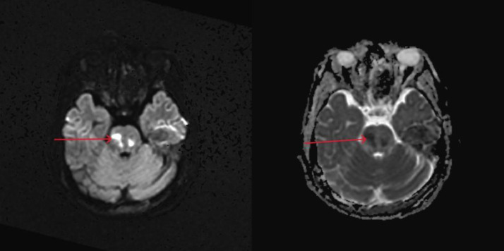

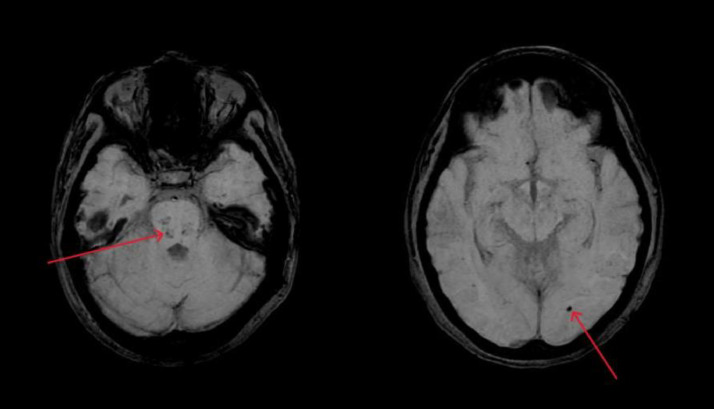

- Câu hỏi: DWI/ADC và SWI cho thấy gì? Ý nghĩa tiên lượng?

<b>Bấm để hiện đáp án (findings + chẩn đoán)</b>

- Dấu hiệu (findings): **DWI sáng + ADC tối khu trú ở cầu não** (mũi tên) = **hạn chế khuếch tán thật (nhồi máu cầu não)**; ảnh SWI cùng ca có **"blooming" cầu não + thùy chẩm trái = thành phần xuất huyết**.
- Chẩn đoán (diagnosis): **PRES xuất huyết kèm nhồi máu cầu não** — biến thể nặng. **Hạn chế khuếch tán + xuất huyết = dấu hiệu tiên lượng xấu** (không còn thuần "hồi phục"). Xử trí tích cực, theo dõi sát, có thể cần can thiệp giải ép.
- Nguồn ảnh: Nalla S et al., Radiol Case Rep 2026 (PMC13396603), CC BY-NC-ND 4.0 — ảnh giữ nguyên bản.

**Ca 5 — Phụ nữ hậu sản, đau đầu sét đánh tái diễn. Nhìn MRA:**

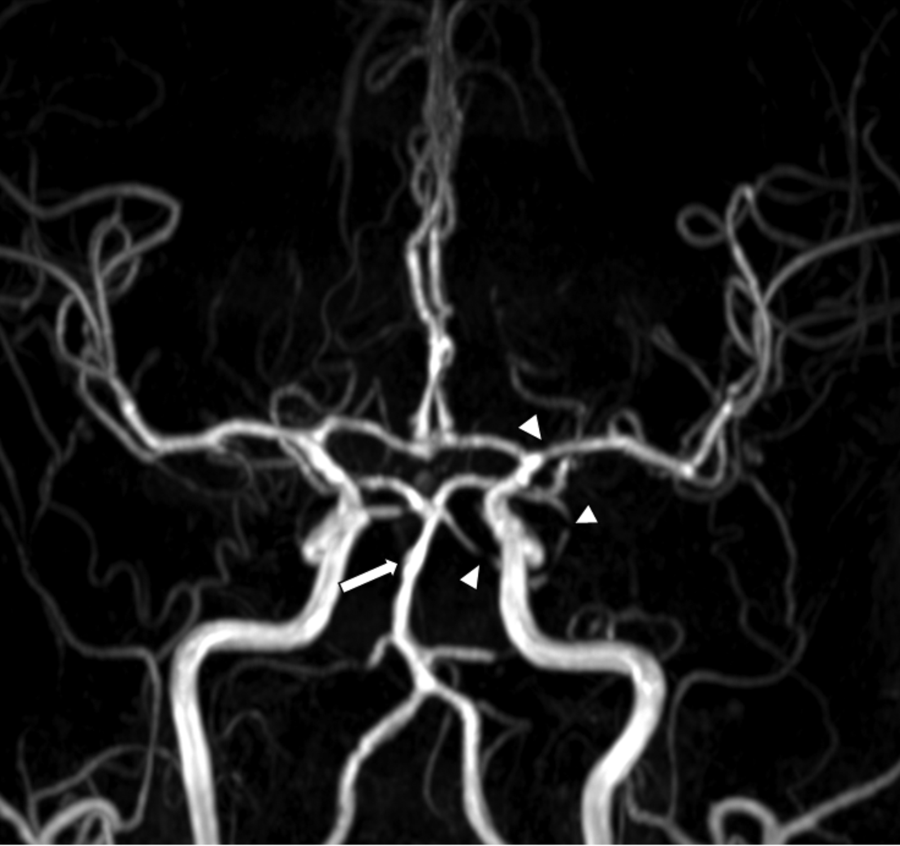

- Câu hỏi: Mô tả bất thường mạch? Chẩn đoán? Bước xác nhận và điều trị?

<b>Bấm để hiện đáp án (findings + chẩn đoán)</b>

- Dấu hiệu (findings): **hẹp từng đoạn (mũi tên nhọn) xen kẽ giãn sau hẹp** ở nhiều động mạch não = **hình "chuỗi hạt" (string of beads)**.
- Chẩn đoán (diagnosis): **RCVS**. Đối chiếu lâm sàng **thunderclap tái diễn có yếu tố khởi phát**; chấm **RCVS2** (≥ 5: Se 90%/Sp 99%). Xác nhận hồi phục trên **MRA lặp 2–3 tuần (< 3 tháng)**; **ngừng yếu tố co mạch + nimodipine**; **không dùng corticoid**.
- Nguồn ảnh: Kim SA et al., J Headache Pain 2025 (PMC12036309), CC BY 4.0.

**Ca 6 — Đau đầu sét đánh nhưng MRA **bình thường** tuần đầu. Nhìn ảnh chuỗi hạt vs bình thường:**

- Câu hỏi: MRA âm tuần đầu có loại trừ RCVS không? Làm gì tiếp?

<b>Bấm để hiện đáp án (findings + chẩn đoán)</b>

- Dấu hiệu (findings): phải = **MRA bình thường** ở bệnh nhân đau đầu sét đánh tái diễn (trái = ca khác có chuỗi hạt để đối chiếu).
- Chẩn đoán (diagnosis): **KHÔNG loại trừ RCVS** — MRA/CTA có thể **bình thường trong tuần đầu** → **"probable RCVS"** (ICHD-3). Xử trí: **lặp MRA/CTA sau 2–3 tuần**, thêm **CE-FLAIR tìm hở BBB** (69% RCVS rõ; tăng chẩn đoán 33% → 41% ở ca angiogram âm), và theo dõi đáp ứng ngừng yếu tố co mạch.
- Nguồn ảnh: Kim SA et al., J Headache Pain 2025 (PMC12036309), CC BY 4.0.

**Ca 7 — Đau đầu sét đánh, MRA hẹp nhiều ổ; 6 tháng sau phần lớn cải thiện nhưng 1 ổ vẫn hẹp. Nhìn ảnh:**

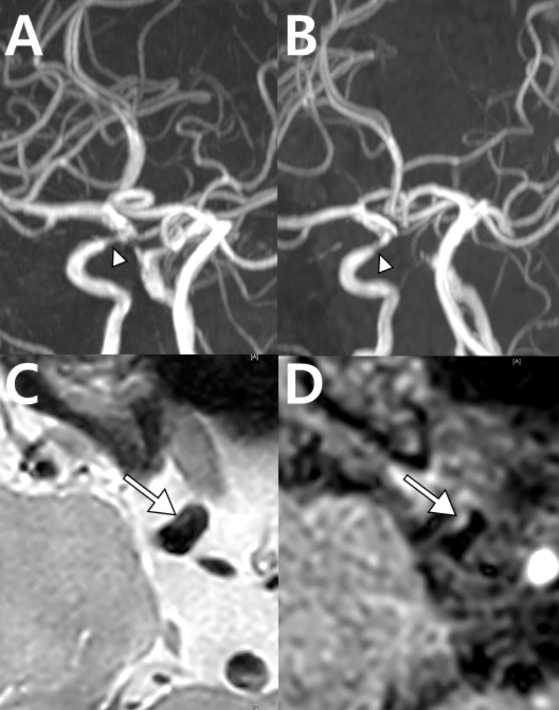

- Câu hỏi: Vì sao một ổ **không hồi phục** quan trọng? Chuỗi HR-vwMRI (C/D) giúp gì?

<b>Bấm để hiện đáp án (findings + chẩn đoán)</b>

- Dấu hiệu (findings): (A) co mạch nhiều ổ; (B) sau 6 tháng phần lớn cải thiện nhưng **ổ đoạn tận ĐM cảnh trong phải vẫn hẹp**; (C/D) HR-vwMRI cho thấy **mảng xơ vữa** tại ổ đó.
- Chẩn đoán (diagnosis): **RCVS (các ổ hồi phục) + xơ vữa nội sọ nền (ổ không hồi phục)**. Bài học: **"không hồi phục" = không phải RCVS**; **HR-vwMRI** phân biệt xơ vữa (mảng lệch tâm, tái tạo dương, ngấm) với RCVS (ngấm nhẹ, không mảng lệch tâm).
- Nguồn ảnh: Kim SA et al., J Headache Pain 2025 (PMC12036309), CC BY 4.0.

## Bài liên quan chéo
- [200 – Tổng quan Hệ Thần kinh](../200-tong-quan-he-than-kinh/lesson.md)
- [201 – Protocol sọ não](../201-protocol-so-nao/lesson.md) (DWI/ADC, tưới máu, SWI, mạch CTA/MRA/MRV)
- [211 – Đột quỵ thiếu máu não cấp](../211-dot-quy-nao/lesson.md) (phân biệt phù mạch máu vs nhồi máu)
- [212 – Xuất huyết sọ](../212-xuat-huyet-so-nao/lesson.md) (SAH lồi vs SAH bể nền; diễn tiến hemoglobin)
- [214 – Nhiễm trùng TKTW](../214-nhiem-trung-tktw/lesson.md) (viêm não HSV — DDx quan trọng của PRES)
- [216 – Dị dạng mạch & CVST](../216-di-dang-mach-CVST/lesson.md) (huyết khối xoang, co mạch)
- [218 – Thoát vị não & úng thủy](../218-thoat-vi-nao-ung-thuy/lesson.md) (phù não, biến chứng thần kinh)

## Ảnh
- `images/219_pres_CT_PMC10821201-Fig2-CCBY.jpg` — CT giảm đậm độ dưới vỏ chẩm-đỉnh (CC BY 4.0).
- `images/219_pres_MRI_PMC10821201-Fig3-CCBY.jpg` — MRI 6 chuỗi: T1/T2/FLAIR + SWI/DWI/MRA (CC BY 4.0).
- `images/219_pres_MRI_PMC13555745-Fig1-CCBY.jpg` — T2 đối xứng chẩm-đỉnh thai kỳ (CC BY 4.0).
- `images/219_pres_MRI_PMC13396603-Fig1-CCBYNCND.jpg` — FLAIR chẩm-đỉnh điển hình (CC BY-NC-ND 4.0, giữ nguyên bản).
- `images/219_pres_DWI-ADC_PMC13396603-Fig3-CCBYNCND.jpg` — DWI/ADC nhồi máu cầu não (CC BY-NC-ND 4.0, giữ nguyên bản).
- `images/219_pres_SWI_PMC13396603-Fig4-CCBYNCND.jpg` — SWI xuất huyết (CC BY-NC-ND 4.0, giữ nguyên bản).
- `images/219_pres_MRI_PMC13488048-Fig1-CCBYNCND.jpg` — biến thể lan tỏa (CC BY-NC-ND 4.0, giữ nguyên bản).
- `images/219_rcvs_MRA_PMC12036309-Fig1-chuoi-hat-CCBY.jpg` — MRA chuỗi hạt (CC BY 4.0).
- `images/219_rcvs_MRA_PMC12036309-Fig3-binh-thuong-CCBY.jpg` — MRA bình thường tuần đầu (CC BY 4.0).
- `images/219_rcvs_MRA_PMC12036309-Fig8-tai-thong-CCBY.jpg` — hồi phục trong 2 ngày (CC BY 4.0).
- `images/219_rcvs_MRA-HRvW_PMC12036309-Fig10-xo-vua-CCBY.jpg` — HR-vwMRI mảng xơ vữa (CC BY 4.0).
- `images/219_rcvs_CE-FLAIR_PMC12036309-Fig16-BBB-CCBY.jpg` — CE-FLAIR hở hàng rào máu-não (CC BY 4.0).
- `images/composite_219_pres_CT-vs-MRI.jpg`, `images/composite_219_rcvs_chuoi-hat-vs-binh-thuong.jpg` — ảnh ghép đối chiếu (CC BY 4.0).
- Nguồn + giấy phép đầy đủ: `images/CREDITS.md`; link gốc: `sources.md`.

> Không dùng để chẩn đoán độc lập khi chưa có người hướng dẫn.
