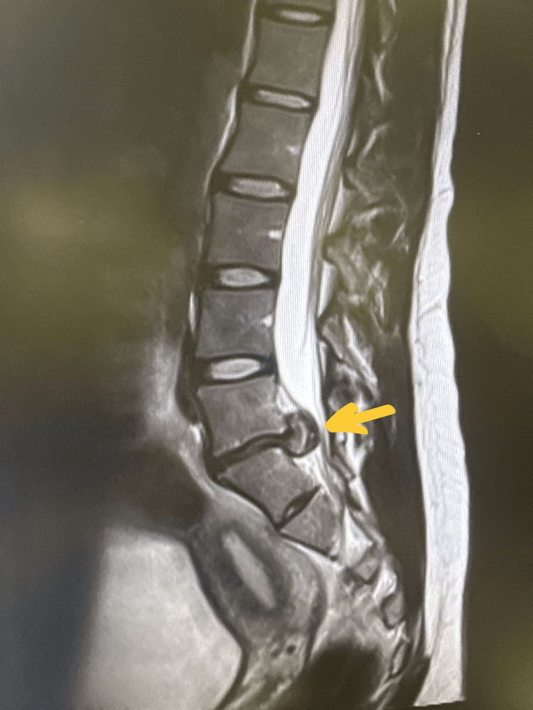
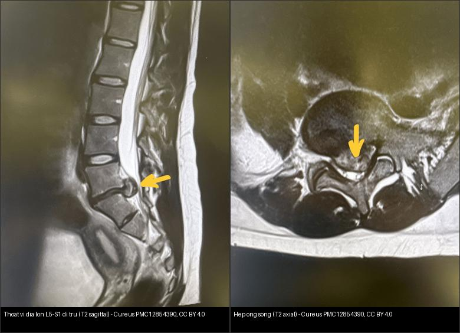
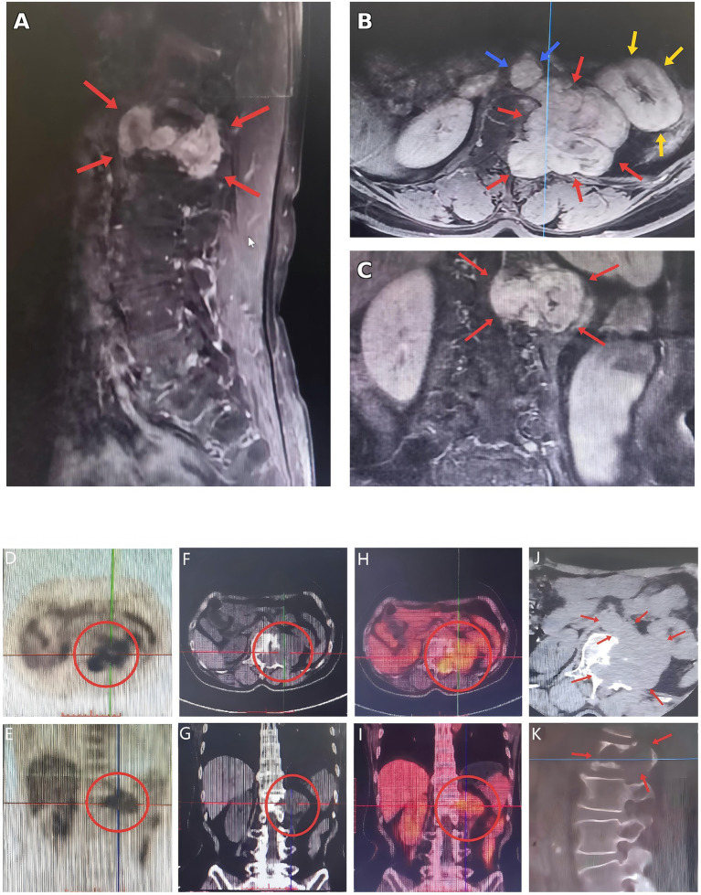
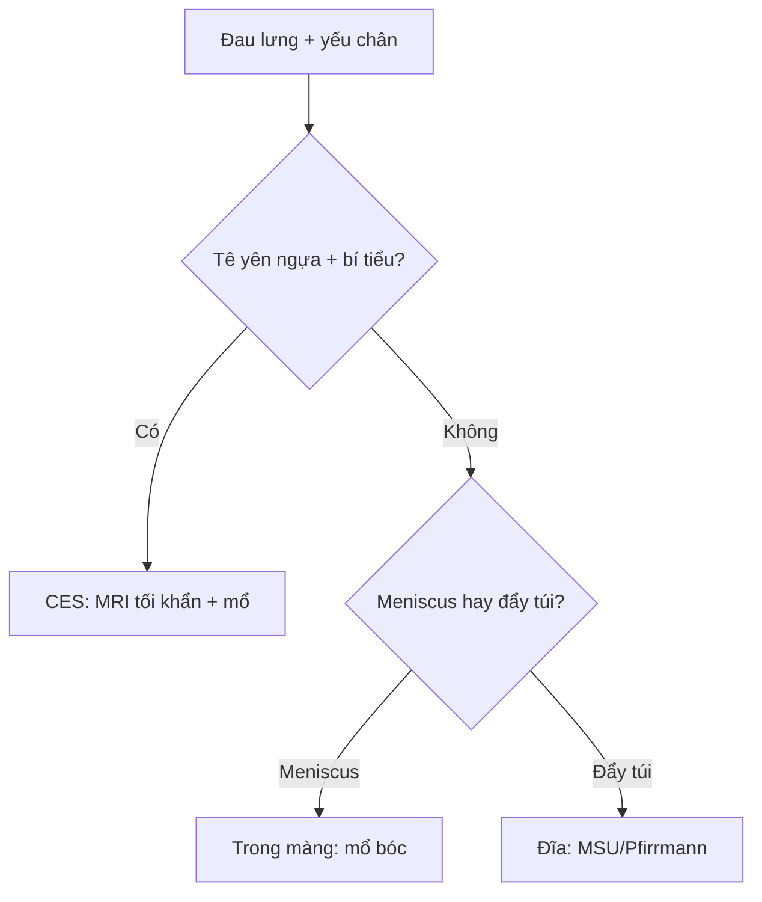
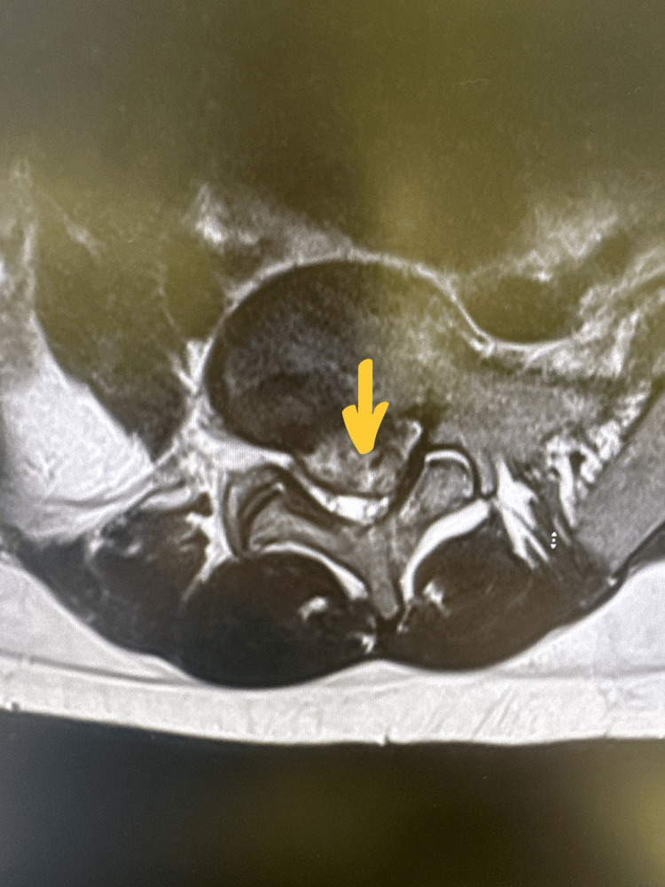

# 220 — Ống sống 3 khoang: thoát vị đĩa, u tủy & viêm tủy / Spinal compartments

**Tags:** `pattern:ong-song` `vung:cot-song` `score:MSU-Pfirrmann`
**Mức chắc chắn (certainty):** tổng hợp y văn (literature synthesis) — nhóm tự biên từ y văn mở; **các ca trong quiz là ca nguyên văn (verbatim case)** chép đúng tuổi – lâm sàng – chú thích gốc.

## 1. Tổng quan — túi màng cứng là ranh giới sống còn

- Ống sống 3 khoang: ngoài màng cứng (extradural: đĩa + di căn + tụ máu), trong màng cứng-ngoài tủy (intradural-extramedullary: schwannoma + meningioma), nội tủy (intramedullary: ependymoma + viêm tủy) — TẠI SAO túi màng cứng (thecal sac) quyết định: khối ngoài màng đẩy lệch túi, khối trong màng-ngoài tủy nong rộng khoang dưới nhện hình chén (meniscus/gutter), khối nội tủy phình rộng tủy.
- Thoát vị đĩa: nhân nhầy (nucleus) chui qua vòng xơ (annulus) — lồi (bulge) → phồng (protrusion: đáy rộng hơn vòm) → thoát (extrusion: vòm rộng hơn đáy) → di trú (migration/sequestration).
- Phân độ Pfirrmann I–V (tín hiệu + chiều cao đĩa) + MSU (vị trí A/B/C + độ 1–3) quyết định mổ/thủ thuật.
- Danh pháp NASS v2.0: **lồi (bulge) > 25% chu vi (> 90°)** vs **thoát vị khu trú (protrusion/extrusion) < 25% chu vi** — TẠI SAO: lồi là thoái hóa lan tỏa (bảo tồn), thoát vị khu trú mới là đích mổ.
- Thoái hóa Modic bản tận: **Type 1 (T1 tối/T2 sáng = viêm-phù)**, Type 2 (T1 sáng = mỡ), Type 3 (T1+T2 tối = xơ) — **dấu móng vuốt (claw sign: viền Modic 1 ôm đĩa thoái hóa = thoái hóa, không phải viêm!**; viêm thật phá bản tận 2 bên + đĩa sáng như dịch).

*T2 sagittal: **thoát vị đĩa trung tâm lớn L5–S1 di trú theo trục thân sống (mũi tên vàng)**, chèn ép nặng chùm đuôi ngựa + hai rễ S1 — điển hình thoát vị di trú (sequestration). Nguồn: Alshanqity M et al., Cureus 2025 (PMC12854390) Fig 1, CC BY 4.0.*

## 2. Gamut đau lưng + yếu chân (Gamut)

- **Đĩa lệch bên + đau rễ một bên:** thoát vị cạnh bên — NSAID + vật lý trị liệu, mổ khi liệt tiến triển.
- **Khối trong màng-ngoài tủy + meniscus:** schwannoma/meningioma — mổ bóc (giữ tủy).
- **Phình tủy + tăng T2 dài + ngấm loang:** viêm tủy cắt ngang vs ependymoma — corticoid + kháng thể AQP4/MOG.
- **Tê yên ngựa + bí tiểu:** hội chứng chùm đuôi ngựa (CES) — MRI tối khẩn + mổ < 24–48 giờ.

## 3. Bảng so sánh phân biệt (ma trận đối chiếu)

| Thực thể (entity) | Hình ảnh điển hình | Chốt vào (rule-in) | Chốt loại (rule-out) | Gợi ý xác nhận |
|---|---|---|---|---|
| Thoát vị đĩa | **Đẩy lệch túi màng cứng; extrusion vòm > đáy; Pfirrmann IV–V** | **Đau rễ theo khoanh + extrusion/MSU 2–3** | Meniscus trong màng → schwannoma | MRI + ODI; mổ khi liệt/CES |
| Schwannoma/meningioma | **Nong khoang dưới nhện hình chén + ngấm đồng nhất** | **Meniscus + trong màng-ngoài tủy** | Phình tủy → nội tủy | Mổ bóc, giữ tủy |
| Viêm tủy cắt ngang | **Tăng T2 ≥ 3 đốt + phù tủy + ngấm loang (LETM)** | **LETM + AQP4/MOG** | Khối ngấm đặc + phình khu trú → ependymoma | Corticoid + thay huyết tương |
| CES (cấp cứu) | **Đĩa lớn giữa + túi bẹt + tê yên ngựa + bí tiểu** | **Yên ngựa + bí tiểu = mổ < 24–48 giờ** | Đau rễ đơn thuần → bảo tồn | MRI tối khẩn + mổ giải ép |

*Trái: T2 sagittal — **thoát vị đĩa trung tâm lớn L5–S1 di trú** (mũi tên), chèn ép chùm đuôi ngựa. Phải: T2 axial — **đĩa lồi ra sau (protrusion) làm hẹp nặng ống sống + hẹp hai ngách bên (recess stenosis)**. Nguồn: Alshanqity M et al., Cureus 2025 (PMC12854390) Fig 1 & 2, CC BY 4.0. Ảnh ghép letterbox, giữ tỉ lệ.*

**Khoang trong màng–ngoài tủy — schwannoma hình quả tạ (dumbbell):**

*MRI có cản quang (A sagittal) + PET/CT: **khối lớn ngấm thuốc không đồng nhất ở L1, hình quả tạ qua lỗ liên hợp (dumbbell)** — dấu hiệu kinh điển của schwannoma thần kinh ngoại biên. Nguồn: Jiang C et al., Front Med 2026 (PMC13138916) Fig 1, CC BY 4.0.*

## 4. Protocol MRI cột sống

- **MRI T1/T2/STIR + gadolinium + axial qua đĩa:** Pfirrmann + MSU + meniscus + LETM; CES = mổ < 24–48 giờ.

## 5. Cạm bẫy

- **Bỏ sót CES vì chỉ đau lưng** — hỏi tiểu + tê yên ngựa mọi thoát vị lớn giữa.
- **Viêm tủy gọi nhầm u nội tủy** → mổ oan — AQP4/MOG + LETM + corticoid thử trước.
- **Đĩa mất nước tuổi già** giả thoát vị — Pfirrmann + tương quan rễ lâm sàng mới mổ.
- **Mảnh đĩa di trú tự do (sequestered) ngấm viền** giả schwannoma/áp-xe ngoài màng — liên tục với đĩa mẹ + claw Modic là thoái hóa (schwannoma có meniscus, áp-xe có sốt!).

## 6. Tự lượng giá — Blind Quiz

**Ca 1 — Bệnh nhân nữ, đau lưng cấp + đau rễ hai bên chân, tê vùng yên ngựa, bí tiểu. T2 sagittal. Mô tả trước khi mở đáp án.**

- Hỏi: Dấu hiệu ở đĩa L5–S1? Chèn ép gì? Chẩn đoán + giờ mổ?

<b>Bấm để hiện đáp án</b>

- **Thoát vị đĩa trung tâm lớn L5–S1, di trú theo trục (sequestration)** (mũi tên vàng) → **chùm đuôi ngựa + hai rễ S1 chèn ép nặng**. Lâm sàng **tê yên ngựa + bí tiểu = hội chứng chùm đuôi ngựa (CES)**.
- **Xử trí: MRI tối khẩn + mổ giải ép < 24–48 giờ** (không bảo tồn như đau rễ đơn thuần).
- Nguồn ảnh: Alshanqity M et al., Cureus 2025 (PMC12854390), Fig 1, CC BY 4.0.

**Ca 2 — Cùng bệnh nhân, lát T2 axial qua đĩa L5–S1. Ống sống bị gì?**

<b>Bấm để hiện đáp án</b>

- **Đĩa lồi ra sau (posterior disc protrusion)** (mũi tên vàng) làm **hẹp nặng ống sống + hẹp hai ngách bên (recess stenosis)** — giải thích chèn ép hai rễ. Đối chiếu sagittal (Ca 1): thoát vị di trú theo trục.
- Lưu ý danh pháp NASS: **lồi (bulge) > 25% chu vi** là thoái hóa lan tỏa; **thoát vị khu trú** mới là đích mổ.
- Nguồn ảnh: Alshanqity M et al., Cureus 2025 (PMC12854390), Fig 2, CC BY 4.0.

**Ca 3 — Bệnh nhân nữ lớn tuổi, đau lưng + yếu chân tiến triển. MRI có cản quang tầng L1: khối cạnh đường giữa.**

<b>Bấm để hiện đáp án</b>

- **Schwannoma hình quả tạ (dumbbell) tầng L1**: khối **trong màng–ngoài tủy**, ngấm thuốc không đồng nhất, **lan qua lỗ liên hợp** (dấu quả tạ). Vị trí trong màng–ngoài tủy → nghĩ **schwannoma/meningioma** (nong khoang dưới nhện hình chén = meniscus) thay vì khối nội tủy (phình tủy).
- Xử trí: **mổ bóc, giữ tủy**; đối chiếu u nội tủy (ependymoma) và viêm tủy cắt ngang — nối [215].
- Nguồn ảnh: Jiang C et al., Front Med 2026 (PMC13138916), Fig 1, CC BY 4.0.

## Bài liên quan chéo
- [200 – Tổng quan Thần kinh](../200-tong-quan-he-than-kinh/lesson.md)
- [215 – Mất myelin](../215-mat-myelin/lesson.md) (LETM, AQP4)
- [221 – Chấn thương cột sống](../221-chan-thuong-cot-song/lesson.md) (trục + cột Denis)

## Ảnh
- Tên file: `NNN_slug_Modality_SourceID.jpg`. Chi tiết nguồn + giấy phép từng ảnh: `images/CREDITS.md` và `sources.md`.
- Ảnh nguồn **CC BY 4.0** (ghi nguồn đầy đủ); ảnh ghép đối chiếu tạo bằng `tools/make_composite.py` (letterbox, không crop/kéo giãn).

> Không dùng để chẩn đoán độc lập khi chưa có người hướng dẫn.
