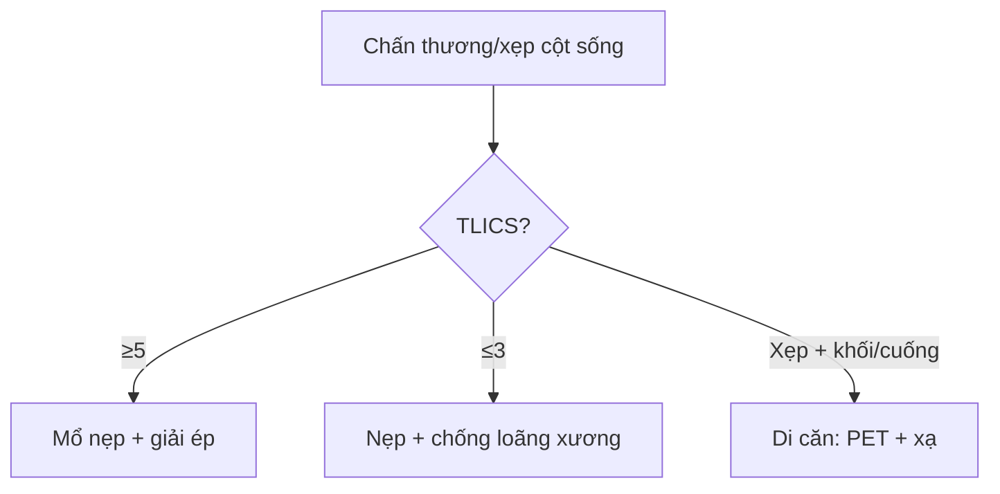

# 221 — Chấn thương cột sống: 3 cột Denis, TLICS & xẹp lành-ác / Spine trauma

**Tags:** `pattern:chan-thuong-cot-song` `vung:cot-song` `score:TLICS`
**Mức chắc chắn (certainty):** tổng hợp y văn (literature synthesis) — nhóm tự biên từ y văn mở, chưa gắn ca nguyên văn đơn lẻ.

## 1. Tổng quan — cột giữa là chìa khóa mất vững

- Mô hình 3 cột Denis: trước (1/2 trước thân + đĩa), giữa (1/2 sau thân + dây chằng dọc sau), sau (cung + dây chằng) — TẠI SAO cột giữa vỡ = mất vững cơ học: nó là trụ chịu nén + rào cản mảnh vỡ vào tủy.
- TLICS (Thoracolumbar Injury Classification): hình thái (1–4) + phức hợp dây chằng sau (0–3) + thần kinh (0–3); **≥ 5 = mổ, ≤ 3 = bảo tồn, 4 = tùy**.
- Xẹp loãng xương vs di căn: lành (phù + xẹp lõm + tín hiệu dịch) vs ác (lồi bờ sau + hủy cuống + khối ngoài màng).

## 2. Gamut sau ngã/tai nạn + đau lưng người già (Gamut)

- **Vỡ 3 cột + liệt:** mổ nẹp + giải ép — corticoid tủy còn bàn cãi.
- **Xẹp hình chêm + loãng xương + không khối:** tạo hình đốt sống/đeo nẹp + chống loãng xương.
- **Hủy cuống (mất mắt cú) + khối + chừa đĩa:** di căn — PET + xạ/mổ.
- **Tụ máu ngoài màng cứng sau chấn thương:** chèn tủy tiến triển — mổ tối khẩn.

## 3. Bảng so sánh phân biệt (ma trận đối chiếu)

| Thực thể (entity) | Hình ảnh điển hình | Chốt vào (rule-in) | Chốt loại (rule-out) | Gợi ý xác nhận |
|---|---|---|---|---|
| Mất vững (Denis/TLICS) | **Vỡ cột giữa + di lệch + hở dây chằng sau** | **TLICS ≥ 5 = mổ** | TLICS ≤ 3 → nẹp + theo dõi | CT 3D + MRI dây chằng |
| Xẹp loãng xương | **Xẹp lõm + phù STIR + tín hiệu dịch + bờ sau lõm** | **Già + loãng xương + không khối/cuống** | Lồi bờ sau + hủy cuống → ác | DXA + tạo hình/khâu |
| Xẹp ác tính | **Lồi bờ sau + hủy cuống (mất mắt cú) + khối ngoài màng + chừa đĩa** | **Cuống + khối + tiền sử K** | Phù đơn thuần + lõm → lành | PET + sinh thiết + xạ |
| Tụ máu ngoài màng | **Thấu kính sau tủy + chèn tiến triển** | **Liệt tăng dần sau chấn thương** | Không chèn → theo dõi | Mổ tối khẩn khi liệt |

## 4. Protocol + TLICS flowchart

- **CT 3D + MRI STIR/T1C:** cột + dây chằng + tủy (phù/chảy máu tủy); DXA khi xẹp người già + canxi 1000 mg/ngày và vitamin D 800 IU/ngày khi loãng xương.

## 5. Cạm bẫy

- **Vỡ Chance (dây an toàn) bỏ sót** — STIR dây chằng sau + TLICS mới thấy mất vững.
- **Di căn gọi nhầm loãng xương** → bơm xi măng vào u — cuống + khối + chừa đĩa trước mọi tạo hình.
- **Tổn thương tủy không gãy (SCIWORA trẻ)** — MRI tủy dù CT bình thường.

## 6. Tự lượng giá — Blind Quiz

**Ca 1 — Ngã cao + vỡ L1 3 cột + liệt chân tăng dần:** TLICS mấy? Mổ hay nẹp? *(Bảng mục 3.)*

<b>Bấm để hiện đáp án</b>

- **TLICS ≥ 5 + liệt tiến triển:** mổ nẹp + giải ép cấp cứu (tụ máu/mảnh vỡ chèn).

**Ca 2 — Bà 75 tuổi xẹp D12 lõm + phù STIR + không khối, DXA −3,0:** lành hay ác? Xử trí? *(Bảng mục 3.)*

<b>Bấm để hiện đáp án</b>

- **Xẹp loãng xương lành tính:** tạo hình/nẹp + chống loãng xương (không phải di căn khi không hủy cuống).

**Ca 3 — Xẹp + mất mắt cú + khối ngoài màng + K phổi cũ:** chẩn đoán + bước tiếp? *(Bảng mục 3.)*

<b>Bấm để hiện đáp án</b>

- **Di căn cột sống:** PET + sinh thiết + xạ/mổ (cấm bơm xi măng mù).

## Bài liên quan chéo
- [200 – Tổng quan Thần kinh](../200-tong-quan-he-than-kinh/lesson.md)
- [220 – Ống sống 3 khoang](../220-ong-song-tuy/lesson.md) (đĩa vs u vs viêm)
- [222 – Viêm đốt sống](../222-viem-dot-song/lesson.md) (Pott vs vi khuẩn vs di căn)

> Không dùng để chẩn đoán độc lập khi chưa có người hướng dẫn.
