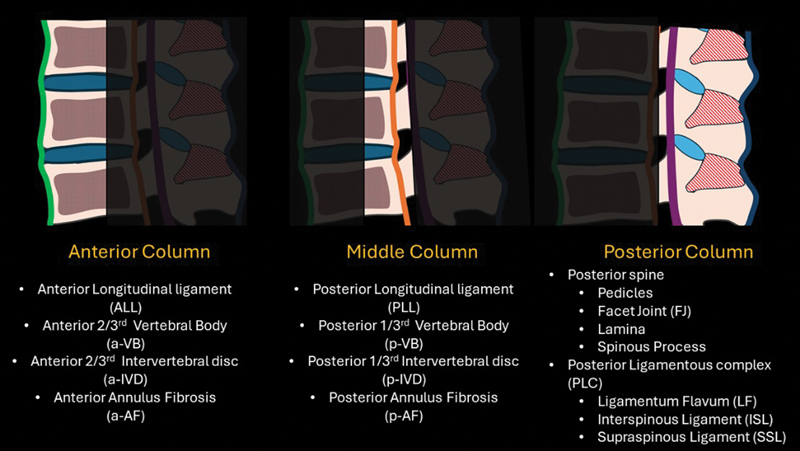
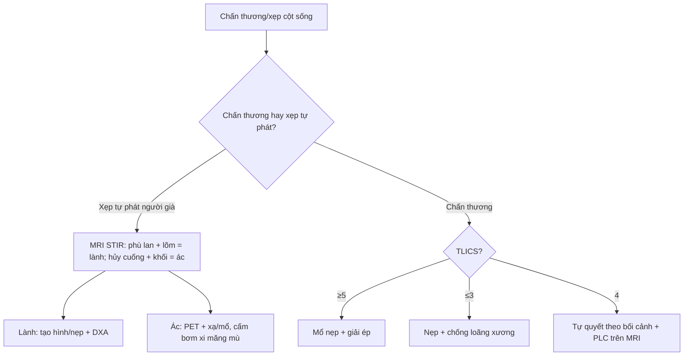
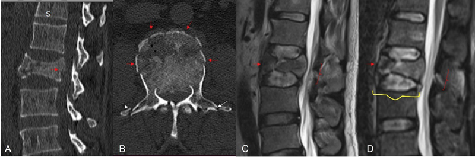
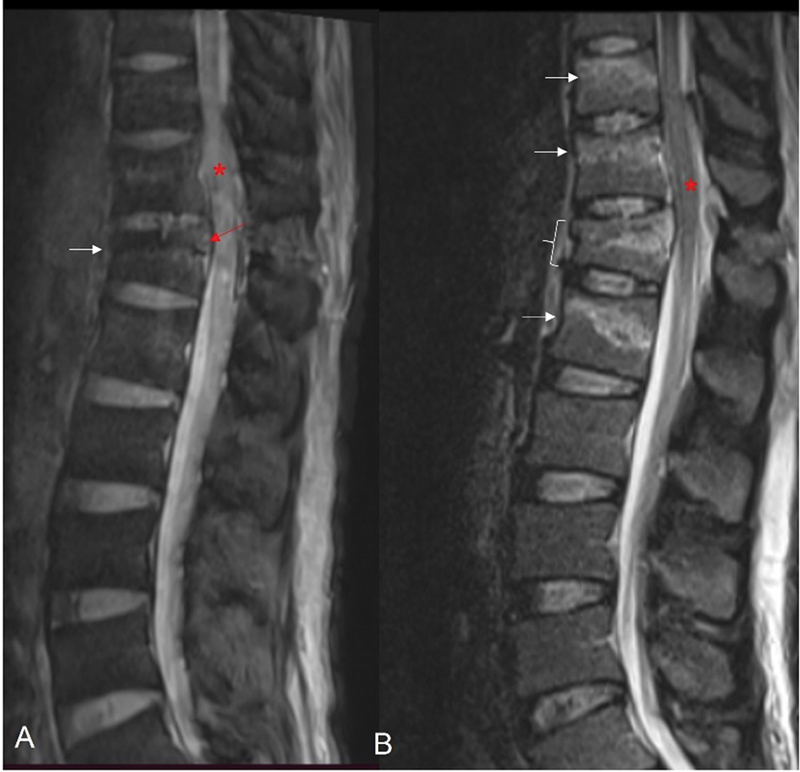
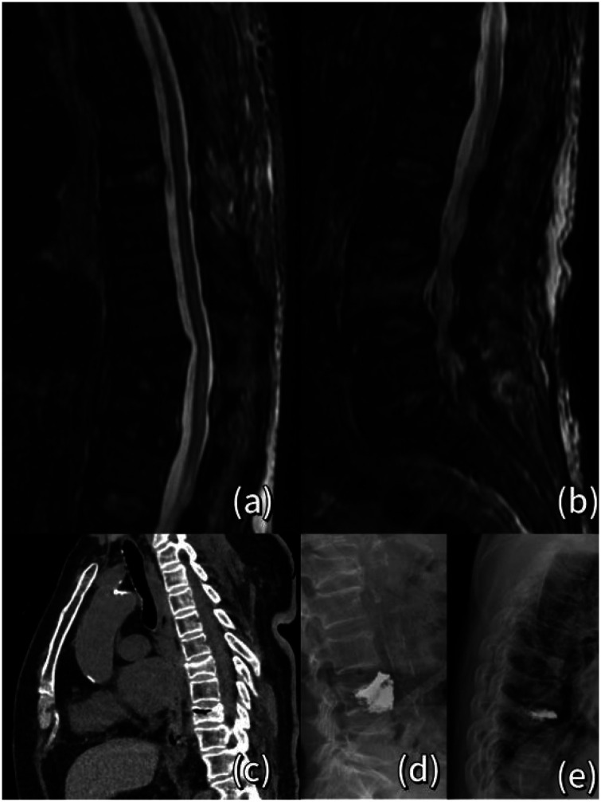
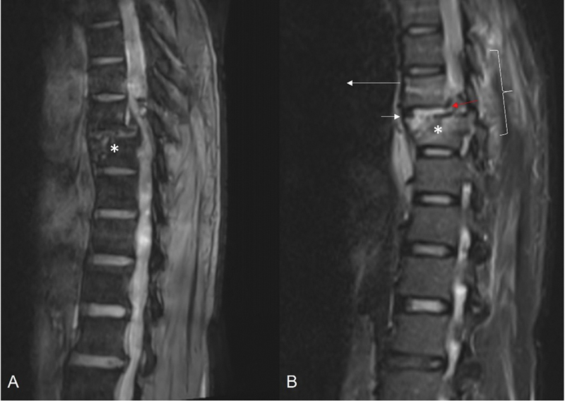

# 221 — Chấn thương cột sống: 3 cột Denis, TLICS & xẹp lành-ác / Spine trauma

**Tags:** `pattern:chan-thuong-cot-song` `vung:cot-song` `score:TLICS`
**Mức chắc chắn (certainty):** tổng hợp y văn (literature synthesis) — nhóm tự biên từ y văn mở (Indian J Radiol Imaging CC BY-NC-ND, J Int Med Res CC BY-NC), chưa gắn ca nguyên văn đơn lẻ.

## 1. Tổng quan — cột giữa là chìa khóa mất vững

- Mô hình **3 cột Denis**: **trước** (1/2 trước thân đốt + đĩa), **giữa** (1/2 sau thân đốt + dây chằng dọc sau PLL), **sau** (cung sau + dây chằng) — **TẠI SAO cột giữa vỡ = mất vững cơ học**: cột giữa là trụ chịu nén chính, đồng thời là **rào cản cuối** ngăn mảnh xương chọc vào ống sống. Vỡ cột giữa làm thân đốt mất điểm tựa phía sau → gập góc (kyphosis) tiến triển và mảnh xương trôi ra sau chèn tủy.
- Trên **cột sống ngực-thắt lưng (T10–L2 — vùng chuyển tiếp di động nhất, nơi cột sống ngực cứng chuyển sang cột sống thắt lưng linh hoạt)**, chấn thương năng lượng cao rất dễ gây vỡ cột giữa.
- **TLICS (Thoracolumbar Injury Classification and Severity Score)** chấm **3 thành phần** (không phải chỉ hình thái): **hình thái (morphology) 1–4** + **phức hợp dây chằng sau (PLC) 0–3** + **thần kinh (neurologic) 0–3**. Điểm chót: **≥ 5 = mổ, ≤ 3 = bảo tồn, = 4 = tự quyết**. Vì hình thái nặng đơn thuần (vỡ nát = 4) vẫn có thể bảo tồn nếu dây chằng sau còn lành và thần kinh nguyên vẹn.
- **Đọc MRI chứ không chỉ CT:** CT thấy xương nhưng **không thấy dây chằng** — chấn thương cột giữa với **tăng tín hiệu STIR dây chằng liên gai/sau gai** chứng tỏ **PLC đã đứt** → TLICS tăng 3 điểm → lật quyết định sang mổ.
- **Xẹp loãng xương vs di căn:** lành tính = **xẹp lõm (wedge), bờ sau LỒI vào/không phá cuống, phù tủy lan cả thân (STIR sáng) + đường đứt gãy thân đốt + không khối ngoài màng**; ác tính = **lồi bờ sau, HỦY CUỐNG (mất "mắt cúi" còn gọi là owl-eye/mắt cúi — trên CT ngang là mất viền xương trắng của hai cuống), khối mô mềm ngoài màng, còn chừa đĩa đệm**.

*Mô hình 3 cột Denis: cột trước (thân đốt trước + đĩa + dây chằng dọc trước ALL), cột giữa (1/3 sau thân đốt + PLL), cột sau (cung sau + phức hợp dây chằng sau PLC). Nguồn: Indian J Radiol Imaging, CC BY-NC-ND 4.0 (giữ nguyên bản).*

## 2. Gamut sau ngã/tai nạn + đau lưng người già (Gamut)

- **Vỡ 3 cột + liệt:** mổ nẹp + giải ép — corticoid tủy còn bàn cãi.
- **Xẹp hình chêm + loãng xương + không khối:** tạo hình đốt sống (vertebroplasty/kyphoplasty)/đeo nẹp + chống loãng xương.
- **Hủy cuống (mất mắt cúi) + khối + chừa đĩa:** di căn — PET + xạ/mổ.
- **Tụ máu ngoài màng cứng sau chấn thương:** chèn tủy tiến triển — mổ tối khẩn.
- **Vỡ ngang qua thân đốt + đứt ngang đĩa (distraction — vỡ Chance/seat-belt):** dây an toàn ở bụng làm đứt cả 3 cột theo lực kéo ngang — **cực kỳ dễ bỏ sót** vì không có mảnh xương đè tủy rõ.

## 3. Bảng so sánh phân biệt (ma trận đối chiếu)

| Thực thể (entity) | Hình ảnh điển hình | Chốt vào (rule-in) | Chốt loại (rule-out) | Gợi ý xác nhận |
|---|---|---|---|---|
| Mất vững (Denis/TLICS) | **Vỡ cột giữa + di lệch + hở dây chằng sau (STIR sáng)** | **TLICS ≥ 5 = mổ** | TLICS ≤ 3 → nẹp + theo dõi | CT 3D + MRI STIR dây chằng |
| Xẹp loãng xương (lành) | **Xẹp lõm hình chêm + phù tủy lan tỏa (STIR sáng) + bờ sau LỒI vào, lõm** | **Già + loãng xương (DXA ≤ −2,5) + không khối/cuống** | Lồi bờ sau + hủy cuống → ác | DXA + tạo hình/khâu |
| Xẹp ác tính (di căn/myeloma) | **Lồi bờ sau + hủy cuống (mất mắt cúi) + khối ngoài màng + chừa đĩa** | **Cuống + khối + tiền sử K** | Phù đơn thuần + lõm → lành | PET + sinh thiết + xạ |
| Tụ máu ngoài màng | **Thấu kính sau tủy + chèn tiến triển** | **Liệt tăng dần sau chấn thương** | Không chèn → theo dõi | Mổ tối khẩn khi liệt |
| Vỡ ngang kiểu distraction (Chance) | **Đường đứt ngang thân đốt ± đứt đĩa + mở rộng khoảng sau** | **Cơ chế dây an toàn + STIR dây chằng sau dương tính** | Hình chêm đơn thuần → chèn ép | CT 3D + MRI STIR |

## 4. Protocol + TLICS flowchart

- **CT dựng hình 3D (lát mỏng ≤ 1 mm)** để phân tích thân đốt/cuống + **MRI STIR** cho **PLC, đĩa, tủy (phù/chảy máu tủy)**. Ưu tiên MRI ở **già có loãng xương** để phân biệt lành/ác và ở **trẻ có SCIWORA** (tổn thương tủy không gãy xương thấy trên CT).
- **DXA** khi xẹp người già; chống loãng xương (canxi **1000 mg/ngày** + vitamin D **800 IU/ngày**; bisphosphonate/teriparatide tùy nguy cơ).
- **Cột mốc TLICS:** hình thái (nén 1, vỡ 2, mất vững kéo giãn 3, mất vững trượt 4) + PLC (toàn vẹn 0, nghi ngờ 2, đứt 3) + thần kinh (nguyên vẹn 0, tổn thương rễ/chùm đuôi ngựa 3, tủy không hoàn toàn 2, tủy hoàn toàn 3... tủy không hoàn toàn/đứt hoàn toàn tính khác nhau theo bảng gốc).

*Vỡ burst hoàn toàn L2: (A) CT dựng sagittal, (B) CT ngang thấy vỡ cả thân đốt; (C) MRI T2W và (D) STIR lộ mảnh xương sau và phù tủy. Nguồn: Indian J Radiol Imaging, CC BY-NC-ND 4.0 (giữ nguyên bản).*

## 5. Cạm bẫy

- **Vỡ Chance (dây an toàn) bỏ sót** — đường đứt ngang thân đốt ± đứt đĩa không mảnh đè tủy rõ; **chỉ STIR dây chằng sau + TLICS mới thấy mất vững**. Ở bệnh nhân viêm cột sống dính khớp (ankylosing spondylitis), chấn thương nhẹ cũng đủ gây đường đứt ngang tương tự.
- **Di căn gọi nhầm loãng xương** → bơm xi măng vào u → **luôn soi cuống + khối ngoài màng + đĩa còn chừa** trước mọi tạo hình.
- **Tổn thương tủy không gãy (SCIWORA — trẻ em):** CT bình thường mà **MRI tủy bất thường** — không loại trừ tổn thương tủy chỉ bằng CT.
- **Chỉ dựa CT để chấm TLICS:** dây chằng không thấy trên CT → **hay chấm thiếu điểm PLC** và điều trị bảo tồn sai cho tổn thương mất vững.

*Nhiều vỡ chêm (wedge impaction) thân đốt ngực: (A) gradient echo và (B) STIR — phù tủy các tầng vỡ. Nguồn: Indian J Radiol Imaging, CC BY-NC-ND 4.0 (giữ nguyên bản).*

*Xẹp đốt T8 cấp trên MRI STIR (a): phù tủy tăng tín hiệu lan tỏa trong thân đốt — dấu hiệu xẹp LÀNH tính do loãng xương (các panel còn lại: chụp cắt lớp tạo hình). Nguồn: J Int Med Res, CC BY-NC 4.0 (giữ nguyên bản).*

## 6. Tự lượng giá — Blind Quiz (ảnh trơn ngoài, đáp án trong)

**Ca 1 — Ngã cao, vỡ L2. Nhìn CT, mô tả trước:**

- Câu hỏi: Đây là loại vỡ gì? Cột nào đã vỡ? Mảnh xương sau có chèn không? Bước tiếp theo?

<b>Bấm để hiện đáp án (findings + chẩn đoán)</b>

- Dấu hiệu: **vỡ burst hoàn toàn thân đốt** với **mảnh góc sau (retropulsed fragment)** trôi vào ống sống trên CT (A/B) và MRI (C/D) — tức **đã vỡ cột giữa**.
- Chẩn đoán: **vỡ mất vững cột giữa** → chấm TLICS (hình thái + PLC trên STIR + thần kinh); **TLICS ≥ 5 → mổ nẹp + giải ép**.
- Nguồn ảnh: Indian J Radiol Imaging, CC BY-NC-ND 4.0.

**Ca 2 — Bà 75 tuổi, đau lưng đột ngột, X-quang thấy xẹp đốt. Nhìn MRI:**

- Câu hỏi: Tín hiệu trong thân đốt gợi ý gì? Lành hay ác? Cần soi thêm dấu hiệu nào?

<b>Bấm để hiện đáp án (findings + chẩn đoán)</b>

- Dấu hiệu: thân đốt **tăng tín hiệu STIR lan tỏa (phù tủy)** = tổn thương cấp; hình xẹp lõm, **không lồi bờ sau, không hủy cuống, không khối ngoài màng**.
- Chẩn đoán: **xẹp loãng xương lành tính cấp** (khác di căn). Xử trí: tạo hình/đeo nẹp + DXA + chống loãng xương.
- Nguồn ảnh: J Int Med Res, CC BY-NC 4.0.

**Ca 3 — Tai nạn xe, đau cột sống ngực. Nhìn MRI sagittal:**

- Câu hỏi: Có di lệch thân đốt không? Đây là mất vững kiểu gì? Tại sao nguy hiểm?

<b>Bấm để hiện đáp án (findings + chẩn đoán)</b>

- Dấu hiệu: **di lệch (listhesis) thân đốt kèm tín hiệu bất thường dây chằng sau (STIR)** — **tổn thương dịch chuyển (translational injury)**, mất vững cả 3 cột.
- Chẩn đoán: **mất vững trượt** → TLICS hình thái 4 + hở PLC → điểm cao → **mổ**. Nguy hiểm vì dây chằng đứt làm cột sống mất ổn định, dễ chèn tủy khi vận chuyển/sinh hoạt.
- Nguồn ảnh: Indian J Radiol Imaging, CC BY-NC-ND 4.0.

## Bài liên quan chéo
- [200 – Tổng quan Thần kinh](../200-tong-quan-he-than-kinh/lesson.md)
- [220 – Ống sống 3 khoang](../220-ong-song-tuy/lesson.md) (đĩa vs u vs viêm)
- [222 – Viêm đốt sống](../222-viem-dot-song/lesson.md) (Pott vs vi khuẩn vs di căn)
- [331 – U ác ở người lớn (myeloma/di căn)](../331-u-ac-nguoi-lon/lesson.md)

## Ảnh
- `images/221_chan-thuong-cot-song_so-do_3cot-Denis_PMC12440593.jpg` — mô hình 3 cột Denis (CC BY-NC-ND).
- `images/221_chan-thuong-cot-song_CT_burst_PMC12440593.jpg` — vỡ burst L2 (CC BY-NC-ND).
- `images/221_chan-thuong-cot-song_MRI_wedge-STIR_PMC12440593.jpg` — vỡ chêm nhiều tầng (CC BY-NC-ND).
- `images/221_chan-thuong-cot-song_MRI_translational_PMC12440593.jpg` — tổn thương dịch chuyển (CC BY-NC-ND).
- `images/221_chan-thuong-cot-song_CT_distraction_PMC12440593.jpg` — tổn thương distraction (CC BY-NC-ND).
- `images/221_chan-thuong-cot-song_MRI_xep-STIR_PMC13031746.jpg` — xẹp loãng xương cấp STIR (CC BY-NC).
- Nguồn + giấy phép đầy đủ: `images/CREDITS.md`; link gốc: `sources.md`.

> Không dùng để chẩn đoán độc lập khi chưa có người hướng dẫn.
