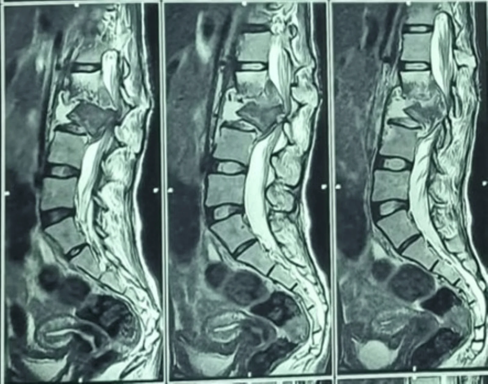
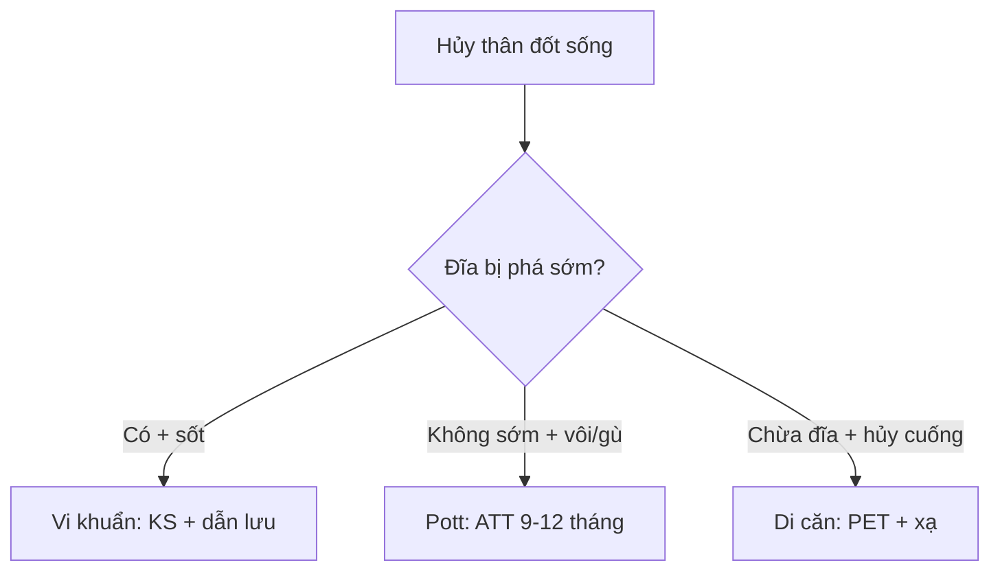

# 222 — Viêm đốt sống-đĩa đệm: Pott vs vi khuẩn vs di căn / Spondylitis vs Mets

**Tags:** `pattern:viem-dot-song` `vung:cot-song`
**Mức chắc chắn (certainty):** tổng hợp y văn (literature synthesis) — nhóm tự biên từ y văn mở, chưa gắn ca nguyên văn đơn lẻ.

## 1. Tổng quan — đĩa là nạn nhân hay nhân chứng thì tùy thủ phạm

- Vi khuẩn sinh mủ (Staph. aureus) ăn đĩa trước (protease) — TẠI SAO phá hủy đĩa sớm + phù Modic I + áp-xe cạnh sống nóng: vi khuẩn theo động mạch đầu-cuối đốt sống vào đĩa vô mạch.
- Lao (Pott) khởi đầu cạnh đĩa (paradiscal) rồi lan nhiều thân — TẠI SAO bảo tồn đĩa sớm + áp-xe lạnh vôi hóa + gù: lao thiếu protease, hoại tử bã đậu lan dưới dây chằng dọc trước.
- Di căn theo tủy xương cuống (pedicle) — TẠI SAO chừa đĩa + hủy cuống (mất mắt cú trên X-quang thẳng): tế bào K theo mạch Batson vào tủy xương, đĩa vô mạch thoát nạn.
- Kháng lao (ATT) **9–12 tháng** + cấy máu/mủ trước kháng sinh là chốt sinh-tử.

## 2. Gamut đau lưng + sốt + sụt cân (Gamut)

- **Phá đĩa sớm + sốt cao + áp-xe nóng:** vi khuẩn — kháng sinh 6–8 tuần + dẫn lưu.
- **Cạnh đĩa + áp-xe lạnh vôi + gù + lao cũ:** Pott — ATT 9–12 tháng + nẹp/mổ khi mất vững/liệt.
- **Hủy cuống + chừa đĩa + K đã biết:** di căn — PET + xạ/mổ.
- **Trượt L3 liệt 2 chân + mất vững:** Pott nặng — corpectomy + ghép xương (như ca dưới).

## 3. Bảng so sánh phân biệt (ma trận đối chiếu)

| Thực thể (entity) | Hình ảnh điển hình | Chốt vào (rule-in) | Chốt loại (rule-out) | Gợi ý xác nhận |
|---|---|---|---|---|
| Vi khuẩn sinh mủ | **Phá đĩa sớm + Modic I + áp-xe nóng 1–2 thân kề** | **Sốt + CRP cao + phá đĩa** | Bảo tồn đĩa + vôi → Pott | Cấy máu/mủ + KS 6–8 tuần |
| Lao Pott | **Cạnh đĩa + bảo tồn đĩa sớm + áp-xe lạnh vôi + gù đa thân** | **Lao cũ + vôi + gù + lạnh** | Hủy cuống + chừa đĩa hoàn toàn → di căn | GenXpert + ATT 9–12 tháng |
| Di căn | **Hủy cuống (mất mắt cú) + CHỪA đĩa + khối ngoài màng** | **Cuống + K đã biết + chừa đĩa** | Phá đĩa sớm → vi khuẩn | PET + sinh thiết + xạ |

*Hủy thân L2–L3 + trượt ra trước + hẹp ống sống, liệt 2 chân. Nguồn: Pothare et al., Cureus 2026 Fig. 2, CC BY 4.0.*

## 4. Protocol

- **MRI + gadolinium + cấy máu/mủ + GenXpert + PET** khi hủy thân: đĩa (phá/bảo tồn) + cuống + áp-xe (nóng/lạnh/vôi) quyết định KS/ATT/xạ.

## 5. Cạm bẫy

- **Kháng sinh mù trước cấy** = mất chẩn đoán vi khuẩn — cấy máu/mủ + GenXpert trước thuốc.
- **Pott liệt tiến triển chờ ATT ngấm** = liệt vĩnh viễn — mổ giải ép + vững khi liệt/mất vững.
- **Bơm xi măng vào di căn/Pott** không sinh thiết — cuống + áp-xe lạnh phải loại trừ trước.

## 6. Tự lượng giá — Blind Quiz

**Ca 1 — Nữ 22 tuổi đau lưng 6 tháng + liệt 2 chân đột ngột. Đọc MRI.**

- Hỏi: hủy ở đâu? Trượt hướng nào? ATT đơn thuần đủ không?

<b>Bấm để hiện đáp án</b>

- Dấu hiệu (findings): hủy thân L2–L3 + trượt ra trước + hẹp ống sống + tủy đuôi ngựa chèn.
- Chẩn đoán (diagnosis): **lao Pott mất vững liệt 2 chân** — ATT 9–12 tháng + **corpectomy L3 + ghép mào chậu** (mất vững + liệt không chờ thuốc).
- Nguồn: Pothare et al., Fig. 2, CC BY 4.0.

**Ca 2 — Sốt 39 + phá đĩa L4–L5 + áp-xe nóng, cấy Staph:** Pott hay vi khuẩn? Thuốc bao lâu? *(Bảng mục 3.)*

<b>Bấm để hiện đáp án</b>

- **Vi khuẩn sinh mủ:** kháng sinh 6–8 tuần + dẫn lưu (Pott là lạnh + vôi + bảo tồn đĩa sớm).

**Ca 3 — K phổi + hủy cuống D8 + chừa đĩa + không sốt:** viêm hay di căn? *(Bảng mục 3.)*

<b>Bấm để hiện đáp án</b>

- **Di căn (mất mắt cú):** PET + xạ/mổ (không phải Pott/vi khuẩn).

## Bài liên quan chéo
- [200 – Tổng quan Thần kinh](../200-tong-quan-he-than-kinh/lesson.md)
- [220 – Ống sống 3 khoang](../220-ong-song-tuy/lesson.md) (ngoài màng cứng)
- [221 – Chấn thương cột sống](../221-chan-thuong-cot-song/lesson.md) (xẹp lành-ác)

> Không dùng để chẩn đoán độc lập khi chưa có người hướng dẫn.
