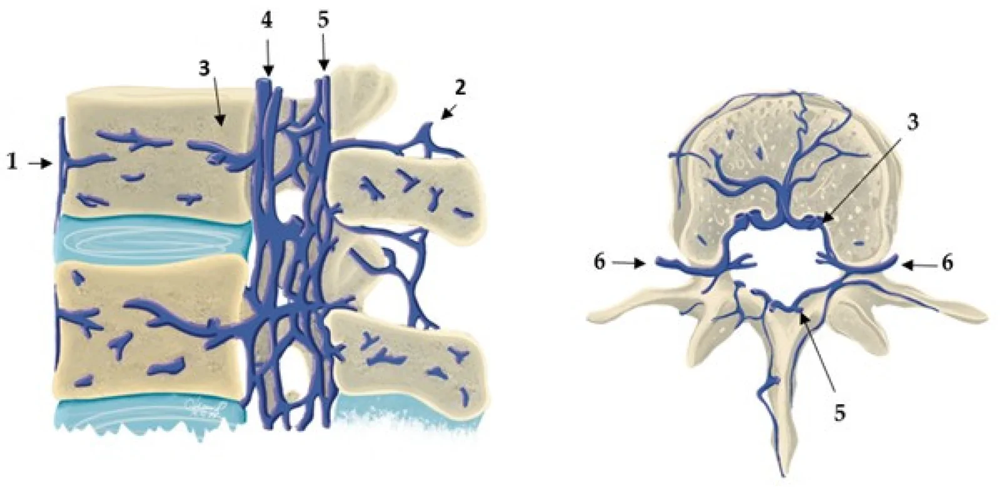
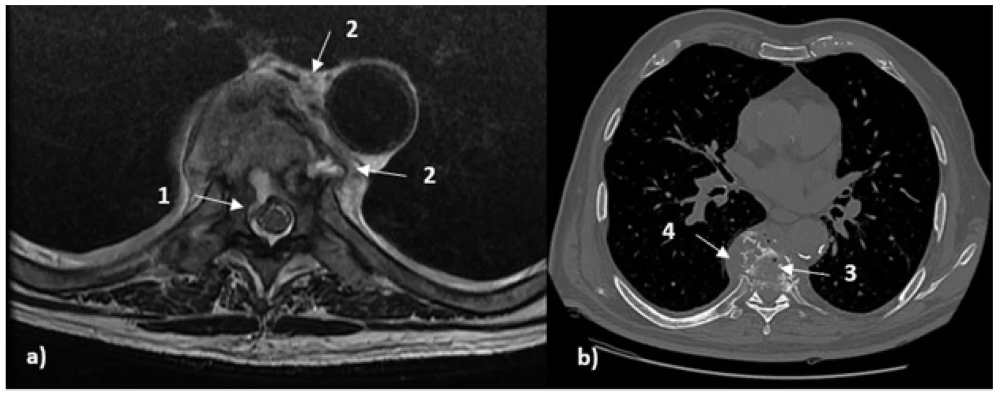
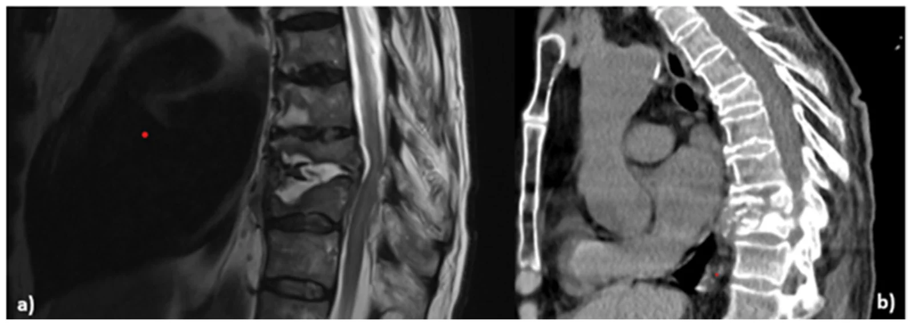
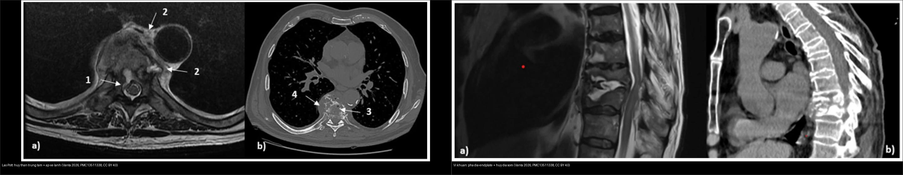
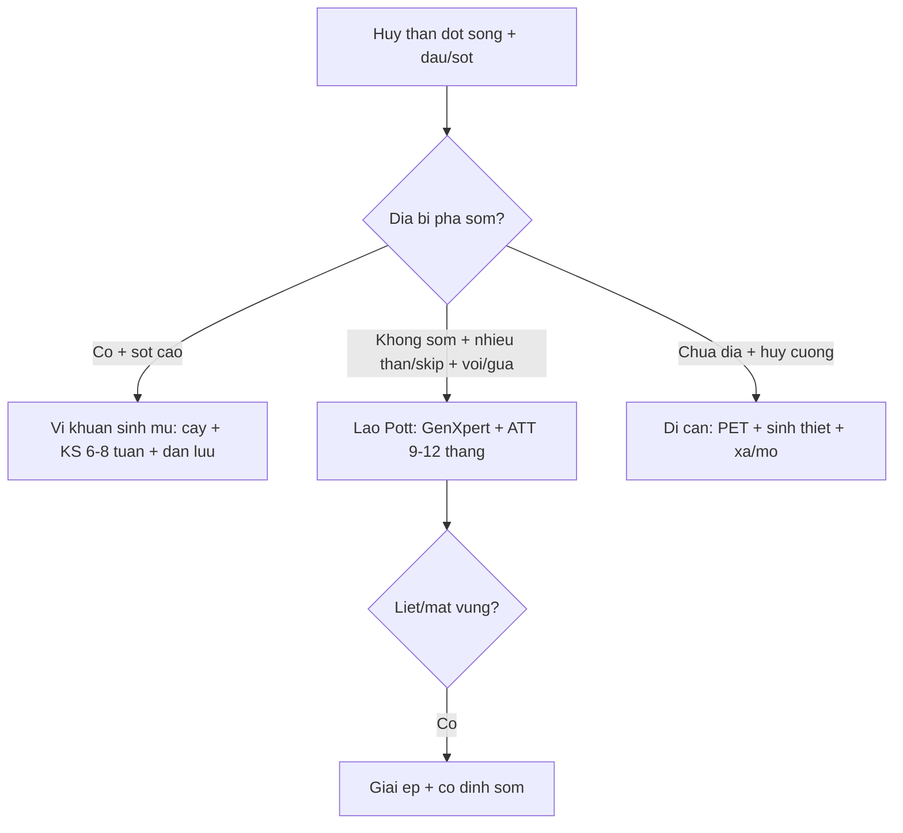
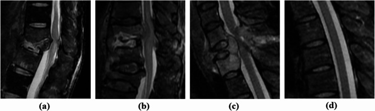

# 222 — Viêm đốt sống-đĩa đệm: Pott vs vi khuẩn vs di căn / Spondylitis vs Mets

**Tags:** `pattern:viem-dot-song` `vung:cot-song` `protocol:MRI-cot-song`
**Mức chắc chắn (certainty):** tổng hợp y văn (literature synthesis) — tổng hợp từ y văn mở (Diagnostics 2026 PMC13511338, Cureus 2026 PMC13523787, BMC Musculoskelet Disord 2026 PMC13220592), số liệu lấy nguyên từ bảng/Fig nguồn.

## 1. Tổng quan — đĩa là nạn nhân hay nhân chứng thì tùy thủ phạm

- **TẠI SAO vi khuẩn sinh mủ ăn đĩa trước:** *Staphylococcus aureus* theo **động mạch đầu–cuối (end-artery)** vào **thân đốt** rồi lan ra **đĩa đệm vô mạch**; protease của vi khuẩn **phá hủy đĩa sớm** → **phù Modic I**, hẹp đĩa nhanh, **áp-xe cạnh sống "nóng"** (ngấm mạnh, thành dày/không rõ).
- **TẠI SAO lao (Pott) bảo tồn đĩa sớm:** *Mycobacterium tuberculosis* khởi đầu **cạnh đĩa (paradiscal)** rồi lan **dưới dây chằng dọc trước (subligamentous)** nhiều thân; **thiếu protease → đĩa tương đối còn** → hoại tử bã đậu lan xa thành **áp-xe lạnh thành mỏng, rõ, hay vôi hóa**, gây **gù (kyphosis)**.
- **TẠI SAO di căn chừa đĩa:** tế bào K theo **đám rối tĩnh mạch Batson** vào **tủy xương/cuống (pedicle)** — đĩa vô mạch **thoát nạn** → **hủy cuống, chừa đĩa** (mất "mắt cú" trên X-quang thẳng).
- **Chốt sinh–tử:** **cấy máu/mủ + GenXpert trước kháng sinh**; lao **ATT 9–12 tháng**, vi khuẩn sinh mủ **kháng sinh 6–8 tuần**. Không có dấu hiệu ảnh đơn lẻ nào "vàng" cho lao hay mủ (PMC13511338).

*Sơ đồ sagittal (trái) + axial (phải) đám rối tĩnh mạch đốt sống không van (Batson): giải thích TẠI SAO di căn theo cuống/thân và TẠI SAO đĩa vô mạch ít bị xâm lấn. Nguồn: Vanta OM et al., Diagnostics 2026, PMC13511338, CC BY 4.0.*

## 2. Gamut — bảng "domain" định hướng TS vs PS (Pott vs vi khuẩn)

Theo bảng tổng hợp của PMC13511338 (mỗi dòng = một miền dấu hiệu):

| Miền (domain) | Nghiêng **LAO (TS)** | Nghiêng **VI KHUẨN (PS)** |
|---|---|---|
| Tầng & lan rộng | **Ngực** ưu thế; **nhiều thân ≥ 2**; **tổn thương nhảy cách (skip)** | **Thắt lưng** ưu thế; thường **1 tầng liền kề** |
| Phức hợp đĩa–bản tận | **Bảo tồn đĩa tương đối sớm**; hủy thân **không tương xứng** với tổn thương đĩa | **Đĩa sáng T2 sớm + hẹp đĩa nhanh + hủy bản tận rõ** |
| Tín hiệu thân đốt | **T1/T2-STIR không đồng nhất**, ngấm không đồng nhất; **áp-xe trong xương** hay gặp | Ngấm tủy/mô mềm **đồng nhất hơn** |
| Kiểu hủy & trục | **Hủy trung tâm thân nặng, sập > 50%**, chồng thân, **gù** | Hủy **< 50%**, ít gù sớm |
| Tụ cạnh sống/màng cứng | **Áp-xe lớn, thành mỏng, giới hạn rõ** | Thành dày/không đều hơn; **viêm mô (phlegmon)** nhiều hơn |
| Lan theo dây chằng | **Lan dưới dây chằng** (dọc DC dọc trước) | Ít lan dưới dây chằng hơn; khu trú tại mặt đĩa–bản tận |
| Di căn (đối chứng) | — | **Hủy cuống + CHỪA đĩa + khối ngoài màng cứng** |

- **Mô hình dự đoán (tham khảo, chưa dùng đại trà):** mô hình một trung tâm **AUC 0,95, Se 85,6%, Sp 87,8%** (chưa ngoại kiểm); mô hình của Zhang (CT+MRI+xét nghiệm) **AUC 0,981, Se 91,4%, Sp 95,7%** với **4 biến**: **WBC < 7,265 × 10⁹/L**, **tổn thương nhảy cách/≥ 3 tầng**, **mảnh chết (sequestra) lớn**, **hủy xương dưới dây chằng** → lao (PMC13511338).

## 3. Bảng so sánh phân biệt (ma trận đối chiếu)

| Thực thể (entity) | Hình ảnh điển hình | Chốt vào (rule-in) | Chốt loại (rule-out) | Gợi ý xác nhận |
|---|---|---|---|---|
| **Vi khuẩn sinh mủ (PS)** | Hủy **phức hợp đĩa–bản tận**, hẹp đĩa nhanh, **áp-xe/phlegmon thành dày**, tầng thắt lưng, 1 tầng | **Sốt + CRP cao + hủy đĩa sớm + Modic I** | Bảo tồn đĩa + vôi hóa + lan dưới dây chằng → lao | Cấy máu/mủ + KS 6–8 tuần |
| **Lao Pott (TS)** | Hủy **trung tâm thân**, **nhiều thân/skip**, lan **dưới dây chằng**, **áp-xe lạnh thành mỏng**, vôi hóa, gù | **Ngực + nhiều thân + bảo tồn đĩa sớm + áp-xe lạnh** | Hủy cuống + chừa đĩa hoàn toàn → di căn | GenXpert + ATT 9–12 tháng |
| **Di căn đốt sống** | Hủy **cuống (mất mắt cú)**, **chừa đĩa**, khối ngoài màng cứng, thường 1–2 tầng không liền | **Cuống + K đã biết + chừa đĩa** | Hủy đĩa sớm → vi khuẩn | PET-CT + sinh thiết + xạ |

*Trái (a): T2 axial — hủy/hủy trung tâm thân D8 + tụ cạnh sống; phải (b): CT axial — hủy thân + **mảnh xương/vôi** trong tổn thương (dấu hiệu nghiêng lao). Nguồn: Vanta OM et al., Diagnostics 2026, PMC13511338, CC BY 4.0.*

*Trái (a): T2 sagittal — **hủy phức hợp đĩa–bản tận**, hẹp đĩa rõ; phải (b): CT sagittal — **hủy đĩa + bản tận** (dấu hiệu nghiêng vi khuẩn). Nguồn: Vanta OM et al., Diagnostics 2026, PMC13511338, CC BY 4.0. Ảnh gốc là ca riêng, không phải cùng bệnh nhân với ca Pott.*

*Hủy thân L2–L3 + trượt ra trước + hẹp ống sống, liệt 2 chân. Nguồn: Pothare N et al., Cureus 2026, Fig. 2, CC BY 4.0.*

*Trái: lao — hủy trung tâm thân + áp-xe/lan rộng. Phải: vi khuẩn — hủy phức hợp đĩa–bản tận, hẹp đĩa. Nguồn: cả hai ảnh từ Vanta OM et al., Diagnostics 2026, PMC13511338, CC BY 4.0. Ảnh ghép letterbox.*

## 4. Protocol

- **MRI cột sống + gadolinium** là trung tâm: **T1W, T2W, STIR, T1W sau tiêm xóa mỡ** (sagittal + axial). Đọc 7 điểm: tầng/số thân, phức hợp đĩa–bản tận, tín hiệu thân, kiểu hủy–trục, tụ cạnh sống/màng cứng, lan dây chằng, yếu tố sau (PMC13511338).
- **Nghi lao → chụp TOÀN BỘ cột sống** (tìm **skip lesions**), X-quang ngực, và tầm soát lao ngoài phổi.
- **CT** bổ sung khi cần chi tiết **hủy xương/vôi hóa/mảnh chết**; **¹⁸F-FDG PET/CT** bổ trợ khi **MRI chống chỉ định/mơ hồ**, nhiễm trùng có dụng cụ, hoặc định hướng **sinh thiết** (không phải tuyến đầu).
- **Sinh thiết/kim dẫn đường CT + cấy máu/mủ + GenXpert TRƯỚC kháng sinh** — chốt sinh-tử.

## 5. Cạm bẫy

- **Kháng sinh mù trước cấy** = mất chẩn đoán vi khuẩn — **cấy máu/mủ + GenXpert trước thuốc**.
- **Pott liệt tiến triển chờ ATT ngấm** = liệt vĩnh viễn — **mổ giải ép + cố định** khi liệt/mất vững (như ca Pott L3 dưới).
- **CT bình thường/bất thường tối thiểu KHÔNG loại trừ** lao hay mủ, nhất là giai đoạn sớm (PMC13511338) — MRI mới nhạy.
- **Bơm xi măng vào di căn/Pott không sinh thiết** — phải loại trừ **cuống + áp-xe lạnh** trước.
- **Thoái hóa Modic I** ("claw sign" ôm đĩa) tưởng viêm thân sống — **đĩa đen T2 + không phá bản tận + không sốt/CRP** = thoái hóa (viêm là **phá bản tận + đĩa sáng dịch + sốt**).
- **Không có dấu hiệu ảnh đơn lẻ nào là "vàng"** — mô hình dự đoán chỉ là **bổ trợ xác suất**, không thay cấy/sinh thiết (PMC13511338).

## 6. Tự lượng giá — Blind Quiz

**Ca 1 — Nữ 22 tuổi đau lưng 6 tháng + liệt 2 chân đột ngột. Đọc MRI.**

- Hỏi: hủy ở đâu? Trượt hướng nào? ATT đơn thuần đủ không?

<b>Bấm để hiện đáp án (findings + chẩn đoán)</b>

- **Findings:** hủy thân L2–L3 + trượt ra trước + hẹp ống sống + tủy đuôi ngựa chèn.
- **Chẩn đoán:** **lao Pott mất vững liệt 2 chân** — ATT 9–12 tháng + **corpectomy L3 + ghép xào chậu** (mất vững + liệt không chờ thuốc).
- Nguồn: Pothare N et al., Fig. 2, Cureus 2026, CC BY 4.0.

**Ca 2 — Bốn mặt sagittal T2 cạnh nhau: (a), (b), (c), (d). Xác định bệnh nào là vi khuẩn, lao, di căn, bình thường?**

- Hỏi: mặt nào **hủy đĩa–bản tận** (vi khuẩn)? mặt nào **chừa đĩa + khối** (di căn)? mặt nào **nhiều tầng/hủy thân** (lao)?

<b>Bấm để hiện đáp án (findings + chẩn đoán)</b>

- **Theo chú thích nguồn:** (a) **pyogenic (vi khuẩn)**, (b) **spinal tuberculosis (lao)**, (c) **spinal metastasis (di căn)**, (d) **normal (bình thường)**.
- **Chốt:** vi khuẩn = hủy **phức hợp đĩa–bản tận**; lao = hủy **thân nhiều tầng**; di căn = **chừa đĩa** + khối. Không có dấu hiệu đơn lẻ nào đủ — ghép bối cảnh (dịch tễ, sốt, CRP, GenXpert).
- Nguồn: Sangsin A et al., BMC Musculoskelet Disord 2026, Fig. 2, PMC13220592, CC BY-NC-ND 4.0 (giữ nguyên bản).

**Ca 3 — Ghép: hai kiểu hủy đốt sống — bên nào lao, bên nào vi khuẩn?**

<b>Bấm để hiện đáp án (findings + chẩn đoán)</b>

- **Trái — lao Pott:** hủy **trung tâm thân**, lan rộng/nhiều tầng, tụ cạnh sống. **Phải — vi khuẩn:** hủy **phức hợp đĩa–bản tận**, **hẹp đĩa** rõ, 1 tầng.
- **Chốt:** **đĩa** là mấu chốt — phá sớm = vi khuẩn; bảo tồn tương đối = lao; chừa hoàn toàn = di căn. Nguồn: Vanta OM et al., Diagnostics 2026, PMC13511338, CC BY 4.0.

**Ca 4 — Sốt 39 °C + phá đĩa L4–L5 + áp-xe nóng, cấy *Staph*:** Pott hay vi khuẩn? Thuốc bao lâu? *(Bảng mục 3.)*

<b>Bấm để hiện đáp án (findings + chẩn đoán)</b>

- **Vi khuẩn sinh mủ:** kháng sinh **6–8 tuần** + dẫn lưu (Pott = áp-xe lạnh + vôi + **bảo tồn đĩa sớm** + ATT 9–12 tháng).

**Ca 5 — K phổi + hủy cuống D8 + chừa đĩa + không sốt:** viêm hay di căn? *(Bảng mục 3.)*

<b>Bấm để hiện đáp án (findings + chẩn đoán)</b>

- **Di căn (mất "mắt cú"):** PET + xạ/mổ — không phải Pott/vi khuẩn.

## Bài liên quan chéo
- [200 – Tổng quan Thần kinh](../200-tong-quan-he-than-kinh/lesson.md)
- [220 – Ống sống 3 khoang](../220-ong-song-tuy/lesson.md) (áp-xe ngoài màng cứng)
- [221 – Chấn thương cột sống](../221-chan-thuong-cot-song/lesson.md) (xẹp lành-ác)
- [223 – Chấn thương tủy sống: ASIA & SCIWORA](../223-chan-thuong-tuy-so/lesson.md)

## Ảnh
- Nguồn + giấy phép từng ảnh trong `images/CREDITS.md`. Ảnh **CC BY-NC-ND** (PMC13220592) giữ **nguyên bản**, không crop/ghép.

> Không dùng để chẩn đoán độc lập khi chưa có người hướng dẫn.
