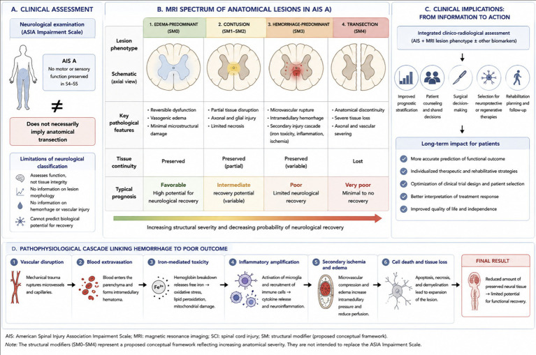
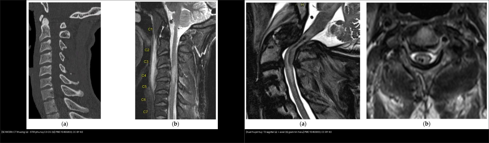
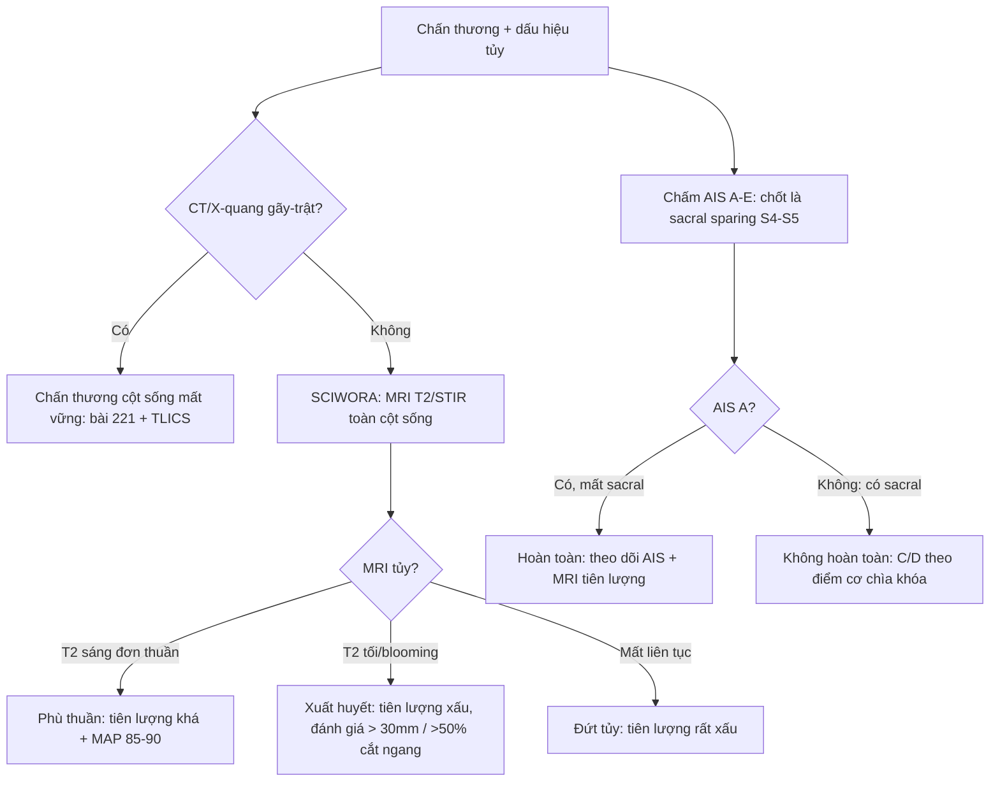
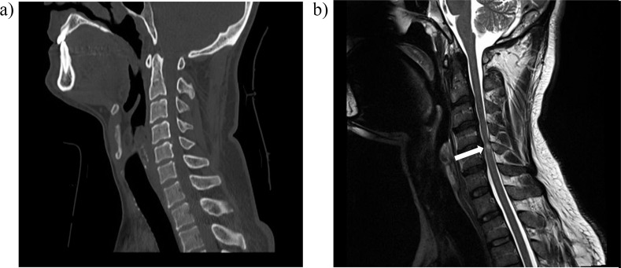
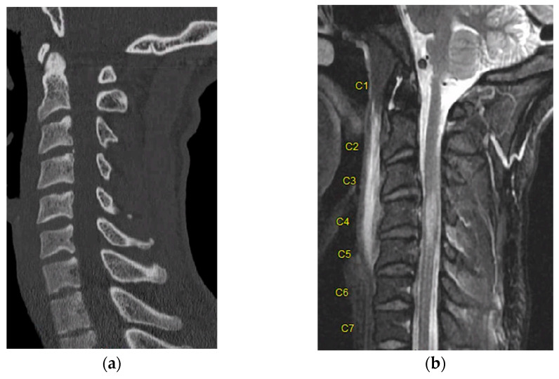
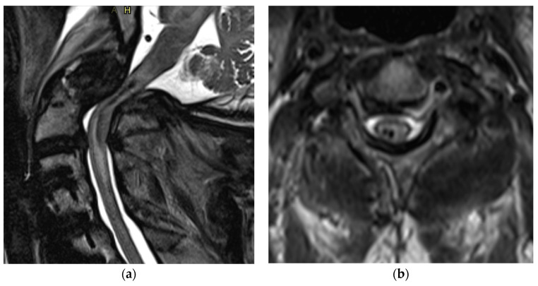

# 223 — Chấn thương tủy sống: thang ASIA & SCIWORA / Spinal cord injury

**Tags:** `pattern:chan-thuong-tuy` `vung:cot-song` `score:ASIA`
**Mức chắc chắn (certainty):** tổng hợp y văn (literature synthesis) — nhóm tự biên từ y văn mở (Front Neurol 2026, Life 2023, Qatar Med J 2021 CC BY); **các ca trong quiz là ca nguyên văn (verbatim case)** chép đúng tuổi – lâm sàng – chú thích gốc.

## 1. Tổng quan — thang ASIA đo lâm sàng, MRI đo mô học

- **ASIA/ISNCSCI (International Standards for Neurological Classification of Spinal Cord Injury)** chấm trên **28 dermatome (C2–S4/S5)** × 2 phương thức (cảm giác nhẹ – light touch + cảm giác đau – pinprick) và **10 cặp cơ chìa khóa (C5, C6, C7, C8, T1, L2, L3, L4, L5, S1)** thang 0–5. Từ đó suy ra **mức thần kinh (neurological level of injury — NLI)**, mức cảm giác, mức vận động.
- **Thang khiếm khuyết ASIA (AIS) A–E:** **A = hoàn toàn** (không còn cảm giác/vận động ở **S4–S5**); **B = không hoàn toàn cảm giác** (có cảm giác nhưng không vận động dưới mức, gồm S4–S5); **C = không hoàn toàn vận động, > một nửa cơ chìa khóa dưới mức yếu (điểm < 3)**; **D = không hoàn toàn vận động, ≥ một nửa cơ chìa khóa dưới mức đạt ≥ 3**; **E = bình thường**. **Chốt của "không hoàn toàn" là bảo tồn vùng cùng (sacral sparing): cảm giác S4–S5, cảm giác sâu hậu môn (deep anal pressure), co cơ hậu môn tự ý** — mất cả ba = AIS A.
- **TẠI SAO ASIA A (lâm sàng "hoàn toàn") KHÔNG đồng nghĩa tủy đứt về giải phẫu:** tổn thương sinh hóa/vi mạch có thể chặn dẫn truyền qua vùng tủy còn LIÊN TỤC; MRI vì thế là "nhãn mô học" độc lập. Trên AIS A, MRI vẫn hay thấy tủy liên tục, và **kiểu tín hiệu (phù vs xuất huyết vs đứt) dự báo hồi phục khác hẳn nhau** (Front Neurol 2026; Serratrice N., PMC13467916).
- **Vật lý tín hiệu — TẠI SAO đọc được bản chất mô:** **phù tủy (edema)** = nước ngoại bào tăng → **T2W tăng tín hiệu** (T1W gần bình thường), không sắt; **xuất huyết tủy (hemorrhage)** = hemoglobin/deoxyhemoglobin + hemosiderin (sắt từ tính) gây **mất tín hiệu cục bộ, T2W TỐI + "blooming" trên chuỗi nhạy từ GRE/SWI**; **đứt tủy (transection)** = mất liên tục thật. **Xuất huyết nặng hơn phù** vì vỡ vi mạch + dòng thác viêm/thiếu máu thứ phát gây chết tế bào không hồi phục.
- **Ngưỡng định lượng nằm lòng:** **đường kính ống sống cổ ≤ 13 mm** hoặc tỷ lệ **Pavlov/Torg < 0,8** = hẹp ống bẩm sinh (dễ SCIWORA); **xuất huyết tủy kéo dài ≥ 30 mm hoặc chiếm > 50% diện cắt ngang** = tiên lượng rất xấu; **mục tiêu MAP 85–90 mmHg trong 5–7 ngày**; **giải ép < 24 giờ**; methylprednisolon (NASCIS) **30 mg/kg bolus + 5,4 mg/kg/giờ × 23 giờ**.

*Sơ đồ tổng hợp: (A) khám lâm sàng ASIA (AIS A = mất cảm giác/vận động S4–5, KHÔNG đồng nghĩa đứt tủy); (B) phổ tổn thương giải phẫu trên MRI — tụ máu ngoài màng (SM0), tủy mềm (SM1–SM2), xuất huyết (SM3), đứt (SM4) với tính liên tục mô + tiên lượng; (C) dòng thác 6 bước từ vỡ vi mạch → phù/xuất huyết → viêm → thiếu máu thứ phát → chết tế bào. Các "SM0–SM4" là khung đề xuất, KHÔNG thay thế thang ASIA. Nguồn: Serratrice N., Front Neurol 2026 (PMC13467916), CC BY 4.0.*

## 2. Mẫu hình + chẩn đoán phân biệt theo bối cảnh chấn thương (Gamut)

- **Đau cổ + tê/yếu tay chân + CT BÌNH THƯỜNG:** **SCIWORA** — đặc biệt **trẻ em** (cột sống non: dây chằng lỏng, diện khớp nông/ngang, cốt hóa chưa hoàn tất → tủy "va đập" mà xương không gãy) và **người ≥ 50 tuổi hẹp ống bẩm sinh**. Tổng quan **848 ca trẻ (< 18 tuổi)**: MRI có ở 399 ca — **46% tổn thương nội tủy (Type IIb)**, **39% MRI bình thường ("SCIWORA thật", Type I)**, 9% phối hợp, 6% ngoài tủy; **AIS A lúc đầu 46,25%** nhưng lúc theo dõi **AIS E tăng tới 49,78%**; **66,2% cải thiện thần kinh**; **95,41% bảo tồn, chỉ 4,59% mổ** (PMC12429215).
- **Liệt mềm + mất cảm giác dưới mức + gù/di lệch:** gãy–mất vững cột sống, **chấn thương dịch chuyển (translational)** — soi 3 cột Denis + TLICS (bài `221`).
- **Yếu ưu thế hai tay > hai chân:** **hội chứng tủy trung tâm (central cord syndrome)** — thường do tăng duỗi cổ trên nền hẹp ống, tiên lượng tốt nhất trong nhóm không hoàn toàn.
- **Mất vận động + cảm giác đau/dị cảm MẤT, cảm giác sâu = 0 dưới mức:** **hội chứng tủy trước (anterior cord)** — do tổn thương động mạch tủy trước; tiên lượng vận động xấu.
- **Mất cảm giác đau/nhiệt MỘT bên + mất cảm giác sâu/vận động bên kia:** **Brown-Séquard (hemisection)** — tiên lượng đi lại khá.
- **Liệt hai chi dưới + bí tiểu + giảm trương lực + mất phản xạ:** **chùm đuôi ngựa (cauda equina)** — cấp cứu ngoại khoa.
- **Chấn thương "nhẹ" ở người viêm cột sống dính (AS):** gãy ngang mất vững cả 3 cột (kiểu Chance) — không được coi nhẹ.

## 3. Bảng so sánh phân biệt (ma trận đối chiếu)

| Thực thể (entity) | Hình ảnh điển hình (CT/MRI) | Chốt vào (rule-in) | Chốt loại (rule-out) | Gợi ý xác nhận |
|---|---|---|---|---|
| SCIWORA | **CT/X-quang bình thường + MRI tủy bất thường** (phù ± xuất huyết) | **Lâm sàng tủy + hình xương bình thường + MRI (+)**, trẻ/người hẹp ống (canal ≤ 13 mm, Torg < 0,8) | Gãy/trật thấy trên CT → không phải SCIWORA | MRI T2/STIR toàn cột sống + theo dõi khởi phát muộn |
| Phù tủy (edema) thuần | **T2W tăng tín hiệu lan, T1W gần bình thường, KHÔNG tối trên GRE/SWI** | **T2 sáng đơn thuần, không "blooming"** | T2 tối + blooming → đã có xuất huyết | MRI theo dõi, tiên lượng khá hơn |
| Xuất huyết tủy (hemorrhagic contusion) | **T2W TỐI + blooming trên GRE/SWI ± viền phù quanh** | **Tín hiệu tối T2/GRE trong tủy = máu** | Chỉ T2 sáng → phù thuần | Đo chiều dài (≥ 30 mm) + % diện cắt ngang (> 50%) = rất xấu |
| Đứt tủy (transection) | **Mất liên tục tủy, hai đầu co kéo ± phù/xuất huyết hai đầu** | **AIS A + MRI đứt hoàn toàn** | Một phần liên tục → không gọi đứt | Hội chẩn ngoại + tiên lượng rất xấu |
| AIS A "lâm sàng hoàn toàn" nhưng tủy liên tục | **Khám AIS A nhưng MRI còn dải mô liên tục** | **Mất sacral sparing (S4–5) → chấm AIS A** | Có bất kỳ sacral sparing → KHÔNG phải A | ISIosC/ASIA chuẩn hóa + MRI để tiên lượng |
| Tụ máu ngoài màng tủy (SM0) | **Khối thấu kính ngoài màng, chèn túi màng cứng, tín hiệu theo tuổi máu** | **Chèn ép ngoài màng tiến triển + liệt tăng dần** | Thấm ngoài màng không chèn → theo dõi | **Mổ tối khẩn khi liệt tiến triển** |

*Trái: (a) CT cổ bình thường nhưng (b) STIR tăng tín hiệu tủy C3–C5 = **tủy mềm/phù (SCIWORA)**. Phải: (a) T2 sagittal + (b) T2 axial **mất tín hiệu trong tủy = xuất huyết tủy** — tiên lượng xấu hơn hẳn phù thuần. Ảnh ghép letterbox từ 2 hình của cùng nguồn: Hussain O et al., Life 2023 (PMC10455833), CC BY 4.0.*

## 4. Protocol chụp + thang ASIA & flowchart

- **CT cột sống lát mỏng ≤ 1 mm + dựng 3D** mọi chấn thương cột sống; **MRI toàn cột sống (T2W + STIR, ± GRE/SWI)** khi có dấu hiệu tủy hoặc CT bình thường mà lâm sàng tủy (nghi SCIWORA). **CT KHÔNG loại trừ được tổn thương tủy** — chỉ MRI thấy tủy.
- **Huyết động:** giữ **MAP 85–90 mmHg trong 5–7 ngày** (AANS/CNS 2013); tránh tụt < 65 mmHg. **Corticoid:** NASCIS (MPSS **30 mg/kg + 5,4 mg/kg/giờ × 23 giờ**, nếu trong 8 giờ) **KHÔNG khuyến cáo thường quy** (AANS/CNS 2013) — bàn ca theo ca.
- **Thời điểm mổ:** **giải ép < 24 giờ** — STASCIS cho thấy tỷ lệ cải thiện AIS ≥ 2 bậc cao hơn (OR ~2,8).
- **Thang/khung điểm MRI:** **BASIC (Brain and Spinal Injury Center) 0–4** — 0 tủy bình thường, 1 phù T2 đơn thuần, 2 phù + xuất huyết một phần, 3 xuất huyết tủy hoàn toàn, 4 đứt tủy (+1 điểm nếu ≤ 1 đốt sống)... điểm càng cao tiên lượng vận động càng xấu. Khung **SM0–SM4** (Front Neurol 2026) là cách trình bày tương tự, mang tính đề xuất.

## 5. Biến thể bình thường và cạm bẫy

- **SCIWORA khởi phát MUỘN (latent):** thần kinh bình thường lúc đầu rồi yếu dần trong **~30 phút đến 4 ngày** (Pang) — phải dặn theo dõi và bất động cổ, không cho về sớm; **tái phát (recurrent SCIWORA)** cũng đã được báo cáo nên cần bất động đủ và tránh hoạt động tăng nguy cơ.
- **Điều trị:** **bảo tồn là chính** (bất động ± corticoid), **chỉ mổ** khi còn chèn ép tủy hoặc mất vững trên lâm sàng + MRI — trong tổng quan 848 ca trẻ, **95,41% bảo tồn, 4,59% mổ**.
- **"CT bình thường = tủy lành" là cạm bẫy chết người** — luôn hỏi MRI khi có dấu hiệu tủy; tương tự, **X-quang cổ chưa trưởng thành ở trẻ rất dễ bỏ sót C1–C2**.
- **Hội chứng tủy trung tâm ở người già hẹp ống** bị đánh giá thấp vì yếu tay "thoáng qua" — vẫn là tổn thương tủy thật, cần MRI + theo dõi.
- **Viêm cột sống dính (AS)** làm cột sống thành một ống cứng: chấn thương năng lượng thấp cũng đủ **gãy ngang cả 3 cột** — hình xương dễ bị đọc nhầm "không có gì".
- **Tụ máu ngoài màng tiến triển** sau chấn thương: liệt tăng dần theo giờ = **cấp cứu mổ**, đừng chờ MRI hoàn chỉnh.

## 6. Tự lượng giá — Blind Quiz (ảnh trơn ngoài, đáp án trong)

**Ca 1 — Nam trưởng thành, ngã xe, tê yếu tay chân nhưng CT cổ bình thường. Nhìn 2 ảnh:**

- Gợi ý lâm sàng (clinical context): chấn thương cột sống cổ, có triệu chứng tủy, chụp hình xương không thấy gãy/trật.
- Câu hỏi: (a) hình xương thế nào? (b) mũi tên chỉ gì? Đặt tên chẩn đoán + bước xử trí tiếp theo?

<b>Bấm để hiện đáp án (findings + chẩn đoán)</b>

- Dấu hiệu (findings): (a) **CT cổ bình thường, không gãy/trật**, (b) **MRI T2 có tăng tín hiệu trong tủy cổ (mũi tên)** = tổn thương tủy mô mềm không thấy trên CT.
- Chẩn đoán (diagnosis): **SCIWORA (chấn thương tủy không bất thường trên hình xương)** — chẩn đoán bằng lâm sàng tủy + MRI; bất động cổ + giữ MAP 85–90 mmHg + theo dõi khởi phát muộn; cân nhắc giải ép nếu chèn ép.
- Nguồn ảnh: Yaqoob Hakim S et al., Qatar Med J 2021 (PMC8628129), CC BY 4.0.

**Ca 2 — Chấn thương cổ, CT không gãy. Nhìn MRI: tín hiệu tủy kiểu gì, tiên lượng ra sao?**

- Câu hỏi: (a) và (b) khác nhau thế nào? Đây là phù hay xuất huyết? Tiên lượng so với xuất huyết ra sao?

<b>Bấm để hiện đáp án (findings + chẩn đoán)</b>

- Dấu hiệu (findings): (a) sagittal CT **không gãy/không lệch**; (b) STIR **tăng tín hiệu dọc tủy từ C3 đến C5** = tủy mềm/phù, KHÔNG có vùng tối, không blooming.
- Chẩn đoán (diagnosis): **SCIWORA với phù tủy đơn thuần** — tiên lượng hồi phục tốt hơn hẳn thể xuất huyết; điều trị bất động + MAP 85–90 mmHg, theo dõi.
- Nguồn ảnh: Hussain O et al., Life 2023 (PMC10455833), CC BY 4.0.

**Ca 3 — Liệt nặng sau chấn thương cổ. Nhìn T2 sagittal + axial:**

- Câu hỏi: dấu hiệu trong tủy trên T2 là gì? Vì sao dấu hiệu này nặng hơn phù? Ảnh hưởng chọn phác đồ?

<b>Bấm để hiện đáp án (findings + chẩn đoán)</b>

- Dấu hiệu (findings): T2 sagittal (a) và axial (b) có **vùng mất tín hiệu (tối) trong tủy = xuất huyết tủy (hemorrhagic contusion)**, khác hẳn vùng T2 sáng của phù.
- Chẩn đoán (diagnosis): **chấn thương tủy xuất huyết** — hemoglobin/hemosiderin gây mất tín hiệu; xuất huyết (đặc biệt ≥ 30 mm hoặc > 50% diện cắt ngang) = tiên lượng vận động xấu. Cần chấm AIS đầy đủ, giữ MAP 85–90 mmHg, hội chẩn giải ép sớm < 24 giờ.
- Nguồn ảnh: Hussain O et al., Life 2023 (PMC10455833), CC BY 4.0.

## Bài liên quan chéo
- [200 – Tổng quan Thần kinh](../200-tong-quan-he-than-kinh/lesson.md)
- [210 – Giải phẫu cắt lớp sọ não](../210-giai-phau-so-nao/lesson.md)
- [220 – Ống sống 3 khoang](../220-ong-song-tuy/lesson.md) (ngoài màng cứng vs nội tủy)
- [221 – Chấn thương cột sống](../221-chan-thuong-cot-song/lesson.md) (3 cột Denis, TLICS, xẹp lành-ác)
- [222 – Viêm đốt sống](../222-viem-dot-song/lesson.md) (Pott vs vi khuẩn vs di căn)

## Ảnh
- `images/223_chan-thuong-tuy_MRI_PMC13467916-pho-ton-thuong-CCBY.jpg` — sơ đồ phổ tổn thương tủy + ASIA (CC BY 4.0).
- `images/223_chan-thuong-tuy_CT-MRI_PMC8628129-SCIWORA-CCBY.jpg` — SCIWORA: CT bình thường + MRI contusion (CC BY 4.0).
- `images/223_chan-thuong-tuy_CT-MRI_PMC10455833-Fig3-SCIWORA-CCBY.jpg` — SCIWORA: CT bình thường + STIR phù tủy C3–C5 (CC BY 4.0).
- `images/223_chan-thuong-tuy_MRI_PMC10455833-Fig5-xuat-huyet-CCBY.jpg` — xuất huyết tủy trên T2H (CC BY 4.0).
- `images/composite_223_phu-vs-xuat-huyet.jpg` — ảnh ghép đối chiếu phù vs xuất huyết (CC BY 4.0).
- Nguồn + giấy phép đầy đủ: `images/CREDITS.md`; link gốc: `sources.md`.

> Không dùng để chẩn đoán độc lập khi chưa có người hướng dẫn.
