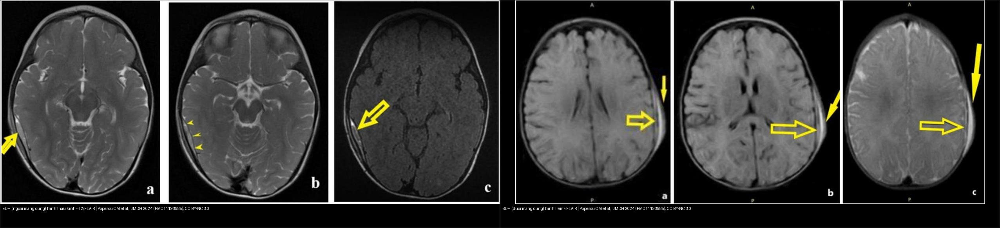
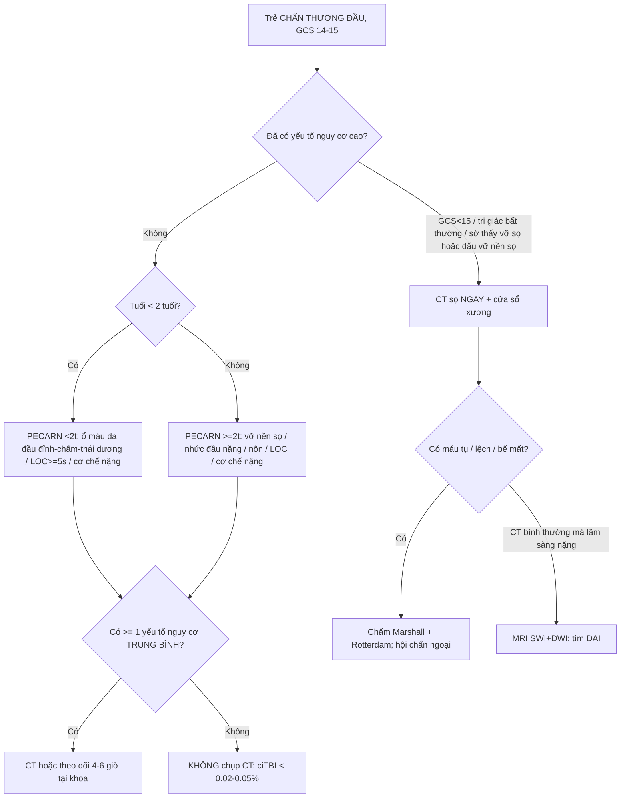
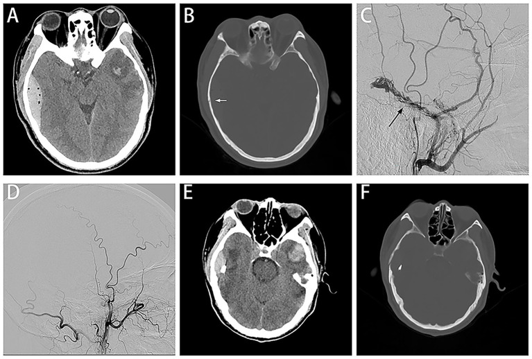
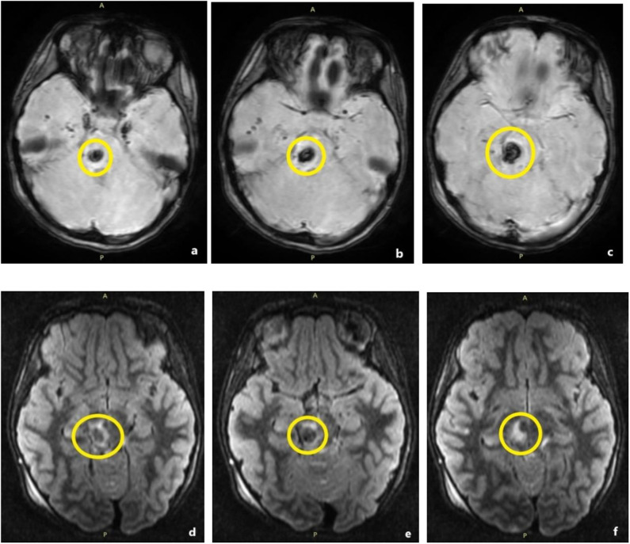
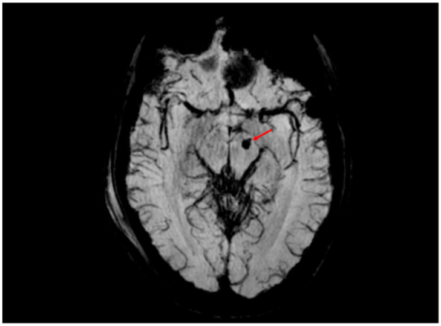
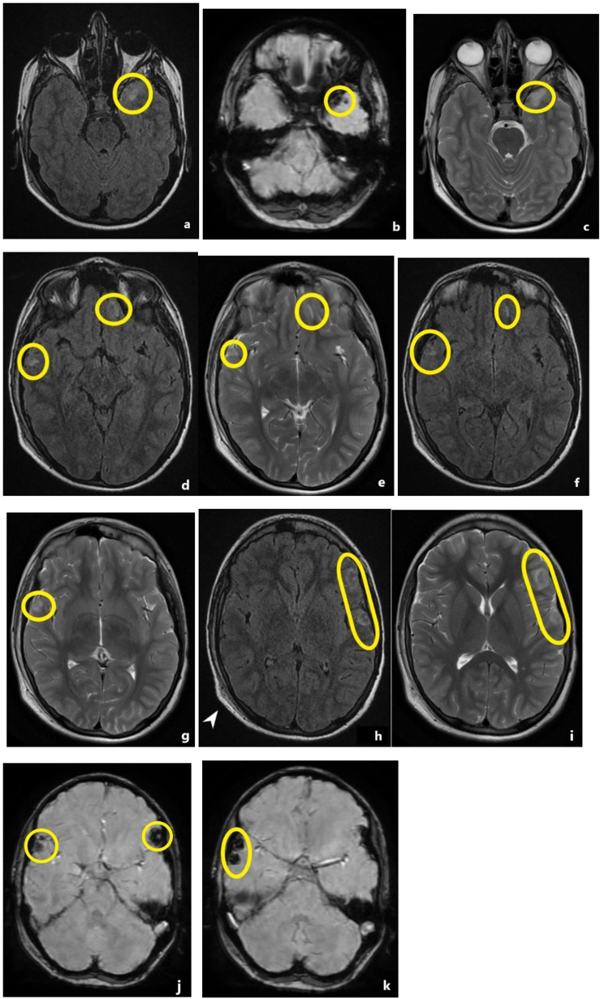
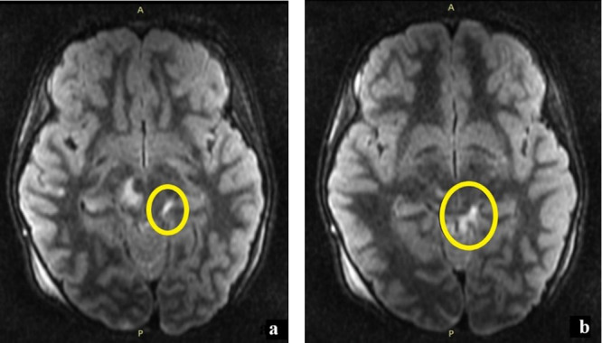
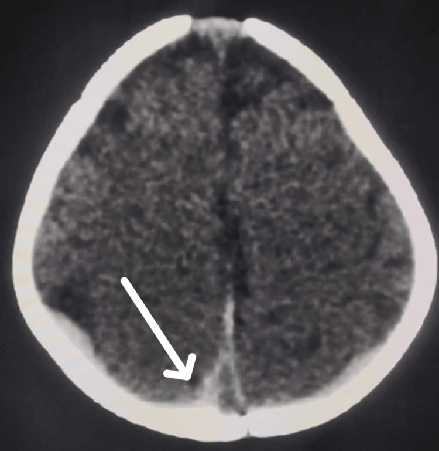
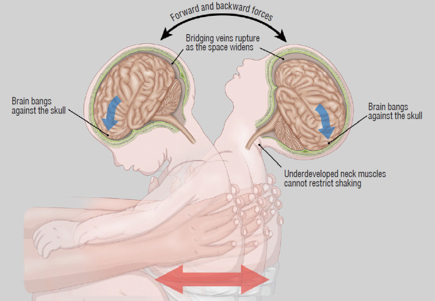

# 224 — Chấn thương sọ não ở trẻ (TBI nhi): phân độ Marshall/Rotterdam, khoang dưới nhện & DAI / Pediatric traumatic brain injury

**Tags:** `pattern:chan-thuong-so-nao` `pattern:xuat-huyet-ngoai-truc` `pattern:dai` `vung:nao-nhi` `score:Marshall` `score:Rotterdam` `score:PECARN` `protocol:CT-so-nao` `protocol:MRI-TBI`
**Mức chắc chắn (certainty):** tổng hợp y văn (literature synthesis) — nhóm tự biên từ y văn mở (Popescu 2024, Cheon 2022 CC BY-NC; Hahnemann 2025, Santurro 2025, Raees 2022 CC BY), ghép **4 cửa Argon** + các thang điểm có số; **các ca trong quiz là ca nguyên văn (verbatim case)** chép đúng tuổi – cơ chế – chú thích gốc.

## 1. Tổng quan bệnh học – cơ chế hình ảnh

- **Chấn thương sọ não (traumatic brain injury — TBI)** là tổn thương não do lực cơ học, **nguyên nhân tử vong – tàn tật số 1 ở trẻ** (Popescu 2024). Cơ chế: **va đập trực tiếp (coup)**, **đối diện (contrecoup)** và **tăng–giảm tốc xoay (rotational acceleration–deceleration)** sinh lực cắt (shear).
- **TẠI SAO trẻ em KHÁC người lớn** (nền tảng đọc hình): (1) **đầu to – nặng tương đối + cơ cổ yếu** → lực xoay lớn, dễ **tổn thương sợi trục lan tỏa (diffuse axonal injury — DAI)**; (2) **sọ mỏng, dẻo, khớp sọ chưa liền** → vỡ/giãn khớp (diastatic) mà đôi khi **không lún**, và **máu tụ ngoài màng cứng (EDH) có thể xuất hiện dù không thấy đường vỡ**; (3) **não nhiều nước, myelin chưa hoàn chỉnh** → xu hướng **phù não lan tỏa (diffuse cerebral swelling)** hơn là máu tụ khu trú; (4) **hộp sọ nhỏ** → khối choán chỗ nhỏ cũng đủ tăng áp lực nội sọ (ICP); (5) **tự điều hòa áp lực (autoregulation)** non nớt nên huyết áp tụt rất dễ làm tổn thương lan rộng.
- **TẠI SAO đọc được bản chất mô trên CT — đậm độ Hounsfield (HU):** máu tụ **cấp** đậm độ cao **40–70 HU** (có cục co rút tới **50–90 HU**) do hemoglobin đặc; **dịch não tủy (CSF) 0–15 HU**, **nhu mô não 30–40 HU**, **mỡ ≈ −100 HU**. **Phù = tăng nước nội–ngoại bào → giảm đậm độ (giảm 2–3 HU/giờ ở nhồi máu, nhanh hơn ở contusion)**. Xương sọ cản quang mạnh → **cửa sổ xương bắt buộc** để tìm đường vỡ.
- **TẠI SAO MRI bắt được DAI mà CT bỏ sót:** DAI là **vi xuất huyết (microhemorrhage)** tại giao diện chất xám–trắng, thể chai, cuống não. Sản phẩm máu (deoxyhemoglobin, hemosiderin) gây **mất tín hiệu cục bộ + "blooming" trên chuỗi nhạy từ (GRE/T2\*/SWI)**; **SWI nhạy nhất** — phát hiện gấp nhiều lần T2\* thường quy. Phù quanh trục trục thì **T2/FLAIR tăng tín hiệu** (nước tự do); vùng thiếu máu/DAI **hạn chế khuếch tán (DWI sáng, ADC tối)**.
- **Ngưỡng định lượng nằm lòng:** **lệch đường giữa (midline shift — MLS) > 5 mm** và **khối choán chỗ > 25 cm³** là mốc của thang Marshall; **ICP bình thường < 10–15 mmHg, điều trị khi ICP > 20 mmHg**; **áp lực tưới máu não (CPP) tối thiểu 40–50 mmHg** (nhũ nhi/trẻ nhỏ), **50–60 mmHg** (trẻ lớn) (PBTF 2019, Kochanek PM et al., PMID 30829890); **EDH cần mổ khi thể tích > 30 cm³, dày > 15 mm hoặc MLS > 5 mm** (Bullock MR et al., PMID 16710967 — dựa trên người lớn, dùng tham chiếu ở trẻ).

## 2. Mẫu hình + chẩn đoán phân biệt theo khoang và cơ chế (Gamut)

- **Ngoài trục (extra-axial):** **máu tụ ngoài màng cứng (EDH)** — thấu kính (biconvex/lenticular), bị **giới hạn bởi đường khớp sọ**; **máu tụ dưới màng cứng (SDH)** — hình liềm (crescent), **VƯỢT khớp sọ**, hay dọc liềm não/lều tiểu não; **xuất huyết dưới nhện do chấn thương (traumatic SAH)** — tăng đậm độ trong **bể nền/rãnh não** (+ xuất huyết trong não thất — IVH).
- **Trong trục (intra-axial):** **đụng dập não (contusion)** — đám tăng đậm độ vỏ–dưới vỏ, thường **coup/contrecoup** (cực trán/thái dương); **DAI** — vi xuất huyết ở **giao diện chất xám–trắng, thể chai (splenium), cuống não/cầu não**; **phù não lan tỏa** — xóa rãnh/bể, xẹp não thất hai bên, mất phân biệt xám–trắng.
- **Tổn thương xương kèm theo:** vỡ tuyến tính, **vỡ giãn khớp (diastatic)**, vỡ lún (depressed), **vỡ nền sọ (basilar)** (chảy máu quanh mắt/tai, dấu **bầm sau tai Battle**, **mắt gấu trúc raccoon**), **vỡ sọ tiến triển (growing skull fracture — nang màng não-tủy)** ở trẻ < 3 tuổi khi rách màng cứng.
- **Theo tuổi – cơ chế (chìa khóa định hướng):** **nhũ nhi < 2 tuổi, chưa tự đi** mà có **SDH + vỡ sọ** → nghĩ **chấn thương do bị hành hạ (abusive head trauma — AHT/NAT)**; **trẻ đi được, ngã** → contusion/EDH; **tai nạn giao thông** → DAI + tổn thương lan rộng.

## 3. Bảng so sánh phân biệt (ma trận đối chiếu)

| Thực thể (entity) | Hình ảnh điển hình (CT/MRI) | Chốt vào (rule-in) | Chốt loại (rule-out) | Gợi ý xác nhận |
|---|---|---|---|---|
| **EDH (ngoài màng cứng)** | Khối **thấu kính (lens/biconvex)**, tăng đậm độ cấp, ranh giới **dừng ở đường khớp sọ**, ± vỡ xương trên đó, ± "swirl sign" (máu hoạt tính) | **Hình thấu kính + KHÔNG vượt khớp sọ** | Hình liềm/vượt khớp + dọc liềm → SDH | CT 1 mm cửa sổ xương; đo dày/thể tích/MLS để quyết mổ |
| **SDH (dưới màng cứng)** | Khối **hình liềm (crescent)**, tăng đậm độ cấp, **VƯỢT khớp sọ**, men theo liềm/lều | **Hình liềm + vượt khớp sọ** | Hình thấu kính dừng ở khớp → EDH | CT; MRI T1/T2 để phân tuổi máu; luôn hỏi cơ chế ở nhũ nhi |
| **tSAH (dưới nhện chấn thương)** | **Tăng đậm độ trong rãnh/bể nền** (thể chai, quanh cuống não), FLAIR tăng tín hiệu | **Máu trong bể nền/rãnh não** | Tăng đậm độ dọc **chính giữa liềm/dây chằng** đơn thuần = giả (falx bình thường) | NECT; CTA nếu do vỡ phình (khác bối cảnh); theo dõi co mạch |
| **Contusion** | Đám tăng đậm độ **chèn vỏ não**, vị trí **coup/contrecoup** (cực trán/thái dương) | **Tổn thương dính vỏ + cơ chế va đập** | Khối lớn khu trú có vỏ bao rõ + không cơ chế → u/máu tụ | CT; MRI theo dõi tiến triển/nhũn não |
| **DAI** | Vi xuất huyết **giao diện xám–trắng, thể chai, cuống não**; **T2\*/SWI mất tín hiệu "blooming"** | **Vị trí đặc trưng + SWI/GRE sáng** | CT bình thường **KHÔNG loại trừ** DAI (MRI mới thấy) | MRI SWI + DWI; chấm độ DAI (Adams I–III) để tiên lượng |
| **Phù não lan tỏa (diffuse swelling)** | Xóa rãnh/bể, **xẹp não thất hai bên**, mất phân biệt xám–trắng | **Xẹp não thất + xóa bể hai bên** | Còn bể + không lệch → Marshall II nhẹ | Theo dõi ICP; ICP > 20 mmHg là ngưỡng điều trị |
| **AHT/NAT (nhũ nhi)** | **SDH nhiều tầng/mảnh** (đậm độ khác nhau) ± vỡ sọ, thiếu máu–phù lan tỏa; **KHÔNG tương xứng với cơ chế kể** | **SDH + xuất huyết võng mạc + thương tích hệ khác ở trẻ < 2 tuổi chưa tự đi** | Chẩn đoán khác: **rối loạn chuyển hóa** (glutaric aciduria type 1, Menkes), SDH **quanh sinh**, bệnh máu/rối loạn đông | Khám đáy mắt + MRI toàn thân xương; hội chẩn bảo vệ trẻ em |

*Trái: **EDH** — khối ngoài trục hình **thấu kính (lenticular)**, mặt trong † áp vào não, dấu màng cứng (đường tối mảnh) hiện ở mũi tên nhỏ. Phải: **SDH** — khối **hình liềm (crescent)** men theo vòm sọ, lõm theo bề mặt não. Ảnh ghép letterbox giữ aspect gốc (không crop/kéo giãn) từ 2 hình cùng nguồn: Popescu CM et al., J Multidiscip Healthc 2024 (PMC11193985), **CC BY-NC 3.0** (tác phẩm phái sinh giữ nguyên giấy phép).*

### Đọc nhanh khoang dưới nhện & bể nền (cho Marshall)
- **Bể nền (basal cisterns) = "cửa sổ sống còn"** của thang Marshall/Rotterdam: **bình thường** → còn não thất/sulci chứa dịch; **bị chèn ép (compressed)** = bể còn mảnh nhưng hẹp; **mất (absent)** = xóa hẳn → gợi ý **tăng ICP nặng, tiên lượng xấu**.
- **Phân biệt tSAH vs giả tSAH:** máu dưới nhện nằm **trong rãnh/bể, bất đối xứng**; tăng đậm độ **dọc chính giữa liềm não rất đối xứng** ở người trẻ thường chỉ là **vôi hóa/mạch liềm bình thường** — cạm bẫy gọi nhầm "SAH".

## 4. Protocol chụp + thang điểm Marshall/Rotterdam/PECARN

- **CT không tiêm (NECT) lát mỏng ≤ 1 mm + cửa sổ xương** là **cửa vào** mọi TBI cấp tính (nhanh, loại trừ máu tụ/xuất huyết, tìm vỡ sọ). **CTA** khi nghĩ tổn thương mạch máu (bóc tách, giả phình, vỡ sọ nền/xuyên thấu) — không thường quy ở trẻ.
- **MRI (SWI + DWI/ADC + T2/FLAIR)** khi: **CT bình thường nhưng lâm sàng nặng**, nghi **DAI**, tiên lượng hôn mê, hoặc theo dõi di chứng. **SWI/GRE là chuỗi quyết định cho DAI.**
- **Đo và ghi vào báo cáo:** **MLS (mm)**, **thể tích khối choán chỗ (cm³)**, **trạng thái bể nền (bình thường/chèn ép/mất)**, **có IVH/tSAH hay không**, **có EDH hay không** — đây là các biến của thang điểm bên dưới.
- **Thang Marshall (Marshall LF et al., J Neurosurg 1991;75(Suppl):S14–20)** — phân loại hình thái:
  - **I – Không thấy tổn thương**
  - **II – Tổn thương lan tỏa nhẹ:** bể nền còn, MLS 0–5 mm, **không khối > 25 cm³**
  - **III – Phù lan tỏa (swelling):** **bể bị chèn ép/mất**, MLS 0–5 mm, không khối > 25 cm³
  - **IV – Lệch:** **MLS > 5 mm**, không khối > 25 cm³
  - **V – Khối choán chỗ ĐÃ mổ lấy** (evacuated mass)
  - **VI – Khối choán chỗ > 25 cm³ KHÔNG mổ** (non-evacuated mass)
- **Thang Rotterdam (Maas AI et al., Neurosurgery 2005, PMID 16331165)** — cộng 4 biến, tổng **1–6 điểm** (điểm càng cao càng tử vong nhiều):
  - Bể nền: bình thường **0** · chèn ép **1** · mất **2**
  - MLS: ≤ 5 mm **0** · > 5 mm **1**
  - **EDH: có → 0 · không → 1** (EDH tăng thêm 0 điểm vì tiên lượng tốt hơn)
  - IVH hoặc tSAH: không **0** · có **1**
- **Thang quyết định chụp CT ở trẻ — PECARN (Kuppermann N et al., Lancet 2009, PMID 19758692):** không khuyến cáo CT khi **không có yếu tố dự báo nào** (nguy cơ chấn thương não quan trọng trên lâm sàng — ciTBI **< 0,02% ở < 2 tuổi và < 0,05% ở ≥ 2 tuổi**). Yếu tố **nguy cơ cao** (< 2 tuổi: **GCS < 15, tri giác bất thường, sờ thấy vỡ sọ**; ≥ 2 tuổi: **GCS < 15, tri giác bất thường, dấu vỡ nền sọ**) → **CT ngay**.

## 5. Biến thể bình thường và cạm bẫy

- **PECARN giúp GIẢM chụp nhưng có vùng mù:** **không áp dụng cho trẻ < 3 tháng tuổi**, trẻ có **bệnh máu/rối loạn đông, shunt/thủ thuật thần kinh trước đó, hoặc chấn thương lực rất mạnh** — nhóm này cứ CT/hội chẩn.
- **"CT bình thường = não lành" là cạm bẫy chết người:** DAI có thể **CT âm tính**; nếu lâm sàng nặng mà CT bình thường → **MRI SWI/DWI**.
- **Bỏ sót tổn thương ĐỐI DIỆN (satisfaction of search):** sau khi thấy máu tụ một bên, **luôn soát bán cầu còn lại** và tìm thêm contusion/EDH/SDH thứ hai.
- **EDH ở trẻ có thể do tĩnh mạch, có thể không có vỡ sọ, và "khoảng tỉnh" (lucid interval) không đáng tin** — đừng loại trừ EDH chỉ vì trẻ tỉnh táo hoặc không thấy đường vỡ.
- **Giả tSAH:** tăng đậm độ dọc **liềm não chính giữa rất đối xứng** (người trẻ) là hình thái bình thường, không phải máu dưới nhện.
- **AHT và các thể giả AHT (mimic):** **glutaric aciduria type 1** (SDH + tổn thương hạch nền + loạn dưỡng chất trắng) và **Menkes** (mạch xoắn, tổn thương chất trắng, SDH) có thể bị đọc nhầm thành NAT — do đó **luôn kèm đánh giá chuyển hóa/toàn thân**, không kết luận NAT chỉ bằng một tổn thương (Cheon JE, Kim JH, J Korean Neurosurg Soc 2022, PMC9082130).
- **SDH quanh sinh (birth-related) ở trẻ sơ sinh** có thể tự tiêu — phân biệt với SDH do chấn thương mới bằng **bối cảnh + chuỗi hình ảnh theo thời gian**, không bằng một lần chụp.
- **Vỡ sọ tiến triển (growing fracture) ở trẻ < 3 tuổi** xuất hiện **nhiều tuần–tháng** sau chấn thương do rách màng cứng + dò dịch → cần theo dõi phim chụp lại, không bỏ quên sau một phim bình thường.
- **Máu tụ dưới màng cứng phân tuổi bằng MRI:** đậm độ CT rất nhạy ở giai đoạn rất sớm nhưng mau đồng đậm; trong AHT đã kiểm chứng, **SDH đậm độ cao trên CT gặp tới ngày thứ 9**, **màng dưới màng cứng hình thành muộn từ ngày 283**, **dấu "nòng nọc" (tadpole sign) trên MRI từ 3 giờ tới 46 ngày** (Hahnemann M et al., Eur Radiol 2025, PMC12021946).

## 6. Tự lượng giá — Blind Quiz (ảnh trơn ngoài, đáp án trong)

**Ca 1 — Trẻ bị ngã, sau chấn thương có một bên đồng tử giãn, liệt nửa người. Nhìn CT (panen A là ảnh CT):**

- Gợi ý lâm sàng (clinical context): chấn thương đầu kín, thần kinh xấu dần, có vỡ xương thái dương.
- Câu hỏi: mô tả khối ngoài trục? Hình dạng gì, có vượt đường khớp sọ không? 3 chẩn đoán phân biệt? Xử trí?

<b>Bấm để hiện đáp án (findings + chẩn đoán)</b>

- Dấu hiệu (findings): khối **tăng đậm độ cấp** vùng thái dương phải, **hình thấu kính (biconvex)**, dừng ở đường khớp sọ (không vượt), kèm **đường vỡ xương thái dương** (panel B) và lệch đường giữa + chèn ép; DSA cho thấy **mạch màng não giữa (MMA)** liên quan (panel C–E).
- Chẩn đoán (diagnosis): **máu tụ ngoài màng cứng (EDH) cấp** — thường do rách MMA động mạch ± vỡ xương. **Xử trí: hội chẩn mổ giải ép cấp cứu**; thể nhỏ có thể theo dõi/nút MMA (nghiên cứu: 14 ca EDH nhỏ + vỡ sọ **nút MMA sớm** đều **không tiến triển, khỏi không di chứng**) — nhưng khi có dấu hiệu chèn ép thì mổ ngay.
- Nguồn ảnh: Wang W et al., Front Neurol 2026 (PMC12956541), CC BY 4.0.

**Ca 2 — Nhũ nhi 5 tháng ngã, nhìn 2 ảnh: ảnh trái có khối hình gì, ảnh phải hình gì?**

- Gợi ý lâm sàng (clinical context): hai cơ chế khác nhau trên cùng một chuỗi xung.
- Câu hỏi: đâu là EDH, đâu là SDH? Dấu hiệu hình học chốt? Ở nhũ nhi, kiểu nào phải nghĩ đến AHT?

<b>Bấm để hiện đáp án (findings + chẩn đoán)</b>

- Dấu hiệu (findings): **trái = EDH** dạng **thấu kính (lenticular)**, mặt trong lõm theo não (dấu màng cứng — đường tối mảnh); **phải = SDH** dạng **liềm (crescent)** men vòm sọ.
- Chẩn đoán (diagnosis): **EDH vs SDH** — chốt hình học là **thấu kính + dừng ở khớp sọ** vs **liềm + vượt khớp**. Ở **nhũ nhi chưa tự đi**, **SDH (đặc biệt nhiều tầng)** phải loại trừ **AHT/NAT** trước khi cho là ngã thường.
- Nguồn ảnh: Popescu CM et al., J Multidiscip Healthc 2024 (PMC11193985), CC BY-NC 3.0 (ảnh ghép phái sinh).

**Ca 3 — Trẻ TNGT, CT bình thường nhưng hôn mê. Nhìn MRI (a–c) và FLAIR (d–f):**

- Câu hỏi: vị trí tổn thương? Chuỗi nào thấy rõ nhất? Chẩn đoán + độ DAI (Adams)? Vì sao CT âm tính?

<b>Bấm để hiện đáp án (findings + chẩn đoán)</b>

- Dấu hiệu (findings): vùng **mất tín hiệu (tối) ở cầu não/cuống não** trên **SWI (a–c)**, có **phù quanh (FLAIR tăng tín hiệu, d–f)**.
- Chẩn đoán (diagnosis): **DAI độ III (Adams — thân não/cuống não)**: vi xuất huyết **không thấy trên CT** vì quá nhỏ; **SWI nhạy nhất**. DAI độ III = **tiên lượng xấu nhất** trong nhóm DAI.
- Nguồn ảnh: Popescu CM et al., J Multidiscip Healthc 2024 (PMC11193985), CC BY-NC 3.0.

**Ca 4 — Trẻ TNGT, nhìn T2\*: mũi tên đỏ chỉ gì và nghĩa là gì?**

- Câu hỏi: dấu hiệu trên chuỗi xung? Nếu chỉ có CT sẽ ra sao? Ý nghĩa tiên lượng?

<b>Bấm để hiện đáp án (findings + chẩn đoán)</b>

- Dấu hiệu (findings): **nốt mất tín hiệu nhỏ ở cuống não trái** (mũi tên đỏ) trên **SWI** = **vi xuất huyết sợi trục** (thể tích chỉ ~0,03 cm³) — tương ứng **DAI độ III**.
- Chẩn đoán (diagnosis): **DAI xuất huyết** — CT thường bỏ sót; **SWI phát hiện tổn thương mà CT/T2\* thường quy không thấy**. Tổn thương thân não = tiên lượng vận động/tri giác xấu.
- Nguồn ảnh: Santurro A et al., Int J Mol Sci 2025 (PMC12386751), CC BY 4.0.

**Ca 5 — Trẻ va đập, nhìn chuỗi FLAIR (a, d, f, h) và SWI (b, j, k):**

- Câu hỏi: tổn thương ở đâu (trong hay ngoài trục)? Vì sao SWI thấy rõ hơn FLAIR? Đây là contusion hay DAI?

<b>Bấm để hiện đáp án (findings + chẩn đoán)</b>

- Dấu hiệu (findings): nhiều **đám tín hiệu bất thường ở vỏ–dưới vỏ** (khoanh vàng) trên FLAIR, tương ứng **vùng mất tín hiệu trên SWI** = thành phần xuất huyết.
- Chẩn đoán (diagnosis): **đụng dập vỏ não (cortical contusion)** — tổn thương **trong trục dính vỏ**; khác DAI (giao diện xám–trắng/thể chai/thân não). **SWI thấy thành phần vi xuất huyết** mà FLAIR chỉ thấy phù.
- Nguồn ảnh: Popescu CM et al., J Multidiscip Healthc 2024 (PMC11193985), CC BY-NC 3.0.

**Ca 6 — Trẻ TNGT, nhìn FLAIR (a) và (b): dấu hiệu bất đối xứng nằm ở đâu?**

- Câu hỏi: vùng tăng tín hiệu ở đâu? Chẩn đoán? Phân biệt với "giả tSAH"?

<b>Bấm để hiện đáp án (findings + chẩn đoán)</b>

- Dấu hiệu (findings): **tăng tín hiệu FLAIR trong bể quanh cuống não (bể quanh cuống/ambient cistern)** (khoanh vàng), bất đối xứng — tương ứng **máu trong khoang dưới nhện**.
- Chẩn đoán (diagnosis): **xuất huyết dưới nhện do chấn thương (tSAH)** — máu trong bể nền/rãnh. Phân biệt **giả tSAH**: tăng đậm độ **dọc chính giữa liềm não rất đối xứng** ở người trẻ là hình thái bình thường.
- Nguồn ảnh: Popescu CM et al., J Multidiscip Healthc 2024 (PMC11193985), CC BY-NC 3.0.

**Ca 7 — Nhũ nhi 9 tháng nôn, co giật, rối loạn tri giác; đáy mắt có vô số đốm Roth. Nhìn CT:**

- Gợi ý lâm sàng (clinical context): trẻ nhũ nhi, không rõ cơ chế tương xứng, đáy mắt bất thường.
- Câu hỏi: mô tả dải tăng đậm độ? 3 chẩn đoán phân biệt? Bước tiếp theo?

<b>Bấm để hiện đáp án (findings + chẩn đoán)</b>

- Dấu hiệu (findings): **dải máu dưới màng cứng mảnh (mũi tên trắng)** dọc liềm/bán cầu (liềm não + vùng chẩm-đỉnh hai bên), kèm **xuất huyết võng mạc nhiều tầng + đốm Roth** trên soi đáy mắt.
- Chẩn đoán (diagnosis): **chấn thương do bị hành hạ (AHT/NAT)** — **tam chứng:** bệnh não + SDH + xuất huyết võng mạc (không có dấu nào tuyệt đối đặc hiệu một mình). Bước tiếp theo: **khám đáy mắt đầy đủ + MRI não/tủy + X-quang xương theo tuổi (skeletal survey) + đánh giá chuyển hóa/đông máu + hội chẩn bảo vệ trẻ em**. Phải loại trừ **mimic**: glutaric aciduria type 1, Menkes (xem Ca 8).
- Nguồn ảnh: S N et al., Cureus 2026 (PMC13172391), CC BY 4.0.

**Ca 8 — Sơ đồ cơ chế sinh chấn thương đầu do rung lắc: mũi tên xoay và "tĩnh mạch cầu" vỡ giải thích gì?**

- Câu hỏi: cơ chế nào tạo SDH? Vì sao trẻ nhũ nhi nhạy cảm? Hai chẩn đoán chuyển hóa có thể giả AHT?

<b>Bấm để hiện đáp án (findings + chẩn đoán)</b>

- Dấu hiệu (findings): sơ đồ cho thấy **lực xoay tới–lui** làm **giãn khoang dưới nhện → vỡ tĩnh mạch cầu (bridging veins)** → **SDH**; **não đập vào sọ** → đụng dập; **cơ cổ non yếu** không hạn chế được lực rung lắc.
- Chẩn đoán (diagnosis): **cơ chế sinh AHT** — giúp hiểu vì sao **SDH + xuất huyết võng mạc + đụng dập/DAI** cùng xuất hiện ở nhũ nhi. Phải loại trừ **glutaric aciduria type 1** và **Menkes** (đều có thể có SDH + tổn thương nhu mô giả chấn thương).
- Nguồn ảnh: Cheon JE, Kim JH, J Korean Neurosurg Soc 2022 (PMC9082130), CC BY-NC 4.0.

## Bài liên quan chéo
- [200 – Tổng quan Thần kinh](../200-tong-quan-he-than-kinh/lesson.md)
- [201 – Protocol CT/MRI sọ não](../201-protocol-so-nao/lesson.md) (cửa sổ đột quỵ/chấn thương, DWI)
- [210 – Giải phẫu cắt lớp sọ não](../210-giai-phau-so-nao/lesson.md)
- [212 – Xuất huyết nội sọ (EDH, SDH, SAH) & diễn tiến hemoglobin](../212-xuat-huyet-so-nao/lesson.md) (bản người lớn)
- [218 – Thoát vị não & úng thủy](../218-thoat-vi-nao-ung-thuy/lesson.md) (thoát vị khi ICP tăng)
- [650 – Thần kinh nhi: xuất huyết mầm & u hố sau](../650-than-kinh-nhi-xuat-huyet-mam-va-u-ho-sau/lesson.md)
- [655 – HIE sơ sinh & dị tật bẩm sinh](../655-hie-so-sinh-va-di-dang-bam-sinh-than-kinh/lesson.md) (DDx não nhi)
- [223 – Chấn thương tủy sống: ASIA & SCIWORA](../223-chan-thuong-tuy-so/lesson.md) (chấn thương thần kinh trục)
- [231 – BCVI & vỡ sọ tiến triển ở trẻ](../231-ton-thuong-mach-mau-nao-chan-thuong-va-vo-so-tien-trien/lesson.md) (biến chứng mạch máu – xương sọ)
- [232 – Chấn thương đầu nhẹ & concussion ở trẻ](../232-chan-thuong-dau-nhe-concussion-o-tre/lesson.md) (PECARN, quan sát, quay lại học/thể thao)

## Ảnh
- `images/224_chan-thuong-so-nao-nhi_MRI_PMC11193985-Fig1-contusion-CCBYNC.jpg` — đụng dập vỏ não (CC BY-NC 3.0).
- `images/224_chan-thuong-so-nao-nhi_MRI_PMC11193985-Fig4-DAI-gradeIII-CCBYNC.jpg` — DAI độ III thân não (CC BY-NC 3.0).
- `images/224_chan-thuong-so-nao-nhi_MRI_PMC11193985-Fig5-EDH-lenticular-CCBYNC.jpg` — EDH thấu kính (CC BY-NC 3.0).
- `images/224_chan-thuong-so-nao-nhi_MRI_PMC11193985-Fig6-SDH-crescent-CCBYNC.jpg` — SDH hình liềm (CC BY-NC 3.0).
- `images/224_chan-thuong-so-nao-nhi_MRI_PMC11193985-Fig7-tSAH-CCBYNC.jpg` — tSAH bể quanh cuống (CC BY-NC 3.0).
- `images/224_chan-thuong-so-nao-nhi_CT_PMC9411658-Fig2-SDH-crescent-CCBY.jpg` — SDH hình liềm trên CT (CC BY 4.0).
- `images/224_chan-thuong-so-nao-nhi_CT_PMC13172391-Fig4-SDH-NAT-CCBY.jpg` — SDH mảnh trong AHT (CC BY 4.0).
- `images/224_chan-thuong-so-nao-nhi_CT_PMC12956541-Fig1-EDH-CCBY.jpg` — EDH cấp + vỡ xương + MMA (CC BY 4.0).
- `images/224_chan-thuong-so-nao-nhi_MRI_PMC12386751-Fig5-SWI-DAI-CCBY.jpg` — DAI trên SWI (CC BY 4.0).
- `images/224_chan-thuong-so-nao-nhi_SD_PMC9082130-Fig1-AHT-co-che-CCBYNC.jpg` — sơ đồ cơ chế AHT (CC BY-NC 4.0).
- `images/composite_224_EDH-vs-SDH.jpg` — ảnh ghép EDH vs SDH (phái sinh CC BY-NC 3.0).
- Nguồn + giấy phép đầy đủ: `images/CREDITS.md`; link gốc: `sources.md`.

> Không dùng để chẩn đoán độc lập khi chưa có người hướng dẫn.
