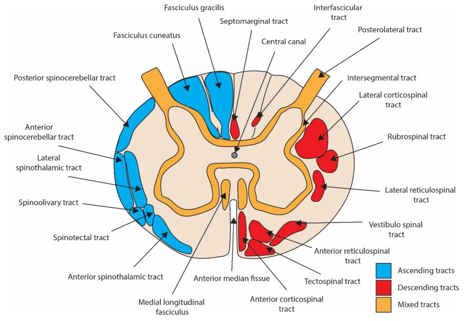
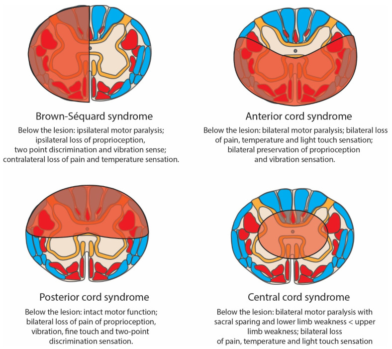
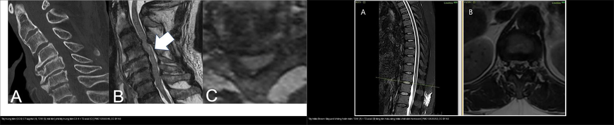
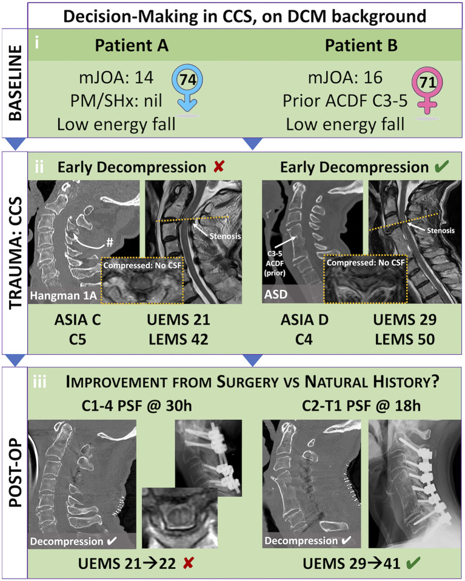
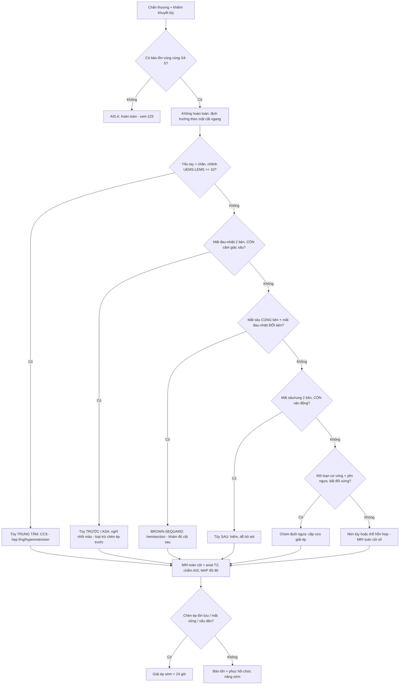
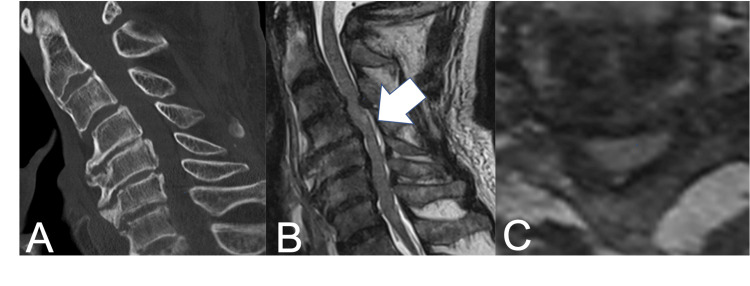
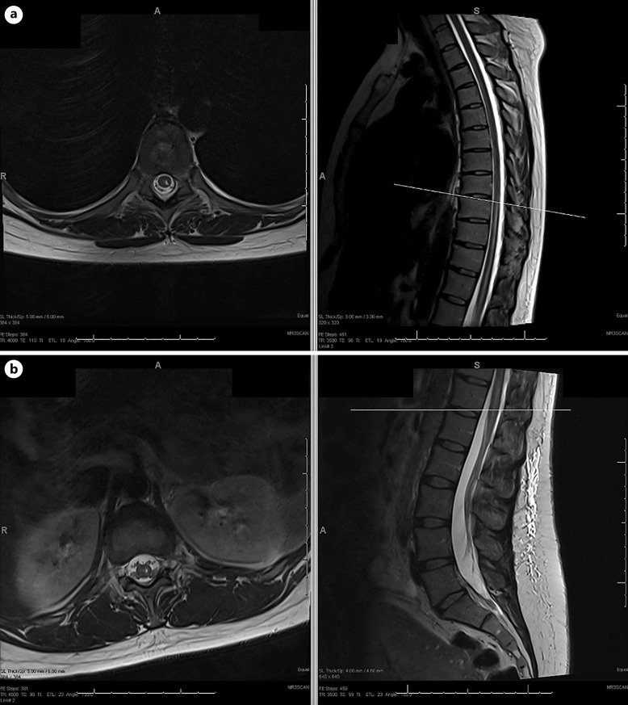
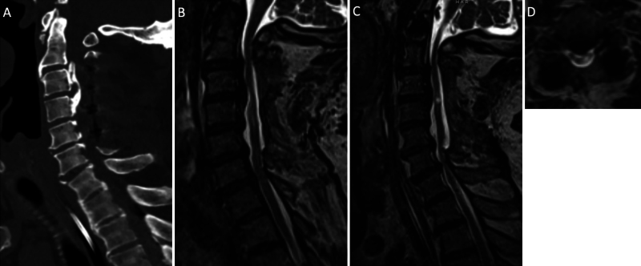
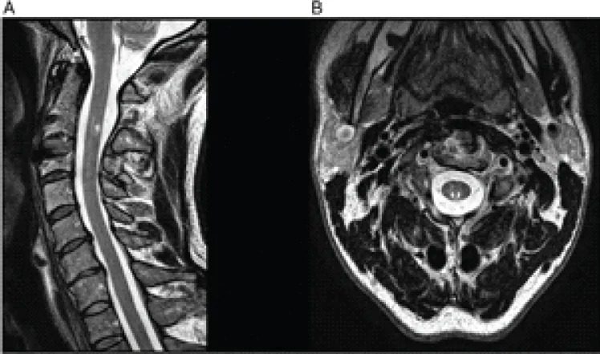

# 225 — Hội chứng tủy không hoàn toàn: tủy trung tâm, tủy trước, Brown-Séquard, tủy sau / Incomplete spinal cord syndromes

**Tags:** `pattern:hoi-chung-tuy` `pattern:tuy-khong-hoan-toan` `vung:tuy-song` `score:ASIA` `protocol:MRI-cot-song` `protocol:CT-cot-song`
**Mức chắc chắn (certainty):** tổng hợp y văn (literature synthesis) — tổng hợp từ bài tổng quan phân loại–điều trị SCI (McDearman JC et al., J Clin Med 2026, PMC13512939), bài tổng quan sinh lý bệnh neurotrauma (Stevens AR et al., Biomedicines 2024, PMC10968440), tổng quan tủy trung tâm (Martínez-Palacios K et al., Brain Spine 2025, PMC12166739) và **các ca nguyên văn (verbatim case)** giữ đúng tuổi – lâm sàng – chú thích gốc: tủy trung tâm (Katayama M et al., Cureus 2025, PMC12550345), tủy trước/Brown-Séquard không hoàn toàn (Kavya BT et al., Front Radiol 2025, PMC12620253), hội chứng động mạch tủy trước một bên (Kraus MJ & Nguyen J, Case Rep Neurol 2024, PMC11250075), Brown-Séquard (Torres J et al., J Neurosurg Case Lessons 2024, PMC11670128), tủy sau (Raj S et al., J Orthop Case Rep 2026, PMC13552138).

## 1. Tổng quan — vì sao mỗi hội chứng có "chân dung" riêng (giải phẫu + tưới máu)

- **Tủy sống = chất xám trung tâm + chất trắng bao quanh.** Chất trắng chia **đường lên (ascending)** và **đường xuống (descending)**: cột sau (fasciculus gracilis/cuneatus) dẫn **cảm giác sâu – rung – phân biệt hai điểm**, bó spinothalamic (sừng sau → trước bên) dẫn **đau – nhiệt**, bó corticospinal (bên) dẫn **vận động**; chất xám có **sừng trước (vận động, 2 neuron)**, **sừng sau (cảm giác)** và **sừng bên (giao cảm)**. Vì các bó này chiếm các "ô" riêng trong mặt cắt ngang, **mỗi vùng tổn thương cho một tổ hợp dấu hiệu khác nhau** — đó là cơ sở của "hội chứng tủy không hoàn toàn".
- **TẠI SAO phải phân biệt "không hoàn toàn" trước hết:** "không hoàn toàn" theo ASIA/ISNCSCI (`223`) là **còn bảo tồn vùng cùng (sacral sparing)**: cảm giác S4–S5, cảm giác sâu hậu môn, co cơ hậu môn tự ý. Chỉ cần một trong ba → **KHÔNG phải AIS A**, tiên lượng khác hẳn (mổ/thuốc/theo dõi khác). Trên nền không hoàn toàn, **kiểu phân bố khiếm khuyết** mới chia thành các hội chứng dưới đây.
- **Hai "bản đồ" cùng lúc — somatotopy vs mạch máu (bài học lịch sử):**
  - *Somatotopy:* trong bó corticospinal cổ, sợi tới **chi trên nằm TRONG (medial)**, tới **chi dưới nằm NGOÀI (lateral)** → tổn thương **trung tâm** dễ yếu tay hơn chân ("central cord"). Schneider 1954 mô tả vậy trên cơ chế **tăng duỗi cổ (hyperextension)** ở người hẹp ống.
  - *Mạch máu:* tủy được cấp bởi **một động mạch tủy trước (anterior spinal artery — ASA)** cho **2/3 trước** (sừng trước + corticospinal + spinothalamic) và **hai động mạch tủy sau (posterior spinal artery)** cho **1/3 sau (cột sau)**. **Vùng phân thủy (watershed)** là chỗ dễ tổn thương nhất khi tụt huyết áp / tắc mạch. Do đó **cùng một "vùng trước"** có thể do cả chèn ép lẫn thiếu máu — giải thích vì sao mô hình somatotopy kinh điển bị thách thức và cơ chế được mô tả lại (Stevens AR et al., Biomedicines 2024, PMC10968440).
  - *Chi tiết ASA:* 78% nhánh tăng cường lớn nhất (**động mạch Adamkiewicz**) xuất phát **bên TRÁI**, phần lớn từ **T8–L3 (hay gặp nhất T9–T12)** — giải thích các nhồi máu một bên, không đối xứng (Kraus MJ & Nguyen J, Case Rep Neurol 2024, PMC11250075).
- **Ngưỡng định lượng nằm lòng (theo PROMPT_SYNTHESIZER):**
  - **Tủy trung tâm (central cord syndrome — CCS):** **hội chứng không hoàn toàn hay gặp nhất**; **tần suất 15–25%** các ca SCI, **~11.000 ca/năm** ở Mỹ; tiêu chuẩn hình thái lâm sàng **Pouw: chênh điểm vận động chi trên – chi dưới ≥ 10 điểm**; **tuổi < 65** có khả năng đi lại không dụng cụ cao nhất (McDearman JC et al., J Clin Med 2026, PMC13512939; Martínez-Palacios K et al., Brain Spine 2025, PMC12166739).
  - **Tủy trước (anterior cord):** **nhồi máu tủy hay gặp nhất**, chiếm **~1,2% của MỌI đột quỵ**; tần suất ước tính **3,7/100.000 người**; **tử vong 9–23%**; phục hồi vận động về mức nền là **tối thiểu** dù biểu hiện nhẹ (McDearman JC et al., PMC13512939; Martinez-Santori M et al., J Pediatr Rehabil Med 2024, PMC13292633).
  - **Brown-Séquard (hemisection):** ~**11.000 ca mới/năm** ở Mỹ; chiếm **~4%** chấn thương tủy ở Na Uy; **tiên lượng tốt nhất** trong nhóm (phần lớn đi lại được) (McDearman JC et al., PMC13512939).
  - **Tủy sau (posterior cord):** **không nằm trong các hội chứng ISNCSCI chính thức**, tần suất báo cáo **< 1%**, **thường bị bỏ sót** vì không khám kỹ cột sau (Raj S et al., J Orthop Case Rep 2026, PMC13552138).
  - **Nón tủy (conus medullaris) ~1,5/1 triệu người; chùm đuôi ngựa (cauda equina) ~3,4/1 triệu người**; chuyển hoàn toàn A→D chỉ **2,3%** (McDearman JC et al., PMC13512939).
  - **Tủy trung tâm: ~90% phục hồi vận động trong 3 năm**, không phụ thuộc vào cách điều trị (mổ hay bảo tồn); phục hồi theo trình tự **dưới → trên, gần → xa (ascending, proximal-to-distal)** (Martinez-Santori M et al., PMC13292633).
- **Điểm "đọc ảnh phải nhớ":** MRI thấy **vùng tăng tín hiệu T2 trong tủy** nhưng **hội chứng được đặt tên theo LÂM SÀNG, không theo hình ảnh** — ảnh chỉ định vị và loại trừ chèn ép (đĩa xương, máu tụ), còn Brown-Séquard/tủy trước/tủy sau là **chẩn đoán lâm sàng – định khu**.

*Vì sao "ô" tổn thương quyết định chân dung: cột sau (fasciculus gracilis/cuneatus) = cảm giác sâu; bó spinothalamic trước-bên = đau–nhiệt; bó corticospinal bên = vận động; sừng trước = neuron vận động dưới. Stevens AR et al., Biomedicines 2024 (PMC10968440, Fig. 2), CC BY 4.0.*

## 2. Mẫu hình + chẩn đoán phân biệt theo mẫu hình (Gamut)

Đọc **năm câu hỏi** theo mặt cắt ngang (từ trước ra sau, từ trong ra ngoài) → gọi tên hội chứng:

- **Yếu TAY > CHÂN + mất cảm giác/đau–nhiệt dưới mức (thường cổ, tăng duỗi trên nền hẹp ống):** **tủy trung tâm (central cord)** — cơ chế trung tâm (chèn ép trước-sau + phù/xuất huyết trung tâm chất xám). Mất **sừng trước cổ** → teo cơ/tay "mềm nhất". Tiên lượng tốt nhất trong các tổn thương cổ nặng, hồi phục **chân trước tay**.
- **Liệt hai bên (đối xứng) + MẤT đau–nhiệt hai bên + CÒN cảm giác sâu/rung:** **tủy trước (anterior cord / anterior spinal artery syndrome)** — tổn thương 2/3 trước. Thường **vascular** (phẫu thuật ĐMC, tụt HA, thuyên tắc), đôi khi chèn ép trước cấp. **Còn cột sau = chốt loại "tổn thương hoàn toàn".**
- **Mất vận động + cảm giác sâu CÙNG BÊN + mất đau–nhiệt ĐỐI BÊN (dị cảm phân ly):** **Brown-Séquard (hemisection)** — do đâm/xuyên (vật nhọn, dao), hoặc u/chèn ép. Thêm **Horner nếu tổn thương trên T1** (đường giao cảm mắt); mất cảm giác sâu → **mất thăng bằng tư thế**.
- **Mất cảm giác sâu/rung/2 điểm HAI BÊN + CÒN vận động và đau–nhiệt:** **tủy sau (posterior cord)** — tổn thương cột sau (thường do nhồi máu động mạch tủy sau, ít khi do chấn thương). Vì cột sau đôi khi **chồng lấn đường giữa** → mất cảm giác sâu có thể thay đổi theo mức; **dễ bị bỏ sót** nếu chỉ khám cảm giác đau/nhiệt.
- **Liệt mềm hai chi dưới + bí tiểu + mất phản xạ, không đối xứng:** **chùm đuôi ngựa (cauda equina)** — cấp cứu ngoại (nén rễ); **đối xứng, rối loạn cơ vòng sớm, đau yên ngựa, giữ phản xạ:** **nón tủy (conus medullaris)** — ranh giới lâm sàng hay chồng lấn, phân biệt chủ yếu để định hướng chèn ép rễ vs nhu mô tủy tận.
- **Gợi nhớ "5 ô" — TC·Tr·BS·S·ĐN:** **T**rung tâm (Tay > Chân) · **Tr**ước (mất đau–nhiệt, còn sâu) · **B**rown-**S**équard (dị cảm phân ly) · **S**au (mất sâu, còn vận động) · **Đ**uôi ngựa/**N**ón tủy (rễ/vùng tận).

*Brown-Séquard (hemisection: liệt vận động + mất sâu cùng bên, mất đau–nhiệt đối bên), tủy trước (liệt + mất đau–nhiệt hai bên, còn sâu), tủy sau (mất sâu/rung/2 điểm, còn vận động), tủy trung tâm (yếu tay > chân + mất cảm giác/đau–nhiệt dưới mức). Ảnh dùng cho mục đích học; hội chứng vẫn được chẩn đoán bằng LÂM SÀNG. Stevens AR et al., Biomedicines 2024 (PMC10968440, Fig. 3), CC BY 4.0.*

## 3. Bảng so sánh phân biệt (ma trận đối chiếu)

| Thực thể (entity) | Hình ảnh điển hình (CT/MRI) | Chốt vào (rule-in) | Chốt loại (rule-out) | Gợi ý xác nhận |
|---|---|---|---|---|
| Tủy trung tâm (central cord) | CT: hẹp ống đa tầng/OPLL, không gãy; **T2W tăng tín hiệu trung tâm tủy cổ** (C2–C6), axial thấy phù trung tâm chất xám | **Yếu tay > chân + chênh UEMS–LEMS ≥ 10 điểm + T2 trung tâm tủy cổ** | **Tổn thương chỉ nửa tủy (mất đau–nhiệt đối bên) → Brown-Séquard** | MRI cổ T2/STIR; đo chênh điểm vận động (Pouw); theo dõi hồi phục **chân trước tay** |
| Tủy trước (anterior cord / ASA) | T2W **tăng tín hiệu đồng nhất 2/3 trước**, "owl's eye"/hình chấm ở sừng trước; **cột sau còn tối**; có thể tăng tín hiệu mảnh hình bút chì ở trung tâm | **Liệt + mất đau–nhiệt hai bên nhưng CÒN cảm giác sâu/rung** | **Mất luôn cảm giác sâu/rung → không phải tủy trước (nghĩ hoàn toàn/toàn bộ cắt ngang)** | MRI toàn cột + DWI (nhạy thấp); loại trừ chèn ép trước cấp; bối cảnh phẫu thuật ĐMC/tụt HA |
| Brown-Séquard (hemisection) | T2W **tăng tín hiệu MỘT bên hemicord** (thường cổ/ngực trên); CT có thể bình thường hoặc thấy OPLL–chèn ép một bên | **Dị cảm phân ly**: yếu + mất sâu CÙNG bên, mất đau–nhiệt ĐỐI bên | **Tăng tín hiệu lan cả hai nửa tủy → không còn là "hemisection" thuần** | MRI T2/STIR; khám đủ cột sau; **Horner nếu > T1** |
| Tủy sau (posterior cord) | T2W **tăng tín hiệu giới hạn cột sau hai bên** (axial: vùng sau rãnh giữa); thường không chèn ép | **Mất cảm giác sâu/rung/2 điểm hai bên, CÒN vận động và đau–nhiệt** | **Có mất vận động hoặc mất đau–nhiệt → không phải tủy sau đơn thuần** | MRI axial T2; **bắt buộc khám rung âm thoa + 2 điểm** (không thì bỏ sót) |
| Chùm đuôi ngựa vs nón tủy | MRI thắt lưng: nón tủy **tăng tín hiệu khu trú tại đầu tủy** vs **chèn ép/nén rễ dưới mức đầu tủy**; CT nếu gãy L1 | **Bất đối xứng + đau rễ + yếu mềm một/nhiều rễ = đuôi ngựa**; **đối xứng + rối loạn cơ vòng sớm = nón tủy** | **Chỉ mất cảm giác yên ngựa đơn thuần, không yếu cơ → chưa chắc chèn ép rễ** | MRI thắt lưng sớm (< 24–48 giờ khi có rối loạn cơ vòng/đau yên ngựa) |

*Trái — **tủy trung tâm (CCS)**: (A) CT sagittal giữ thẳng, không gãy; (B) T2W **tăng tín hiệu tủy trung tâm C3/4** (mũi tên); (C) T2 axial phù trung tâm. Phải — **tủy trước/Brown-Séquard không hoàn toàn** (nhồi máu nhánh sulcal): (A) T2W tăng tín hiệu **phần trước tủy** D12–L1; (B) T2 axial tăng tín hiệu **sừng trước + vùng trung gian hemicord trái**. Ảnh ghép letterbox giữ tỷ lệ. Katayama M et al., Cureus 2025 (PMC12550345, Fig. 1), CC BY 4.0 + Kavya BT et al., Front Radiol 2025 (PMC12620253, Fig. 1), CC BY 4.0.*

### Dấu hiệu đặc trưng cần đọc đúng
- **"Tăng tín hiệu T2 trong tủy" chưa phải chẩn đoán:** cùng một "đốm sáng" có thể là **phù (edema)**, **xuất huyết (hemorrhage)** hay **nhồi máu**. Xem `223` để phân biệt **phù (T2 sáng, không blooming)** vs **xuất huyết (T2 tối + blooming GRE/SWI)** — tiên lượng khác nhau.
- **Tín hiệu theo vị trí mới định hướng hội chứng:** trung tâm (sừng xám giữa) → tủy trung tâm; 2/3 trước → tủy trước; một hemicord → Brown-Séquard; cột sau → tủy sau. **Luôn đọc kèm axial** — chỉ sagittal sẽ bỏ sót phân bố ngang.
- **Nhồi máu nhánh sulcal (sulcal artery):** biến thể của tủy trước, thường **lệch một bên** và biểu hiện như **Brown-Séquard không hoàn toàn**; MRI **không ngấm thuốc** (giúp loại viêm/u) (Kavya BT et al., Front Radiol 2025, PMC12620253).

## 4. Protocol chụp + thang ASIA & lưu đồ

- **CT cột sống lát mỏng ≤ 1 mm + dựng 3D** mọi chấn thương: loại trừ gãy–trật–mất vững (bài `221`); nhưng **CT bình thường KHÔNG loại trừ tổn thương tủy**.
- **MRI toàn cột sống (whole-spine) T2W + STIR (± GRE/SWI)** khi có dấu hiệu tủy hoặc CT bình thường mà lâm sàng tủy. **Bắt buộc chuỗi axial T2** để định vị phân bố ngang (trung tâm/trước/một bên/sau). **DWI tủy** độ nhạy thấp, không thay thế T2.
- **Chấm AIS (ASIA Impairment Scale) A–E** — tiêu chuẩn hóa bằng ISNCSCI (`223`); **chốt "không hoàn toàn" = sacral sparing S4–5**. Ghi **mức thần kinh (NLI)**, điểm vận động chi trên/dưới (UEMS/LEMS) để tính **chênh ≥ 10 điểm (tiêu chuẩn Pouw cho CCS)**.
- **Cấp cứu/huyết động:** giữ **MAP 85–90 mmHg trong 5–7 ngày**; **mổ giải ép sớm < 24 giờ** ở người có **chèn ép tồn lưu, mất vững, hoặc suy giảm thần kinh tiến triển** (AANS/CNS; AO Spine). **Corticoid (MPSS) KHÔNG khuyến cáo thường quy**; nếu trong 8 giờ có thể bàn ca.
- **Điểm khác biệt theo hội chứng khi quyết định mổ (từ y văn):** với CCS **không mất vững/không chèn ép nặng**, **bảo tồn** (bất động, đảm bảo tưới máu tủy, phục hồi chức năng sớm) an toàn và hiệu quả; **mổ** ưu thế khi **chèn ép cơ học, mất vững, hoặc khiếm khuyết tiến triển**; tiếp cận **trước (ACDF/corpectomy)** cho chèn ép phía trước (đĩa thoát vị, OPLL), **sau (laminectomy/laminoplasty)** cho hẹp đa tầng (Katayama M et al., Cureus 2025, PMC12550345; Stevens AR et al., PMC10968440).

*Hai bệnh nhân CCS trên nền DCM: (ii) cả hai có chèn ép + mất dịch não tủy quanh tủy (khung vàng); (iii) sau giải ép, **UEMS 21→22** (kém) so với **29→41** nếu mổ sớm < 24 h. Trực quan hóa lý do "mổ sớm ở đúng bệnh nhân". Shakil H et al., Front Neurol 2023 (PMC10690824, Fig. 2), CC BY 4.0.*

## 5. Biến thể bình thường và cạm bẫy

- **Cạm bẫy "hội chứng đặt tên theo ảnh":** tên hội chứng là **lâm sàng**; MRI có thể **bình thường sớm** (đặc biệt tủy trung tâm nhẹ, SCIWORA — bài `223`) hoặc **không đặc hiệu**. Đừng loại trừ hội chứng chỉ vì MRI "chưa thấy gì".
- **Bỏ sót tủy sau:** vì mất cảm giác sâu/rung **không gây đau** và không cản trở "sức cơ", rất dễ bị bỏ qua nếu **không khám âm thoa + phân biệt hai điểm**. Tủy sau tần suất **< 1%** và **thường dưới chẩn đoán** (Raj S et al., PMC13552138).
- **Lẫn "tủy trước" với "nhồi máu tủy trung tâm/nhánh sulcal" và với bệnh tủy khác:** nhồi máu tủy **khởi phát đột ngột, đau, không ngấm thuốc**; **viêm tủy/NMOSD (LETM ≥ 3 đốt sống, bài `215`)** thường ngấm thuốc và có bệnh cảnh viêm. Cần **DWI/MRI + xét nghiệm** để phân biệt.
- **Horner trong Brown-Séquard:** có **chỉ khi tổn thương trên T1**. Dưới T1 vẫn có thể là hemisection điển hình (cạm bẫy "không Horner nên loại Brown-Séquard" là sai).
- **Tăng tín hiệu tủy do artifact/chèn ép ngoài tủy:** OPLL, đĩa thoát vị, giả phù do dịch chuyển — phải **đối chiếu CT + GRE/SWI** để không chẩn đoán nhầm "xuất huyết tủy".
- **Phù tủy lan trên nhiều đốt do chèn ép:** đôi khi **lệch mức tín hiệu so với mức lâm sàng** — đánh giá theo **mức thần kinh lâm sàng**, MRI chỉ bổ trợ.
- **Hội chứng chồng lấn:** nhiều ca **không thuần một hội chứng** (ví dụ **đồng thời tủy trước + tủy trung tâm ở trẻ**) — nêu đúng các thành phần thay vì gò ép vào một nhãn (Martinez-Santori M et al., PMC13292633).

## 6. Tự lượng giá — Blind Quiz (ảnh trơn ngoài, đáp án trong)

**Ca 1 — Người lớn tăng duỗi cổ, yếu tay nhiều hơn chân, CT không gãy. Đọc CT + MRI:**

- Gợi ý lâm sàng (clinical context): chấn thương năng lượng thấp, đau cổ, yếu chi trên ưu thế.
- Câu hỏi: Hình xương có gãy/mất vững không? Tín hiệu tủy ở đâu? Đặt tên hội chứng + bước xử trí?

<b>Bấm để hiện đáp án (findings + chẩn đoán)</b>

- Dấu hiệu (findings): (A) CT sagittal **không gãy**; (B) T2W **tăng tín hiệu trung tâm tủy cổ** (mũi tên); (C) axial phù **trung tâm** chất xám.
- Chẩn đoán (diagnosis): **hội chứng tủy trung tâm (central cord syndrome)** — yếu tay > chân, chênh UEMS–LEMS **≥ 10 điểm**. Tiên lượng tốt (**~90% phục hồi vận động trong 3 năm**), hồi phục **chân trước tay**. Giữ **MAP 85–90 mmHg**; mổ nếu **chèn ép tồn lưu/mất vững/xấu dần**; còn lại bảo tồn + phục hồi chức năng.
- Nguồn ảnh: Katayama M et al., Cureus 2025 (PMC12550345, Fig. 1), CC BY 4.0.

**Ca 2 — Sau phẫu thuật ĐMC, liệt hai chân đột ngột, cảm giác đau–nhiệt mất nhưng còn cảm giác rung. Đọc MRI T2:**

- Gợi ý lâm sàng: biến chứng tụt HA/thao tác mạch, khiếm khuyết cảm giác phân ly.
- Câu hỏi: Tín hiệu tủy phân bố ở vùng nào của mặt cắt ngang? Hội chứng nào? Tiên lượng?

<b>Bấm để hiện đáp án (findings + chẩn đoán)</b>

- Dấu hiệu (findings): (a) axial T2 **tăng tín hiệu hemicord/trước**; (b) sagittal T2 **tăng tín hiệu dọc tủy từ T8 tới nón tủy**, **cột sau còn bình thường**.
- Chẩn đoán (diagnosis): **hội chứng tủy trước / động mạch tủy trước (ASA)** — mất đau–nhiệt, **còn cảm giác sâu**. Hay do **tụt HA, phẫu thuật ĐMC**; động mạch Adamkiewicz **78% bên trái, hay T9–T12**. Phục hồi vận động **tối thiểu**; huyết động + phục hồi chức năng.
- Nguồn ảnh: Kraus MJ & Nguyen J, Case Rep Neurol 2024 (PMC11250075, Fig. 1), **CC BY-NC 4.0 — nguyên bản**.

**Ca 3 — Chấn thương cổ, yếu một bên + mất cảm giác sâu cùng bên, mất đau–nhiệt đối bên. Đọc T2 axial (D) + sagittal:**

- Gợi ý lâm sàng: tiền sử hẹp ống/OPLL, chấn thương kín cổ.
- Câu hỏi: Mô tả phân bố tín hiệu tủy trên axial (D)? Hội chứng? Vì sao phải khám cảm giác sâu?

<b>Bấm để hiện đáp án (findings + chẩn đoán)</b>

- Dấu hiệu (findings): (D) T2 axial **tăng tín hiệu một nửa tủy (hemicord)**, phù hợp tổn thương nửa cắt ngang; kèm hình ảnh mổ giải ép (A–C).
- Chẩn đoán (diagnosis): **Brown-Séquard (hemisection)** — dị cảm phân ly; **tiên lượng tốt nhất** trong nhóm; cần **khám đủ cột sau** (rung/2 điểm) và **tìm Horner nếu > T1**.
- Nguồn ảnh: Torres J et al., J Neurosurg Case Lessons 2024 (PMC11670128, Fig. 4), **CC BY-NC-ND 4.0 — nguyên bản, không crop/ghép**.

**Ca 4 — Sau chấn thương cổ, rối loạn cảm giác sâu/thăng bằng, còn vận động. Đọc MRI 1 năm:**

- Gợi ý lâm sàng: giữ nguyên sức cơ nhưng đi đứng loạng choạng, dị cảm tay.
- Câu hỏi: Vùng tín hiệu bất thường trên axial (B) thuộc cột nào? Hội chứng nào và vì sao dễ bỏ sót?

<b>Bấm để hiện đáp án (findings + chẩn đoán)</b>

- Dấu hiệu (findings): axial T2 tại C3 cho thấy **tổn thương khu trú cột sau** (tăng tín hiệu vùng sau rãnh giữa), **bảo tồn vận động và cảm giác đau–nhiệt**.
- Chẩn đoán (diagnosis): **hội chứng tủy sau (posterior cord syndrome)** — **tần suất < 1%, thường dưới chẩn đoán**; chỉ phát hiện nếu **khám rung âm thoa + phân biệt hai điểm**. Không nằm trong 5 hội chứng ISNCSCI chính thức.
- Nguồn ảnh: Raj S et al., J Orthop Case Rep 2026 (PMC13552138, Fig. 3), **CC BY-NC 4.0 — nguyên bản**.

**Ca 5 — Ảnh ghép: cùng nhìn "đốm sáng T2 trong tủy", phân biệt vị trí ngang.**

- Câu hỏi: Mỗi bên tín hiệu nằm ở phần nào của mặt cắt ngang? Hai hội chứng gì? Khác nhau ở cảm giác nào bảo tồn?

<b>Bấm để hiện đáp án (findings + chẩn đoán)</b>

- Dấu hiệu (findings): trái — T2 **trung tâm** tủy cổ (C3/4) + hẹp ống; phải — T2 **2/3 trước/hemicord sừng trước** tại D12–L1.
- Chẩn đoán (diagnosis): **trái = tủy trung tâm (CCS)** (yếu tay > chân, `còn` cảm giác sâu); **phải = tủy trước / Brown-Séquard không hoàn toàn** (nhánh sulcal, `mất` đau–nhiệt, còn sâu). Phân biệt dựa vào **phân bố ngang trên axial + khám cảm giác**.
- Nguồn ảnh: Katayama M et al., Cureus 2025 (PMC12550345, CC BY) + Kavya BT et al., Front Radiol 2025 (PMC12620253, CC BY); ảnh ghép letterbox giữ tỷ lệ.

## Bài liên quan chéo
- [200 – Tổng quan Hệ Thần kinh](../200-tong-quan-he-than-kinh/lesson.md) (bảng DDx)
- [223 – Chấn thương tủy sống: thang ASIA & SCIWORA](../223-chan-thuong-tuy-so/lesson.md) (sacral sparing; phù vs xuất huyết tủy)
- [221 – Chấn thương cột sống](../221-chan-thuong-cot-song/lesson.md) (3 cột Denis, TLICS)
- [220 – Ống sống 3 khoang](../220-ong-song-tuy/lesson.md) (ngoài màng cứng vs trong màng vs nội tủy)
- [215 – Bệnh lý mất myelin (MS/NMOSD/ADEM)](../215-mat-myelin/lesson.md) (viêm tủy cắt ngang LETM ≥ 3 đốt)
- [222 – Viêm đốt sống](../222-viem-dot-song/lesson.md) (Pott vs vi khuẩn vs di căn)

## Ảnh
- `images/225_tuy-tracts_Schema_PMC10968440-Fig2-CCBY.jpg` — sơ đồ bó đường tủy (CC BY 4.0).
- `images/225_tuy-khong-hoan-toan_Schema_PMC10968440-Fig3-CCBY.jpg` — sơ đồ 4 hội chứng không hoàn toàn (CC BY 4.0).
- `images/225_tuy-trung-tam_CT-MRI_PMC12550345-Fig1-CCBY.jpg` — CCS: CT + T2W (CC BY 4.0).
- `images/225_tuy-trung-tam_CT-MRI_PMC10690824-Fig2-CCBY.jpg` — ca minh họa chọn bệnh nhân, mổ sớm < 24 h (CC BY 4.0).
- `images/225_tuy-truoc_MRI_PMC12620253-Fig1-CCBY.jpg` — tủy trước/Brown-Séquard không hoàn toàn (CC BY 4.0).
- `images/225_tuy-truoc-dong-mach_MRI_PMC11250075-Fig1-CCBYNC.jpg` — hội chứng động mạch tủy trước một bên (CC BY-NC 4.0, nguyên bản).
- `images/225_brown-sequard_MRI_PMC11670128-Fig4-CCBYNCND.jpg` — Brown-Séquard (CC BY-NC-ND 4.0, nguyên bản, không crop/ghép).
- `images/225_tuy-sau_MRI_PMC13552138-Fig3-CCBYNC.jpg` — hội chứng tủy sau (CC BY-NC 4.0, nguyên bản).
- `images/composite_225_tuy-trung-tam-vs-tuy-truoc.jpg` — ảnh ghép đối chiếu trung tâm vs trước (chỉ ghép ảnh CC BY).
- Nguồn + giấy phép đầy đủ: `images/CREDITS.md`; link gốc: `sources.md`.

> Không dùng để chẩn đoán độc lập khi chưa có người hướng dẫn.
