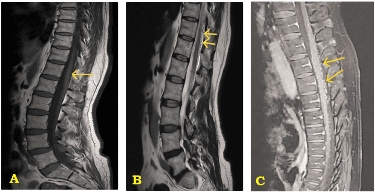
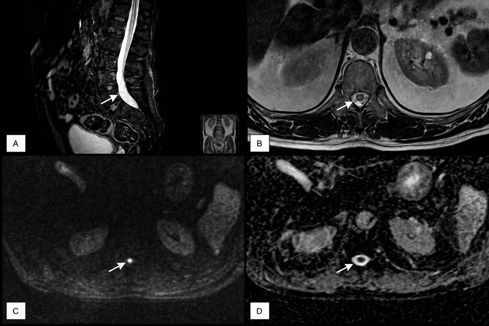
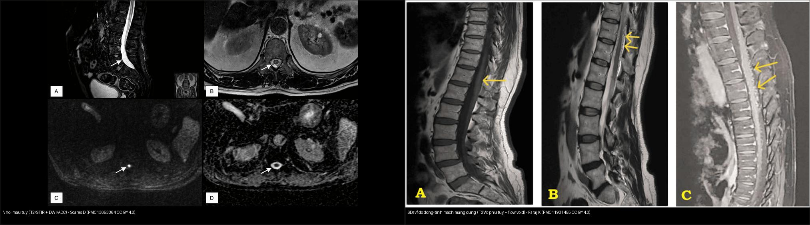
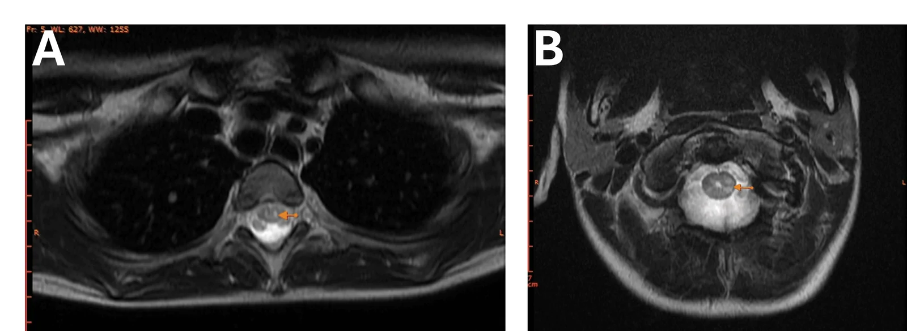
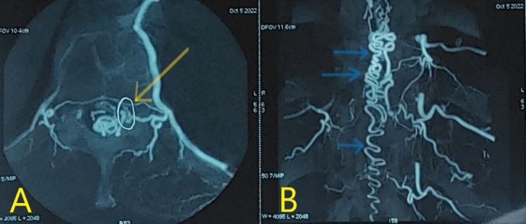
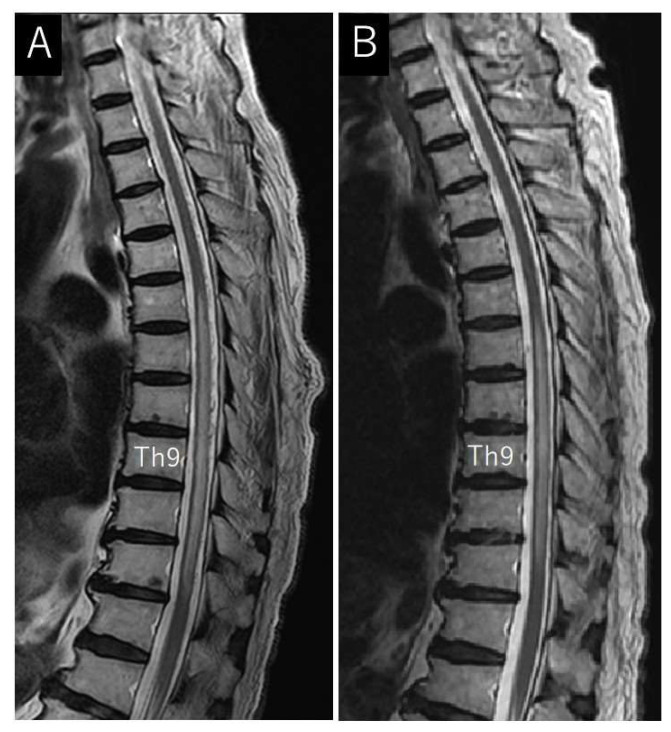
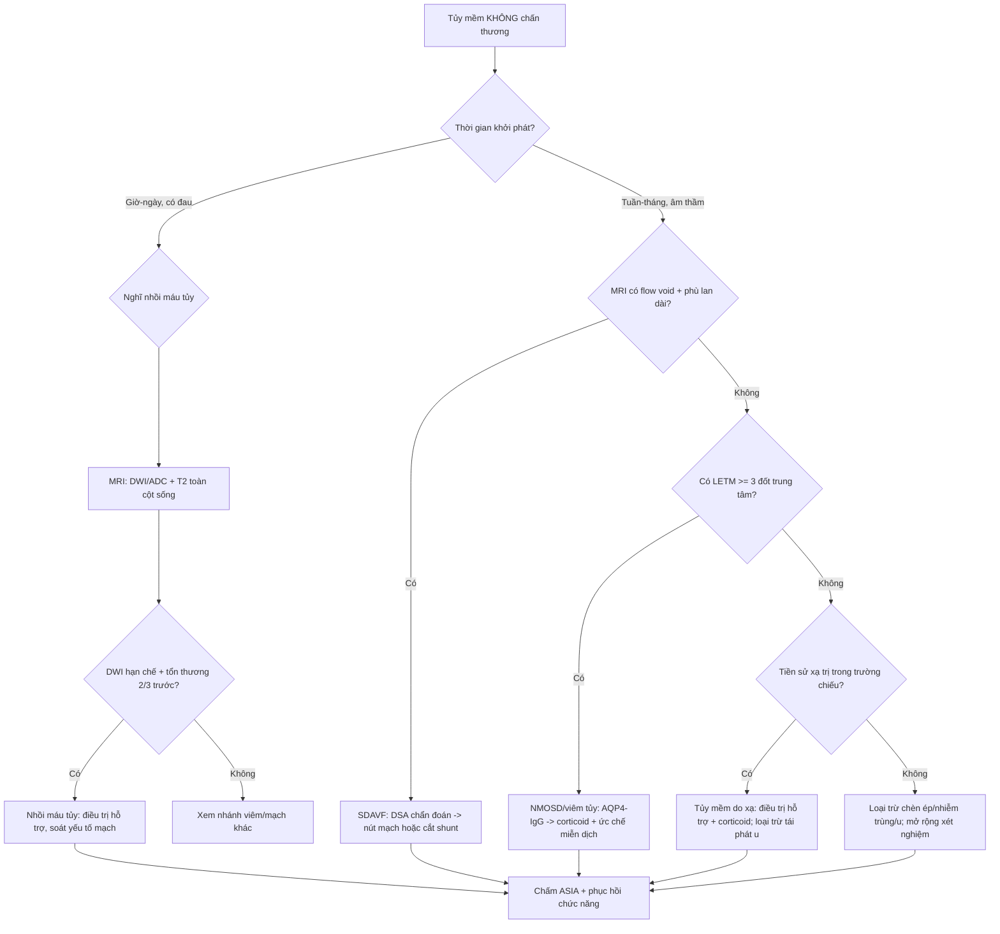
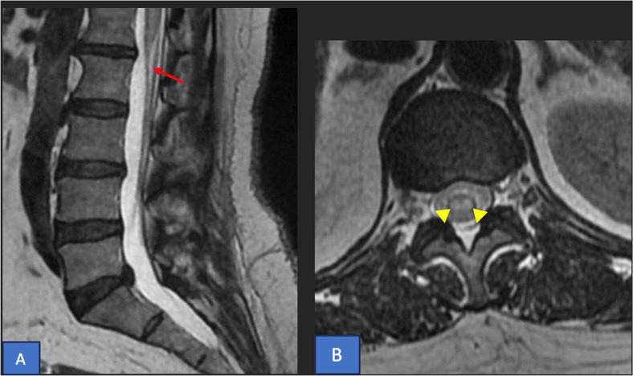
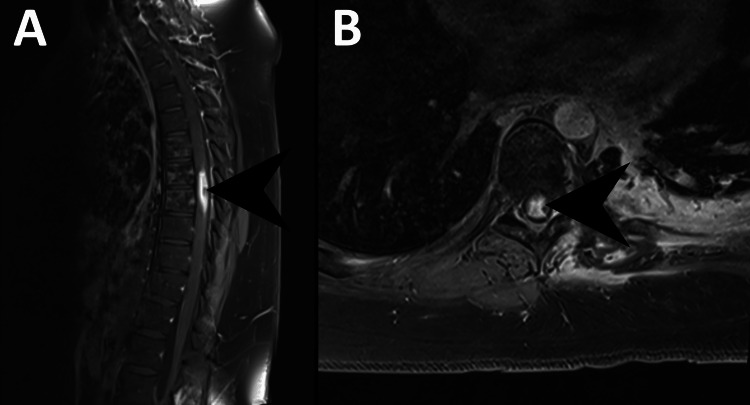

# 226 — Tủy mềm KHÔNG chấn thương: nhồi máu tủy, dò động–tĩnh mạch màng cứng (SDAVF), viêm tủy cấp/NMO & tủy mềm do xạ / Non-traumatic myelopathy

**Tags:** `pattern:tuy-mem` `pattern:nhoi-mau-tuy` `pattern:di-dong-tinh-mach-mang-cung` `pattern:viem-tuy` `pattern:tuy-mem-do-xa` `vung:tuy-song` `score:ASIA` `protocol:MRI-cot-song` `protocol:DSA-tuy`
**Mức chắc chắn (certainty):** tổng hợp y văn (literature synthesis) — tổng hợp từ nghiên cứu đoàn hệ + tổng quan (Tanaka T et al., J Clin Med 2024, PMC10856045), tổng quan đổi tên dấu "snake bite sign" (Arkoudis NA et al., World J Radiol 2025, PMC12308545) và **các ca nguyên văn (verbatim case)** giữ đúng tuổi – lâm sàng – chú thích gốc: SDAVF (Faraj K et al., Cureus 2025, PMC11931455), nhồi máu tủy (Soares D et al., Cureus 2026, PMC13653364; Jabbari C et al., Radiol Case Rep 2026, PMC12886534), NMOSD H-sign ở trẻ (Espinel-Porras JB et al., Cureus 2026, PMC13499930), tủy mềm do xạ (Iftekharuddin A et al., Cureus 2023, PMC10399638).

## 1. Tổng quan — vì sao "tủy mềm" không chấn thương lại khó

- **"Tủy mềm" (myelopathy) là một hội chứng, không phải chẩn đoán.** Biểu hiện lâm sàng (yếu, rối loạn cảm giác, rối loạn cơ vòng) chồng lấp giữa nguyên nhân **mạch máu – viêm – chèn ép – do xạ**. Chìa khóa nằm ở **thời gian khởi phát + phân bố trên MRI**.
- **Bốn nhóm chính của bài này** (đúng gamut của bài toán "tủy mềm không chấn thương"):
  1. **Nhồi máu tủy (spinal cord infarction)** — mạch máu, khởi phát **đột ngột, đau**, tổn thương **2/3 trước** (lãnh thổ động mạch tủy trước).
  2. **Dò động–tĩnh mạch màng cứng tủy (spinal dural arteriovenous fistula — SDAVF)** — mạch máu, **tiến triển mạn tính**, ứ trệ tĩnh mạch; **điều trị được nhưng hay bị chẩn đoán muộn**.
  3. **Viêm tủy cấp / rối loạn phổ mất myelin thị thần kinh (NMOSD)** — tự miễn; **viêm tủy ngang lan dài (LETM) ≥ 3 đốt** + chất xám trung tâm.
  4. **Tủy mềm do xạ (radiation myelopathy)** — biến chứng **muộn sau xạ trị**, tiến triển không hồi phục.
- **TẠI SAO mỗi nhóm cho một chân dung hình ảnh riêng (vật lý + mô bệnh):**
  - **DWI/ADC:** trong **nhồi máu**, phù tế bào (cytotoxic edema) làm nước khuếch tán hạn chế → **DWI sáng + ADC tối** (như đột quỵ não). Viêm/xơ thì ADC **không tối** kiểu này.
  - **Flow void (tín hiệu trống do dòng chảy):** trong SDAVF, các **tĩnh mạch tủy giãn, dòng chảy nhanh** tạo các **đường/túi tín hiệu TRỐNG hình con rắn ở mặt sau tủy** trên T2/T1 — dấu hiệu "dòng chảy".
  - **T2 tăng lan dài + tăng sau tiêm:** phù và ứ trệ tĩnh mạch (SDAVF) tăng tín hiệu T2 **từ nón tủy ngược lên** và **ngấm thuốc dạng đốm/mảnh**; NMOSD tổn thương **chất xám trung tâm** (đặc trưng H-sign) kèm tổn thương **area postrema**.
- **Số liệu định lượng nằm lòng:**
  - **SDAVF:** là **dị dạng mạch tủy gặp nhất**; thường ở **nam cao tuổi**, vùng **ngực–thắt lưng**; shunt nằm **trong màng cứng cạnh rễ** (động mạch tủy–rễ → tĩnh mạch rễ) → **tăng áp lực tĩnh mạch tủy** → ứ trệ → tê yếu tiến triển + rối loạn cơ vòng (Faraj K et al., Cureus 2025, PMC11931455). Tổng quan 965 ca: **nam 71,8–100%**, tuổi trung bình **53,5–71**, **tỷ lệ chẩn đoán sai 17,5–100%**, thời gian từ biểu hiện đầu đến chẩn đoán **~10–15 tháng**, từ hình ảnh đầu tiên có đặc điểm DAVF **9,2–20,7 tháng** (Tanaka T et al., J Clin Med 2024, PMC10856045).
  - **Nhồi máu tủy:** nguyên nhân hiếm của tê yếu cấp nhưng **di chứng/tử vong cao**; lãnh thổ **động mạch tủy trước** chiếm phần lớn; ước tính **~1,2% của mọi đột quỵ**, tần suất **~3,7/100.000**, **tử vong 9–23%** (dùng số liệu tổng quan McDearman JC et al., J Clin Med 2026, PMC13512939 — xem bài `225`).
  - **NMOSD:** tổn thương **LETM ≥ 3 đốt liên tục**, thường **chất xám trung tâm** (H-sign) + **hội chứng area postrema** (nôn/biếc ăn); gắn **kháng thể AQP4-IgG**; ca trẻ 9 tuổi sau COVID-19 có **LETM C1–C6 và T2–T6** (Espinel-Porras JB et al., Cureus 2026, PMC13499930).
  - **Tủy mềm do xạ:** tổn thương chất trắng tủy sau xạ, biểu hiện **muộn (nhiều tuần–tháng)**; ca minh họa: tủy nhận **liều tối đa 35 Gy**, xuất hiện **9 tháng** sau xạ, **không hồi phục** dù corticoid (Iftekharuddin A et al., Cureus 2023, PMC10399638).

*SDAVF ngực–thắt lưng: (A) **tăng tín hiệu T2 lan dài** dọc tủy (mũi tên) do ứ trệ tĩnh mạch; (B) các **đường tín hiệu TRỐNG hình con rắn (flow void)** sau tủy — tĩnh mạch tủy giãn, dòng chảy nhanh; (C) chuỗi tín hiệu bất thường liên tục. Đây là bộ đôi chốt: **phù lan dài + flow void** = nghĩ SDAVF. Faraj K et al., Cureus 2025 (PMC11931455, Fig. 1), CC BY 4.0.*

*Nhồi máu tủy ngực–thắt lưng (thể động mạch tủy trước): (A) **T2/STIR tăng tín hiệu trong tủy** (mũi tên); (B) axial T2 tổn thương phần trước/trung tâm; (C) **DWI hạn chế** (chấm sáng); (D) **ADC tương ứng thấp** — bộ ba xác nhận thiếu máu (khác phù viêm). Soares D et al., Cureus 2026 (PMC13653364, Fig. 1), CC BY 4.0.*

## 2. Mẫu hình + chẩn đoán phân biệt theo thời gian & phân bố (Gamut)

Đọc **hai trục cùng lúc**: **(1) tốc độ khởi phát** (giờ–ngày vs tuần–tháng) và **(2) phân bố trên mặt cắt ngang** (trước / trung tâm / lan dài / cột sau):

- **Khởi phát ĐỘT NGỘT trong giờ–ngày, có đau lưng dữ dội:** nghĩ **nhồi máu tủy** (lãnh thổ động mạch tủy trước). Dấu chốt: **DWI hạn chế + ADC tối** + tổn thương **2/3 trước**. Ở trẻ/người trẻ sau vận động: **nhồi máu do thuyên tắc sụn xơ (fibrocartilaginous embolism) / "surfer's myelopathy"**.
- **Tiến triển ÂM THẦM trong nhiều tuần–tháng, tê–yếu hai chân rồi rối loạn cơ vòng:** nghĩ **SDAVF**. Dấu chốt: **flow void** + **phù T2 lan dài từ nón tủy ngược lên** + **ngấm thuốc**. Khi nghi ngờ → **DSA** là chuẩn xác định shunt.
- **Khởi phát bán cấp, đau, tổn thương LETM:** nghĩ **viêm tủy cấp/NMOSD**. Dấu chốt: **LETM ≥ 3 đốt** + **chất xám trung tâm (H-sign)** + **area postrema**; huyết thanh **AQP4-IgG**.
- **Nhiều tháng sau xạ trị, tiến triển không hồi phục:** nghĩ **tủy mềm do xạ**. Chú ý phân biệt với **tái phát u/đè ép tủy** (pseudoprogression) — cần bối cảnh lâm sàng + sinh thiết nếu không rõ.
- **Gợi nhớ "MAVS — Mạch · Màng (tủy) · Viêm · Sạline":** **M**ạch (infarction, SDAVF) · **A**‑cquired? Hãy nhớ gọn **"V‑I‑R‑X": V**ascular (nhồi máu/SDAVF) · **I**nflammatory (NMOSD/viêm tủy) · **R**adiation (xạ) · (**X** = loại trừ chèn ép u/áp-xe trước mọi hướng dùng thuốc).

## 3. Bảng so sánh phân biệt (ma trận đối chiếu)

| Thực thể (entity) | Hình ảnh điển hình (MRI) | Chốt vào (rule-in) | Chốt loại (rule-out) | Gợi ý xác nhận |
|---|---|---|---|---|
| **Nhồi máu tủy (ASA)** | T2/STIR **tăng 2/3 trước**, "owl's eyes/snake bite" ở sừng trước; **DWI sáng/ADC tối**; thường lệch/một bên | **Khởi phát đột ngột + đau + DWI hạn chế + tổn thương phía trước** | **DWI/ADC không hạn chế + LETM vỏ trung tâm** → nghĩ viêm, không phải nhồi máu | MRI có DWI/ADC sớm; tìm nguồn thuyên tắc (rung nhĩ, bóc tách) |
| **SDAVF** | T2 **phù lan dài từ nón tủy lên** + **flow void** (tĩnh mạch giãn) + **ngấm thuốc đốm** | **Flow void + phù lan dài + tiến triển mạn ở người lớn tuổi** | **Không thấy flow void** thì khó chốt — nhưng **MRI bình thường KHÔNG loại trừ** khi lâm sàng mạnh | **DSA** (chuẩn) + MRI tủy; điều trị nút mạch hoặc mổ cắt shunt |
| **NMOSD / viêm tủy cấp** | **LETM ≥ 3 đốt**, **trung tâm chất xám (H-sign)**, lan vào cột bên; tổn thương **area postrema** (nôn) | **LETM ≥ 3 đốt + H-sign + area postrema + AQP4-IgG (+)** | **Tổn thương < 3 đốt, bờ không lan dài** → nghĩ MS/khác (xem `215`) | Huyết thanh **AQP4-IgG** (và MOG-IgG); MRI não/thị thần kinh |
| **Tủy mềm do xạ** | T2 tăng khu trú/liên tục trong tủy; **ngấm thuốc sau tiêm**; tương ứng **trường chiếu xạ** | **Tiền sử xạ trị + tiến triển nhiều tháng + tổn thương trong trường xạ** | **Không có tiền sử xạ** → loại trừ RM | Đối chiếu bản đồ liều xạ; loại trừ tái phát u (PET/sinh thiết) |

*Trái — **nhồi máu tủy**: T2/STIR + DWI/ADC, tổn thương **phía trước**, DWI hạn chế (thiếu máu). Phải — **SDAVF**: phù T2 **lan dài + flow void** (ứ trệ tĩnh mạch). Cùng nhìn thấy "tủy sáng T2" nhưng **cơ chế và DWI khác hẳn**. Ảnh ghép letterbox giữ tỷ lệ (chỉ ghép 2 ảnh CC BY). Soares D (PMC13653364) + Faraj K (PMC11931455), CC BY 4.0.*

*NMOSD ở trẻ: T2 axial cho thấy **"H-sign"** — tăng tín hiệu T2 **phủ khắp chất xám trung tâm tủy** (không phải vỏ ngoài), phù hợp tổn thương chất xám trung tâm của viêm tủy ngang lan dài. Espinel-Porras JB et al., Cureus 2026 (PMC13499930, Fig. 3), CC BY 4.0.*

### Dấu hiệu đặc trưng cần đọc đúng
- **"Owl's eyes" = "snake eyes" = "snake bite sign":** cùng hiện tượng **hai điểm tăng T2 ở hai sừng trước** của tủy (thương tổn chất xám vận động trong nhồi máu lãnh thổ ASA). Nhóm tác giả đề xuất gọi **"snake bite sign"** vì gợi cơ chế xâm nhập mạch và tránh nhầm với "mắt" trong bệnh khác (Arkoudis NA et al., World J Radiol 2025, PMC12308545). **Không đặc hiệu** — gặp trong nhiều bệnh cảnh; **bối cảnh quyết định**.
- **Flow void quyết định SDAVF:** nếu chỉ có "phù lan dài" mà bỏ qua dải tĩnh mạch giãn, rất dễ nhầm **viêm tủy** → điều trị sai hướng (Tanaka T et al., J Clin Med 2024, PMC10856045).

## 4. Protocol chụp + DSA & lưu đồ

- **MRI toàn cột sống (whole-spine):** **T2W + STIR sagittal** (bắt buộc **tìm flow void** và phù lan dài), **T2W axial** (định vị phân bố: trước/trung tâm/lan dài), **DWI/ADC** (chốt thiếu máu), **T1W sau tiêm gadolinium** (SDAVF/NMOSD/tủy mềm do xạ đều có thể ngấm), **MRA tủy** tầm soát.
- **Bất tử về đọc phim:** **MRI bình thường hoặc không đặc hiệu KHÔNG loại trừ SDAVF khi lâm sàng mạnh về tiến triển mạn** → **DSA** (digital subtraction angiography) là **chuẩn vàng** xác định shunt và mức; đồng thời là **phương tiện điều trị (nút mạch)**.
- **Phân độ lâm sàng:** dùng **ASIA/ISNCSCI** (`223`) để ghi mức và độ khiếm khuyết (thần kinh, không theo hình ảnh).
- **Xử trí sơ bộ theo nhóm:** **nhồi máu tủy** — điều trị hỗ trợ/kiểm soát yếu tố nguy cơ mạch máu; **SDAVF** — **nút mạch/ cắt shunt** (có thể phục hồi chức năng vận động, dáng đi, đi tiểu nếu chẩn đoán sớm); **NMOSD** — corticoid liều cao ± lọc huyết tương + ức chế miễn dịch (AQP4); **tủy mềm do xạ** — hỗ trợ + corticoid (không hồi phục).

*Chụp mạch máu tủy (DSA) trước điều trị: (A) hình axial cho thấy **shunt giữa động mạch tủy–rễ (nhánh từ động mạch liên sườn) và tĩnh mạch rễ**; (B) hình chụp mạch xác định mức. DSA là **chuẩn vàng** bởi không chỉ chẩn đoán mà còn để nút mạch. Faraj K et al., Cureus 2025 (PMC11931455, Fig. 2), CC BY 4.0.*

*So sánh trước–sau điều trị: (A) **trước** — T2W sagittal phù tăng tín hiệu lan dài trong tủy; (B) **sau** — phù thoái triển và **các tĩnh mạch giãn (flow void) mất đi**. Theo dõi bằng MRI T2 là cách đánh giá đáp ứng sau nút mạch/mổ. Tanaka T et al., J Clin Med 2024 (PMC10856045, Fig. 3), CC BY 4.0.*

## 5. Biến thể bình thường và cạm bẫy

- **Cạm bẫy "tăng tín hiệu T2 = viêm":** trong **huyết khối/fistula**, phù ứ trệ trông rất giống viêm tủy. **Luôn tìm flow void + mức độ lan từ nón tủy**. Nếu bỏ sót, bệnh nhân SDAVF mất **cửa sổ vàng phục hồi** (phù lan dài càng lâu, hồi phục càng kém) (Tanaka T et al., PMC10856045).
- **Cạm bẫy "owl's eyes là đặc hiệu cho nhồi máu":** **không** — dấu này cũng gặp trong nhiều bệnh cảnh tủy; hãy gọi nó là **snake bite sign** và dựa vào **DWI/ADC + bối cảnh khởi phát đột ngột** (Arkoudis NA et al., PMC12308545).
- **Cạm bẫy "DWI tủy khó, thấy tối là âm":** DWI cột sống có **nhiễu do dòng dịch não tủy và chuyển động**; DWI có thể **âm tính sớm**. Không loại trừ nhồi máu chỉ vì DWI "chưa dương".
- **Cạm bẫy "tủy mềm do xạ vs tái phát u":** cả hai cùng nằm trong trường xạ, đều ngấm thuốc — cần **bản đồ liều**, diễn tiến thời gian, và **PET/sinh thiết** khi không phân định được.
- **Cạm bẫy "bỏ qua chèn ép":** trước khi kết luận nguyên nhân nội tủy, **bắt buộc loại trừ chèn ép ngoài tủy** (di căn, áp-xe màng cứng, thoát vị) trên toàn cột sống (nối `220`, `222`).
- **Cạm bẫy "NMOSD ≠ MS":** phác đồ khác nhau: **NMOSD tránh một số thuốc đặc hiệu MS** — cần **AQP4-IgG** trước khi xử trí dài hạn (nối `215`).

## 6. Tự lượng giá — Blind Quiz (ảnh trơn ngoài, đáp án trong)

**Ca 1 — Nữ 55 tuổi, đau lưng dữ dội khi làm việc nhà, liệt hai chân trong vài giờ. Đọc T2 axial cột sống:**

- Gợi ý lâm sàng (clinical context): đau khởi phát đột ngột, liệt nhanh trong giờ, sau đó phát hiện rung nhĩ mới.
- Câu hỏi: Dấu hiệu trên axial tên gì? Phân bố tổn thương ở vùng nào? Cơ chế?

<b>Bấm để hiện đáp án (findings + chẩn đoán)</b>

- Dấu hiệu (findings): (A) T2W sagittal **tăng tín hiệu đầu dưới tủy/nón tủy** (mũi tên đỏ); (B) axial T2 **hai điểm sáng ở hai sừng trước** → dấu **"owl's eyes"/"snake bite"**.
- Chẩn đoán (diagnosis): **nhồi máu tủy lãnh thổ động mạch tủy trước (ASA)**; cơ chế **thuyên tắc từ rung nhĩ mới**. Yêu cầu: DWI/ADC xác nhận, soát yếu tố mạch máu (rung nhĩ, bóc tách).
- Nguồn ảnh: Jabbari C et al., Radiol Case Rep 2026 (PMC12886534, Fig. 1), **CC BY-NC-ND 4.0 — nguyên bản, không crop/ghép**.

**Ca 2 — Bệnh nhân tăng tín hiệu T2 lan dài trong tủy + "đường sáng" ngoằn ngoèo sau tủy. Đọc MRI:**

- Gợi ý lâm sàng: nam lớn tuổi, tê–yếu hai chân tiến triển nhiều tháng, rối loạn cơ vòng.
- Câu hỏi: Dấu hiệu "đường sáng" sau tủy là gì? Chẩn đoán? Bước xác nhận và điều trị?

<b>Bấm để hiện đáp án (findings + chẩn đoán)</b>

- Dấu hiệu (findings): phù **tăng tín hiệu T2 lan dài** trong tủy + **nhiều tĩnh mạch giãn (flow void)** ở mặt sau tủy.
- Chẩn đoán (diagnosis): **SDAVF** — ứ trệ tĩnh mạch tủy. Xác nhận bằng **DSA**; điều trị **nút mạch/cắt shunt**. MRI **phù lan dài + flow void** là bộ đôi chốt; chẩn đoán muộn **10–15 tháng** làm giảm khả năng hồi phục.
- Nguồn ảnh: Faraj K et al., Cureus 2025 (PMC11931455, Fig. 1), CC BY 4.0.

**Ca 3 — Bệnh nhân nhiều tháng sau xạ trị ngực, yếu–tê chi dưới. Đọc MRI sau tiêm:**

- Gợi ý lâm sàng: tiền sử xạ trị vào ngực, triệu chứng xuất hiện muộn (nhiều tháng).
- Câu hỏi: Dấu hiệu chính? Phân biệt với gì? Tiên lượng?

<b>Bấm để hiện đáp án (findings + chẩn đoán)</b>

- Dấu hiệu (findings): **ngấm thuốc sau tiêm** dọc tủy (mũi tên) trong trường chiếu xạ; T2 tăng tín hiệu tương ứng.
- Chẩn đoán (diagnosis): **tủy mềm do xạ (radiation myelopathy)** — ca minh họa tủy nhận **liều tối đa 35 Gy**, xuất hiện **9 tháng** sau xạ; điều trị bằng **corticoid** giảm phù nhưng **không hồi phục**. Cần **loại trừ tái phát u/đè ép**.
- Nguồn ảnh: Iftekharuddin A et al., Cureus 2023 (PMC10399638, Fig. 3), CC BY 3.0.

**Ca 4 — Trẻ sau COVID-19, nôn kéo dài rồi yếu chi + LETM. Đọc T2 axial:**

- Gợi ý lâm sàng: hội chứng area postrema (nôn) + tổn thương tủy lan dài.
- Câu hỏi: Dấu hiệu này tên gì? Vùng tổn thương? Hướng xét nghiệm/điều trị?

<b>Bấm để hiện đáp án (findings + chẩn đoán)</b>

- Dấu hiệu (findings): **"H-sign"** — tăng tín hiệu T2 phủ **chất xám trung tâm tủy**; kèm **LETM C1–C6 và T2–T6**.
- Chẩn đoán (diagnosis): **NMOSD** (AQP4-IgG dương trong ca gốc). Xử trí: **corticoid liều cao ± lọc huyết tương** + ức chế miễn dịch; phân biệt với **MS** (xem `215`).
- Nguồn ảnh: Espinel-Porras JB et al., Cureus 2026 (PMC13499930, Fig. 3), CC BY 4.0.

## Bài liên quan chéo
- [200 – Tổng quan Hệ Thần kinh](../200-tong-quan-he-than-kinh/lesson.md) (bảng DDx)
- [223 – Chấn thương tủy sống: ASIA & SCIWORA](../223-chan-thuong-tuy-so/lesson.md) (chấm AIS, phù vs xuất huyết tủy)
- [225 – Hội chứng tủy không hoàn toàn](../225-hoi-chung-tuy-khong-hoan-toan/lesson.md) (tủy trước/ASA, tủy trung tâm)
- [220 – Ống sống 3 khoang](../220-ong-song-tuy/lesson.md) (loại trừ chèn ép ngoài tủy)
- [215 – Bệnh lý mất myelin (MS/NMOSD/ADEM)](../215-mat-myelin/lesson.md) (LETM, AQP4-IgG)
- [222 – Viêm đốt sống](../222-viem-dot-song/lesson.md) (áp-xe màng cứng/viêm đĩa–đốt sống)

## Ảnh
- `images/226_sdavf_MRI_PMC11931455-Fig1-CCBY.jpg` — SDAVF: phù lan dài + flow void (CC BY 4.0).
- `images/226_sdavf_DSA_PMC11931455-Fig2-CCBY.jpg` — DSA tủy: shunt (CC BY 4.0).
- `images/226_sdavf-truoc-sau_MRI_PMC10856045-Fig3-CCBY.jpg` — SDAVF trước–sau điều trị (CC BY 4.0).
- `images/226_nhoi-mau-tuy_MRI_PMC13653364-Fig1-CCBY.webp` — nhồi máu tủy T2/STIR + DWI/ADC (CC BY 4.0).
- `images/226_mat-cat-chuot_MRI_PMC12886534-Fig1-CCBYNCND.jpg` — owl's eyes ở nón tủy (CC BY-NC-ND 4.0, nguyên bản).
- `images/226_dau-ran-can_MRI_PMC12308545-Fig1-CCBYNC.jpg` — snake bite sign (CC BY-NC 4.0, nguyên bản).
- `images/226_nmo-h-sign_MRI_PMC13499930-Fig3-CCBY.webp` — H-sign trong NMOSD (CC BY 4.0).
- `images/226_tuy-mem-do-xa_MRI_PMC10399638-Fig3-CCBY.jpg` — tủy mềm do xạ (CC BY 3.0).
- `images/composite_226_nhoi-mau-tuy-vs-sdavf.jpg` — ảnh ghép so sánh nhồi máu tủy vs SDAVF (chỉ ghép ảnh CC BY).
- Nguồn + giấy phép đầy đủ: `images/CREDITS.md`; link gốc: `sources.md`.

> Không dùng để chẩn đoán độc lập khi chưa có người hướng dẫn.
