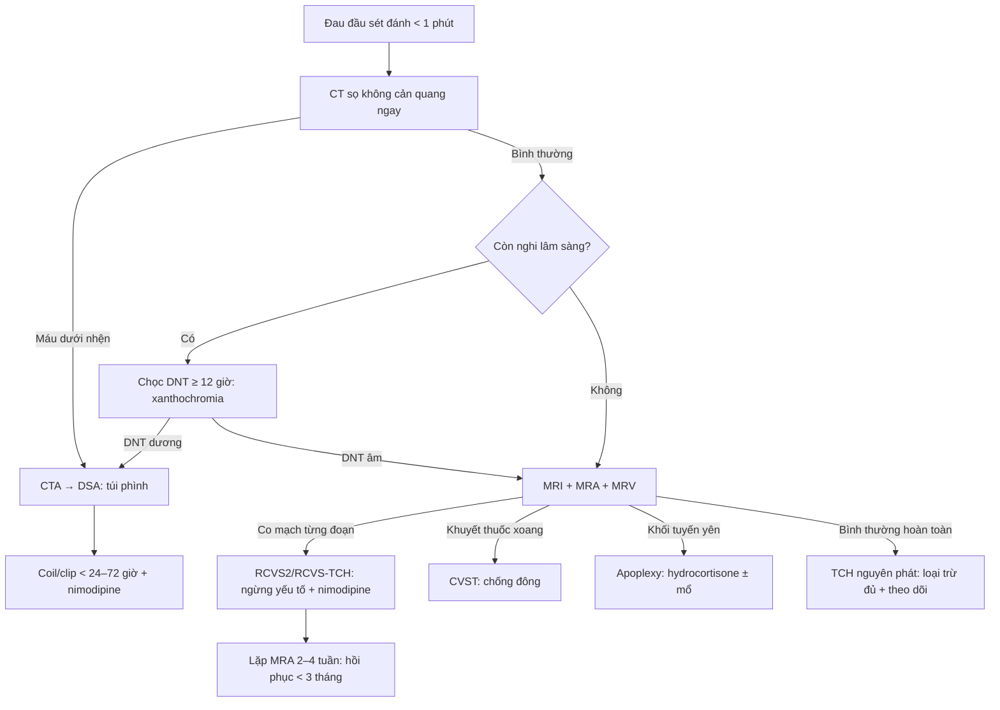

# 227 — Đau đầu sét đánh: tiếp cận cấp cứu & phân biệt SAH / RCVS / CVST / u tuyến yên / bóc tách / TCH nguyên phát / Thunderclap headache: emergency approach & differential diagnosis

**Tags:** `pattern:dau-dau-set-danh` `pattern:xuat-huyet-duoi-nhen` `pattern:co-mach-nao` `vung:nao` `score:RCVS2` `score:RCVS-TCH` `protocol:CT-CTA-MRV` `protocol:choc-dong`
**Mức chắc chắn (certainty):** tổng hợp y văn (literature synthesis) — số liệu lấy từ bài tổng quan RCVS 2026 (PMC13142216), tổng quan SAH 2026 (PMC13121685) và ca SAH có ảnh CT (PMC11112413); **các ca trong quiz là ca nguyên văn (verbatim case)**, giữ đúng tuổi – bối cảnh – chú thích gốc.

## 1. Tổng quan bệnh học – cơ chế hình ảnh (TẠI SAO)

- **Đau đầu sét đánh (thunderclap headache, TCH)** là **triệu chứng**, không phải chẩn đoán: đau đầu dữ dội đạt **đỉnh trong < 1 phút** (ICHD-3: < 60 giây), thường là “đau đầu tệ nhất đời”. Vì vậy mỗi ca TCH là một **cấp cứu chẩn đoán**, không được cho về chỉ vì “đau đầu”.
- **TẠI SAO CT không cản quang thấy máu:** máu tụ cấp đặc **60–80 HU**, trong khi dịch não tủy (DNT) **0–15 HU** và nhu mô não **35–40 HU** → máu trong bể nền/rãnh cuộn não hiện **tăng đậm độ trắng** trên CT. Độ nhạy **> 95% trong 24 giờ đầu**, nhưng **giảm dần theo thời gian** vì hồng cầu ly giải, máu bị pha loãng và rửa trôi (Shen H et al., Mol Biomed 2026, PMC13121685).
- **Vì sao vẫn bỏ sót SAH tới ~50%:** đau đầu có thể tự giảm (“sentinel headache” — đau cảnh báo trước vỡ phình 2–8 tuần), CT quá sớm hoặc quá muộn, và **không chọc DNT khi CT âm nhưng lâm sàng còn nghi**. Chẩn đoán SAH là chẩn đoán **loại trừ có hệ thống**, không phải “CT âm là xong”.
- **RCVS (reversible cerebral vasoconstriction syndrome)** — nguyên nhân TCH quan trọng thứ hai sau SAH: **đau đầu sét đánh tái diễn** + **co mạch từng đoạn đa ổ** của động mạch não, **hồi phục trong 3 tháng**. TCH gặp ở **95–100%** bệnh nhân RCVS; ở **76–85%** đó là biểu hiện **duy nhất**. Tần suất ước tính **3 ca/triệu người/năm** (PMC13142216).
- **TẠI SAO RCVS gây tổn thương nhu mô:** co mạch → giảm tưới máu → thiếu máu vùng chuyển tiếp; đồng thời rối loạn tự điều hòa + tăng tính thấm hàng rào máu-não → **phù mạch máu** (FLAIR tăng, DWI âm/ADC tăng) và có thể **xuất huyết dưới nhện lồi (convexity SAH)**, **xuất huyết nhu mô**, **nhồi máu** (DWI sáng/ADC tối). Vì vậy RCVS **không “lành tính tuyệt đối”**.
- **TẠI SAO MRA/CTA có thể bình thường:** co mạch tiến triển **từ trung tâm ra ngoại vi**, nên tuần đầu MRA/CTA có thể âm; **DSA là tiêu chuẩn vàng** và có thể thấy co mạch động học (giãn sau tiêm thuốc giãn mạch nội động mạch).
- **Ngưỡng định lượng nằm lòng:**
  - **RCVS2 ≥ 5:** độ nhạy **90%**, độ đặc hiệu **99%** cho RCVS; **RCVS2 ≤ 2:** đặc hiệu **100%**, độ nhạy **85%** để loại RCVS (PMC13142216).
  - **RCVS-TCH ≥ 7:** độ nhạy **80%**, độ đặc hiệu **97%** phân biệt RCVS với chẩn đoán khác — nhưng **không thay thế** việc loại trừ SAH.
  - **SAH:** CT **> 95%** trong 24 giờ đầu; khoảng **15%** không tìm thấy nguồn chảy máu trên DSA; tỷ lệ chẩn đoán sai ước tính **50%** (PMC13121685).
  - **Bóc tách động mạch cổ/đốt sống** gặp ở **~8%** bệnh nhân RCVS trong các cohort Pháp (PMC13142216) — luôn khảo sát mạch cổ, không chỉ mạch nội sọ.

*Sơ đồ cơ chế: thuốc ức chế miễn dịch, tăng huyết áp, thuốc giao cảm → rối loạn nội mô, tăng hoạt giao cảm, stress oxy hóa → tăng tính thấm hàng rào máu-não (phù mạch máu, máu tụ thùy, SAH lồi) và rối loạn tự điều hòa (co mạch đa ổ → thiếu máu). Nguồn: de Sousa ÍA et al., Headache 2026 (PMC13142216), Fig. 2, CC BY 4.0.*

## 2. Mẫu hình + chẩn đoán phân biệt theo bối cảnh (Gamut)

- **Nhóm mạch máu – nguy hiểm nhất:**
  - **SAH do vỡ phình (aneurysmal SAH):** TCH + cứng gáy + nôn; CT máu bể nền/rãnh; **CTA → DSA**; nguy cơ vỡ lại cao trong 24–72 giờ đầu.
  - **RCVS:** TCH **tái diễn nhiều lần trong 1–4 tuần**, có yếu tố khởi phát (thuốc co mạch, hậu sản, Valsalva, stress); co mạch “chuỗi hạt” hồi phục.
  - **Huyết khối xoang tĩnh mạch não (CVST):** đau đầu + tăng áp lực nội sọ, co giật, nhìn mờ; **khuyết thuốc xoang (empty delta sign)** trên CTV/MRV — xem bài 216.
  - **Bóc tách động mạch cổ/đốt sống:** đau cổ + đau đầu, Horner, thiếu máu não sau; CTA/MRA cổ.
  - **U tuyến yên chảy máu/nhồi máu (pituitary apoplexy):** TCH + **sụp thị trường/liệt vận nhãn**; CT có thể bỏ sót → MRI tuyến yên.
  - **PRES:** TCH + THA cấp/thuốc ức chế miễn dịch + phù não sau — xem bài 219.
- **Nhóm nhiễm trùng:** viêm màng não cấp (sốt, cứng gáy, rối loạn ý thức) — chọc DNT.
- **Nhóm áp lực DNT:** **hạ áp lực nội sọ tự phát** sau chọc dòng/thủng DNT (đau đầu tư thế đứng).
- **Nhóm lành tính – chẩn đoán loại trừ:** TCH nguyên phát, đau đầu khi ho/Valsalva, đau đầu khi giao hợp, đau đầu khi gắng sức.
- **Mnemonic “V-I-P”:** **V**ascular (SAH, RCVS, CVST, bóc tách, u tuyến yên), **I**nfection (viêm màng não), **P**ressure (hạ áp lực DNT) — cộng nhóm **primary headache** sau khi đã loại trừ.

## 3. Bảng so sánh phân biệt (ma trận đối chiếu)

| Thực thể (entity) | Hình ảnh điển hình | Chốt vào (rule-in) | Chốt loại (rule-out) | Gợi ý xác nhận |
|---|---|---|---|---|
| **SAH do vỡ phình** | CT không cản quang: **máu tăng đậm độ 60–80 HU** ở bể nền/rãnh cuộn não/khe Sylvius; có thể máu não thất | **CT tăng đậm độ khoang dưới nhện + TCH + cứng gáy** | CT bình thường **> 24 giờ** vẫn chưa loại trừ nếu không chọc DNT | CTA/DSA; DNT xanthochromia; điều trị túi phình < 24–72 giờ |
| **RCVS** | **co mạch từng đoạn đa ổ “chuỗi hạt”** trên DSA/MRA; có thể **cSAH lồi**, ICH, nhồi máu vùng chuyển tiếp, phù FLAIR | **TCH tái diễn + yếu tố khởi phát + co mạch đa ổ hồi phục < 3 tháng**; RCVS2 ≥ 5 | Co mạch **một mạch, không hồi phục, ngấm mạnh thành mạch** → xơ vữa/viêm mạch | MRA/CTA lặp 2–4 tuần; DSA; HR-vwMRI |
| **CVST** | **khuyết thuốc xoang** trên CTV/MRV; nhồi máu/xuất huyết tĩnh mạch, không theo lãnh thổ động mạch | **Đau đầu + yếu tố nguy cơ (thai sản, thuốc tránh thai, tăng đông) + khuyết thuốc xoang** | CTV/MRV bình thường hoàn toàn + D-dimer thấp → ít khả năng | CTV/MRV; D-dimer; chống đông |
| **Bóc tách động mạch cổ/đốt sống** | Hẹp **hình nón/đuôi chuột**, flap nội mạc, giả phình trên CTA/MRA cổ | **Đau cổ + Horner + thiếu máu não sau**; flap/giả phình | Mạch cổ bình thường trên CTA/MRA chất lượng tốt | CTA/MRA cổ; siêu âm Doppler; chống đông/kháng kết tập |
| **U tuyến yên chảy máu (pituitary apoplexy)** | Khối tuyến yên **T1 sáng/T2 không đồng nhất** (máu), chèn xoang hang; CT có thể chỉ thấy khối tự nhiên | **TCH + sụp thị trường + liệt vận nhãn** + khối tuyến yên | MRI tuyến yên bình thường + nội tiết bình thường | MRI sella có cản quang; cortisol/PRL/FT4; mổ giải ép nếu nặng |
| **TCH nguyên phát / đau đầu ho–Valsalva–giao hợp** | Không tổn thương trên CT/MRI/MRA/MRV; DNT bình thường | **Tái diễn cùng hoàn cảnh, hình ảnh âm, đã loại trừ thực thể** | Còn bất kỳ dấu hiệu mạch máu/nhiễm trùng → **không** gọi nguyên phát | Theo dõi; ICHD-3; điều trị triệu chứng |

*Trái (A–F): tổn thương nhu mô RCVS — (A) xuất huyết dưới nhện lồi trán trái, (B) xuất huyết nhân bèo trái có máu não thất, (C) FLAIR tăng tín hiệu vùng chẩm hai bên, (D–F) nhiều ổ hạn chế khuếch tán vùng vỏ/dưới vỏ và tiểu não. Phải (A–E): tổn thương mạch — DSA hẹp từng đoạn M1/A1–A2 phải, hẹp nhánh xa, 3D-RA và MRA nhiều ổ hẹp, MRA sau 100 ngày hồi phục. Nguồn: de Sousa ÍA et al., Headache 2026 (PMC13142216), Fig. 3 & Fig. 4, CC BY 4.0; ảnh ghép letterbox giữ nguyên tỷ lệ.*

## 4. Protocol chụp + hệ phân độ/điểm chuẩn hóa

- **Bước 1 — CT sọ không cản quang ngay:** lớp **≤ 5 mm** qua hố sau/bể nền; đọc **bể nền, khe Sylvius, rãnh cuộn não, não thất, nhu mô**. Nếu có máu → **CTA ngay** để tìm túi phình, rồi DSA.
- **Bước 2 — CT âm nhưng còn nghi:** **chọc DNT sau 12 giờ** (không sớm hơn vì máu chưa ly giải đủ): đếm hồng cầu ở 3 ống, **xanthochromia bằng quang phổ kế** (bilirubin đạt đỉnh 48 giờ, tồn tại tới 2 tuần). **Chọc ra máu đỏ đều 3 ống không tự cải thiện** = chọc trúng mạch, không loại trừ SAH.
- **Bước 3 — MRI/MRA + MRV:** nếu CT/DNT âm hoặc cần đánh giá nhu mô: **FLAIR** (máu dưới nhện, phù), **SWI** (vi xuất huyết), **DWI/ADC** (nhồi máu), **MRA** (co mạch), **MRV** (xoang tĩnh mạch). Ở RCVS, **MRA tuần đầu có thể bình thường** → lặp lại sau **2–4 tuần**; DSA khi còn nghi ngờ cao.
- **Bước 4 — RCVS2 (Rocha 2021):** **TCH tái diễn +5**, **yếu tố khởi phát (thuốc co mạch/hậu sản/Valsalva) +3**, **giới nữ +1**, **hẹp động mạch cảnh nội sọ −2**, **SAH lồi +5**; **≥ 5 = RCVS** (Se 90%/Sp 99%). **RCVS-TCH (Cho 2023):** TCH tái diễn +2, nữ +3, yếu tố khởi phát +3 (nhiều yếu tố +2), **tăng huyết áp lúc đau +4**; **≥ 7 = RCVS** (Se 80%/Sp 97%). **Điểm cao không miễn trừ SAH.**
- **Bước 5 — xử trí theo chẩn đoán:**
  - **SAH:** cầm máu túi phình **< 24–72 giờ** (coil/clip), **nimodipine 21 ngày**, kiểm soát huyết áp, dẫn lưu não thất nếu úng thủy.
  - **RCVS:** **ngừng ngay thuốc/yếu tố khởi phát**, **nimodipine** giảm đau, **không dùng corticosteroid** (có thể làm nặng); theo dõi nhồi máu/xuất huyết.
  - **CVST:** **chống đông** (heparin trọng lượng phân tử thấp → kháng vitamin K/DOAC), kể cả khi có xuất huyết nhu mô do tắc tĩnh mạch.
  - **Pituitary apoplexy:** **hydrocortisone ngay** nếu suy thượng thận cấp; mổ giải ép qua xoang bướm khi suy thị lực/liệt vận nhãn nặng.

*Sơ đồ gốc: CT sọ + CT mạch máu (động mạch và tĩnh mạch) là bước đầu; nếu bình thường → chọc DNT; nếu DNT âm → RCVS-TCH; nhánh có bất thường mạch → RCVS2 ≥ 5/≤ 2 hoặc chẩn đoán khác. Nguồn: de Sousa ÍA et al., Headache 2026 (PMC13142216), Fig. 5, CC BY 4.0.*

## 5. Biến thể bình thường và cạm bẫy

- **“Sentinel headache” (đau cảnh báo):** đau đầu dữ dội thoáng qua **2–8 tuần trước** vỡ phình thật; CT lúc này có thể chỉ thấy **máu rất mỏng** hoặc âm → phải chọc DNT/CTA theo nguy cơ, không chờ đau tái diễn.
- **CT quá sớm/quá muộn:** trong **6 giờ đầu** độ nhạy cao nhất; sau **24 giờ** giảm rõ. CT bình thường **không** loại trừ SAH nếu lâm sàng điển hình.
- **Chọc DNT “máu đều 3 ống”:** phân biệt **chọc trúng mạch** (hồng cầu giảm dần, không xanthochromia) với **SAH** (xanthochromia, hồng cầu không giảm rõ). Ly tâm ngay, đo bilirubin bằng **quang phổ kế**, không chỉ nhìn bằng mắt.
- **RCVS bị bỏ sót vì MRA bình thường tuần đầu:** co mạch tiến triển từ gần ra xa; nếu TCH tái diễn + yếu tố khởi phát, **lặp MRA/CTA sau 2–4 tuần** hoặc DSA.
- **Dùng corticosteroid trong RCVS** có thể làm bệnh nặng hơn — **không** điều trị RCVS như viêm mạch/viêm màng não.
- **SAH lồi (convexity SAH) ở RCVS** nằm ở rãnh lồi bán cầu, **không phải bể nền**; đừng nhầm với SAH do vỡ phình và đừng bỏ qua RCVS.
- **Pituitary apoplexy** có thể giống SAH (TCH + nôn + cứng gáy do máu vào khoang dưới nhện) nhưng CT sọ âm; phải **MRI tuyến yên** khi có sụp thị trường/liệt vận nhãn.
- **TCH nguyên phát là chẩn đoán loại trừ:** chỉ chốt sau khi CT/CTA/MRV/DNT âm và không có yếu tố khởi phát mạch máu; theo dõi tái diễn.

## 6. Tự lượng giá — Blind Quiz

**Ca 1 — Nữ 62 tuổi, đau đầu dữ dội đột ngột, cứng gáy. Nhìn CT trước, mô tả máu nằm ở đâu.**

- Gợi ý: không sốt, không chấn thương; khởi phát đỉnh < 1 phút.
- Hỏi: mô tả phân bố máu? Chẩn đoán đầu tay? Bước tiếp theo và nguy cơ cần xử lý ngay?

<b>Bấm để hiện đáp án (findings + chẩn đoán)</b>

- **Findings:** máu tăng đậm độ lan tỏa trong **bể nền, khe Sylvius và rãnh cuộn não**, có máu trong não thất — mẫu hình **SAH lan tỏa** (không phải SAH lồi đơn thuần).
- **Chẩn đoán:** **xuất huyết dưới nhện tự phát (SAH)**, nghĩ vỡ túi phình → **CTA ngay**, rồi **DSA**; cần xử lý túi phình **< 24–72 giờ** và **nimodipine**.
- **Vì sao CT thấy:** huyết khối cấp 60–80 HU tương phản với DNT 0–15 HU.
- **Nguồn ảnh:** Amantakul A et al., Pol J Radiol 2024 (PMC11112413), Fig. 2, CC BY-NC-ND 4.0 — ảnh giữ nguyên bản.

**Ca 2 — Nữ 40 tuổi, nhiều cơn đau đầu sét đánh trong 2 tuần sau sinh. CT/MRI cho thấy tổn thương nhu mô; hỏi cơ chế và chẩn đoán.**

- Gợi ý: đau đầu tái diễn, có yếu tố hậu sản; không sốt.
- Hỏi: có mấy loại tổn thương? Tại sao cùng một bệnh lại vừa xuất huyết vừa nhồi máu?

<b>Bấm để hiện đáp án (findings + chẩn đoán)</b>

- **Findings:** (A) **SAH lồi trán trái**; (B) **xuất huyết nhân bèo trái** có máu não thất; (C) **FLAIR tăng tín hiệu vùng chẩm hai bên** (phù mạch máu); (D–F) **nhiều ổ hạn chế khuếch tán** vùng vỏ/dưới vỏ và tiểu não.
- **Chẩn đoán:** **RCVS có biến chứng** — co mạch gây thiếu máu/nhồi máu và tăng tính thấm gây phù/xuất huyết; SAH lồi là dấu hiệu kinh điển.
- **Cơ chế:** rối loạn tự điều hòa + co mạch từng đoạn → đồng thời thiếu máu (DWI sáng/ADC tối) và phù mạch máu (FLAIR tăng/ADC tăng).
- **Nguồn ảnh:** de Sousa ÍA et al., Headache 2026 (PMC13142216), Fig. 3, CC BY 4.0.

**Ca 3 — Cùng bối cảnh TCH tái diễn; DSA/MRA dưới đây. Dấu hiệu chốt là gì và tiên lượng?**

- Gợi ý: bệnh nhân trẻ, không xơ vữa; đau tái diễn từng cơn.
- Hỏi: mô tả bất thường mạch? Vì sao không gọi là xơ vữa/viêm mạch? Theo dõi bằng gì?

<b>Bấm để hiện đáp án (findings + chẩn đoán)</b>

- **Findings:** (A, B) DSA hẹp **từng đoạn** M1 phải và A1–A2 phải, hẹp nhánh xa; (C) 3D-RA nhiều ổ hẹp; (D) MRA nhiều ổ hẹp hai bên; (E) MRA sau **100 ngày hồi phục**.
- **Chẩn đoán:** **RCVS** — co mạch từng đoạn đa ổ, **hồi phục < 3 tháng**.
- **Chốt loại xơ vữa/viêm mạch:** hẹp **nhiều ổ, từng đoạn, mạch khác nhau**, **hồi phục** trên MRA lặp; xơ vữa thường lệch tâm, không hồi phục; viêm mạch ngấm thành mạch mạnh.
- **Theo dõi:** lặp MRA/CTA sau **2–4 tuần**; DSA nếu còn nghi; theo dõi nhồi máu/xuất huyết.
- **Nguồn ảnh:** de Sousa ÍA et al., Headache 2026 (PMC13142216), Fig. 4, CC BY 4.0.

**Ca 4 — Ghép đối chiếu: nhìn hai ô, xác định bên nào là “tổn thương nhu mô” và bên nào là “tổn thương mạch”; nêu 3 chẩn đoán phân biệt của TCH.**

- Hỏi: dấu hiệu nào giúp phân biệt RCVS với SAH do vỡ phình? Kể 3 nguyên nhân TCH khác cần loại trừ.

<b>Bấm để hiện đáp án (findings + chẩn đoán)</b>

- **Trái:** tổn thương **nhu mô** (cSAH lồi, ICH, phù FLAIR, ổ DWI). **Phải:** tổn thương **mạch** (hẹp từng đoạn “chuỗi hạt”, hồi phục).
- **RCVS vs SAH vỡ phình:** RCVS thường **TCH tái diễn**, máu **lồi (convexity)** lượng ít, **không có túi phình** trên CTA/DSA, co mạch đa ổ hồi phục. SAH vỡ phình: máu **bể nền** nhiều, **túi phình** trên CTA/DSA.
- **3 nguyên nhân khác:** **CVST**, **bóc tách động mạch cổ/đốt sống**, **pituitary apoplexy** (hoặc viêm màng não, hạ áp lực DNT, TCH nguyên phát).
- **Nguồn ảnh:** de Sousa ÍA et al., Headache 2026 (PMC13142216), Fig. 3 & 4, CC BY 4.0; ảnh ghép bằng `tools/make_composite.py`.

## Bài liên quan chéo
- [219 – PRES & RCVS](../219-pres-rcvs/lesson.md) — cơ chế phù mạch máu, RCVS2, biến chứng
- [216 – Dị dạng mạch & CVST](../216-di-dang-mach-CVST/lesson.md) — khuyết thuốc xoang, nhồi máu tĩnh mạch
- [212 – Xuất huyết sọ não](../212-xuat-huyet-so-nao/lesson.md) — phân biệt SAH/IPH/SDH
- [211 – Đột quỵ thiếu máu não](../211-dot-quy-nao/lesson.md) — DWI/ADC, mạch lớn
- [226 – Tủy mềm không chấn thương](../226-tuy-mem-khong-chan-thuong-nhoi-mau-sdavf-nmo-xa/lesson.md) — tiếp cận mạch máu thần kinh

> Không dùng để chẩn đoán độc lập khi chưa có người hướng dẫn.
