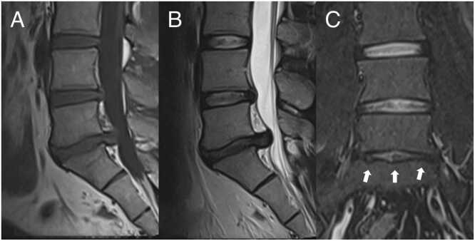
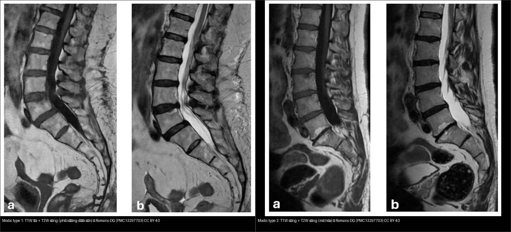
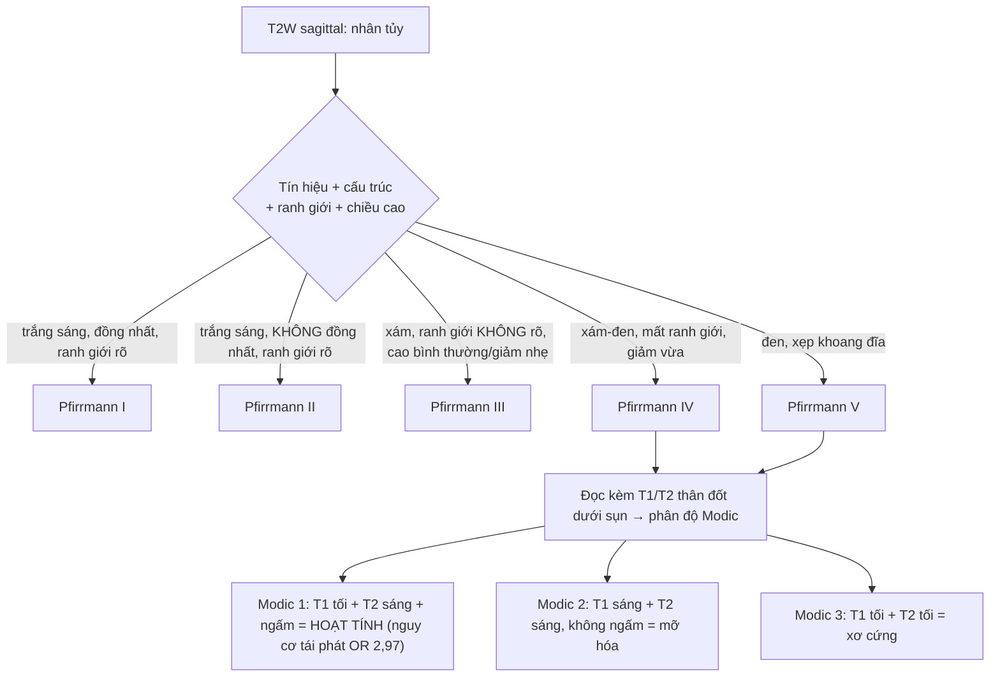
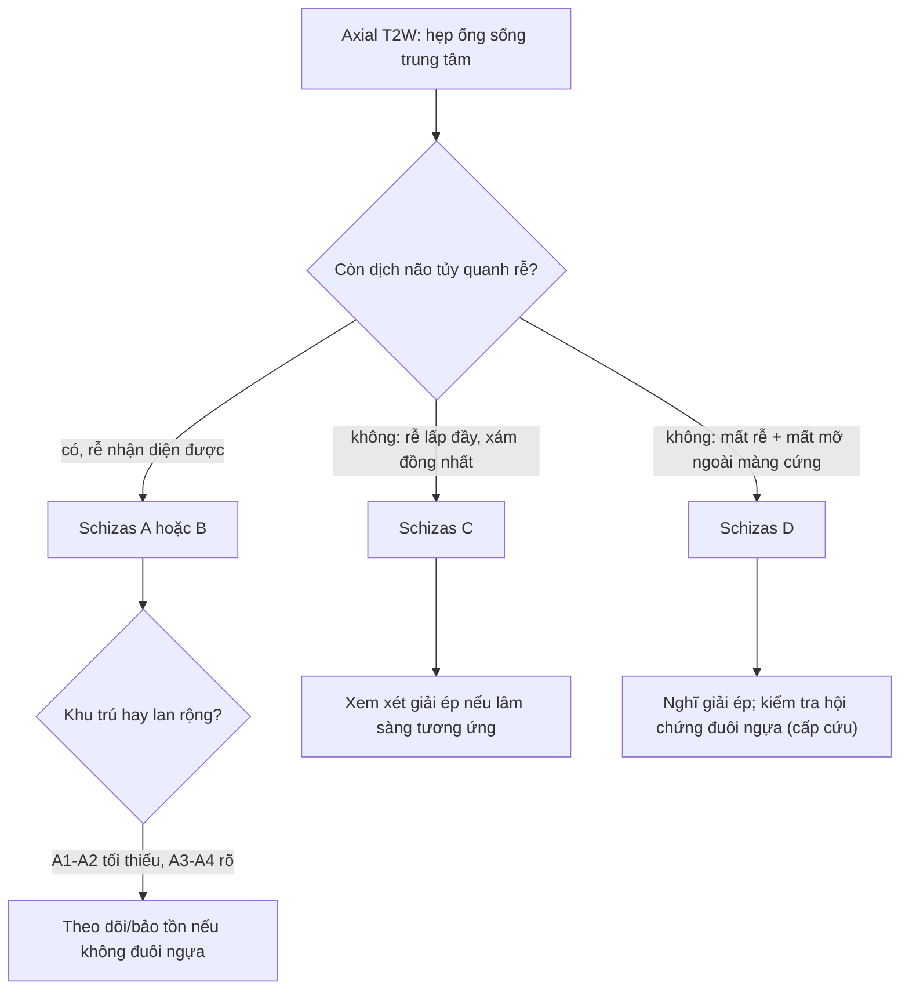
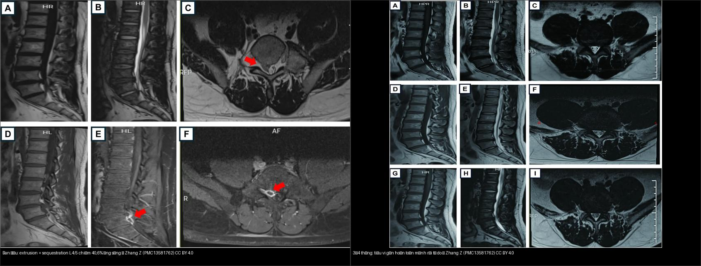

# 228 — Thoát vị đĩa đệm thắt lưng: phân loại hình thái & phân độ Pfirrmann/Modic / Lumbar disc herniation: morphology, Pfirrmann & Modic grading

**Tags:** `pattern:thoat-vi-dia-dem` `pattern:hep-ong-song` `pattern:modic` `pattern:pfirrmann` `vung:cot-song-that-lung` `score:Pfirrmann` `score:Modic` `score:Schizas` `protocol:MRI-cot-song` `incidentaloma:modic`
**Mức chắc chắn (certainty):** tổng hợp y văn (literature synthesis) — tổng hợp từ tổng quan + ca nguyên văn (verbatim case) giữ đúng tuổi – lâm sàng – chú thích gốc: thoát vị di trú gây hội chứng đuôi ngựa (Alshanqity M et al., Cureus 2025, PMC12854390), tiêu vi mảnh rời tự do trên MRI nối tiếp (Zhang Z et al., Front Pain Res 2026, PMC13581762), Pfirrmann + Modic trên cùng chuỗi xung (Korhonen T et al., Eur J Radiol Open 2026, PMC12855554), Modic type 1/2 (Romano DG et al., Diagnostics 2026, PMC13297703).

## 1. Tổng quan — vì sao đĩa đệm "mất nước" lại đổi tín hiệu, và ngưỡng của một thoát vị

- **Giải phẫu chức năng 3 phần:** **vòng sợi ngoài (annulus fibrosus)** dai giữ áp lực, **nhân tủy (nucleus pulposus)** giàu **proteoglycan + nước** như một "gối thủy lực", và **sụn tận cùng (cartilaginous endplate)** làm cửa khuếch tán nuôi đĩa. Đĩa trưởng thành **không có mạch máu** nên dinh dưỡng hoàn toàn nhờ **khuếch tán từ sụn tận cùng** — đây là mấu chốt của mọi thoái hóa.
- **TẠI SAO T2 thấp = đĩa thoái hóa (vật lý học):** tín hiệu T2 của nhân tủy tỉ lệ với **lượng nước tự do liên kết proteoglycan**. Thoái hóa → mất proteoglycan → mất nước → **giảm tín hiệu T2**. Vì vậy **"nhân tủy tối trên T2" là chỉ dấu thay thế cho mức mất nước**, không phải một bệnh riêng.
- **TẠI SAO Pfirrmann có 5 độ:** hệ Pfirrmann (2001) chấm theo **4 biến**: **(1) tín hiệu T2 của nhân tủy**, **(2) cấu trúc (đồng nhất hay không)**, **(3) phân biệt nhân – vòng sợi**, **(4) chiều cao đĩa**. Càng mất nước + càng mất ranh giới + càng xẹp = độ càng cao.
  - **I:** đồng nhất, **trắng sáng**, ranh giới nhân/vòng rõ, chiều cao bình thường.
  - **II:** không đồng nhất, vẫn trắng sáng, ranh giới rõ, chiều cao bình thường.
  - **III:** không đồng nhất, **xám**, ranh giới **không rõ**, chiều cao bình thường–giảm nhẹ.
  - **IV:** không đồng nhất, **xám–đen**, **mất ranh giới**, chiều cao giảm nhẹ–vừa.
  - **V:** không đồng nhất, **đen**, mất ranh giới, **khoang đĩa xẹp**.
  - Có **biến thể 8 độ "cải tiến"** tách nhỏ các độ cao cho người già/đĩa thoái hóa nặng, nhưng vẫn là thang **định tính, phụ thuộc người đọc** (xem `13605291`).
- **TẠI SAO Modic lại đổi tín hiệu theo 3 kiểu (vật lý + mô bệnh học):** Modic mô tả **tủy xương dưới sụn tận cùng** kế cận:
  - **Type 1 — phù/viêm tủy xương:** tăng nước tự do + tăng tính thấm mạch → **T1 THẤP, T2 CAO, ngấm gadolinium**. Là kiểu **"hoạt tính"**, gắn đau lưng và tái phát.
  - **Type 2 — chuyển mỡ:** tủy đỏ → tủy vàng (mỡ). **Mỡ làm ngắn T1** → **T1 CAO, T2 cao/đồng tín hiệu**, **không ngấm**. Là kiểu **ổn định/chuyển hóa mỡ**.
  - **Type 3 — xơ cứng:** xương đặc xơ thay tủy → **T1 THẤP, T2 THẤP**, **không ngấm**.
  - Type 1 và 2 **có thể chuyển đổi qua lại** theo thời gian; **type 1 là kiểu nguy cơ cao** (xem mục 4).
- **Ngưỡng định lượng nằm lòng:**
  - **Định danh "thoát vị" (Fardon/ASNR 2014):** **phình đĩa (bulge)** lan rộng **> 25% chu vi đĩa** và không phải thoát vị; **lồi (protrusion)** khi **đáy rộng hơn mọi đường kính phần thoát ra** (đáy > chiều cao); **thoát ra (extrusion)** khi **đáy hẹp hơn phần thoát ra** (đáy < chiều cao); **mảnh rời (sequestration)** khi mảnh **mất liên tục với đĩa gốc** và có thể **di trú lên/xuống**.
  - **Mức chèn ép ống sống:** ca minh họa mảnh thoát vị **chiếm 40,6% diện tích ống sống** kèm chèn đuôi ngựa (Zhang Z et al., PMC13581762).
  - **Hẹp ống sống trung tâm (kinh điển):** đường kính trước–sau túi màng cứng **< 10 mm = tương đối**, **< 7 mm = tuyệt đối**; diện tích túi màng cứng **< 100 mm²** gợi ý hẹp **tương đối**, **< 75 mm² = nặng**. **Ngách bên (lateral recess)** bị coi là hẹp khi chiều cao **< 3–4 mm**.
  - **Modic type 1 là yếu tố nguy cơ TÁI PHÁT độc lập:** **OR 2,97 (95% CI 2,20–4,01)**; tỷ lệ tái phát chung sau mổ nội soi **12,7%**, vi phẫu **11,4%**, mổ mở **15,3%** (Soliman MAR et al., Neurospine 2026, PMC12890318).

*T2W sagittal: **mảnh thoát vị trung tâm L5–S1 di trú theo trục dọc (cranio-caudal migration)** (mũi tên vàng), chèn ép nặng **đuôi ngựa và hai rễ S1** — hình thái **extrusion + di trú**, tương ứng bệnh cảnh **hội chứng đuôi ngựa** (cấp cứu). Alshanqity M et al., Cureus 2025 (PMC12854390, Fig. 1), CC BY 4.0.*

## 2. Mẫu hình + chẩn đoán phân biệt theo hình thái & vị trí (Gamut)

Đọc **hai trục cùng lúc**: **(1) hình thái** (phình → lồi → thoát ra → mảnh rời) và **(2) vị trí trên mặt cắt ngang** (quyết định rễ nào bị chèn).

- **Hình thái (nhớ "B-P-E-S" = Bulge – Protrusion – Extrusion – Sequestration):**
  - **Bulge** (phình): lan rộng theo chu vi, **không** phải thoát vị thật; thường do thoái hóa đĩa + lỏng lẻo, **hay gặp ở người không triệu chứng**.
  - **Protrusion** (lồi): **đáy rộng hơn phần thoát ra**, vẫn liên tục với đĩa.
  - **Extrusion** (thoát ra): **đáy hẹp hơn phần thoát ra**; có thể **di trú**.
  - **Sequestration** (mảnh rời): mảnh **mất liên tục** với đĩa gốc — **có thể tiêu vi theo thời gian** (xem mục 5).
- **Vị trí mặt cắt ngang — quy tắc "rễ nào bị chèn":**
  - **Trung tâm (central):** túi màng cứng → đuôi ngựa, thường **đái khó, tê yên ngựa, yếu hai chân** (đuôi ngựa).
  - **Cạnh trung tâm / dưới khớp (paracentral / subarticular):** hay gặp nhất ở **L4–L5 và L5–S1**; chèn **rễ đi ngang (traversing root)** — ở L4–L5 là **rễ L5**.
  - **Lỗ liên hợp (foraminal)** và **ngoài lỗ (extraforaminal/far-lateral):** chèn **rễ đi ra (exiting root)** — ở L4–L5 là **rễ L4**.
  - **Mẹo nhớ:** *trung tâm → đuôi ngựa; dưới khớp → rễ "đi ngang"; lỗ/ngoài lỗ → rễ "đi ra".*
- **Bảng gamut theo vị trí chèn ép (giải thích học thuyết thể tích của ống sống):** hẹp **trung tâm** = tổn thương **túi màng cứng** (đuôi ngựa); hẹp **ngách bên** = tổn thương rễ đi ngang; hẹp **lỗ liên hợp** = rễ đi ra. Cùng một "khối thoát vị", **vị trí** quyết định chân dung lâm sàng.
- **Gamut DDx của một "khối ngoài màng cứng trong ống sống":** thoát vị đĩa (đa số), **nang hoạt dịch khớp (facet synovial cyst)**, **di căn ngoài màng cứng**, **áp-xe ngoài màng cứng/viêm đĩa–đốt sống**, **máu tụ ngoài màng cứng**, **giãn tĩnh mạch ngoài màng cứng**.

*T2W axial: **khối thoát vị ra sau** (mũi tên vàng) làm **hẹp nặng ống sống** và **hẹp ngách bên hai bên** — đối chiếu trục (1)&(2): hình thái + vị trí để suy ra rễ bị chèn. Alshanqity M et al., Cureus 2025 (PMC12854390, Fig. 2), CC BY 4.0.*

## 3. Bảng so sánh phân biệt (ma trận đối chiếu)

| Thực thể (entity) | Hình ảnh điển hình | Chốt vào (rule-in) | Chốt loại (rule-out) | Gợi ý xác nhận |
|---|---|---|---|---|
| **Phình đĩa (bulge)** | Lan rộng theo chu vi, bờ trơn, **< 3 mm** ở nhiều tầng | **Lan > 25% chu vi đĩa + không khu trú một điểm** | **Khu trú rõ một điểm + đáy rộng** → lồi (protrusion) | So sánh với mức đĩa trên/dưới; bệnh cảnh lâm sàng |
| **Lồi (protrusion)** | **Đáy rộng hơn phần thoát ra**, còn liên tục | **Đáy > chiều cao khối thoát ra** | **Đáy < chiều cao** → thoát ra (extrusion) | T2 sagittal + axial |
| **Thoát ra (extrusion)** | **Đáy hẹp hơn phần thoát ra**, vẫn liên tục | **Đáy < chiều cao + có/không di trú** | **Mảnh mất liên tục** → mảnh rời (sequestration) | T1/T2 sagittal đa lát |
| **Mảnh rời (sequestration)** | Mảnh **mất liên tục** với đĩa gốc, có thể **di trú** lên/xuống, **viền ngấm mỏng** trên MRI sau tiêm | **Mảnh rời tự do + di trú** (có thể chèn đuôi ngựa) | Còn cầu nối với đĩa → extrusion | MRI ± tiêm; theo dõi T2 (có thể tiêu vi) |
| **Nang hoạt dịch khớp (facet cyst)** | Cấu trúc **dịch (T2 sáng, T1 tối)**, dính mặt sau khớp, ở **ngách bên** | **Có cuống/dính vào bao khớp + tín hiệu dịch đồng nhất** | Có mỡ/calci trong khối → nghĩ u/khác | MRI; tiêm khớp (nếu cần) |
| **Viêm đĩa–đốt sống (discitis-osteomyelitis)** | **Phù tủy hai bên đĩa (Modic type 1 cả hai thân đốt) + ngấm cả đĩa** | **Ngấm thuốc CẢ đĩa + phù hai thân đốt kề + phá hủy** | Chỉ ngấm một thân đốt, chừa đĩa → nghĩ di căn/xẹp lành | MRI + tiêm; CRP/máu; sinh thiết |
| **Di căn ngoài màng cứng** | Khối **ngoài màng cứng**, **chừa đĩa**, phá hủy xương/ngấm mạnh | **Chừa đĩa đệm + tổn thương thân đốt + ngấm** | Còn đĩa nguyên vẹn + tín hiệu đĩa thoái hóa điển hình → thoát vị | MRI tiêm + CT xương; tìm u nguyên phát |

Bảng phân độ **Modic** (đối chiếu trên cùng một chuỗi T1/T2):

| Modic | T1W | T2W | Ngấm thuốc | Ý nghĩa lâm sàng |
|---|---|---|---|---|
| **Type 1** | **Thấp** | **Cao** | **Có** | Phù/viêm tủy xương dưới sụn — **hoạt tính**, gắn đau lưng + **tái phát (OR 2,97)** |
| **Type 2** | **Cao** | Cao/đồng tín hiệu | Không | Chuyển mỡ tủy (ổn định/chuyển hóa) |
| **Type 3** | **Thấp** | **Thấp** | Không | Xơ cứng xương dưới sụn |

Bảng phân độ **Pfirrmann** (T2W sagittal):

| Độ | Tín hiệu nhân tủy | Cấu trúc | Ranh giới nhân–vòng | Chiều cao đĩa |
|---|---|---|---|---|
| **I** | Trắng sáng | Đồng nhất | Rõ | Bình thường |
| **II** | Trắng sáng | Không đồng nhất | Rõ | Bình thường |
| **III** | **Xám** | Không đồng nhất | **Không rõ** | Bình thường–giảm nhẹ |
| **IV** | **Xám–đen** | Không đồng nhất | Mất | Giảm nhẹ–vừa |
| **V** | **Đen** | Không đồng nhất | Mất | **Xẹp khoang đĩa** |

*Cùng một bệnh nhân L5/S1: **(A)** T1W, **(B)** T2W sagittal cho thấy đĩa **Pfirrmann độ 4** (nhân xám–đen, mất ranh giới), **(C)** STIR coronal cho thấy **Modic type 2 hai bên** (tăng tín hiệu mỡ dưới sụn, mũi tên trắng). Đây là mẫu "đọc 2 hệ trên 1 chuỗi xung". Korhonen T et al., Eur J Radiol Open 2026 (PMC12855554, Fig. 1), CC BY 4.0.*

*Trái — **Modic type 1**: T1W **tối** + T2W **sáng** (phù/viêm tủy xương dưới sụn, "hoạt tính"). Phải — **Modic type 2**: T1W **sáng** + T2W sáng (chuyển mỡ). Chỉ khác nhau ở **T1** — vì mỡ làm ngắn T1. Ảnh ghép letterbox giữ tỷ lệ (chỉ ghép 2 ảnh CC BY). Romano DG et al., Diagnostics 2026 (PMC13297703, Fig. 3 & 4), CC BY 4.0.*

## 4. Protocol + hệ phân độ + sơ đồ

- **MRI là chuẩn** (không dùng CT để "chẩn đoán" thoát vị mềm). **Protocol tối thiểu:** **T2W sagittal** (đánh giá Pfirrmann + hình thái + di trú), **T2W axial** (định khu + hẹp ngách/lỗ), **T1W sagittal**, và **STIR** (phát hiện **Modic type 1 hoạt tính** — T2 thường bị "che" bởi mỡ type 2). **Tiêm gadolinium không thường quy**, chỉ khi nghi **mảnh rời/áp-xe/u**.
- **CT:** có giá trị cho **hẹp ống sống do xương** (phì đại diện khớp, vôi hóa dây chằng vàng), **không** thay thế MRI để đọc Pfirrmann/Modic.
- **Phân độ hẹp trung tâm theo Schizas (axial T2W, tỉ lệ dịch não tủy/rễ):** **A** = không/ít hẹp, **còn rõ dịch não tủy** quanh rễ; **B** = hẹp vừa, rễ **lấp đầy** túi nhưng **còn nhận diện từng rễ**; **C** = hẹp nặng, **không còn nhận diện được rễ**, túi **đồng tín hiệu xám**; **D** = hẹp tối đa, **mất cả rễ lẫn mỡ ngoài màng cứng** (Honjoh K et al., J Clin Med 2026, PMC13207235).
- **Modic type 1 là kiểu nguy cơ cao:** là **yếu tố nguy cơ tái phát thoát vị độc lập (OR 2,97; 95% CI 2,20–4,01)**; trong khi loại thoát vị (protrusion/extrusion/sequestration), tầng L5–S1 và Pfirrmann cao **không** đạt ý nghĩa (Soliman MAR et al., Neurospine 2026, PMC12890318).

## 5. Biến thể bình thường & cạm bẫy

- **Phình/thoát vị "không triệu chứng" rất hay gặp:** trên MRI người **không đau lưng**, một tỉ lệ lớn có **bulge/protrusion** — **hình ảnh phải khớp lâm sàng**, đừng mổ theo phim.
- **Mảnh rời tự do có thể TIÊU VI:** theo dõi chuỗi MRI, mảnh **sequestration L4/5 chiếm 40,6% ống sống** đã **tiêu vi gần hoàn toàn (~3 tháng) rồi hoàn toàn (~4 tháng)** dưới điều trị bảo tồn (Zhang Z et al., PMC13581762) — **"khối ngoài màng cứng mới xuất hiện + ngấm viền" có thể là mảnh rời đang tiêu vi, KHÔNG phải u/áp-xe**.
- **Mảnh rời di trú:** mảnh có thể **di trú lên/xuống** (như ca PMC12854390) và **chèn đuôi ngựa** — luôn xem **nhiều lát sagittal T2**, đừng chỉ đọc lát ở tầng đĩa.
- **Khe nứt vòng sợi (annular fissure) + HIZ:** vùng **tăng tín hiệu T2 ở vòng sợi sau** ("high-intensity zone") **không đồng nghĩa với thoát vị** — đó là **rách vòng sợi**; chỉ gọi thoát vị khi có **dịch chuyển chất đĩa ra ngoài ranh giới đĩa**.
- **Hiện tượng chân không (vacuum phenomenon):** khí trong đĩa gây **tín hiệu trống mọi chuỗi**, dễ đọc nhầm "mảnh rời tối" — đối chiếu CT thấy khí (đậm độ khí).
- **Cạm bẫy mặt cắt ngang — rễ dính (conjoined nerve root) & rễ dị vị:** bờ rễ dày bất thường ở ngách bên có thể **giả khối thoát vị**; dùng **chuỗi T2 axial nhiều lát + coronal** để theo dõi rễ.
- **Modic "type 1 cả hai bên đĩa" là cờ đỏ của viêm đĩa–đốt sống** (ngấm cả đĩa) — **không** được nhầm với thoái hóa Modic type 1 đơn thuần; ca đó phải loại trừ nhiễm trùng (xem bài `222`).
- **Cạm bẫy hình học kinh điển (hệ ống sống):** một "khối ngoài màng cứng" cần được **định khu theo 3 khoang** (ngoài màng cứng/trong màng cứng–ngoài tủy/nội tủy) trước khi chốt nguyên nhân (xem bài `220`).

## 6. Tự lượng giá — Blind Quiz

**Ca 1 — Nam vận động viên, đau lưng cấp sau nâng tạ, yếu hai chân + đái khó. Nhìn phim sagittal, mô tả trước.**

- Hỏi: hình thái thoát vị? tầng nào? có dấu hiệu gì trong ống sống? đây là cấp cứu gì?

<b>Bấm để hiện đáp án</b>

- **Thoát vị thể extension có di trú trục dọc (cranio-caudal migration)** ở **L5–S1**, mảnh lớn **trung tâm** chèn ép **đuôi ngựa và hai rễ S1**.
- Bệnh cảnh **hội chứng đuôi ngựa (cauda equina syndrome)** — **cấp cứu phẫu thuật** (đái khó, tê yên ngựa, yếu hai chân).
- T2 axial đối chiếu:
  
  **Lồi/thoát vị ra sau làm hẹp nặng ống sống + hẹp ngách bên hai bên.**
- Nguồn ca nguyên văn: Alshanqity M et al., Cureus 2025 (PMC12854390), CC BY 4.0. Phản biện: đây là ca **nặng, không điển hình về cơ chế** (chấn thương do nâng tạ ở nữ vận động viên) — nhưng hình thái **extrusion + di trú** là điển hình.

**Ca 2 — BN 34 tuổi, đau thắt lưng mạn. Đọc chuỗi xung và chấm 2 hệ phân độ:**

- Hỏi: Pfirrmann mấy độ? Modic kiểu nào? vì sao?

<b>Bấm để hiện đáp án</b>

- **(A/B)** đĩa L5/S1 **nhân xám–đen, mất ranh giới nhân–vòng, chiều cao giảm** → **Pfirrmann độ 4**.
- **(C)** STIR coronal: **tăng tín hiệu dưới sụn hai bên** (mũi tên trắng) → **Modic type 2** (tín hiệu mỡ; nếu là type 1 sẽ tối trên T1W).
- **Bài học:** **Pfirrmann = T2 nhân tủy; Modic = T1/T2 tủy xương dưới sụn.** Hai hệ **độc lập**, đọc cùng lúc.
- Nguồn ca: Korhonen T et al., Eur J Radiol Open 2026 (PMC12855554, Fig. 1), CC BY 4.0.

**Ca 3 — Hai bệnh nhân khác nhau, cùng "vệt bất thường dưới sụn". Đọc T1 trước, T2 sau:**

- Hỏi: bên nào "hoạt tính"? dấu hiệu quyết định nằm ở chuỗi nào? ý nghĩa lâm sàng?

<b>Bấm để hiện đáp án</b>

- Trái = **Modic type 1** (**T1 tối** + T2 sáng) = **phù/viêm tủy xương dưới sụn, HOẠT TÍNH** — gắn đau lưng và **nguy cơ tái phát cao (OR 2,97)**.
- Phải = **Modic type 2** (**T1 sáng** + T2 sáng) = chuyển mỡ, kiểu ổn định.
- **Chốt phân biệt nằm ở T1W** (mỡ làm ngắn T1 → sáng). Nếu chỉ có T2 sẽ dễ nhầm.
- Nguồn: Romano DG et al., Diagnostics 2026 (PMC13297703), CC BY 4.0.

**Ca 4 — Nam 45 tuổi, đau chân L4/5, được theo dõi bảo tồn. Nhìn baseline và phim lại:**

- Hỏi: tổn thương ban đầu là gì? điều gì xảy ra ở phim lại? cạm bẫy?

<b>Bấm để hiện đáp án</b>

- Baseline: **extrusion + mảnh rời (sequestration) L4/5**, chiếm **40,6% ống sống**.
- Phim lại **~3–4 tháng**: mảnh rời **tiêu vi gần hoàn toàn rồi hoàn toàn** — **hiện tượng tiêu vi tự nhiên của mảnh rời**.
- **Cạm bẫy:** một khối ngoài màng cứng **mới** kèm **ngấm viền mỏng** trên MRI có thể là **mảnh rời đang tiêu vi**, **không phải u/áp-xe** — đối chiếu lâm sàng và theo dõi.
- Nguồn ca: Zhang Z et al., Front Pain Res 2026 (PMC13581762), CC BY 4.0.

## Bài liên quan chéo
- [200 – Tổng quan Thần kinh](../200-tong-quan-he-than-kinh/lesson.md)
- [220 – Ống sống 3 khoang](../220-ong-song-tuy/lesson.md) (định khu khối ngoài màng cứng)
- [221 – Chấn thương cột sống](../221-chan-thuong-cot-song/lesson.md)
- [222 – Viêm đốt sống](../222-viem-dot-song/lesson.md) (Modic "type 1 hai bên đĩa" = cờ đỏ nhiễm trùng)
- [223 – Chấn thương tủy sống](../223-chan-thuong-tuy-so/lesson.md) (ASIA, SCIWORA)
- [225 – Hội chứng tủy không hoàn toàn](../225-hoi-chung-tuy-khong-hoan-toan/lesson.md)

> Không dùng để chẩn đoán độc lập khi chưa có người hướng dẫn.
