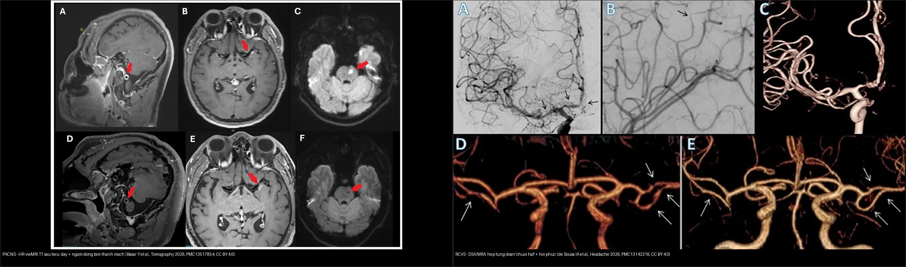
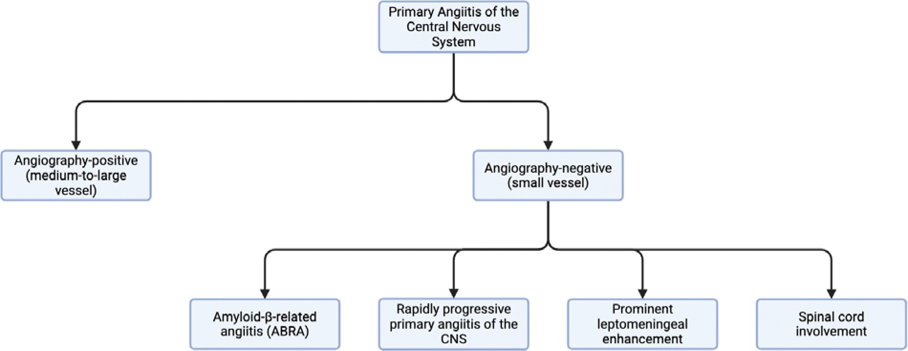
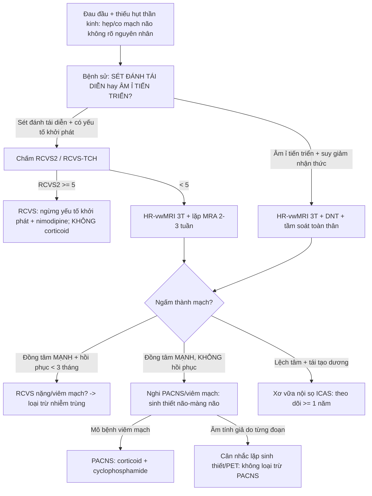
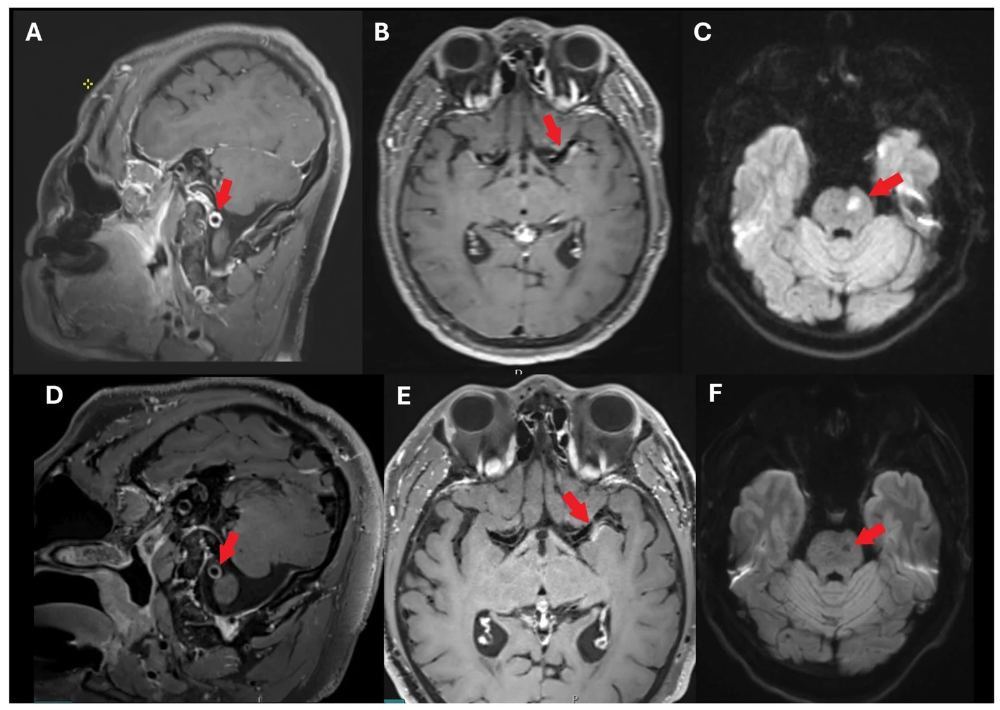
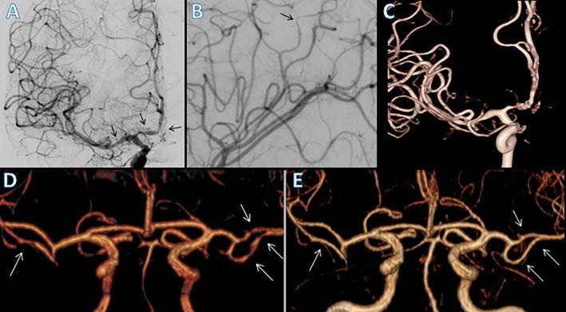
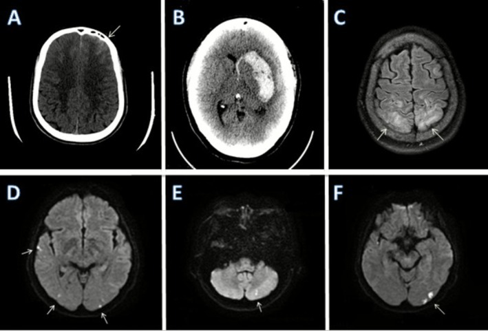
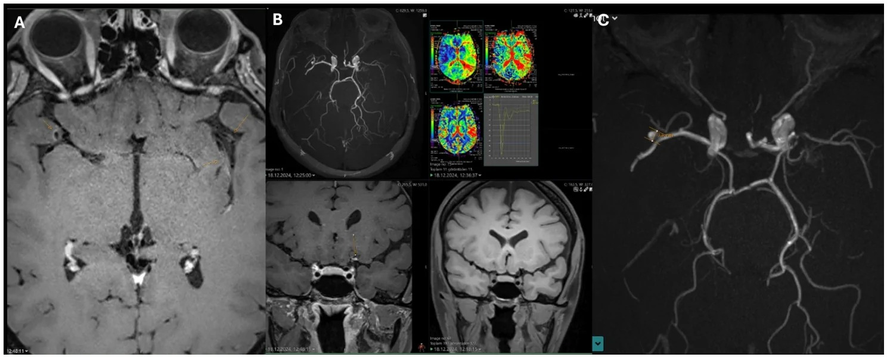

# 229 — Viêm mạch TKTW nguyên phát (PACNS) vs co mạch não có hồi phục (RCVS): hai bệnh "chồng lấp" nhưng điều trị NGƯỢC nhau / Primary angiitis of the CNS (PACNS) vs Reversible cerebral vasoconstriction syndrome (RCVS)

**Tags:** `pattern:co-mach-nao` `pattern:viem-mach-nao` `vung:nao` `vung:mach-nao` `score:RCVS2` `protocol:HR-vwMRI` `protocol:sinh-thiet-nao`
**Mức chắc chắn (certainty):** tổng hợp y văn (literature synthesis) — nhóm tự biên từ y văn mở (JNNP 2025, Tomography 2026, Headache 2026, Ann Neurol 2025, Arch Intern Med Res 2026 CC BY/BY-NC); **các ca trong quiz là ca nguyên văn (verbatim case)** chép đúng tuổi – lâm sàng – chú thích gốc.

## 1. Tổng quan — bệnh học & cơ chế hình ảnh (TẠI SAO)

- **PACNS (primary angiitis of the central nervous system — viêm mạch TKTW nguyên phát):** viêm mạch **mạch máu nhỏ và vừa của não–tủy** mà **KHÔNG có nguyên nhân toàn thân/viêm mạch ngoài não**. Bệnh cảnh kinh điển: đau đầu âm ỉ **tiến triển, thiếu hụt thần kinh khu trú tái diễn, suy giảm nhận thức, đột quỵ nhiều đợt khác lãnh thổ** — chẩn đoán **khó** vì triệu chứng không đặc hiệu. Hai phân nhóm theo cỡ mạch (PMC13052826): **bệnh mạch nhỏ** (chẩn đoán **sinh thiết não**) vs **bệnh mạch vừa–lớn** (chẩn đoán **chụp mạch/sinh thiết**).
- **RCVS (reversible cerebral vasoconstriction syndrome — co mạch não có hồi phục):** **đau đầu sét đánh (thunderclap headache) tái diễn** + **co mạch từng đoạn, đa ổ**, **tự hồi phục trong < 3 tháng**. Sinh lý bệnh: yếu tố khởi phát → **rối loạn chức năng nội mô + tăng hoạt giao cảm + stress oxy hóa** → co mạch & hở hàng rào máu-não (BBB). **Lịch sử: RCVS từng bị chẩn đoán nhầm là PACNS → điều trị ức chế miễn dịch oan** (PMC13142216).
- **TẠI SAO đọc được bản chất mô bằng vật lý (theo Argon):**
  - **HR-vwMRI (high-resolution vessel wall MRI — MRI thành mạch độ phân giải cao), T1 sau tiêm gadolinium:** viêm mạch → thành mạch **dày + ngấm thuốc**. **PACNS: ngấm ĐỒNG TÂM, mạnh, đối xứng quanh lòng mạch** (viêm xuyên toàn bộ thành). **RCVS: ngấm RẤT NHẸ hoặc không ngấm** (rối loạn trương lực cơ, không viêm thành) — đây là **chốt phân biệt cơ chế**. Ngấm **lệch tâm + tái tạo dương** lại là **xơ vữa (atherosclerosis)**.
  - **T2/FLAIR:** phù não **mạch máu (vasogenic)** → T2/FLAIR tăng, **DWI âm + ADC TĂNG**, ưu thế chất trắng dưới vỏ/vùng chuyển tiếp; **DWI sáng + ADC tối = nhồi máu** (phù độc tế bào). RCVS gây phù mạch máu kiểu PRES trong **8–38%** ca.
  - **SWI/GRE:** **xuất huyết dưới nhện LỒI (convexity SAH)/xuất huyết nhu mô** flower thành sắt từ → "blooming" — **thường gặp trong RCVS**, hỗ trợ chẩn đoán.
- **Ngưỡng định lượng nằm lòng (mọi nhận định kèm số/phiên bản):**
  - **PACNS (sinh thiết chứng minh, n=57, PMC12421100):** thể bệnh học **L-PACNS 65%**, **ABRA 16%**, **G-PACNS 14%**, **N-PACNS 5%**; tuổi trung vị **L 47 / ABRA 64,5 / G 37 / N 65 tuổi** (p=0,008). Diễn tiến **đơn pha** ở L-PACNS (65%) và ABRA (75%) nhưng **tái phát–lui bệnh** ở nhóm khác.
  - **PACNS (cohort đa trung tâm, n=163, PMC12542311):** tuổi trung vị **48 (39–59,5)**; **45% nữ**; **18% tử vong, 52% kết cục xấu (mRS 3–6), 50% tái phát**. Yếu tố tiên lượng xấu: **tuổi (HR 1,96/10 năm)**, **thời gian từ khởi phát đến chẩn đoán kéo dài (HR 1,01)**. **Cyclophosphamide ± corticoid giảm tái phát: HR 0,44 / 0,47** so với không điều trị.
  - **PACNS tổng quan (PMC13052826):** tử vong **8–23%**, **~25% tàn phế nặng** dù điều trị; thâm nhiễm **tế bào T nhớ CD45R0+**; điều trị **tấn công corticoid + cyclophosphamide**, duy trì **MMF/rituximab/azathioprine/methotrexate**; sinh thiết **âm tính giả (false-negative)** vì tổn thương **từng đoạn**.
  - **RCVS (tổng quan, PMC13142216):** **~0,2/100.000 ca nhập viện** ở Mỹ, **~75% là nữ**; hẹp mạch **hồi phục tự nhiên < 3 tháng**; phù mạch máu hồi phục trong vài ngày; **convexity SAH** là dấu nhu mô hay gặp; **điều trị: ngừng yếu tố khởi phát + nimodipine** (khởi đầu < 7 ngày có thể giảm co mạch); **tránh glucocorticoid** (nguy cơ làm nặng/thiếu máu).

## 2. Mẫu hình + chẩn đoán phân biệt theo bối cảnh (Gamut)

- **THEO BỆNH SỬ (chìa khóa đầu tiên):**
  - **PACNS:** đau đầu **âm ỉ tăng dần theo tuần–tháng**, **suy giảm nhận thức**, thiếu hụt thần kinh **KÉO DÀI/tái diễn tích lũy**, **không có yếu tố khởi phát cấp**; dịch não tủy (DNT) thường **bất thường** (tăng protein ± tăng tế bào lympho nhẹ).
  - **RCVS:** **đau đầu sét đánh TÁI DIỄN** trong 1–4 tuần (đạt đỉnh, tự khỏi), **có yếu tố khởi phát** (thuốc co mạch cảm cúm/serotonin/triptan/ergot, hậu sản, Valsalva, chấn thương, truyền máu); thiếu hụt **thoáng qua**; DNT **bình thường** (trừ khi có SAH).
- **THEO HÌNH ẢNH:**
  - **Co mạch/hẹp đa ổ "chuỗi hạt":** RCVS · xơ vữa nội sọ (ICAS) · bóc tách · moyamoya · viêm mạch hệ thống (NPSLE, Takayasu) · co mạch sau SAH · loạn sản cơ xơ (FMD).
  - **Ngấm + dày thành mạch đồng tâm:** PACNS · viêm mạch do nhiễm trùng (VZV, lao, nấm) · bệnh mạch máu liên quan IgG4.
  - **Nhồi máu nhiều lãnh thổ + nhồi máu kèm nhồi máu**: PACNS, xơ vữa, bệnh mạch nhỏ.
- **Mnemonic yếu tố khởi phát RCVS (tự soạn):** **"SAD-VAN"** — **S**erotonergic/cảm cúm · **A**fter birth (hậu sản) · **D**rugs (triptan, ergot, immunosuppressant) · **V**alsalva/gắng sức · **A**nemi/truyền máu · **N**hiễm trùng/đối quang.

## 3. Bảng so sánh phân biệt (ma trận đối chiếu)

| Thực thể (entity) | Hình ảnh điển hình | Chốt vào (rule-in) | Chốt loại (rule-out) | Gợi ý xác nhận |
|---|---|---|---|---|
| **PACNS** | Nhiều **nhồi máu nhỏ nhiều lãnh thổ** (hạch nền/chất trắng sâu); **HR-vwMRI: dày + ngấm ĐỒNG TÂM mạnh** thành mạch; hẹp **đa ổ đối xứng, ít gồ ghề** | **Bệnh sử tiến triển + DNT bất thường + HR-vwMRI ngấm đồng tâm mạnh + không yếu tố khởi phát cấp** | **Đau đầu sét đánh tái diễn + ngấm nhẹ/không ngấm + hồi phục < 3 tháng** → RCVS | **Sinh thiết não–màng não** (tiêu chuẩn vàng, âm tính giả vì tổn thương từng đoạn); HR-vwMRI dẫn đường sinh thiết |
| **RCVS** | **Hẹp từng đoạn đa ổ "chuỗi hạt"** (hồi phục < 3 tháng); **convexity SAH**, xuất huyết nhu mô, phù kiểu PRES (8–38%); ngấm thành mạch **nhẹ/không** | **Thunderclap tái diễn + yếu tố khởi phát + co mạch đa ổ + ngấm nhẹ** (RCVS2 ≥ 5 / RCVS-TCH ≥ 7) | Hẹp **một mạch, không hồi phục > 3 tháng, ngấm mạnh đồng tâm** → PACNS/viêm mạch | MRA/CTA + **lặp lại 2–3 tuần**; CE-FLAIR hở BBB; DSA |
| **Xơ vữa nội sọ (ICAS)** | Hẹp **lệch tâm**, **tái tạo dương**, mảng xơ vữa ngấm lệch tâm; **không hồi phục** | **HR-vwMRI: mảng lệch tâm + tái tạo dương + ngấm thành từng ổ** | Ngấm **đồng tâm mạnh + hồi phục** → RCVS/PACNS | HR-vwMRI (T2 + T1 sau tiêm), theo dõi ≥ 1 năm |
| **Bóc tách động mạch nội sọ** | **Vạt nội mạc (intimal flap)** + máu tụ thành mạch; **thường MỘT mạch** | **Vạt nội mạc (42–91%) hoặc máu tụ thành mạch (23–61%)** | Co mạch **đa ổ đối xứng, động học** → RCVS | HR-vwMRI + CTA/MRA; theo dõi động học |
| **Co mạch sau SAH phình mạch** | Co mạch **quanh vị trí chảy máu, một bên**, đỉnh ngày 4–14 | **SAH bể nền/khe Sylvius + co mạch cùng bên tương xứng lượng máu** | **SAH LỒI (convexity) + co mạch đa ổ không tương xứng** → RCVS | CT/DSA + tìm phình mạch; xanthochromia DNT |
| **Moyamoya** | Hẹp **đoạn tận ĐM cảnh trong HAI BÊN** + **"khói thuốc" (puff of smoke)**, không hồi phục | **Hẹp tận ICA tiến triển hai bên + tuần hoàn bàng hệ nền sọ** | Hồi phục < 3 tháng, không bàng hệ nền sọ → RCVS | MRA/DSA; HR-vwMRI (tái tạo âm, ngấm đồng tâm) |
| **Viêm mạch hệ thống (NPSLE, Takayasu)** | Co mạch/hẹp **đa ổ** + **tổn thương ngoài não** (da, thận, ĐMC, mắt) | **Bệnh hệ thống đã biết + tổn thương đa cơ quan + ANA/ANCA dương** | **Không có biểu hiện ngoài TKTW** → hướng PACNS | Xét nghiệm miễn dịch, sinh thiết ngoài não, CTA/MRA toàn thân |

*Trái: **HR-vwMRI T1 sau tiêm** — PACNS: **dày + ngấm ĐỒNG TÂM** thành ĐM (mũi tên đỏ; trên trước điều trị, dưới sau điều trị có thoái triển). Phải: **RCVS** — DSA/MRA **hẹp từng đoạn "chuỗi hạt"** (A, B) và **hồi phục sau 100 ngày** (E). **Ngấm mạnh đồng tâm = viêm (PACNS); hẹp từng đoạn hồi phục + ngấm nhẹ = RCVS.** Ảnh ghép letterbox: Basar Y et al., Tomography 2026 (PMC13517854); de Sousa ÍA et al., Headache 2026 (PMC13142216) — CC BY 4.0.*

### Sơ đồ phân nhóm PACNS theo mô bệnh học (đọc nhanh)
- **L-PACNS (lymphocytic, 65%)** — tổn thương lympho; diễn tiến thường **đơn pha**; tuổi trung vị 47.
- **G-PACNS (granulomatous, 14%)** — u hạt; hay **tái phát–lui bệnh**; tuổi trẻ hơn (37).
- **N-PACNS (necrotising, 5%)** — hoại tử; hiếm, nặng.
- **ABRA (amyloid-beta-related angiitis, 16%)** — liên quan mạch amyloid; **lớn tuổi nhất (64,5)**, có thể chồng lấp xuất huyết não.
> **Chỉ có sinh thiết mới phân biệt được các thể này** → chỉ định sinh thiết khi hình ảnh không chắc và điều trị ức chế miễn dịch dài hạn đang cân nhắc.

*Sơ đồ phân nhóm PACNS theo cỡ mạch và mô bệnh học: **mạch nhỏ** (L-PACNS/G-PACNS/N-PACNS, chẩn đoán bằng **sinh thiết**) vs **mạch vừa–lớn** (chẩn đoán bằng **chụp mạch/biopsy**). Nguồn: Phu A, Agrawal DK, Arch Intern Med Res 2026 (PMC13052826), CC BY 4.0.*

## 4. Protocol chụp + hệ thống điểm & flowchart

- **HR-vwMRI 3T (protocol chuẩn, theo Basar Y et al., PMC13517854):** chuỗi **3D T1 SPACE/VISTA trước và sau tiêm gadolinium** (độ phân giải cao, lát mỏng ≤ 1 mm), **T2W 3D** thành mạch, **TOF-MRA**, ± **tưới máu (perfusion: time-to-peak)**. Chỉ định: co mạch/hẹp **không rõ nguyên nhân**, nghi viêm mạch, **dẫn đường chọn vị trí sinh thiết**.
  - **Đọc HR-vwMRI:** cần phối hợp **hình dạng ngấm** (đồng tâm vs lệch tâm), **hướng** (một ổ vs đa ổ), **mức hồi phục** theo thời gian, và **ý nghĩa huyết động** (TTP trễ ~2 giây ở ca minh họa = tổn thương có ý nghĩa, gợi ý thực thể đang hoạt động cần điều trị).
- **Sinh thiết não–màng não (tiêu chuẩn vàng cho PACNS mạch nhỏ):** tổn thương **từng đoạn** → **âm tính giả thường gặp**; **không cho phép loại trừ PACNS**; biến chứng có thể gặp → **chọn vị trí sinh thiết bằng HR-vwMRI/PET** (vùng ngấm mạnh nhất).
- **Điểm chuẩn hóa (dùng phân biệt RCVS với các bệnh mạch nội sọ):**
  - **RCVS2 score** (CTA): thunderclap tái diễn/đơn **+5** · ĐM cảnh trong nội sọ **−2** · yếu tố khởi phát **+3** · nữ **+1** · SAH **+1**. **≥ 5: Se 90%/Sp 99%** xác định RCVS; **≤ 2: Se 85%/Sp 100%** loại RCVS (PMC12036309).
  - **RCVS-TCH score:** thunderclap tái diễn **+2** · nữ **+3** · THA đột ngột **+4** · yếu tố khởi phát (nhiều **+3** / một **+2**). **≥ 7: Se 80%/Sp 97%**.
- **Xử trí (quyết định sinh tử — HAI HƯỚNG NGƯỢC NHAU):**
  - **PACNS:** **corticoid + cyclophosphamide** (tấn công) → duy trì MMF/rituximab/azathioprine/methotrexate. Không điều trị → nguy cơ tử vong/tàn phế cao.
  - **RCVS:** **ngừng yếu tố khởi phát + nimodipine**; **TRÁNH glucocorticoid** (có thể làm nặng co mạch/thiếu máu). **Chẩn đoán nhầm PACNS = ức chế miễn dịch oan; chẩn đoán nhầm RCVS = bỏ sót viêm mạch tiến triển.**

## 5. Biến thể bình thường và cạm bẫy

- **Đừng điều trị ức chế miễn dịch chỉ vì "co mạch đẹp như viêm mạch":** lịch sử cho thấy nhiều ca RCVS bị chẩn đoán nhầm PACNS → **mở sinh thiết/ức chế miễn dịch oan** (PMC13142216). Bệnh sử **sét đánh tái diễn** là chốt.
- **Sinh thiết âm tính KHÔNG loại trừ PACNS:** mạch bị viêm **từng đoạn** → bỏ sót tổn thương; phải **lấy vùng ngấm mạnh nhất trên HR-vwMRI** và vẫn theo dõi điều trị nếu lâm sàng–hình ảnh mạnh.
- **HR-vwMRI cạm bẫy (theo PMC13517854):** **ngấm thành mạch KHÔNG đồng nghĩa viêm** — ngấm lệch tâm/tái tạo dương gặp ở **xơ vữa**; cần **đối chiếu tưới máu (TTP)** để biết tổn thương có ý nghĩa huyết động; ngấm có thể **thoái triển sau điều trị** (theo dõi là bằng chứng chẩn đoán).
- **RCVS giai đoạn đầu có MRA/CTA BÌNH THƯỜNG** (co mạch đạt đỉnh tuần 2–3) → **"probable RCVS"** (ICHD-3); **lặp mạch 2–3 tuần + CE-FLAIR (hở BBB 69%)**.
- **Giả ảnh MRA ở RCVS** (stair-step, in-plane saturation, venetian blind) → tạo **hẹp giả**; xác nhận bằng MRA cản từ/DSA.
- **Chồng lấp PRES–RCVS–PACNS:** bệnh nhân hậu sản/THA có thể có **cả PRES và RCVS**; "ngấm thành mạch" đơn độc không đủ để chẩn đoán PACNS.
- **Không chốt từ một lần chụp:** đường kính mạch trong RCVS **thay đổi theo thời gian** — luôn so chuỗi theo thời gian.

## 6. Tự lượng giá — Blind Quiz (ảnh trơn ngoài, đáp án trong)

**Ca 1 — Nam 39 tuổi đau đầu + cơn thiếu máu não thoáng qua. Nhìn HR-vwMRI trước–sau điều trị:**

- Gợi ý lâm sàng (clinical context): đau đầu kéo dài, thiếu hụt thần kinh khu trú tái diễn, không có yếu tố khởi phát cấp.
- Câu hỏi: Thành mạch ngấm kiểu gì (đồng tâm hay lệch tâm)? Có mạch hay một ổ? DWI kèm gì? 3 chẩn đoán phân biệt?

<b>Bấm để hiện đáp án (findings + chẩn đoán)</b>

- Dấu hiệu (findings): **dày + ngấm ĐỒNG TÂM** thành ĐM đốt sống V4 phải (A, mũi tên) và hai ĐM não giữa M1 (B) — **nhiều ổ**; DWI có **nhồi máu cấp 12 mm ở cầu não trái bên** (C); sau điều trị **thoái triển** phần lớn (D, E) còn tổn thương **dư bên trái**; DWI lặp có di chứng nhồi máu cũ (F).
- Chẩn đoán (diagnosis): **PACNS (viêm mạch TKTW nguyên phát)** — ngấm **đồng tâm mạnh + nhiều lãnh thổ + không hồi phục hoàn toàn** gợi viêm thành mạch; điều trị **corticoid + cyclophosphamide**. Phân biệt RCVS (hồi phục < 3 tháng, ngấm nhẹ) và xơ vữa (ngấm lệch tâm, tái tạo dương).
- Nguồn ảnh: Basar Y et al., Tomography 2026 (PMC13517854), Fig. 4. CC BY 4.0.

**Ca 2 — Bệnh nhân đau đầu sét đánh, MRA hẹp nhiều ổ; lặp lại sau 100 ngày. Nhìn DSA/MRA:**

- Câu hỏi: Mô tả bất thường mạch và so sánh (D) với (E)? Điều này chốt điều gì?

<b>Bấm để hiện đáp án (findings + chẩn đoán)</b>

- Dấu hiệu (findings): DSA (A) **hẹp từng đoạn M1 MCA phải + A1/A2 ACA phải**; (B) hẹp nhẹ **đoạn xa** (mũi tên đen); (C) 3D-RA co mạch **từng đoạn đa ổ**; (D) MRA nhiều ổ hẹp (mũi tên trắng) → **(E) ĐẢO NGƯỢC/hồi phục sau 100 ngày**.
- Chẩn đoán (diagnosis): **RCVS** — **hẹp đa ổ hồi phục < 3 tháng**. Điều trị **ngừng yếu tố khởi phát + nimodipine**, **tránh corticoid**. Chốt: **"hồi phục" là đặc trưng cơ bản** phân biệt với PACNS/xơ vữa/moyamoya.
- Nguồn ảnh: de Sousa ÍA et al., Headache 2026 (PMC13142216), Fig. 4. CC BY 4.0.

**Ca 3 — Bệnh nhân RCVS: tìm dấu hiệu nhu mô. Nhìn CT/MRI:**

- Câu hỏi: Kể tên các dấu hiệu nhu mô điển hình của RCVS trên ảnh này? Dấu nào hay bị bỏ sót?

<b>Bấm để hiện đáp án (findings + chẩn đoán)</b>

- Dấu hiệu (findings): (A) **SAH LỒI thùy trán trái (convexity SAH)**; (B) **máu tụ hạch nền trái lan vào não thất** (mũi tên trắng); (C) FLAIR **tăng tín hiệu vùng sau hai bên = phù mạch máu**; (D–F) **hạn chế khuếch tán** nhiều ổ vỏ–dưới vỏ–vùng chuyển tiếp (thái dương phải, chẩm hai bên, tiểu não trái).
- Chẩn đoán (diagnosis): **RCVS có biến chứng: convexity SAH + xuất huyết nhu mô + phù kiểu PRES + nhồi máu đa ổ**. **SAH lồi + co mạch đa ổ không tương xứng lượng máu** là chốt (khác co mạch sau SAH bể nền). Lưu ý **phù não hồi phục trong 8–38% ca RCVS**.
- Nguồn ảnh: de Sousa ÍA et al., Headache 2026 (PMC13142216), Fig. 3. CC BY 4.0.

**Ca 4 — Nữ 40 tuổi, nghi viêm mạch nội sọ. Nhìn HR-vwMRI + tưới máu:**

- Câu hỏi: Ngấm thành mạch ở đây **đồng tâm hay lệch tâm**? Tưới máu (C) nói lên điều gì? Nghĩ thực thể nào?

<b>Bấm để hiện đáp án (findings + chẩn đoán)</b>

- Dấu hiệu (findings): (A) HR-vwMRI: **dày + ngấm LỆCH TÂM** tại chạc ĐM cảnh trong trái và M1 gần; (B) chụp lòng mạch: **hẹp nặng M1 trái gần**; (C) tưới máu: **TTP trễ ~2 giây** lãnh thổ MCA trái so với phải = **có ý nghĩa huyết động**; kèm phình túi 4 × 3 mm tại chạc MCA phải.
- Chẩn đoán (diagnosis): **bệnh mạch máu nội sọ dạng viêm/xơ vữa — ngấm LỆCH TÂM gợi XƠ VỮA hơn PACNS** (PACNS ngấm **đồng tâm**). Đây là **cạm bẫy**: ngấm thành mạch **không đồng nghĩa viêm**; cần đối chiếu **hình dạng ngấm + tưới máu (TTP)** và theo dõi. Xử trí khác hẳn PACNS (ức chế miễn dịch) và RCVS (ngừng khởi phát).
- Nguồn ảnh: Basar Y et al., Tomography 2026 (PMC13517854), Fig. 2. CC BY 4.0.

**Ca 5 — Nhìn ảnh ghép, gọi tên bên trái và bên phải + vì sao điều trị khác nhau:**

- Câu hỏi: Bên nào là PACNS, bên nào là RCVS? Dấu hiệu chốt của mỗi bên? Điều trị khác nhau thế nào?

<b>Bấm để hiện đáp án (findings + chẩn đoán)</b>

- Dấu hiệu (findings): **Trái = PACNS (HR-vwMRI T1 sau tiêm): dày + ngấm ĐỒNG TÂM mạnh** thành mạch; **Phải = RCVS (DSA/MRA): hẹp từng đoạn "chuỗi hạt" + hồi phục sau 100 ngày (E)**.
- Chẩn đoán (diagnosis): **PACNS → corticoid + cyclophosphamide** (ức chế miễn dịch). **RCVS → ngừng yếu tố khởi phát + nimodipine, TRÁNH corticoid.** Chẩn đoán nhầm theo hướng nào cũng gây hại.
- Nguồn ảnh: ghép từ Basar Y et al., Tomography 2026 (PMC13517854) + de Sousa ÍA et al., Headache 2026 (PMC13142216). CC BY 4.0.

**Ca 6 — Cần chọn vị trí sinh thiết ở ca nghi PACNS. Sơ đồ phân nhóm giúp gì?**

- Câu hỏi: PACNS mạch nhỏ chẩn đoán bằng gì? Vì sao sinh thiết âm tính không loại trừ bệnh?

<b>Bấm để hiện đáp án (findings + chẩn đoán)</b>

- Dấu hiệu (findings): sơ đồ chia PACNS thành **mạch nhỏ** (L/G/N-PACNS — chẩn đoán **sinh thiết**) và **mạch vừa–lớn** (chẩn đoán **chụp mạch/biopsy**).
- Chẩn đoán (diagnosis): nghi PACNS mạch nhỏ → **sinh thiết não–màng não** là tiêu chuẩn vàng; **âm tính giả thường gặp vì tổn thương từng đoạn** → chọn vị trí bằng **HR-vwMRI/PET** (vùng ngấm mạnh nhất) và **không loại trừ** PACNS chỉ vì sinh thiết âm.
- Nguồn ảnh: Phu A, Agrawal DK, Arch Intern Med Res 2026 (PMC13052826), Fig. 1. CC BY 4.0.

## Bài liên quan chéo
- [200 – Tổng quan Hệ Thần kinh](../200-tong-quan-he-than-kinh/lesson.md)
- [219 – PRES & RCVS: phù não sau & co mạch não có hồi phục](../219-pres-rcvs/lesson.md) (nền tảng RCVS2/RCVS-TCH, HR-vwMRI)
- [227 – Đau đầu sét đánh: SAH / RCVS / CVST / bóc tách](../227-dau-dau-set-danh-thunderclap/lesson.md)
- [216 – Dị dạng mạch & huyết khối xoang (CVST)](../216-di-dang-mach-CVST/lesson.md)
- [211 – Đột quỵ thiếu máu não cấp](../211-dot-quy-nao/lesson.md) (phân biệt nhồi máu nhiều lãnh thổ)
- [215 – Bệnh lý mất myelin (MS/NMOSD)](../215-mat-myelin/lesson.md)
- [436 – Takayasu vs GCA: viêm mạch lớn](../436-takayasu-vs-gca/lesson.md)
- [241 – Đọc HR-vwMRI thành mạch nội sọ: đồng tâm vs lệch tâm](../241-hr-vwmri-doc-ngam-thanh-mach/lesson.md) (kỹ thuật + bẫy đọc)
- [242 – PACNS: điều trị duy trì, theo dõi tái phát & ngừng thuốc](../242-pacns-duy-tri-theo-doi/lesson.md) (chuyện sau chẩn đoán)

## Ảnh
- `images/229_pacns-HRvWI_MRI_PMC13517854-Fig4-CCBY.jpg` — PACNS: ngấm đồng tâm thành mạch, trước/sau điều trị (CC BY 4.0).
- `images/229_viem-mach-HRvWI_MRI_PMC13517854-Fig2-CCBY.jpg` — ngấm lệch tâm + thiếu máu huyết động (CC BY 4.0).
- `images/229_rcvs_DSA-MRA_PMC13142216-Fig4-CCBY.jpg` — RCVS: "chuỗi hạt" + hồi phục sau 100 ngày (CC BY 4.0).
- `images/229_rcvs_CT-MRI_PMC13142216-Fig3-CCBY.jpg` — RCVS: nhu mô (convexity SAH, máu tụ, phù kiểu PRES, nhồi máu) (CC BY 4.0).
- `images/229_pacns_flowchart_PMC13052826-Fig1-CCBY.jpg` — sơ đồ phân nhóm PACNS (CC BY 4.0).
- `images/composite_229_pacns-vs-rcvs.jpg` — ảnh ghép đối chiếu (CC BY 4.0).
- Nguồn + giấy phép đầy đủ: `images/CREDITS.md`; link gốc: `sources.md`.

> Không dùng để chẩn đoán độc lập khi chưa có người hướng dẫn.
