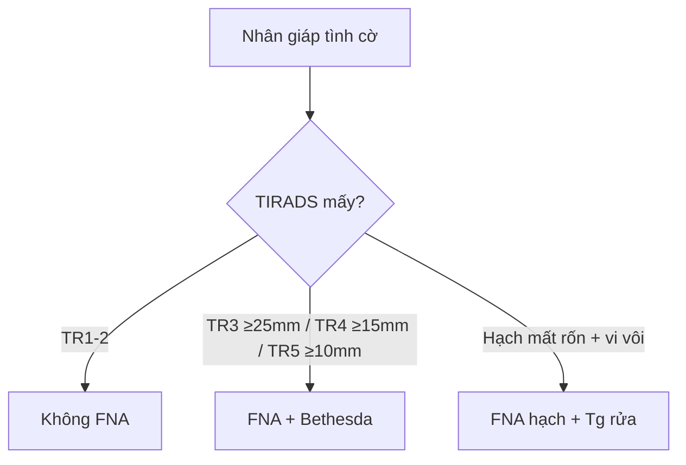

# 230 — Tuyến giáp TI-RADS & hạch cổ I–VII / Thyroid & Neck nodes

**Tags:** `pattern:tuyen-giap-hach-co` `vung:dau-mat-co` `score:TI-RADS`
**Mức chắc chắn (certainty):** tổng hợp y văn (literature synthesis) — nhóm tự biên từ y văn mở, chưa gắn ca nguyên văn đơn lẻ.

## 1. Tổng quan — điểm cộng dồn + ngưỡng chọc hút theo mm

- ACR TI-RADS 2017 chấm 5 nhóm (thành phần, âm, hình dạng, viền, echo sáng): TR1 (0 điểm, lành) → TR5 (≥ 7 điểm, nghi cao) — TẠI SAO taller-than-wide (cao > rộng) nặng 3 điểm: u ác phát triển xuyên mặt phẳng mô, khác nang lành dẹt theo mô.
- Ngưỡng chọc hút tế bào (FNA): TR3 ≥ 25 mm, TR4 ≥ 15 mm, TR5 ≥ 10 mm; theo dõi: TR3 ≥ 15 mm, TR4 ≥ 10 mm, TR5 ≥ 5 mm (hàng năm tới 5 năm).
- Hạch cổ: I (dưới cằm/hàm), II–IV (cảnh trên-giữa-dưới), V (gai sau), VI (trung tâm quanh giáp), VII (trung thất trên) — di căn giáp nhú hay vào VI + II–IV.

## 2. Gamut nhân giáp + hạch cổ (Gamut)

- **Nang đơn thuần + bọt biển (spongiform):** TR1–TR2 — bỏ qua/khám định kỳ.
- **Đặc giảm âm + cao > rộng + vi vôi + bờ đa vòng:** TR5 — FNA khi ≥ 10 mm.
- **Hạch tròn + mất rốn mỡ + vi vôi + nang hóa:** di căn giáp — FNA + thyroglobulin dịch rửa.
- **Hạch hoại tử + lao/HIV:** viêm — cấy + GenXpert, đừng mổ hạch vội.

## 3. Bảng so sánh phân biệt (ma trận đối chiếu)

| Thực thể (entity) | Hình ảnh điển hình | Chốt vào (rule-in) | Chốt loại (rule-out) | Gợi ý xác nhận |
|---|---|---|---|---|
| TR5 ác tính | **Đặc + giảm âm + cao > rộng + vi vôi + bờ xâm lấn (≥ 7 điểm)** | **Vi vôi + cao > rộng + hạch kèm** | Nang/bọt biển → TR1–2 | FNA ≥ 10 mm + Bethesda |
| TR3–TR4 | **Đồng/kém âm + nang lẫn đặc, 3–6 điểm** | **Điểm cộng dồn + ngưỡng mm** | TR5 khi đủ điểm | FNA ≥ 25/15 mm; theo dõi |
| Hạch di căn giáp | **Tròn + mất rốn + vi vôi/nang hóa + tăng sinh mạch** | **Vi vôi + Tg rửa cao** | Rốn mỡ còn + bầu dục → phản ứng | FNA + Tg dịch rửa |
| Hạch viêm/lao | **Hoại tử + viền ngấm + lao phổi** | **Hoại tử + GenXpert (+)** | Vi vôi + Tg cao → di căn | Kháng lao, không mổ |

## 4. Protocol siêu âm + flowchart

- **Siêu âm tuyến giáp + hạch cổ + FNA dưới siêu âm:** đo 3 chiều + điểm TR + Bethesda I–VI (II lành, V–VI mổ).

## 5. Cạm bẫy

- **Nhân nóng (hot) xạ hình** ít ác nhưng vẫn FNA khi TR cao — xạ không thay siêu âm.
- **Mổ hạch lao** tưởng di căn — GenXpert + cấy trước mổ.
- **Bỏ sót hạch VI trung tâm** sau mổ giáp — siêu âm VI + Tg máu theo dõi tái phát.

## 6. Tự lượng giá — Blind Quiz

**Ca 1 — Nhân đặc 12 mm giảm âm + cao > rộng + vi vôi:** TR mấy? FNA không? *(Bảng mục 3.)*

<b>Bấm để hiện đáp án</b>

- **TR5 (≥ 7 điểm) + ≥ 10 mm:** FNA + Bethesda (không theo dõi đơn thuần).

**Ca 2 — Hạch cổ II mất rốn + vi vôi + nhân giáp TR5:** di căn hay viêm? Xét nghiệm nào chốt? *(Bảng mục 3.)*

<b>Bấm để hiện đáp án</b>

- **Di căn giáp nhú:** FNA hạch + thyroglobulin dịch rửa cao.

**Ca 3 — Nang giáp bọt biển 30 mm, không hạch:** TR mấy? Chọc không? *(Bảng mục 3.)*

<b>Bấm để hiện đáp án</b>

- **TR2:** không FNA thường quy (trừ chèn ép/to nhanh thì hút giảm áp).

## Bài liên quan chéo
- [200 – Tổng quan Thần kinh](../200-tong-quan-he-than-kinh/lesson.md)
- [217 – Ngoài trục CPA](../217-ngoai-truc-CPA/lesson.md) (khối nền sọ-cổ)
- [150 – Bosniak & u thận](../150-nang-than-Bosniak/lesson.md) (logic RADS tương tự)

> Không dùng để chẩn đoán độc lập khi chưa có người hướng dẫn.
